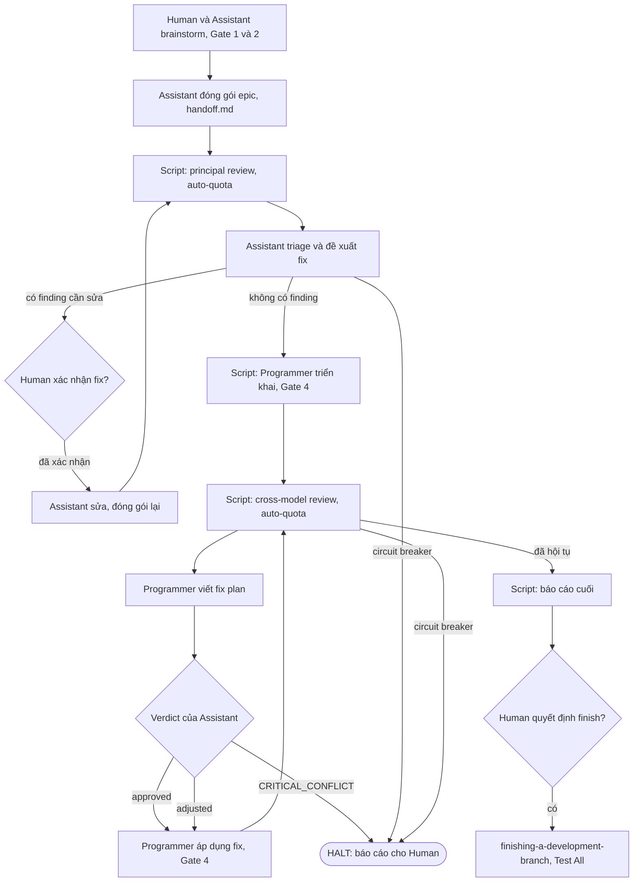

# Thiết kế Autonomous Lifecycle Runner

Thiết kế một script tùy chọn (opt-in) điều khiển `dev-lifecycle` từ handoff tới báo cáo cuối cho Human, với ba tác nhân (Human, AI Assistant, AI Programmer) và dispatch model headless.

## Mục lục

1. [Tóm tắt](#tóm-tắt)
2. [Mục tiêu và phi mục tiêu](#mục-tiêu-và-phi-mục-tiêu)
3. [Tác nhân và model](#tác-nhân-và-model)
4. [Luồng pipeline](#luồng-pipeline)
5. [Điểm dừng chờ Human](#điểm-dừng-chờ-human)
6. [Kiến trúc runner](#kiến-trúc-runner)
7. [Thay đổi quy tắc](#thay-đổi-quy-tắc)
8. [Rủi ro và giảm thiểu](#rủi-ro-và-giảm-thiểu)
9. [Kiểm thử](#kiểm-thử)
10. [Cảnh báo Shared Contract](#cảnh-báo-shared-contract)

## Tóm tắt

Hiện nay lifecycle dừng ở nhiều menu (Handoff Choice, Gate 3, Review Choice) và ở mọi finding review không phải critical. Một script mới, `lifecycle_runner.py`, bỏ các menu này và chạy mỗi stage trong một tiến trình `agy` headless riêng, dùng đúng model và effort mà stage đó cần. Quyết định của Human chỉ được giữ ở những chỗ Human yêu cầu.

## Mục tiêu và phi mục tiêu

Mục tiêu:

- Chạy pipeline từ handoff tới báo cáo cuối mà không dừng ở menu.
- Dispatch Programmer là Gemini 3.8 Flash ở effort high, và Assistant là model mạnh hơn.
- Thêm bước Assistant duyệt fix plan của Programmer sau mỗi round cross-model review.
- Chịu được khởi động lại: toàn bộ trạng thái nằm trong `.devtool/`.

Phi mục tiêu:

- Không đổi interactive mode: runner là tùy chọn qua `/dev-lifecycle --autonomous`.
- Không đổi Gate 1 và Gate 2, giới hạn 3 round, hay ba Circuit Breaker.
- Không tự merge: Human luôn quyết định `/finishing-a-development-branch`.

## Tác nhân và model

| Tác nhân | Vai trò | Nguồn model |
|---|---|---|
| Human (2.1) | Chốt giải pháp, xác nhận fix của Principal Review, quyết định finish | n/a |
| AI Assistant (2.2) | Viết thiết kế, triage finding review, duyệt fix plan | `.devtool/review_config.json` (mục `assistant`) |
| AI Programmer (2.3) | Triển khai task, đề xuất và áp dụng fix | `gemini-3.8-flash`, effort `high` |

Dạng lệnh đã được kiểm chứng trên máy này: `agy --print "<prompt>" --model gemini-3.8-flash --effort high --mode plan` thoát mã 0 và trả lời. Các lần gọi Programmer dùng `--mode auto` để tiến trình sửa được file trong worktree.

## Luồng pipeline

## Điểm dừng chờ Human

1. **Brainstorming và thiết kế (Gate 1 và 2)**: giữ nguyên, Human duyệt spec và phân rã task.
2. **Fix của Principal Review**: AI Assistant tự động áp dụng các sửa đổi thiết kế kỹ thuật đã đồng thuận, commit và đóng gói lại mà không làm gián đoạn con người. Runner chỉ tạm dừng và chuyển sang `AWAITING_PRINCIPAL_CONFIRMATION` khi phát hiện rủi ro nghiêm trọng, xung đột yêu cầu nghiệp vụ, xung đột mã nguồn chưa chốt, hoặc `SHARED_CONTRACT_CONFLICT`. Round chỉ có Minor (`AUTO_PASS_FINAL_MINOR_SWEEP`) được quét và xử lý trong một lượt duy nhất mà không dừng hỏi Con người. Thứ tự ưu tiên mô hình cho Principal Review được cấu hình/chọn tại bước xác nhận phân rã task (Gate 2) qua 4 tùy chọn: (1) `Claude -> Codex -> Kiro -> Argon` [Mặc định], (2) `Codex -> Claude -> Kiro -> Argon`, (3) `Kiro -> Claude -> Codex -> Argon`, (4) `Kiro -> Codex -> Claude -> Argon`.
3. **Fix của cross-model review**: không dừng chờ Human. Programmer đề xuất fix, Assistant duyệt hoặc chỉnh plan, Programmer áp dụng, rồi Gate 4 chạy lại.
4. **Circuit Breaker**: `SHARED_CONTRACT_CONFLICT`, `FIX_LOOP` và `MAX_ROUNDS_CRITICAL_REMAINING` luôn dừng và báo cáo, ở cả hai stage review.
5. **Assistant CRITICAL_CONFLICT**: fix plan làm thay đổi một quyết định đã duyệt thì dừng và báo cáo.
6. **Báo cáo cuối**: sau khi review hội tụ và Gate 4 xanh, runner in executive report rồi dừng. Human chọn `/finishing-a-development-branch`; merge sau đó chạy `Test All`.

## Kiến trúc runner

Script nằm ở `skills/dev-lifecycle/resources/scripts/lifecycle_runner.py`, là một state machine có thể resume.

- **Trạng thái**: `.devtool/state/<epic>.pipeline.json` ghi stage hiện tại, số round, SHA cuối và verdict cuối. Gate Ledger (`.devtool/GATE_LEDGER.md`) vẫn là nơi ghi các lần duyệt.
- **Dispatch**: mỗi bước AI là một subprocess `agy --print <prompt> --model <model> --effort <effort> --mode <mode>`, chạy trong worktree của epic, có timeout và process group riêng.
- **Prompt**: chỉ dựng từ các file trong `.devtool/` (handoff, task file, output triage, review ledger), vì các session headless không chia sẻ ngữ cảnh.
- **Fix plan**: Programmer ghi `.devtool/epic/<epic>/fix_plan_round<N>.md`. Assistant trả lời bằng một dòng verdict: `APPROVED`, `ADJUSTED` (kèm plan đã chỉnh) hoặc `CRITICAL_CONFLICT`.
- **Startup probe**: trước lần dispatch đầu tiên, runner gọi từng model đã cấu hình với prompt một từ và dừng với lỗi rõ ràng nếu model không được chấp nhận.
- **Tái sử dụng script có sẵn**: `package_epic.py`, `run_external_review.py` (`run`, `triage`, `check`), `audit_epic.py`, `compute_execution_order.py`, `resume_context.py`.

## Thay đổi quy tắc

- `rules/CRITICAL_RULES.md` mục 5 (Review Choice bắt buộc): ở chế độ autonomous, runner tự vào cross-model review sau lần Gate 4 PASS đầu tiên và không hiện menu. Interactive mode giữ nguyên.
- `rules/CRITICAL_RULES.md` mục 6: ở chế độ autonomous, finding `Debatable` và `False Positive` trong cross-model review được giải quyết bằng verdict của Assistant, không dừng chờ Human.
- Gate 3 (thứ tự thực thi): ở chế độ autonomous được xác nhận tự động từ output của `compute_execution_order.py`, thứ tự được ghi vào Gate Ledger.
- `skills/dev-lifecycle/SKILL.md`, `skills/dev-implementation/SKILL.md`, `skills/principal-review/SKILL.md`, `skills/cross-model-review/SKILL.md` và `docs/lifecycles.{en,vi}.md` mô tả đường autonomous ngắn gọn và trỏ tới một file reference cho phần chi tiết.

## Rủi ro và giảm thiểu

| Rủi ro | Giảm thiểu |
|---|---|
| Model identifier bị từ chối trên máy hoặc profile khác | Startup probe fail nhanh; model và effort lấy từ cấu hình, không hard-code |
| Assistant duyệt yếu hơn Human duyệt | Assistant chỉ thấy fix plan và thiết kế đã duyệt; Gate 4 chạy lại sau mỗi fix; giữ giới hạn 3 round và Circuit Breaker |
| Programmer headless sửa ngoài phạm vi | Chỉ chạy trong worktree của epic; `Allowed files` từ task file nằm trong prompt; `audit_epic.py` vẫn báo thay đổi protected path |
| Crash làm pipeline dang dở | State file cộng Gate Ledger; runner resume từ stage đã ghi |
| Hết quota giữa chừng | Thứ tự provider `--auto-quota`; provider hết quota bị bỏ qua, nếu không còn provider nào thì runner dừng và báo cáo |

## Kiểm thử

- Unit test dùng một executable `agy` giả, cùng mẫu với `test_run_external_review.py`.
- Các case: mỗi chuyển stage, resume sau crash ở từng stage, từng điều kiện halt, bước dừng-và-xác nhận của Principal Review, parse verdict của fix plan, và lỗi startup probe.
- `scripts/verify.sh` chạy file test mới như một phần của kiểm tra release.

## Cảnh báo Shared Contract

Repository này không có `shared-contracts/`, nên không có cảnh báo contract. Đã xác nhận trạng thái sạch.

