# Autonomous Lifecycle Runner High-Level Design

## Table of Contents

- [Meta Data](#meta-data)
- [Background](#background)
- [Goals and Non-Goals](#goals-and-non-goals)
- [Architecture and Technical Design](#architecture-and-technical-design)
- [Shared Contract Impact](#shared-contract-impact)
- [Integration Test Plan and Boundary Matrix](#integration-test-plan-and-boundary-matrix)
- [Verification Environment](#verification-environment)
- [Comprehensive BDD Scenario Coverage](#comprehensive-bdd-scenario-coverage)
- [Rollout Strategy and Mitigation](#rollout-strategy-and-mitigation)
- [Kanban Tasks Breakdown](#kanban-tasks-breakdown)
- [Spec Errata](#spec-errata)

## Meta Data

- **Epic name**: `autonomous_lifecycle_runner`
- **Status**: In Progress
- **Target release**: Next plugin release
- **Platform**: Python tooling / agent skill kit
- **Depends on epic**: none
- **Source Spec**: [Approved autonomous lifecycle runner design](2026-11-10-autonomous-lifecycle-runner-design.en.md)

## Background

The software development lifecycle in `dev-lifecycle` currently requires interactive manual intervention at multiple decision gates:
1. Stage 2 handoff menu (Handoff Choice prompt to run Principal Review or proceed directly).
2. Stage 3 entry menu (Gate 3 execution order confirmation).
3. Stage 3 post-implementation menu (Review Choice prompt to Finish, Cross-model review, or Local model review).
4. Review finding triage (stopping to confirm proposed actions even when findings are minor or non-critical).

To enable fully autonomous end-to-end epic development while maintaining strict architectural governance, a unified state machine orchestrator (`lifecycle_runner.py`) is introduced. This runner orchestrates three distinct personas:
- **Human Architect (Role 2.1)**: Guides initial brainstorming, approves Gate 1 & Gate 2, reviews proposed Principal Review fixes, and makes the final Gate 5 completion decision.
- **AI Assistant (Role 2.2)**: Triages review findings, formulates proposed fixes during Principal Review, and evaluates/approves the AI Programmer's fix plans during Cross-Model Review.
- **AI Programmer (Role 2.3)**: Headless developer dispatched via `agy --model gemini-3.8-flash --effort high --mode auto`, implementing code tasks in isolated worktrees, running quality checks, and drafting fix plans.

Autonomous execution eliminates unnecessary menu pauses while preserving absolute circuit breaker halts on architectural conflicts (`SHARED_CONTRACT_CONFLICT`, `FIX_LOOP`, `MAX_ROUNDS_CRITICAL_REMAINING`).

## Goals and Non-Goals

### Goals

- Deliver a headless, resumable orchestrator CLI `skills/dev-lifecycle/resources/scripts/lifecycle_runner.py` capable of driving an epic through Stage 2 review, Stage 3 implementation, and Stage 3 cross-model review.
- Dispatch the AI Programmer using headless `agy --model gemini-3.8-flash --effort high --mode auto` in an isolated git worktree with process group supervision and timeout fencing.
- Implement automated Gate 3 task execution order calculation via `compute_execution_order.py`.
- Enforce Principal Review auto-triage: AI Assistant auto-applies aligned design revisions, halting for Human confirmation only on high-risk critical issues, business/domain requirement conflicts, or `SHARED_CONTRACT_CONFLICT`.
- Implement an automated fix-and-verify loop for Cross-Model Review: AI Programmer drafts a fix plan, AI Assistant evaluates and approves/adjusts it, AI Programmer applies fixes, and Gate 4 re-verifies automatically without stopping for Human.
- Maintain persistent state in `.devtool/state/<epic>.pipeline.json` synchronized with `.devtool/GATE_LEDGER.md` for instant crash recovery.
- Keep interactive mode 100% backward-compatible (`/dev-lifecycle --autonomous` or direct runner execution is strictly opt-in).

### Non-Goals

- Modifying the interactive lifecycle path or changing how developers interact with manual prompts when `--autonomous` is omitted.
- Bypassing Human approval at Gate 1 (spec approval), Gate 2 (task breakdown confirmation), or Gate 5 (final finish & merge decision).
- Auto-pushing code to remote repositories or auto-merging feature branches into base branches without explicit developer trigger.
- Increasing the 3-round review convergence cap or relaxing the three mandatory Circuit Breakers.

## Architecture and Technical Design

### High-Level Architecture

```mermaid
flowchart TD
    subgraph CLI["CLI & Runner Entry Point"]
        RUNNER["lifecycle_runner.py<br/>(Resumable State Machine)"]
        PROBE["Startup Model Probe<br/>(agy probe gemini-3.8-flash & assistant)"]
        CONF[".devtool/review_config.json"]
    end

    subgraph STATE["Persistence & Recovery"]
        PIPE_STATE[".devtool/state/<epic>.pipeline.json"]
        GATE_LEDGER[".devtool/GATE_LEDGER.md"]
        PROJ_LEDGER[".devtool/PROJECT_LEDGER.md"]
    end

    subgraph STAGE2["Stage 2: Principal Review Automation"]
        PR_RUN["run_external_review.py run --kind principal --epic-dir <dir> --base <base> --auto-quota"]
        PR_TRIAGE["Assistant Auto-Triage & Fix Proposals<br/>(triage --kind principal)"]
        PR_HUMAN{"Human Checkpoint:<br/>Confirm Fixes?"}
        PR_REVISE["Assistant Revises & Repackages Epic<br/>(package_epic.py --revise)"]
    end

    subgraph STAGE3["Stage 3: Headless Implementation"]
        ORDER["compute_execution_order.py<br/>(Auto Gate 3 Order Confirmation via resume_context)"]
        DISPATCH["Headless Dispatcher<br/>(agy stdin --model <model> --effort high --mode auto)"]
        GATE4["Phase 4 / Gate 4 Local Quality Gate"]
    end

    subgraph CMR["Stage 3: Cross-Model Review Loop"]
        CMR_RUN["run_external_review.py run --kind code --epic-dir <dir> --base <base> --auto-quota"]
        PROG_PLAN["Programmer Drafts Fix Plan<br/>(fix_plan_roundN.md)"]
        ASST_EVAL{"Assistant Evaluation:<br/>APPROVED / ADJUSTED / CONFLICT"}
        PROG_FIX["Programmer Applies Fixes & Gate 4"]
    end

    subgraph CB["Circuit Breakers (Immediate Stop & Alert)"]
        HALT_SCC["HALT: SHARED_CONTRACT_CONFLICT"]
        HALT_FL["HALT: FIX_LOOP"]
        HALT_MR["HALT: MAX_ROUNDS_CRITICAL_REMAINING"]
        HALT_CC["HALT: Assistant CRITICAL_CONFLICT"]
    end

    subgraph FINAL["Stage 4: Developer Review & Finish"]
        REPORT["Final Executive Report Display"]
        HUMAN_FINISH{"Human Decides:<br/>/finishing-a-development-branch"}
        FINISH_BRANCH["Integrate Branch & Full Test All"]
    end

    CONF --> PROBE --> RUNNER
    RUNNER <--> PIPE_STATE
    RUNNER <--> GATE_LEDGER

    RUNNER --> PR_RUN
    PR_RUN --> PR_TRIAGE
    PR_TRIAGE -->|Findings to Fix| PR_HUMAN
    PR_TRIAGE -->|0 Findings| ORDER
    PR_HUMAN -->|Confirmed| PR_REVISE --> PR_RUN

    ORDER --> DISPATCH --> GATE4
    GATE4 -->|PASS| CMR_RUN
    CMR_RUN -->|Findings Exist| PROG_PLAN
    PROG_PLAN --> ASST_EVAL
    ASST_EVAL -->|APPROVED / ADJUSTED| PROG_FIX --> GATE4
    CMR_RUN -->|Converged (0 Blocker)| REPORT

    REPORT --> HUMAN_FINISH
    HUMAN_FINISH -->|Finish| FINISH_BRANCH

    PR_TRIAGE -.->|Contract Drift| HALT_SCC
    CMR_RUN -.->|Contract Drift| HALT_SCC
    CMR_RUN -.->|Re-reported in Fix| HALT_FL
    CMR_RUN -.->|Round >= 3 Critical| HALT_MR
    ASST_EVAL -.->|Design Violation| HALT_CC
```

### Sequence Diagram

```mermaid
sequenceDiagram
    autonumber
    actor Human as Human Architect (Role 2.1)
    participant Runner as lifecycle_runner.py
    participant Reviewer as External Reviewer (Claude/Codex/Kiro)
    participant Assistant as AI Assistant (Role 2.2)
    participant Programmer as AI Programmer (Role 2.3 Gemini 3.8)

    Note over Human,Assistant: Gate 1 & Gate 2 Approved
    Human->>Runner: /dev-lifecycle --autonomous
    Runner->>Runner: probe_models() [verify agy & models]
    Runner->>Runner: record_state(stage="principal_review")

    rect rgb(240, 248, 255)
    Note over Runner,Assistant: Stage 2: Principal Review Automation
    loop Principal Review (Max 3 Rounds)
        Runner->>Reviewer: run_external_review.py run --kind principal --epic-dir <dir> --base <base> --auto-quota
        Reviewer-->>Runner: Review findings recorded in principal_review.md
        Runner->>Assistant: Triage findings (run_external_review.py triage --kind principal)
        alt AUTO_PASS_CLEAN (0 findings)
            Runner->>Runner: Direct advance to Stage 3 Implementation
        else AUTO_PASS_FINAL_MINOR_SWEEP (0 Critical/Important, only Minor)
            Runner->>Assistant: Sweep minor fixes in single pass
            Assistant-->>Runner: Minor fixes applied & committed
            Runner->>Runner: Record decisions & run package_epic.py --revise
            Runner->>Runner: Advance to Stage 3 without extra review round
        else AUTO_FIX_ELIGIBLE (Rounds 1-2 with valid fixes)
            alt High-risk, business conflict, or shared-contracts conflict
                Runner->>Runner: Save state (AWAITING_PRINCIPAL_CONFIRMATION) & write proposal file
                Runner->>Human: Present proposed fixes & prompt confirmation (--confirm-fixes / --reject-fixes)
                Human-->>Runner: Confirm fix proposal
            else Aligned / established fixes
                Runner->>Assistant: Auto-apply aligned revisions
            end
            Assistant-->>Runner: Revisions applied & committed
            Runner->>Runner: Record decisions (fixed in <sha>) & commit
            Runner->>Runner: package_epic.py <dir> --revise & commit
            Runner->>Runner: Advance to next review round
        else AUTO_PASS_FINAL_SWEEP (Round 3, 0 Critical, only Important/Minor)
            Runner->>Assistant: Final fix pass anchored to approved design
            Assistant-->>Runner: Fixes applied & committed
            Runner->>Runner: Record decisions & package_epic.py --revise
            Runner->>Runner: Advance to Stage 3 without 4th round
        else CIRCUIT_BREAKER_HALT (SHARED_CONTRACT_CONFLICT / FIX_LOOP / MAX_ROUNDS_CRITICAL_REMAINING)
            Runner->>Human: Immediate HALT: Display executive warning & halt pipeline
        end
    end
    end

    rect rgb(245, 255, 250)
    Note over Runner,Programmer: Stage 3: Autonomous Implementation
    Runner->>Runner: resolve_gate3_order() -> resume_context.py --gate 3
    loop For each task in execution order
        Runner->>Programmer: agy stdin --model <model> --effort high --mode auto (Task N)
        Programmer-->>Runner: Code edits, unit tests, task evidence
        Runner->>Runner: Commit task implementation (clean git tree)
        Runner->>Runner: Sync task status to done
    end
    Runner->>Runner: run_gate4() in full (deterministic local check)
    end

    rect rgb(255, 250, 240)
    Note over Runner,Assistant: Stage 3: Cross-Model Review Loop
    loop Cross-Model Review (Max 3 Rounds)
        Runner->>Reviewer: run_external_review.py run --kind code --epic-dir <dir> --base <base> --auto-quota
        Reviewer-->>Runner: Findings recorded in review_results.md
        alt AUTO_PASS_CLEAN (0 findings)
            Runner->>Runner: Break loop -> Advance to Final Report
        else Final sweep (AUTO_PASS_FINAL_MINOR_SWEEP or AUTO_PASS_FINAL_SWEEP)
            Runner->>Programmer: Draft final sweep fix plan (fix_plan_roundN.md)
            Programmer-->>Runner: fix_plan_roundN.md written
            Runner->>Assistant: Review fix plan against approved HLD
            Assistant-->>Runner: Verdict (APPROVED / ADJUSTED / CRITICAL_CONFLICT)
            alt CRITICAL_CONFLICT
                Runner->>Human: HALT: Report design conflict
            else APPROVED or ADJUSTED
                Runner->>Programmer: Apply approved final sweep fixes
                Programmer-->>Runner: Code fixes applied
                Runner->>Runner: Commit code fixes (git commit)
                Runner->>Runner: Record decisions in review_results.md (fixed in <sha>)
                Runner->>Runner: Commit decisions (clean git tree)
                Runner->>Runner: run_gate4() in full (verifies clean certified SHA)
                Runner->>Runner: Break loop -> Advance to Final Report
            end
        else Blockers exist (AUTO_FIX_ELIGIBLE)
            Runner->>Programmer: Draft fix plan (fix_plan_roundN.md)
            Programmer-->>Runner: fix_plan_roundN.md written
            Runner->>Assistant: Review fix plan against approved HLD
            Assistant-->>Runner: Verdict (APPROVED / ADJUSTED / CRITICAL_CONFLICT)
            alt CRITICAL_CONFLICT
                Runner->>Human: HALT: Report design conflict
            else APPROVED or ADJUSTED
                Runner->>Programmer: Apply approved fix plan
                Programmer-->>Runner: Code fixes applied
                Runner->>Runner: Commit code fixes (git commit)
                Runner->>Runner: Record decisions in review_results.md (fixed in <sha>)
                Runner->>Runner: Commit decisions (clean git tree)
                Runner->>Runner: run_gate4() in full (verifies clean certified SHA)
            end
        end
    end
    end

    Runner->>Human: Output Final Executive Report
    Human->>Runner: Trigger /finishing-a-development-branch
```



### Feature Maintenance Map ("Prompt to Maintain" Index)

| Capability | Canonical Source Paths & Entry Points | Core Invariants & State/Config Knobs | Extension & Troubleshooting Guide |
|---|---|---|---|
| **State Machine Runner** | `skills/dev-lifecycle/resources/scripts/lifecycle_runner.py` | State file `.devtool/state/<epic>.pipeline.json` must be updated atomically using `.tmp` rename. State schema adheres to `PipelineState` dataclass. | Inspect state file to see active stage, round, and last SHA. Use `--resume` or `--reset-stage <stage>` to recover from failed states. |
| **Model Prober & Dispatcher** | `lifecycle_runner.py::ModelDispatcher` | Headless execution pipes prompts via stdin to `agy --model <model> --effort <effort> --mode <mode>`. Process group isolation via `start_new_session=True` (`pgid = p.pid`) with SIGTERM, 1s grace, and SIGKILL escalation. | If a model is deprecated or renamed, check `.devtool/review_config.json` or fallback defaults. Startup probe fails fast before any file mutations. |
| **Principal Review Checkpoint** | `lifecycle_runner.py::step_principal_review` | Automatically processes aligned/agreed fixes. Halts and transitions to `AWAITING_PRINCIPAL_CONFIRMATION` only when high-risk critical issues, business/domain requirement conflicts, unaligned source conflicts, or `SHARED_CONTRACT_CONFLICT` occur. Minor-only rounds complete via `AUTO_PASS_FINAL_MINOR_SWEEP` without extra review round. | Check `principal_review.md` and triage output. Confirming allows Assistant to run `package_epic.py --revise`. Supports `--resume --confirm-fixes` / `--reject-fixes`. |
| **Gate 3 Auto-Order** | `lifecycle_runner.py::resolve_gate3_order` | Execution order must strictly follow topological sort from `compute_execution_order.py`. Gate 3 entry recorded in Gate Ledger via `resume_context.py --gate 3`. | If dependency cycles exist, `compute_execution_order.py` fails with clear error; runner halts and requests human resolution. |
| **Cross-Model Fix Loop** | `lifecycle_runner.py::step_cross_model_review` | Programmer drafts `.devtool/epic/<epic>/fix_plan_round<N>.md`. Assistant answers with `APPROVED`, `ADJUSTED`, or `CRITICAL_CONFLICT`. Gate 4 re-runs after every fix round. Intermediate rounds do not pause for Human. | Review `fix_plan_round<N>.md` to inspect proposed fixes. Assistant verdict is recorded in `.devtool/state/<epic>.pipeline.json`. |
| **Commit Sequencing & Tree Hygiene** | `lifecycle_runner.py::run` | `git status --porcelain` must be clean before invoking any review pass. The runner commits fix plans, code fixes, and review decisions in sequence. | Prevents `run_external_review.py` from refusing runs on dirty tree. |
| **Multi-Round Executive Report & Stop** | `lifecycle_runner.py::render_final_executive_report` | Rendered only at the final round when review converged and Gate 4 passes. Synthesizes Top 3 Highest-Risk Findings across all review rounds. Halts and prompts Human for merge or other actions. | Aggregates all rounds from `review_results.md`. Displays findings, fix commits, and Gate 4 certified SHA before prompting `/finishing-a-development-branch`. |
| **Circuit Breakers** | `lifecycle_runner.py::evaluate_circuit_breakers` | Halts immediately without retry on: `SHARED_CONTRACT_CONFLICT`, `FIX_LOOP`, `MAX_ROUNDS_CRITICAL_REMAINING`, or Assistant `CRITICAL_CONFLICT`. | Check console banner for error reason and remediation instructions. Resuming requires resolving the conflict and running with `--resume`. |

### Module Contracts

These signatures and structures are frozen for implementation in `skills/dev-lifecycle/resources/scripts/lifecycle_runner.py`:

```python
from dataclasses import dataclass, field
from enum import Enum
from pathlib import Path
from typing import Any, Dict, List, Optional, Tuple

class StageName(str, Enum):
    INITIALIZED = "initialized"
    PRINCIPAL_REVIEW = "principal_review"
    AWAITING_PRINCIPAL_CONFIRMATION = "awaiting_principal_confirmation"
    IMPLEMENTATION = "implementation"
    CROSS_MODEL_REVIEW = "cross_model_review"
    AWAITING_FINISH = "awaiting_finish"
    COMPLETED = "completed"
    HALTED = "halted"

class FixPlanVerdict(str, Enum):
    APPROVED = "APPROVED"
    ADJUSTED = "ADJUSTED"
    CRITICAL_CONFLICT = "CRITICAL_CONFLICT"

@dataclass
class RunnerConfig:
    programmer_model: str = "gemini-3.8-flash"
    programmer_effort: str = "high"
    assistant_model: Optional[str] = None  # Precedence: CLI --assistant-model -> .devtool/review_config.json providers.assistant.model -> active profile model -> fallback claude-sonnet-5-5-high
    assistant_effort: str = "high"
    timeout_seconds: int = 1800
    max_review_rounds: int = 3

@dataclass
class PipelineState:
    epic_slug: str
    active_stage: StageName
    principal_round: int = 0
    cross_model_round: int = 0
    last_commit_sha: str = ""
    last_verdict: str = ""
    halt_reason: Optional[str] = None
    last_error: Optional[str] = None
    task_order: List[str] = field(default_factory=list)
    completed_tasks: List[str] = field(default_factory=list)

    def to_dict(self) -> Dict[str, Any]: ...
    @classmethod
    def from_dict(cls, data: Dict[str, Any]) -> "PipelineState": ...

class ModelDispatcher:
    def __init__(self, config: RunnerConfig): ...
    def probe_model(self, model: str) -> bool: ...
    def dispatch(
        self,
        prompt: str,
        model: str,
        effort: str,
        mode: str,
        worktree_root: Path,
        timeout: Optional[int] = None,
    ) -> Tuple[int, str, str]: ...

class LifecycleRunner:
    def __init__(self, root: Path, epic_slug: str, config: Optional[RunnerConfig] = None): ...
    def load_or_init_state(self) -> PipelineState: ...
    def save_state(self) -> None: ...
    def run(self, resume: bool = False) -> int: ...
    def resolve_gate3_order(self) -> List[str]: ...
    def step_principal_review(self) -> bool: ...
    def step_implementation(self) -> bool: ...
    def run_gate4(self) -> Tuple[bool, str]: ...
    def step_cross_model_review(self) -> bool: ...
    def evaluate_circuit_breakers(self, stage: str, round_num: int) -> Optional[str]: ...
    def prompt_human_principal_fixes(self, triage_summary: str) -> bool: ...
    def evaluate_programmer_fix_plan(self, round_num: int) -> Tuple[FixPlanVerdict, str]: ...
    def render_final_executive_report(self) -> str: ...
```

#### Method Execution Contracts and Task Ownership

- **`step_implementation(self) -> bool`** (Owned by Task 2):
  - Execution contract: loops over `self.state.task_order` sequentially. For each task:
    1. Checks if already present in `self.state.completed_tasks`. If so, skips.
    2. Gating and evidence verification: dispatches Programmer subprocess with task prompt via stdin (`skills/dev-implementation/SKILL.md:229–240`).
    3. Verifies task evidence and status updated to `done`.
    4. Commits task changes cleanly (`git commit -m "[<EPIC>] Execute <task_slug>"`).
    5. Appends task to `self.state.completed_tasks` and saves state atomically (`ALR-ST-01`).
    6. Returns `True` if all tasks succeed; on subprocess failure or timeout, logs error, preserves state, and returns `False`.
- **`run_gate4(self) -> Tuple[bool, str]`** (Owned by Task 5):
  - Execution contract: executes the full Stage 3 Gate 4 verification sequence on the candidate SHA (`skills/dev-implementation/SKILL.md:321–356`):
    1. Generates and commits smoke checklist (`skills/dev-implementation/resources/scripts/generate_smoke_checklist.py --epic-dir <epic>`).
    2. Runs finding decision check (`run_external_review.py check --epic-dir <epic> --kind code`).
    3. Runs codebase and security audit checks (`audit_epic.py --epic-dir <epic> --base <base>`).
    4. Runs declared integration commands and test suite (`run_unittest_junit.py`).
    5. Runs result-based BDD traceability (`check_bdd_traceability.py tests --scenarios .devtool/epic/<epic>/bdd_scenarios.en.md --roots <roots> --results <reports>`, dynamically deriving test roots and report paths from the selected epic's HLD Integration Test Plan).
    6. Runs complete headless `quality_check` workflow with profile `epic`, base reference, candidate SHA, provider execution, and contract reconciliation, requiring an aggregated verdict of PASS bound to that candidate SHA (`skills/dev-implementation/SKILL.md:349–356`).
    7. Verifies all results trace cleanly to candidate commit SHA.
    8. Returns `(True, "Gate 4 PASS: <candidate_sha>")` if all checks pass; otherwise `(False, "<failure_reason>")`.

### Impact Analysis

Impact analysis executed via `check_code_impact.py` against `main`:
- Upstream Git Conflict Analysis: 🟢 **CLEAN** (Zero unmerged commits against `main`).
- Downstream Callers & Blast Radius: `lifecycle_runner.py` is a new standalone entry point. Consumers will be `dev-lifecycle` slash command and CLI invocations.
- No cross-platform or native bridge contracts are touched.

## Shared Contract Impact

None — self-contained feature.

## Integration Test Plan and Boundary Matrix

Integration test roots: tests/, skills/dev-lifecycle/resources/scripts/

Protected paths: .agents/quality/**, .devtool/epic/autonomous_lifecycle_runner/bdd_scenarios.en.md, .devtool/epic/autonomous_lifecycle_runner/bdd_scenarios.vi.md, tests/test_lifecycle_runner.py

Integration results: python3 scripts/run_unittest_junit.py --junitxml build/test-results/autonomous-lifecycle-runner.xml tests/test_lifecycle_runner.py -> build/test-results/autonomous-lifecycle-runner.xml

| Boundary | Real components | Isolation or fixture | Required assertions |
|---|---|---|---|
| **Model Prober** | `ModelDispatcher.probe_model` | Fake `agy` script on `PATH` simulating valid and invalid exit codes | Exits 0 on recognized model; returns clear error and halts pipeline when model rejected. |
| **Subprocess Group Supervision** | `ModelDispatcher.dispatch` | Fake long-running script | Process executes in isolated process group (`start_new_session=True`); SIGTERM delivered cleanly on timeout. |
| **State Persistence & Resumption** | `LifecycleRunner.save_state`, `load_or_init_state` | Temporary filesystem with mock `.devtool/state` | Atomic `.tmp` rename prevents file corruption; runner resumes exactly from saved stage. |
| **Gate 3 Auto-Order** | `LifecycleRunner.step_implementation` | Mock `compute_execution_order.py` | Order parsed from JSON/text output and written to `.devtool/GATE_LEDGER.md`. |
| **Principal Review Auto-Triage** | `step_principal_review` | Mock stdin/stdout prompt wrapper | Auto-applies aligned fixes; halts and prompts human only on critical, domain, or contract conflicts. |
| **Cross-Model Fix Plan Evaluation** | `evaluate_programmer_fix_plan` | Mock Assistant dispatcher returning `APPROVED`, `ADJUSTED`, `CRITICAL_CONFLICT` | Handles all 3 verdicts correctly; triggers Programmer fix execution or halts pipeline. |
| **Circuit Breakers** | `evaluate_circuit_breakers` | Synthetic `review_results.md` fixtures | Immediate halt on `SHARED_CONTRACT_CONFLICT`, `FIX_LOOP`, and `MAX_ROUNDS_CRITICAL_REMAINING`. |
| **Final Executive Report** | `LifecycleRunner.run` | Completed pipeline state | Renders markdown executive report and stops with prompt for `/finishing-a-development-branch`. |

## Verification Environment

- All unit and integration tests run in isolated temporary directories (`tempfile.TemporaryDirectory`).
- Tests simulate the `agy` CLI using executable fake scripts or `unittest.mock.patch`, requiring zero external API keys or remote network calls.
- Process timeouts and termination are tested with short intervals (< 2.0s).
- JUnit XML reports are written to `build/test-results/autonomous-lifecycle-runner.xml`.

## Comprehensive BDD Scenario Coverage

The canonical Gherkin definitions are in [BDD scenarios](bdd_scenarios.en.md), with the synchronized [Vietnamese translation](bdd_scenarios.vi.md).

| Dimension | Scenario IDs | Coverage intent |
|---|---|---|
| **Happy Paths** | `ALR-HP-01` through `ALR-HP-04` | Full autonomous pipeline run, headless Programmer Gemini 3.8 dispatch, Principal Review human confirmation, Assistant fix plan approval. |
| **Edge Cases and Boundaries** | `ALR-EC-01` through `ALR-EC-04` | 0 findings in Principal Review bypasses prompt, minor-only findings batched, Assistant adjusts fix plan, Gate 3 order auto-confirmed. |
| **State Transitions and Invariants** | `ALR-ST-01` through `ALR-ST-03` | State persistence across crash, Gate Ledger synchronization, model capability probe. |
| **Async and Concurrency** | `ALR-AR-01` through `ALR-AR-02` | Process group isolation and SIGTERM timeout fencing, atomic state file locking. |
| **Failure and Resilience** | `ALR-FR-01` through `ALR-FR-04` | Halt on shared contract conflict, halt on fix loop, halt on max rounds critical, halt on Assistant CRITICAL_CONFLICT. |

## Rollout Strategy and Mitigation

1. Implement core state machine, models, and persistence in `skills/dev-lifecycle/resources/scripts/lifecycle_runner.py` with comprehensive unit tests.
2. Implement headless `agy` dispatcher with process group fencing and model probing.
3. Integrate Stage 2 Principal Review automation with Human fix confirmation checkpoint.
4. Integrate Stage 3 Cross-Model Review fix plan evaluation loop.
5. Update `rules/CRITICAL_RULES.md`, `skills/dev-lifecycle/SKILL.md`, `skills/dev-implementation/SKILL.md`, and documentation to specify autonomous mode behavior.
6. Verify full test suite using `scripts/run_unittest_junit.py` and `scripts/verify.sh`.

Mitigation: Autonomous mode is strictly opt-in via `/dev-lifecycle --autonomous` or direct invocation of `lifecycle_runner.py`. Interactive lifecycle behavior remains completely intact and default.

## Kanban Tasks Breakdown

1. [Task 1: Pipeline State Machine, Persistence, and Model Probing](task_1_pipeline_state_machine_and_probing.md)
2. [Task 2: Subprocess Dispatcher and Headless agy Runner](task_2_subprocess_dispatcher_and_headless_agy.md)
3. [Task 3: Principal Review Automation and Human Checkpoint](task_3_principal_review_automation_and_checkpoint.md)
4. [Task 4: Cross-Model Review Fix Plan Loop and Assistant Evaluator](task_4_cross_model_review_fix_plan_loop.md)
5. [Task 5: End-to-End Orchestrator, CLI Integration, and Governance Rules](task_5_orchestrator_cli_and_governance_rules.md)

## Spec Errata

- **[SE-01] Principal Review Round 1 Alignment**: Aligned external review CLI flags (`--kind principal` / `--kind code` with required `--base`), integrated `run_external_review.py triage` action parsing, made Assistant model dynamically inherit the developer's selected model (Argon/Claude/Codex/etc) with Gemini 3.8 Flash default for Programmer, added `AWAITING_PRINCIPAL_CONFIRMATION` state with proposal file and non-blocking CLI flags (`--confirm-fixes`/`--reject-fixes`), established commit sequencing for clean git tree, and aligned method signatures across HLD and tasks.
- **[SE-02] Principal Review Round 2 Delta Alignment**: Formalized Auto-Triage Gate stage transitions (auto-application of agreed fixes in Principal Review, single-pass minor sweeps for AUTO_PASS_FINAL_MINOR_SWEEP and AUTO_PASS_FINAL_SWEEP without redundant review rounds), corrected Gate 4 commit and decision recording sequence (code fix commit -> decision recording -> decision commit -> Gate 4 run), added run_gate4() and step_implementation contract definitions, aligned ModelDispatcher to stdin pipes and process group supervision, and updated test verification commands to isolated runner scopes.
- **[SE-03] Principal Review Round 3 Convergence Alignment**: Aligned Principal Review auto-triage policy across spec, HLD, BDD, and tasks (auto-applying aligned technical fixes without interrupting the developer, halting only on high-risk critical issues, business/domain requirement conflicts, or SHARED_CONTRACT_CONFLICT); synchronized 4 selectable model priority options at Gate 2 task confirmation with default `Claude -> Codex -> Kiro -> Argon`; updated Cross-Model Review sequence diagram to route both final sweep actions through code fix commit, decision recording, decision commit, and full Gate 4 before reporting; mapped BDD scenarios ALR-ST-01 to Task 2, ALR-ST-02 to Task 5, and ALR-ST-03 to Task 1 with 100% traceability.
- **[SE-04] Principal Review Round 3 Findings Alignment**: Synchronized run_gate4() execution contract with skills/dev-implementation/SKILL.md:321–356 (smoke checklist, review decision check, audit, result-based traceability via check_bdd_traceability.py tests --scenarios ... --roots ... --results ..., and aggregated quality check requiring PASS); updated task verification rows V4/V5 across all tasks to explicitly target skills/dev-lifecycle/resources/scripts/lifecycle_runner.py and added --ignore SIM117 so linting passes cleanly while matching registered capabilities; assigned review model priority configuration and dispatch to Task 1 with run_external_review.py and its test suite added to Allowed files; routed Cross-Model Review final sweeps through Programmer fix plan drafting and Assistant evaluation before code modification; and clarified that Gate 5 candidate readiness is stored in pipeline state (awaiting_finish) without auto-executing resume_context.py --gate 5.
- **[SE-05] Principal Review Round 4 Findings Alignment**: Synchronized run_gate4() execution contract with skills/dev-implementation/SKILL.md:342–356 by requiring complete headless quality_check workflow execution (profile epic, base ref, candidate SHA, provider execution, and contract reconciliation requiring aggregated PASS) and dynamically deriving integration test roots and result report paths from the target epic's HLD Integration Test Plan instead of hardcoding static paths.

