# Thiết kế tổng thể Runner Vòng đời Tự động (Autonomous Lifecycle Runner)

## Mục lục

- [Siêu dữ liệu](#siêu-dữ-liệu)
- [Bối cảnh](#bối-cảnh)
- [Mục tiêu và Phi mục tiêu](#mục-tiêu-và-phi-mục-tiêu)
- [Kiến trúc và Thiết kế Kỹ thuật](#kiến-trúc-và-thiết-kế-kỹ-thuật)
- [Cảnh báo Shared Contract](#cảnh-báo-shared-contract)
- [Kế hoạch Kiểm thử Tích hợp và Ma trận Biên](#kế-hoạch-kiểm-thử-tích-hợp-và-ma-trận-biên)
- [Môi trường Kiểm thử](#môi-trường-kiểm-thử)
- [Độ bao phủ Kịch bản BDD Toàn diện](#độ-bao-phủ-kịch-bản-bdd-toàn-diện)
- [Chiến lược Phát hành và Giảm thiểu Rủi ro](#chiến-lược-phát-hành-và-giảm-thiểu-rủi-ro)
- [Phân rã Công việc Kanban](#phân-rã-công-việc-kanban)
- [Đính chính Đặc tả (Spec Errata)](#đính-chính-đặc-tả-spec-errata)

## Siêu dữ liệu

- **Tên Epic**: `autonomous_lifecycle_runner`
- **Trạng thái**: Đã đóng gói (2026-11-10)
- **Bản phát hành mục tiêu**: Bản phát hành plugin tiếp theo
- **Nền tảng**: Bộ công cụ Python / agent skill kit
- **Phụ thuộc vào epic**: không
- **Đặc tả nguồn**: [Thiết kế runner vòng đời tự động đã duyệt](2026-11-10-autonomous-lifecycle-runner-design.vi.md)

## Bối cảnh

Vòng đời phát triển phần mềm trong `dev-lifecycle` hiện tại yêu cầu can thiệp thủ công có tính tương tác tại nhiều cổng quyết định:
1. Menu bàn giao Giai đoạn 2 (prompt Handoff Choice hỏi chạy Principal Review hay tiếp tục trực tiếp).
2. Menu vào Giai đoạn 3 (xác nhận thứ tự thực thi Gate 3).
3. Menu sau triển khai Giai đoạn 3 (prompt Review Choice để Hoàn thành, Cross-model review, hoặc Local model review).
4. Phân loại (triage) phát hiện review (dừng lại xác nhận các hành động đề xuất ngay cả khi các phát hiện là thứ yếu hoặc không nghiêm trọng).

Để hỗ trợ phát triển epic tự động hóa đầu-cuối hoàn toàn trong khi vẫn giữ vững kỷ luật quản trị kiến trúc nghiêm ngặt, một bộ điều phối máy trạng thái hợp nhất (`lifecycle_runner.py`) được giới thiệu. Runner này điều phối ba tác nhân riêng biệt:
- **Human Architect (Vai trò 2.1)**: Định hướng brainstorming ban đầu, phê duyệt Gate 1 & Gate 2, rà soát các đề xuất sửa chữa của Principal Review, và đưa ra quyết định hoàn thành Gate 5 cuối cùng.
- **AI Assistant (Vai trò 2.2)**: Phân loại phát hiện review, xây dựng danh sách đề xuất sửa chữa trong Principal Review, và đánh giá/phê duyệt kế hoạch sửa lỗi của AI Programmer trong Cross-Model Review.
- **AI Programmer (Vai trò 2.3)**: Lập trình viên chạy headless được điều phối qua `agy --model gemini-3.8-flash --effort high --mode auto`, triển khai các task code trong worktree biệt lập, chạy quality check, và soạn thảo kế hoạch sửa lỗi.

Tiến trình tự động hóa loại bỏ các bước dừng menu không cần thiết nhưng bảo toàn tuyệt đối việc dừng khẩn cấp (circuit breaker) trước các xung đột kiến trúc (`SHARED_CONTRACT_CONFLICT`, `FIX_LOOP`, `MAX_ROUNDS_CRITICAL_REMAINING`).

## Mục tiêu và Phi mục tiêu

### Mục tiêu

- Cung cấp CLI điều phối máy trạng thái chạy headless, có khả năng phục hồi sau sự cố tại `skills/dev-lifecycle/resources/scripts/lifecycle_runner.py`, dẫn dắt epic qua review Giai đoạn 2, triển khai Giai đoạn 3, và cross-model review Giai đoạn 3.
- Điều phối AI Programmer sử dụng lệnh headless `agy --model gemini-3.8-flash --effort high --mode auto` trong worktree git biệt lập với giám sát nhóm tiến trình và giới hạn timeout.
- Tự động hóa việc tính toán thứ tự thực thi task ở Gate 3 thông qua `compute_execution_order.py`.
- Thực thi phân loại tự động Principal Review: AI Assistant tự động áp dụng các sửa đổi thiết kế đã đồng thuận, và chỉ tạm dừng hỏi Con người khi phát hiện rủi ro nghiêm trọng, xung đột nghiệp vụ, hoặc `SHARED_CONTRACT_CONFLICT`.
- Hiện thực hóa vòng lặp sửa lỗi và kiểm chứng tự động cho Cross-Model Review: AI Programmer lập kế hoạch sửa lỗi, AI Assistant đánh giá và phê duyệt/điều chỉnh kế hoạch, AI Programmer áp dụng sửa đổi, và Gate 4 tự động kiểm chứng lại mà không cần dừng hỏi con người.
- Duy trì trạng thái bền vững trong `.devtool/state/<epic>.pipeline.json` đồng bộ với `.devtool/GATE_LEDGER.md` để khôi phục tức thì khi bị ngắt quãng.
- Đảm bảo chế độ tương tác (interactive mode) tương thích ngược 100% (`/dev-lifecycle --autonomous` hoặc gọi runner trực tiếp hoàn toàn là lựa chọn tùy chọn).

### Phi mục tiêu

- Chỉnh sửa luồng vòng đời tương tác hoặc thay đổi cách nhà phát triển tương tác với các prompt thủ công khi không có cờ `--autonomous`.
- Bỏ qua phê duyệt của con người tại Gate 1 (duyệt spec), Gate 2 (xác nhận phân rã task), hoặc Gate 5 (quyết định hoàn thành & merge cuối cùng).
- Tự động push code lên kho từ xa hoặc tự động merge nhánh tính năng vào nhánh gốc mà không có chỉ định rõ ràng từ nhà phát triển.
- Tăng giới hạn hội tụ review quá 3 vòng hoặc nới lỏng ba Circuit Breakers bắt buộc.

## Kiến trúc và Thiết kế Kỹ thuật

### Kiến trúc Mức cao

```mermaid
flowchart TD
    subgraph CLI["CLI & Điểm vào Runner"]
        RUNNER["lifecycle_runner.py<br/>(Máy trạng thái có thể phục hồi)"]
        PROBE["Thăm dò model khởi động<br/>(agy probe gemini-3.8-flash & assistant)"]
        CONF[".devtool/review_config.json"]
    end

    subgraph STATE["Lưu trữ Trạng thái & Khôi phục"]
        PIPE_STATE[".devtool/state/<epic>.pipeline.json"]
        GATE_LEDGER[".devtool/GATE_LEDGER.md"]
        PROJ_LEDGER[".devtool/PROJECT_LEDGER.md"]
    end

    subgraph STAGE2["Giai đoạn 2: Tự động hóa Principal Review"]
        PR_RUN["run_external_review.py run --kind principal --epic-dir <dir> --base <base> --auto-quota"]
        PR_TRIAGE["Assistant tự động phân loại & đề xuất sửa lỗi<br/>(triage --kind principal)"]
        PR_HUMAN{"Điểm dừng Con người:<br/>Xác nhận sửa lỗi?"}
        PR_REVISE["Assistant chỉnh sửa & đóng gói lại Epic<br/>(package_epic.py --revise)"]
    end

    subgraph STAGE3["Giai đoạn 3: Triển khai Headless"]
        ORDER["compute_execution_order.py<br/>(Tự động xác nhận Gate 3 qua resume_context)"]
        DISPATCH["Bộ điều phối Headless<br/>(agy stdin --model <model> --effort high --mode auto)"]
        GATE4["Cổng chất lượng nội bộ Giai đoạn 4 / Gate 4"]
    end

    subgraph CMR["Giai đoạn 3: Vòng lặp Cross-Model Review"]
        CMR_RUN["run_external_review.py run --kind code --epic-dir <dir> --base <base> --auto-quota"]
        PROG_PLAN["Programmer soạn Kế hoạch Sửa lỗi<br/>(fix_plan_roundN.md)"]
        ASST_EVAL{"Assistant đánh giá:<br/>APPROVED / ADJUSTED / CONFLICT"}
        PROG_FIX["Programmer áp dụng Sửa lỗi & Gate 4"]
    end

    subgraph CB["Circuit Breakers (Dừng Ngay lập tức & Báo cáo)"]
        HALT_SCC["HALT: SHARED_CONTRACT_CONFLICT"]
        HALT_FL["HALT: FIX_LOOP"]
        HALT_MR["HALT: MAX_ROUNDS_CRITICAL_REMAINING"]
        HALT_CC["HALT: Assistant CRITICAL_CONFLICT"]
    end

    subgraph FINAL["Giai đoạn 4: Developer Review & Hoàn thành"]
        REPORT["Hiển thị Báo cáo Điều hành Cuối cùng"]
        HUMAN_FINISH{"Con người quyết định:<br/>/finishing-a-development-branch"}
        FINISH_BRANCH["Tích hợp Nhánh & Kiểm thử Toàn bộ"]
    end

    CONF --> PROBE --> RUNNER
    RUNNER <--> PIPE_STATE
    RUNNER <--> GATE_LEDGER

    RUNNER --> PR_RUN
    PR_RUN --> PR_TRIAGE
    PR_TRIAGE -->|Có phát hiện cần sửa| PR_HUMAN
    PR_TRIAGE -->|0 phát hiện| ORDER
    PR_HUMAN -->|Đã xác nhận| PR_REVISE --> PR_RUN

    ORDER --> DISPATCH --> GATE4
    GATE4 -->|PASS| CMR_RUN
    CMR_RUN -->|Tồn tại phát hiện| PROG_PLAN
    PROG_PLAN --> ASST_EVAL
    ASST_EVAL -->|APPROVED / ADJUSTED| PROG_FIX --> GATE4
    CMR_RUN -->|Hội tụ (0 Blocker)| REPORT

    REPORT --> HUMAN_FINISH
    HUMAN_FINISH -->|Hoàn thành| FINISH_BRANCH

    PR_TRIAGE -.->|Lệch Contract| HALT_SCC
    CMR_RUN -.->|Lệch Contract| HALT_SCC
    CMR_RUN -.->|Lặp lại lỗi ở file cũ| HALT_FL
    CMR_RUN -.->|Vòng >= 3 còn Critical| HALT_MR
    ASST_EVAL -.->|Vi phạm Thiết kế| HALT_CC
```

### Biểu đồ Tuần tự

```mermaid
sequenceDiagram
    autonumber
    actor Human as Human Architect (Vai trò 2.1)
    participant Runner as lifecycle_runner.py
    participant Reviewer as External Reviewer (Claude/Codex/Kiro)
    participant Assistant as AI Assistant (Vai trò 2.2)
    participant Programmer as AI Programmer (Vai trò 2.3 Gemini 3.8)

    Note over Human,Assistant: Gate 1 & Gate 2 Đã phê duyệt
    Human->>Runner: /dev-lifecycle --autonomous
    Runner->>Runner: probe_models() [kiểm tra agy & các model]
    Runner->>Runner: record_state(stage="principal_review")

    rect rgb(240, 248, 255)
    Note over Runner,Assistant: Giai đoạn 2: Tự động hóa Principal Review
    loop Principal Review (Tối đa 3 vòng)
        Runner->>Reviewer: run_external_review.py run --kind principal --epic-dir <dir> --base <base> --auto-quota
        Reviewer-->>Runner: Ghi nhận phát hiện review trong principal_review.md
        Runner->>Assistant: Phân loại phát hiện (run_external_review.py triage --kind principal)
        alt AUTO_PASS_CLEAN (0 phát hiện)
            Runner->>Runner: Chuyển thẳng sang Giai đoạn 3 Triển khai
        else AUTO_PASS_FINAL_MINOR_SWEEP (0 Critical/Important, chỉ có Minor)
            Runner->>Assistant: Quét sửa lỗi minor trong một lượt
            Assistant-->>Runner: Đã áp dụng & commit sửa đổi minor
            Runner->>Runner: Ghi nhận decisions & chạy package_epic.py --revise
            Runner->>Runner: Chuyển sang Giai đoạn 3 không cần vòng review phụ
        else AUTO_FIX_ELIGIBLE (Vòng 1-2 với phát hiện hợp lệ)
            alt Rủi ro cao, xung đột nghiệp vụ, hoặc xung đột shared-contracts
                Runner->>Runner: Lưu trạng thái (AWAITING_PRINCIPAL_CONFIRMATION) & ghi file đề xuất
                Runner->>Human: Trình bày đề xuất & chờ xác nhận (--confirm-fixes / --reject-fixes)
                Human-->>Runner: Xác nhận đề xuất sửa lỗi
            else Sửa đổi đã thống nhất / chuẩn hóa
                Runner->>Assistant: Tự động áp dụng sửa đổi đã chốt
            end
            Assistant-->>Runner: Áp dụng sửa chữa & commit (clean git tree)
            Runner->>Runner: Ghi nhận decisions (fixed in <sha>) & commit
            Runner->>Runner: package_epic.py <dir> --revise & commit
            Runner->>Runner: Chuyển sang vòng review tiếp theo
        else AUTO_PASS_FINAL_SWEEP (Vòng 3, 0 Critical, chỉ còn Important/Minor)
            Runner->>Assistant: Lượt sửa lỗi cuối cùng neo theo thiết kế đã duyệt
            Assistant-->>Runner: Đã áp dụng & commit sửa lỗi
            Runner->>Runner: Ghi nhận decisions & package_epic.py --revise
            Runner->>Runner: Chuyển sang Giai đoạn 3 không cần vòng thứ 4
        else CIRCUIT_BREAKER_HALT (SHARED_CONTRACT_CONFLICT / FIX_LOOP / MAX_ROUNDS_CRITICAL_REMAINING)
            Runner->>Human: HALT NGAY LẬP TỨC: Xuất banner cảnh báo & dừng pipeline
        end
    end
    end

    rect rgb(245, 255, 250)
    Note over Runner,Programmer: Giai đoạn 3: Triển khai Tự động Headless
    Runner->>Runner: resolve_gate3_order() -> resume_context.py --gate 3
    loop Cho từng task theo thứ tự thực thi
        Runner->>Programmer: agy stdin --model <model> --effort high --mode auto (Task N)
        Programmer-->>Runner: Chỉnh sửa mã, unit test, bằng chứng task
        Runner->>Runner: Commit triển khai task (clean git tree)
        Runner->>Runner: Đồng bộ trạng thái task sang hoàn thành
    end
    Runner->>Runner: run_gate4() đầy đủ (kiểm tra nội bộ tất định)
    end

    rect rgb(255, 250, 240)
    Note over Runner,Assistant: Giai đoạn 3: Vòng lặp Cross-Model Review
    loop Cross-Model Review (Tối đa 3 vòng)
        Runner->>Reviewer: run_external_review.py run --kind code --epic-dir <dir> --base <base> --auto-quota
        Reviewer-->>Runner: Ghi nhận phát hiện trong review_results.md
        alt AUTO_PASS_CLEAN (0 phát hiện)
            Runner->>Runner: Thoát vòng lặp -> Chuyển sang Báo cáo Cuối cùng
        else Quét lần cuối (AUTO_PASS_FINAL_MINOR_SWEEP hoặc AUTO_PASS_FINAL_SWEEP)
            Runner->>Programmer: Soạn kế hoạch sửa đổi quét lần cuối (fix_plan_roundN.md)
            Programmer-->>Runner: Đã viết fix_plan_roundN.md
            Runner->>Assistant: Đánh giá kế hoạch sửa đổi theo HLD đã duyệt
            Assistant-->>Runner: Phán quyết (APPROVED / ADJUSTED / CRITICAL_CONFLICT)
            alt CRITICAL_CONFLICT
                Runner->>Human: HALT: Báo cáo xung đột thiết kế
            else APPROVED hoặc ADJUSTED
                Runner->>Programmer: Áp dụng kế hoạch sửa đổi quét lần cuối đã duyệt
                Programmer-->>Runner: Đã áp dụng sửa đổi mã
                Runner->>Runner: Commit sửa đổi mã (git commit)
                Runner->>Runner: Ghi nhận decisions vào review_results.md (fixed in <sha>)
                Runner->>Runner: Commit decisions (clean git tree)
                Runner->>Runner: run_gate4() đầy đủ (xác minh SHA đạt chuẩn)
                Runner->>Runner: Thoát vòng lặp -> Chuyển sang Báo cáo Cuối cùng
            end
        else Còn tồn tại Blocker (AUTO_FIX_ELIGIBLE)
            Runner->>Programmer: Soạn kế hoạch sửa lỗi (fix_plan_roundN.md)
            Programmer-->>Runner: Đã viết fix_plan_roundN.md
            Runner->>Assistant: Đánh giá kế hoạch sửa lỗi theo HLD đã duyệt
            Assistant-->>Runner: Phán quyết (APPROVED / ADJUSTED / CRITICAL_CONFLICT)
            alt CRITICAL_CONFLICT
                Runner->>Human: HALT: Báo cáo xung đột thiết kế
            else APPROVED hoặc ADJUSTED
                Runner->>Programmer: Áp dụng kế hoạch sửa lỗi đã duyệt
                Programmer-->>Runner: Đã áp dụng sửa đổi mã
                Runner->>Runner: Commit sửa đổi mã (git commit)
                Runner->>Runner: Ghi nhận decisions vào review_results.md (fixed in <sha>)
                Runner->>Runner: Commit decisions (clean git tree)
                Runner->>Runner: run_gate4() đầy đủ (xác minh SHA đạt chuẩn)
            end
        end
    end
    end

    Runner->>Human: Xuất Báo cáo Điều hành Cuối cùng
    Human->>Runner: Kích hoạt /finishing-a-development-branch
```



### Bản đồ Duy trì Tính năng ("Chỉ mục Hướng dẫn Bảo trì")

| Khả năng | Đường dẫn Nguồn Chuẩn & Điểm vào | Bất biến Cốt lõi & Tùy chọn Trạng thái/Cấu hình | Hướng dẫn Mở rộng & Xử lý Sự cố |
|---|---|---|---|
| **State Machine Runner** | `skills/dev-lifecycle/resources/scripts/lifecycle_runner.py` | Tệp trạng thái `.devtool/state/<epic>.pipeline.json` phải được cập nhật nguyên tử thông qua đổi tên `.tmp`. Schema trạng thái tuân thủ dataclass `PipelineState`. | Kiểm tra file trạng thái để xem stage, vòng review và SHA gần nhất. Dùng `--resume` hoặc `--reset-stage <stage>` để khôi phục. |
| **Model Prober & Dispatcher** | `lifecycle_runner.py::ModelDispatcher` | Tiến trình headless truyền prompt qua stdin đến `agy --model <model> --effort <effort> --mode <mode>`. Cô lập process group qua `start_new_session=True` (`pgid = p.pid`) kèm SIGTERM, 1s ân hạn và nâng cấp SIGKILL. | Nếu model bị đổi tên hoặc không hỗ trợ, kiểm tra `.devtool/review_config.json` hoặc cấu hình mặc định. Thăm dò ban đầu dừng ngay trước khi sửa đổi file. |
| **Điểm dừng Principal Review** | `lifecycle_runner.py::step_principal_review` | Tự động xử lý các sửa đổi đã thống nhất/chuẩn hóa. Chỉ tạm dừng và chuyển `AWAITING_PRINCIPAL_CONFIRMATION` khi có lỗi rủi ro cao critical, xung đột nghiệp vụ/yêu cầu spec, xung đột mã nguồn chưa chốt, hoặc `SHARED_CONTRACT_CONFLICT`. Vòng chỉ có minor hoàn tất qua `AUTO_PASS_FINAL_MINOR_SWEEP` không cần thêm vòng review. | Kiểm tra `principal_review.md` và kết quả triage. Xác nhận cho phép Assistant chạy `package_epic.py --revise`. Hỗ trợ `--resume --confirm-fixes` / `--reject-fixes`. |
| **Tự động hóa Gate 3** | `lifecycle_runner.py::resolve_gate3_order` | Thứ tự thực thi phải tuân thủ nghiêm ngặt sắp xếp topo từ `compute_execution_order.py`. Bản ghi Gate 3 được lưu vào Gate Ledger qua `resume_context.py --gate 3`. | Nếu có chu trình phụ thuộc, `compute_execution_order.py` sẽ báo lỗi rõ ràng; runner tạm dừng để người dùng xử lý. |
| **Vòng lặp Cross-Model Fix** | `lifecycle_runner.py::step_cross_model_review` | Programmer soạn thảo `.devtool/epic/<epic>/fix_plan_round<N>.md`. Assistant phản hồi bằng `APPROVED`, `ADJUSTED`, hoặc `CRITICAL_CONFLICT`. Gate 4 chạy lại sau mỗi vòng sửa lỗi. Các vòng trung gian không dừng hỏi con người. | Xem `fix_plan_round<N>.md` để kiểm tra các sửa chữa được đề xuất. Phán quyết của Assistant được lưu vào `.devtool/state/<epic>.pipeline.json`. |
| **Tuần tự Commit & Vệ sinh Cây Git** | `lifecycle_runner.py::run` | `git status --porcelain` phải sạch trước khi gọi bất kỳ lượt review nào. Runner tuần tự commit fix plan, mã nguồn sửa đổi, và quyết định review. | Ngăn ngừa `run_external_review.py` từ chối chạy khi cây git bị dirty. |
| **Báo cáo Điều hành Đa vòng & Dừng Cuối** | `lifecycle_runner.py::render_final_executive_report` | Chỉ kết xuất ở vòng cuối cùng khi review đã hội tụ và Gate 4 PASS. Tổng hợp Top 3 Phát hiện Rủi ro Cao nhất của cả quá trình review qua nhiều vòng. Dừng chờ xác nhận Merge hoặc hành động khác. | Gom toàn bộ các vòng từ `review_results.md`. Hiển thị phát hiện, commit sửa lỗi, và SHA đạt chuẩn Gate 4 trước khi gợi ý prompt `/finishing-a-development-branch`. |
| **Circuit Breakers** | `lifecycle_runner.py::evaluate_circuit_breakers` | Dừng ngay lập tức không thử lại khi gặp: `SHARED_CONTRACT_CONFLICT`, `FIX_LOOP`, `MAX_ROUNDS_CRITICAL_REMAINING`, hoặc Assistant `CRITICAL_CONFLICT`. | Đọc banner cảnh báo trên console để biết nguyên nhân và hướng dẫn khắc phục. Khôi phục yêu cầu giải quyết xung đột rồi chạy `--resume`. |

### Hợp đồng Mô-đun

Các chữ ký và cấu trúc này được đóng băng cho việc triển khai tại `skills/dev-lifecycle/resources/scripts/lifecycle_runner.py`:

```python
from dataclasses import dataclass, field
from enum import Enum
from pathlib import Path
from typing import Any, Dict, List, Optional, Tuple

class StageName(str, Enum):
    INITIALIZED = "initialized"
    PRINCIPAL_REVIEW = "principal_review"
    AWAITING_PRINCIPAL_CONFIRMATION = "awaiting_principal_confirmation"
    IMPLEMENTATION = "implementation"
    CROSS_MODEL_REVIEW = "cross_model_review"
    AWAITING_FINISH = "awaiting_finish"
    COMPLETED = "completed"
    HALTED = "halted"

class FixPlanVerdict(str, Enum):
    APPROVED = "APPROVED"
    ADJUSTED = "ADJUSTED"
    CRITICAL_CONFLICT = "CRITICAL_CONFLICT"

@dataclass
class RunnerConfig:
    programmer_model: str = "gemini-3.8-flash"
    programmer_effort: str = "high"
    assistant_model: Optional[str] = None  # Thứ tự ưu tiên: CLI --assistant-model -> .devtool/review_config.json providers.assistant.model -> model active profile -> fallback claude-sonnet-5-5-high
    assistant_effort: str = "high"
    timeout_seconds: int = 1800
    max_review_rounds: int = 3

@dataclass
class PipelineState:
    epic_slug: str
    active_stage: StageName
    principal_round: int = 0
    cross_model_round: int = 0
    last_commit_sha: str = ""
    last_verdict: str = ""
    halt_reason: Optional[str] = None
    last_error: Optional[str] = None
    task_order: List[str] = field(default_factory=list)
    completed_tasks: List[str] = field(default_factory=list)

    def to_dict(self) -> Dict[str, Any]: ...
    @classmethod
    def from_dict(cls, data: Dict[str, Any]) -> "PipelineState": ...

class ModelDispatcher:
    def __init__(self, config: RunnerConfig): ...
    def probe_model(self, model: str) -> bool: ...
    def dispatch(
        self,
        prompt: str,
        model: str,
        effort: str,
        mode: str,
        worktree_root: Path,
        timeout: Optional[int] = None,
    ) -> Tuple[int, str, str]: ...

class LifecycleRunner:
    def __init__(self, root: Path, epic_slug: str, config: Optional[RunnerConfig] = None): ...
    def load_or_init_state(self) -> PipelineState: ...
    def save_state(self) -> None: ...
    def run(self, resume: bool = False) -> int: ...
    def resolve_gate3_order(self) -> List[str]: ...
    def step_principal_review(self) -> bool: ...
    def step_implementation(self) -> bool: ...
    def run_gate4(self) -> Tuple[bool, str]: ...
    def step_cross_model_review(self) -> bool: ...
    def evaluate_circuit_breakers(self, stage: str, round_num: int) -> Optional[str]: ...
    def prompt_human_principal_fixes(self, triage_summary: str) -> bool: ...
    def evaluate_programmer_fix_plan(self, round_num: int) -> Tuple[FixPlanVerdict, str]: ...
    def render_final_executive_report(self) -> str: ...
```

#### Hợp đồng Thực thi Phương thức và Quyền sở hữu Task

- **`step_implementation(self) -> bool`** (Sở hữu bởi Task 2):
  - Hợp đồng thực thi: lặp tuần tự qua danh sách `self.state.task_order`. Với mỗi task:
    1. Kiểm tra xem task đã có trong `self.state.completed_tasks` chưa. Nếu có, bỏ qua.
    2. Kiểm chứng gating và bằng chứng: dispatch tiến trình con Programmer qua stdin (`skills/dev-implementation/SKILL.md:229–240`).
    3. Xác minh bằng chứng task và trạng thái được cập nhật thành `done`.
    4. Commit các thay đổi của task một cách sạch sẽ (`git commit -m "[<EPIC>] Execute <task_slug>"`).
    5. Thêm task vào `self.state.completed_tasks` và lưu trạng thái nguyên tử (`ALR-ST-01`).
    6. Trả về `True` nếu tất cả task thành công; khi tiến trình con thất bại hoặc timeout, ghi log lỗi, bảo toàn trạng thái và trả về `False`.
- **`run_gate4(self) -> Tuple[bool, str]`** (Sở hữu bởi Task 5):
  - Hợp đồng thực thi: chạy chuỗi kiểm chứng Gate 4 Giai đoạn 3 đầy đủ trên SHA ứng viên (`skills/dev-implementation/SKILL.md:321–356`):
    1. Tạo và commit checklist smoke (`skills/dev-implementation/resources/scripts/generate_smoke_checklist.py --epic-dir <epic>`).
    2. Chạy kiểm tra quyết định phát hiện review (`run_external_review.py check --epic-dir <epic> --kind code`).
    3. Chạy các kiểm tra audit mã nguồn và bảo mật (`audit_epic.py --epic-dir <epic> --base <base>`).
    4. Chạy các lệnh tích hợp và bộ test đã khai báo (`run_unittest_junit.py`).
    5. Chạy truy xuất nguồn gốc BDD dựa trên kết quả test (`check_bdd_traceability.py tests --scenarios .devtool/epic/<epic>/bdd_scenarios.en.md --roots <roots> --results <reports>`, trích xuất động các test roots và đường dẫn báo cáo từ HLD Integration Test Plan của epic mục tiêu).
    6. Chạy quy trình `quality_check` headless đầy đủ với profile `epic`, base reference, candidate SHA, dispatch provider đã đăng ký và đối soát hợp đồng, yêu cầu phán quyết tổng hợp là PASS gắn chặt với candidate SHA đó (`skills/dev-implementation/SKILL.md:349–356`).
    7. Xác minh tất cả kết quả truy xuất nguồn gốc sạch sẽ tới SHA ứng viên.
    8. Trả về `(True, "Gate 4 PASS: <candidate_sha>")` nếu tất cả kiểm tra đều qua; ngược lại `(False, "<failure_reason>")`.

### Phân tích Tác động

Phân tích tác động được thực thi qua `check_code_impact.py` so với nhánh `main`:
- Phân tích Xung đột Git Ngược dòng: 🟢 **SẠCH** (Không có commit chưa merge với `main`).
- Vùng ảnh hưởng và Đối tượng gọi: `lifecycle_runner.py` là một điểm vào độc lập mới. Nơi tiêu thụ sẽ là slash command `dev-lifecycle` và các lệnh CLI.
- Không chạm tới bất kỳ hợp đồng bridge đa nền tảng hoặc native nào.

## Cảnh báo Shared Contract

Không có — tính năng hoàn toàn tự chứa (self-contained feature).

## Kế hoạch Kiểm thử Tích hợp và Ma trận Biên

Integration test roots: tests/, skills/dev-lifecycle/resources/scripts/

Protected paths: .agents/quality/**, .devtool/epic/autonomous_lifecycle_runner/bdd_scenarios.en.md, .devtool/epic/autonomous_lifecycle_runner/bdd_scenarios.vi.md, tests/test_lifecycle_runner.py

Integration results: python3 scripts/run_unittest_junit.py --junitxml build/test-results/autonomous-lifecycle-runner.xml tests/test_lifecycle_runner.py -> build/test-results/autonomous-lifecycle-runner.xml

| Ranh giới | Thành phần thực tế | Cách cô lập hoặc fixture | Khẳng định bắt buộc |
|---|---|---|---|
| **Thăm dò Model** | `ModelDispatcher.probe_model` | Script `agy` giả lập trên `PATH` mô phỏng các mã thoát thành công và thất bại | Trả về mã 0 với model hợp lệ; trả về lỗi rõ ràng và dừng pipeline khi model bị từ chối. |
| **Giám sát Nhóm Tiến trình** | `ModelDispatcher.dispatch` | Script chạy giả lập thời gian dài | Tiến trình chạy trong process group riêng biệt (`start_new_session=True`); tín hiệu SIGTERM được gửi sạch sẽ khi quá thời gian timeout. |
| **Lưu trữ và Khôi phục Trạng thái** | `LifecycleRunner.save_state`, `load_or_init_state` | Hệ thống tệp tạm thời với thư mục `.devtool/state` giả lập | Đổi tên nguyên tử `.tmp` chống hỏng file; runner khôi phục chính xác từ giai đoạn đã lưu. |
| **Tự động hóa Thứ tự Gate 3** | `LifecycleRunner.step_implementation` | `compute_execution_order.py` giả lập | Thứ tự được bóc tách từ kết quả JSON/text và ghi nhận vào `.devtool/GATE_LEDGER.md`. |
| **Phân loại tự động Principal Review** | `step_principal_review` | Lớp bọc prompt stdin/stdout giả lập | Tự động áp dụng sửa đổi đã đồng thuận; chỉ dừng hỏi con người khi có xung đột rủi ro cao, nghiệp vụ hoặc hợp đồng. |
| **Đánh giá Kế hoạch Sửa lỗi Cross-Model** | `evaluate_programmer_fix_plan` | Dispatcher Assistant giả lập trả về `APPROVED`, `ADJUSTED`, `CRITICAL_CONFLICT` | Xử lý chính xác cả 3 phán quyết; kích hoạt Programmer sửa lỗi hoặc dừng pipeline. |
| **Circuit Breakers** | `evaluate_circuit_breakers` | Fixture `review_results.md` tổng hợp | Dừng ngay lập tức khi phát hiện `SHARED_CONTRACT_CONFLICT`, `FIX_LOOP`, và `MAX_ROUNDS_CRITICAL_REMAINING`. |
| **Báo cáo Điều hành Cuối cùng** | `LifecycleRunner.run` | Trạng thái pipeline đã hoàn thành | Kết xuất báo cáo markdown điều hành và dừng lại kèm hướng dẫn `/finishing-a-development-branch`. |

## Môi trường Kiểm thử

- Mọi bài kiểm thử đơn vị và tích hợp chạy trong các thư mục tạm biệt lập (`tempfile.TemporaryDirectory`).
- Kiểm thử giả lập CLI `agy` bằng các script giả lập thực thi được hoặc `unittest.mock.patch`, không yêu cầu API key bên ngoài hay mạng internet.
- Timeout tiến trình và việc ngắt tín hiệu được kiểm thử với khoảng thời gian ngắn (< 2.0s).
- Báo cáo JUnit XML được ghi vào `build/test-results/autonomous-lifecycle-runner.xml`.

## Độ bao phủ Kịch bản BDD Toàn diện

Các định nghĩa Gherkin chuẩn nằm tại [Kịch bản BDD](bdd_scenarios.en.md), cùng bản dịch đồng bộ [Tiếng Việt](bdd_scenarios.vi.md).

| Chiều kiểm thử | Mã kịch bản | Mục đích bao phủ |
|---|---|---|
| **Luồng thành công** | `ALR-HP-01` đến `ALR-HP-04` | Chạy toàn bộ pipeline tự động, điều phối Programmer Gemini 3.8 không giao diện, con người xác nhận Principal Review, Assistant duyệt kế hoạch sửa lỗi. |
| **Trường hợp biên và dữ liệu bất thường** | `ALR-EC-01` đến `ALR-EC-04` | 0 phát hiện trong Principal Review bỏ qua prompt, gom cụm phát hiện minor, Assistant điều chỉnh kế hoạch, tự động xác nhận Gate 3. |
| **Chuyển đổi trạng thái và bất biến** | `ALR-ST-01` đến `ALR-ST-03` | Lưu trạng thái qua sự cố, đồng bộ Gate Ledger, thăm dò tính năng model trước khi chạy. |
| **Bất đồng bộ và điều kiện tranh chấp** | `ALR-AR-01` đến `ALR-AR-02` | Cách ly process group và ngắt SIGTERM theo timeout, khóa file trạng thái chống tranh chấp. |
| **Lỗi và khả năng phục hồi** | `ALR-FR-01` đến `ALR-FR-04` | Dừng khi xung đột shared contract, dừng khi lặp lỗi fix loop, dừng khi hết vòng review còn critical, dừng khi Assistant báo CRITICAL_CONFLICT. |

## Chiến lược Phát hành và Giảm thiểu Rủi ro

1. Hiện thực hóa máy trạng thái cốt lõi, models và lưu trữ trạng thái tại `skills/dev-lifecycle/resources/scripts/lifecycle_runner.py` kèm unit tests toàn diện.
2. Hiện thực hóa dispatcher `agy` headless với ranh giới process group và thăm dò model.
3. Tích hợp tự động hóa Giai đoạn 2 Principal Review với điểm dừng con người xác nhận sửa lỗi.
4. Tích hợp vòng lặp đánh giá kế hoạch sửa lỗi Cross-Model Review ở Giai đoạn 3.
5. Cập nhật `rules/CRITICAL_RULES.md`, `skills/dev-lifecycle/SKILL.md`, `skills/dev-implementation/SKILL.md`, và tài liệu hướng dẫn hành vi chế độ tự động.
6. Xác minh toàn bộ bộ test bằng `scripts/run_unittest_junit.py` và `scripts/verify.sh`.

Giảm thiểu rủi ro: Chế độ tự động hoàn toàn là tùy chọn qua cờ `/dev-lifecycle --autonomous` hoặc gọi trực tiếp `lifecycle_runner.py`. Hành vi tương tác mặc định của vòng đời phát triển vẫn được bảo toàn trọn vẹn.

## Phân rã Công việc Kanban

1. [Task 1: Máy Trạng thái Pipeline, Lưu trữ Trạng thái và Thăm dò Model](task_1_pipeline_state_machine_and_probing.md)
2. [Task 2: Bộ Điều phối Tiến trình con và Headless agy Runner](task_2_subprocess_dispatcher_and_headless_agy.md)
3. [Task 3: Tự động hóa Principal Review và Điểm dừng Con người](task_3_principal_review_automation_and_checkpoint.md)
4. [Task 4: Vòng lặp Kế hoạch Sửa lỗi Cross-Model Review và Bộ Đánh giá Assistant](task_4_cross_model_review_fix_plan_loop.md)
5. [Task 5: Điều phối viên Toàn trình, Tích hợp CLI và Quy tắc Quản trị](task_5_orchestrator_cli_and_governance_rules.md)

## Đính chính Đặc tả (Spec Errata)

- **[SE-01] Đồng bộ Principal Review Vòng 1**: Đồng bộ cờ CLI external review (`--kind principal` / `--kind code` kèm `--base` bắt buộc), tích hợp cơ chế phân tích action từ `run_external_review.py triage`, hỗ trợ model Assistant kế thừa linh hoạt model đang được chọn (Argon/Claude/Codex/v.v.) với mặc định Gemini 3.8 Flash cho Programmer, bổ sung trạng thái `AWAITING_PRINCIPAL_CONFIRMATION` kèm tệp đề xuất và cờ CLI non-blocking (`--confirm-fixes`/`--reject-fixes`), thiết lập tuần tự commit giữ cây git sạch, và đồng bộ chữ ký hàm giữa HLD và các task.
- **[SE-02] Đồng bộ Principal Review Vòng 2 Delta**: Chuẩn hóa chuyển đổi trạng thái Auto-Triage Gate (tự động xử lý các sửa đổi đã thống nhất trong Principal Review, quét gom cụm lỗi minor trong một lượt cho AUTO_PASS_FINAL_MINOR_SWEEP và AUTO_PASS_FINAL_SWEEP không chạy thêm vòng review thừa), điều chỉnh tuần tự commit và ghi nhận quyết định Gate 4 (commit sửa đổi mã -> ghi nhận decisions -> commit decisions -> chạy Gate 4), bổ sung định nghĩa hợp đồng run_gate4() và step_implementation, đồng bộ ModelDispatcher với stdin pipe và giám sát process group, và cập nhật lệnh kiểm thử sang phạm vi cô lập của runner.
- **[SE-03] Đồng bộ Principal Review Vòng 3 Hội tụ**: Đồng bộ chính sách phân loại tự động Principal Review xuyên suốt spec, HLD, BDD và task (tự động sửa các vấn đề kỹ thuật đã đồng thuận không ngắt quãng nhà phát triển, chỉ dừng lại khi có rủi ro nghiêm trọng, xung đột nghiệp vụ, hoặc SHARED_CONTRACT_CONFLICT); đồng bộ 4 tùy chọn ưu tiên mô hình tại bước xác nhận phân rã task Gate 2 với mặc định `Claude -> Codex -> Kiro -> Argon`; cập nhật sơ đồ tuần tự Cross-Model Review để cả hai hành động quét cuối đều đi qua commit sửa mã, ghi nhận decisions, commit decisions, và chạy đủ Gate 4 trước khi xuất báo cáo; phân bổ các kịch bản BDD ALR-ST-01 vào Task 2, ALR-ST-02 vào Task 5, và ALR-ST-03 vào Task 1 với truy xuất nguồn gốc 100%.
- **[SE-04] Đồng bộ các phát hiện Principal Review Vòng 3**: Đồng bộ hợp đồng thực thi run_gate4() với skills/dev-implementation/SKILL.md:321–356 (tạo checklist smoke, kiểm tra review decision, audit, truy xuất nguồn gốc BDD dựa trên kết quả test qua check_bdd_traceability.py tests --scenarios ... --roots ... --results ..., và kiểm tra chất lượng tổng hợp yêu cầu PASS); cập nhật các dòng kiểm thử task V4/V5 xuyên suốt toàn bộ task nhắm trực tiếp vào skills/dev-lifecycle/resources/scripts/lifecycle_runner.py kèm cờ --ignore SIM117 để linting sạch sẽ và khớp năng lực đã đăng ký; giao trách nhiệm cấu hình và dispatch thứ tự ưu tiên model review cho Task 1 kèm run_external_review.py và bộ test vào Allowed files; định tuyến luồng quét cuối Cross-Model Review qua bước Programmer lập plan và Assistant duyệt trước khi sửa code; và làm rõ trạng thái sẵn sàng Gate 5 được lưu trong state pipeline (awaiting_finish) không tự động chạy resume_context.py --gate 5.
- **[SE-05] Đồng bộ các phát hiện Principal Review Vòng 4**: Đồng bộ hợp đồng thực thi run_gate4() với skills/dev-implementation/SKILL.md:342–356 bằng cách yêu cầu thực thi quy trình quality_check headless đầy đủ (profile epic, base ref, candidate SHA, dispatch provider và đối soát contract yêu cầu PASS tổng hợp) và trích xuất động các test roots và đường dẫn báo cáo kết quả từ HLD Integration Test Plan của epic mục tiêu thay vì fix cứng đường dẫn tĩnh.

