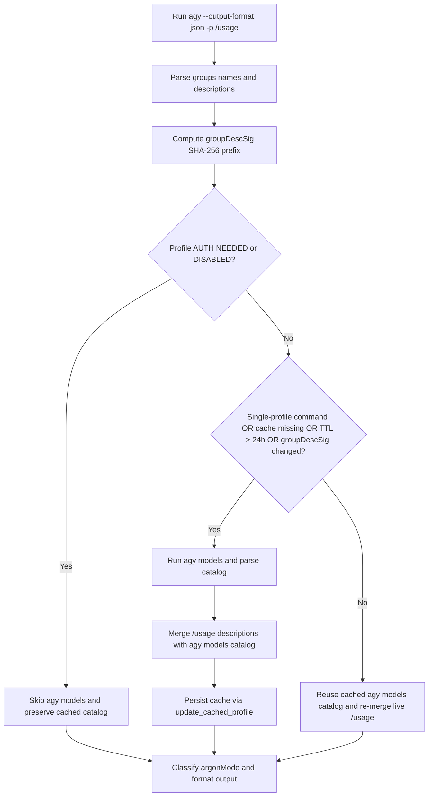
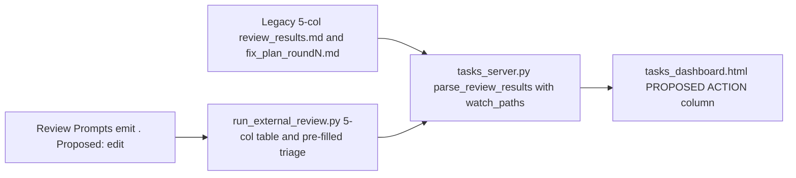

# Check-Quota Dynamic Models and Review Proposed Action Design Spec

- **Date**: 2026-11-18
- **PIC**: nguyenhieu000690
- **Status**: Approved (Gate 1 passed at ca17b12)
- **Scope**: Unified epic combining `/check-quota` dynamic model discovery, header badge generation, and shared-pool Argon handling (`scripts/agy_quota.py`, `skills/refresh-session/resources/scripts/refresh_session.py`, `scripts/types/quota_dashboard.types.ts`, `skills/check-quota/resources/dashboard/quota_dashboard.html`) with `/check-tasks` and `run_external_review.py` Proposed Action restoration (`skills/dev-implementation/references/external-review-prompt.md`, `skills/dev-implementation/references/local-review-prompt.md`, `skills/dev-implementation/resources/scripts/run_external_review.py`, `skills/check-tasks/resources/scripts/tasks_server.py`, `skills/check-tasks/resources/dashboard/tasks_dashboard.html`)
- **Next step**: Route to `d3nexus:dev-designer` to scaffold the unified epic (`check_quota_dynamic_models_and_review_action`) HLD, BDD specifications, and Kanban tasks after Gate 1 approval

## Table of Contents

- [1. Problem Statement and Root Cause](#1-problem-statement-and-root-cause)
- [2. Goals and Non-Goals](#2-goals-and-non-goals)
- [3. Part A Architecture for Dynamic Models and Shared-Pool Semantics](#3-part-a-architecture-for-dynamic-models-and-shared-pool-semantics)
- [4. Part B Architecture for Review Proposed Action Pipeline](#4-part-b-architecture-for-review-proposed-action-pipeline)
- [5. Shared Contract Warnings](#5-shared-contract-warnings)
- [6. Verification Strategy and Risk Mitigations](#6-verification-strategy-and-risk-mitigations)

## 1. Problem Statement and Root Cause

### 1.1 Part A Dynamic Models and False Argon Inactive State

Live Antigravity CLI (`/usage` and `agy models`) inspection across configured accounts reveals two distinct quota group layouts and model rosters:

- On Ultra-tier profiles (`hoangcongtam690`, `nguyenhieu000690`), `agy --output-format json -p "/usage"` returns two quota groups (`"Gemini Models"` and `"Claude and GPT models"`) and **no third Argon group**. Inside `"Gemini Models"`'s `description`, the CLI lists `Gemini 4 Carbon, Gemini 4 Argon, Gemini 4 Hydrogen, Orchestrator (Carbon), Orchestrator (Argon), Gemini 3.8 Flash`, while `"Claude and GPT models"` lists `Claude Sonnet 4.6, Claude Opus 4.6, GPT-OSS 120B`. Meanwhile, `agy models` returns 18 model IDs including `gemini-4-carbon-*`, `gemini-4-argon-*`, `gemini-pro-orchestrator`, and `gemini-pro-orchestrator-argon`.
- On Pro-tier profiles (`danhdue`), `/usage` returns three quota groups: `"Gemini Models"` (`Gemini 4 Hydrogen, Gemini 3.8 Flash`), `"Claude and GPT models"` (`Claude Opus 5.5, Claude Sonnet 5.5, GPT-OSS 120B`), and a separate third group `"Gemini 4 Argon"` (`gemini-argon-wtu-weekly`). On `danhdue`, `groups[0].description` omits `Orchestrator (Argon)`, even though `agy models` exposes `gemini-pro-orchestrator-g1-pro` (`Orchestrator (Argon)`), demonstrating why `/usage` group descriptions and `agy models` must both be combined.

Three defects currently break `/check-quota` across [scripts/agy_quota.py](../../../scripts/agy_quota.py), [skills/refresh-session/resources/scripts/refresh_session.py](../../../skills/refresh-session/resources/scripts/refresh_session.py), and [skills/check-quota/resources/dashboard/quota_dashboard.html](../../../skills/check-quota/resources/dashboard/quota_dashboard.html):

1. `parse_quota_items()` ignores `g.get("description")`, inspecting only group names (`"gemini models"`, `"claude"`, `"argon"`), and never captures actual per-group model rosters.
2. `print_dashboard_cards()`, `renderProfileCard()`, `openProfileInfoModal()`, and header tier/capability badges render hardcoded static labels (`"Gemini 3.8 / Pro 5H"`, `"Claude 5.5 / GPT 5H"`, `"Gemini 4 Argon Weekly"`) that hide `Carbon`, `Argon`, `Orchestrator`, and version differences (`4.6` vs `5.5`).
3. `format_profile_for_dashboard()` derives `has_argon = items["argon_weekly"]["available"]`, causing shared-pool profiles (`hoangcongtam690`, `nguyenhieu000690`) to omit Argon badges or display `INACTIVE` / `Unavailable N/A`. In addition, `refresh_session.py` (`ping_profile()`) triggers redundant `Argon 7D` pings whenever `"argon"` appears in `available_models` and `argon_weekly` is empty—even though Argon on those accounts is already active inside `"Gemini Models"`.
4. Although `hoangcongtam690` (`sub=104967295718101115720`) and `nguyenhieu000690` (`sub=117259606861581511265`) have separate tokens/emails whose `retrieveUserQuotaSummary` backend responses synchronize `resetTime` and remaining fractions, the user explicitly mandated **strict per-profile quota isolation**: `/check-quota` must not aggregate, link, or display cross-profile shared pools from `retrieveUserQuotaSummary`.

### 1.2 Part B Missing Proposed Action in Cross-Model Review UI

In `/check-tasks` (`Cross-Model Review` tab, observed on `duet_refrain_harmonization`), the `PROPOSED ACTION` column renders `—` for every row even when actionable recommendations already exist inside `.devtool/epic/<epic>/fix_plan_round<N>.md`.

Root cause analysis identified three compounding gaps:

1. **Prompt contract divergence**: [skills/principal-review/references/principal-review-prompt.md](../../../skills/principal-review/references/principal-review-prompt.md) specifies `. Proposed: <edit>` at the end of every finding line, so Principal Review findings populate `proposed_action`. Conversely, [skills/dev-implementation/references/external-review-prompt.md](../../../skills/dev-implementation/references/external-review-prompt.md) and [skills/dev-implementation/references/local-review-prompt.md](../../../skills/dev-implementation/references/local-review-prompt.md) end findings at `<problem>` without `. Proposed: <edit>`.
2. **Pre-fill gap in orchestrator scripts**: [skills/dev-implementation/resources/scripts/run_external_review.py](../../../skills/dev-implementation/resources/scripts/run_external_review.py) hardcodes literal `?` for `Proposed action` in `top_risk_findings_section()` and `triage()` rather than extracting proposals when present. At the same time, `check()` and `finding_rows()` mandate 5-column tables (`len(cells) == 5`) in persisted `review_results.md`.
3. **Parser and cache invalidation gaps in `tasks_server.py`**: [skills/check-tasks/resources/scripts/tasks_server.py](../../../skills/check-tasks/resources/scripts/tasks_server.py) (`parse_review_results()`) searches only `cells[3]` (`Problem`) using `Proposed:\s*(.+)`, assumes `cells[4]` is always `decision`, never reads fallback actions from `.devtool/epic/<epic>/fix_plan_round<N>.md` (`## Summary Matrix` `Action` column or `### Finding #N` `Proposed Action (...)` entries), and omits `fix_plan_round*.md` from `watch_paths`.

## 2. Goals and Non-Goals

### 2.1 Goals

1. Parse dynamic per-group model lists from `/usage` (`groups[].description`) combined with `agy models` using a **Hybrid + Cache** policy (`groupDescSig` + 24-hour TTL).
2. Surface dynamic tier/capability badges (`ULTRA`, `PRO`, `FREE`, `DEV`, `Carbon`, `Argon`, `Orchestrator`) and actual per-group model rosters across the Web UI cards, Profile Info Modal, CLI dashboard cards, and CLI `--table` output.
3. Introduce `argonMode` (`"separate"` | `"shared_gemini"` | `"none"`) and **Shared-Pool Mirror** (`sharedPool: true`) so `shared_gemini` accounts mirror `geminiWeekly` quota onto the Argon row (showing `"Shared w/ Gemini Pool"` instead of `INACTIVE`), avoid double-counting shared quota scores, and suppress redundant `Argon 7D` pings.
4. Persist CLI `refresh <profile>` updates via `update_cached_profile()` consistently with `all` and HTTP refresh routes.
5. Update External and Local Review prompts to emit `. Proposed: <edit>`, pre-fill `Proposed action` in `run_external_review.py` while keeping persisted `review_results.md` 5-column compliant, and extend `tasks_server.py` (`parse_review_results()`) with multi-pattern prefix extraction, 5/6-column header awareness, `fix_plan_round<N>.md` fallback, and `watch_paths` cache invalidation.

### 2.2 Non-Goals

1. **No cross-profile pool merging**: Never call or render cross-account quota sharing derived from `retrieveUserQuotaSummary`; each profile card and CLI entry reports its own independent state only.
2. **No breaking schema changes to `review_results.md` 5-column validation**: `run_external_review.py check()` continues requiring 5-column tables in `review_results.md`; proposals live inline in `Problem` (`. Proposed: <edit>`) and in `fix_plan_round<N>.md`.
3. **No `agy models` spawning on unusable accounts**: Never invoke `agy models` when a profile is in `AUTH NEEDED` or `DISABLED` state.

## 3. Part A Architecture for Dynamic Models and Shared-Pool Semantics

### 3.1 Hybrid + Cache Discovery Flow

Every quota fetch parses `/usage` (`groups[].description`) on the live payload because it incurs zero extra subprocesses. Invocation of `agy models` follows the Hybrid + Cache decision flow below:



Single-profile entrypoints (`check-quota <profile>`, `check-quota refresh <profile>`, `/api/refresh`, `execute_ping_profile()`) always refresh `agy models` when the profile is authenticated and enabled. Batch scans (`all`, `/api/refresh-all`) run `agy models` only when the cache is absent, `modelsFetchedAt` exceeds 24 hours, or `groupDescSig` changed from the previous cached signature.

### 3.2 Backend Parsing, Argon Mode Classification, and Ping Guards

In [scripts/agy_quota.py](../../../scripts/agy_quota.py) and [skills/refresh-session/resources/scripts/refresh_session.py](../../../skills/refresh-session/resources/scripts/refresh_session.py):

1. **`parse_usage_group_models(groups: list) -> dict`**: Iterates over `/usage` `groups`, extracting `g.get("description", "")` per group (`gemini`, `claude`, `argon`), splitting comma-separated model names, normalizing whitespace, and computing a deterministic `groupDescSig` digest over normalized `(group_name, description)` tuples.
2. **`parse_agy_models_catalog(stdout: str) -> list[dict]`**: Supplements existing `parse_agy_models_output(stdout: str) -> list[str]` by emitting structured entries `{id, label, quotaFamily, tags}` (identifying `carbon`, `argon`, `orchestrator`, `hydrogen`, `flash`, `claude`, `gpt`, and tier tags like `g1-pro`). Merging `parse_usage_group_models()` with `parse_agy_models_catalog()` reconciles models omitted from `/usage` descriptions (for example, `Orchestrator (Argon)` from `gemini-pro-orchestrator-g1-pro` on `danhdue`).
3. **`argonMode` classification**:
   - `"separate"`: `/usage` includes a dedicated Argon quota group (`"argon"` in group name, e.g., `"Gemini 4 Argon"` / `gemini-argon-wtu-weekly`). `argonWeekly.sharedPool = false`.
   - `"shared_gemini"`: `/usage` has no dedicated Argon group, AND (`"argon"` appears in the Gemini group's `description` OR an Argon/Orchestrator-Argon model exists in `modelCatalog` / `availableModels`). Copy `geminiWeekly` percentages, formatted remaining string, reset timestamps, and availability onto `argonWeekly` with `sharedPool: true` and `mode: "shared_gemini"`.
   - `"none"`: Neither a separate Argon group nor Argon capability exists (`argonWeekly.available = false`, `mode: "none"`).
4. **Ping suppression guard**: Both `execute_ping_profile()` (`agy_quota.py`) and `ping_profile()` / `_extract_usage_buckets()` / `check_profile_has_argon()` (`refresh_session.py`) evaluate `argonMode`. Only trigger a standalone `Argon 7D` ping when `argonMode == "separate"` and the dedicated Argon bucket is inactive or empty. Never emit an `Argon 7D` ping for `"shared_gemini"` profiles whose `"Gemini Models"` pool already provides Argon access.
5. **CLI `refresh` cache persistence**: Update `main()`'s `refresh` subcommand branch in `scripts/agy_quota.py` to invoke `update_cached_profile()` identically to `all` and HTTP `/api/refresh`, ensuring refreshed models, signatures, and quota buckets survive for subsequent cached reads.

### 3.3 Backward-Compatible Schema in `quota_dashboard.types.ts`

Extend [scripts/types/quota_dashboard.types.ts](../../../scripts/types/quota_dashboard.types.ts) with additive optional fields while keeping all legacy properties intact:

```typescript
export type ArgonMode = 'separate' | 'shared_gemini' | 'none';

export interface ModelCatalogEntry {
  id: string;
  label?: string;
  quotaFamily: 'gemini' | 'claude' | 'argon' | 'other';
  tags: string[];
}

export interface ProfileCapabilities {
  tier: string;
  hasCarbon: boolean;
  hasArgon: boolean;
  argonMode: ArgonMode;
  hasOrchestrator: boolean;
  badges: string[];
}
```

- `QuotaBucket`: add optional `sharedPool?: boolean` and `mode?: ArgonMode`.
- `QuotaGroup`: add optional `models?: string[]`.
- `ProfileQuotaState`: add optional `availableModels?: string[]`, `modelCatalog?: ModelCatalogEntry[]`, `groupModels?: { gemini: string[]; claude: string[]; argon: string[] }`, `capabilities?: ProfileCapabilities`, `modelsFetchedAt?: string`, `groupDescSig?: string`, and update `hasArgon` so both `"separate"` and `"shared_gemini"` yield `hasArgon = true`.

### 3.4 Web UI, Modal, Header Badges, and CLI Views

- **Dynamic Badges** ([skills/check-quota/resources/dashboard/quota_dashboard.html](../../../skills/check-quota/resources/dashboard/quota_dashboard.html)): Replace static tier/Argon-only rendering with dynamic capability pills derived from `capabilities.badges` (`ULTRA`, `PRO`, `FREE`, `DEV`, `Carbon`, `Argon`, `Orchestrator`) using tooltip hints when Argon is pooled (`"Shared w/ Gemini Pool"`).
- **Group Cards and Shared-Pool Mirror**:
  - `Gemini Models` card shows actual `groupModels.gemini` labels when available (falling back gracefully to legacy summary strings if cache predates the upgrade).
  - `Claude & GPT` card shows actual `groupModels.claude` labels (for example, `Claude Sonnet 4.6, Claude Opus 4.6, GPT-OSS 120B` vs `5.5`).
  - `Gemini 4 Argon` card renders independent weekly progress for `separate`, renders mirrored `geminiWeekly` progress + countdown + `"Shared w/ Gemini Pool"` pill alongside Argon models for `shared_gemini`, and omits or marks unavailable for `none`.
- **Quota Score and Auto-Switch Sorting (`getProfileQuotaScore()`, `isProfileSchedulable()`)**: When `argonWeekly.sharedPool === true`, do not double-count `argonWeekly` against `geminiWeekly` in aggregate score calculations, and never penalize `shared_gemini` profiles as having zero Argon quota.
- **Profile Info Modal (`openProfileInfoModal()`)**: Display per-group model lists, active capability badges, `argonMode`, `modelsFetchedAt`, and `groupDescSig`.
- **CLI Views (`print_dashboard_cards()`, `print_all_summary()`)**: Replace hardcoded model headers inside dashboard cards with dynamic group model strings and render `(Shared Gemini)` + mirrored fraction/reset in `--table` when `argonMode == "shared_gemini"`.

## 4. Part B Architecture for Review Proposed Action Pipeline

### 4.1 End-to-End Flow Across Prompts, Triage, Server, and UI



### 4.2 Prompt Alignment and Pre-Filled Triage Templates

1. Update [skills/dev-implementation/references/external-review-prompt.md](../../../skills/dev-implementation/references/external-review-prompt.md) and [skills/dev-implementation/references/local-review-prompt.md](../../../skills/dev-implementation/references/local-review-prompt.md) so the required finding format matches [skills/principal-review/references/principal-review-prompt.md](../../../skills/principal-review/references/principal-review-prompt.md):
   ```text
   - [Critical|Important|Minor] <artefact>:<location> — <problem>. Proposed: <edit>
   ```
2. Keep persisted `review_results.md` tables strictly at 5 columns (`| # | Severity | File / Target | Problem | Decision |`) inside [skills/dev-implementation/resources/scripts/run_external_review.py](../../../skills/dev-implementation/resources/scripts/run_external_review.py) (`render_round()`, `check()`, `finding_rows()`) so existing `len(cells) == 5` structural gates remain unchanged.
3. Update `top_risk_findings_section()` and `triage()` in `run_external_review.py` to parse `. Proposed: <edit>` from `problem` (via regex or shared helper) and pre-fill `Proposed action: <edit>` inside `fix_plan_round<N>.md` / top-risk blocks instead of hardcoding `?`, using `?` only when no proposal text exists.

### 4.3 Multi-Strategy Parser and Fix-Plan Fallback in `tasks_server.py`

Extend `parse_review_results()` in [skills/check-tasks/resources/scripts/tasks_server.py](../../../skills/check-tasks/resources/scripts/tasks_server.py):

1. **Header-Aware Column Mapping**: Inspect each round's markdown table header row. Support both canonical 5-column tables (`#`, `Severity`, `File / Target`, `Problem`, `Decision`) and explicit 6-column tables with a `Proposed Action` / `Action` column (extracting `proposed_action` directly without misclassifying it as `decision`).
2. **Broadened Problem Prefix Extraction**: Expand regex extraction on the `Problem` cell to capture `. Proposed: <text>`, `Proposed action: <text>`, `Fix: <text>`, and `Suggestion: <text>` (delimited by `.`, `;`, or `—`), stripping the proposal clause cleanly from `problem`.
3. **Round-Scoped `fix_plan_round<N>.md` Fallback**: For findings whose `proposed_action` remains empty after parsing `review_results.md` / `principal_review.md`, load `.devtool/epic/<epic>/fix_plan_round<N>.md` (or `fix_plan.md` when round-unnumbered):
   - Parse `### Finding #<N>` subsections for `- **Proposed Action (...):** <text>` (covering variants such as `Proposed Action (Adjusted)` or `Action`).
   - Parse `## Summary Matrix` table rows mapping finding number `#` to its `Action` cell.
   - Prefer detailed `### Finding #<N>` text over the shorter `Summary Matrix` `Action` cell when both exist.
4. **Watch-Path Cache Invalidation**: Append all discovered `fix_plan_round*.md` and `fix_plan.md` paths in the epic directory to `watch_paths` evaluated by `_file_stat_sig()` in `_REVIEW_PARSE_CACHE`, ensuring dashboard API calls reflect edits to fix plans immediately.

### 4.4 Dashboard Rendering in `tasks_dashboard.html`

Confirm `buildReviewFindingsTableHtml()` and `formatReviewTokens()` in [skills/check-tasks/resources/dashboard/tasks_dashboard.html](../../../skills/check-tasks/resources/dashboard/tasks_dashboard.html) render populated `f.proposed_action` strings consistently across both `Principal Review` and `Cross-Model Review` tabs, displaying `—` only when all inline and fix-plan sources are absent.

## 5. Shared Contract Warnings

The `ai-agent-tools` repository is a standalone plugin kit and does not contain a `shared-contracts/` directory (`api_contract.md`, `architecture_and_flow.md`, and `gaps_and_rfcs.md` are absent). Therefore, no cross-repository shared contract edits or waivers are required. All JSON fields added to `/check-quota` payloads (`availableModels`, `modelCatalog`, `groupModels`, `capabilities`, `modelsFetchedAt`, `groupDescSig`, `sharedPool`, `mode`) and `/check-tasks` review findings (`proposed_action`) are strictly additive and backward-compatible with existing consumers.

## 6. Verification Strategy and Risk Mitigations

### 6.1 Planned Test Coverage

Following Tri-Role TDD discipline during Stage 3 (`dev-implementation`):

- **Quota suite** ([tests/test_agy_quota.py](../../../tests/test_agy_quota.py) and `refresh_session` tests):
  - Parse `/usage` `description` + `agy models` for Ultra (`shared_gemini`, Carbon + Argon + Orchestrator, Claude 4.6) and Pro (`separate`, Hydrogen + Flash + separate Argon + Orchestrator `g1-pro`, Claude 5.5).
  - Verify Hybrid + Cache behavior: `agy models` runs on single-profile commands and batch misses/24h expiry/`groupDescSig` changes, skips on batch cache hits, and never runs for `AUTH NEEDED` or `DISABLED` profiles.
  - Verify `shared_gemini` mirrors `geminiWeekly` onto `argonWeekly` (`sharedPool: true`), avoids double-counting in `getProfileQuotaScore()`, suppresses `Argon 7D` pings in `execute_ping_profile()` and `ping_profile()`, persists `refresh` CLI output via `update_cached_profile()`, and preserves strict per-profile isolation.
- **Review action suite** ([skills/dev-implementation/resources/scripts/test_run_external_review.py](../../../skills/dev-implementation/resources/scripts/test_run_external_review.py), [tests/test_check_tasks_server.py](../../../tests/test_check_tasks_server.py), [tests/test_cehm_history_aggregator.py](../../../tests/test_cehm_history_aggregator.py)):
  - Confirm `run_external_review.py check()` still passes on 5-column `review_results.md` containing `. Proposed: <edit>`.
  - Verify `top_risk_findings_section()` and `triage()` pre-fill `Proposed action` when present and fall back to `?` when absent.
  - Verify `parse_review_results()` handles 5-col inline prefixes (`Proposed:`, `Proposed action:`, `Fix:`, `Suggestion:`), 6-col `Proposed Action`, `fix_plan_round<N>.md` `### Finding #N` + `Summary Matrix` fallback on `duet_refrain_harmonization`-style fixtures, and `watch_paths` cache invalidation on fix-plan edits.

### 6.2 Live Verification and Repository Gate

- Verify live `agy_quota.py` CLI cards and `--table` output against local profiles (`hoangcongtam690`, `nguyenhieu000690`, `danhdue`).
- Inspect both `quota_dashboard.html` and `tasks_dashboard.html` in Chrome DevTools via `browser` subagent to confirm dynamic badges, per-group model rosters, `"Shared w/ Gemini Pool"` rendering, and populated `PROPOSED ACTION` cells.
- Run [scripts/verify.sh](../../../scripts/verify.sh) and `@quality_check` on the Stage 3 candidate commit before Gate 5 finish.

### 6.3 Key Risks and Mitigations

- **Upstream `/usage` description formatting shifts**: Mitigated by case-insensitive family matching combined with preserving raw display labels and falling back cleanly when a group omits `description`.
- **Batch `all` latency regression**: Mitigated by Hybrid + Cache (`groupDescSig` + 24-hour TTL) and skipping unauthenticated/disabled profiles so steady-state batch runs avoid extra `agy models` subprocesses.
- **Stale in-memory review cache in `tasks_server.py`**: Mitigated by including `fix_plan_round*.md` and `fix_plan.md` in `watch_paths` signatures inside `_REVIEW_PARSE_CACHE`.
- **Downstream breakage of 5-column `review_results.md` validators**: Mitigated by preserving `len(cells) == 5` in `review_results.md` and `run_external_review.py check()`.
