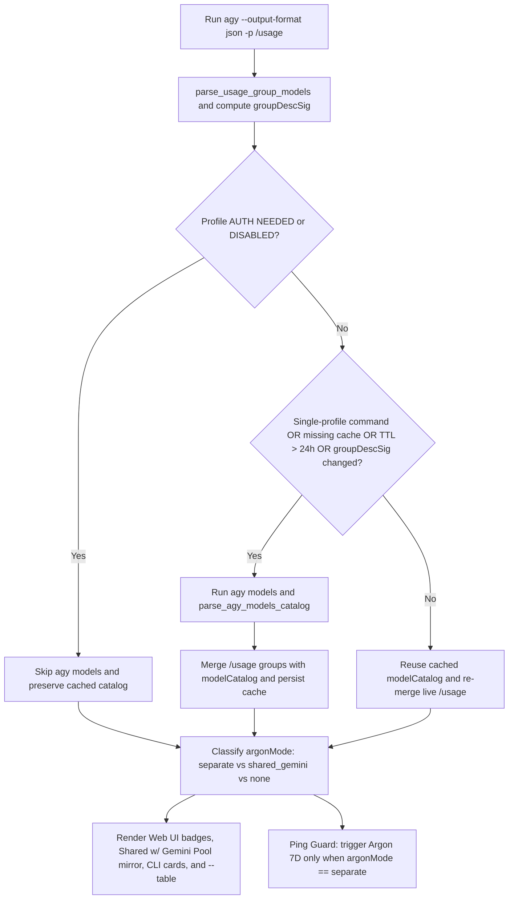
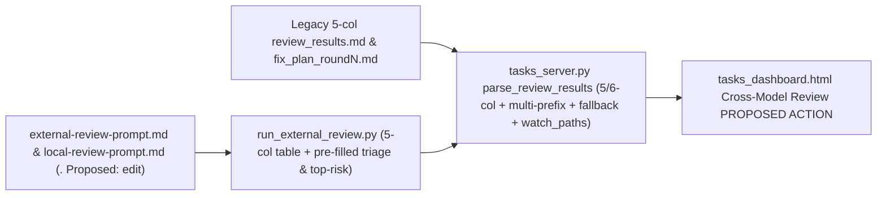

# Check-Quota Dynamic Models and Review Proposed Action High-Level Design

## Table of Contents

- [Meta Data](#meta-data)
- [Background](#background)
- [Goals and Non-Goals](#goals-and-non-goals)
- [Architecture and Technical Design](#architecture-and-technical-design)
- [Feature Maintenance Map](#feature-maintenance-map)
- [Module Contracts and HTTP Interfaces](#module-contracts-and-http-interfaces)
- [Impact Analysis](#impact-analysis)
- [Shared Contract Impact](#shared-contract-impact)
- [Integration Test Plan and Boundary Matrix](#integration-test-plan-and-boundary-matrix)
- [Verification Environment](#verification-environment)
- [Comprehensive BDD Scenario Coverage](#comprehensive-bdd-scenario-coverage)
- [Rollout Strategy and Mitigation](#rollout-strategy-and-mitigation)
- [Kanban Tasks Breakdown](#kanban-tasks-breakdown)
- [Spec Errata](#spec-errata)

## Meta Data

- **Epic name**: `check_quota_dynamic_models_and_review_action`
- **Status**: In Review
- **PIC**: `nguyenhieu000690`
- **Target release**: Next plugin release
- **Platform**: Python tooling, Markdown skill prompts, TypeScript contract types, local HTTP servers, and HTML/Vanilla JS dashboards
- **Depends on epic**: none
- **Source Spec**: [Check-Quota Dynamic Models and Review Proposed Action Design Spec](2026-11-18-check-quota-dynamic-models-and-review-action-design.en.md)

## Background

This epic resolves two high-impact observability regressions discovered across the kit's quota and task dashboards:

1. **`/check-quota` Static Model Strings & False Argon Inactive State**:
   - `parse_quota_items()` (`scripts/agy_quota.py:L971-L1021`) ignores `/usage` `groups[].description`, and UI/CLI renderers (`print_dashboard_cards` `L1024-L1101`, `renderProfileCard` `quota_dashboard.html:L2399-L2778`, `openProfileInfoModal` `L4252-L4277`) hardcode static strings (`"Gemini 3.8 / Pro 5H"`, `"Claude 5.5 / GPT 5H"`, `"Gemini 4 Argon Weekly"`).
   - Ultra-tier profiles (`hoangcongtam690`, `nguyenhieu000690`) bundle `Gemini 4 Carbon`, `Gemini 4 Argon`, `Gemini 4 Hydrogen`, `Orchestrator (Carbon)`, `Orchestrator (Argon)`, and `Gemini 3.8 Flash` inside `"Gemini Models"` with no 3rd Argon group, whereas Pro-tier profiles (`danhdue`) carry a separate 3rd `"Gemini 4 Argon"` group while omitting `Orchestrator (Argon)` from `/usage` description despite exposing `gemini-pro-orchestrator-g1-pro` via `agy models`.
   - Treating `has_argon = items["argon_weekly"]["available"]` marks Ultra pooled profiles as `INACTIVE` / `Unavailable N/A`, and cached fallback paths (`execute_ping_profile` `L2908-L2920`, `probe_blocked_profile` `L666-L820`, `refresh_session.py::check_profile_has_argon` `L1306-L1324`, `ping_profile` `L1486-L1656`) gate on `hasArgon and not argonWeekly.unavailable` so setting `hasArgon = true` with mirrored `argonWeekly` would trigger redundant `Argon 7D` pings/probes unless gated on `argonMode == "separate"`. Meanwhile, CLI `refresh` (`agy_quota.py:L4079-L4134`) fails to persist updated cache entries via `update_cached_profile()`.
   - Cross-profile pool aggregation via `retrieveUserQuotaSummary` is explicitly forbidden by the user: every profile must display strictly independent quota metrics.
2. **Missing `PROPOSED ACTION` in `/check-tasks` Cross-Model Review**:
   - `skills/principal-review/references/principal-review-prompt.md:L56` mandates `. Proposed: <edit>`, whereas `skills/dev-implementation/references/external-review-prompt.md:L67` and `local-review-prompt.md:L50` omit `. Proposed: <edit>`.
   - `run_external_review.py` hardcodes `?` in `top_risk_findings_section()` (`L2440-L2466`) and `triage()` stdout tables (`L2548-L2659`; `triage()` writes only to stdout while `fix_plan_round<N>.md` is drafted externally), while `check()` (`L2263-L2286`) enforces 5-column persisted tables (`len(cells) == 5`).
   - `tasks_server.py` (`parse_review_results` `L527-L806`) searches only `cells[3]` with `(?:Proposed(?:\s+Action)?|Đề xuất):\s*(.+)$` (missing `Fix:`/`Suggestion:`, `\b` word boundaries, and last-match delimiter safety), assumes `cells[4]` is always `decision`, ignores `.devtool/epic/<epic>/fix_plan_round<N>.md` (across both `### Finding #N` / `## Summary Matrix` and `### Fix N` / `Planned Surgical Fix` conventions), and omits `fix_plan_round<N>.md` / `fix_plan.md` from `watch_paths` (`L772-L780`).

## Goals and Non-Goals

### Goals

- Combine live `/usage` `groups[].description` parsing with cached `agy models` (`groupDescSig` + 24h TTL + immediate refresh on single-profile commands, never on `AUTH NEEDED` or `DISABLED` profiles).
- Classify `argonMode` (`"separate"` | `"shared_gemini"` | `"none"`), mirror `geminiWeekly` onto `argonWeekly` (`sharedPool: true`) for `shared_gemini`, keep `getProfileQuotaScore()`'s existing 4-bucket score formula unchanged (Argon stays excluded so `shared_gemini` is never double-counted), and suppress redundant `Argon 7D` pings/probes across both live and cached-fallback paths in `agy_quota.py` and `refresh_session.py`.
- Surface dynamic `capabilities.badges` (`ULTRA`, `PRO`, `FREE`, `DEV`, `Carbon`, `Argon`, `Orchestrator`), per-group model rosters, and `(Shared Gemini)` / `"Shared w/ Gemini Pool"` indicators across `quota_dashboard.html` and CLI output (deriving `capabilities.tier` cleanly while keeping top-level `tier` as `PRO`/`FREE`), plus persist CLI `refresh` updates via `update_cached_profile()`.
- Update `external-review-prompt.md` and `local-review-prompt.md` to emit `. Proposed: <edit>`, pre-fill `Proposed action` in `run_external_review.py` stdout triage tables while keeping `check()` 5-column compliant, and enhance `tasks_server.py` (`parse_review_results()` + unconditional `watch_paths`) with multi-prefix extraction, header-aware 5/6-column mapping, and best-effort `fix_plan_round<N>.md` fallback.

### Non-Goals

- Cross-profile pool grouping or `retrieveUserQuotaSummary` aggregation in UI or CLI.
- Breaking 5-column persisted `review_results.md` compatibility enforced by `run_external_review.py check()`.
- Retroactively modifying `four_persona_governance` archived artefacts.

## Architecture and Technical Design

### Part A Hybrid Model Discovery and Argon Classification Flow

### Part B Review Proposed Action Extraction Flow

## Feature Maintenance Map

| Feature Area | Primary Files | Entry / Function |
|---|---|---|
| Dynamic Model Parsing, Hybrid Cache, `argonMode`, CLI Cards & `refresh` Cache | `scripts/agy_quota.py` | `parse_usage_group_models`, `parse_agy_models_catalog`, `parse_quota_items()`, `format_profile_for_dashboard()`, `execute_ping_profile()`, `probe_blocked_profile()`, `print_dashboard_cards()`, `print_all_summary()`, `main()` |
| Ping Suppression Guard for Shared-Pool Argon | `skills/refresh-session/resources/scripts/refresh_session.py` | `_extract_usage_buckets()`, `check_profile_has_argon()`, `ping_profile()` |
| Quota Payload TypeScript Schema | `scripts/types/quota_dashboard.types.ts` | `ArgonMode`, `ModelCatalogEntry`, `ProfileCapabilities`, `QuotaBucket`, `QuotaGroup`, `ProfileQuotaState` |
| Quota Dashboard Dynamic Badges, Roster & Shared Mirror UI | `skills/check-quota/resources/dashboard/quota_dashboard.html` | `getTierBadgeHTML()`, `getArgonBadgeHTML()`, `renderProfileCard()`, `getProfileQuotaScore()`, `openProfileInfoModal()` |
| External/Local Prompt Format & Review Triage Pre-Fill | `skills/dev-implementation/references/external-review-prompt.md`, `skills/dev-implementation/references/local-review-prompt.md`, `skills/dev-implementation/resources/scripts/run_external_review.py` | Prompt format section, `parse_findings()`, `top_risk_findings_section()`, `triage()` |
| Multi-Strategy Review Parser, `fix_plan` Fallback & Dashboard Rendering | `skills/check-tasks/resources/scripts/tasks_server.py`, `skills/check-tasks/resources/dashboard/tasks_dashboard.html`, `scripts/verify.sh` | `parse_review_results()`, `_file_stat_sig()`, `buildReviewFindingsTableHtml()`, `formatReviewTokens()`, `SUITES` |

## Module Contracts and HTTP Interfaces

1. **`scripts/agy_quota.py` Additives & Contracts**:
   - `parse_usage_group_models(groups: list) -> dict`: returns `groupDescriptions`, `groupModels` (`gemini`, `claude`, `argon`), and `groupDescSig` (SHA-256 hex prefix over normalized `(groupName, description)` tuples).
   - `parse_agy_models_catalog(stdout: str) -> list[dict]`: extracts `{id, label, quotaFamily, tags}`; preserves `parse_agy_models_output(stdout: str) -> list[str]` unchanged.
   - `format_profile_for_dashboard()` adds `availableModels`, `modelCatalog`, `groupModels`, `capabilities` (`tier`, `hasCarbon`, `hasArgon`, `argonMode`, `hasOrchestrator`, `badges`), `modelsFetchedAt`, `groupDescSig`; sets `hasArgon = (argonMode != "none")`; keeps top-level `tier` strictly `"PRO"`/`"FREE"` (or `"DEV"`) while deriving `capabilities.tier` (`"ULTRA"` when `plan_name` contains `"ULTRA"` or non-`FREE` profile has no dedicated Argon group and includes a Carbon model); when `argonMode == "shared_gemini"`, populates `argonWeekly` with mirrored `geminiWeekly` fields (`fraction`, `countdown`, `resetTime`, `resetTimeLocal`, `unavailable`) plus `sharedPool: True` and `mode: "shared_gemini"`.
   - `execute_ping_profile()` (both live and cached `L2908-L2920` paths) and `probe_blocked_profile()` (`L666-L820`) gate Argon probes/pings on `argonMode == "separate"` (or legacy cache lacking `capabilities.argonMode` with `sharedPool != True` and `hasArgon and not unavailable`).
   - Zero calls to `retrieveUserQuotaSummary`.

2. **`skills/refresh-session/resources/scripts/refresh_session.py` Ping Guard**:
   - `_extract_usage_buckets(cmd_data)` includes normalized per-group descriptions/models so `check_profile_has_argon()` (reading `_DASHBOARD_HTML_CANDIDATES`) and `ping_profile()` (live + non-live `L1581-L1583` fallback) gate Argon on `argonMode == "separate"` (or legacy cache lacking `capabilities.argonMode` with `sharedPool != True` and `hasArgon and not unavailable`): suppress `Argon 7D` ping and return `False` from `check_profile_has_argon()` for `"shared_gemini"` and `"none"`; retain `Argon 7D` ping when `argonMode == "separate"` and dedicated Argon bucket is inactive/empty.

3. **`scripts/types/quota_dashboard.types.ts` Contract**:
   - Exports `ArgonMode = 'separate' | 'shared_gemini' | 'none'`, `ModelCatalogEntry`, `ProfileCapabilities`; aligns `QuotaBucket` with emitted runtime keys (`name`, `fraction`, `countdown`, `resetTime`, `resetTimeLocal?`, `unavailable`, `tags?`, `sharedPool?: boolean`, `mode?: ArgonMode`, keeping `id?`, `window?`, `remainingFraction?`, `description?`, `isAvailable?` optional); adds additive optional fields on `QuotaGroup` and `ProfileQuotaState`.

4. **`skills/dev-implementation/resources/scripts/run_external_review.py`**:
   - Keeps `render_round()` (`L1310-L1342`), `check()` (`L2263-L2286`), and `finding_rows()` (`L2339-L2342`) enforcing 5-column `| # | Severity | Location | Problem | Decision |` tables in `review_results.md`.
   - `top_risk_findings_section()` (`L2440-L2466`) and `triage()` (`L2548-L2659`) extract inline proposal clauses from `finding[3]` (`Problem`) using the shared marker regex and pre-fill the `Proposed action` cell in stdout triage tables (`?` only when absent); `triage()` prints only to stdout (`L2656`) and never writes `fix_plan_round<N>.md`.

5. **`skills/check-tasks/resources/scripts/tasks_server.py::parse_review_results`**:
   - Preserves existing call signature; maps columns by normalized header name (`#`/`id`, `Severity`/`Mức độ`/`Sev`, `Location`/`File / Target`/`Target`, `Problem`, `Proposed Action`/`Action`, `Decision`) across 5-column (`Location`) and 6-column tables with positional fallback `[0..4]`; uses the shared word-boundary last-match regex (`Proposed:`, `Proposed action:`, `Fix:`, `Suggestion:`, `Đề xuất:`); applies best-effort fallback per `(round, finding_num)` to `.devtool/epic/<epic>/fix_plan_round<N>.md` and `fix_plan.md` across both `### Finding #N` / `## Summary Matrix` and `### Fix N [...#N...]` / `Planned Surgical Fix` / numbered `Finding #N` formats (preferring detailed per-finding prose over summary table cells); unconditionally adds expected `fix_plan_round<round>.md` and `fix_plan.md` (plus discovered `fix_plan_round*.md`) to `watch_paths` (`L772-L780`) inside `_REVIEW_PARSE_CACHE`.

## Impact Analysis

Shift-left impact analysis (`check_code_impact.py --base-ref main`) audited all target files and 21 downstream callers across tests and scripts:

- **Upstream Git Conflict Status & `four_persona_governance` Merge Alignment**: **0** unmerged commits against `main`. Prerequisite queue blocker `four_persona_governance` (`task_04`/`task_06` on `run_external_review.py`, `task_05` on `tasks_server.py` and `tasks_dashboard.html`, `task_08` on `scripts/verify.sh`) merged at `21f268d` (recorded at `c084ad1`). All affected line anchors in `run_external_review.py`, `tasks_server.py`, `tasks_dashboard.html`, and `scripts/verify.sh` have been re-baselined to post-merge `main` (`c084ad1`), and `sync_task_status.py check-conflicts` reports `0 conflicts`. Note also that `skills/check-quota/resources/dashboard/quota_dashboard.html` may carry cached profile injections on main checkouts; Stage 3 tasks execute cleanly inside isolated branch worktrees.
- **Downstream Compatibility**:
  - `parse_agy_models_output` retains its `list[str]` return signature (`test_agy_quota.py`, `refresh_session.py`).
  - Existing `/api/review` and `/api/epic/history` callers receive populated string `proposed_action` values in the existing finding dict shape (`test_check_tasks_server.py`, `test_cehm_history_aggregator.py`, `test_cehm_dashboard_modal_ui.py`).
  - Persisted `review_results.md` tables remain 5-column compatible (`test_run_external_review.py`, `test_local_review.py`, `lifecycle_runner.py`).

## Shared Contract Impact

None — self-contained feature inside `ai-agent-tools` (`shared-contracts/` does not exist in this repository).

## Integration Test Plan and Boundary Matrix

Integration test roots: tests
Protected paths: .agents/quality/**, .devtool/epic/check_quota_dynamic_models_and_review_action/bdd_scenarios.en.md, .devtool/epic/check_quota_dynamic_models_and_review_action/bdd_scenarios.vi.md
Integration results: python3 -m pytest -q --tb=short --maxfail=3 --junitxml=build/test-results/cqra-integration.xml tests/test_cqra_quota_discovery.py tests/test_cqra_refresh_session_argon.py tests/test_cqra_external_review_proposed.py tests/test_cqra_quota_ui.py tests/test_cqra_review_action_e2e.py tests/test_agy_quota.py tests/test_check_tasks_server.py tests/test_cehm_history_aggregator.py tests/test_cehm_dashboard_modal_ui.py tests/test_rsdh_quota_modal_stack.py tests/test_claude_quota.py -> build/test-results/cqra-integration.xml

| Boundary | Producer | Consumer | Verification Tier |
|---|---|---|---|
| `/usage` descriptions + `agy models` -> Cached `ProfileQuotaState` + `argonMode` | `scripts/agy_quota.py`, `scripts/types/quota_dashboard.types.ts` | `quota_dashboard.html`, CLI cards & `--table` | Tier A Unit + CLI Regression |
| `argonMode` ping guard in `refresh_session.py` | `_extract_usage_buckets()`, `ping_profile()` | `agy_quota.py` & isolated `agy` pings | Tier A Unit |
| `ProfileQuotaState` JSON -> Dynamic Badges & `"Shared w/ Gemini Pool"` UI | `scripts/agy_quota.py` HTTP/HTML embed | `skills/check-quota/resources/dashboard/quota_dashboard.html` | Tier C Headless Chrome CDP |
| Review Prompts `. Proposed:` -> `run_external_review.py` 5-col + stdout triage pre-fill | `external-review-prompt.md`, `local-review-prompt.md`, `run_external_review.py` | `parse_review_results()`, human & fixer agents | Tier A Unit |
| `review_results.md` + `fix_plan_round<N>.md` -> `parse_review_results()` -> `PROPOSED ACTION` | `skills/check-tasks/resources/scripts/tasks_server.py` | `skills/check-tasks/resources/dashboard/tasks_dashboard.html` | Tier C HTTP + Headless Chrome CDP |

## Verification Environment

- **Data Isolation**: Automated tests execute inside ephemeral `tmp_path` / `tempfile.TemporaryDirectory` workspaces and bind test HTTP servers only to dynamically assigned localhost ports (`find_available_port`). Tests covering `update_cached_profile()` or `check_profile_has_argon()` MUST patch `update_cached_profile` / `get_dashboard_html_path` (plus `sync_copies` / `REAL_HOME` / `Path.home`) or `_DASHBOARD_HTML_CANDIDATES` to `tmp_path`.
- **Forbidden Live Stores**: Automated tests must never mutate host `~/.gemini/`, `~/antigravity_homes/`, `~/.zshrc`, repo-tracked `quota_dashboard.html`, `/tmp/agy_tasks_server.pid`, or `/tmp/agy_quota_server*`. Live CLI checks in manual QA run read-only `check-quota` queries only.
- **Needs Variables**: None (`Needs: —`).

## Comprehensive BDD Scenario Coverage

All 17 BDD scenarios (`CQRA-HP-01` through `CQRA-FR-03`) are defined in [bdd_scenarios.en.md](bdd_scenarios.en.md) spanning Happy Path (`HP`), Edge Cases (`EC`), State Transitions (`ST`), Architecture & Concurrency (`AR`), and Fault Resilience (`FR`).

## Rollout Strategy and Mitigation

- Execute Wave 1 tasks (`Task 01`, `Task 02`, `Task 03`) in parallel over disjoint file sets inside worker slots before advancing to Wave 2 (`Task 04`, `Task 05`).
- Following `four_persona_governance` archival and merge (`21f268d`), this epic is promoted from `backlog` to `todo` with all shifted line anchors in `run_external_review.py`, `tasks_server.py`, `tasks_dashboard.html`, and `scripts/verify.sh` re-baselined to `c084ad1`.
- Verify both existing regression suites (`test_agy_quota.py`, `test_refresh_session.py`, `test_run_external_review.py`, `test_check_tasks_server.py`, `test_cehm_history_aggregator.py`, `test_cehm_dashboard_modal_ui.py`) and `bash scripts/verify.sh` cleanly before Gate 4 convergence.

## Kanban Tasks Breakdown

Confirmed 5-task breakdown (promoted to `todo` after `four_persona_governance` completion):

1. **[Task 01: Check-Quota Hybrid Model Discovery, `argonMode` Mirror, Schema Types & `refresh` Cache Persistence](task_01_check_quota_dynamic_models_and_argon_mode.md)** (`review_tier: "full"`) — Covers: `CQRA-HP-01`, `CQRA-HP-02`, `CQRA-EC-01`, `CQRA-ST-01`, `CQRA-AR-01`, `CQRA-FR-01`
2. **[Task 02: Refresh-Session Shared-Pool Argon Ping Suppression Guard](task_02_refresh_session_shared_argon_guard.md)** (`review_tier: "full"`) — Covers: `CQRA-ST-02`, `CQRA-FR-02`
3. **[Task 03: Review Prompts `. Proposed:` Contract & `run_external_review.py` Pre-Filled Triage](task_03_review_prompts_and_triage_prefill.md)** (`review_tier: "full"`) — Covers: `CQRA-HP-04`, `CQRA-EC-04`
4. **[Task 04: Quota Dashboard Web UI Dynamic Badges, Group Model Rosters, Shared-Pool Mirror & Modal](task_04_quota_dashboard_dynamic_ui.md)** (`review_tier: "full"`) — Covers: `CQRA-HP-03`, `CQRA-EC-02`, `CQRA-AR-02`
5. **[Task 05: `tasks_server.py` Multi-Strategy `Proposed Action` Extraction, `fix_plan` Fallback, Dashboard UI & Full Regression](task_05_review_action_parser_ui_and_regression.md)** (`review_tier: "full"`) — Covers: `CQRA-HP-05`, `CQRA-EC-03`, `CQRA-ST-03`, `CQRA-FR-03`

## Spec Errata

- **[SE-01] §3.2 & §3.3 QuotaBucket Keys and ULTRA Tier Isolation**: Runtime dashboard buckets emit `fraction`, `countdown`, `resetTime`, `resetTimeLocal`, and `unavailable` (not `remainingFraction`/`remainingPct`/`usedPct`); `QuotaBucket` aligns to those emitted keys while keeping legacy TS properties optional, and `ULTRA` populates `capabilities.tier` only while top-level `tier` stays `PRO`/`FREE`.
- **[SE-02] §3.2 & §3.4 Quota Score and Cached Fallback Argon Gates**: `getProfileQuotaScore()` already excludes `argonWeekly`, so its 4-bucket formula remains unchanged; cached fallback Argon paths (`execute_ping_profile`, `probe_blocked_profile`, `check_profile_has_argon`, `ping_profile`) gate on `argonMode == "separate"` (or legacy cache with `sharedPool != True`).
- **[SE-03] §4.2 & §4.3 Review Table Location Header, Stdout Triage, Best-Effort Fix Plans, and Watch Paths**: Persisted tables use `Location` (not `File / Target`), `triage()` prints only to stdout while `fix_plan_round<N>.md` is authored externally, `fix_plan_round<N>.md` fallback is best-effort across both `### Finding #N` / `Summary Matrix` and `### Fix N` / `Planned Surgical Fix` formats, and expected `fix_plan_round<round>.md` / `fix_plan.md` paths are always added to `watch_paths`.
