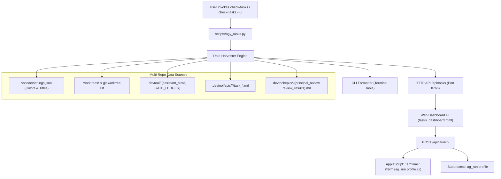

# Cross-Repo Tasks & Context Dashboard Design

## Table of Contents
- [Overview](#overview)
- [Problem Statement and Goals](#problem-statement-and-goals)
- [Shared Contract Warnings](#shared-contract-warnings)
- [System Architecture and File Layout](#system-architecture-and-file-layout)
- [Data Harvester Engine and Multi-Repo Scanning](#data-harvester-engine-and-multi-repo-scanning)
- [Web Server, REST API and Launcher Operations](#web-server-rest-api-and-launcher-operations)
- [UI and UX Architecture with Modal Dialogs](#ui-and-ux-architecture-with-modal-dialogs)
- [Lifecycle State Engine and Human Decisions](#lifecycle-state-engine-and-human-decisions)
- [Terminal CLI and Slash Command Integration](#terminal-cli-and-slash-command-integration)
- [Error Handling, Safety and Concurrency](#error-handling-safety-and-concurrency)
- [Verification and Acceptance Plan](#verification-and-acceptance-plan)

---

## Overview

The **Cross-Repo Tasks & Context Dashboard** (`check-tasks`) is an executive, real-time developer tool and interactive Dark Mode dashboard designed to monitor and coordinate parallel development epics across all repositories in `/Users/danhdueexoictif/AllProjects`. 

Modeled after the high-efficiency architecture of `check-quota`, `check-tasks` provides both a fast terminal CLI formatter and a persistent local Web Dashboard daemon (default port `8766`). It seamlessly harvests:
1. Dynamic UI color themes and window titles directly from each project's `.vscode/settings.json`.
2. Git worktrees and parallel in-flight epics across repositories.
3. Real-time active task progress and granular Kanban states from `.devtool/epic/` and `.devtool/features/`.
4. Verified Two-Tier Project Memory (`/save-context` and `/resume-context`) from `.devtool/PROJECT_LEDGER.md` (Tier 1) and `.devtool/assistant_state.md` / `activity_stream.log` (Tier 2).
5. Comprehensive multi-round triage findings tables and Gate status from `/principal-review` and `/cross-model-review`.
6. Zero-friction native launch buttons to open the active Profile's Antigravity CLI and Antigravity IDE directly inside any isolated worktree.

## Problem Statement and Goals

### The Problem
In multi-repository ecosystems where developers maintain multiple repositories simultaneously (`ai-agent-tools`, `lyrics-sync`, `D3Nexus`, `nexus`, `digital_wallet`), each repository frequently implements multiple epics in parallel inside isolated Git worktrees (`.worktrees/<epic_slug>`). 

Currently:
- Developers lack a single pane of glass to observe which repositories have active worktrees, which epics are currently in progress, what specific task is actively being implemented (`status: "in_progress"`), and what Gate has been passed.
- Context inspection requires manually browsing through `.devtool/` folders, `PROJECT_LEDGER.md`, and `GATE_LEDGER.md` across multiple directories.
- Review findings from `/principal-review` (Stage 2) and `/cross-model-review` (Stage 3) reside in large Markdown files (`principal_review.md`, `review_results.md`), making it tedious to quickly scan the unresolved Critical/Important findings across rounds without opening multiple editor windows.
- Switching between terminal worktrees and launching the correct profile-isolated Antigravity CLI or IDE requires manual terminal commands (`ag_run <profile> ...`).

### Goals
1. **Unified Multi-Repo Visibility**: Aggregate and display all repositories and parallel active epics in a single responsive Dark Mode dashboard.
2. **Dynamic Project Parity**: Automatically adapt card border colors, glow accents, and title badges to match each repository's `workbench.colorCustomizations` and `window.title` defined in `.vscode/settings.json`.
3. **One-Click Native Launchers**: Provide clean `[ 💻 Mở CLI ]` and `[ 🚀 Mở IDE ]` buttons on each epic card to launch the profile-isolated CLI or Antigravity IDE in the exact worktree directory.
4. **Modal Dialog Interactions (Zero Page Switching)**: Keep the developer anchored on the main Overview page. Clicking actions opens non-disruptive Dialog Modals:
   - **Kanban Board Modal**: 5-column Kanban board (`Backlog`, `To Do`, `In Progress`, `Review`, `Done`) matching the clean native Antigravity Kanban UI.
   - **Two-Tier Contexts Modal**: Split-pane view of Tier 1 Permanent Ledger and Tier 2 In-Flight State.
   - **Review Triage Modals**: Dedicated dialogs for `/principal-review` and `/cross-model-review` displaying complete round metadata (Round, Candidate SHA, Reviewer, Thinking / Effort Level, Verdict) and a structured 5-column triage table with severity tags and raw evidence drawer.
5. **Dual Interface Parity**: Support both terminal workflows (`check-tasks`, `check-tasks all`) and background web daemon (`check-tasks --ui`, `check-tasks --stop`).

## Shared Contract Warnings

Absent `shared-contracts/` confirmation: `ai-agent-tools` is the shared agent tools kit repository and does not bind domain shared contracts directly. All contract checks in downstream satellite/hub repositories remain read-only during task status harvesting.

## System Architecture and File Layout

The feature follows the decoupled architecture established by `check-quota`:

```text
ai-agent-tools/
├── bin/
│   └── check-tasks                              # Global executable entrypoint in PATH
├── scripts/
│   └── agy_tasks.py                             # Core engine: Harvester + Terminal CLI + HTTP Daemon Server
└── skills/
    └── check-tasks/
        ├── SKILL.md                             # Skill documentation & slash command specification
        └── resources/
            └── dashboard/
                └── tasks_dashboard.html         # Single-Page Dark Mode UI with Tailwind CSS & Modal Dialogs
```

### Component Flow



## Data Harvester Engine and Multi-Repo Scanning

`scripts/agy_tasks.py` implements a resilient, non-blocking file scanner that parses project state within 150ms:

1. **Repository Discovery**:
   - Searches `WORKSPACE_ROOT` (defaults to `/Users/danhdueexoictif/AllProjects`).
   - Scans known repos: `ai-agent-tools`, `lyrics-sync`, `D3Nexus`, `nexus`, `digital_wallet`, and dynamic sub-repositories.
2. **Settings Extraction (`.vscode/settings.json`)**:
   - Resolves `workbench.colorCustomizations["titleBar.activeBackground"]` (e.g., `#7f1d1d` for lyrics-sync, `#065f46` for D3Nexus, `#0d47a1` for nexus, `#b45309` for ai-agent-tools).
   - Extracts `window.title` to parse the active account profile (`@hau`, `@buivantrong8901`, `@danhdue`), Vietnamese epic title, and current stage text.
3. **Worktree and Epic Mapping**:
   - Executes `git -C <repo> worktree list` and inspects `<repo>/.worktrees/`.
   - Matches worktree directories to active epics in `<repo>/.devtool/epic/<slug>/`.
4. **Task Progress and In-Flight Identification**:
   - Scans `task_*.md` files in `.devtool/features/` and `.devtool/epic/<slug>/`.
   - Parses frontmatter: `id`, `status` (`backlog`, `todo`, `in_progress`, `review`, `done`), `priority`, `order`, `labels`.
   - Identifies the current active task: the first item marked `status: "in_progress"` (or first `todo`).
   - Computes progress: `done_count / total_count * 100`.
5. **Gate Ledger & Memory Harvesting**:
   - Parses `.devtool/GATE_LEDGER.md` for the latest Gate record (Gate 1–5).
   - Reads `.devtool/PROJECT_LEDGER.md` for Tier 1 permanent invariants and milestones.
   - Reads `.devtool/assistant_state.md` and `.devtool/activity_stream.log` for Tier 2 active state.
6. **Review Findings Parser**:
   - Reads `principal_review.md` and `review_results.md`.
   - Extracts round sections (`## Round 1`, `## Round 2`, `## Round 3`).
   - Parses round headers: `Date`, `SHA`, `CLI`, `Model`, `Thinking`, `Verdict`.
   - Parses markdown table rows into structured finding objects (`#`, `Severity`, `Location`, `Problem`, `Assessment`, `Evidence`, `Proposed action`).

## Web Server, REST API and Launcher Operations

The embedded daemon server operates using standard Python `http.server` on port `8766`, writing its PID to `/tmp/agy_tasks_server.pid`:

### Endpoints
- `GET /`: Serves `tasks_dashboard.html`.
- `GET /api/tasks`: Returns the complete JSON graph of all scanned repositories, worktrees, active epics, tasks, colors, and reviews. Cached for 3 seconds to eliminate excessive disk I/O.
- `POST /api/launch`: Executes native operating system actions based on JSON payload:
  ```json
  {
    "action": "cli",
    "profile": "hau",
    "worktree": "/Users/danhdueexoictif/AllProjects/ai-agent-tools/.worktrees/autonomous_lifecycle_runner"
  }
  ```
  - **Action `cli`**: Spawns an isolated Terminal or iTerm2 window via AppleScript:
    ```bash
    osascript -e 'tell application "Terminal"
      do script "cd \"<worktree>\" && source ~/.zshrc && ag_run <profile> cli"
      activate
    end tell'
    ```
  - **Action `ide`**: Spawns the isolated Electron Antigravity IDE:
    ```bash
    zsh -i -c "ag_run <profile> \"<worktree>\""
    ```

### Server Management Commands
- `check-tasks --ui`: Starts the server as a background daemon (if not already running) and opens the default web browser.
- `check-tasks --ui -f`: Runs the server in foreground mode for interactive debugging.
- `check-tasks --stop`: Gracefully terminates the running daemon via PID kill.
- `check-tasks --status`: Queries port `8766` and PID file to report server status.

## UI and UX Architecture with Modal Dialogs

The Web Dashboard (`tasks_dashboard.html`) is built as a single-page reactive application using Tailwind CSS and dark-mode tokens:

### 1. Main Overview View
- **Repository Cards**: Styled with the project's exact accent color (`border-color`, `box-shadow`, `accent-badge`).
- **Worktree List**: Displays active worktrees per repository with Git branch tags.
- **Current Task Highlight**: Prominently highlights the task currently `in_progress`.
- **Human-Essential Metrics Row**:
  - 4 compact sub-cards presenting crucial verification telemetry that a Human Architect needs to know at a glance:
    1. `Unit & Integration Tests`: Actual test pass rate (`19 / 19 PASS (100%)`).
    2. `BDD Scenarios Traceability`: Behavioral test contract coverage (`17 / 17 Covered`).
    3. `Git Worktree State`: Working tree hygiene (`Clean (0 uncommitted)`).
    4. `Profile Quota (5H Window)`: Remaining profile quota headroom (`78% remaining`).
  - **Crisp Straight Indicator Line Standard (Zero Corner Curvature)**: Colored accent lines on the left (`border-left: 3px solid <color>`) are kept perfectly straight by zeroing out the left border radii (`border-radius: 0 6px 6px 0; border-top-left-radius: 0; border-bottom-left-radius: 0;`), completely eliminating glaring curved edges.
- **"⚡ Next Immediate Step / Human Decision" Banner**: Prominently showcases the exact decision or action required by the Human Architect as determined by the `/dev-lifecycle` Finite State Machine.
- **Progress Bar**: Segmented progress bar indicating Done, In Progress, and Todo proportions.
- **Action Buttons**:
  - `[ 💻 Mở CLI ]`: Clean profile CLI launcher.
  - `[ 🚀 Mở IDE ]`: Clean Antigravity IDE launcher.
  - `[ 📊 Xem Kanban ]`: Opens the Kanban Modal Dialog.
  - `[ 🧠 Xem Contexts ]`: Opens the Two-Tier Context Modal Dialog.
  - `[ 🛡️ Principal Review ]`: Opens the Principal Review Findings Modal Dialog.
  - `[ 🔬 Cross-Model Review ]`: Opens the Cross-Model Review Findings Modal Dialog.

### 2. Kanban Board Modal Dialog
- Displays a 5-column layout:
  - `● Backlog`
  - `● To Do`
  - `● In Progress`
  - `● Review`
  - `● Done`
- Features task cards containing: Task Title, Priority Pill (`High`, `Med`, `Low`), Document Reference, Branch Tag (`⎇ <epic_slug>`), and Category Pills (`docs`, `reference`, `telemetry`).
- Empty columns display a centered, clean `No features` placeholder.

### 3. Two-Tier Context Modal Dialog
- Split 2-column comparison:
  - **Left Pane (Tier 1 Permanent Ledger)**: Core Invariants and Milestone ledger from `PROJECT_LEDGER.md`.
  - **Right Pane (Tier 2 In-Flight State)**: Active Decisions, Gate Ledger status, and rolling Activity Stream.

### 4. Review Findings Modal Dialog (Principal & Cross-Model)
- Matches the clean, minimalist dark theme:
  - **Header Metadata**:
    - `Candidate SHA`: Full commit hash in code tag.
    - `Reviewer`: Reviewer name and model (e.g., `Claude (model sonnet)`).
    - `Effort / Thinking Level`: `High`.
    - `Verdict`: Verdict text with count summary (e.g., `CHANGES REQUIRED (3 Critical, 1 Important findings)`).
  - **Round Selector**: Tabs to switch between `Round 1`, `Round 2`, and `Round 3`.
  - **Triage Table (7 Columns)**:
    - `#`: Sequential issue index.
    - `Severity`: Muted, clean tag pills (`Critical` in red, `Important` in amber, `Minor` in blue).
    - `Location`: Monospace file path with bold line numbers.
    - `Problem`: Description with highlighted code tokens.
    - `Assessment`: Status (`Valid`, `Debatable`, `False Positive`).
    - `Evidence`: Monospace dynamic probing code block.
    - `Proposed action`: Action description with highlighted `fix:` prefix and `✓ fixed in <sha>` commit tag.

## Lifecycle State Engine and Human Decisions

To eliminate ambiguity for developers coordinating multiple parallel epics, `check-tasks` embeds a deterministic lifecycle state engine. Its primary purpose is to ascertain **"⚡ Next Immediate Step / Human Decision"** deterministically without guesswork.

### 1. Deterministic Dual-Check Mechanism

The system queries this information through two independent, mutually-verifying paths:

1. **Immediate Disk State (`assistant_state.md` / `state/<epic>.md`)**:
   - As AI agents execute `/dev-lifecycle`, every pause for human approval or stage completion mandatorily triggers `/save-context`, persisting `## Next Immediate Step:`.
   - Example: Upon Gate 4 PASS, this field explicitly records: `- Review Choice: (1) Finish (/finish) or (2) Cross-Model Review (Claude / Codex / Kiro)`.
2. **Deterministic Finite State Machine (FSM) Engine**:
   - If `assistant_state.md` has not yet been persisted or when a developer inspects a newly cloned epic, `check-tasks` dynamically derives the state from immutable ledger records:
     - Gate Ledger: `.devtool/GATE_LEDGER.md` (identifying which of Gates 1, 2, 3, 4, 5 are recorded).
     - Task Progress: Granular counts of `task_*.md` (number of tasks in `done`, `in_progress`, `todo`).
     - Verification Artifacts: Verdicts recorded in `review_results.md` or `principal_review.md`.

### 2. Core 8-State Human Decision Mapping

| Lifecycle Stage | Machine State Condition | ⚡ Next Immediate Step / Human Decision |
|---|---|---|
| **Stage 1 (Inception)** | No Gate 1 in `GATE_LEDGER.md`, design spec exists | **Approve Gate 1 (Design Spec)** to advance to Stage 2 |
| **Stage 2 (Architecture)** | Gate 1 PASS, no Gate 2, drafting HLD/BDD/Tasks | AI Assistant drafting HLD & Task Breakdown (`/dev-designer`) |
| **Stage 2 Exit (Handoff)** | Gate 2 PASS, no Gate 3, epic packaged (`handoff.md`) | **Handoff Choice**: (1) Run `/principal-review` or (2) Enter Stage 3 (`/dev-implementation`) |
| **Stage 2 Review Triage** | Principal Review round contains `Critical`/`Important` findings | **Confirm Triage Decisions** (Valid / False Positive / Fix) for findings |
| **Stage 3 Phase 1 (Order)** | Gate 2 PASS, worktree initialized, no Gate 3 recorded | **Approve Gate 3**: Confirm Kanban execution order and worktree isolation |
| **Stage 3 Phase 2 (TDD)** | Gate 3 PASS, tasks currently `in_progress` | AI Programmer autonomously executing TDD tasks (No human action needed) |
| **Stage 3 Phase 4 (Review)** | All tasks `done`, Gate 4 PASS, no Gate 5 | **Review Choice (Mandatory Rule 5)**: Choose (1) Finish & merge branch (`/finish`) or (2) Run Cross-Model Review (Claude / Codex / Kiro) |
| **Stage 3 Phase 4.1 (Sign-off)** | Gate 4 PASS following review rounds, ready for merge | **Approve Gate 5 (Kanban Sign-Off)**: Confirm worktree cleanup and permanent archival |

## Terminal CLI and Slash Command Integration

### CLI Usage
```bash
# Display compact overview for current repository or active worktree
check-tasks

# Display tabular cross-repo status for all repositories in /AllProjects
check-tasks all

# Display detailed status for a specific repository
check-tasks lyrics-sync

# Launch the interactive web dashboard daemon
check-tasks --ui

# Stop the running web dashboard server
check-tasks --stop

# Check running daemon status
check-tasks --status
```

### Slash Command `/check-tasks`
When invoked in chat, Antigravity renders:
```html
<agent-embed src="file:///Users/danhdueexoictif/AllProjects/ai-agent-tools/skills/check-tasks/resources/dashboard/tasks_dashboard.html"></agent-embed>
```
Followed by a concise terminal summary card detailing active worktrees, in-flight epics, and latest Gate status.

## Error Handling, Safety and Concurrency

1. **Multi-Profile OS Boundary Safety (Rule 9)**:
   - Launching CLI or IDE strictly uses localized subshells (`ag_run <profile>`) without altering host system Keychain or global `$HOME`.
2. **Missing Files Graceful Degradation**:
   - If `.vscode/settings.json` is absent, falls back to canonical repository signatures (`#7f1d1d`, `#065f46`, `#0d47a1`, `#b45309`) or a deterministic hash palette.
   - If `review_results.md` or `principal_review.md` is absent, the corresponding review button displays `No reviews yet` in disabled state.
   - If worktrees are empty, cards display `Clean working tree (no active worktree)`.
3. **Daemon Port Collision Safety**:
   - If port `8766` is already occupied, the script checks if it belongs to an existing `check-tasks` instance. If occupied by an unrelated process, it safely increments to `8767`.
4. **PID File Guard**:
   - Stored at `/tmp/agy_tasks_server.pid`. Process existence is verified with `kill -0 <pid>` before issuing stop or restart commands.

## Verification and Acceptance Plan

| ID | Category | Verification Step | Success Criteria |
|---|---|---|---|
| **V1** | Scanning | Run `scripts/agy_tasks.py --scan` across `/Users/danhdueexoictif/AllProjects` | Discovers all repos, worktrees, active epics, and `.vscode/settings.json` colors without error |
| **V2** | Terminal CLI | Run `check-tasks all` in terminal | Renders rich ANSI colored table listing repos, epics, current tasks, and Gates |
| **V3** | Daemon Lifecycle | Run `check-tasks --ui`, check `curl http://localhost:8766/api/tasks`, run `check-tasks --stop` | Server starts, API returns valid JSON graph in < 200ms, server shuts down cleanly |
| **V4** | Kanban Modal | Open Web UI, click `[ 📊 Xem Kanban ]` | Modal dialog opens instantly, displaying 5 columns with real task cards matching native Kanban layout |
| **V5** | Context Modal | Click `[ 🧠 Xem Contexts ]` | Modal dialog displays Tier 1 Permanent Ledger and Tier 2 In-Flight State |
| **V6** | Review Modal | Click `[ 🔬 Cross-Model Review ]` on `ai-agent-tools` | Modal displays Round selector, Candidate SHA, Reviewer, Thinking Level, Verdict, and 5-column triage table with severity tags |
| **V7** | Native Launchers | Click `[ 💻 Mở CLI ]` and `[ 🚀 Mở IDE ]` | CLI opens new terminal tab with profile environment; IDE opens Antigravity instance targeting worktree |
| **V8** | Document QA | Run `check_document.py` on bilingual spec pair | Returns PASS with zero markdown lint, ToC, or bilingual drift errors |
