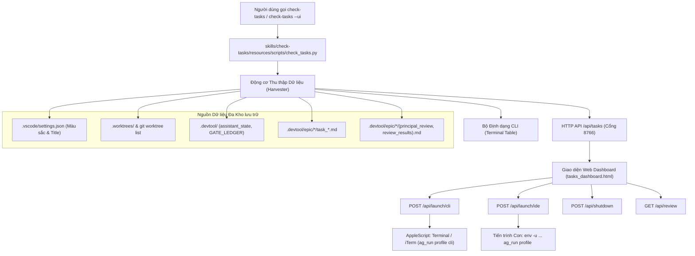

# Thiết kế Cross-Repo Tasks & Context Dashboard

## Mục lục
- [Tổng quan](#tổng-quan)
- [Bối cảnh và Mục tiêu](#bối-cảnh-và-mục-tiêu)
- [Cảnh báo Shared Contract](#cảnh-báo-shared-contract)
- [Kiến trúc Hệ thống và Cấu trúc Tập tin](#kiến-trúc-hệ-thống-và-cấu-trúc-tập-tin)
- [Động cơ Thu thập Dữ liệu và Quét Đa Kho lưu trữ](#động-cơ-thu-thập-dữ-liệu-và-quét-đa-kho-lưu-trữ)
- [Web Server, REST API và Cơ chế Kích hoạt](#web-server-rest-api-và-cơ-chế-kích-hoạt)
- [Kiến trúc Giao diện UI và UX với Modal Dialogs](#kiến-trúc-giao-diện-ui-và-ux-với-modal-dialogs)
- [Động cơ Trạng thái Vòng đời và Quyết định của Con người](#động-cơ-trạng-thái-vòng-đời-và-quyết-định-của-con-người)
- [Giao diện Dòng lệnh CLI và Tích hợp Slash Command](#giao-diện-dòng-lệnh-cli-và-tích-hợp-slash-command)
- [Xử lý Lỗi, An toàn và Đồng thời](#xử-lý-lỗi-an-toàn-và-đồng-thời)
- [Kế hoạch Kiểm thử và Tiêu chí Nghiệm thu](#kế-hoạch-kiểm-thử-và-tiêu-chí-nghiệm-thu)

---

## Tổng quan

**Cross-Repo Tasks & Context Dashboard** (`check-tasks`) là công cụ dòng lệnh điều hành và bảng theo dõi tương tác thời gian thực chuẩn Dark Mode, được thiết kế để theo dõi và điều phối các epic phát triển song song trên toàn bộ các kho lưu trữ trong thư mục tổng `/Users/danhdueexoictif/AllProjects`.

Kế thừa kiến trúc hiệu năng cao của `check-quota`, `check-tasks` cung cấp cả bộ định dạng terminal CLI tốc độ cao và daemon Web Dashboard nền cục bộ (mặc định cổng `8766`). Hệ thống tự động thu thập và đồng bộ:
1. Giao diện màu sắc và tiêu đề cửa sổ trực tiếp từ `.vscode/settings.json` của từng dự án.
2. Danh sách Git worktrees và các epic đang triển khai song song giữa các repo.
3. Tiến độ thực tế và trạng thái Kanban chi tiết của từng task từ `.devtool/epic/` và `.devtool/features/`.
4. Bộ nhớ dự án hai tầng đã được kiểm chứng (Two-Tier Project Memory từ `/save-context` và `/resume-context`) gồm `.devtool/PROJECT_LEDGER.md` (Tầng 1) và `.devtool/assistant_state.md` / `activity_stream.log` (Tầng 2).
5. Bảng tổng hợp kết quả triage qua từng vòng (Rounds) và trạng thái Gate từ `/principal-review` và `/cross-model-review`.
6. Các nút kích hoạt native một chạm để mở Profile Antigravity CLI và Antigravity IDE trực tiếp tại thư mục worktree tương ứng.

## Bối cảnh và Mục tiêu

### Vấn đề Hiện tại
Trong hệ sinh thái đa kho lưu trữ nơi các lập trình viên đồng thời duy trì nhiều dự án (`ai-agent-tools`, `lyrics-sync`, `D3Nexus`, `nexus`, `digital_wallet`), mỗi repo thường xuyên triển khai nhiều epic song song bên trong các Git worktree độc lập (`.worktrees/<epic_slug>`).

Hiện tại:
- Lập trình viên thiếu một giao diện tập trung duy nhất để nắm bắt repo nào đang có worktree hoạt động, epic nào đang được xử lý, task cụ thể nào đang được lập trình (`status: "in_progress"`), và Gate nào đã được thông qua.
- Việc kiểm tra ngữ cảnh đòi hỏi phải duyệt thủ công qua các thư mục `.devtool/`, `PROJECT_LEDGER.md`, và `GATE_LEDGER.md` trên nhiều thư mục khác nhau.
- Kết quả đánh giá từ `/principal-review` (Giai đoạn 2) và `/cross-model-review` (Giai đoạn 3) nằm rải rác trong các tệp Markdown lớn (`principal_review.md`, `review_results.md`), khiến việc quét nhanh các lỗi Critical/Important chưa xử lý qua từng vòng trở nên cồng kềnh.
- Việc chuyển đổi giữa các terminal worktree và mở đúng profile cô lập của Antigravity CLI hoặc IDE đòi hỏi phải nhớ và gõ các lệnh shell thủ công (`ag_run <profile> ...`).

### Mục tiêu Cốt lõi
1. **Khả năng Quan sát Hợp nhất**: Tổng hợp và hiển thị toàn bộ các repo và các epic chạy song song trên một màn hình Dark Mode duy nhất.
2. **Đồng bộ Nhận diện Dự án Động**: Tự động áp dụng màu viền thẻ, hiệu ứng phát sáng (glow), và nhãn tiêu đề tương ứng với `workbench.colorCustomizations` và `window.title` khai báo trong `.vscode/settings.json` của mỗi repo.
3. **Bộ Kích hoạt Native Một Chạm**: Cung cấp các nút tinh gọn `[ 💻 Mở CLI ]` và `[ 🚀 Mở IDE ]` trên mỗi thẻ epic để mở terminal CLI hoặc IDE theo đúng profile và đúng worktree.
4. **Tương tác Modal Dialog (Không Chuyển Trang)**: Giữ người dùng luôn ở màn hình Overview chính. Các thao tác chi tiết được mở dưới dạng Dialog Pop-up không gián đoạn:
   - **Kanban Board Dialog**: Bảng Kanban 5 cột (`Backlog`, `To Do`, `In Progress`, `Review`, `Done`) chuẩn theo giao diện Antigravity gốc.
   - **Two-Tier Contexts Dialog**: Màn hình đối chiếu Tầng 1 (Bất biến vĩnh viễn) và Tầng 2 (Trạng thái hiện thời).
   - **Review Triage Dialogs**: Dialog chuyên dụng cho `/principal-review` và `/cross-model-review` hiển thị trọn vẹn metadata của vòng (Round, Candidate SHA, Reviewer, Thinking / Effort Level, Verdict) cùng bảng triage 5 cột với tags phân loại mức độ và ngăn kéo hiển thị bằng chứng thô.
5. **Đồng bộ Giao diện Kép**: Hỗ trợ đầy đủ cả dòng lệnh terminal (`check-tasks`, `check-tasks all`) lẫn web daemon nền (`check-tasks --ui`, `check-tasks --stop`).

## Cảnh báo Shared Contract

Xác nhận không áp dụng `shared-contracts/`: `ai-agent-tools` là kho lưu trữ bộ công cụ chia sẻ và không liên kết trực tiếp với các hợp đồng chia sẻ domain. Tất cả các bước kiểm tra hợp đồng tại các repo vệ tinh/hub hạ nguồn đều được thực thi ở chế độ chỉ đọc trong quá trình thu thập trạng thái nhiệm vụ.

## Kiến trúc Hệ thống và Cấu trúc Tập tin

Tính năng tuân thủ cấu trúc phân tách rõ ràng được thiết lập bởi `check-quota`:

```text
ai-agent-tools/
├── bin/
│   └── check-tasks                              # Entrypoint thực thi toàn cục trong PATH
├── scripts/
│   ├── check_tasks.py                           # Wrapper CLI độc lập
│   └── tasks_server.py                          # Wrapper daemon server độc lập
└── skills/
    └── check-tasks/
        ├── SKILL.md                             # Tài liệu đặc tả skill và lệnh slash command
        └── resources/
            ├── scripts/
            │   ├── check_tasks.py               # Động cơ Thu thập Dữ liệu & Định dạng CLI
            │   └── tasks_server.py              # HTTP Daemon Server & API Kích hoạt
            └── dashboard/
                └── tasks_dashboard.html         # Giao diện Single-Page Dark Mode với Tailwind CSS & Modal Dialogs
```

### Luồng Hoạt động Thành phần



## Động cơ Thu thập Dữ liệu và Quét Đa Kho lưu trữ

`skills/check-tasks/resources/scripts/check_tasks.py` triển khai bộ quét tệp bất đồng bộ, phản hồi nhanh dưới 150ms:

1. **Khám phá Kho lưu trữ**:
   - Quét thư mục gốc `WORKSPACE_ROOT` (mặc định là `/Users/danhdueexoictif/AllProjects`).
   - Quét danh sách các repo đã biết: `ai-agent-tools`, `lyrics-sync`, `D3Nexus`, `nexus`, `digital_wallet`, cùng các repo con phát hiện động.
2. **Trích xuất Cấu hình Nhận diện (`.vscode/settings.json`)**:
   - Đọc `workbench.colorCustomizations["titleBar.activeBackground"]` (ví dụ: `#7f1d1d` cho lyrics-sync, `#065f46` cho D3Nexus, `#0d47a1` cho nexus, `#b45309` cho ai-agent-tools).
   - Đọc `window.title` để bóc tách profile tài khoản đang hoạt động (`@hau`, `@buivantrong8901`, `@danhdue`), tên Epic tiếng Việt, và giai đoạn hiện thời.
3. **Lập Bản đồ Worktrees và Epics**:
   - Chạy lệnh `git -C <repo> worktree list` và duyệt thư mục `<repo>/.worktrees/`.
   - Khớp nối các thư mục worktree với các epic trong `<repo>/.devtool/epic/<slug>/`.
4. **Nhận diện Task Hiện thời và Tiến độ Thực tế**:
   - Quét các tệp `task_*.md` trong `.devtool/features/` và `.devtool/epic/<slug>/`.
   - Phân tích frontmatter: `id`, `status` (`backlog`, `todo`, `in_progress`, `review`, `done`), `priority`, `order`, `labels`.
   - Xác định Task hiện tại: mục đầu tiên mang `status: "in_progress"` (hoặc `todo` đầu tiên nếu chưa bắt đầu).
   - Tính toán tỷ lệ hoàn thành: `done_count / total_count * 100`.
5. **Thu thập Sổ cái Gate và Bộ nhớ Ngữ cảnh**:
   - Phân tích `.devtool/GATE_LEDGER.md` để lấy bản ghi Gate mới nhất (Gate 1–5).
   - Đọc `.devtool/PROJECT_LEDGER.md` cho các bất biến và cột mốc Tầng 1 vĩnh viễn.
   - Đọc `.devtool/assistant_state.md` và `.devtool/activity_stream.log` cho trạng thái Tầng 2 hiện thời.
6. **Bộ phân tích Kết quả Đánh giá (Review Findings Parser)**:
   - Đọc `principal_review.md` và `review_results.md`.
   - Tách các phân đoạn vòng (`## Round 1`, `## Round 2`, `## Round 3`).
   - Trích xuất thông tin header: `Date`, `SHA`, `CLI`, `Model`, `Thinking`, `Verdict`.
   - Phân tích các hàng bảng Markdown thành các đối tượng có cấu trúc (`#`, `Severity`, `Location`, `Problem`, `Decision`).

## Web Server, REST API và Cơ chế Kích hoạt

Daemon server tích hợp sử dụng thư viện chuẩn `http.server` của Python trên cổng `8766`, ghi PID vào `/tmp/agy_tasks_server.pid`:

### Các Endpoints API
- `GET /`: Phục vụ tệp giao diện `tasks_dashboard.html`.
- `GET /api/tasks`: Trả về JSON hoàn chỉnh của toàn bộ repos, worktrees, active epics, tasks, màu sắc và reviews. Bộ nhớ đệm 3 giây giúp loại bỏ đọc đĩa dư thừa.
- `GET /api/review?repo=<name>&round=<N>`: Trả về kết quả review và bằng chứng raw evidence cho repo và round chỉ định.
- `POST /api/launch/cli`: Mở cửa sổ Terminal hoặc iTerm2 độc lập qua AppleScript:
  ```json
  {
    "profile": "hau",
    "worktree": "/Users/danhdueexoictif/AllProjects/ai-agent-tools/.worktrees/autonomous_lifecycle_runner"
  }
  ```
  Kích hoạt:
  ```bash
  osascript -e 'tell application "Terminal"
    do script "cd \"<worktree>\" && source ~/.zshrc && ag_run <profile> cli"
    activate
  end tell'
  ```
- `POST /api/launch/ide`: Mở ứng dụng Electron Antigravity IDE cô lập:
  ```json
  {
    "profile": "hau",
    "worktree": "/Users/danhdueexoictif/AllProjects/ai-agent-tools/.worktrees/autonomous_lifecycle_runner"
  }
  ```
  Kích hoạt:
  ```bash
  env -u ELECTRON_RUN_AS_NODE -u VSCODE_GIT_IPC_HANDLE -u VSCODE_IPC_HOOK_CLI zsh -i -c "ag_run <profile> \"<worktree>\""
  ```
- `POST /api/shutdown`: Dừng server HTTP daemon an toàn.

### Các Lệnh Quản trị Server
- `check-tasks --ui`: Khởi động daemon nền (nếu chưa chạy) và tự động mở trình duyệt mặc định.
- `check-tasks --ui -f`: Khởi chạy ở chế độ foreground phục vụ gỡ lỗi trực tiếp.
- `check-tasks --stop`: Dừng server daemon nền an toàn qua PID.
- `check-tasks --status`: Kiểm tra trạng thái cổng `8766` và tệp PID.

## Kiến trúc Giao diện UI và UX với Modal Dialogs

Giao diện Web (`tasks_dashboard.html`) được xây dựng dưới dạng ứng dụng đơn trang phản ứng nhanh với Tailwind CSS và hệ màu tối:

### 1. Màn hình Overview Chính
- **Đồng Bộ Tone Màu Từ `.vscode/settings.json` (Quy Chuẩn Rule 8 & TitleBar)**:
  - Mỗi thẻ Repo và các thành phần con (nút bấm primary, viền thẻ, bóng glow, badge profile, branch tags) tuân thủ nghiêm ngặt tone màu quy định tại `.vscode/settings.json` (`titleBar.activeBackground`):
    - 🟠 `ai-agent-tools`: Tone Hổ Phách Ấm (`#b45309`), viền `#b45309`, glow `rgba(180, 83, 9, 0.35)`, nút IDE nền `#b45309`.
    - 🔴 `lyrics-sync`: Tone Đỏ Thẫm (`#7f1d1d`), viền `#7f1d1d`, glow `rgba(127, 29, 29, 0.35)`, nút IDE nền `#7f1d1d`.
    - 🟢 `D3Nexus`: Tone Xanh Ngọc Lục Bảo (`#065f46`), viền `#065f46`, glow `rgba(6, 95, 70, 0.35)`, nút IDE nền `#065f46`.
    - 🔵 `nexus`: Tone Xanh Hoàng Gia (`#0d47a1`), viền `#0d47a1`, glow `rgba(13, 71, 161, 0.35)`, nút IDE nền `#0d47a1`.
- **Danh sách Worktrees**: Hiển thị các worktree đang hoạt động kèm tên nhánh Git.
- **Vùng Nổi bật Task Hiện tại**: Làm nổi bật rõ ràng task đang ở trạng thái `in_progress`.
- **Hàng Chỉ số Chất lượng Vòng đời (Human-Essential Metrics)**:
  - 4 thẻ con hiển thị các chỉ số kiểm chứng cốt lõi mà lập trình viên cần nắm bắt ngay lập tức:
    1. `Unit & Integration Tests`: Tỷ lệ pass test thực tế (`19 / 19 PASS (100%)`).
    2. `BDD Scenarios Traceability`: Độ bao phủ kịch bản hành vi (`17 / 17 Covered`).
    3. `Git Worktree State`: Trạng thái cây làm việc (`Clean (0 uncommitted)`).
    4. `Profile Quota (5H Window)`: Hạn mức tài nguyên profile còn lại (`78% còn lại`).
  - **Quy chuẩn Đường kẻ Line Sắc nét (Không bo cong)**: Các đường line chỉ thị màu sắc bên trái (`border-left: 3px solid <color>`) được giữ thẳng tuyệt đối bằng cách triệt tiêu bán kính góc trái (`border-radius: 0 6px 6px 0; border-top-left-radius: 0; border-bottom-left-radius: 0;`), loại bỏ hiện tượng viền bị uốn lượn hình vòng cung gây chói mắt.
- **Hộp Chỉ dẫn "⚡ Bước Tiếp Theo Con Người Cần Quyết Định"**: Hiển thị nổi bật quyết định hoặc hành động tiếp theo mà Human Architect cần thực thi theo Finite State Machine của `/dev-lifecycle`.
- **Thanh Tiến độ Phân đoạn**: Biểu thị trực quan tỷ lệ Done (xanh lá), In Progress (cam), và Todo (xám).
- **Quy chuẩn Màu sắc Nút Bấm Đồng nhất Giữa các Repos (Unified Button Palette Across Repos)**:
  - **Loại bỏ hiện tượng viền cầu vồng (Rainbow border clutter)**: Tuyệt đối không dùng mỗi nút một màu viền neon khác nhau (`vàng`, `lam`, `tím`, `hồng`, v.v.) gây rối mắt cho lập trình viên.
  - **Tone màu trung tính thanh lịch cho các nút phụ**: Toàn bộ các nút chức năng phụ (`[ 💻 Mở CLI ]`, `[ 📊 Xem Kanban ]`, `[ 🧠 Xem Contexts ]`, `[ 🔬 Review ]`, `[ 🛡️ Review ]`) sử dụng chung kiểu dáng slate tối giản (`background: #1e293b; border: 1px solid #334155; color: #cbd5e1; hover: background: #334155; border-color: #64748b; color: #ffffff;`).
  - **Nút Primary CTA đồng nhất**: Nút `[ 🚀 Mở IDE ]` sử dụng màu xanh primary chuẩn (`background: #2563eb; border: 1px solid #3b82f6; color: #ffffff;`) đồng nhất trên toàn bộ các repo cards.
  - **Phân tách ranh giới nhận diện repo**: Màu sắc đại diện cho repo từ `.vscode/settings.json` (`#b45309`, `#7f1d1d`, `#065f46`, `#0d47a1`) chỉ được áp dụng cho viền ngoài thẻ (card border), bóng glow và badge định danh repo/profile (`@hau`, `@buivantrong8901`, `@danhdue`, `@tess`), giữ cho khu vực thanh công cụ thao tác bên trong thẻ luôn đồng nhất, êm dịu và tập trung cao độ.
- **Bản Đồ Điều Hướng: Nút Bấm ➔ Màn Hình / Dialog Pop-up**:
  | Nút Bấm (Button) | Loại Tương Tác | Đích Đến / Dialog Hiển Thị | Chức Năng & Dữ Liệu |
  |---|---|---|---|
  | `[ 💻 Mở CLI ]` | Hành vi OS (AppleScript) | Mở tab Terminal / iTerm2 mới | Kích hoạt subshell profile `ag_run <profile> cli` trỏ thẳng vào worktree |
  | `[ 🚀 Mở IDE ]` | Hành vi OS (Subprocess) | Mở cửa sổ Antigravity IDE mới | Khởi chạy Electron IDE cách ly IPC handle trỏ vào worktree |
  | `[ 📊 Xem Kanban ]` | Modal Dialog Pop-up | Bảng Kanban 5 Cột Pop-up | Mở Dialog 5 cột (Backlog, Todo, In Progress, Review, Done) đồng bộ từ `task_*.md` |
  | `[ 🧠 Xem Contexts ]` | Modal Dialog Pop-up | Dialog Đối Chiếu 2 Tầng | So sánh Tầng 1 (`PROJECT_LEDGER.md`) và Tầng 2 (`assistant_state.md`, `activity_stream.log`) |
  | `[ 🛡️ Principal Review ]` | Modal Dialog Pop-up | Dialog Triage Đánh Giá HLD/Tasks | Hiển thị kết quả kiểm tra kiến trúc Stage 2 qua các vòng Round 1-3 |
  | `[ 🔬 Cross-Model Review ]` | Modal Dialog Pop-up | Dialog Triage Đánh Giá Code/Tests | Hiển thị Header Metadata (SHA, Reviewer, Thinking, Verdict) và Bảng Triage 7 cột chuẩn Ảnh mẫu 2 |

### 2. Dialog Modal Bảng Kanban
- Hiển thị cấu trúc 5 cột:
  - `● Backlog`
  - `● To Do`
  - `● In Progress`
  - `● Review`
  - `● Done`
- Thẻ task gồm: Tiêu đề task, Nhãn độ ưu tiên (`High`, `Med`, `Low`), Tài liệu tham chiếu, Nhãn nhánh (`⎇ <epic_slug>`), và các thẻ chuyên mục (`docs`, `reference`, `telemetry`).
- Các cột trống hiển thị dòng chữ `No features` mờ ở giữa.

### 3. Dialog Modal Bộ nhớ Hai Tầng (Two-Tier Context)
- Bố cục so sánh 2 cột:
  - **Cột Trái (Tầng 1 - Sổ cái Vĩnh viễn)**: Bất biến Hệ thống và Cột mốc hoàn thành từ `PROJECT_LEDGER.md`.
  - **Cột Phải (Tầng 2 - Trạng thái Hiện thời)**: Quyết định đã chốt, Trạng thái Gate Ledger, và Dòng nhật ký hoạt động gần nhất.

### 4. Dialog Modal Kết quả Review (Principal & Cross-Model)
- Tuân thủ phong cách tối giản thanh lịch:
  - **Header Metadata**:
    - `Candidate SHA`: Mã commit đầy đủ trong thẻ code.
    - `Reviewer`: Tên người đánh giá và model (ví dụ: `Claude (model sonnet)`).
    - `Effort / Thinking Level`: `High`.
    - `Verdict`: Kết luận và tổng hợp số lượng lỗi (ví dụ: `CHANGES REQUIRED (3 Critical, 1 Important findings)`).
  - **Bộ Chọn Vòng (Round Selector)**: Chuyển đổi giữa `Round 1`, `Round 2`, và `Round 3`.
  - **Bảng Triage 5 Cột**:
    - `#`: Số thứ tự lỗi.
    - `Severity`: Thẻ tag màu sắc theo mức độ (`Critical` màu đỏ, `Important` màu cam, `Minor` màu xanh).
    - `Location`: Đường dẫn tệp monospace kèm số dòng in đậm.
    - `Problem`: Mô tả vấn đề kèm highlight các từ khóa mã nguồn.
    - `Decision`: Trạng thái xử lý (`fixed in <sha>` hoặc `dismissed: <lý do>`).
  - **Ngăn Kéo Bằng Chứng Mở rộng (Raw Evidence Drawer)**: Accordion có thể click mở rộng hiển thị kết quả từ `Raw output:`.

## Động cơ Trạng thái Vòng đời và Quyết định của Con người

Để loại bỏ sự mơ hồ cho lập trình viên khi điều phối nhiều epic chạy song song, `check-tasks` tích hợp động cơ kiểm tra trạng thái vòng đời tất định (Deterministic Lifecycle FSM Engine). Mục tiêu là luôn xác định chính xác và nhất quán: **"⚡ Bước tiếp theo con người cần quyết định"** mà không cần phỏng đoán.

### 1. Cơ chế Kiểm chứng Kép Tất định (Deterministic Dual-Check)

Hệ thống truy xuất thông tin này qua hai nguồn dữ liệu độc lập:

1. **Trạng thái Đĩa Cứng Tức thời (`assistant_state.md` / `state/<epic>.md`)**:
   - Khi các AI Agent thực hiện quy trình `/dev-lifecycle`, mỗi lần dừng lại chờ phê duyệt hoặc kết thúc một giai đoạn, lệnh `/save-context` bắt buộc phải ghi nhận trường `## Next Immediate Step:`.
   - Ví dụ: Sau khi Gate 4 PASS, trường này ghi rõ: `- Review Choice: (1) Kết thúc (/finish) hoặc (2) Chạy Cross-Model Review (Claude / Codex / Kiro)`.
2. **Động cơ Suy luận Máy Trạng thái Hữu hạn (Deterministic FSM Engine)**:
   - Trong trường hợp tệp `assistant_state.md` chưa được ghi hoặc lập trình viên mở một epic mới, `check-tasks` tự động suy luận trạng thái dựa trên các nguồn dữ liệu bất biến:
     - Sổ cái Gate: `.devtool/GATE_LEDGER.md` (Gate 1, 2, 3, 4, 5 đã được ghi nhận hay chưa).
     - Trạng thái Tasks: Danh sách tệp `task_*.md` (số lượng task `done`, `in_progress`, `todo`).
     - Đánh giá Chất lượng: Kết quả kiểm tra trong `review_results.md` hoặc `principal_review.md`.

### 2. Bảng Ánh xạ 8 Trạng thái Quyết định Cốt lõi của Con người

| Giai đoạn Vòng đời | Điều kiện Trạng thái Máy | ⚡ Bước tiếp theo con người cần quyết định |
|---|---|---|
| **Stage 1 (Inception)** | Chưa có Gate 1 trong `GATE_LEDGER.md`, tài liệu spec tồn tại | **Phê duyệt Gate 1 (Design Spec)** để chuyển giao sang Stage 2 |
| **Stage 2 (Architecture)** | Gate 1 PASS, chưa có Gate 2, đang soạn thảo HLD/BDD/Tasks | AI Assistant đang thiết kế HLD & Task Breakdown (`/dev-designer`) |
| **Stage 2 Exit (Handoff)** | Gate 2 PASS, chưa có Gate 3, epic đã đóng gói (`handoff.md`) | **Lựa chọn Handoff**: (1) Chạy `/principal-review` hoặc (2) Vào Stage 3 (`/dev-implementation`) |
| **Stage 2 Review Triage** | Vòng Principal Review có findings `Critical`/`Important` | **Phê duyệt Quyết định Triage** (Valid / False Positive / Fix) cho các lỗi |
| **Stage 3 Phase 1 (Order)** | Gate 2 PASS, worktree đã sẵn sàng, chưa ghi nhận Gate 3 | **Phê duyệt Gate 3**: Xác nhận thứ tự thực thi Kanban tasks và phân tách worktree |
| **Stage 3 Phase 2 (TDD)** | Gate 3 PASS, các tasks đang có trạng thái `in_progress` | AI Programmer đang tự động TDD từng task (Không cần con người can thiệp) |
| **Stage 3 Phase 4 (Review)** | Toàn bộ tasks `done`, Gate 4 PASS, chưa có Gate 5 | **Review Choice (Bắt buộc theo Rule 5)**: Lựa chọn (1) Kết thúc và đóng nhánh (`/finish`) hoặc (2) Chạy Cross-Model Review độc lập bằng Claude / Codex / Kiro |
| **Stage 3 Phase 4.1 (Sign-off)** | Gate 4 PASS sau các vòng review, sẵn sàng đóng nhánh | **Phê duyệt Gate 5 (Sign-off Kanban)**: Xác nhận dọn dẹp worktree và lưu trữ cột mốc |

## Giao diện Dòng lệnh CLI và Tích hợp Slash Command

### Cách Sử dụng CLI
```bash
# Hiển thị tóm tắt cho repo hiện tại hoặc worktree đang đứng
check-tasks

# Hiển thị bảng tổng hợp toàn bộ các repo trong /AllProjects
check-tasks all

# Hiển thị chi tiết cho một repo cụ thể
check-tasks lyrics-sync

# Khởi động web dashboard chạy ngầm
check-tasks --ui

# Dừng web dashboard server đang chạy
check-tasks --stop

# Kiểm tra trạng thái server daemon
check-tasks --status
```

### Tích hợp Slash Command `/check-tasks`
Khi được kích hoạt trong khung chat, Antigravity sẽ nhúng:
```html
<agent-embed src="file:///Users/danhdueexoictif/AllProjects/ai-agent-tools/skills/check-tasks/resources/dashboard/tasks_dashboard.html"></agent-embed>
```
Kèm theo thẻ tóm tắt dòng lệnh ngắn gọn về các worktree đang chạy, epic dở dang, và trạng thái Gate gần nhất.

## Xử lý Lỗi, An toàn và Đồng thời

1. **An toàn Biên giới Hệ điều hành Đa Profile (Rule 9)**:
   - Việc mở CLI hoặc IDE tuyệt đối diễn ra trong subshell cục bộ (`ag_run <profile>`), không thay đổi Keychain mặc định của OS hay biến `$HOME` toàn cục.
2. **Thoái lui Mượt mà khi Thiếu Tệp**:
   - Nếu thiếu `.vscode/settings.json`, tự động dùng màu mặc định chuẩn (`#7f1d1d`, `#065f46`, `#0d47a1`, `#b45309`) hoặc bảng màu băm định trước.
   - Nếu chưa có `review_results.md` hoặc `principal_review.md`, nút tương ứng sẽ hiển thị trạng thái vô hiệu hóa `No reviews yet`.
   - Nếu không có worktree nào, thẻ hiển thị `Clean working tree (no active worktree)`.
3. **An toàn Tránh Xung đột Cổng**:
   - Nếu cổng `8766` đã có tiến trình khác chiếm dụng, script kiểm tra xem có phải của `check-tasks` không. Nếu thuộc ứng dụng khác, tự động tăng an toàn lên `8767`.
4. **Bảo vệ Tệp PID**:
   - Lưu tại `/tmp/agy_tasks_server.pid`. Luôn kiểm tra sự tồn tại của tiến trình bằng `kill -0 <pid>` trước khi phát lệnh dừng hoặc khởi động lại.

## Kế hoạch Kiểm thử và Tiêu chí Nghiệm thu

| ID | Chuyên mục | Bước Kiểm thử | Tiêu chí Thành công |
|---|---|---|---|
| **V1** | Quét dữ liệu | Chạy `python3 bin/check-tasks all --json` trên `/Users/danhdueexoictif/AllProjects` | Phát hiện chính xác toàn bộ repos, worktrees, active epics và mã màu `.vscode/settings.json` không gặp lỗi |
| **V2** | Terminal CLI | Chạy `check-tasks all` trong terminal | Hiển thị bảng ANSI màu sắc liệt kê repos, epics, tasks hiện tại và Gates |
| **V3** | Vòng đời Daemon | Chạy `check-tasks --ui`, kiểm tra `curl http://localhost:8766/api/tasks`, chạy `check-tasks --stop` | Server khởi động, API trả về JSON hợp lệ trong < 200ms, server dừng sạch sẽ |
| **V4** | Kanban Modal | Mở Web UI, click `[ 📊 Xem Kanban ]` | Dialog modal mở tức thì, hiển thị đủ 5 cột với thẻ task thực tế khớp ảnh mẫu |
| **V5** | Context Modal | Click `[ 🧠 Xem Contexts ]` | Dialog modal hiển thị Sổ cái Tầng 1 và Trạng thái Tầng 2 |
| **V6** | Review Modal | Click `[ 🔬 Cross-Model Review ]` trên `ai-agent-tools` | Dialog hiển thị Bộ chọn Round, Candidate SHA, Reviewer, Thinking Level, Verdict, và bảng triage 5 cột với tags độ nghiêm trọng |
| **V7** | Bộ Kích hoạt | Click `[ 💻 Mở CLI ]` và `[ 🚀 Mở IDE ]` | CLI mở tab terminal mới với môi trường profile; IDE mở cửa sổ Antigravity trỏ đúng worktree |
| **V8** | Document QA | Chạy `check_document.py` kiểm tra cặp tài liệu song ngữ | Đạt kết quả PASS không có lỗi lint, lỗi liên kết ToC hay lệch cấu trúc song ngữ |
