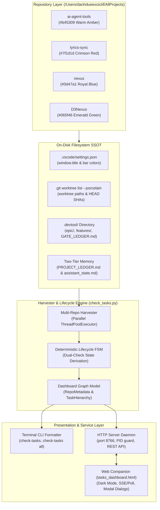
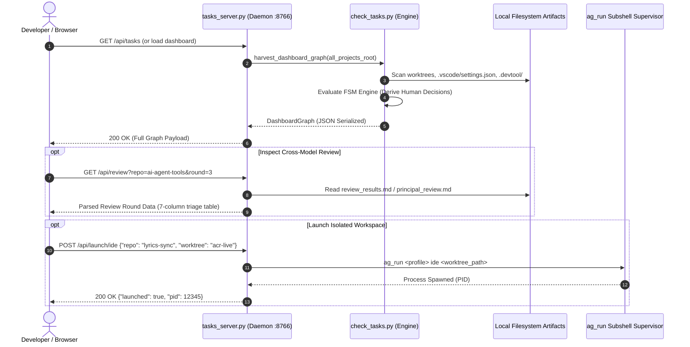

# Cross-Repo Tasks and Context Dashboard High-Level Design

## Table of Contents

- [Meta Data](#meta-data)
- [Background](#background)
- [Goals and Non-Goals](#goals-and-non-goals)
- [Architecture and Technical Design](#architecture-and-technical-design)
- [Feature Maintenance Map](#feature-maintenance-map)
- [Deterministic Lifecycle FSM Engine](#deterministic-lifecycle-fsm-engine)
- [Shared Contract Impact](#shared-contract-impact)
- [Integration Test Plan and Boundary Matrix](#integration-test-plan-and-boundary-matrix)
- [Verification Environment](#verification-environment)
- [Rollout Strategy and Mitigation](#rollout-strategy-and-mitigation)
- [Kanban Tasks Breakdown](#kanban-tasks-breakdown)

## Meta Data

- **Epic name**: `check_tasks_dashboard`
- **Status**: In Progress
- **Target release**: Next plugin release (v1.29.0)
- **Platform**: Python tooling / agent skill kit
- **Depends on epic**: `autonomous_lifecycle_runner`
- **Source Spec**: [Cross-Repo Tasks & Context Dashboard Design](2026-11-11-check-tasks-dashboard-design.en.md)

## Background

When developers and autonomous AI Agents orchestrate multi-project ecosystems across `/Users/danhdueexoictif/AllProjects` (`ai-agent-tools`, `lyrics-sync`, `nexus`, `D3Nexus`), they face cognitive overhead tracking:
1. Parallel git worktrees, active branches, and dirty working trees across projects.
2. In-flight epics, lifecycle stages, and real-time Kanban task progress (`done`, `in_progress`, `todo`).
3. Disparate repository styling and window signatures configured in `.vscode/settings.json`.
4. Two-Tier Project Memory (`.devtool/PROJECT_LEDGER.md` Tier 1 permanent history and `.devtool/assistant_state.md` / `activity_stream.log` Tier 2 snapshot memory).
5. Next required human decisions: developers frequently lose context on whether an epic is waiting for Gate 1 approval, Gate 2 task sign-off, Principal Review triage, Gate 3 order confirmation, Gate 4 Review Choice, or Gate 5 merge sign-off.

Inheriting the high-performance, self-contained architecture of `check-quota`, the **Cross-Repo Tasks & Context Dashboard** (`check-tasks`) introduces both a blazing-fast terminal CLI formatter and a persistent local Web Dashboard daemon (port `8766`). The system scans repositories in parallel, extracts architectural invariants, evaluates an automated Lifecycle Finite State Machine (FSM), and surfaces a unified real-time operations view.

## Goals and Non-Goals

### Goals

- Deliver a high-performance scanner and harvester module (`scripts/check_tasks.py`) that discovers all repositories in `/Users/danhdueexoictif/AllProjects`, parsing worktrees, `.vscode/settings.json`, `.devtool/epic/`, `.devtool/features/`, and Two-Tier memory artifacts.
- Implement a Deterministic Lifecycle FSM Engine that resolves the exact human decision state across 8 lifecycle gates without guesswork.
- Build an ANSI-colored terminal CLI supporting compact single-repo summaries (`check-tasks`), multi-repo tabular overviews (`check-tasks all`), and deep repository inspection (`check-tasks <repo>`).
- Implement a zero-dependency Python `http.server` daemon (`scripts/tasks_server.py`) serving a unified JSON REST API (`/api/tasks`, `/api/review`, `/api/launch`, `/api/shutdown`) on port `8766` with PID guard protection and auto-port increment.
- Build a lightweight, responsive Dark Mode web companion (`tasks_dashboard.html`) featuring project cards, worktree chips, interactive Kanban meters, a 7-column Cross-Model Review modal, and one-click CLI/IDE launchers.
- Support Rule 9 Multi-Profile OS Boundary Safety for native launcher operations, dispatching localized subshells via `ag_run <profile>` without mutating host OS keychain or `$HOME`.
- Package the tool into an Antigravity skill (`skills/check-tasks/SKILL.md`) with `/check-tasks` slash command support.

### Non-Goals

- Mutating repository git states, checking out branches, or auto-committing code from the dashboard.
- Modifying remote GitHub repositories or triggering git push/fetch operations.
- Storing task states in an external centralized database (e.g., PostgreSQL or Redis); all state is derived directly from filesystem artifacts.
- Replacing project-level quality checks or running full test suites from within the dashboard daemon.

## Architecture and Technical Design

### High-Level Architecture



### Sequence Diagram: Real-Time Scanning & Interactive Review



## Feature Maintenance Map

| Capability | Canonical Source Path & Entry Points | Core Invariants & Config Knobs | Extension & Troubleshooting Guide |
|---|---|---|---|
| **Data Harvesting** | `skills/check-tasks/resources/scripts/check_tasks.py` (`harvest_dashboard_graph`, `scan_repo`) | Scans all subdirectories in `/Users/danhdueexoictif/AllProjects`; skips non-git folders gracefully | Add new filesystem sensors to `scan_repo`; inspect regex parsers for worktrees |
| **Lifecycle FSM** | `skills/check-tasks/resources/scripts/check_tasks.py` (`derive_lifecycle_state`) | Strict adherence to the 8 Core Human Decision states; dual-checks `assistant_state.md` against `GATE_LEDGER.md` | Update state transitions when lifecycle gates change in `dev-lifecycle` |
| **Terminal CLI** | `skills/check-tasks/resources/scripts/check_tasks.py` (`main`, `render_terminal_table`, `render_single_repo`) | Uses ANSI colors matching repository color signatures; falls back to plain text if stdout is not a TTY | Modify column layouts in `render_terminal_table`; adjust terminal width heuristics |
| **Daemon Server** | `skills/check-tasks/resources/scripts/tasks_server.py` (`TasksServer`, `TasksHandler`) | Binds to `localhost:8766`; PID guard at `/tmp/agy_tasks_server.pid`; safe port bump if occupied by foreign process | Check `/tmp/agy_tasks_server.pid` and `kill -0 <pid>` if server fails to restart |
| **Web Dashboard UI** | `skills/check-tasks/resources/dashboard/tasks_dashboard.html` | Self-contained single-file HTML/JS/CSS; zero npm dependencies; responsive Dark Mode | Update CSS tokens in `:root`; enhance client-side event handlers in script section |
| **Skill & Slash Cmd** | `skills/check-tasks/SKILL.md` | Skill triggers on `/check-tasks` and keywords ("check tasks", "dashboard", "worktrees") | Register in `.agents/quality/python-quality.json` capabilities list |

## Deterministic Lifecycle FSM Engine

The FSM Engine resolves ambiguous repository states into exactly one actionable prompt for the human architect:

| Stage Name | Gate Ledger Condition | Disk / Kanban Condition | ⚡ Next Immediate Step for Human Decision |
|---|---|---|---|
| **Stage 1 (Inception)** | Gate 1 absent | Design spec exists in `docs/` or `.devtool/epic/` | **Approve Gate 1 (Design Spec)** to advance to Stage 2 |
| **Stage 2 (Architecture)** | Gate 1 PASS, Gate 2 absent | Drafting HLD/BDD/Tasks | AI Assistant drafting HLD & Task Breakdown (`/dev-designer`) |
| **Stage 2 Exit (Handoff)** | Gate 2 PASS, Gate 3 absent | Epic packaged (`handoff.md`) | **Handoff Choice**: (1) Run `/principal-review` or (2) Enter Stage 3 (`/dev-implementation`) |
| **Stage 2 Review Triage** | Gate 2 PASS, PR in progress | Principal Review contains unconfirmed findings | **Approve Triage Decisions** (Valid / False Positive / Fix) for findings |
| **Stage 3 Phase 1 (Order)** | Gate 2 PASS, worktree ready | Gate 3 absent in ledger | **Approve Gate 3**: Confirm Kanban execution order and worktree isolation |
| **Stage 3 Phase 2 (TDD)** | Gate 3 PASS | Tasks in `in_progress` | AI Programmer autonomously executing TDD tasks (No human action needed) |
| **Stage 3 Phase 4 (Review)** | All tasks `done`, Gate 4 PASS | Gate 5 absent in ledger | **Review Choice (Rule 5)**: Choose (1) Finish & merge (`/finish`) or (2) Run Cross-Model Review |
| **Stage 3 Phase 4.1 (Sign-off)** | Gate 4 PASS after review rounds | Ready for branch finish | **Approve Gate 5 (Kanban Sign-Off)**: Confirm worktree cleanup and permanent archival |

## Shared Contract Impact

- **Single Source of Truth**: Physical `shared-contracts/` lives in `D3Nexus`. Satellites maintain read-only symlinks.
- **Contract Boundary**: `check-tasks` is a management tool living entirely in `ai-agent-tools`. It reads `shared-contracts/` solely for contract drift indicators (reporting whether satellite symlinks are valid or drifted).
- **Stateless Compute**: Zero database connections; operations strictly respect filesystem boundary rules.

## Integration Test Plan and Boundary Matrix

```text
Integration test roots: tests
Integration results: python3 scripts/run_unittest_junit.py --junitxml build/test-results/check_tasks_dashboard.xml tests/test_check_tasks_harvester.py tests/test_check_tasks_fsm.py tests/test_check_tasks_cli.py tests/test_check_tasks_server.py tests/test_check_tasks_e2e.py -> build/test-results/check_tasks_dashboard.xml
Protected paths: skills/check-tasks/
```

| ID | Boundary Under Test | Test Type | Verification Strategy |
|---|---|---|---|
| **IT-01** | Multi-Repo Scanning & Harvester | Integration | Create temporary mock directory structure simulating 4 repositories with worktrees, parse graph, and verify all metadata fields match fixtures. |
| **IT-02** | FSM Decision Derivation | Unit / Integration | Test all 8 lifecycle states against synthetic `assistant_state.md` and `GATE_LEDGER.md` combinations, asserting exact decision strings. |
| **IT-03** | Terminal ANSI Formatter | Integration | Execute CLI against mock repos; capture stdout; verify table alignment, color codes, and fallback on narrow viewports. |
| **IT-04** | Daemon Lifecycle & REST API | Integration | Start server on test port, query `/api/tasks` and `/api/review`, assert JSON schemas, test PID guard collision, and issue clean `/api/shutdown`. |
| **IT-05** | Rule 9 Launcher Safety | Unit | Verify that CLI and IDE launch commands construct localized `ag_run <profile>` commands without modifying host OS environment or security plists. |
| **IT-06** | Web UI Asset Integrity | E2E / Static | Validate `tasks_dashboard.html` for clean HTML5, valid JS syntax, accessibility contrast ratios in Dark Mode, and zero external CDN script calls. |

## Verification Environment

- **Python Runtime**: Python 3.12+ via `uv run` or host virtual environment.
- **Dependencies**: Zero runtime third-party dependencies (strictly built with Python standard library: `http.server`, `urllib`, `json`, `subprocess`, `threading`, `dataclasses`, `pathlib`).
- **Test Runner**: `pytest tests/test_check_tasks*.py`.
- **Quality Gates**: `ruff check`, `ruff format --check`, and integration test validation via `scripts/verify.sh`.

## Rollout Strategy and Mitigation

1. **Phase 1: Harvester & FSM Engine Core**:
   - Implement data models and scanning logic with unit tests ensuring resilient fallback when repositories have missing or corrupt metadata files.
2. **Phase 2: Terminal CLI Delivery**:
   - Deliver `scripts/check_tasks.py` and register standalone command alias in `.zshrc` / toolchain.
3. **Phase 3: Daemon Server & REST API**:
   - Deliver `tasks_server.py` with port collision protection and PID lifecycle management.
4. **Phase 4: Web Companion UI & Skill Registration**:
   - Ship `tasks_dashboard.html` and `skills/check-tasks/SKILL.md`, verified through full regression suite.

## Kanban Tasks Breakdown

- [ ] `task_01_harvester_engine_and_data_models.md`: Core dataclasses, filesystem scanner, worktree discovery, and project memory harvester.
- [ ] `task_02_deterministic_lifecycle_fsm_engine.md`: Deterministic 8-state lifecycle engine, dual-check hydration, and decision mapping.
- [ ] `task_03_terminal_cli_and_ansi_reporter.md`: Command-line interface, ANSI table layout, repo inspection, and `--all` view.
- [ ] `task_04_http_daemon_server_and_rest_api.md`: Lightweight HTTP daemon, port collision protection, PID guards, and REST API.
- [ ] `task_05_interactive_web_dashboard_and_skill.md`: Dark mode web companion UI, Cross-Model Review modal, launcher bridges, and skill metadata.
