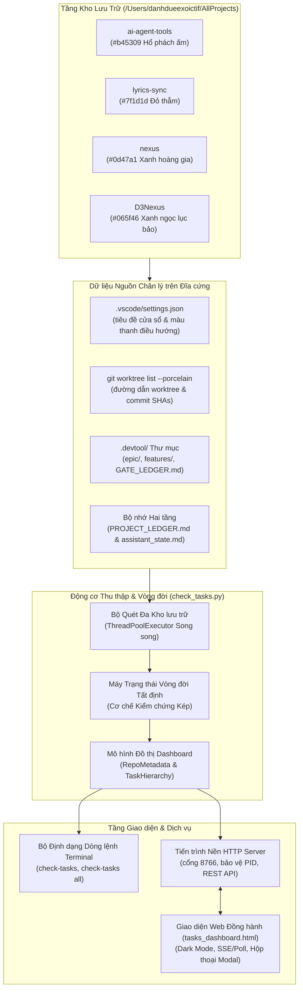
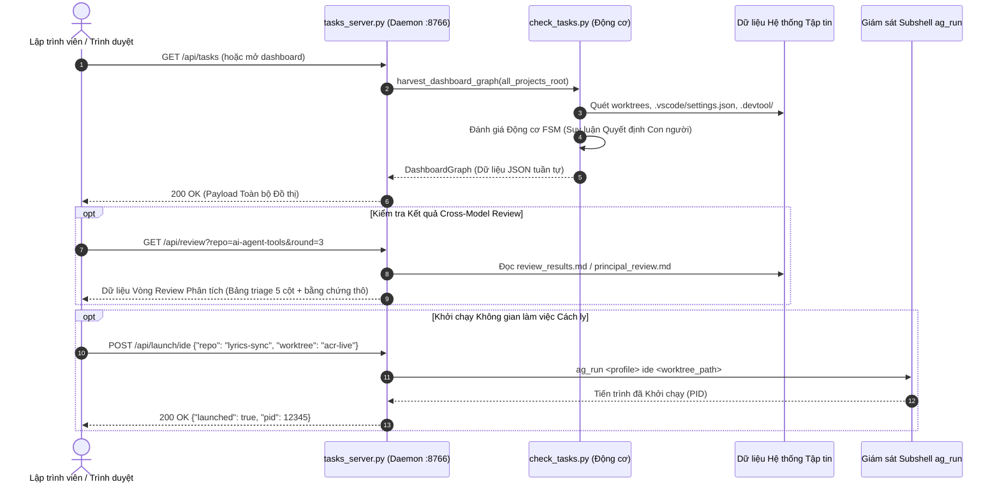

# Thiết kế Tổng thể Bảng Điều Khiển Tasks & Context Đa Repo

## Mục lục

- [Thông tin Meta](#thông-tin-meta)
- [Bối cảnh](#bối-cảnh)
- [Mục tiêu và Phạm vi Loại trừ](#mục-tiêu-và-phạm-vi-loại-trừ)
- [Kiến trúc và Thiết kế Kỹ thuật](#kiến-trúc-và-thiết-kế-kỹ-thuật)
- [Bản đồ Bảo trì Tính năng](#bản-đồ-bảo-trì-tính-năng)
- [Động cơ Máy Trạng thái Vòng đời Tất định](#động-cơ-máy-trạng-thái-vòng-đời-tất-định)
- [Tác động Tới Hợp đồng Dùng chung](#tác-động-tới-hợp-đồng-dùng-chung)
- [Kế hoạch Kiểm thử Tích hợp và Ma trận Biên](#kế-hoạch-kiểm-thử-tích-hợp-và-ma-trận-biên)
- [Môi trường Xác thực](#môi-trường-xác-thực)
- [Chiến lược Triển khai và Giảm thiểu Rủi ro](#chiến-lược-triển-khai-và-giảm-thiểu-rủi-ro)
- [Phân rã Tasks Kanban](#phân-rã-tasks-kanban)

## Thông tin Meta

- **Tên Epic**: `check_tasks_dashboard`
- **Trạng thái**: In Progress
- **Phiên bản Đích**: Bản phát hành plugin tiếp theo (v1.29.0)
- **Nền tảng**: Công cụ Python / Bộ công cụ kỹ năng Agent
- **Phụ thuộc vào epic**: `autonomous_lifecycle_runner`
- **Tài liệu Spec Nguồn**: [Thiết kế Cross-Repo Tasks & Context Dashboard](2026-11-11-check-tasks-dashboard-design.vi.md)

## Bối cảnh

Khi các lập trình viên và AI Agent tự hành phối hợp điều phối hệ sinh thái đa dự án tại `/Users/danhdueexoictif/AllProjects` (`ai-agent-tools`, `lyrics-sync`, `nexus`, `D3Nexus`), họ thường xuyên gặp áp lực quá tải ngữ cảnh khi phải theo dõi:
1. Các git worktree chạy song song, nhánh đang kích hoạt và trạng thái working tree bẩn giữa các dự án.
2. Các epic đang thực hiện, giai đoạn vòng đời hiện tại và tiến độ tasks Kanban thời gian thực (`done`, `in-progress`, `todo`).
3. Giao diện màu sắc và tiêu đề cửa sổ nhận diện riêng biệt được cấu hình trong `.vscode/settings.json`.
4. Bộ nhớ dự án hai tầng (Two-Tier Project Memory gồm `.devtool/PROJECT_LEDGER.md` lịch sử vĩnh viễn Tầng 1 và `.devtool/assistant_state.md` / `activity_stream.log` bộ nhớ chụp nhanh Tầng 2).
5. Bước tiếp theo cần con người quyết định: lập trình viên thường xuyên mất phương hướng không rõ epic đang dừng chờ phê duyệt Gate 1, xác nhận phân rã tasks Gate 2, duyệt triage Principal Review, chốt thứ tự Gate 3, lựa chọn Review Choice Gate 4 hay ký duyệt hoàn tất Gate 5.

Kế thừa kiến trúc hiệu năng cao, độc lập và nhẹ của `check-quota`, **Bảng Điều Khiển Tasks & Context Đa Repo** (`check-tasks`) cung cấp cả bộ định dạng terminal CLI tốc độ cao và daemon Web Dashboard nền cục bộ (cổng `8766`). Hệ thống quét song song các kho lưu trữ, trích xuất dữ liệu kiến trúc, tính toán động cơ máy trạng thái vòng đời tất định (FSM) và hiển thị góc nhìn điều hành thời gian thực thống nhất.

## Mục tiêu và Phạm vi Loại trừ

### Mục tiêu

- Cung cấp mô-đun thu thập và quét dữ liệu hiệu năng cao (`skills/check-tasks/resources/scripts/check_tasks.py` kèm entrypoint `bin/check-tasks`) khám phá toàn bộ các kho lưu trữ trong `/Users/danhdueexoictif/AllProjects`, phân tích worktrees, `.vscode/settings.json`, `.devtool/epic/`, `.devtool/features/`, và các thành phần bộ nhớ hai tầng.
- Triển khai Động cơ Máy Trạng thái Vòng đời Tất định (FSM) suy luận chính xác trạng thái quyết định của con người qua 8 cổng vòng đời mà không cần phỏng đoán.
- Xây dựng giao diện dòng lệnh terminal hiển thị mã màu ANSI hỗ trợ tóm tắt một repo (`check-tasks`), bảng tổng quan đa repo (`check-tasks all`), và kiểm tra chi tiết từng repo (`check-tasks <repo>`).
- Triển khai daemon `http.server` bằng Python thuần không phụ thuộc thư viện ngoài (`skills/check-tasks/resources/scripts/tasks_server.py`) phục vụ REST API JSON thống nhất (`/api/tasks`, `/api/review`, `/api/launch/cli`, `/api/launch/ide`, `/api/shutdown`) trên cổng `8766` với cơ chế bảo vệ PID và tự động tăng cổng an toàn.
- Xây dựng giao diện web Dark Mode nhẹ, tương thích cao (`tasks_dashboard.html`) với thẻ dự án, chip worktree, thanh đo Kanban trực quan, modal Cross-Model Review 5 cột, và các nút mở nhanh CLI/IDE.
- Đảm bảo tuân thủ Quy tắc 9 về An toàn Ranh giới Hệ điều hành Đa Profile khi khởi chạy native CLI/IDE, kích hoạt subshell cục bộ qua `ag_run <profile>` mà không làm biến đổi Keychain hệ thống hay biến `$HOME` toàn cục.
- Đóng gói công cụ thành kỹ năng Antigravity (`skills/check-tasks/SKILL.md`) hỗ trợ lệnh tắt slash command `/check-tasks`.

### Phạm vi Loại trừ

- Không thay đổi trạng thái git cục bộ, không tự ý checkout nhánh hay tự commit mã nguồn từ dashboard.
- Không chỉnh sửa kho lưu trữ remote GitHub hay tự động chạy lệnh git push/fetch.
- Không lưu trữ trạng thái tasks vào cơ sở dữ liệu tập trung bên ngoài (như PostgreSQL hay Redis); toàn bộ trạng thái được trích xuất trực tiếp từ hệ thống tập tin đĩa cứng.
- Không thay thế bộ kiểm tra chất lượng cấp dự án và không chạy các bộ kiểm thử nặng bên trong tiến trình daemon dashboard.

## Kiến trúc và Thiết kế Kỹ thuật

### Kiến trúc Tổng thể



### Sơ đồ Tuần tự: Quét Thời gian Thực & Đánh giá Review



## Bản đồ Bảo trì Tính năng

| Khả năng Hệ thống | Đường dẫn Nguồn Chuẩn & Điểm Đầu vào | Bất biến Cốt lõi & Cấu hình | Hướng dẫn Mở rộng & Khắc phục Lỗi |
|---|---|---|---|
| **Thu thập Dữ liệu** | `skills/check-tasks/resources/scripts/check_tasks.py` (`harvest_dashboard_graph`, `scan_repo`) | Quét toàn bộ thư mục con trong `/Users/danhdueexoictif/AllProjects`; bỏ qua an toàn thư mục không phải git | Thêm cảm biến tập tin mới vào `scan_repo`; kiểm tra biểu thức chính quy cho worktree |
| **Động cơ FSM Vòng đời** | `skills/check-tasks/resources/scripts/check_tasks.py` (`derive_lifecycle_state`) | Bám sát 8 trạng thái Quyết định Cốt lõi của Con người; kiểm chứng kép `assistant_state.md` và `GATE_LEDGER.md` | Cập nhật chuyển dịch trạng thái khi các cổng trong `dev-lifecycle` thay đổi |
| **Giao diện Dòng lệnh CLI** | `skills/check-tasks/resources/scripts/check_tasks.py` (`main`, `render_terminal_table`, `render_single_repo`) | Sử dụng mã màu ANSI tương ứng với chữ ký repo; tự động rơi về văn bản thuần khi không có TTY | Tùy chỉnh bố cục cột trong `render_terminal_table`; tinh chỉnh độ rộng terminal |
| **Daemon Server** | `skills/check-tasks/resources/scripts/tasks_server.py` (`TasksServer`, `TasksHandler`) | Lắng nghe tại `localhost:8766`; tệp bảo vệ PID tại `/tmp/agy_tasks_server.pid`; tự động tăng cổng nếu bị chiếm dụng | Kiểm tra `/tmp/agy_tasks_server.pid` và lệnh `kill -0 <pid>` nếu daemon không khởi động lại được |
| **Giao diện Web UI** | `skills/check-tasks/resources/dashboard/tasks_dashboard.html` | Tệp HTML/JS/CSS duy nhất, không phụ thuộc npm, giao diện Dark Mode tương thích cao | Cập nhật tokens CSS trong `:root`; nâng cấp các bộ bắt sự kiện phía client |
| **Kỹ năng & Lệnh Slash** | `skills/check-tasks/SKILL.md` | Kích hoạt với lệnh `/check-tasks` và các từ khóa liên quan ("check tasks", "dashboard", "worktrees") | Đăng ký năng lực vào tệp `.agents/quality/python-quality.json` |

## Động cơ Máy Trạng thái Vòng đời Tất định

Động cơ FSM chuyển đổi các trạng thái không đồng nhất của kho lưu trữ thành đúng một hành động gợi ý dứt khoát cho lập trình viên:

| Tên Giai đoạn | Điều kiện Sổ cái Cổng | Điều kiện Đĩa / Kanban | ⚡ Bước tiếp theo con người cần quyết định |
|---|---|---|---|
| **Stage 1 (Inception)** | Chưa có Gate 1 | Bản đặc tả thiết kế tồn tại trong `docs/` hoặc `.devtool/epic/` | **Phê duyệt Gate 1 (Design Spec)** để chuyển sang Stage 2 |
| **Stage 2 (Architecture)** | Gate 1 PASS, chưa có Gate 2 | Đang soạn thảo HLD/BDD/Tasks | AI Assistant đang thiết kế HLD & Phân rã Tasks (`/dev-designer`) |
| **Stage 2 Exit (Handoff)** | Gate 2 PASS, chưa có Gate 3 | Epic đã đóng gói (`handoff.md`) | **Lựa chọn Handoff**: (1) Chạy `/principal-review` hoặc (2) Vào Stage 3 (`/dev-implementation`) |
| **Stage 2 Review Triage** | Gate 2 PASS, đang chạy PR | Principal Review có findings chưa xác nhận | **Phê duyệt Quyết định Triage** (Valid / False Positive / Fix) cho các lỗi |
| **Stage 3 Phase 1 (Order)** | Gate 2 PASS, worktree đã sẵn sàng | Chưa có Gate 3 trong sổ cái | **Phê duyệt Gate 3**: Xác nhận thứ tự thực thi Kanban tasks và phân tách worktree |
| **Stage 3 Phase 2 (TDD)** | Gate 3 PASS | Các tasks đang ở trạng thái `in-progress` | AI Programmer đang tự động TDD từng task (Không cần con người can thiệp) |
| **Stage 3 Phase 4 (Review)** | Toàn bộ tasks `done`, Gate 4 PASS | Chưa có Gate 5 trong sổ cái | **Review Choice (Quy tắc 5)**: Lựa chọn (1) Kết thúc (`/finish`) hoặc (2) Chạy Cross-Model Review |
| **Stage 3 Phase 4.1 (Sign-off)** | Gate 4 PASS sau các vòng review | Sẵn sàng kết thúc nhánh | **Phê duyệt Gate 5 (Sign-off Kanban)**: Xác nhận dọn dẹp worktree và lưu trữ cột mốc |

## Tác động Tới Hợp đồng Dùng chung

- **Nguồn Chân lý Duy nhất**: Thư mục vật lý `shared-contracts/` đặt tại `D3Nexus`. Các repository vệ tinh giữ liên kết symlink chỉ đọc.
- **Ranh giới Hợp đồng**: `check-tasks` là công cụ quản trị định vị hoàn toàn trong `ai-agent-tools`. Công cụ chỉ đọc `shared-contracts/` để phát hiện lệch chuẩn symlink (báo cáo trạng thái hợp đồng nguyên vẹn hay bị hỏng).
- **Tính toán Không Trạng thái**: Không kết nối trực tiếp cơ sở dữ liệu; toàn bộ hoạt động tuân thủ ranh giới hệ thống tập tin.

## Kế hoạch Kiểm thử Tích hợp và Ma trận Biên

```text
Integration test roots: tests
Integration results: python3 scripts/run_unittest_junit.py --junitxml build/test-results/check_tasks_dashboard.xml tests/test_check_tasks_harvester.py tests/test_check_tasks_fsm.py tests/test_check_tasks_cli.py tests/test_check_tasks_server.py tests/test_check_tasks_e2e.py -> build/test-results/check_tasks_dashboard.xml
Protected paths: .agents/quality/**, .devtool/epic/check_tasks_dashboard/bdd_scenarios.en.md, .devtool/epic/check_tasks_dashboard/bdd_scenarios.vi.md
```

| Mã kiểm thử | Ranh giới Kiểm thử | Loại kiểm thử | Chiến lược Xác thực |
|---|---|---|---|
| **IT-01** | Thu thập & Quét Đa Kho lưu trữ | Tích hợp | Tạo cấu trúc thư mục giả lập 4 kho lưu trữ với worktrees, phân tích đồ thị và kiểm chứng toàn bộ trường metadata. |
| **IT-02** | Suy luận Quyết định FSM | Đơn vị / Tích hợp | Kiểm thử 8 trạng thái vòng đời với các tổ hợp dữ liệu `assistant_state.md` và `GATE_LEDGER.md`, xác thực chuỗi quyết định chuẩn xác. |
| **IT-03** | Bộ Định dạng ANSI Terminal | Tích hợp | Chạy CLI trên repos giả lập; bắt luồng xuất stdout; kiểm tra căn lề bảng, mã màu ANSI và rơi về văn bản thuần khi màn hình hẹp. |
| **IT-04** | Vòng đời Daemon & REST API | Tích hợp | Khởi chạy server trên cổng kiểm thử, truy vấn `/api/tasks` và `/api/review`, kiểm tra JSON schema, kiểm tra va chạm PID guard và phát lệnh tắt an toàn `/api/shutdown`. |
| **IT-05** | An toàn Trình Khởi chạy Quy tắc 9 | Đơn vị | Xác thực lệnh mở CLI và IDE được tạo đúng cú pháp subshell `ag_run <profile>` mà không thay đổi môi trường hệ điều hành máy chủ hay Keychain. |
| **IT-06** | Tính Toàn vẹn Tài nguyên Web UI | E2E / Tĩnh | Kiểm tra `tasks_dashboard.html` đảm bảo chuẩn HTML5 sạch, cú pháp JS hợp lệ, độ tương phản giao diện Dark Mode và không gọi CDN ngoài. |

## Môi trường Xác thực

- **Môi trường Python**: Python 3.12+ qua `uv run` hoặc virtualenv máy chủ.
- **Phụ thuộc**: Hoàn toàn không phụ thuộc thư viện ngoài (sử dụng thư viện chuẩn của Python: `http.server`, `urllib`, `json`, `subprocess`, `threading`, `dataclasses`, `pathlib`).
- **Trình Chạy Test**: `pytest tests/test_check_tasks*.py`.
- **Cổng Chất lượng**: `ruff check`, `ruff format --check`, và kiểm tra tích hợp toàn diện qua `scripts/verify.sh`.

## Chiến lược Triển khai và Giảm thiểu Rủi ro

1. **Giai đoạn 1: Lõi Thu thập Dữ liệu & Động cơ FSM**:
   - Triển khai các mô hình dữ liệu và logic quét với unit test bảo vệ rơi về an toàn khi repo thiếu hoặc lỗi tập tin metadata.
2. **Giai đoạn 2: Bàn giao Terminal CLI**:
   - Hoàn tất `scripts/check_tasks.py` và đăng ký lệnh alias trong `.zshrc` / toolchain.
3. **Giai đoạn 3: Daemon Server & REST API**:
   - Bàn giao `tasks_server.py` với cơ chế phát hiện va chạm cổng và quản lý vòng đời PID.
4. **Giai đoạn 4: Giao diện Web Đồng hành & Đăng ký Kỹ năng**:
   - Hoàn tất `tasks_dashboard.html` và `skills/check-tasks/SKILL.md`, xác thực qua toàn bộ bộ kiểm thử hồi quy.

## Phân rã Tasks Kanban

- [ ] `task_01_harvester_engine_and_data_models.md`: Mô hình dữ liệu dataclass, bộ quét hệ thống tập tin, phát hiện worktree và thu thập bộ nhớ dự án.
- [ ] `task_02_deterministic_lifecycle_fsm_engine.md`: Động cơ vòng đời 8 trạng thái tất định, nạp kiểm chứng kép và ánh xạ quyết định.
- [ ] `task_03_terminal_cli_and_ansi_reporter.md`: Giao diện dòng lệnh, bố cục bảng màu ANSI, kiểm tra repo và chế độ xem `--all`.
- [ ] `task_04_http_daemon_server_and_rest_api.md`: Daemon HTTP nhẹ, bảo vệ va chạm cổng, bảo vệ PID và REST API.
- [ ] `task_05_interactive_web_dashboard_and_skill.md`: Giao diện web đồng hành Dark mode, modal Cross-Model Review, cầu nối khởi chạy và metadata kỹ năng.
