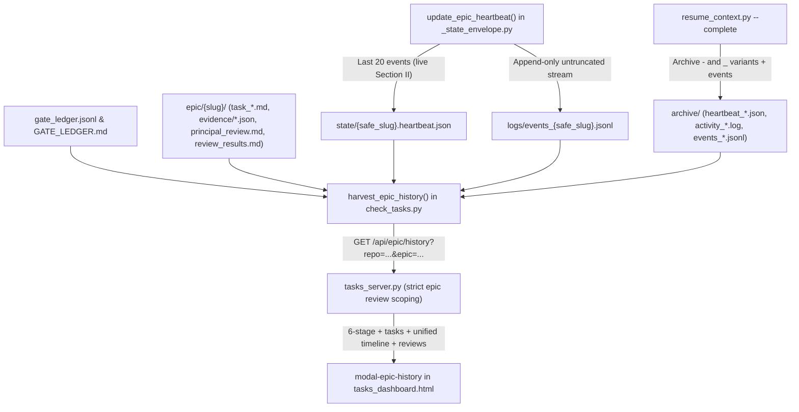

# Check-Tasks Epic History Modal & Append-Only Telemetry Design

- **Date**: 2026-11-15
- **Status**: Approved (Gate 1)
- **PIC**: `phungthuy8901`
- **Epic Directory**: `check_tasks_epic_history_modal`
- **Epic Slug**: `check_tasks_epic_history_modal`
- **Scope**: `scripts/_state_envelope.py`, `scripts/resume_context.py`, `skills/check-tasks/resources/scripts/check_tasks.py`, `skills/check-tasks/resources/scripts/tasks_server.py`, `skills/check-tasks/resources/dashboard/tasks_dashboard.html`, `tests/`
- **Next step**: `dev-designer` (Stage 2)

## Table of Contents

- [1. Background](#1-background)
- [2. Goals and Non-Goals](#2-goals-and-non-goals)
  - [Goals](#goals)
  - [Non-Goals](#non-goals)
- [3. Architecture and Data Flow](#3-architecture-and-data-flow)
- [4. Detailed Component Design](#4-detailed-component-design)
  - [4.1. Append-Only Per-Epic Event Stream and Archival](#41-append-only-per-epic-event-stream-and-archival)
  - [4.2. On-Demand History Aggregator and Scoped API](#42-on-demand-history-aggregator-and-scoped-api)
  - [4.3. Epic History Modal UI and Helper Extraction](#43-epic-history-modal-ui-and-helper-extraction)
- [5. Error Handling and Resilience](#5-error-handling-and-resilience)
- [6. Shared Contract Warnings](#6-shared-contract-warnings)
- [7. Verification and Testing Strategy](#7-verification-and-testing-strategy)
- [8. Dependency Mapping and Risks](#8-dependency-mapping-and-risks)

---

## 1. Background

On the `/check-tasks` Web Dashboard (`skills/check-tasks/resources/dashboard/tasks_dashboard.html`), **Section III ("Project Epics Roadmap (`.devtool/epic/`)")** renders every repository epic (`Done`, `In Progress`, `Packaged`, `Backlog`, `Abandon`), yet `.roadmap-epic-row` entries are non-interactive:

1. **No Historical Epic Inspector**: Clicking any epic row in the Roadmap table does nothing. Completed (`Done`), `Packaged`, `Backlog`, and `Abandon` epics vanish from **Section II** after completion, leaving no UI way to inspect their 6-stage pipeline progression, task outcomes, verification evidence, chronological timeline, or Principal / Cross-Model review findings side by side without disrupting an active epic running in Section II.
2. **Truncated Step Telemetry and Hyphen/Underscore Split**: `update_epic_heartbeat` in `scripts/_state_envelope.py` caps `.heartbeat.json` at `max_events = 20`, evicting earlier micro-step logs on longer epics. Additionally, `_sanitize_epic_slug` converts `_` to `-`, causing hyphenated (`alignment-flow-hardening.heartbeat.json`) and underscored (`alignment_flow_hardening.heartbeat.json`) state files to split telemetry, while `resume_context.py --complete` only archives the sanitized `<safe_slug>.heartbeat.json` variant.
3. **Unscoped Review Fallback**: `parse_review_results` in `skills/check-tasks/resources/scripts/tasks_server.py` falls back to repo-wide `.devtool/principal_review.md` and `.devtool/review_results.md` even when an explicit `epic` query parameter is passed, risking showing another epic's review when inspecting older epics that lack per-epic review files.

---

## 2. Goals and Non-Goals

### Goals

- Make every row in **Project Epics Roadmap** (`Done`, `In Progress`, `Packaged`, `Backlog`, `Abandon`) clickable to open a dedicated **`modal-epic-history`** Pop-up Modal while preserving **Section II** untouched underneath for active parallel work and isolating `<select>` clicks in the `PIC` column.
- Render a unified, read-only forensic view inside `modal-epic-history`:
  - Compact header (repo badge, epic title/slug, status, PIC, last updated, Refresh & Close controls) and fixed **6-Stage Pipeline Summary** (`1. Spec` -> `6. Finish` + sub-step strip matching Section II).
  - Switchable tabs directly inside the modal: **`Timeline & Step Logs`** (with `All / Gates / Steps / Activity / Evidence` filters), **`Tasks & Evidence`** (task statuses + expandable `evidence/*.json` verification rows), **`Principal Review`**, and **`Cross-Model Review`** (Round selector tabs + 6-column Triage Table + expandable Raw output).
- Implement **Hybrid Telemetry Continuity**:
  - For **past epics**: reconstruct unified chronological logs from all existing sources across `-` and `_` slug variants (`gate_ledger.jsonl` / `GATE_LEDGER.md`, `activity_*.log` in `logs/` and `archive/`, `state/` and `archive/` heartbeat files, `evidence/*.json` runs, and review round timestamps).
  - For **new/future epics**: append deduplicated micro-step and state transitions to `.devtool/logs/events_<safe_slug>.jsonl` (untruncated) and archive both `events_<safe_slug>.jsonl` and both `-`/`_` heartbeat variants on `resume_context.py --complete`.
- Keep `/api/tasks` polling lightweight across 118+ historical epics by fetching deep epic history on demand via `GET /api/epic/history?repo=<repo>&epic=<slug>`.

### Non-Goals

- Does not embed an interactive terminal/IDE editor or mutate task statuses from inside the history modal (history inspection is strictly read-only except for the existing inline `PIC` selector in Roadmap).
- Does not modify external satellite repositories (`D3Nexus`, `lyrics-sync`, `nexus`) or retroactively regenerate missing historical raw stdout logs for pre-telemetry epics.
- Does not store full raw CLI stdout streams of every check command when concise structured messages and `evidence/*.json` summaries already exist.

---

## 3. Architecture and Data Flow

---

## 4. Detailed Component Design

### 4.1. Append-Only Per-Epic Event Stream and Archival

1. **`update_epic_heartbeat` (`scripts/_state_envelope.py`)**:
   - Preserve the existing 20-event rolling window (`max_events: int = 20`) inside `<safe_slug>.heartbeat.json` so `/api/tasks` live payloads stay bounded.
   - Inside the same transactional lock across discovered mirror `.devtool` directories, when a new event entry is appended (or timestamps/transitions to a distinct `stage` / `sub_step` / `sub_step_detail` / `last_event` / `review_state`), append one compact JSON line (`ts`, `stage`, `sub_step`, `sub_step_detail`, `message`, `review_state`) to `.devtool/logs/events_<safe_slug>.jsonl`.
   - Maintain backward compatibility for all callers (`dev-lifecycle`, `dev-implementation`, `quality_check`, `run_external_review.py`, `resume_context.py`) without signature changes.
2. **Completion Archival (`scripts/resume_context.py`)**:
   - Extend `--complete` cleanup under `file_lock(devtool_dir)` to move `.devtool/logs/events_<safe_slug>.jsonl` into `.devtool/archive/events_<safe_slug>_<timestamp>.jsonl` (plus deduplicated `<epic_slug>` variant if present).
   - Archive both `.devtool/state/<safe_slug>.heartbeat.json` and un-sanitized `.devtool/state/<epic_slug>.heartbeat.json` (or `<alt_slug>.heartbeat.json`) so split telemetry files are never left stranded in `state/`.

### 4.2. On-Demand History Aggregator and Scoped API

1. **`harvest_epic_history(repo_path: Path, epic_slug: str)` (`skills/check-tasks/resources/scripts/check_tasks.py`)**:
   - **Slug & Root Discovery**: Normalize `-` / `_` variants and scan active worktrees matching the epic, root `.devtool/epic/<slug>/`, `.devtool/state/`, `.devtool/logs/`, and `.devtool/archive/`.
   - **Metadata & Artifact Flags**: Resolve `title`, `status` (`done`, `in_progress`, `packaged`, `unstarted`, `abandoned`), `pic`, `last_updated`, `theme_color`, and boolean artifact flags (`spec`, `hld`, `bdd`, `handoff`, `manual_smoke`).
   - **Tasks & Verification Evidence**: Load all `task_*.md` (preferring active worktree `.devtool/features/` when `in_progress`, falling back to `.devtool/epic/<slug>/task_*.md` in natural numeric order). Attach `evidence/<task_id>.json` summaries (`head` SHA, `started`, `finished`, pass/fail check counts, and structured `rows` with `id`, `phase`, `command`, `outcome`, `output_tail` capped safely for modal display).
   - **6-Stage Pipeline Summary**: Merge recovered `heartbeat` JSONs (`-` and `_`, newest `generation`/`updated_at` merged with accumulated events) and call `compute_pipeline_telemetry(..., is_completed=(status == "done"))` so all 6 stages and sub-steps render consistently with Section II.
   - **Unified Chronological Timeline**: Collect, normalize ISO-8601 UTC timestamps, deduplicate, and sort events across:
     - `gate_ledger.jsonl` and `GATE_LEDGER.md` (`category: "gate"`)
     - `events_<slug>.jsonl` live + archived (`category: "step"`)
     - Merged `heartbeat*.json` `events` (`category: "step"`, marked whether backed by untruncated `events_*.jsonl` or snapshot-only `heartbeat`)
     - `activity_<slug>*.log` live + archived (`category: "activity"`)
     - `evidence/*.json` verification run start/finish records (`category: "evidence"`)
     - Round dates parsed from `principal_review.md` and `review_results.md` (`category: "review"`)
2. **`GET /api/epic/history` & Scoped `parse_review_results` (`skills/check-tasks/resources/scripts/tasks_server.py`)**:
   - Validate `repo` stays within `workspace_root` (reject path traversal with HTTP `400`/`404`) and accept `epic`, optional `round_principal`, and `round_cross`.
   - Add `strict_epic: bool = False` to `parse_review_results()`: when `strict_epic=True` (used by `/api/epic/history`), inspect **only** epic-scoped directories (`.worktrees/<slug_or_alt>/.devtool/epic/<slug_or_alt>/...` and `repo_dir/.devtool/epic/<slug_or_alt>/...`), never falling back to repo-root `.devtool/principal_review.md` or `.devtool/review_results.md`. Return both `reviews.principal` and `reviews.cross_model` payloads (`available_rounds`, active round metadata, `findings`, `raw_output`, `present: bool`).

### 4.3. Epic History Modal UI and Helper Extraction

In `skills/check-tasks/resources/dashboard/tasks_dashboard.html`:

1. **Roadmap Row Activation (`renderRoadmapTableRows`)**:
   - Add clickable affordance on `<tr class="roadmap-epic-row">` calling `openEpicHistoryModal(repoName, slug)`.
   - Ensure interactive controls inside the `PIC` column (`<select>`) call `event.stopPropagation()` on click/mousedown so changing PIC never opens the modal.
2. **Modal Layout (`#modal-epic-history`)**:
   - Register in the `openLiveModal` / `closeLiveModal` modal stack (`ESC`, backdrop click, and `✕` button support) with repo `theme_color` border/glow, leaving **Section II** untouched underneath.
   - **Top Fixed Summary**: Repo pill, epic title/slug, status badge, PIC, updated timestamp, active/historical source hint badge, manual Refresh button, and extracted shared **6-Stage Pipeline Stepper + Sub-step Strip** renderer (`renderPipelineStepperSummaryHtml`).
   - **4 Direct Switchable Sub-Tabs**:
     - `Timeline & Step Logs`: Filter chips (`All`, `Gates`, `Steps`, `Activity`, `Evidence`), chronological feed with timestamp, category/sub-step badge, source tag, and copyable SHA pill.
     - `Tasks & Evidence`: Task list showing ID, title, status badge, priority, source (`worktree` vs `epic`), and inline expandable verification evidence rows (`V1..Vn` pass/fail + command).
     - `Principal Review`: Round selector buttons switching rounds in place, Header Metadata (`SHA`, `Reviewer`, `Model`, `Thinking`, `Verdict`), extracted shared **6-Column Triage Table** renderer (`renderReviewTriageTableHtml`), and collapsible Raw Output panel.
     - `Cross-Model Review`: Identical layout switching directly to `cross_model` reviews and rounds without opening a nested second modal.
3. **Live Refresh Sync for `In Progress` Epics**:
   - While `#modal-epic-history` stays open on an `in_progress` epic, background 5s dashboard ticks optionally trigger a silent in-place refresh (preserving active tab, selected rounds, and scroll offsets).

---

## 5. Error Handling and Resilience

- **Concurrent Clicks / Stale Responses**: Track an incrementing `epicHistoryRequestToken` + `AbortController` in frontend state; discard resolved responses whose token no longer matches the currently open modal or after the modal closes.
- **Legacy & Empty-State Epics**: Epics in `Backlog` / `Packaged` or historical pre-telemetry epics display explicit, informative empty states inside missing tabs (e.g., *"No Principal Review recorded for this epic"*, *"Tasks not yet decomposed"*, or *"Snapshot-only logs: untruncated event log was not enabled when this epic ran"*) rather than errors or leaked cross-epic files.
- **Corrupt / Malformed Files**: Parse `.jsonl`, `.json`, and markdown files defensively per line/file with `contextlib.suppress`; malformed lines do not break timeline aggregation or other tabs.
- **Invalid Query Parameters & Security**: Reject missing/invalid `repo` or `epic` parameters escaping `workspace_root` with HTTP `400`/`404` JSON payloads; show an inline retry banner inside the modal on network failures.

---

## 6. Shared Contract Warnings

- **Status**: Clean — no `shared-contracts/` directory exists in `ai-agent-tools` (`ls shared-contracts` absent), and the API changes remain local to the `/check-tasks` local dashboard HTTP server (`tasks_server.py`) and JSONL telemetry files under `.devtool/`.
- No cross-repository wire contract drift applies.

---

## 7. Verification and Testing Strategy

1. **Unit & Backend Integration Tests (`pytest`)**:
   - **Telemetry Stream & Archival (`tests/test_lifecycle_telemetry_and_stage_progress.py` or dedicated suite)**: verify `update_epic_heartbeat` preserves the 20-event ring buffer while appending >20 distinct events into `.devtool/logs/events_<safe_slug>.jsonl`, handles concurrent lock safety, and `--complete` archives `events_*.jsonl` alongside both `-` and `_` heartbeat variants.
   - **History Aggregator & Endpoint (`tests/test_check_tasks_cli.py` / `tests/test_ltsp_harvester_pipeline.py`)**: verify `harvest_epic_history` & `GET /api/epic/history` resolve `-`/`_` variants, prioritize worktree tasks when active vs `.devtool/epic/<slug>/` when Done, merge `evidence/*.json`, sort/deduplicate multi-source timelines, render clean empty states for `Backlog`, reject path traversal, and strictly isolate reviews (zero fallback to repo-root `.devtool/review_results.md`).
2. **Browser / UI Integration Tests (`Playwright` / CDP)**:
   - Verify changing a `PIC` dropdown on a Roadmap row does **not** trigger `modal-epic-history`.
   - Verify clicking `Done`, `In Progress`, and `Backlog` Roadmap rows opens `modal-epic-history` with Section II intact behind it, renders the 6-stage stepper summary, switches smoothly across all 4 tabs (`Timeline`, `Tasks & Evidence`, `Principal Review`, `Cross-Model Review`) and Review rounds, and closes cleanly via `✕` and `ESC`.
3. **Full Release Gate**:
   - Run `bash scripts/verify.sh --full`, `ruff`, `mypy`, and `@quality_check` with `--profile pr` on completion.

---

## 8. Dependency Mapping and Risks

| Item | Classification | Impact & Mitigation |
|---|---|---|
| Telemetry producers (`dev-lifecycle`, `dev-implementation`, `quality_check`, `run_external_review.py`, `resume_context.py`) | Cross-feature dependency | All existing callers invoke `update_epic_heartbeat`; adding `.jsonl` append inside `_state_envelope.py` requires zero caller changes and preserves 100% backward compatibility. |
| Shared UI renderers (`tasks_dashboard.html`) | Intra-file coupling | Duplicating Section II pipeline stepper or `modal-cross-review` triage table creates drift; mitigate by extracting shared pure JS helpers before wiring `modal-epic-history`. |
| Evidence / raw log size on large epics | Performance risk | Epics with 15+ tasks and verbose `raw_output` could inflate JSON responses; keep modal data isolated from `/api/tasks`, truncate verbose `output_tail` defaults safely, and lazy-expand details. |
| Plugin cache (`~/.gemini/config/plugins/d3nexus/`) | Environment assumption | Runtime profiles using installed plugin snapshots rather than workspace symlinks will see the new event stream and dashboard once the plugin is refreshed/re-synced. |
| Legacy epics lacking `events_*.jsonl` | Historical data limit | Pre-feature `Done` epics only retain `gate_ledger`, optional `activity_*.log`, `evidence/*.json`, reviews, and final heartbeat snapshot; UI labels synthesized/partial timelines clearly. |
