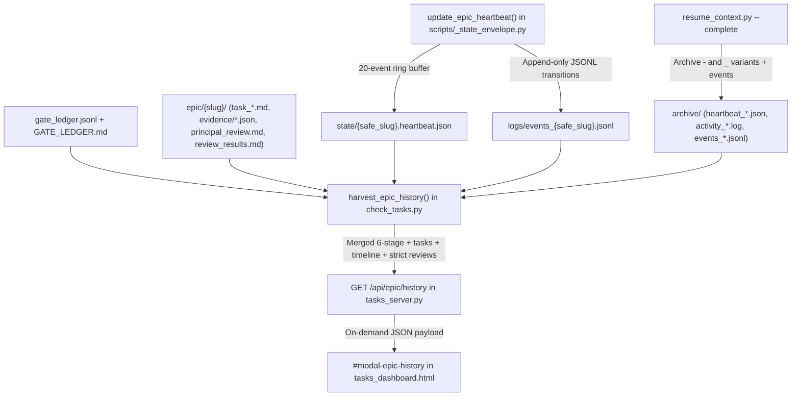
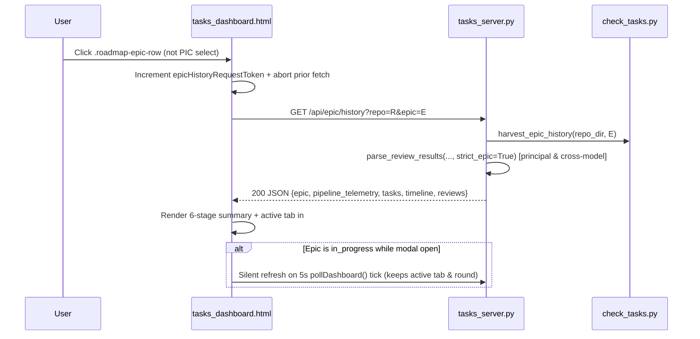

# Check-Tasks Epic History Modal & Append-Only Telemetry High-Level Design

## Table of Contents

- [Meta Data](#meta-data)
- [Background](#background)
- [Goals and Non-Goals](#goals-and-non-goals)
- [Architecture and Technical Design](#architecture-and-technical-design)
- [Feature Maintenance Map](#feature-maintenance-map)
- [Module Contracts and HTTP Interfaces](#module-contracts-and-http-interfaces)
- [Impact Analysis](#impact-analysis)
- [Shared Contract Impact](#shared-contract-impact)
- [Integration Test Plan and Boundary Matrix](#integration-test-plan-and-boundary-matrix)
- [Verification Environment](#verification-environment)
- [Comprehensive BDD Scenario Coverage](#comprehensive-bdd-scenario-coverage)
- [Rollout Strategy and Mitigation](#rollout-strategy-and-mitigation)
- [Kanban Tasks Breakdown](#kanban-tasks-breakdown)
- [Spec Errata](#spec-errata)

## Meta Data

- **Epic name**: `check_tasks_epic_history_modal`
- **Status**: Done
- **PIC**: `phungthuy8901`
- **Target release**: Next plugin release
- **Platform**: Python tooling, local HTTP dashboard server, and HTML/Vanilla JS dashboard UI
- **Depends on epic**: none
- **Source Spec**: [Check-Tasks Epic History Modal & Append-Only Telemetry Design](2026-11-15-check-tasks-epic-history-modal-design.en.md)

## Background

The `/check-tasks` Web Dashboard (`skills/check-tasks/resources/dashboard/tasks_dashboard.html`) displays live active epics in **Section II** and lists all repository epics (`Done`, `In Progress`, `Packaged`, `Backlog`, `Abandon`) in **Section III ("Project Epics Roadmap (`.devtool/epic/`)")**. Four structural gaps prevent users from inspecting historical or sibling epics seamlessly:

1. **Non-Interactive Roadmap Rows**: `renderRoadmapTableRows()` (`tasks_dashboard.html:L3396-L3455`) renders `<tr class="roadmap-epic-row">` without a row click handler, leaving no way to inspect a completed or backlog epic's 6-stage pipeline progression, task breakdown, verification evidence, logs, or review results without displacing the live epic in Section II.
2. **20-Event Ring Buffer Eviction & Hyphen/Underscore Telemetry Split**: `update_epic_heartbeat()` (`scripts/_state_envelope.py:L430-L565`) caps `.heartbeat.json["events"]` at `max_events = 20`, dropping earlier micro-steps on long epics. Moreover, `_sanitize_epic_slug()` converts underscores to hyphens, causing state writes and `--complete` archival (`scripts/resume_context.py:L1038-L1062`) to split or leave behind `<epic_slug>.heartbeat.json` vs `<safe_slug>.heartbeat.json` files.
3. **Completed Tasks Excluded from Overview Harvesting**: `extract_task_progress()` (`skills/check-tasks/resources/scripts/check_tasks.py:L1393`) skips completed epics (`slug in completed_slugs and slug != active_epic`) to keep `/api/tasks` polling lightweight, so no endpoint serves archived `task_*.md` or `evidence/*.json` runs for completed epics.
4. **Unscoped Review Fallback**: `parse_review_results()` (`skills/check-tasks/resources/scripts/tasks_server.py:L390-L435`) appends repo-root `.devtool/principal_review.md` and `.devtool/review_results.md` fallback paths even when `active_epic` is specified, risking cross-epic review leakage when inspecting older epics without per-epic review files.

## Goals and Non-Goals

### Goals

- Enable clicking any `.roadmap-epic-row` across all statuses (`Done`, `In Progress`, `Packaged`, `Backlog`, `Abandon`) to open a dedicated `#modal-epic-history` Pop-up Modal while preserving **Section II** untouched underneath and keeping `<select>` interactions in the `PIC` column isolated via `stopPropagation()`.
- Persist an untruncated append-only event stream `.devtool/logs/events_{safe_slug}.jsonl` inside `update_epic_heartbeat()` alongside the existing 20-event `.heartbeat.json` ring buffer, and archive both `events_{safe_slug}.jsonl` and `-`/`_` heartbeat variants cleanly during `resume_context.py --complete`.
- Expose an on-demand `GET /api/epic/history?repo=<repo>&epic=<slug>` endpoint backed by `harvest_epic_history()` that stitches legacy and untruncated sources across worktree, root `.devtool/`, and `.devtool/archive/` (`-`/`_` slug variants), reconstructs 6-stage telemetry via `compute_pipeline_telemetry()`, attaches `task_*.md` + `evidence/*.json`, builds a deduplicated chronological timeline, and loads epic-strict `Principal Review` + `Cross-Model Review` rounds.
- Extract shared pure JS rendering helpers from Section II and `#modal-cross-review` (`tasks_dashboard.html`) to power `#modal-epic-history` with 4 switchable sub-tabs (`Timeline & Step Logs`, `Tasks & Evidence`, `Principal Review`, `Cross-Model Review`) and automatic live refresh when inspecting an `In Progress` epic.

### Non-Goals

- Mutating task status, running CLI reviews, or dispatching terminal commands from inside `#modal-epic-history` (strictly read-only inspection).
- Rewriting historical `.devtool/` artifacts inside sibling repositories (`D3Nexus`, `lyrics-sync`, `nexus`) or storing verbose raw subprocess stdout in JSONL event streams.
- Expanding `/api/tasks` polling payloads with full archived task/evidence histories across 118+ completed epics.

## Architecture and Technical Design

### High-Level Architecture



### Modal Interaction and Refresh Sequence



### Key Design Mechanics

1. **Hybrid Append-Only Stream (`scripts/_state_envelope.py`, `scripts/resume_context.py`)**:
   - Inside `run_state_transaction()` for `<safe_slug>.heartbeat.json`, compare incoming `(stage, sub_step, sub_step_detail, last_event, review_state)` against the previous snapshot. When a new distinct event is appended (i.e., `last_event` is non-empty and differs from the previous event, or `stage`/`sub_step`/`review_state` phase/round changed), append one line to `.devtool/logs/events_<safe_slug>.jsonl` across every mirrored `.devtool` directory while under `file_lock`.
   - When `last_event` is identical consecutively with only `updated_at` ticking, avoid spamming duplicate JSONL lines (updating only the live heartbeat snapshot's `ts`).
   - During `resume_context.py --complete`, archive `events_<safe_slug>.jsonl` (plus `<epic_slug>` variant if distinct) to `.devtool/archive/events_<safe_slug>_<timestamp>.jsonl`, and archive both `<safe_slug>.heartbeat.json` and un-sanitized `<epic_slug>.heartbeat.json` / hyphen-underscore counterpart so no orphan `.heartbeat.json` remains in `.devtool/state/`.
2. **Multi-Source History Aggregator (`skills/check-tasks/resources/scripts/check_tasks.py`)**:
   - `_collect_slug_variants(epic_slug)` enumerates `[epic_slug, safe_slug, epic_slug.replace("_", "-"), epic_slug.replace("-", "_")]` preserving order and uniqueness.
   - `harvest_epic_history(repo_path, epic_slug)` discovers matching `.devtool/epic/<variant>/`, active worktree paths, `.devtool/state/`, `.devtool/logs/`, and `.devtool/archive/`.
   - Heartbeat reconstruction loads all matching state and archived heartbeat files (`generation` + `updated_at` winning snapshot + union of `events`) alongside `events_<variant>*.jsonl`, computing `log_completeness`: `"full_stream"` when `events_*.jsonl` contributed entries, `"snapshot_and_ledger"` when synthesized from ring-buffer heartbeats / `gate_ledger` / `activity_*.log` / `evidence/*.json`, or `"none"` when empty.
   - Task resolution prefers active worktree `.devtool/features/` when `status == "in_progress"` (matching `extract_task_progress`), otherwise parses `.devtool/epic/<variant>/task_*.md` in `natural_sort_key` order, attaching `evidence/<task_id>.json` verify summaries (`head`, `started`, `finished`, `passed_rows`, `total_rows`, capped `rows`).
   - Timeline entries use `(ts, category, message, sub_step)` deduplication keys, prioritizing richer sources (`events_log` over duplicated trailing `heartbeat` items) and normalizing ISO-8601 UTC timestamps before chronological sorting.
3. **Strict Epic Review Scoping (`skills/check-tasks/resources/scripts/tasks_server.py`)**:
   - `parse_review_results(..., strict_epic: bool = False)` keeps default compatibility for `/api/review` when no epic override asks for isolation, while setting `strict_epic=True` inside `/api/epic/history` (and optional `&strict=1` on `/api/review`) restricts candidate files strictly to `.worktrees/<variant>/.devtool/epic/<variant>/...` and `repo_dir/.devtool/epic/<variant>/...`, excluding repo-root `.devtool/principal_review.md` and `.devtool/review_results.md`.
4. **Shared JS Helper Extraction (`skills/check-tasks/resources/dashboard/tasks_dashboard.html`)**:
   - Extract `buildPipelineStepperHtml(pt, hb, options)` (pure stepper + sub-step chips reused by both `renderPipelineStepperAndLogs()` in Section II and `#modal-epic-history` header summary).
   - Extract `buildReviewHeaderHtml(data)` and `buildReviewFindingsTableHtml(findings)` (6-column Triage Table + commit copy + review token highlighting reused by both `openReviewModal()` and the `Principal Review` / `Cross-Model Review` tabs inside `#modal-epic-history`).

## Feature Maintenance Map

| Feature Area | Primary Files | Entry / Function |
|---|---|---|
| Append-only `events_*.jsonl` Telemetry Stream | `scripts/_state_envelope.py` | `update_epic_heartbeat()`, `_append_epic_event_stream()` |
| Complete Archival (`events_*.jsonl` + `-`/`_` Heartbeats) | `scripts/resume_context.py` | `complete_feature()` (`--complete` block) |
| Multi-Source Epic History Aggregator | `skills/check-tasks/resources/scripts/check_tasks.py` | `harvest_epic_history()`, `_merge_epic_heartbeats()`, `_build_unified_timeline()` |
| HTTP Endpoint & Strict Epic Review Parser | `skills/check-tasks/resources/scripts/tasks_server.py` | `TasksHandler.do_GET()`, `parse_review_results()` |
| Clickable Roadmap, Shared Helpers & Modal UI | `skills/check-tasks/resources/dashboard/tasks_dashboard.html` | `renderRoadmapTableRows()`, `openEpicHistoryModal()`, `switchEpicHistoryTab()`, `buildPipelineStepperHtml()`, `buildReviewFindingsTableHtml()` |

## Module Contracts and HTTP Interfaces

1. **`scripts/_state_envelope.py::update_epic_heartbeat`**:
   - Keeps exact existing signature (`L430-L451`); writes bounded `max_events=20` ring buffer to `<safe_slug>.heartbeat.json` AND appends distinct transition JSONL entries (`ts`, `stage`, `sub_step`, `sub_step_detail`, `message`, `review_state`) to `.devtool/logs/events_<safe_slug>.jsonl` across mirrored `.devtool` roots.
2. **`skills/check-tasks/resources/scripts/check_tasks.py::harvest_epic_history`**:
   ```python
   def harvest_epic_history(repo_path: Path, epic_slug: str) -> dict[str, Any]:
   ```
   Returns `{ "epic": {...}, "pipeline_telemetry": {...}, "tasks": [...], "timeline": [...], "log_completeness": "full_stream" | "snapshot_and_ledger" | "none" }`.
3. **`skills/check-tasks/resources/scripts/tasks_server.py::parse_review_results`**:
   ```python
   def parse_review_results(
       repo_dir: Path,
       active_epic: str | None = None,
       target_round: int | None = None,
       kind: str | None = None,
       *,
       strict_epic: bool = False,
   ) -> dict[str, Any]:
   ```
   When `strict_epic=True`, omits repo-root fallback `.devtool/{principal_review,review_results}.md` and sets `"present": bool(review_file)`.
4. **HTTP Route `GET /api/epic/history`**:
   - Query params: `repo` (required, must resolve strictly under `workspace_root`), `epic` (required, safe slug without traversal tokens), `round_principal` (optional `int`), `round_cross` (optional `int`).
   - Status codes: `200` JSON payload (`{ "success": true, "epic": ..., "pipeline_telemetry": ..., "tasks": ..., "timeline": ..., "reviews": { "principal": ..., "cross_model": ... }, "log_completeness": ... }`), `400` on missing/invalid query or path traversal attempt, `404` when `repo` or matching epic cannot be found.

## Impact Analysis

Shift-left impact analysis (`check_code_impact.py --base-ref main`) inspected callers of `update_epic_heartbeat`, `parse_review_results`, `compute_pipeline_telemetry`, `renderRoadmapTableRows`, and `openReviewModal`:

- Upstream git conflict status: **CLEAN** (`0` unmerged commits against `main`).
- Downstream callers remain backward-compatible because:
  - `update_epic_heartbeat` retains its identical signature and `.heartbeat.json` schema.
  - `parse_review_results` defaults `strict_epic=False` for legacy callers while `/api/epic/history` passes `strict_epic=True`.
  - `/api/tasks` continues omitting archived `Done` tasks so existing `test_check_tasks_harvester.py` and `test_rsdh_harvester_and_pic.py` contracts hold untouched.
  - Extracted JS helpers (`buildPipelineStepperHtml`, `buildReviewHeaderHtml`, `buildReviewFindingsTableHtml`) preserve all existing DOM `data-telemetry` attributes tested in `tests/test_ltsp_dashboard_ui.py` and `tests/test_rsdh_tasks_dashboard_ui.py`.

## Shared Contract Impact

None — self-contained feature inside `ai-agent-tools` (`shared-contracts/` does not exist in this repository).

## Integration Test Plan and Boundary Matrix

Integration test roots: tests
Protected paths: .agents/quality/**, .devtool/epic/check_tasks_epic_history_modal/bdd_scenarios.en.md, .devtool/epic/check_tasks_epic_history_modal/bdd_scenarios.vi.md
Integration results: python3 -m pytest -q --tb=short --maxfail=3 --junitxml=build/test-results/check-tasks-epic-history-modal.xml tests/test_cehm_telemetry_stream.py tests/test_cehm_history_aggregator.py tests/test_cehm_dashboard_modal_ui.py tests/test_cehm_e2e_cdp.py tests/test_check_tasks_server.py tests/test_check_tasks_fsm.py tests/test_ltsp_state_and_producers.py tests/test_ltsp_harvester_pipeline.py tests/test_ltsp_dashboard_ui.py tests/test_rsdh_state_envelope.py tests/test_rsdh_harvester_and_pic.py tests/test_rsdh_tasks_dashboard_ui.py tests/test_rsdh_orchestration.py -> build/test-results/check-tasks-epic-history-modal.xml

| Boundary | Producer | Consumer | Verification Tier |
|---|---|---|---|
| `.devtool/logs/events_{safe_slug}.jsonl` & `.devtool/archive/events_*` | `scripts/_state_envelope.py`, `scripts/resume_context.py` | `harvest_epic_history()` | Tier A Unit & Concurrency |
| `harvest_epic_history()` & `parse_review_results(strict_epic=True)` | `check_tasks.py`, `tasks_server.py` | `GET /api/epic/history` | Tier A Unit & Tier C HTTP |
| `GET /api/epic/history` & `tasks_dashboard.html` `#modal-epic-history` | `tasks_server.py` | `tasks_dashboard.html` UI + CDP | Tier C Headless Chrome CDP |

## Verification Environment

- **Data Isolation**: All automated tests execute inside ephemeral `tmp_path` / `tempfile.TemporaryDirectory` git repositories bound to dynamically allocated localhost ports (`find_available_port`).
- **Forbidden Live Stores**: Tests must never read or mutate host `~/.gemini/`, `~/antigravity_homes/`, `~/.zshrc`, or `/tmp/agy_tasks_server.pid`.
- **Needs Variables**: None required (`Needs: none`).

## Comprehensive BDD Scenario Coverage

All 15 BDD scenarios (`CEHM-HP-01` through `CEHM-FR-02`) are defined in [bdd_scenarios.en.md](bdd_scenarios.en.md) across Happy Path (`HP`), Edge Cases (`EC`), State Transitions (`ST`), Architecture & Concurrency (`AR`), and Fault Resilience (`FR`).

## Rollout Strategy and Mitigation

- Land changes atomically across `_state_envelope.py`, `resume_context.py`, `check_tasks.py`, `tasks_server.py`, and `tasks_dashboard.html` in the isolated feature branch before Gate 4 and Cross-Model Review convergence.
- Keep `events_{safe_slug}.jsonl` append payloads compact and cap inline verification `output_tail` slices (`<= 8` lines per check row by default in `/api/epic/history`) so even epics with 15+ tasks serialize cleanly in under 50ms.
- After Gate 5 merge on `main`, synchronize the installed plugin snapshot if using `~/.gemini/config/plugins/d3nexus/`.

## Kanban Tasks Breakdown

1. **[Task 01: Append-Only Per-Epic Event Stream and Dual-Variant Archival](task_01_append_only_event_stream_and_archival.md)** (`review_tier: "full"`) — Covers: `CEHM-HP-01`, `CEHM-AR-01`
2. **[Task 02: Epic History Aggregator, Scoped Review Lookup, and `/api/epic/history` Endpoint](task_02_epic_history_aggregator_and_scoped_api.md)** (`review_tier: "full"`) — Covers: `CEHM-HP-02`, `CEHM-HP-03`, `CEHM-EC-01`, `CEHM-EC-02`, `CEHM-ST-01`, `CEHM-AR-03`, `CEHM-FR-01`
3. **[Task 03: Shared JS Renderers and Interactive `modal-epic-history` Dashboard UI](task_03_shared_helpers_and_epic_history_modal_ui.md)** (`review_tier: "full"`) — Covers: `CEHM-HP-04`, `CEHM-EC-03`, `CEHM-ST-02`, `CEHM-ST-03`, `CEHM-AR-02`
4. **[Task 04: End-to-End Integration, Headless Chrome CDP Verification, and Regression Alignment](task_04_end_to_end_cdp_and_regression_alignment.md)** (`review_tier: "full"`) — Covers: `CEHM-FR-02`

## Spec Errata

None.
