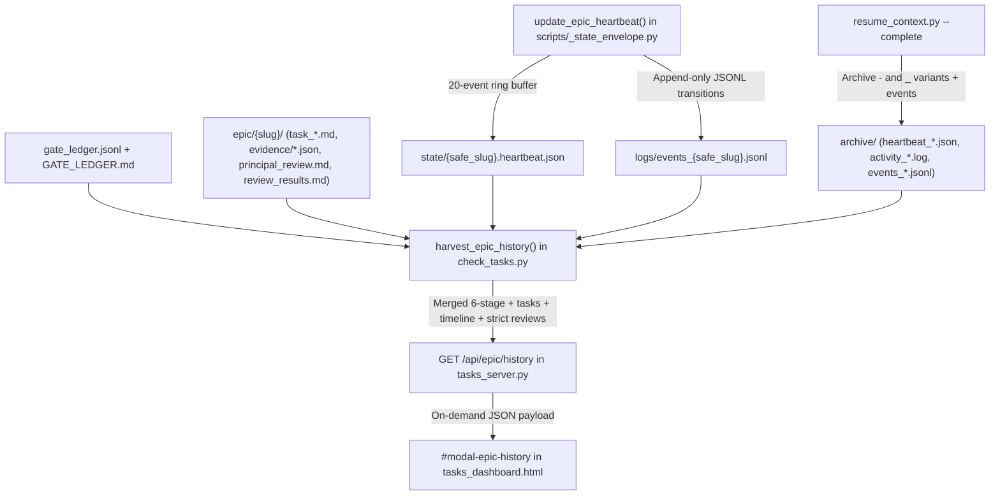
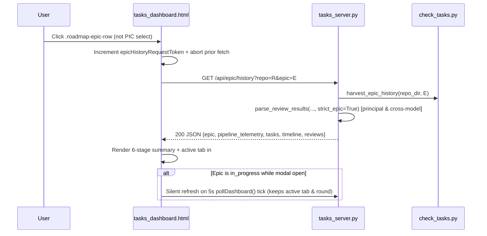

# Thiết kế Cấp cao: Modal Lịch sử Epic và Telemetry Append-Only trong Check-Tasks

## Mục lục

- [Meta Data](#meta-data)
- [Bối cảnh](#bối-cảnh)
- [Mục tiêu và Ngoài phạm vi](#mục-tiêu-và-ngoài-phạm-vi)
- [Kiến trúc và Thiết kế Kỹ thuật](#kiến-trúc-và-thiết-kế-kỹ-thuật)
- [Bản đồ Bảo trì Tính năng](#bản-đồ-bảo-trì-tính-năng)
- [Hợp đồng Module và Giao diện HTTP](#hợp-đồng-module-và-giao-diện-http)
- [Phân tích Tác động](#phân-tích-tác-động)
- [Tác động Hợp đồng Dùng chung](#tác-động-hợp-đồng-dùng-chung)
- [Kế hoạch Kiểm thử Tích hợp và Ma trận Ranh giới](#kế-hoạch-kiểm-thử-tích-hợp-và-ma-trận-ranh-giới)
- [Môi trường Xác minh](#môi-trường-xác-minh)
- [Độ phủ Kịch bản BDD Toàn diện](#độ-phủ-kịch-bản-bdd-toàn-diện)
- [Chiến lược Triển khai và Giảm thiểu Rủi ro](#chiến-lược-triển-khai-và-giảm-thiểu-rủi-ro)
- [Phân rã Task Kanban](#phân-rã-task-kanban)
- [Đính chính Đặc tả (Spec Errata)](#đính-chính-đặc-tả-spec-errata)

## Meta Data

- **Epic name**: `check_tasks_epic_history_modal`
- **Status**: Done
- **PIC**: `phungthuy8901`
- **Target release**: Next plugin release
- **Platform**: Python tooling, local HTTP dashboard server, and HTML/Vanilla JS dashboard UI
- **Depends on epic**: none
- **Source Spec**: [Thiết kế Modal Lịch sử Epic và Telemetry Append-Only trong Check-Tasks](2026-11-15-check-tasks-epic-history-modal-design.vi.md)

## Bối cảnh

Web Dashboard `/check-tasks` (`skills/check-tasks/resources/dashboard/tasks_dashboard.html`) hiển thị các epic đang hoạt động tại **Section II** và liệt kê toàn bộ các epic của repository (`Done`, `In Progress`, `Packaged`, `Backlog`, `Abandon`) tại **Section III ("Project Epics Roadmap (`.devtool/epic/`)")**. Bốn khoảng trống cấu trúc ngăn người dùng kiểm tra các epic lịch sử hoặc epic đồng cấp một cách liền mạch:

1. **Các hàng Roadmap không tương tác**: `renderRoadmapTableRows()` (`tasks_dashboard.html:L3396-L3455`) render `<tr class="roadmap-epic-row">` mà không có trình xử lý nhấp hàng, không cho phép kiểm tra tiến trình pipeline 6 stage, phân rã task, bằng chứng xác minh, log, hoặc kết quả review của một epic đã xong hoặc backlog mà không làm thay thế epic đang chạy ở Section II.
2. **Cắt ngắn Ring Buffer 20 sự kiện & Tách rời Telemetry Gạch nối/Gạch dưới**: `update_epic_heartbeat()` (`scripts/_state_envelope.py:L430-L565`) giới hạn `.heartbeat.json["events"]` ở `max_events = 20`, làm mất các vi bước trước đó trên các epic dài. Hơn nữa, `_sanitize_epic_slug()` chuyển gạch dưới thành gạch nối, khiến các thao tác ghi trạng thái và lưu trữ hoàn tất `--complete` (`scripts/resume_context.py:L1038-L1062`) bị phân tách hoặc bỏ sót tệp `<epic_slug>.heartbeat.json` so với `<safe_slug>.heartbeat.json`.
3. **Các task hoàn tất bị loại khỏi thu thập tổng quan**: `extract_task_progress()` (`skills/check-tasks/resources/scripts/check_tasks.py:L1393`) bỏ qua các epic đã xong (`slug in completed_slugs and slug != active_epic`) để giữ cho polling `/api/tasks` nhẹ nhàng, do đó không có endpoint nào phục vụ các lượt chạy `task_*.md` hoặc `evidence/*.json` đã lưu trữ của epic hoàn thành.
4. **Fallback Review không giới hạn phạm vi**: `parse_review_results()` (`skills/check-tasks/resources/scripts/tasks_server.py:L390-L435`) tự động chèn đường dẫn fallback `.devtool/principal_review.md` và `.devtool/review_results.md` ở thư mục gốc repo ngay cả khi `active_epic` được chỉ định, gây nguy cơ rò rỉ review giữa các epic khi kiểm tra các epic cũ không có tệp review riêng.

## Mục tiêu và Ngoài phạm vi

### Mục tiêu

- Cho phép nhấp vào bất kỳ `.roadmap-epic-row` nào trên mọi trạng thái (`Done`, `In Progress`, `Packaged`, `Backlog`, `Abandon`) để mở một Pop-up Modal `#modal-epic-history` chuyên dụng trong khi vẫn giữ nguyên **Section II** bên dưới và giữ tương tác `<select>` trong cột `PIC` độc lập qua `stopPropagation()`.
- Lưu trữ luồng sự kiện append-only không cắt ngắn `.devtool/logs/events_{safe_slug}.jsonl` bên trong `update_epic_heartbeat()` cùng với ring buffer `.heartbeat.json` 20 sự kiện hiện tại, và lưu trữ sạch sẽ cả `events_{safe_slug}.jsonl` lẫn các biến thể heartbeat `-`/`_` trong `resume_context.py --complete`.
- Cung cấp endpoint theo yêu cầu `GET /api/epic/history?repo=<repo>&epic=<slug>` được hỗ trợ bởi `harvest_epic_history()` giúp liên kết các nguồn dữ liệu cũ và luồng đầy đủ trên worktree, `.devtool/` gốc và `.devtool/archive/` (các biến thể slug `-`/`_`), tái cấu trúc telemetry 6 stage qua `compute_pipeline_telemetry()`, gắn kèm `task_*.md` + `evidence/*.json`, xây dựng dòng thời gian khử trùng lặp và tải các vòng `Principal Review` + `Cross-Model Review` theo phạm vi nghiêm ngặt.
- Trích xuất các pure JS rendering helper dùng chung từ Section II và `#modal-cross-review` (`tasks_dashboard.html`) để vận hành `#modal-epic-history` với 4 tab con có thể chuyển đổi (`Timeline & Step Logs`, `Tasks & Evidence`, `Principal Review`, `Cross-Model Review`) và tự động làm mới trực tiếp khi kiểm tra một epic `In Progress`.

### Ngoài phạm vi

- Sửa đổi trạng thái task, chạy review CLI, hoặc gửi lệnh terminal từ bên trong `#modal-epic-history` (chỉ xem ở chế độ read-only nghiêm ngặt).
- Ghi lại các tệp `.devtool/` lịch sử bên trong các repository đồng cấp (`D3Nexus`, `lyrics-sync`, `nexus`) hoặc lưu stdout thô quá chi tiết của subprocess vào luồng JSONL sự kiện.
- Mở rộng payload thăm dò `/api/tasks` với toàn bộ lịch sử task/evidence đã lưu trữ trên hơn 118 epic đã hoàn tất.

## Kiến trúc và Thiết kế Kỹ thuật

### High-Level Architecture



### Modal Interaction and Refresh Sequence



### Key Design Mechanics

1. **Luồng lai Append-Only (`scripts/_state_envelope.py`, `scripts/resume_context.py`)**:
   - Bên trong `run_state_transaction()` cho `<safe_slug>.heartbeat.json`, so sánh `(stage, sub_step, sub_step_detail, last_event, review_state)` đến với bản chụp trước. Khi một sự kiện khác biệt mới được thêm vào (tức là `last_event` không rỗng và khác với sự kiện trước đó, hoặc phase/round của `stage`/`sub_step`/`review_state` thay đổi), nối một dòng vào `.devtool/logs/events_<safe_slug>.jsonl` trên tất cả thư mục mirror `.devtool` trong khi giữ `file_lock`.
   - Khi `last_event` giống hệt nhau liên tiếp và chỉ có `updated_at` nhảy nhịp, tránh ghi trùng lặp các dòng JSONL (chỉ cập nhật `ts` của snapshot heartbeat trực tiếp).
   - Trong quá trình `resume_context.py --complete`, lưu trữ `events_<safe_slug>.jsonl` (cùng biến thể `<epic_slug>` nếu phân biệt) vào `.devtool/archive/events_<safe_slug>_<timestamp>.jsonl`, đồng thời lưu trữ cả `<safe_slug>.heartbeat.json` và `<epic_slug>.heartbeat.json` chưa chuẩn hóa / đối ứng gạch nối gạch dưới để không còn `.heartbeat.json` mồ côi trong `.devtool/state/`.
2. **Trình tổng hợp Lịch sử Đa nguồn (`skills/check-tasks/resources/scripts/check_tasks.py`)**:
   - `_collect_slug_variants(epic_slug)` liệt kê `[epic_slug, safe_slug, epic_slug.replace("_", "-"), epic_slug.replace("-", "_")]` bảo toàn thứ tự và tính duy nhất.
   - `harvest_epic_history(repo_path, epic_slug)` phát hiện thư mục khớp `.devtool/epic/<variant>/`, đường dẫn worktree đang hoạt động, `.devtool/state/`, `.devtool/logs/`, và `.devtool/archive/`.
   - Tái tạo heartbeat nạp tất cả tệp trạng thái và heartbeat lưu trữ phù hợp (bản chụp chiến thắng theo `generation` + `updated_at` + hợp các `events`) cùng với `events_<variant>*.jsonl`, tính toán `log_completeness`: `"full_stream"` khi `events_*.jsonl` đóng góp bản ghi, `"snapshot_and_ledger"` khi được tổng hợp từ ring-buffer heartbeats / `gate_ledger` / `activity_*.log` / `evidence/*.json`, hoặc `"none"` khi rỗng.
   - Phân giải task ưu tiên `.devtool/features/` của worktree đang hoạt động khi `status == "in_progress"` (khớp với `extract_task_progress`), nếu không sẽ phân tích `.devtool/epic/<variant>/task_*.md` theo thứ tự `natural_sort_key`, gắn kèm tóm tắt xác minh `evidence/<task_id>.json` (`head`, `started`, `finished`, `passed_rows`, `total_rows`, `rows` có giới hạn).
   - Các mục timeline sử dụng khóa khử trùng lặp `(ts, category, message, sub_step)`, ưu tiên nguồn phong phú hơn (`events_log` hơn các mục `heartbeat` đuôi trùng lặp) và chuẩn hóa mốc thời gian UTC ISO-8601 trước khi sắp xếp theo trình tự thời gian.
3. **Phân lập Review Epic Nghiêm ngặt (`skills/check-tasks/resources/scripts/tasks_server.py`)**:
   - `parse_review_results(..., strict_epic: bool = False)` duy trì tương thích mặc định cho `/api/review` khi không có chỉ định epic nào yêu cầu cô lập, trong khi thiết lập `strict_epic=True` bên trong `/api/epic/history` (và `&strict=1` tùy chọn trên `/api/review`) sẽ hạn chế tệp ứng viên nghiêm ngặt trong `.worktrees/<variant>/.devtool/epic/<variant>/...` và `repo_dir/.devtool/epic/<variant>/...`, loại trừ `.devtool/principal_review.md` và `.devtool/review_results.md` ở thư mục gốc repo.
4. **Trích xuất JS Helper Dùng chung (`skills/check-tasks/resources/dashboard/tasks_dashboard.html`)**:
   - Trích xuất `buildPipelineStepperHtml(pt, hb, options)` (stepper thuần túy + chip bước con được dùng lại bởi cả `renderPipelineStepperAndLogs()` trong Section II và phần tóm tắt header của `#modal-epic-history`).
   - Trích xuất `buildReviewHeaderHtml(data)` và `buildReviewFindingsTableHtml(findings)` (Bảng Triage 6 cột + sao chép commit + tô nổi bật token review được dùng lại bởi cả `openReviewModal()` và các tab `Principal Review` / `Cross-Model Review` bên trong `#modal-epic-history`).

## Bản đồ Bảo trì Tính năng

| Khu vực Tính năng | Các tệp Chính | Điểm vào / Hàm |
|---|---|---|
| Luồng Telemetry Append-only `events_*.jsonl` | `scripts/_state_envelope.py` | `update_epic_heartbeat()`, `_append_epic_event_stream()` |
| Lưu trữ Hoàn tất (`events_*.jsonl` + Heartbeat `-`/`_`) | `scripts/resume_context.py` | `complete_feature()` (khối `--complete`) |
| Trình tổng hợp Lịch sử Epic Đa nguồn | `skills/check-tasks/resources/scripts/check_tasks.py` | `harvest_epic_history()`, `_merge_epic_heartbeats()`, `_build_unified_timeline()` |
| Endpoint HTTP & Trình phân tích Review Epic Nghiêm ngặt | `skills/check-tasks/resources/scripts/tasks_server.py` | `TasksHandler.do_GET()`, `parse_review_results()` |
| Roadmap Có thể nhấp, Helper Dùng chung & Giao diện Modal | `skills/check-tasks/resources/dashboard/tasks_dashboard.html` | `renderRoadmapTableRows()`, `openEpicHistoryModal()`, `switchEpicHistoryTab()`, `buildPipelineStepperHtml()`, `buildReviewFindingsTableHtml()` |

## Hợp đồng Module và Giao diện HTTP

1. **`scripts/_state_envelope.py::update_epic_heartbeat`**:
   - Giữ nguyên chữ ký hiện tại (`L430-L451`); ghi ring buffer giới hạn `max_events=20` vào `<safe_slug>.heartbeat.json` ĐỒNG THỜI nối các bản ghi JSONL chuyển đổi phân biệt (`ts`, `stage`, `sub_step`, `sub_step_detail`, `message`, `review_state`) vào `.devtool/logs/events_<safe_slug>.jsonl` trên các thư mục gốc `.devtool` được mirror.
2. **`skills/check-tasks/resources/scripts/check_tasks.py::harvest_epic_history`**:
   ```python
   def harvest_epic_history(repo_path: Path, epic_slug: str) -> dict[str, Any]:
   ```
   Trả về `{ "epic": {...}, "pipeline_telemetry": {...}, "tasks": [...], "timeline": [...], "log_completeness": "full_stream" | "snapshot_and_ledger" | "none" }`.
3. **`skills/check-tasks/resources/scripts/tasks_server.py::parse_review_results`**:
   ```python
   def parse_review_results(
       repo_dir: Path,
       active_epic: str | None = None,
       target_round: int | None = None,
       kind: str | None = None,
       *,
       strict_epic: bool = False,
   ) -> dict[str, Any]:
   ```
   Khi `strict_epic=True`, bỏ qua tệp fallback ở gốc repo `.devtool/{principal_review,review_results}.md` và thiết lập `"present": bool(review_file)`.
4. **Tuyến HTTP `GET /api/epic/history`**:
   - Tham số truy vấn: `repo` (bắt buộc, phải phân giải nghiêm ngặt dưới `workspace_root`), `epic` (bắt buộc, safe slug không có ký tự duyệt đường dẫn), `round_principal` (`int` tùy chọn), `round_cross` (`int` tùy chọn).
   - Mã trạng thái: Payload JSON `200` (`{ "success": true, "epic": ..., "pipeline_telemetry": ..., "tasks": ..., "timeline": ..., "reviews": { "principal": ..., "cross_model": ... }, "log_completeness": ... }`), `400` khi thiếu/sai tham số hoặc cố tình duyệt đường dẫn, `404` khi không tìm thấy `repo` hoặc epic tương ứng.

## Phân tích Tác động

Phân tích tác động Shift-left (`check_code_impact.py --base-ref main`) đã kiểm tra các caller của `update_epic_heartbeat`, `parse_review_results`, `compute_pipeline_telemetry`, `renderRoadmapTableRows`, và `openReviewModal`:

- Trạng thái xung đột git thượng nguồn: **CLEAN** (`0` commit chưa hợp nhất so với `main`).
- Các caller hạ nguồn giữ nguyên tương thích ngược vì:
   - `update_epic_heartbeat` giữ nguyên chữ ký và schema `.heartbeat.json`.
   - `parse_review_results` mặc định `strict_epic=False` cho các caller kế thừa trong khi `/api/epic/history` truyền `strict_epic=True`.
   - `/api/tasks` tiếp tục bỏ qua các task `Done` đã lưu trữ để các hợp đồng hiện có của `test_check_tasks_harvester.py` và `test_rsdh_harvester_and_pic.py` được bảo toàn nguyên vẹn.
   - Các JS helper được trích xuất (`buildPipelineStepperHtml`, `buildReviewHeaderHtml`, `buildReviewFindingsTableHtml`) bảo toàn toàn bộ thuộc tính DOM `data-telemetry` hiện có được kiểm thử trong `tests/test_ltsp_dashboard_ui.py` và `tests/test_rsdh_tasks_dashboard_ui.py`.

## Tác động Hợp đồng Dùng chung

Không có — tính năng tự chứa hoàn toàn bên trong `ai-agent-tools` (`shared-contracts/` không tồn tại trong repository này).

## Kế hoạch Kiểm thử Tích hợp và Ma trận Ranh giới

Integration test roots: tests
Protected paths: .agents/quality/**, .devtool/epic/check_tasks_epic_history_modal/bdd_scenarios.en.md, .devtool/epic/check_tasks_epic_history_modal/bdd_scenarios.vi.md
Integration results: python3 -m pytest -q --tb=short --maxfail=3 --junitxml=build/test-results/check-tasks-epic-history-modal.xml tests/test_cehm_telemetry_stream.py tests/test_cehm_history_aggregator.py tests/test_cehm_dashboard_modal_ui.py tests/test_cehm_e2e_cdp.py tests/test_check_tasks_server.py tests/test_check_tasks_fsm.py tests/test_ltsp_state_and_producers.py tests/test_ltsp_harvester_pipeline.py tests/test_ltsp_dashboard_ui.py tests/test_rsdh_state_envelope.py tests/test_rsdh_harvester_and_pic.py tests/test_rsdh_tasks_dashboard_ui.py tests/test_rsdh_orchestration.py -> build/test-results/check-tasks-epic-history-modal.xml

| Boundary | Producer | Consumer | Verification Tier |
|---|---|---|---|
| `.devtool/logs/events_{safe_slug}.jsonl` & `.devtool/archive/events_*` | `scripts/_state_envelope.py`, `scripts/resume_context.py` | `harvest_epic_history()` | Tier A Unit & Concurrency |
| `harvest_epic_history()` & `parse_review_results(strict_epic=True)` | `check_tasks.py`, `tasks_server.py` | `GET /api/epic/history` | Tier A Unit & Tier C HTTP |
| `GET /api/epic/history` & `tasks_dashboard.html` `#modal-epic-history` | `tasks_server.py` | `tasks_dashboard.html` UI + CDP | Tier C Headless Chrome CDP |

## Môi trường Xác minh

- **Cô lập Dữ liệu**: Tất cả kiểm thử tự động thực thi bên trong git repository tạm thời `tmp_path` / `tempfile.TemporaryDirectory` được gắn với các cổng localhost cấp phát động (`find_available_port`).
- **Kho lưu trữ Trực tiếp Bị cấm**: Kiểm thử tuyệt đối không được đọc hoặc sửa đổi `~/.gemini/`, `~/antigravity_homes/`, `~/.zshrc`, hoặc `/tmp/agy_tasks_server.pid` của host.
- **Biến Needs**: Không yêu cầu (`Needs: none`).

## Độ phủ Kịch bản BDD Toàn diện

Toàn bộ 15 kịch bản BDD (`CEHM-HP-01` đến `CEHM-FR-02`) được định nghĩa trong [bdd_scenarios.vi.md](bdd_scenarios.vi.md) qua các luồng Luồng chính (`HP`), Trường hợp biên (`EC`), Chuyển đổi trạng thái (`ST`), Kiến trúc & Đồng thời (`AR`), và Phục hồi lỗi (`FR`).

## Chiến lược Triển khai và Giảm thiểu Rủi ro

- Hợp nhất các thay đổi nguyên tử qua `_state_envelope.py`, `resume_context.py`, `check_tasks.py`, `tasks_server.py`, và `tasks_dashboard.html` trong nhánh tính năng độc lập trước khi đạt hội tụ Gate 4 và Cross-Model Review.
- Giữ payload ghi thêm của `events_{safe_slug}.jsonl` gọn nhẹ và giới hạn lát cắt `output_tail` xác minh nội dòng (`<= 8` dòng mỗi hàng kiểm tra theo mặc định trong `/api/epic/history`) để ngay cả các epic có hơn 15 task cũng tuần tự hóa sạch sẽ dưới 50ms.
- Sau khi hợp nhất Gate 5 vào `main`, đồng bộ lại bản snapshot plugin đã cài đặt nếu sử dụng `~/.gemini/config/plugins/d3nexus/`.

## Phân rã Task Kanban

1. **[Task 01: Append-Only Per-Epic Event Stream and Dual-Variant Archival](task_01_append_only_event_stream_and_archival.md)** (`review_tier: "full"`) — Covers: `CEHM-HP-01`, `CEHM-AR-01`
2. **[Task 02: Epic History Aggregator, Scoped Review Lookup, and `/api/epic/history` Endpoint](task_02_epic_history_aggregator_and_scoped_api.md)** (`review_tier: "full"`) — Covers: `CEHM-HP-02`, `CEHM-HP-03`, `CEHM-EC-01`, `CEHM-EC-02`, `CEHM-ST-01`, `CEHM-AR-03`, `CEHM-FR-01`
3. **[Task 03: Shared JS Renderers and Interactive `modal-epic-history` Dashboard UI](task_03_shared_helpers_and_epic_history_modal_ui.md)** (`review_tier: "full"`) — Covers: `CEHM-HP-04`, `CEHM-EC-03`, `CEHM-ST-02`, `CEHM-ST-03`, `CEHM-AR-02`
4. **[Task 04: End-to-End Integration, Headless Chrome CDP Verification, and Regression Alignment](task_04_end_to_end_cdp_and_regression_alignment.md)** (`review_tier: "full"`) — Covers: `CEHM-FR-02`

## Đính chính Đặc tả (Spec Errata)

None.

<!-- sync-en-sha256: 3971084390f91dac -->
