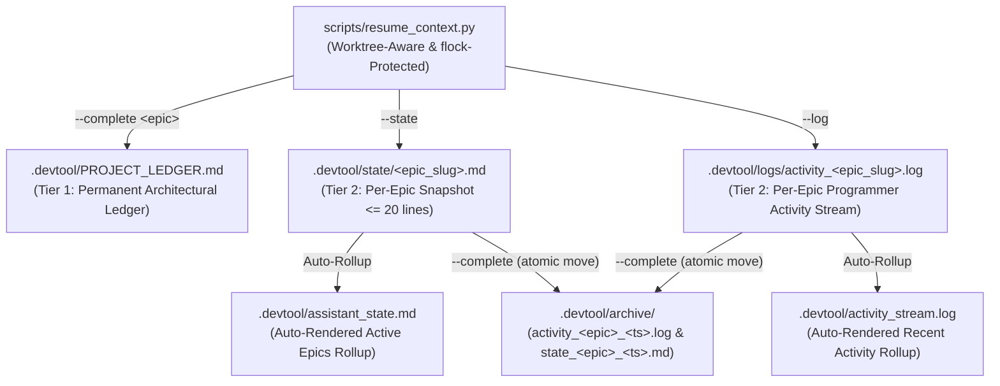
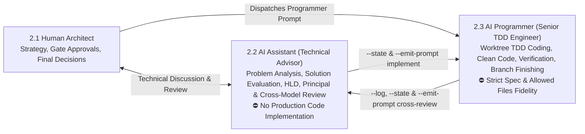

# Two-Tier Project Memory, Tri-Role Governance, and Context Resume/Save Specification

## Table of Contents

- [1. Overview and Problem Statement](#1-overview-and-problem-statement)
- [2. Goals and Non-Goals](#2-goals-and-non-goals)
- [3. Environment Unification and Shell Aliases](#3-environment-unification-and-shell-aliases)
- [4. Multi-Epic Two-Tier Storage Architecture](#4-multi-epic-two-tier-storage-architecture)
- [5. CLI Engine Specification](#5-cli-engine-specification)
- [6. Tri-Role Governance and Handoff Matrix](#6-tri-role-governance-and-handoff-matrix)
- [7. Skills and Dev-Lifecycle Integration](#7-skills-and-dev-lifecycle-integration)
- [8. Error Handling, Concurrency, and Testing Strategy](#8-error-handling-concurrency-and-testing-strategy)

## 1. Overview and Problem Statement

AI-assisted software engineering across multi-repository workspaces (`ai-agent-tools`, `D3Nexus`, `lyrics-sync`, `nexus`) and multiple Antigravity account profiles (`antigravity_homes/<profile>`) faces three persistent continuity challenges:

1. **Account Rotation and Session Handoff Loss**: Switching accounts or opening new sessions loses conversational state unless architectural decisions, active task progress, and recent programming steps are persisted deterministically on disk.
2. **Multi-Agent and Multi-Epic Collisions**: When multiple AI Agents work concurrently on different Epics within the same repository, a single overwritten `.devtool/assistant_state.md` or a single rotated `.devtool/activity_stream.log` causes state overwrites and premature log truncation for in-flight Epics.
3. **Role Ambiguity Between Advisory and Programming Personas**: Without explicit role boundaries, an AI Agent summoned as an **AI Assistant** for architectural analysis, Principal Review, or Cross-Model Review may prematurely modify production code, while an execution agent lacks a sharply defined **AI Programmer (Senior TDD Software Engineer)** identity enforcing TDD, Clean Code, and strict specification boundaries.

This specification defines a unified **Two-Tier Project Memory** engine (`scripts/resume_context.py`), environment synchronization in `.zshrc` (including shared terminal history and aliases), two dedicated skills (`resume-context` and `save-context`), a **Tri-Role Governance Model** (Human Architect, AI Assistant, AI Programmer), and automated checkpoints across all stages of `d3nexus:dev-lifecycle`.

## 2. Goals and Non-Goals

### Goals

- Unify shell environment variables (`REAL_HOME`, `WORKSPACE_ROOT`, `HISTFILE`), directory symlinks (`AllProjects`, `Projects`, `.zsh_history`), and aliases (`resume`, `save-context`) across all Antigravity profiles via `/Users/danhdueexoictif/.zshrc`.
- Implement a zero-dependency Python CLI engine at `scripts/resume_context.py` supporting multi-epic partitioned Tier 2 state (`.devtool/state/<epic_slug>.md` and `.devtool/logs/activity_<epic_slug>.log`) with automatic rollup into `.devtool/assistant_state.md` and `.devtool/activity_stream.log`.
- Support git worktree-aware routing so invocations inside `.worktrees/<epic_dir>` automatically resolve to the primary repository root's `.devtool/` directory.
- Enforce the **Tri-Role Governance Model** (Human Architect, AI Assistant, AI Programmer) with role-specific context harvesting (`--role assistant|programmer`) and deterministic handoff prompt generation (`--emit-prompt`) across four real-world lifecycle transitions.
- Create `skills/resume-context/SKILL.md` and `skills/save-context/SKILL.md`, and integrate automatic context persistence into `dev-brainstorming`, `dev-designer`, `dev-lifecycle`, `principal-review`, `dev-implementation`, `cross-model-review`, `finishing-a-development-branch`, and `rules/CRITICAL_RULES.md`.

### Non-Goals

- External database dependencies or cloud-hosted telemetry services (all state remains strictly file-backed and local to `.devtool/`).
- Modifying production application logic in satellite repositories (`D3Nexus`, `lyrics-sync`, `nexus`) during this toolkit epic.
- Replacing git version control history or Kanban task files (`.devtool/features/task_*.md`).

## 3. Environment Unification and Shell Aliases

All Antigravity profile homes (`/Users/danhdueexoictif/antigravity_homes/<profile>/.zshrc`) symlink to `/Users/danhdueexoictif/.zshrc`. To ensure complete parity across IDE terminals, `<profile>-cli` sessions, and standalone shells:

1. **Workspace Root and Project Symlinks**:
   - Define `export REAL_HOME="/Users/danhdueexoictif"` and `export WORKSPACE_ROOT="$REAL_HOME/AllProjects"` at the top of `/Users/danhdueexoictif/.zshrc`.
   - Maintain `/Users/danhdueexoictif/Projects -> /Users/danhdueexoictif/AllProjects` and add `AllProjects`, `Projects`, and `.zsh_history` to the `sync_items` array inside `ag_run()`.
2. **Shared Terminal History Across All Accounts**:
   - Merge existing profile `.zsh_history` entries into `/Users/danhdueexoictif/.zsh_history` and symlink each profile's `.zsh_history` to `$REAL_HOME/.zsh_history`.
   - Configure zsh history settings after `source $ZSH/oh-my-zsh.sh` so Oh-My-Zsh does not override `HISTFILE`:
     ```zsh
     export HISTFILE="$REAL_HOME/.zsh_history"
     export HISTSIZE=50000
     export SAVEHIST=50000
     setopt INC_APPEND_HISTORY
     setopt SHARE_HISTORY
     setopt HIST_IGNORE_DUPS
     ```
3. **Standardized Context Aliases**:
   ```zsh
   alias resume='python3 $HOME/Projects/ai-agent-tools/scripts/resume_context.py'
   alias save-context='python3 $HOME/Projects/ai-agent-tools/scripts/resume_context.py --complete'
   ```

## 4. Multi-Epic Two-Tier Storage Architecture

To prevent multi-agent contention when multiple Epics are active simultaneously in the same repository, `.devtool/` uses epic-scoped partitioning in Tier 2 while maintaining backward-compatible rollup files:



### Storage Layout Rules

- **Tier 1 — `.devtool/PROJECT_LEDGER.md`**:
  - Permanent record of system topology, core invariants, and completed epic milestones (`- **[YYYY-MM-DD] \`<epic_slug>\`**: <summary>`). Never deleted.
- **Tier 2 — `.devtool/state/<epic_slug>.md` and `.devtool/assistant_state.md`**:
  - Each active epic (or `general` for non-epic work) owns `.devtool/state/<epic_slug>.md`, capped at 20 lines, containing:
    - `Active Epic`: `<epic_slug>` (plus active role and timestamp)
    - `Recent Decisions Locked`: key architectural or review decisions
    - `Repo/Task Status`: current stage, branch/worktree, and task completion count
    - `Next Immediate Step`: exact next action
    - `Custom Prompt / Notes`: optional developer or agent context note
  - Every `--state` or `--complete` update automatically re-renders `.devtool/assistant_state.md` by concatenating all active `.devtool/state/*.md` snapshots.
- **Tier 2 — `.devtool/logs/activity_<epic_slug>.log` and `.devtool/activity_stream.log`**:
  - Each completed code request or task appends 1–3 lines from the **AI Programmer** to `.devtool/logs/activity_<epic_slug>.log`:
    `[YYYY-MM-DD HH:MM] [<repo>/<epic_slug>/<task_id>] Request: <summary> | Action: <files & tests> | Note: <deviations or None>`
  - Every `--log` or `--complete` update automatically refreshes `.devtool/activity_stream.log` from active epic logs.
- **Epic-Isolated Compaction (`--complete`)**:
  - Invoking `--complete <epic_slug> "<summary>"` appends the milestone to `PROJECT_LEDGER.md`, atomically moves only `.devtool/logs/activity_<epic_slug>.log` and `.devtool/state/<epic_slug>.md` into `.devtool/archive/`, and re-renders the rollup files from the remaining active epics. Other in-flight epics remain untouched.

## 5. CLI Engine Specification

`scripts/resume_context.py` provides four primary operations plus role-bound prompt emission:

1. **Harvest & Resume Mode (Default)**:
   ```bash
   python3 scripts/resume_context.py [--workspace-root <path>] [--repo <name>] [--epic <slug>] [--role assistant|programmer] [--tail <N>] [--json]
   ```
   - Note: `--role implementer` and `--role worker` are accepted as backward-compatible aliases for `--role programmer`.
   - Auto-detects `WORKSPACE_ROOT` from `--workspace-root`, `$WORKSPACE_ROOT`, script path (`Path(__file__).resolve().parents[1].parent`), or `$HOME/Projects` / `$HOME/AllProjects`.
   - Resolves git worktrees via `git rev-parse --git-common-dir` so commands executed inside `.worktrees/<epic_dir>` read and write the main repository's `.devtool/`.
   - Outputs 6 sections:
     0. `0. PROJECT ARCHITECTURAL LEDGER (.devtool/PROJECT_LEDGER.md)`
     1. `1. ACTIVE EPIC STATE (.devtool/state/*.md & .devtool/assistant_state.md)`
     2. `2. RECENT PROGRAMMER ACTIVITY (.devtool/logs/activity_*.log)` (last $N$ lines per active epic)
     3. `3. GIT WORKING TREE & WORKTREE STATUS ACROSS REPOS`
     4. `4. OPEN CONTRACT GAPS & RFCS (shared-contracts/*/gaps_and_rfcs.md)`
     5. `5. ACTIVE & COMPLETED KANBAN TASKS (.devtool/features/task_*.md & done/)`
   - When `--role assistant` or `--role programmer` is passed, prints the corresponding **Role Governance Banner** enforcing permissions, coding standards, and restrictions.

2. **Architect/Assistant Snapshot Write Mode (`--state`)**:
   ```bash
   python3 scripts/resume_context.py --state --epic <slug> [--repo <name>] \
     [--decisions "<text>"] [--status "<text>"] [--next "<text>"] [--prompt "<custom_note>"]
   ```
   - Enforces the 20-line ceiling on `.devtool/state/<epic_slug>.md`, acquires an exclusive file lock (`.devtool/.memory.lock`), writes the epic snapshot, and regenerates `.devtool/assistant_state.md`.

3. **Programmer Activity Log Mode (`--log`)**:
   ```bash
   python3 scripts/resume_context.py --log --epic <slug> [--repo <name>] [--task <task_id>] \
     --request "<summary>" --action "<files_and_tests>" [--note "<deviations_or_prompt>"]
   ```
   - Appends a formatted entry to `.devtool/logs/activity_<epic_slug>.log` under file lock and refreshes `.devtool/activity_stream.log`.

4. **Feature Completion & Compaction Mode (`--complete` / `save-context`)**:
   ```bash
   python3 scripts/resume_context.py --complete <epic_slug> "<milestone_summary>" [--repo <name>] [--checkpoint]
   ```
   - Standard `--complete <epic_slug> "<summary>"`: appends milestone to `PROJECT_LEDGER.md`, archives `<epic_slug>` state and activity log into `.devtool/archive/`, and refreshes rollup files.
   - If `--checkpoint` is passed alongside `--complete` (e.g. `save-context --checkpoint <epic_slug> "<custom_prompt>"`), saves a Tier 2 checkpoint (`--state` + `--log`) without archiving the epic.

5. **Role-Bound Handoff Prompt Generator (`--emit-prompt`)**:
   ```bash
   python3 scripts/resume_context.py --emit-prompt <principal-review|implement|cross-review|finish|assistant> [--epic <slug>] [--epic-dir <dir>] [--prompt "<custom_note>"]
   ```
   - Emits ready-to-copy prompts with explicit persona locks (`AI ASSISTANT` or `AI PROGRAMMER`) for seamless transitions between advisory/review and programming sessions.

## 6. Tri-Role Governance and Handoff Matrix

Project development is governed by three explicit roles:



### Detailed Role Definitions and Permissions

1. **Role 2.1 — Human Architect (Developer)**:
   - Owns architectural direction, trade-off selection, review triage decisions, and Gate 1–5 approvals.
2. **Role 2.2 — AI Assistant (`[PERSONA: AI ASSISTANT — TECHNICAL ADVISOR & CO-ARCHITECT]`)**:
   - **Responsibilities**: Harvests project context (`--role assistant`), discusses problem statements, analyzes root causes, evaluates solution trade-offs, authors design specs/HLDs/tasks (`dev-brainstorming`, `dev-designer`), and orchestrates `principal-review` and `cross-model-review`.
   - **Hard Restriction**: **Strictly prohibited from writing or modifying production source code or application tests.** May only modify design/architecture documents (`docs/`, `.devtool/`, `shared-contracts/`).
3. **Role 2.3 — AI Programmer (`[PERSONA: AI PROGRAMMER — SENIOR TDD SOFTWARE ENGINEER]`)**:
   - **Responsibilities**: Activated by implementation prompts (`/dev-implementation` or task execution requests). Loads context via `resume_context.py --role programmer --epic <slug>`, writes production code and automated tests inside isolated git worktrees following strict TDD (Red-Green-Refactor), Clean Architecture, and Code Health standards (functions $<20$ lines, $\le 2$ parameters, strict null-safety, zero test fakery), runs verification suites, commits task changes, and logs every action via `--log` and `--state`.
   - **Hard Restriction**: **Strictly bound to approved specifications, `Decisions Already Made`, and `Allowed files`.** Must never alter frozen architecture or modify `shared-contracts/` symlinks in satellite repos; if blocked by a design gap, must halt (`BLOCKED`), record `--log`, and escalate to the Human Architect and AI Assistant.

### The Four Operational Handoff Scenarios

| Scenario | Active Persona | Entry Trigger & Command | Output State & Next Handoff Prompt |
| :--- | :--- | :--- | :--- |
| **1. Post-Package Principal Review** | **AI Assistant (2.2)** | Triggered after Stage 2 `Package`. Loads context via `resume_context.py --role assistant --epic <slug>` and runs `d3nexus:principal-review`. | Saves review round status via `--state` and emits the **AI Programmer Execution Prompt** (`--emit-prompt implement`). |
| **2. Post-Review Implementation** | **AI Programmer (2.3)** | Triggered via `/dev-implementation` with `[PERSONA: AI PROGRAMMER — SENIOR TDD SOFTWARE ENGINEER]`. Loads `resume_context.py --role programmer --epic <slug>` and `handoff.md`. | Logs every programmed task via `--log` + `--state`. Upon Gate 4 PASS, saves candidate SHA and emits `--emit-prompt cross-review`. |
| **3. Post-Implementation Cross-Model Review** | **AI Assistant (2.2)** | Triggered after Gate 4 PASS via `/cross-model-review`. Loads context via `resume_context.py --role assistant --epic <slug>` and triages findings with Human Architect. | Emits either an **AI Programmer Fix Prompt** (if code fixes are needed) or a **Finish Prompt** (`--emit-prompt finish`) for `/finish`. |
| **4. Ad-Hoc Technical Discussion** | **AI Assistant (2.2)** | Triggered anytime via `/resume-context` for architectural Q&A, debugging analysis, or solution evaluation. Production code modifications are strictly locked. | Persists discussion takeaways anytime via `/save-context` (`--state --prompt "<note>"`). |

## 7. Skills and Dev-Lifecycle Integration

### New Skills

1. **`skills/resume-context/SKILL.md`**:
   - Executes `scripts/resume_context.py` on session startup or account switch.
   - Enforces the **Tri-Role Governance Model**: defaults to **AI Assistant** (read-only code analysis, architectural discussion, review orchestration) unless explicitly invoked with an implementation prompt or `/dev-implementation` (which activates **AI Programmer**).
   - Summarizes project state in 5–10 concise bullets before addressing the user's prompt.
2. **`skills/save-context/SKILL.md`**:
   - Saves context immediately with custom prompt support (`--state --prompt "..."`, `--log`, or `--complete`).
   - Automatically emits role-bound handoff prompts (`--emit-prompt`) so the developer can switch accounts or transition between Assistant and Programmer in one step.

### Lifecycle Touchpoints

- **`skills/dev-brainstorming/SKILL.md` (Stage 1)**: After Gate 1 spec approval, persists architectural decisions via `resume_context.py --state`.
- **`skills/dev-designer/SKILL.md` & `skills/dev-lifecycle/SKILL.md` (Stage 2)**: At Gate 2 and during `Package`, updates `--state` and embeds the `[PERSONA: AI PROGRAMMER — SENIOR TDD SOFTWARE ENGINEER]` block and `resume_context.py --role programmer` command into `references/handoff-template.md`, while emitting `--emit-prompt principal-review` and `--emit-prompt implement`.
- **`skills/principal-review/SKILL.md`**: Upon completing the review/revision loop, records state via `--state` and outputs `--emit-prompt implement` (assigning the **AI Programmer** persona) for `/dev-implementation`.
- **`skills/dev-implementation/SKILL.md` (Stage 3)**:
  - Phase 0 runs `resume_context.py --role programmer --epic <epic_slug>`.
  - Phase 2 runs `resume_context.py --log` and `--state` after every completed task commit.
  - Phase 4 (Gate 4 PASS) runs `resume_context.py --state` and outputs `--emit-prompt cross-review` alongside the Review Choice prompt.
- **`skills/cross-model-review/SKILL.md`**: After triage decisions are recorded, runs `resume_context.py --state` and emits the next prompt (AI Programmer fix prompt or Stage 4 finish).
- **`skills/finishing-a-development-branch/SKILL.md` (Stage 4 `/finish`)**: In the **Pre-Finish Hook** (alongside `sync_task_status.py archive-done`), executes `resume_context.py --complete "<epic_slug>" "<milestone_summary>"` to record the permanent Tier 1 milestone in `PROJECT_LEDGER.md` and rotate the epic's Tier 2 state/logs into `.devtool/archive/`.
- **`rules/CRITICAL_RULES.md`**: Adds Rule 7 enforcing Two-Tier Project Memory and Tri-Role Persona boundaries (Human Architect / AI Assistant / AI Programmer) across all projects and agent plugins.

## 8. Error Handling, Concurrency, and Testing Strategy

- **File Locking (`fcntl.flock`)**: All mutations to `PROJECT_LEDGER.md`, `.devtool/state/*.md`, `.devtool/logs/*.log`, and rollup files acquire an exclusive lock on `.devtool/.memory.lock` to prevent corruption during parallel multi-agent execution.
- **Line-Limit Enforcement**: `--state` truncates or compacts snapshots to guarantee `.devtool/state/<epic_slug>.md` never exceeds 20 lines.
- **Legacy State Migration**: If a repository has legacy `.devtool/assistant_state.md` or `.devtool/activity_stream.log` without `.devtool/state/` or `.devtool/logs/`, `resume_context.py` non-destructively migrates them into `state/general.md` and `logs/activity_general.log` on first write.
- **Automated Verification**:
  - `scripts/test_resume_context.py` verifies Tier 1 ledger initialization, Tier 2 multi-epic isolation (completing `epic-a` preserves `epic-b` active state and logs), worktree-to-main-repo path resolution, 20-line snapshot enforcement, and `--emit-prompt` output for both `AI ASSISTANT` and `AI PROGRAMMER` personas.
  - `scripts/verify.sh` validates markdown formatting, bilingual spec synchronization, TOC links, and unit test execution.
