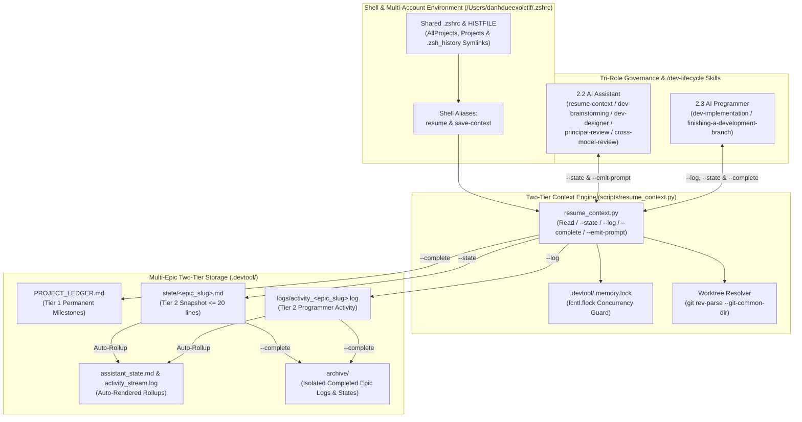
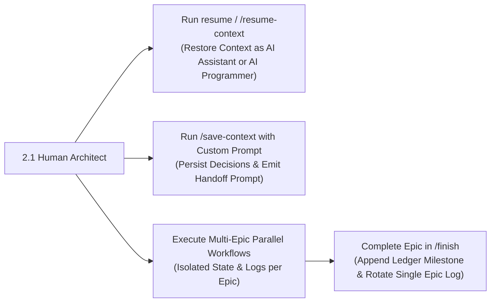
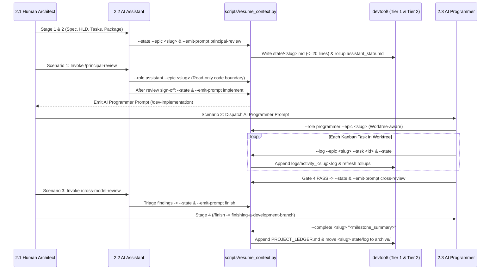

# Context Memory Management High-Level Design

## Table of Contents

- [Meta Data](#meta-data)
- [Background](#background)
- [Goals and Non-Goals](#goals-and-non-goals)
- [Architecture and Technical Design](#architecture-and-technical-design)
- [Integration Test Plan and Boundary Matrix](#integration-test-plan-and-boundary-matrix)
- [Verification Environment](#verification-environment)
- [Shared Contract Impact](#shared-contract-impact)
- [Comprehensive BDD Scenario Coverage](#comprehensive-bdd-scenario-coverage)
- [Rollout Strategy and Mitigation](#rollout-strategy-and-mitigation)
- [Kanban Tasks Breakdown](#kanban-tasks-breakdown)

## Meta Data

- **Epic name**: `context_memory_management`
- **Status**: In Progress
- **Target release**: Next plugin release (1.16.0)
- **Platform**: Python tooling / agent skill kit
- **Source Spec**: [Approved Context Memory Management design](2026-10-30-context-memory-management-design.en.md)

## Background

Across multi-repository workspaces (`ai-agent-tools`, `D3Nexus`, `lyrics-sync`, `nexus`) and multiple Antigravity account profiles (`antigravity_homes/<profile>`), developers and AI agents frequently switch accounts, open new sessions, or transition between architectural design, code review, and task execution.

Based on the baseline architecture defined in `docs/architecture/save_resume_rules.md` and `docs/architecture/resume_context.py`, three critical engineering requirements must be solved to achieve zero-loss handoffs:

1. **Shell Environment & Terminal History Unification (`.zshrc`)**: All Antigravity profiles symlink to `/Users/danhdueexoictif/.zshrc`, but `HISTFILE` is overridden by Oh-My-Zsh per profile, and `$HOME/Projects` is missing when `$HOME` points to `antigravity_homes/<profile>`. Shared `.zsh_history`, `Projects -> AllProjects` symlinks, and standardized `resume` / `save-context` aliases are required.
2. **Multi-Agent & Multi-Epic Concurrency Isolation**: When multiple AI Agents work concurrently on different Epics within the same project, overwriting a single `.devtool/assistant_state.md` or rotating a single `.devtool/activity_stream.log` destroys active context for other in-flight Epics. Epic-scoped partitioning in `.devtool/state/<epic_slug>.md` and `.devtool/logs/activity_<epic_slug>.log` with `fcntl.flock` locking and automatic rollup into `assistant_state.md` and `activity_stream.log` is required.
3. **Tri-Role Governance & Automated Lifecycle Checkpointing**: Project execution separates responsibilities across three roles: **2.1 Human Architect**, **2.2 AI Assistant (Technical Advisor & Reviewer — prohibited from editing production code)**, and **2.3 AI Programmer (Senior TDD Software Engineer — strictly bound to approved specs and `Allowed files`)**. The CLI and skills (`resume-context`, `save-context`, and `/dev-lifecycle` stages) must enforce these personas and emit deterministic handoff prompts across Principal Review, `/dev-implementation`, Cross-Model Review, `/finish`, and ad-hoc technical discussions.

## Goals and Non-Goals

### Goals

- Evolve `docs/architecture/resume_context.py` into `scripts/resume_context.py` (keeping `docs/architecture/resume_context.py` and `docs/architecture/save_resume_rules.md` synchronized) as a zero-dependency Python CLI engine.
- Implement Multi-Epic Tier 2 partitioning (`.devtool/state/<epic_slug>.md` $\le 20$ lines and `.devtool/logs/activity_<epic_slug>.log`) with `fcntl.flock` locking, git worktree-to-primary-repo routing, legacy file migration, and automatic rollup generation into `.devtool/assistant_state.md` and `.devtool/activity_stream.log`.
- Support 6 CLI capabilities in `scripts/resume_context.py`: default context harvest (`--role assistant|programmer`, `--epic`, `--repo`, `--tail`, `--json`), `--state` (with `--prompt`), `--log`, `--complete` (with `--checkpoint` option), `--emit-prompt` (`principal-review`, `implement`, `cross-review`, `finish`, `assistant`), and `--sync-zshrc`.
- Synchronize `/Users/danhdueexoictif/.zshrc` and all `antigravity_homes/<profile>` symlinks (`AllProjects`, `Projects`, `.zsh_history`), configure shared real-time zsh history (`HISTFILE="$REAL_HOME/.zsh_history"`, `SHARE_HISTORY`), and define `alias resume` and `alias save-context`.
- Author `skills/resume-context/SKILL.md` and `skills/save-context/SKILL.md`, add Rule 8 to `rules/CRITICAL_RULES.md`, and integrate automatic context saving and prompt emission into `dev-brainstorming`, `dev-designer`, `dev-lifecycle`, `principal-review`, `dev-implementation`, `cross-model-review`, and `finishing-a-development-branch`.
- Verify all behaviors with hermetic unit and integration tests in `scripts/test_resume_context.py` wired into `scripts/verify.sh`.

### Non-Goals

- Adding third-party Python dependencies or cloud-hosted telemetry services (all state remains strictly file-backed in `.devtool/` using the Python standard library).
- Modifying production application business logic in satellite repositories (`D3Nexus`, `lyrics-sync`, `nexus`) during this toolkit epic.
- Replacing git version control history, Kanban task files (`.devtool/features/task_*.md`), or auto-pushing git commits without explicit developer permission.

## Architecture and Technical Design

### High-Level Architecture

### Use Cases

### Sequence Diagram

## Integration Test Plan and Boundary Matrix

Integration test roots: scripts/

Protected paths: .agents/quality/**, .devtool/epic/context_memory_management/bdd_scenarios.en.md, .devtool/epic/context_memory_management/bdd_scenarios.vi.md

Integration results: python3 scripts/run_unittest_junit.py --junitxml build/test-results/context-memory-management.xml scripts/test_resume_context.py -> build/test-results/context-memory-management.xml

| Component | Test File | Test Case | Target Boundary |
|---|---|---|---|
| Two-Tier Harvest & Multi-Epic Isolation | `scripts/test_resume_context.py` | `test_cmm_hp_01_multi_epic_state_log_and_complete_isolation` | Verifies `--state`, `--log`, rollup rendering, and `--complete` isolating `epic-alpha` from `epic-beta` |
| Shell `.zshrc` & History Unification | `scripts/test_resume_context.py` | `test_cmm_hp_02_zshrc_symlinks_history_and_aliases` | Verifies `.zshrc` configuration, history merge/symlink, `Projects`/`AllProjects` links, and aliases |
| Skills, Rules & Lifecycle Integration | `scripts/test_resume_context.py` | `test_cmm_hp_03_skills_lifecycle_hooks_and_verify_harness` | Verifies `resume-context`, `save-context`, `CRITICAL_RULES.md` Rule 8, lifecycle skills, and `verify.sh` |
| Snapshot Line Limit Cap | `scripts/test_resume_context.py` | `test_cmm_ec_01_snapshot_20_line_cap` | Enforces $\le 20$ lines on `state/<epic>.md` while preserving all 4 mandatory fields |
| Worktree Routing & Task Progress | `scripts/test_resume_context.py` | `test_cmm_ec_02_worktree_routing` & `test_cmm_ec_03_kanban_task_progress` | Resolves `.worktrees/<epic_dir>` to primary root and calculates `done/total` task ratios |
| Tri-Role Prompts & Checkpoint Flag | `scripts/test_resume_context.py` | `test_cmm_st_01_tri_role_banners_and_emit_prompts` & `test_cmm_st_02_checkpoint_non_destructive_save` | Verifies `AI ASSISTANT` vs `AI PROGRAMMER` banners, 5 `--emit-prompt` modes, and `--checkpoint` |
| File Lock Concurrency & Legacy Migration | `scripts/test_resume_context.py` | `test_cmm_ar_01_concurrent_flock` & `test_cmm_fr_01_legacy_migration` | Verifies parallel writes under `fcntl.flock`, history merge idempotency (`test_cmm_ar_02`), and legacy file migration / missing directory fallback (`test_cmm_fr_02`) |

## Verification Environment

- **Runtime**: Python 3.10+ (Standard Library only: `argparse`, `datetime`, `fcntl`, `json`, `os`, `pathlib`, `re`, `shutil`, `subprocess`, `sys`, `tempfile`, `unittest`).
- **Isolation**: All unit and integration tests run inside temporary directories (`tempfile.TemporaryDirectory()`) with mocked or temporary workspace roots so live `.devtool/` and `/Users/danhdueexoictif/.zshrc` are never corrupted by test runs.
- **Environment Variables (`Needs`)**: None (`—`).
- **Test Command**: `python3 -m unittest scripts/test_resume_context.py`
- **Release Gate**: `scripts/verify.sh` executes `scripts/test_resume_context.py` in Section 15 (`scripts/verify.sh` is an implicit protected path that Task 4 is explicitly authorized to update via its `Allowed files` entry).

## Shared Contract Impact

`None — self-contained feature (manages developer context memory and reads shared-contracts/*/gaps_and_rfcs.md in read-only mode)`.

## Comprehensive BDD Scenario Coverage

All 5 behavioral dimensions are specified in [bdd_scenarios.en.md](bdd_scenarios.en.md) and [bdd_scenarios.vi.md](bdd_scenarios.vi.md):
- **Happy Paths**: `CMM-HP-01`, `CMM-HP-02`, `CMM-HP-03`
- **Edge Cases and Boundaries**: `CMM-EC-01`, `CMM-EC-02`, `CMM-EC-03`
- **State Transitions**: `CMM-ST-01`, `CMM-ST-02`
- **Async and Multi-Agent Concurrency**: `CMM-AR-01`, `CMM-AR-02`
- **Failures and Storage Resilience**: `CMM-FR-01`, `CMM-FR-02`

## Rollout Strategy and Mitigation

- **Backward-Compatible Rollup Files**: Maintaining auto-rendered `.devtool/assistant_state.md` and `.devtool/activity_stream.log` alongside `.devtool/state/*.md` and `.devtool/logs/*.log` ensures existing tools and human readers see the exact paths defined in `docs/architecture/save_resume_rules.md`.
- **Safe `.zshrc` & History Sync**: Before symlinking `.zsh_history` in `antigravity_homes/<profile>`, all unique history lines from profile-local `.zsh_history` files are appended to `/Users/danhdueexoictif/.zsh_history` and backed up safely.
- **Rollback Plan**: Revert the epic merge commit on `main` and restore `.zshrc` from backup if any shell alias regression occurs.

## Kanban Tasks Breakdown

- [Task 1: Two-Tier Multi-Epic CLI Engine and Architecture Rules Synchronization](task_01_resume_context_engine.md) (`Covers: CMM-HP-01, CMM-EC-01, CMM-EC-02, CMM-EC-03, CMM-ST-01, CMM-AR-01, CMM-FR-01`)
- [Task 2: Multi-Profile Shell Environment, Shared Terminal History, and Aliases Synchronization](task_02_zshrc_and_environment_sync.md) (`Covers: CMM-HP-02, CMM-AR-02, CMM-FR-02`)
- [Task 3: Resume-Context and Save-Context Skills and Tri-Role Critical Rules](task_03_resume_and_save_skills.md) (`Covers: CMM-ST-02`)
- [Task 4: Dev-Lifecycle Context Hooks Integration and Release Verification Harness](task_04_lifecycle_integration_and_verification.md) (`Covers: CMM-HP-03`)

