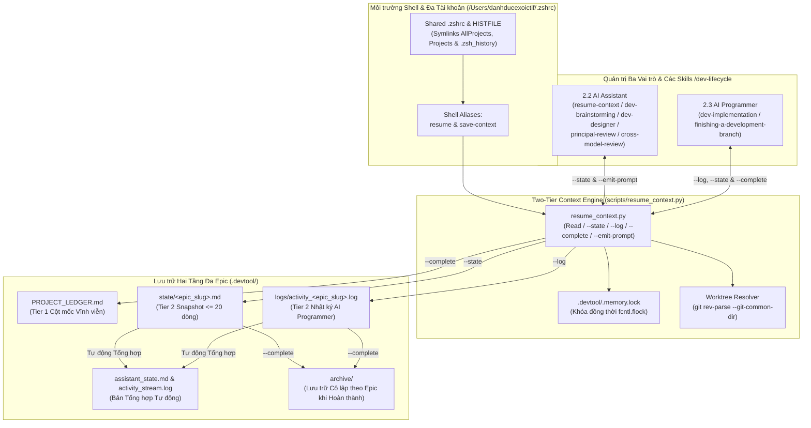
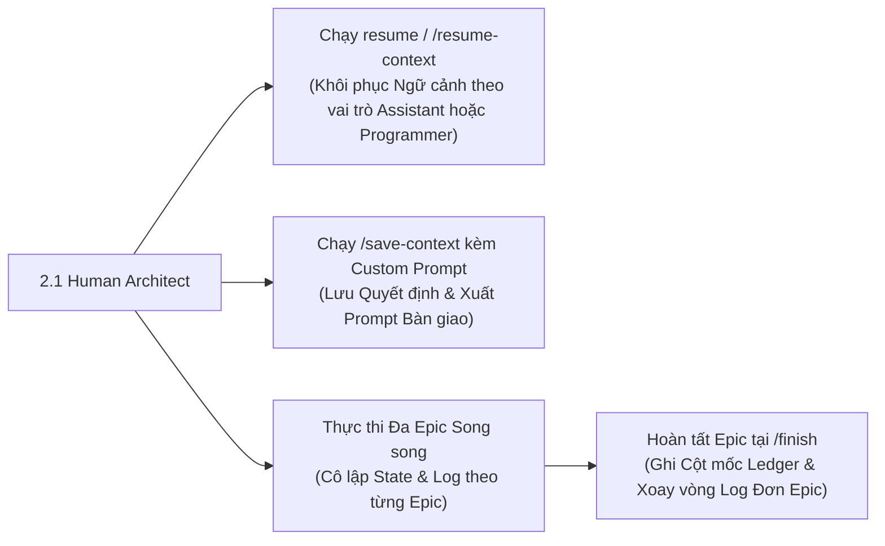
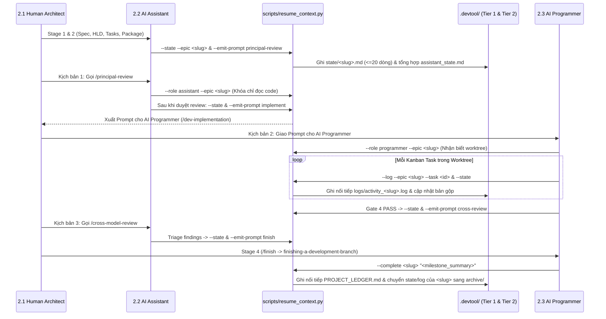

# Thiết kế Tổng thể Quản lý Bộ nhớ Ngữ cảnh

## Table of Contents

- [Meta Data](#meta-data)
- [Bối cảnh](#bối-cảnh)
- [Mục tiêu và Phạm vi Ngoài Mục tiêu](#mục-tiêu-và-phạm-vi-ngoài-mục-tiêu)
- [Kiến trúc và Thiết kế Kỹ thuật](#kiến-trúc-và-thiết-kế-kỹ-thuật)
- [Kế hoạch Kiểm thử Tích hợp và Ma trận Biên](#kế-hoạch-kiểm-thử-tích-hợp-và-ma-trận-biên)
- [Môi trường Xác minh](#môi-trường-xác-minh)
- [Tác động Hợp đồng Dùng chung](#tác-động-hợp-đồng-dùng-chung)
- [Độ phủ Kịch bản BDD Toàn diện](#độ-phủ-kịch-bản-bdd-toàn-diện)
- [Chiến lược Triển khai và Giảm thiểu Rủi ro](#chiến-lược-triển-khai-và-giảm-thiểu-rủi-ro)
- [Danh sách Kanban Tasks](#danh-sách-kanban-tasks)

## Meta Data

- **Epic name**: `context_memory_management`
- **Status**: Draft
- **Target release**: Next plugin release (1.16.0)
- **Platform**: Python tooling / agent skill kit
- **Source Spec**: [Đặc tả Quản lý Bộ nhớ Ngữ cảnh đã duyệt](2026-10-30-context-memory-management-design.vi.md)

## Bối cảnh

Trên không gian làm việc đa repository (`ai-agent-tools`, `D3Nexus`, `lyrics-sync`, `nexus`) và đa tài khoản Antigravity (`antigravity_homes/<profile>`), lập trình viên và các AI Agent thường xuyên chuyển đổi tài khoản, mở phiên mới, hoặc chuyển giao giữa bước thiết kế kiến trúc, review và lập trình thực thi.

Dựa trên kiến trúc nền tảng trong `docs/architecture/save_resume_rules.md` và `docs/architecture/resume_context.py`, ba yêu cầu kỹ thuật cốt lõi cần được giải quyết để đạt khả năng bàn giao không mất mát ngữ cảnh:

1. **Đồng nhất Môi trường Shell & Lịch sử Terminal (`.zshrc`)**: Toàn bộ các profile Antigravity đều trỏ symlink về `/Users/danhdueexoictif/.zshrc`, nhưng biến `HISTFILE` bị Oh-My-Zsh ghi đè theo từng profile và đường dẫn `$HOME/Projects` chưa tồn tại khi `$HOME` trỏ vào `antigravity_homes/<profile>`. Cần đồng bộ `.zsh_history` dùng chung, tạo symlink `Projects -> AllProjects`, và thiết lập hai alias chuẩn `resume` / `save-context`.
2. **Cô lập Đa Luồng cho Nhiều AI Agents & Nhiều Epics**: Khi nhiều AI Agents thao tác song song trên nhiều Epics của cùng một project, việc ghi đè lên một file `.devtool/assistant_state.md` duy nhất hoặc xoay vòng một file `.devtool/activity_stream.log` duy nhất sẽ xóa mất ngữ cảnh của các Epics đang chạy dở. Cần phân vùng theo từng Epic tại `.devtool/state/<epic_slug>.md` và `.devtool/logs/activity_<epic_slug>.log` kèm khóa `fcntl.flock` và tự động kết xuất bản tổng hợp ra `assistant_state.md` và `activity_stream.log`.
3. **Quản trị Ba Vai trò & Tự động Lưu Ngữ cảnh trong `/dev-lifecycle`**: Quy trình phát triển phân tách rõ ba vai trò: **2.1 Human Architect**, **2.2 AI Assistant (Tư vấn kỹ thuật & Reviewer — cấm sửa production code)**, và **2.3 AI Programmer (Senior TDD Software Engineer — tuân thủ nghiêm ngặt spec và `Allowed files`)**. CLI và các skills (`resume-context`, `save-context`, cùng các giai đoạn `/dev-lifecycle`) phải kiểm soát đúng vai trò và tự động xuất prompt bàn giao qua 4 kịch bản: Principal Review, `/dev-implementation`, Cross-Model Review, `/finish`, và thảo luận kỹ thuật độc lập.

## Mục tiêu và Phạm vi Ngoài Mục tiêu

### Mục tiêu

- Phát triển `docs/architecture/resume_context.py` thành `scripts/resume_context.py` (giữ đồng bộ cả `docs/architecture/resume_context.py` và `docs/architecture/save_resume_rules.md`) dưới dạng CLI engine bằng Python chuẩn không phụ thuộc thư viện ngoài.
- Triển khai phân vùng Tier 2 đa Epic (`.devtool/state/<epic_slug>.md` $\le 20$ dòng và `.devtool/logs/activity_<epic_slug>.log`) có khóa `fcntl.flock`, tự động định tuyến từ git worktree về repo gốc, di trú dữ liệu cũ, và tự động tổng hợp ra `.devtool/assistant_state.md` cùng `.devtool/activity_stream.log`.
- Hỗ trợ 5 nhóm tính năng CLI trong `scripts/resume_context.py`: thu hoạch ngữ cảnh mặc định (`--role assistant|programmer`, `--epic`, `--repo`, `--tail`, `--json`), `--state` (kèm `--prompt`), `--log`, `--complete` (kèm tùy chọn `--checkpoint`), `--emit-prompt` (`principal-review`, `implement`, `cross-review`, `finish`, `assistant`), và `--sync-zshrc`.
- Đồng bộ `/Users/danhdueexoictif/.zshrc` và toàn bộ symlink trong `antigravity_homes/<profile>` (`AllProjects`, `Projects`, `.zsh_history`), cấu hình lịch sử zsh dùng chung theo thời gian thực (`HISTFILE="$REAL_HOME/.zsh_history"`, `SHARE_HISTORY`), và khai báo `alias resume` cùng `alias save-context`.
- Xây dựng `skills/resume-context/SKILL.md` và `skills/save-context/SKILL.md`, bổ sung Rule 7 vào `rules/CRITICAL_RULES.md`, và tích hợp tự động lưu ngữ cảnh kèm sinh prompt vào `dev-brainstorming`, `dev-designer`, `dev-lifecycle`, `principal-review`, `dev-implementation`, `cross-model-review`, và `finishing-a-development-branch`.
- Xác minh toàn bộ hành vi bằng bộ kiểm thử đơn vị và tích hợp cô lập trong `scripts/test_resume_context.py` và đăng ký vào `scripts/verify.sh`.

### Phạm vi Ngoài Mục tiêu

- Không thêm thư viện Python bên thứ ba ngoài thư viện chuẩn.
- Không sửa đổi logic nghiệp vụ bên trong `D3Nexus`, `lyrics-sync`, hoặc `nexus`.
- Không tự động đẩy code (`git push`) lên remote khi chưa có sự đồng ý của lập trình viên.

## Kiến trúc và Thiết kế Kỹ thuật

### Kiến trúc Tổng thể

### Các Ca Sử dụng (Use Cases)

### Biểu đồ Tuần tự (Sequence Diagram)

## Kế hoạch Kiểm thử Tích hợp và Ma trận Biên

Integration test roots: scripts/

Protected paths: .agents/quality/**, .devtool/epic/context_memory_management/bdd_scenarios.en.md, .devtool/epic/context_memory_management/bdd_scenarios.vi.md

Integration results: python3 scripts/run_unittest_junit.py --junitxml build/test-results/context-memory-management.xml scripts/test_resume_context.py -> build/test-results/context-memory-management.xml

| Thành phần | File Kiểm thử | Ca Kiểm thử | Ranh giới Kiểm chứng |
|---|---|---|---|
| Thu hoạch Hai Tầng & Cô lập Đa Epic | `scripts/test_resume_context.py` | `test_cmm_hp_01_multi_epic_state_log_and_complete_isolation` | Kiểm chứng `--state`, `--log`, kết xuất rollup, và `--complete` cô lập `epic-alpha` khỏi `epic-beta` |
| Đồng bộ `.zshrc` & Lịch sử Terminal | `scripts/test_resume_context.py` | `test_cmm_hp_02_zshrc_symlinks_history_and_aliases` | Kiểm chứng cấu hình `.zshrc`, gộp/symlink `.zsh_history`, symlink `Projects`/`AllProjects`, và aliases |
| Tích hợp Skills, Rules & Lifecycle | `scripts/test_resume_context.py` | `test_cmm_hp_03_skills_lifecycle_hooks_and_verify_harness` | Kiểm chứng `resume-context`, `save-context`, `CRITICAL_RULES.md`, các skills lifecycle, và `verify.sh` |
| Giới hạn 20 Dòng & Định tuyến Worktree | `scripts/test_resume_context.py` | `test_cmm_ec_01_snapshot_20_line_cap_and_worktree_routing` | Đảm bảo giới hạn $\le 20$ dòng trên `state/<epic>.md` và định tuyến `.worktrees/<epic_dir>` về repo chính |
| Prompts Ba Vai trò & Cờ Checkpoint | `scripts/test_resume_context.py` | `test_cmm_st_01_tri_role_banners_emit_prompts_and_checkpoint` | Kiểm chứng khung `AI ASSISTANT` vs `AI PROGRAMMER`, 5 chế độ `--emit-prompt`, và `--checkpoint` |
| Khóa Đồng thời & Di trú Dữ liệu Cũ | `scripts/test_resume_context.py` | `test_cmm_ar_01_concurrent_flock_and_legacy_migration` | Kiểm chứng ghi song song dưới `fcntl.flock` và di trú file cũ `assistant_state.md` / `activity_stream.log` |

## Môi trường Xác minh

- **Runtime**: Python 3.10+ (Chỉ dùng thư viện chuẩn: `argparse`, `datetime`, `fcntl`, `json`, `os`, `pathlib`, `re`, `shutil`, `subprocess`, `sys`, `tempfile`, `unittest`).
- **Cô lập**: Toàn bộ unit test và integration test chạy trong thư mục tạm (`tempfile.TemporaryDirectory()`) với workspace root giả lập để tuyệt đối không làm hỏng `.devtool/` hoặc `/Users/danhdueexoictif/.zshrc` thật trong quá trình chạy test.
- **Biến Môi trường (`Needs`)**: Không yêu cầu (`—`).
- **Lệnh Kiểm thử**: `python3 -m unittest scripts/test_resume_context.py`
- **Cổng Phát hành**: `scripts/verify.sh` thực thi `scripts/test_resume_context.py` tại Mục 15 (`scripts/verify.sh` là đường dẫn được bảo vệ ngầm định mà Task 4 được cấp quyền cập nhật tường minh trong `Allowed files`).

## Tác động Hợp đồng Dùng chung

`None — self-contained feature (quản lý bộ nhớ ngữ cảnh phát triển và chỉ đọc shared-contracts/*/gaps_and_rfcs.md ở chế độ read-only)`.

## Độ phủ Kịch bản BDD Toàn diện

Toàn bộ 5 chiều hành vi được đặc tả chi tiết trong [bdd_scenarios.en.md](bdd_scenarios.en.md) và [bdd_scenarios.vi.md](bdd_scenarios.vi.md):
- **Luồng Thành công (Happy Paths)**: `CMM-HP-01`, `CMM-HP-02`, `CMM-HP-03`
- **Trường hợp Biên (Edge Cases and Boundaries)**: `CMM-EC-01`, `CMM-EC-02`, `CMM-EC-03`
- **Chuyển đổi Trạng thái (State Transitions)**: `CMM-ST-01`, `CMM-ST-02`
- **Bất đồng bộ và Đa luồng Đa Agent (Async and Multi-Agent Concurrency)**: `CMM-AR-01`, `CMM-AR-02`
- **Xử lý Lỗi và Độ bền Lưu trữ (Failures and Storage Resilience)**: `CMM-FR-01`, `CMM-FR-02`

## Chiến lược Triển khai và Giảm thiểu Rủi ro

- **Tương thích Ngược qua File Tổng hợp**: Duy trì việc kết xuất tự động `.devtool/assistant_state.md` và `.devtool/activity_stream.log` song song với `.devtool/state/*.md` và `.devtool/logs/*.log` giúp mọi công cụ và lập trình viên vẫn đọc được đúng đường dẫn chuẩn trong `docs/architecture/save_resume_rules.md`.
- **Đồng bộ `.zshrc` & Lịch sử An toàn**: Trước khi tạo symlink `.zsh_history` tại `antigravity_homes/<profile>`, mọi dòng lịch sử lệnh riêng lẻ tại từng profile đều được gộp vào `/Users/danhdueexoictif/.zsh_history` và sao lưu an toàn.
- **Kế hoạch Hoàn tác (Rollback)**: Hoàn tác commit merge của epic trên nhánh `main` và khôi phục `.zshrc` từ bản sao lưu nếu phát sinh bất kỳ lỗi tương thích shell nào.

## Danh sách Kanban Tasks

- [Task 1: Two-Tier Multi-Epic CLI Engine and Architecture Rules Synchronization](task_01_resume_context_engine.md) (`Covers: CMM-HP-01, CMM-EC-01, CMM-EC-02, CMM-EC-03, CMM-ST-01, CMM-AR-01, CMM-FR-01`)
- [Task 2: Multi-Profile Shell Environment, Shared Terminal History, and Aliases Synchronization](task_02_zshrc_and_environment_sync.md) (`Covers: CMM-HP-02, CMM-AR-02, CMM-FR-02`)
- [Task 3: Resume-Context and Save-Context Skills and Tri-Role Critical Rules](task_03_resume_and_save_skills.md) (`Covers: CMM-ST-02`)
- [Task 4: Dev-Lifecycle Context Hooks Integration and Release Verification Harness](task_04_lifecycle_integration_and_verification.md) (`Covers: CMM-HP-03`)

