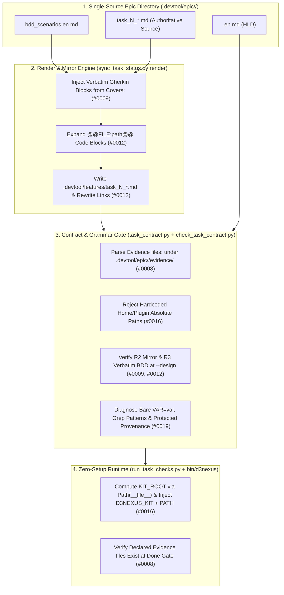

# Task Contract and Authoring Ergonomics Design Specification

## Table of Contents

- [Overview and Background](#overview-and-background)
- [Problem Statement and Observations Addressed](#problem-statement-and-observations-addressed)
- [Goals and Non-Goals](#goals-and-non-goals)
- [Architecture and Component Design](#architecture-and-component-design)
  - [Component Topology](#component-topology)
  - [1. Evidence Files Contract](#1-evidence-files-contract)
  - [2. Single-Source Task Authoring and Auto-Render Engine](#2-single-source-task-authoring-and-auto-render-engine)
  - [3. Zero-Setup Portable Kit Entrypoint](#3-zero-setup-portable-kit-entrypoint)
  - [4. Verification Row Grammar Reference and Diagnostics](#4-verification-row-grammar-reference-and-diagnostics)
- [Error Handling and Edge Cases](#error-handling-and-edge-cases)
- [Testing and Verification Strategy](#testing-and-verification-strategy)
- [Shared Contract Warnings](#shared-contract-warnings)
- [Dependency Mapping and Roadmap Context](#dependency-mapping-and-roadmap-context)

## Overview and Background

During multi-epic packaging and execution in satellite repositories (`lyrics-sync`), fifteen workflow observations (`#0006` through `#0020`) were recorded in `skill-observations/observation-log/`. To deliver focused, verifiable improvements through `dev-lifecycle`, the 15 observations are structured into a three-epic optimization roadmap:

1. **Epic 1 (`contract_and_authoring_ergonomics`)**: Resolves observations `#0008`, `#0009`, `#0012`, `#0016`, and `#0019` by eliminating manual duplication in task authoring, allowing evidence path declarations under `.devtool/`, providing a zero-setup portable CLI entrypoint for kit tools, and formalizing Verification row grammar diagnostics.
2. **Epic 2 (`execution_and_verification_infrastructure`)**: Resolves observations `#0006`, `#0007`, `#0010`, `#0011`, `#0017`, and `#0018` (worktree capability extras bootstrap, failure-set baseline scripts, opt-in live integration tests, design-time task replay, `MEASURE` phase pattern, and JS static module cache-bust checks).
3. **Epic 3 (`multi_epic_orchestration_and_governance`)**: Resolves observations `#0013`, `#0014`, `#0015`, and `#0020` (`Depends on epic:` metadata, conflict-aware concurrent epic backlog detection, revising packaged epics with `Spec Errata`, and structured Gate Approval Ledger).

This specification defines the complete design for **Epic 1 (`contract_and_authoring_ergonomics`)**.

## Problem Statement and Observations Addressed

| Observation ID | Core Problem | Root Cause |
| :--- | :--- | :--- |
| **#0008** | Verification rows and `Read-only context:` cannot reference evidence files created by a task under `.devtool/epic/<epic_dir>/evidence/`. | `.devtool/` is excluded from `Allowed files:`, while `check_task_contract.py` rejects any non-existent, unignored path not marked `(new)` in `Allowed files:`. |
| **#0009** | `check_epic_readiness.py` (Rule R3) requires task Gherkin blocks to match `bdd_scenarios.en.md` verbatim, whereas `dev-designer` instructs authors to write task-level scenario summaries and `check_task_contract.py --design` does not check R3. | Disconnected rules between `dev-designer` instructions, `check_task_contract.py --design`, and `check_epic_readiness.py`. |
| **#0012** | Every task file is authored and maintained twice (`.devtool/epic/<epic_dir>/task_*.md` and `.devtool/features/task_*.md`), and embedded code snippets drift from verified source files. | Lack of a single-source rendering step in `sync_task_status.py` to generate `.devtool/features/` mirrors and inject verified code or verbatim BDD blocks. |
| **#0016** | Task Verification rows invoke kit scripts (`check_document.py`) using machine- and profile-specific absolute paths (`/Users/.../antigravity_homes/...`), breaking portability across machines, accounts, and plugin versions. | No auto-injected kit environment variable or `PATH` wrapper inside `run_task_checks.py` and `check_epic_readiness.py`, and no check rejecting hardcoded home/plugin paths. |
| **#0019** | Verification table rows suffer from undocumented grammar traps (`\|` unescaping false positives in `principal-review`, bare `VAR=val` parsed as an executable name, grep patterns containing `/` treated as missing file paths, and opaque implicit protected paths). | Implicit parser rules in `task_contract.py` and `check_task_contract.py` are not explained in diagnostics or consolidated in a reference read by `dev-designer` and `principal-review`. |

## Goals and Non-Goals

### Goals

- Introduce an `Evidence files:` subsection under `## Files` in `task_*.md` supporting `(new)` markers for `.devtool/epic/<epic_dir>/evidence/*` paths, validated at both `--design` time and the task Done Gate (`#0008`).
- Establish `.devtool/epic/<epic_dir>/task_*.md` as the single authoritative source of truth and add `sync_task_status.py render <epic_dir> [--source-root <dir>]` to automatically inject verbatim Gherkin blocks from `bdd_scenarios.en.md` (`#0009`), expand `<!-- @@FILE:path@@ -->` code blocks, and generate `.devtool/features/task_*.md` mirrors with rewritten relative links (`#0012`).
- Run R2 (mirror parity) and R3 (verbatim BDD parity) checks early inside `check_task_contract.py --design` (`#0009`, `#0012`).
- Ship a portable `bin/d3nexus` CLI wrapper and automatically inject `D3NEXUS_KIT=<kit_root>` and `PATH="<kit_root>/bin:$PATH"` at runtime inside `run_task_checks.py` and `check_epic_readiness.py` (`#0016`).
- Reject machine- or profile-specific absolute paths in Verification rows inside `check_task_contract.py` (`#0016`).
- Improve `check_task_contract.py` grammar diagnostics (`env VAR=value`, non-path grep patterns, implicit protected path provenance) and document the canonical grammar in `skills/dev-designer/references/verification-row-grammar.md` and `skills/principal-review/SKILL.md` (`#0019`).

### Non-Goals

- Changing the 5-column Markdown table layout (`| ID | Phase | Command | Expect | Needs |`) of `## Verification`.
- Modifying worktree bootstrap, failure-set baseline scripts, or multi-epic dependency scheduling (reserved for Epic 2 and Epic 3).
- Breaking backward compatibility for existing completed or in-flight epics that do not declare `Evidence files:` or `<!-- @@FILE:...@@ -->` directives.

## Architecture and Component Design

### Component Topology



### 1. Evidence Files Contract

In `task_contract.py` and `check_task_contract.py`:

- **Syntax**: Under `## Files`, a task may optionally include an `Evidence files:` list between `Allowed files:` and `Read-only context:`:
  ```markdown
  ## Files

  Allowed files:
  - `src/service.py`

  Evidence files:
  - `.devtool/epic/my_epic/evidence/baseline_failures.txt` (new)
  - `.devtool/epic/my_epic/evidence/benchmark_summary.json` (new)

  Read-only context:
  - `src/constants.py`
  ```
- **Parsing (`parse_evidence_files(task_text) -> list[AllowedPath]`)**:
  - Uses the same `- `<path>` (new)` bullet format as `parse_allowed_files()`.
  - Every entry must match `.devtool/epic/<epic_dir>/evidence/<filename>` (no `..` traversal, no directories, no paths outside `.devtool/epic/<epic_dir>/evidence/`).
- **Design-Time Grounding (`check_task_contract.py`)**:
  - Paths marked `(new)` in `Evidence files:` are added to the `created` set across the epic's tasks so `check_grounding()` accepts references to those evidence paths in `Verification` rows and `Read-only context:`.
  - If `--design` is passed and an `Evidence files:` entry is marked `(new)` but already exists on disk, `check_task_contract.py` reports a problem (matching `Allowed files:` behavior).
- **Done-Gate Verification (`evaluate_done_gate()` in `task_contract.py`)**:
  - Adds a check verifying that every path listed in `parse_evidence_files(task_text)` exists on disk (`(layout.root / entry.pattern).is_file()`) and is non-empty after the `verify` run completes.

### 2. Single-Source Task Authoring and Auto-Render Engine

In `sync_task_status.py`:

- **New Subcommand**:
  ```bash
  python3 sync_task_status.py render <epic_dir> [--source-root <worktree_or_repo_dir>]
  ```
- **Step 2.1 — Verbatim BDD Injection (`#0009`)**:
  - Reads `.devtool/epic/<epic_dir>/bdd_scenarios.en.md` and extracts canonical scenario blocks keyed by scenario ID (reusing the Gherkin extraction logic from `check_epic_readiness.py`).
  - For each `.devtool/epic/<epic_dir>/task_*.md`, reads the `Covers:` line(s). If `Covers:` lists scenario IDs (`SC-...`), locates the Gherkin block in the task's BDD section (or a `<!-- @@BDD_COVERS@@ -->` placeholder) and replaces it with the exact verbatim Gherkin blocks from `bdd_scenarios.en.md` in the order listed in `Covers:`.
  - Fails with exit code 1 if any ID in `Covers:` does not exist in `bdd_scenarios.en.md`.
- **Step 2.2 — Verified File Embedding (`#0012`)**:
  - Scans the task body for directives of the form `<!-- @@FILE:<relative_path>@@ -->` immediately preceding a fenced code block.
  - Resolves `<relative_path>` against `--source-root` (defaulting to the repository root). Rejects any path with `..` or absolute prefix.
  - Replaces the fenced block's interior with the exact file content, automatically promoting the outer fence to `max(4, max_inner_backtick_run + 1)` backticks whenever the embedded file contains triple (or longer) backtick fences.
- **Step 2.3 — Mirror Generation and Link Rewriting (`#0012`)**:
  - Canonicalizes intra-epic relative links in the epic task (`](./<file>.md)` -> `](<file>.md)`) and writes the rendered task back to `.devtool/epic/<epic_dir>/task_*.md`.
  - Generates the corresponding Kanban board mirror in `.devtool/features/task_*.md` (rewriting sibling epic links to `](../epic/<epic_dir>/<file>.md)`) or `.devtool/features/done/task_*.md` when frontmatter `status` is `"done"` (rewriting sibling epic links to `](../../epic/<epic_dir>/<file>.md)`).
  - Removes stale `.devtool/features/task_*.md` files whose frontmatter `epic:` matches `<epic_slug>` but whose source file no longer exists in `.devtool/epic/<epic_dir>/`.
- **Step 2.4 — Shift-Left R2 & R3 Checks in `check_task_contract.py --design` and `check_epic_readiness.py`**:
  - When `--design` is active (or whenever `bdd_scenarios.en.md` exists alongside `--hld`), `check_task_contract.py` validates that each task's Gherkin scenario blocks match `bdd_scenarios.en.md` verbatim (R3) and that `.devtool/features/` (or `.devtool/features/done/`) mirrors match the normalized epic task file (R2) using shared location-aware link normalization with `check_epic_readiness.py`, printing a remediation hint (`run: d3nexus sync-status render <epic_dir>`).

### 3. Zero-Setup Portable Kit Entrypoint

- **New CLI (`bin/d3nexus`)**:
  - A portable Python 3 script (`#!/usr/bin/env python3`, `chmod +x`) at `<kit_root>/bin/d3nexus` that resolves `KIT_ROOT = Path(__file__).resolve().parent.parent` and dispatches subcommands:
    - `d3nexus check-doc [args...]` $\rightarrow$ `skills/doc_quality_check/resources/scripts/check_document.py`
    - `d3nexus check-contract [args...]` $\rightarrow$ `skills/dev-implementation/resources/scripts/check_task_contract.py`
    - `d3nexus check-readiness [args...]` $\rightarrow$ `skills/dev-implementation/resources/scripts/check_epic_readiness.py`
    - `d3nexus sync-status [args...]` $\rightarrow$ `skills/dev-implementation/resources/scripts/sync_task_status.py`
    - `d3nexus run-checks [args...]` $\rightarrow$ `skills/dev-implementation/resources/scripts/run_task_checks.py`
- **Zero-Setup Runtime Environment Injection (`#0016`)**:
  - In `run_task_checks.py` (`run_command()`) and `check_epic_readiness.py`, compute `KIT_ROOT = Path(__file__).resolve().parents[4]` and inject into the subprocess environment:
    - `D3NEXUS_KIT = str(KIT_ROOT)`
    - `PATH = f"{KIT_ROOT / 'bin'}{os.pathsep}{os.environ.get('PATH', '')}"`
  - No manual setup is required when switching machines, OS users, or Antigravity account profiles.
  - Additionally, `scripts/resume_context.py --sync-zshrc` exports `D3NEXUS_KIT` and adds `<kit_root>/bin` to `PATH` for interactive user shells.
- **Banning Non-Portable Absolute Paths in `check_task_contract.py` (`#0016`)**:
  - `check_task_contract.py` scans every Verification row command for machine- or profile-specific paths (`/Users/`, `/home/`, `~/`, `.claude/plugins/cache/`, `.gemini/config/plugins/`). Any match raises a contract problem instructing the author to use `d3nexus <subcommand>` or `$D3NEXUS_KIT/...`.
  - Recognizes `d3nexus` in `strip_wrappers()` / executable checks so `check_task_contract.py` never emits a false `executable d3nexus not found on PATH` warning even if the caller's interactive shell has not added `bin/` to `PATH`.

### 4. Verification Row Grammar Reference and Diagnostics

- **Enhanced Grammar Diagnostics in `check_task_contract.py` (`#0019`)**:
  1. **Bare `VAR=value` detection**: If the first command token (without `env`) matches `^[A-Za-z_][A-Za-z0-9_]*=.*`, emit an explicit problem: `inline environment assignment '<token>' must be prefixed with 'env' (e.g. 'env <token> ...')`.
  2. **Search pattern exclusion in `command_paths()`**: When a subcommand invokes `grep`, `egrep`, `fgrep`, `rg`, `sed`, or `awk`, exclude the regex/pattern argument (either the token immediately following `-e` / `--regexp`, or the first non-option positional argument when `-e` / `-f` is absent) from path extraction so patterns containing `/` are not misclassified as missing file paths.
  3. **Implicit Protected Path Provenance**: When `check_task_contract.py` prints `Implicit protected paths:`, include the task and row IDs that triggered each path (e.g., `scripts/verify.sh (task_1:V2)`).
- **Consolidated Grammar Reference (`skills/dev-designer/references/verification-row-grammar.md`)**:
  - Documents cell splitting, `\|` unescaping (`parse_row` turns `\|` into `|` before execution), `env VAR=value`, `d3nexus` / `$D3NEXUS_KIT`, `Evidence files:`, implicit protected paths, and dynamic outer code fences (`max(4, max_inner_backtick_run + 1)`) for task steps containing nested code blocks.
- **Reviewer Alignment (`skills/principal-review/SKILL.md`)**:
  - Explicitly instructs reviewers that `\|` inside Markdown table cells is unescaped to `|` by `task_contract.py` before shell execution, preventing false-positive review findings.

## Error Handling and Edge Cases

- **Missing Scenario ID in `Covers:`**: `sync_task_status.py render` aborts with a clear message naming the task file and the unknown scenario ID without modifying files on disk.
- **Path Traversal in `Evidence files:` or `<!-- @@FILE:...@@ -->`**: Any path containing `..`, starting with `/`, or resolving outside the allowed boundary raises a `ContractError` / `UsageError` and exits non-zero.
- **Tasks without `Covers:` (`Covers: none`)**: `sync_task_status.py render` skips BDD Gherkin injection and still performs `@@FILE:...@@` embedding and `.devtool/features/` mirror generation.
- **Legacy Epics**: Epics without `Evidence files:` or `<!-- @@FILE:...@@ -->` continue to pass all checks unchanged.

## Testing and Verification Strategy

- **Tier A (Unit Tests)**:
  - `test_check_task_contract.py`: Tests for `Evidence files:` validation, `(new)` evidence path grounding, rejection of `/Users/...` and `.claude/plugins/cache/...` paths, bare `VAR=val` diagnostic, `grep`/`rg` pattern slash exclusion, and early R2/R3 checks.
  - `test_sync_task_status.py`: Tests for `render` subcommand covering verbatim BDD injection from `bdd_scenarios.en.md`, `<!-- @@FILE:...@@ -->` code embedding (including dynamic `max(4, max_inner_backtick_run + 1)` fence promotion), location-aware relative link rewriting in `.devtool/features/` and `.devtool/features/done/`, and orphan mirror cleanup.
  - `test_run_task_checks.py`: Tests verifying `D3NEXUS_KIT` and `PATH` injection during row execution and Done-Gate verification of declared `Evidence files:`.
- **Tier C1 (Subcutaneous End-to-End Integration)**:
  - End-to-end test creating a temporary git repository with an HLD, `bdd_scenarios.en.md`, and a single-source `.devtool/epic/<epic>/task_1.md`, running `bin/d3nexus sync-status render`, `bin/d3nexus check-contract --design`, and `bin/d3nexus run-checks verify` (executing `d3nexus check-doc` inside a Verification row and producing a declared evidence file), asserting a clean Done-Gate pass.
- **Repository Quality Gate**:
  - `scripts/verify.sh` and `python-quality-check` (`ruff check`, `mypy`, `pytest`) must pass with 0 errors.

## Shared Contract Warnings

- No `shared-contracts/` directory exists in `ai-agent-tools` (this repository is the workflow plugin kit rather than a `D3Nexus` domain service consumer). No shared API contracts, wire payloads, or database schemas are affected.

## Dependency Mapping and Roadmap Context

- **Blocks**:
  - **Epic 2 (`execution_and_verification_infrastructure`)**: Relies on `Evidence files:` (`#0008`), `bin/d3nexus` (`#0016`), and `sync_task_status.py render` (`#0012`) to store failure-set baselines (`.devtool/epic/<epic>/evidence/baseline_failures.txt`) and measurement evidence (`#0007`, `#0017`).
  - **Epic 3 (`multi_epic_orchestration_and_governance`)**: Extends `check_task_contract.py` and `sync_task_status.py` for cross-epic dependencies (`#0013`, `#0014`) and packaged epic revisions (`#0015`).

