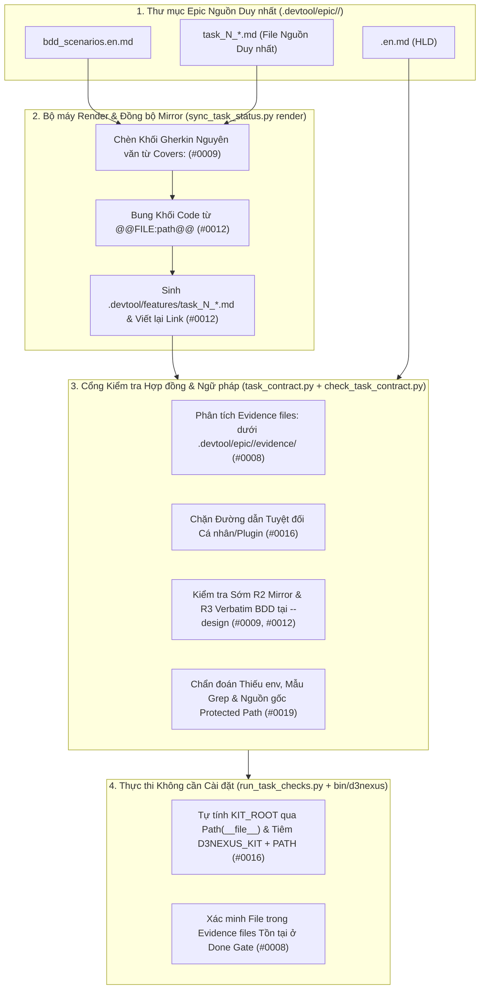

# Đặc tả Thiết kế Hợp đồng Task và Tối ưu Soạn thảo (Task Contract and Authoring Ergonomics)

## Mục lục

- [Tổng quan và Bối cảnh](#tổng-quan-và-bối-cảnh)
- [Phát biểu Bài toán và Các Observations được Giải quyết](#phát-biểu-bài-toán-và-các-observations-được-giải-quyết)
- [Mục tiêu và Phi mục tiêu](#mục-tiêu-và-phi-mục-tiêu)
- [Kiến trúc và Thiết kế Thành phần](#kiến-trúc-và-thiết-kế-thành-phần)
  - [Sơ đồ Cấu trúc Thành phần](#sơ-đồ-cấu-trúc-thành-phần)
  - [1. Hợp đồng Khai báo Evidence Files](#1-hợp-đồng-khai-báo-evidence-files)
  - [2. Soạn thảo Task Một Nguồn Duy nhất và Bộ máy Auto-Render](#2-soạn-thảo-task-một-nguồn-duy-nhất-và-bộ-máy-auto-render)
  - [3. Điểm vào CLI Khả chuyển Không cần Cài đặt (Zero-Setup)](#3-điểm-vào-cli-khả-chuyển-không-cần-cài-đặt-zero-setup)
  - [4. Tài liệu Quy chiếu Ngữ pháp Bảng Verification và Chẩn đoán Lỗi](#4-tài-liệu-quy-chiếu-ngữ-pháp-bảng-verification-và-chẩn-đoán-lỗi)
- [Xử lý Lỗi và Các Trường hợp Biên](#xử-lý-lỗi-và-các-trường-hợp-biên)
- [Chiến lược Kiểm thử và Xác minh](#chiến-lược-kiểm-thử-và-xác-minh)
- [Cảnh báo Shared Contract](#cảnh-báo-shared-contract)
- [Ánh xạ Phụ thuộc và Bối cảnh Lộ trình](#ánh-xạ-phụ-thuộc-và-bối-cảnh-lộ-trình)

## Tổng quan và Bối cảnh

Trong quá trình đóng gói và thực thi nhiều epic trên các kho mã nguồn vệ tinh (`lyrics-sync`), 15 ghi nhận thực tế (`#0006` đến `#0020`) đã được lưu lại trong `skill-observations/observation-log/`. Để triển khai các cải tiến một cách bài bản và kiểm chứng được qua `dev-lifecycle`, 15 observations này được chia thành lộ trình tối ưu hóa gồm 3 Epics độc lập:

1. **Epic 1 (`contract_and_authoring_ergonomics`)**: Giải quyết các observations `#0008`, `#0009`, `#0012`, `#0016` và `#0019` bằng cách loại bỏ việc nhân bản thủ công khi viết task, cho phép khai báo đường dẫn bằng chứng (`Evidence files:`) dưới `.devtool/`, cung cấp CLI khả chuyển tự động cấu hình cho các công cụ của kit, và chuẩn hóa chẩn đoán ngữ pháp bảng Verification.
2. **Epic 2 (`execution_and_verification_infrastructure`)**: Giải quyết các observations `#0006`, `#0007`, `#0010`, `#0011`, `#0017` và `#0018` (khởi tạo extras cho môi trường worktree, bộ công cụ ghi nhận và so sánh baseline hồi quy, kiểm thử tích hợp live opt-in, công cụ replay văn bản task trước khi đóng gói, mẫu thực thi `MEASURE`, và kiểm tra cache-bust cho mô-đun JS tĩnh).
3. **Epic 3 (`multi_epic_orchestration_and_governance`)**: Giải quyết các observations `#0013`, `#0014`, `#0015` và `#0020` (khai báo `Depends on epic:`, xếp hàng `backlog` thông minh theo xung đột file thực tế, quy trình cập nhật epic đã đóng gói kèm `Spec Errata`, và sổ cái lưu vết phê duyệt Gate có cấu trúc).

Tài liệu đặc tả này định nghĩa thiết kế chi tiết cho **Epic 1 (`contract_and_authoring_ergonomics`)**.

## Phát biểu Bài toán và Các Observations được Giải quyết

| Mã Observation | Vấn đề Cốt lõi | Nguyên nhân Gốc rễ |
| :--- | :--- | :--- |
| **#0008** | Các dòng Verification và `Read-only context:` không thể tham chiếu tới file bằng chứng do task tạo ra dưới `.devtool/epic/<epic_dir>/evidence/`. | `.devtool/` bị cấm đưa vào `Allowed files:`, trong khi `check_task_contract.py` từ chối mọi đường dẫn chưa tồn tại và không được đánh dấu `(new)` trong `Allowed files:`. |
| **#0009** | `check_epic_readiness.py` (Rule R3) yêu cầu khối Gherkin trong task phải khớp nguyên văn với `bdd_scenarios.en.md`, nhưng `dev-designer` lại hướng dẫn viết tóm tắt scenario và `check_task_contract.py --design` không kiểm tra R3. | Quy tắc không đồng nhất giữa hướng dẫn trong `dev-designer`, công cụ `check_task_contract.py --design` và `check_epic_readiness.py`. |
| **#0012** | Mỗi file task phải viết và duy trì ở 2 nơi (`.devtool/epic/<epic_dir>/task_*.md` và `.devtool/features/task_*.md`), đồng thời các đoạn code mẫu nhúng trong task bị trôi lệch so với bản đã kiểm chứng. | Thiếu bước render từ một nguồn duy nhất trong `sync_task_status.py` để tự động sinh bản mirror `.devtool/features/` và điền code hoặc khối BDD nguyên văn. |
| **#0016** | Bảng Verification gọi các script của kit (`check_document.py`) bằng đường dẫn tuyệt đối gắn với máy hoặc profile cá nhân (`/Users/.../antigravity_homes/...`), làm hỏng tính khả chuyển khi đổi máy, đổi tài khoản hoặc nâng bản cập nhật plugin. | Chưa tự động tiêm biến môi trường hoặc `PATH` của kit vào `run_task_checks.py` / `check_epic_readiness.py`, và chưa có rule chặn đường dẫn tuyệt đối cá nhân. |
| **#0019** | Bảng Verification có nhiều bẫy ngữ pháp ngầm (unescape `\|` gây báo lỗi giả khi `principal-review`, viết `VAR=val` thiếu `env` bị hiểu nhầm là tên file thực thi, biểu thức grep chứa `/` bị coi là đường dẫn file bị thiếu, và không rõ nguồn gốc của implicit protected paths). | Các quy tắc phân tích ngầm trong `task_contract.py` và `check_task_contract.py` chưa được giải thích rõ trong thông báo lỗi hoặc gom về một tài liệu tham chiếu chung cho `dev-designer` và `principal-review`. |

## Mục tiêu và Phi mục tiêu

### Mục tiêu

- Bổ sung tiểu mục `Evidence files:` dưới `## Files` trong `task_*.md` hỗ trợ đánh dấu `(new)` cho các đường dẫn `.devtool/epic/<epic_dir>/evidence/*`, được kiểm tra ở cả pha `--design` và tại cổng hoàn tất Done Gate (`#0008`).
- Xác lập `.devtool/epic/<epic_dir>/task_*.md` làm nguồn sự thật duy nhất (Single Source of Truth) và thêm lệnh `sync_task_status.py render <epic_dir> [--source-root <dir>]` để tự động chèn khối Gherkin nguyên văn từ `bdd_scenarios.en.md` (`#0009`), bung nội dung file từ chỉ thị `<!-- @@FILE:path@@ -->`, và sinh bản mirror `.devtool/features/task_*.md` với liên kết tương đối được viết lại tự động (`#0012`).
- Đưa kiểm tra R2 (đồng bộ mirror) và R3 (khớp BDD nguyên văn) vào chạy sớm ngay trong `check_task_contract.py --design` (`#0009`, `#0012`).
- Cung cấp CLI khả chuyển `bin/d3nexus` và tự động tiêm `D3NEXUS_KIT=<kit_root>` cùng `PATH="<kit_root>/bin:$PATH"` ngay lúc chạy bên trong `run_task_checks.py` và `check_epic_readiness.py` (`#0016`).
- Chặn mọi đường dẫn tuyệt đối gắn với máy hoặc profile cá nhân trong bảng Verification khi chạy `check_task_contract.py` (`#0016`).
- Nâng cấp thông báo chẩn đoán ngữ pháp của `check_task_contract.py` (`env VAR=value`, loại trừ mẫu tìm kiếm grep khỏi kiểm tra đường dẫn, hiển thị nguồn gốc implicit protected paths) và tài liệu hóa chuẩn mực tại `skills/dev-designer/references/verification-row-grammar.md` cùng `skills/principal-review/SKILL.md` (`#0019`).

### Phi mục tiêu

- Không thay đổi cấu trúc bảng Markdown 5 cột (`| ID | Phase | Command | Expect | Needs |`) của mục `## Verification`.
- Không sửa đổi quy trình khởi tạo worktree, script baseline hồi quy hay lịch trình phụ thuộc liên epic (thuộc phạm vi của Epic 2 và Epic 3).
- Không làm gãy tính tương thích ngược đối với các epic cũ hoặc đang chạy mà không khai báo `Evidence files:` hay `<!-- @@FILE:...@@ -->`.

## Kiến trúc và Thiết kế Thành phần

### Sơ đồ Cấu trúc Thành phần



### 1. Hợp đồng Khai báo Evidence Files

Trong `task_contract.py` và `check_task_contract.py`:

- **Cú pháp**: Dưới mục `## Files`, một task có thể tùy chọn khai báo danh sách `Evidence files:` nằm giữa `Allowed files:` và `Read-only context:`:
  ```markdown
  ## Files

  Allowed files:
  - `src/service.py`

  Evidence files:
  - `.devtool/epic/my_epic/evidence/baseline_failures.txt` (new)
  - `.devtool/epic/my_epic/evidence/benchmark_summary.json` (new)

  Read-only context:
  - `src/constants.py`
  ```
- **Phân tích cú pháp (`parse_evidence_files(task_text) -> list[AllowedPath]`)**:
  - Sử dụng cùng định dạng gạch đầu dòng `- `<path>` (new)` như `parse_allowed_files()`.
  - Mọi đường dẫn bắt buộc phải khớp khuôn mẫu `.devtool/epic/<epic_dir>/evidence/<filename>` (cấm chứa `..`, cấm chỉ định thư mục trần, cấm trỏ ra ngoài `.devtool/epic/<epic_dir>/evidence/`).
- **Kiểm tra Grounding lúc Thiết kế (`check_task_contract.py`)**:
  - Các đường dẫn đánh dấu `(new)` trong `Evidence files:` được gộp vào tập `created` trên toàn epic để `check_grounding()` chấp nhận các tham chiếu tới chúng trong bảng `Verification` và `Read-only context:`.
  - Khi chạy với cờ `--design`, nếu một mục trong `Evidence files:` được đánh dấu `(new)` nhưng đã tồn tại sẵn trên đĩa, `check_task_contract.py` sẽ báo lỗi (giống hành vi của `Allowed files:`).
- **Xác minh tại Done Gate (`evaluate_done_gate()` trong `task_contract.py`)**:
  - Bổ sung điều kiện kiểm tra mọi đường dẫn liệt kê trong `parse_evidence_files(task_text)` phải tồn tại thực tế trên đĩa (`(layout.root / entry.pattern).is_file()`) và khác rỗng sau khi lượt chạy `verify` hoàn tất.

### 2. Soạn thảo Task Một Nguồn Duy nhất và Bộ máy Auto-Render

Trong `sync_task_status.py`:

- **Lệnh con Mới**:
  ```bash
  python3 sync_task_status.py render <epic_dir> [--source-root <worktree_or_repo_dir>]
  ```
- **Bước 2.1 — Chèn Khối BDD Nguyên văn (`#0009`)**:
  - Đọc `.devtool/epic/<epic_dir>/bdd_scenarios.en.md` và trích xuất các khối scenario chuẩn theo mã ID (tái sử dụng thuật toán trích xuất Gherkin từ `check_epic_readiness.py`).
  - Với mỗi file `.devtool/epic/<epic_dir>/task_*.md`, đọc dòng `Covers:`. Nếu `Covers:` có liệt kê các mã scenario (`SC-...`), tìm khối Gherkin trong mục BDD của task (hoặc thẻ giữ chỗ `<!-- @@BDD_COVERS@@ -->`) và thay thế bằng đúng các khối Gherkin nguyên văn từ `bdd_scenarios.en.md` theo đúng thứ tự liệt kê trong `Covers:`.
  - Dừng và trả về mã thoát 1 nếu bất kỳ mã ID nào trong `Covers:` không tồn tại trong `bdd_scenarios.en.md`.
- **Bước 2.2 — Nhúng Nội dung File đã Kiểm chứng (`#0012`)**:
  - Quét thân bài task tìm các chỉ thị có dạng `<!-- @@FILE:<relative_path>@@ -->` nằm ngay trước một khối code fence.
  - Phân giải `<relative_path>` tương đối theo `--source-root` (mặc định là thư mục gốc của repo). Từ chối mọi đường dẫn chứa `..` hoặc bắt đầu bằng `/`.
  - Thay thế phần ruột của khối code fence bằng nội dung chính xác của file nguồn, đồng thời tự động nâng rào ngoài lên 4 dấu backtick (```` ````<lang> ````) nếu nội dung file nhúng có chứa 3 dấu backtick.
- **Bước 2.3 — Sinh Bản Mirror và Viết lại Liên kết (`#0012`)**:
  - Ghi nội dung đã render trở lại `.devtool/epic/<epic_dir>/task_*.md`.
  - Sinh bản mirror tương ứng trên bảng Kanban tại `.devtool/features/task_*.md` (hoặc `.devtool/features/done/task_*.md` nếu frontmatter `status` là `"done"`), tự động chuyển đổi các liên kết Markdown tương đối trỏ tới các file cùng thư mục epic (`](<file>.md)` hoặc `](./<file>.md)`) thành `](../epic/<epic_dir>/<file>.md)`.
  - Dọn dẹp các file `.devtool/features/task_*.md` mồ côi có frontmatter `epic:` trùng với `<epic_slug>` nhưng file nguồn không còn tồn tại trong `.devtool/epic/<epic_dir>/`.
- **Bước 2.4 — Dịch chuyển Kiểm tra R2 & R3 sang Trái trong `check_task_contract.py --design`**:
  - Khi bật cờ `--design` (hoặc khi có file `bdd_scenarios.en.md` đi kèm `--hld`), `check_task_contract.py` kiểm tra ngay các khối Gherkin trong task có khớp nguyên văn với `bdd_scenarios.en.md` (R3) và bản mirror `.devtool/features/<task>.md` có đồng nhất với bản gốc (R2) hay không, đồng thời in gợi ý chạy `d3nexus sync-status render <epic_dir>`.

### 3. Điểm vào CLI Khả chuyển Không cần Cài đặt (Zero-Setup)

- **CLI Mới (`bin/d3nexus`)**:
  - Script Python 3 khả chuyển (`#!/usr/bin/env python3`, `chmod +x`) đặt tại `<kit_root>/bin/d3nexus`, tự xác định `KIT_ROOT = Path(__file__).resolve().parent.parent` và điều phối các lệnh con:
    - `d3nexus check-doc [args...]` $\rightarrow$ `skills/doc_quality_check/resources/scripts/check_document.py`
    - `d3nexus check-contract [args...]` $\rightarrow$ `skills/dev-implementation/resources/scripts/check_task_contract.py`
    - `d3nexus check-readiness [args...]` $\rightarrow$ `skills/dev-implementation/resources/scripts/check_epic_readiness.py`
    - `d3nexus sync-status [args...]` $\rightarrow$ `skills/dev-implementation/resources/scripts/sync_task_status.py`
    - `d3nexus run-checks [args...]` $\rightarrow$ `skills/dev-implementation/resources/scripts/run_task_checks.py`
- **Tự động Tiêm Môi trường Lúc Chạy Không cần Cài đặt (`#0016`)**:
  - Trong `run_task_checks.py` (`run_command()`) và `check_epic_readiness.py`, tự động tính `KIT_ROOT = Path(__file__).resolve().parents[4]` và truyền vào môi trường tiến trình con:
    - `D3NEXUS_KIT = str(KIT_ROOT)`
    - `PATH = f"{KIT_ROOT / 'bin'}{os.pathsep}{os.environ.get('PATH', '')}"`
  - Hoàn toàn không cần cài đặt thủ công khi đổi máy, đổi user hệ điều hành hay chuyển đổi profile Antigravity.
  - Ngoài ra, `scripts/resume_context.py --sync-zshrc` cũng tự động thêm `D3NEXUS_KIT` và `<kit_root>/bin` vào `~/.zshrc` để tiện gõ trực tiếp ngoài terminal.
- **Chặn Đường dẫn Tuyệt đối Cá nhân trong `check_task_contract.py` (`#0016`)**:
  - `check_task_contract.py` quét mọi dòng lệnh Verification tìm các tiền tố đường dẫn gắn với máy hoặc profile cá nhân (`/Users/`, `/home/`, `~/`, `.claude/plugins/cache/`, `.gemini/config/plugins/`). Nếu phát hiện sẽ báo lỗi hợp đồng và hướng dẫn chuyển sang dùng `d3nexus <subcommand>` hoặc `$D3NEXUS_KIT/...`.
  - Nhận diện `d3nexus` trong `strip_wrappers()` và bộ kiểm tra file thực thi để không bao giờ cảnh báo giả `executable d3nexus not found on PATH`.

### 4. Tài liệu Quy chiếu Ngữ pháp Bảng Verification và Chẩn đoán Lỗi

- **Nâng cấp Chẩn đoán Ngữ pháp trong `check_task_contract.py` (`#0019`)**:
  1. **Phát hiện `VAR=value` thiếu `env`**: Nếu token đầu tiên của lệnh (khi chưa có `env`) khớp mẫu `^[A-Za-z_][A-Za-z0-9_]*=.*`, báo lỗi tường minh: `inline environment assignment '<token>' must be prefixed with 'env' (e.g. 'env <token> ...')`.
  2. **Loại trừ biểu thức mẫu tìm kiếm trong `command_paths()`**: Khi câu lệnh gọi `grep`, `egrep`, `fgrep`, `rg`, `sed`, hoặc `awk`, bỏ qua tham số biểu thức tìm kiếm (token đứng ngay sau `-e` / `--regexp`, hoặc tham số vị trí đầu tiên không phải cờ khi không dùng `-e` / `-f`) khỏi bước trích xuất đường dẫn file để các mẫu tìm kiếm có chứa dấu `/` không bị báo lỗi nhầm là thiếu file.
  3. **Hiển thị Nguồn gốc Implicit Protected Paths**: Khi `check_task_contract.py` in dòng `Implicit protected paths:`, hiển thị kèm tên task và mã dòng Verification đã kích hoạt đường dẫn đó (ví dụ: `scripts/verify.sh (task_1:V2)`).
- **Tài liệu Quy chiếu Ngữ pháp Tập trung (`skills/dev-designer/references/verification-row-grammar.md`)**:
  - Tài liệu hóa đầy đủ quy tắc tách ô bảng, quy tắc tự unescape `\|` thành `|` trước khi chạy, cách dùng `env VAR=value`, `d3nexus` / `$D3NEXUS_KIT`, `Evidence files:`, implicit protected paths, và cách dùng rào 4 dấu backtick cho các bước thực thi có chứa khối code lồng bên trong.
- **Đồng bộ Quy tắc với Reviewer (`skills/principal-review/SKILL.md`)**:
  - Ghi rõ trong hướng dẫn của `principal-review` rằng ký tự `\|` trong ô bảng Markdown được `task_contract.py` tự động unescape thành `|` trước khi truyền cho shell, loại bỏ hoàn toàn lỗi bắt nhầm (false positive).

## Xử lý Lỗi và Các Trường hợp Biên

- **Mã Scenario trong `Covers:` Không Tồn tại**: `sync_task_status.py render` dừng ngay với thông báo chỉ rõ tên file task và mã scenario bị thiếu mà không làm hỏng file trên đĩa.
- **Đường dẫn Chứa `..` trong `Evidence files:` hoặc `<!-- @@FILE:...@@ -->`**: Mọi đường dẫn chứa `..`, bắt đầu bằng `/` hoặc trỏ ra ngoài phạm vi cho phép đều bị từ chối với `ContractError` / `UsageError` và mã thoát khác 0.
- **Task Không Có `Covers:` (`Covers: none`)**: `sync_task_status.py render` bỏ qua bước chèn Gherkin BDD nhưng vẫn thực hiện nhúng `@@FILE:...@@` và sinh bản mirror `.devtool/features/`.
- **Các Epic Cũ**: Các epic không khai báo `Evidence files:` hoặc `<!-- @@FILE:...@@ -->` tiếp tục vượt qua mọi bài kiểm tra mà không bị ảnh hưởng.

## Chiến lược Kiểm thử và Xác minh

- **Tier A (Unit Tests)**:
  - `test_check_task_contract.py`: Kiểm thử phân tích `Evidence files:`, grounding cho đường dẫn evidence `(new)`, chặn đường dẫn tuyệt đối `/Users/...` và `.claude/plugins/cache/...`, chẩn đoán `VAR=val` thiếu `env`, bỏ qua mẫu `grep`/`rg` có chứa dấu `/`, và kiểm tra sớm R2/R3.
  - `test_sync_task_status.py`: Kiểm thử lệnh con `render` cho việc chèn BDD nguyên văn từ `bdd_scenarios.en.md`, nhúng code `<!-- @@FILE:...@@ -->` (bao gồm tự động nâng lên 4 dấu backtick), viết lại liên kết tương đối trong `.devtool/features/`, và dọn dẹp mirror mồ côi.
  - `test_run_task_checks.py`: Kiểm thử việc tự động tiêm `D3NEXUS_KIT` và `PATH` khi chạy dòng Verification cũng như kiểm tra sự tồn tại của `Evidence files:` tại Done Gate.
- **Tier C1 (Subcutaneous End-to-End Integration)**:
  - Kiểm thử tích hợp đầu-cuối trên một git repo tạm có đủ HLD, `bdd_scenarios.en.md`, và file nguồn `.devtool/epic/<epic>/task_1.md`; chạy lần lượt `bin/d3nexus sync-status render`, `bin/d3nexus check-contract --design`, và `bin/d3nexus run-checks verify` (bên trong có dòng lệnh gọi `d3nexus check-doc` và sinh file trong `Evidence files:`), xác nhận Done Gate trả về PASS.
- **Cổng Chất lượng Kho mã nguồn**:
  - `scripts/verify.sh` và `python-quality-check` (`ruff check`, `mypy`, `pytest`) phải vượt qua với 0 lỗi.

## Cảnh báo Shared Contract

- Không tồn tại thư mục `shared-contracts/` trong `ai-agent-tools` (kho mã nguồn này là bộ công cụ workflow plugin, không phải dịch vụ tiêu thụ hợp đồng domain của `D3Nexus`). Không có API contract, cấu trúc bản tin hay schema cơ sở dữ liệu dùng chung nào bị ảnh hưởng.

## Ánh xạ Phụ thuộc và Bối cảnh Lộ trình

- **Mở đường cho các Epic tiếp theo**:
  - **Epic 2 (`execution_and_verification_infrastructure`)**: Sử dụng trực tiếp `Evidence files:` (`#0008`), `bin/d3nexus` (`#0016`), và `sync_task_status.py render` (`#0012`) để lưu trữ tập baseline lỗi (`.devtool/epic/<epic>/evidence/baseline_failures.txt`) và bằng chứng đo lường (`#0007`, `#0017`).
  - **Epic 3 (`multi_epic_orchestration_and_governance`)**: Kế thừa và mở rộng `check_task_contract.py` cùng `sync_task_status.py` cho bài toán phụ thuộc liên epic (`#0013`, `#0014`) và đóng gói lại epic (`#0015`).

