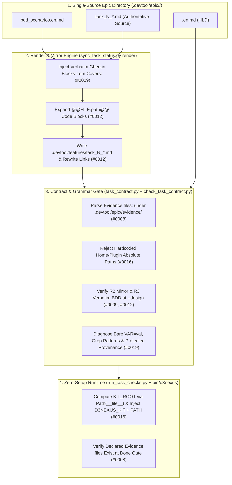
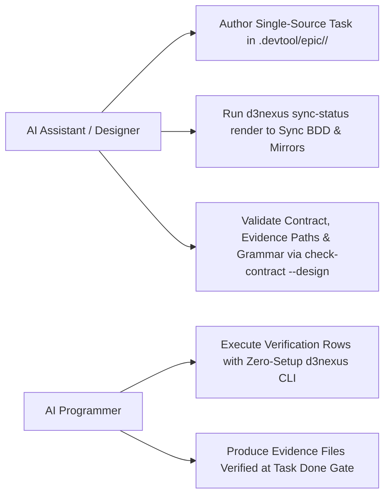
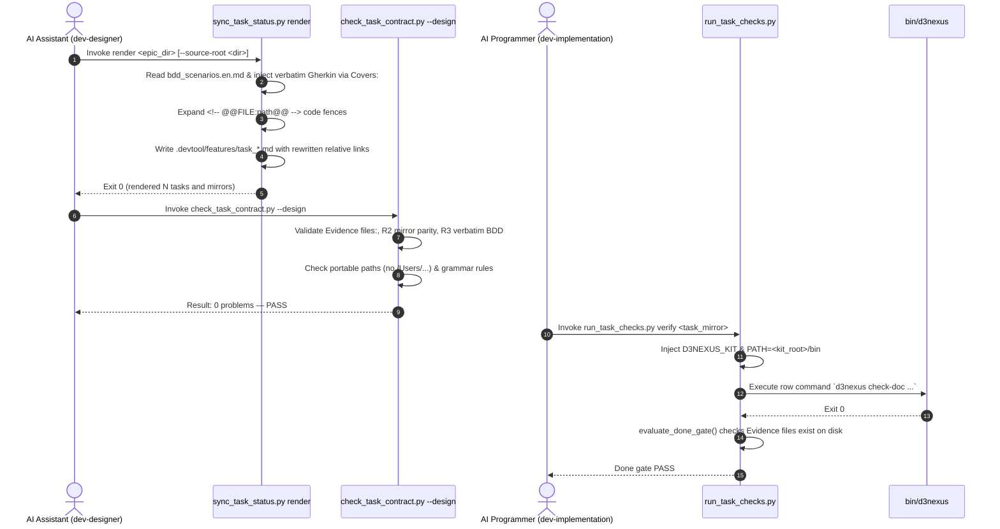

# Epic: Task Contract and Authoring Ergonomics

## Table of Contents

- [Meta Data](#meta-data)
- [Background](#background)
- [Goals and Non-Goals](#goals-and-non-goals)
- [Architecture and Technical Design](#architecture-and-technical-design)
  - [High-Level Architecture](#high-level-architecture)
  - [Use Cases](#use-cases)
  - [Sequence Diagram](#sequence-diagram)
  - [Integration Test Plan and Boundary Matrix](#integration-test-plan-and-boundary-matrix)
  - [Comprehensive BDD Test Scenarios](#comprehensive-bdd-test-scenarios)
- [Verification Environment](#verification-environment)
- [Shared Contract Impact](#shared-contract-impact)
- [Rollout Strategy and Mitigation](#rollout-strategy-and-mitigation)
- [Kanban Tasks Breakdown](#kanban-tasks-breakdown)

## Meta Data

- **Epic Name**: `contract_and_authoring_ergonomics`
- **Epic Slug**: `contract-and-authoring-ergonomics`
- **Status**: Packaged
- **Target Release**: v1.25.0
- **Platform**: Python
- **Source Spec**: [2026-11-06-contract-and-authoring-ergonomics-design.en.md](./2026-11-06-contract-and-authoring-ergonomics-design.en.md)

## Background

During multi-epic packaging and execution in satellite repositories (`lyrics-sync`), five recurring authoring and contract-checking pain points were recorded in `skill-observations/observation-log/`:
- **Observation #0008**: Verification rows and `Read-only context:` cannot reference evidence files created by a task under `.devtool/epic/<epic_dir>/evidence/` because `.devtool/` is barred from `Allowed files:` while `check_task_contract.py` rejects unignored non-existent paths not marked `(new)`.
- **Observation #0009**: `check_epic_readiness.py` (Rule R3) requires task Gherkin blocks to match `bdd_scenarios.en.md` verbatim, whereas `dev-designer` asks for task-level scenario summaries and `check_task_contract.py --design` does not check R3 early.
- **Observation #0012**: Every task file must be maintained in two places (`.devtool/epic/<epic_dir>/task_*.md` and `.devtool/features/task_*.md`), and embedded code snippets drift from verified source files.
- **Observation #0016**: Task Verification rows call kit scripts (`check_document.py`) using machine- and profile-specific absolute paths (`/Users/.../antigravity_homes/...`), breaking portability across machines, accounts, and plugin versions.
- **Observation #0019**: Verification table rows contain undocumented grammar traps (`\|` unescaping false positives in `principal-review`, bare `VAR=val` parsed as an executable name, grep patterns containing `/` treated as missing file paths, and opaque implicit protected paths).

## Goals and Non-Goals

### Goals

- Introduce an `Evidence files:` subsection under `## Files` in `task_*.md` supporting `(new)` markers for `.devtool/epic/<epic_dir>/evidence/*` paths, validated at both `--design` time and the task Done Gate (`#0008`).
- Establish `.devtool/epic/<epic_dir>/task_*.md` as the single authoritative source of truth and add `sync_task_status.py render <epic_dir> [--source-root <dir>]` to automatically inject verbatim Gherkin blocks from `bdd_scenarios.en.md` (`#0009`), expand `<!-- @@FILE:path@@ -->` code blocks, and generate `.devtool/features/task_*.md` mirrors with rewritten relative links (`#0012`).
- Run R2 (mirror parity) and R3 (verbatim BDD parity) checks early inside `check_task_contract.py --design` (`#0009`, `#0012`).
- Ship a portable `bin/d3nexus` CLI wrapper and automatically inject `D3NEXUS_KIT=<kit_root>` and `PATH="<kit_root>/bin:$PATH"` at runtime inside `run_task_checks.py` and `check_epic_readiness.py` (`#0016`).
- Reject machine- or profile-specific absolute paths in Verification rows inside `check_task_contract.py` (`#0016`).
- Improve `check_task_contract.py` grammar diagnostics (`env VAR=value`, non-path grep patterns, implicit protected path provenance) and document the canonical grammar in `skills/dev-designer/references/verification-row-grammar.md` and `skills/principal-review/SKILL.md` (`#0019`).

### Non-Goals

- Changing the 5-column Markdown table layout (`| ID | Phase | Command | Expect | Needs |`) of `## Verification`.
- Modifying worktree capability bootstrap, failure-set baseline scripts, or multi-epic dependency scheduling (scoped for Epic 2 and Epic 3).
- Breaking backward compatibility for existing completed or in-flight epics that do not declare `Evidence files:` or `<!-- @@FILE:...@@ -->` directives.

## Architecture and Technical Design

### High-Level Architecture



### Use Cases



### Sequence Diagram



### Integration Test Plan and Boundary Matrix

```text
Integration test roots: tests/, skills/dev-implementation/resources/scripts/
Protected paths: .agents/quality/**, .devtool/epic/contract_and_authoring_ergonomics/bdd_scenarios.en.md, .devtool/epic/contract_and_authoring_ergonomics/bdd_scenarios.vi.md
Integration results: python3 -m pytest tests/ skills/dev-implementation/resources/scripts/ --junitxml=build/test-results/pytest.xml -> build/test-results/pytest.xml
```

| Boundary Seam | Testing Strategy | Verification Target |
| :--- | :--- | :--- |
| `task_contract.py` & `check_task_contract.py` | Subcutaneous CLI & parser unit/integration tests on temporary git repositories | Verify `Evidence files:` parsing, `(new)` grounding, Done-Gate file existence check, bare `VAR=val` errors, grep pattern exclusion, and early R2/R3 enforcement |
| `sync_task_status.py render` | Real filesystem rendering tests across `.devtool/epic/<epic>/` and `.devtool/features/` | Verify verbatim Gherkin injection from `bdd_scenarios.en.md`, `@@FILE:path@@` embedding with dynamic `max(4, max_inner_backtick_run + 1)` fence promotion, location-aware relative link rewriting (`../epic/` and `../../epic/`), and orphan mirror cleanup |
| `bin/d3nexus` & `run_task_checks.py` | Subprocess execution tests in temporary git repositories | Verify zero-setup `D3NEXUS_KIT` and `PATH` injection, `d3nexus` subcommand dispatch, and rejection of hardcoded `/Users/...` or plugin cache paths |
| Reviewer & Authoring Docs | Document lint and contract checks via `check_document.py` | Verify `verification-row-grammar.md`, `dev-designer/SKILL.md`, and `principal-review/SKILL.md` alignment |

## Verification Environment

- Execution environment: Local macOS / Linux CLI with Python 3.11+, Git, `pytest`, `ruff`, and `mypy` installed.
- No live network or external database dependencies: All tests execute against temporary local Git repositories created via `tempfile.TemporaryDirectory` / `tmp_path`.
- File system isolation: Test runs never mutate the main repository's `.devtool/` state or working tree.

### Comprehensive BDD Test Scenarios

The suite covers all 5 dimensions under the `[TCAE-]` prefix:
1. **Happy Paths (`TCAE-HP-01` .. `TCAE-HP-04`)**: Declaring and verifying `(new)` `Evidence files:`, rendering verbatim BDD and `.devtool/features/` mirrors from single-source epic tasks, executing `d3nexus` commands via zero-setup environment injection, and clean grammar validation with `\|` unescaping and `env VAR=val`.
2. **Edge Cases (`TCAE-EC-01` .. `TCAE-EC-03`)**: Tasks without `Covers:` (`Covers: none`), embedded files containing fenced code blocks automatically promoted to dynamic outer fences (`max(4, max_inner_backtick_run + 1)`), and grep/rg/sed search patterns containing `/` excluded from missing-file path errors.
3. **State Transitions (`TCAE-ST-01` .. `TCAE-ST-02`)**: Orphan mirror cleanup and `done/` board location synchronization during `render`, and Done-Gate transition from FAIL (when a declared `Evidence files:` output is missing) to PASS (once created by verification).
4. **Async & Concurrency (`TCAE-AR-01` .. `TCAE-AR-02`)**: Isolated `D3NEXUS_KIT` / `PATH` injection across parallel worktrees without environment leakage, and deterministic multi-task rendering across worktrees.
5. **Failures & Resilience (`TCAE-FR-01` .. `TCAE-FR-03`)**: Rejecting `Evidence files:` outside `.devtool/epic/<epic>/evidence/` or with `..` traversal, rejecting hardcoded `/Users/...` or `.claude/plugins/cache/...` paths and bare `VAR=val` assignments, and aborting `render` cleanly when `Covers:` references an unknown scenario ID.

## Shared Contract Impact

None — self-contained feature in `ai-agent-tools`.

## Rollout Strategy and Mitigation

- **Phase 1**: Extend `task_contract.py` and `check_task_contract.py` with `Evidence files:` support and Done-Gate verification (`Task 01`).
- **Phase 2**: Implement `sync_task_status.py render` and shift-left R2/R3 validation in `check_task_contract.py --design` (`Task 02`).
- **Phase 3**: Add `bin/d3nexus`, runtime `D3NEXUS_KIT`/`PATH` injection in `run_task_checks.py` and `check_epic_readiness.py`, and absolute path rejection (`Task 03`).
- **Phase 4**: Add Verification row grammar diagnostics (`env VAR=val`, grep pattern exclusion, implicit protected path provenance) and author `verification-row-grammar.md` + skill updates (`Task 04`).
- **Phase 5**: Execute end-to-end subcutaneous integration tests and repository verification (`Task 05`).
- **Rollback Plan**: All changes are backwards-compatible additions to standard library Python scripts; reverting the epic merge commit cleanly restores previous checker behavior.

## Kanban Tasks Breakdown

- [Task 01: Evidence Files Contract and Done-Gate Verification](./task_01_evidence_files_contract.md)
- [Task 02: Single-Source Task Render Engine and Shift-Left R2/R3 Checks](./task_02_single_source_render_engine.md)
- [Task 03: Portable d3nexus CLI and Zero-Setup Runtime Environment Injection](./task_03_portable_d3nexus_cli_and_env.md)
- [Task 04: Verification Row Grammar Diagnostics and Reference Documentation](./task_04_verification_grammar_and_docs.md)
- [Task 05: End-to-End Integration and Acceptance Verification](./task_05_end_to_end_contract_acceptance.md)
