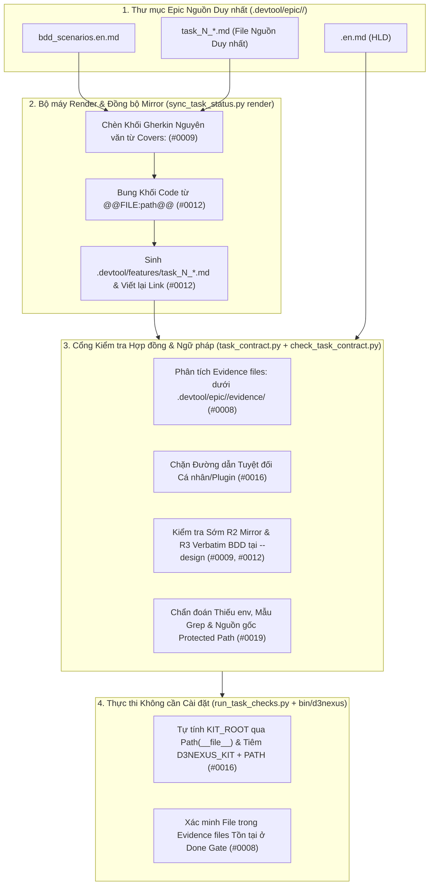
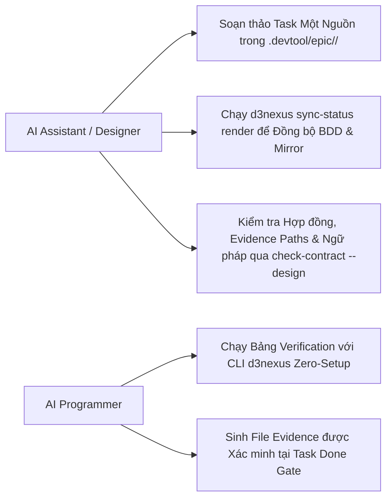
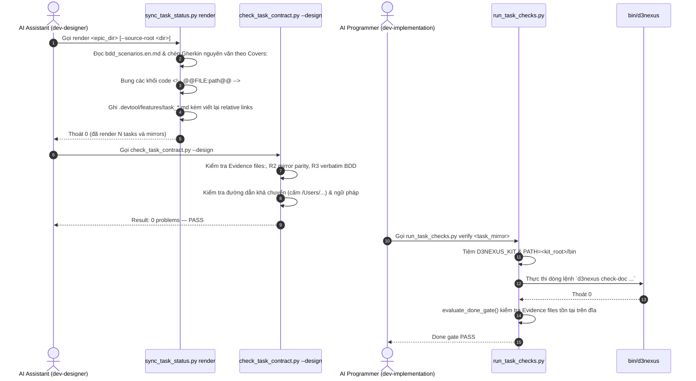

# Epic: Hợp đồng Task và Tối ưu Soạn thảo (Task Contract and Authoring Ergonomics)

## Mục lục

- [Thông tin Chung](#thông-tin-chung)
- [Bối cảnh](#bối-cảnh)
- [Mục tiêu và Phi mục tiêu](#mục-tiêu-và-phi-mục-tiêu)
- [Kiến trúc và Thiết kế Kỹ thuật](#kiến-trúc-và-thiết-kế-kỹ-thuật)
  - [Kiến trúc Tổng thể](#kiến-trúc-tổng-thể)
  - [Các Ca Sử dụng (Use Cases)](#các-ca-sử-dụng-use-cases)
  - [Sơ đồ Tuần tự (Sequence Diagram)](#sơ-đồ-tuần-tự-sequence-diagram)
  - [Kế hoạch Kiểm thử Tích hợp và Ma trận Ranh giới](#kế-hoạch-kiểm-thử-tích-hợp-và-ma-trận-ranh-giới)
  - [Kịch bản Kiểm thử BDD Toàn diện](#kịch-bản-kiểm-thử-bdd-toàn-diện)
- [Môi trường Xác minh](#môi-trường-xác-minh)
- [Tác động Shared Contract](#tác-động-shared-contract)
- [Chiến lược Triển khai và Giảm thiểu Rủi ro](#chiến-lược-triển-khai-và-giảm-thiểu-rủi-ro)
- [Phân rã Kanban Tasks](#phân-rã-kanban-tasks)

## Thông tin Chung

- **Tên Epic**: `contract_and_authoring_ergonomics`
- **Epic Slug**: `contract-and-authoring-ergonomics`
- **Trạng thái**: Packaged
- **Phiên bản Mục tiêu**: v1.25.0
- **Nền tảng**: Python
- **Tài liệu Spec Nguồn**: [2026-11-06-contract-and-authoring-ergonomics-design.vi.md](./2026-11-06-contract-and-authoring-ergonomics-design.vi.md)

## Bối cảnh

Trong quá trình đóng gói và thực thi nhiều epic trên các kho mã nguồn vệ tinh (`lyrics-sync`), 5 điểm nghẽn lặp đi lặp lại trong khâu soạn thảo và kiểm tra hợp đồng task đã được ghi nhận tại `skill-observations/observation-log/`:
- **Observation #0008**: Các dòng Verification và `Read-only context:` không thể tham chiếu tới file bằng chứng do task tạo ra dưới `.devtool/epic/<epic_dir>/evidence/` vì `.devtool/` bị cấm đưa vào `Allowed files:` trong khi `check_task_contract.py` từ chối mọi đường dẫn chưa tồn tại nếu không được đánh dấu `(new)`.
- **Observation #0009**: `check_epic_readiness.py` (Rule R3) yêu cầu khối Gherkin trong task phải khớp nguyên văn với `bdd_scenarios.en.md`, nhưng `dev-designer` lại hướng dẫn viết tóm tắt scenario và `check_task_contract.py --design` không kiểm tra R3 sớm.
- **Observation #0012**: Mỗi file task phải duy trì ở 2 nơi (`.devtool/epic/<epic_dir>/task_*.md` và `.devtool/features/task_*.md`), đồng thời các đoạn code mẫu nhúng trong task bị trôi lệch so với bản đã kiểm chứng.
- **Observation #0016**: Bảng Verification gọi các script của kit (`check_document.py`) bằng đường dẫn tuyệt đối gắn với máy hoặc profile cá nhân (`/Users/.../antigravity_homes/...`), làm hỏng tính khả chuyển khi đổi máy, đổi tài khoản hoặc nâng bản cập nhật plugin.
- **Observation #0019**: Bảng Verification có nhiều bẫy ngữ pháp ngầm (unescape `\|` gây báo lỗi giả khi `principal-review`, viết `VAR=val` thiếu `env` bị hiểu nhầm là tên file thực thi, biểu thức grep chứa `/` bị coi là đường dẫn file bị thiếu, và không rõ nguồn gốc của implicit protected paths).

## Mục tiêu và Phi mục tiêu

### Mục tiêu

- Bổ sung tiểu mục `Evidence files:` dưới `## Files` trong `task_*.md` hỗ trợ đánh dấu `(new)` cho các đường dẫn `.devtool/epic/<epic_dir>/evidence/*`, được kiểm tra ở cả pha `--design` và tại cổng hoàn tất Done Gate (`#0008`).
- Xác lập `.devtool/epic/<epic_dir>/task_*.md` làm nguồn sự thật duy nhất (Single Source of Truth) và thêm lệnh `sync_task_status.py render <epic_dir> [--source-root <dir>]` để tự động chèn khối Gherkin nguyên văn từ `bdd_scenarios.en.md` (`#0009`), bung nội dung file từ chỉ thị `<!-- @@FILE:path@@ -->`, và sinh bản mirror `.devtool/features/task_*.md` với liên kết tương đối được viết lại tự động (`#0012`).
- Đưa kiểm tra R2 (đồng bộ mirror) và R3 (khớp BDD nguyên văn) vào chạy sớm ngay trong `check_task_contract.py --design` (`#0009`, `#0012`).
- Cung cấp CLI khả chuyển `bin/d3nexus` và tự động tiêm `D3NEXUS_KIT=<kit_root>` cùng `PATH="<kit_root>/bin:$PATH"` ngay lúc chạy bên trong `run_task_checks.py` và `check_epic_readiness.py` (`#0016`).
- Chặn mọi đường dẫn tuyệt đối gắn với máy hoặc profile cá nhân trong bảng Verification khi chạy `check_task_contract.py` (`#0016`).
- Nâng cấp thông báo chẩn đoán ngữ pháp của `check_task_contract.py` (`env VAR=value`, loại trừ mẫu tìm kiếm grep khỏi kiểm tra đường dẫn, hiển thị nguồn gốc implicit protected paths) và tài liệu hóa chuẩn mực tại `skills/dev-designer/references/verification-row-grammar.md` cùng `skills/principal-review/SKILL.md` (`#0019`).

### Phi mục tiêu

- Không thay đổi cấu trúc bảng Markdown 5 cột (`| ID | Phase | Command | Expect | Needs |`) của mục `## Verification`.
- Không sửa đổi quy trình khởi tạo extras cho worktree, script baseline hồi quy hay lịch trình phụ thuộc liên epic (thuộc phạm vi của Epic 2 và Epic 3).
- Không làm gãy tính tương thích ngược đối với các epic cũ hoặc đang chạy mà không khai báo `Evidence files:` hay `<!-- @@FILE:...@@ -->`.

## Kiến trúc và Thiết kế Kỹ thuật

### Kiến trúc Tổng thể



### Các Ca Sử dụng (Use Cases)



### Sơ đồ Tuần tự (Sequence Diagram)



### Kế hoạch Kiểm thử Tích hợp và Ma trận Ranh giới

```text
Integration test roots: tests/, skills/dev-implementation/resources/scripts/
Protected paths: .agents/quality/**, .devtool/epic/contract_and_authoring_ergonomics/bdd_scenarios.en.md, .devtool/epic/contract_and_authoring_ergonomics/bdd_scenarios.vi.md
Integration results: python3 -m pytest tests/ skills/dev-implementation/resources/scripts/ --junitxml=build/test-results/pytest.xml -> build/test-results/pytest.xml
```

| Ranh giới Tích hợp | Chiến lược Kiểm thử | Mục tiêu Xác minh |
| :--- | :--- | :--- |
| `task_contract.py` & `check_task_contract.py` | Kiểm thử unit và subcutaneous CLI trên git repo tạm | Xác minh phân tích `Evidence files:`, grounding `(new)`, kiểm tra tồn tại file tại Done Gate, báo lỗi `VAR=val` thiếu `env`, loại trừ mẫu grep, và kiểm tra sớm R2/R3 |
| `sync_task_status.py render` | Kiểm thử render trên hệ thống file thực giữa `.devtool/epic/<epic>/` và `.devtool/features/` | Xác minh chèn Gherkin nguyên văn từ `bdd_scenarios.en.md`, nhúng `@@FILE:path@@` kèm tự nâng lên 4 backticks, viết lại relative link, và xóa mirror mồ côi |
| `bin/d3nexus` & `run_task_checks.py` | Kiểm thử thực thi tiến trình con trên git repo tạm | Xác minh tự động tiêm `D3NEXUS_KIT` và `PATH`, điều phối lệnh con `d3nexus`, và từ chối đường dẫn cứng `/Users/...` hoặc plugin cache |
| Tài liệu Reviewer & Authoring | Kiểm tra lint và hợp đồng tài liệu qua `check_document.py` | Xác minh tính đồng bộ của `verification-row-grammar.md`, `dev-designer/SKILL.md` và `principal-review/SKILL.md` |

## Môi trường Xác minh

- Môi trường thực thi: Máy cục bộ macOS / Linux CLI cài đặt Python 3.11+, Git, `pytest`, `ruff` và `mypy`.
- Không phụ thuộc mạng hay cơ sở dữ liệu bên ngoài: Toàn bộ bài kiểm thử chạy trên các kho Git cục bộ tạm thời tạo bằng `tempfile.TemporaryDirectory` / `tmp_path`.
- Cô lập hệ thống tệp: Các lượt chạy kiểm thử không bao giờ làm thay đổi trạng thái `.devtool/` hoặc cây thư mục làm việc của kho mã nguồn chính.

### Kịch bản Kiểm thử BDD Toàn diện

Bộ kịch bản bao phủ đầy đủ 5 chiều dưới tiền tố `[TCAE-]`:
1. **Happy Paths (`TCAE-HP-01` .. `TCAE-HP-04`)**: Khai báo và xác minh `Evidence files:` đánh dấu `(new)`, render BDD nguyên văn và bản mirror `.devtool/features/` từ một nguồn duy nhất, chạy lệnh `d3nexus` qua cơ chế tự tiêm biến môi trường, và kiểm tra ngữ pháp bảng Verification với `\|` và `env VAR=val`.
2. **Edge Cases (`TCAE-EC-01` .. `TCAE-EC-03`)**: Task không có kịch bản (`Covers: none`), file nhúng có chứa 3 dấu backtick được tự động bọc bằng rào ngoài 4 dấu backtick, và biểu thức tìm kiếm `grep`/`rg`/`sed` chứa dấu `/` không bị báo lỗi nhầm là thiếu file.
3. **State Transitions (`TCAE-ST-01` .. `TCAE-ST-02`)**: Dọn dẹp mirror mồ côi và đồng bộ vị trí `done/` khi chạy `render`, cùng chuyển đổi trạng thái Done Gate từ FAIL (khi thiếu file trong `Evidence files:`) sang PASS (sau khi lệnh verification tạo đủ file).
4. **Async & Concurrency (`TCAE-AR-01` .. `TCAE-AR-02`)**: Cô lập biến môi trường `D3NEXUS_KIT` / `PATH` giữa các worktree song song và đảm bảo tính tất định khi render nhiều task trên nhiều worktree.
5. **Failures & Resilience (`TCAE-FR-01` .. `TCAE-FR-03`)**: Từ chối `Evidence files:` nằm ngoài `.devtool/epic/<epic>/evidence/` hoặc chứa `..`, từ chối đường dẫn cứng `/Users/...` hay `.claude/plugins/cache/...` và phép gán `VAR=val` thiếu `env`, đồng thời dừng `render` an toàn khi `Covers:` chứa mã scenario không tồn tại.

## Tác động Shared Contract

None — tính năng khép kín trong `ai-agent-tools`.

## Chiến lược Triển khai và Giảm thiểu Rủi ro

- **Giai đoạn 1**: Mở rộng `task_contract.py` và `check_task_contract.py` hỗ trợ `Evidence files:` và kiểm tra tại Done Gate (`Task 01`).
- **Giai đoạn 2**: Hiện thực hóa `sync_task_status.py render` và đưa kiểm tra R2/R3 vào `check_task_contract.py --design` (`Task 02`).
- **Giai đoạn 3**: Bổ sung `bin/d3nexus`, tự động tiêm `D3NEXUS_KIT`/`PATH` trong `run_task_checks.py` và `check_epic_readiness.py`, và chặn đường dẫn tuyệt đối (`Task 03`).
- **Giai đoạn 4**: Bổ sung chẩn đoán ngữ pháp bảng Verification (`env VAR=val`, loại trừ mẫu grep, nguồn gốc implicit protected path) và biên soạn `verification-row-grammar.md` + cập nhật skills (`Task 04`).
- **Giai đoạn 5**: Thực thi kiểm thử tích hợp đầu-cuối (Tier C) và xác minh toàn bộ kho mã nguồn (`Task 05`).
- **Kế hoạch Rollback**: Mọi thay đổi đều tương thích ngược trên các script Python stdlib; hoàn tác commit merge của epic sẽ khôi phục nguyên trạng hành vi cũ.

## Phân rã Kanban Tasks

- [Task 01: Evidence Files Contract and Done-Gate Verification](./task_01_evidence_files_contract.md)
- [Task 02: Single-Source Task Render Engine and Shift-Left R2/R3 Checks](./task_02_single_source_render_engine.md)
- [Task 03: Portable d3nexus CLI and Zero-Setup Runtime Environment Injection](./task_03_portable_d3nexus_cli_and_env.md)
- [Task 04: Verification Row Grammar Diagnostics and Reference Documentation](./task_04_verification_grammar_and_docs.md)
- [Task 05: End-to-End Integration and Acceptance Verification](./task_05_end_to_end_contract_acceptance.md)
