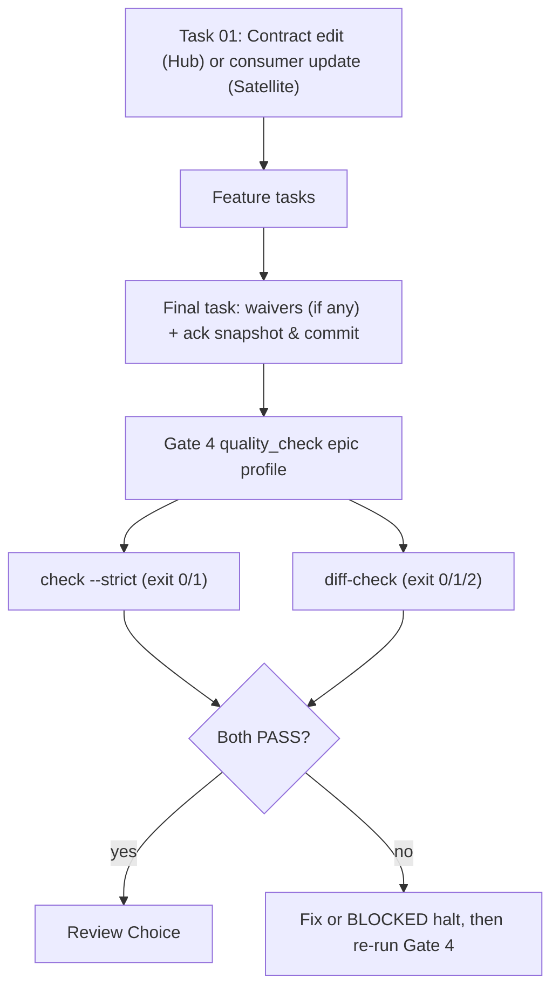

# Contract Diff Gate Design

## Table of Contents

- [Summary](#summary)
- [Goals and Non-Goals](#goals-and-non-goals)
- [Shared Contract Warnings](#shared-contract-warnings)
- [Decisions Already Made](#decisions-already-made)
- [Design](#design)
  - [CLI Signature and Exit Codes](#cli-signature-and-exit-codes)
  - [Contract Map File](#contract-map-file)
  - [Hub Rules](#hub-rules)
  - [Satellite Rules](#satellite-rules)
  - [Waiver Diff Semantics](#waiver-diff-semantics)
  - [Brainstorming Warning and Human Confirmation](#brainstorming-warning-and-human-confirmation)
  - [Gate 4 and Quality Schema Integration](#gate-4-and-quality-schema-integration)
- [Rollout and Repository Boundaries](#rollout-and-repository-boundaries)
- [Testing](#testing)
- [Files Changed](#files-changed)
- [Risks and Limits](#risks-and-limits)

## Summary

`sync_contracts.py check --strict` only proves that a repository acknowledged the current contract
snapshot. It does not notice code that changed a route, DTO or schema while the contract stayed
untouched. This design adds `sync_contracts.py diff-check`, a Gate 4 capability that compares the
git diff of an epic against a per-repository map of contract-bearing files, so a contract-relevant
change cannot reach merge without a contract update, an acknowledgement, or an audited waiver.

## Goals and Non-Goals

Goals:

- Hub (`D3Nexus`): every changed file matched by a domain's map must be covered by a change under `shared-contracts/<domain>/`, or by a newly added path-matching waiver for that domain.
- Satellite (`lyrics-sync`, `nexus`): every changed file matched by a domain's map must be covered by a fresh domain-specific `ack` of the current snapshot in the same diff, or by a newly added path-matching waiver for that domain.
- `dev-brainstorming` warns about contract drift in read-only mode and requires an explicit human decision per warning before Gate 1 passes.
- Distinguish `PASS` (`0`), `FAIL` (`1`), and `BLOCKED` (`2`) deterministically across CLI output and quality provider schemas.
- Reuse the existing topology resolver; Python standard library only.

Non-goals:

- Parsing source code to discover endpoints (heuristic scanning stays in `brief`).
- Proving semantically that code implementation matches the contract (`ack` remains a human-reviewed declaration).
- Committing to repositories other than `ai-agent-tools` from this epic.

## Shared Contract Warnings

No shared-contract warnings (`ai-agent-tools` is the plugin kit repository and has no `shared-contracts/` directory; inspected at session start).

## Decisions Already Made

| # | Decision |
|---|---|
| 1 | Detection evaluates committed git diffs across `merge-base(effective_base_ref, HEAD)..HEAD` via `git diff --no-ext-diff --no-renames --name-only -z M..HEAD` so NUL-delimited unquoted paths preserve both source and destination on renames/moves and avoid Git C-quoting. |
| 2 | Each repository declares its own file-to-domain glob map in `.agents/contract_map.json`; domain membership evaluates against the union of baseline (`M:.agents/contract_map.json`, when present) and `HEAD` domain mappings (each version applying its own `paths` and `exclude` independently) so map edits cannot self-exempt changed files. |
| 3 | Exceptions are path-scoped waivers recorded in `.agents/contract_map.json`, printed in reports, and valid only when newly added in the diff under test. Modifying an existing waiver ID fails the gate. |
| 4 | Satellite proof for domain `D` is a domain-level `ack` change in `.agents/contract_sync.json` within `M..HEAD` whose `HEAD` `snapshot_id` equals the live snapshot, or a new path-matching waiver (citing an existing `GAP-XX` when awaiting upstream contract changes). |
| 5 | Implementation is a new `diff-check` subcommand in `sync_contracts.py` (Approach A) returning exit codes `0` (`PASS`), `1` (`FAIL`), and `2` (`BLOCKED`). |
| 6 | `dev-brainstorming` only checks and warns; it never edits contracts, acknowledges or changes code. Every warning requires an explicit human decision recorded under `## Shared Contract Warnings` (`.en.md`) and `## Cảnh báo Shared Contract` (`.vi.md`). |

## Design

### CLI Signature and Exit Codes

```bash
python3 sync_contracts.py diff-check \
  [--repo-root <path>] \
  [--base-ref <ref>] \
  [--domain <name>] \
  [--json]
```

- `--repo-root <path>`: Target repository or isolated worktree root (defaults to current working directory). Worktree symlinks resolve against the primary checkout root via `resolve_topology`.
- `--base-ref <ref>`: Explicit base branch or commit reference (for example `develop` or `main`). Overrides `base_ref` in `.agents/contract_map.json`; falls back to `contract_map.json`'s `base_ref` when omitted.
- `--domain <name>`: Repeatable optional filter restricting evaluation to named domains. Passing a domain name absent from `contract_map.json` returns exit code `2` (`BLOCKED`). Evaluates all configured domains when omitted.
- `--json`: Emits structured JSON containing `status` (`"PASS"`, `"FAIL"`, or `"BLOCKED"`), nullable `mode` (`"hub"`, `"satellite"`, or `null` when blocked prior to topology), `base_ref`, nullable `merge_base`, `head_sha`, `domains` (list of `{"domain", "changed_files", "proof": "none" | "contract_edit" | "ack" | "waiver" | "uncovered"}`), `violations` (list of `{"domain", "path", "reason"}`), `active_waivers`, and `blockers`.

Deterministic exit codes:

| Exit Code | Status | Trigger Conditions |
|---|---|---|
| `0` | `PASS` | Clean tree, valid map, and either diff is empty (`merge-base == HEAD`), no mapped files changed, or all changed mapped files are covered by contract updates / fresh domain `ack` / valid new waivers. |
| `1` | `FAIL` | Uncovered mapped file changes (under `HEAD` or baseline `M` domain mappings), removing a baseline domain while its baseline-mapped files changed, stale `ack` snapshot in diff, mutated historical waiver ID, or waiver citing a nonexistent or `INACTIVE` (`SUPERSEDED`/`REJECTED`) `GAP-XX`. |
| `2` | `BLOCKED` | Missing or malformed `.agents/contract_map.json` (at `HEAD` or at `merge-base`), unknown `--domain` filter, Satellite map declaring a domain other than its linked `shared-contracts` target, dirty working tree (staged or unstaged tracked changes), unresolvable `base_ref` or git command failure, or broken `shared-contracts` topology/symlink. |

For governance and contract capabilities (`contracts`, `contracts_<domain>`, and `contract_diff`), quality providers (`rust-quality-check`, `python-quality-check`, `flutter-quality-check`, `android-quality-check`, `ios-quality-check`) map exit code `2` (or JSON `"status": "BLOCKED"`) to check status `BLOCKED`, exit code `1` to `FAIL`, and exit code `0` to `PASS`; all other capabilities keep nonzero exit codes mapped to `FAIL`.

### Contract Map File

```json
{
  "schema_version": 1,
  "base_ref": "develop",
  "domains": {
    "lyrics-sync": {
      "paths": ["crates/**/routes/**", "crates/**/dto/**"],
      "exclude": ["**/tests/**"]
    }
  },
  "waivers": [
    {
      "id": "W-001",
      "domain": "lyrics-sync",
      "paths": ["crates/x/routes/y.rs"],
      "reason": "Internal refactor, wire format unchanged",
      "gap": null
    }
  ]
}
```

Validation and scaffolding rules:

- `schema_version` must equal `1`; `base_ref` must be a non-empty string; `domains` must be a non-empty object where each domain defines non-empty `paths` (`list[str]`) and optional `exclude` (`list[str]`).
- Each entry in `waivers` (optional, defaults to `[]`) requires unique string `id`, string `domain` matching a configured domain, non-empty `paths` (`list[str]`), non-empty `reason`, and nullable string `gap`.
- Path matching converts POSIX-normalized repository-relative globs into full-path anchored regular expressions (matching the kit's `task_contract.py` convention where `**/` matches zero or more directory segments and `*` / `?` never cross `/`, avoiding Python 3.12's unanchored `PurePosixPath.match()` limitations). A file belongs to domain `D` if it matches any pattern in `domains[D].paths` and matches no pattern in `domains[D].exclude`.
- A missing or schema-invalid `.agents/contract_map.json` returns exit code `2` (`BLOCKED`, fail-closed). Because the gate never guesses repository globs, `setup-shared-contracts` provides a documented reference template (`resources/templates/contract_map.json.tmpl`) rather than auto-generating placeholder globs during `init-hub` or `link-satellite`.

### Hub Rules

1. Preconditions run first and fail closed with `2` (`BLOCKED`) on any failure: validate `.agents/contract_map.json` at `HEAD`, verify every `--domain` filter exists in `HEAD`'s `domains`, check tracked working-tree cleanliness via `git status --porcelain --untracked-files=no`, resolve `M = git merge-base <effective_base_ref> HEAD`, and resolve `shared-contracts/<D>/` topology for each `HEAD` domain `D`.
2. If `M == HEAD`, no commits diverge from base; return `0` (`PASS`). Otherwise list changed files via `git diff --no-ext-diff --no-renames --name-only -z M..HEAD` and split NUL-delimited UTF-8 records (`surrogateescape`) so renames/moves emit both source and destination paths and filenames with spaces or non-ASCII bytes are never C-quoted.
3. Evaluate domains across the union of `HEAD` and `M:.agents/contract_map.json` (when `--domain` is passed, restrict evaluation to those validated domains; when `--domain` is omitted, evaluate `sorted(set(head_domains) | set(baseline_domains))`). A changed path `f` belongs to domain `D` if it matches `head_domains[D]` (`paths` minus `exclude`) **or** (when `M:.agents/contract_map.json` existed and defined `D`) `baseline_domains[D]` (`paths` minus `exclude`). If `M:.agents/contract_map.json` did not exist at `M` (initial bootstrap), only `head_domains` applies. If `D` existed at `M` and was removed from `HEAD`: return `1` (`FAIL`) when any changed file matched `baseline_domains[D]`, or pass `D` when zero changed files matched `baseline_domains[D]`.
4. Domain `D` passes as a whole (`proof: "contract_edit"`) if the NUL-delimited `M..HEAD` changed-file set includes at least one canonical file under `shared-contracts/<D>/` (`api_contract.md`, `architecture_and_flow.md`, or `gaps_and_rfcs.md`).
5. Otherwise, **every** changed mapped file `f` in domain `D` must match `paths` of at least one **newly added waiver** for domain `D` (`proof: "waiver"`; see [Waiver Diff Semantics](#waiver-diff-semantics)). Any uncovered file `f` causes exit code `1` (`FAIL`, `proof: "uncovered"`), reporting `D` and `f`.
6. `check --strict` continues to run as a sibling capability, so editing `shared-contracts/<D>/` in `task_01` without running `ack` in the final task still fails Gate 4.

### Satellite Rules

In Satellite repositories, `shared-contracts/` is a read-only outbound symlink, so the gate never asks for edits under `shared-contracts/`.

1. Preconditions run first and fail closed with `2` (`BLOCKED`) on any failure: validate `.agents/contract_map.json` at `HEAD`, verify every `--domain` filter exists in `HEAD`'s `domains`, check tracked working-tree cleanliness, resolve `M = git merge-base <effective_base_ref> HEAD`, and resolve `shared-contracts` topology (including broken or circular symlinks). Because a Satellite links to a single Hub domain (`contract_dir.name`), every domain declared in `HEAD`'s `.agents/contract_map.json` must equal `contract_dir.name`, else return `2` (`BLOCKED`). If `M == HEAD`, return `0` (`PASS`). Changed paths are extracted via `git diff --no-ext-diff --no-renames --name-only -z M..HEAD` and matched against the union of `HEAD` and `M` domain mappings (preserving each version's own `paths` and `exclude` independently, with bootstrap fallback when `M:.agents/contract_map.json` is absent, and failing with `1` `FAIL` if a deleted baseline domain had baseline-mapped file changes).
2. For each evaluated domain `D` with at least one changed mapped file in `M..HEAD`:
   - Check presence of `.agents/contract_sync.json` at `M` via `git ls-tree -r --name-only <M> -- .agents/contract_sync.json` (empty stdout on exit `0` -> `{}`; non-zero git exit -> `2` `BLOCKED`) and read `git show <M>:.agents/contract_sync.json` when present. Compare `domains[D]` between `M` and `HEAD`: domain `D` passes as a whole (`proof: "ack"`) if `domains[D]` was added or updated in `M..HEAD` (including a refreshed `last_synced_at` when re-acknowledging an unchanged upstream snapshot) **and** `domains[D].snapshot_id` at `HEAD` equals the live `snapshot_id` computed from the resolved `shared-contracts` files. An acknowledgement affecting only another domain `D2` does not satisfy `D`.
   - Otherwise, **every** changed mapped file `f` in domain `D` must match `paths` of at least one **newly added valid waiver** for domain `D` (`proof: "waiver"`).
3. A stale or mismatched `snapshot_id` in `.agents/contract_sync.json` does not cover mapped changes.
4. Any uncovered file causes exit code `1` (`FAIL`, `proof: "uncovered"`), listing the offending domain and file paths.

### Waiver Diff Semantics

Waivers are scoped per epic diff and per file glob so historical waivers never silently mask future edits, and a waiver for one file never masks unrelated files in the same domain:

1. **Historical baseline extraction**: Probe presence of `.agents/contract_map.json` at commit `M` via `git ls-tree -r --name-only <M> -- .agents/contract_map.json`.
   - Any non-zero exit code from `git ls-tree` (or from `git show <M>:.agents/contract_map.json` when present) returns exit code `2` (`BLOCKED`, fail-closed).
   - If `git ls-tree` exits `0` with empty stdout (`.agents/contract_map.json` did not exist at `M`, bootstrap), both `baseline_domains` and `baseline_waivers` are empty (`{}`).
   - If present at `M` and passing full `contract_map.json` validation (`schema_version == 1`, `domains`, `waivers`), extract `baseline_domains` (for union domain coverage) and index `baseline_waivers` by `id`; malformed JSON or schema validation failure at `M` returns exit code `2` (`BLOCKED`, fail-closed).
2. **Immutability of historical waivers**: For any waiver `id` present in both `baseline_waivers` and `HEAD`, its canonical fields (`domain`, `paths`, `reason`, `gap`) must be identical. Mutating an existing waiver ID to widen `paths` or switch `domain` immediately triggers exit code `1` (`FAIL`). Removing obsolete historical waivers is permitted.
3. **Newly added waivers**: Only waivers whose `id` is in `HEAD` and **not** in `baseline_waivers` are active for covering changed files in `M..HEAD`.
4. **Path-level coverage**: A newly added waiver `W` covers changed file `f` in domain `D` if and only if `W.domain == D` and `f` matches at least one anchored glob in `W.paths`.
5. **`GAP-XX` verification**: When `W.gap` is non-null (for example `"GAP-08"` or `"GAP-NEX-08"`), `diff-check` parses the domain's `gaps_and_rfcs.md` via `parse_gaps_and_rfcs` and verifies `W.gap` exists in `rfcs` with normalized status `"ACTIONABLE_PENDING"` or `"ACKNOWLEDGED_ACTIVE"` (per `normalize_rfc_status`). Missing `GAP` keys or `"INACTIVE"` (`SUPERSEDED`/`REJECTED`) entries trigger exit code `1` (`FAIL`).
6. **Audit visibility**: Per-domain discharge summaries (`domain`, `changed_files`, `proof`) and every active newly added waiver (`id`, `domain`, `paths`, `reason`, `gap`) are printed in text and JSON output so Human Architects review them at Gate 4 and Gate 5.

### Brainstorming Warning and Human Confirmation

When `shared-contracts/` exists (physical directory = Hub, symlink = Satellite), `dev-brainstorming` runs the read-only `sync_contracts.py check --domain <domain>` and `brief` commands and warns only. It never edits contracts, never runs `ack`, and never modifies source code.

1. Warnings are presented in a dedicated message: active contract drift, `MISSING_IN_CODE` items, or user ideas touching routes, DTOs, schemas, or pipeline states.
2. The user must explicitly decide each warning:
   - include in this epic's scope,
   - split into a named follow-up epic, or
   - ignore with an explicit rationale.
   Silence is not consent, and the agent never chooses on the user's behalf.
3. Gate 1 cannot pass while any warning lacks a user decision.
4. Decisions are persisted under `## Shared Contract Warnings` in `.en.md` and `## Cảnh báo Shared Contract` in `.vi.md`, which `dev-designer` reads at Stage 2 to construct `task_01` and any planned waivers. When no warnings arise, the section records one line naming the `snapshot_id` checked (or noting that `shared-contracts/` is absent).

### Gate 4 and Quality Schema Integration



Target repository capability wiring (applied in follow-up adoption epics per repository):

| Repository | Manifest | Capabilities in `epic` and `pr` |
|---|---|---|
| D3Nexus | `rust-quality.json` | `contract_diff`, `contracts_lyrics_sync`, `contracts_nexus` |
| lyrics-sync | `python-quality.json` | `contract_diff`, `contracts` |
| nexus | `flutter-quality.json` | `contract_diff`, `contracts` |

Provider schema, `{skills_dir}`, and `{base_ref}` alignment across the `*-quality-check` family:

- Update `resources/schemas/*-quality.schema.json` across all five quality providers (`rust`, `python`, `flutter`, `android`, `ios`) so `properties.capabilities` permits `contracts` and `contract_diff` (string-array command schema) plus `patternProperties` for `^contracts_[a-z0-9_]+$`, and add `db_hygiene` to `rust-quality.schema.json` so `D3Nexus`'s existing capability conforms to the schema.
- Document `{skills_dir}` argument prefix resolution, `{base_ref}` placeholder substitution (populated from `quality_check`'s normalized `base_ref` invocation parameter, allowing `["python3", "{skills_dir}/.../sync_contracts.py", "diff-check", "--base-ref", "{base_ref}"]`), and exit-code `2` → `BLOCKED` mapping scoped specifically to governance and contract capabilities (`contracts`, `contracts_<domain>`, and `contract_diff`, while all other capabilities retain nonzero → `FAIL`) across all five quality providers (`SKILL.md` for all five, plus `references/{rust,python}-capability-contract.md` for the two providers that maintain separate contract reference files).
- In `dev-designer`, Hub contract edits remain strictly in `task_01` (per the Contract-First rule), while the final task's `Allowed files` includes `.agents/contract_sync.json` and (when waivers are planned) `.agents/contract_map.json`, running before Gate 4 so the Gate 4 commit SHA stays immutable.

## Rollout and Repository Boundaries

This epic modifies only `ai-agent-tools` and publishes a new plugin version first. Downstream adoption in `D3Nexus`, `lyrics-sync`, and `nexus` (creating `.agents/contract_map.json`, auditing `brief`, fixing code or logging `GAP-XX`, running `ack`, and enabling `contract_diff`) happens in separate per-repository epics. No autonomous commits are made to sibling repositories.

## Testing

Standard library `unittest` suite using temporary git repositories, wired into `scripts/verify.sh`:

- **Hub**: mapped change + contract edit → `0` (`PASS`); mapped change alone → `1` (`FAIL`); rename of mapped file outside mapped directory or filename requiring Git quoting (spaces/non-ASCII) without coverage → `1` (`FAIL`) and with contract edit → `0` (`PASS`); mapped change + new path-matching waiver → `0` (`PASS`); partial waiver leaving sibling file uncovered → `1` (`FAIL`); old waiver at `merge-base` does not mask new edit → `1` (`FAIL`); mutating old waiver ID → `1` (`FAIL`); narrowing `domains[D].paths`, adding changed path to `exclude`, or deleting `domains[D]` at `HEAD` while baseline-mapped file changed → `1` (`FAIL`); retiring untouched baseline domain → `0` (`PASS`); bootstrap when `M:.agents/contract_map.json` is absent → evaluates `HEAD` map cleanly; malformed `contract_map.json` at `merge-base` → `2` (`BLOCKED`); `merge-base == HEAD` → `0` (`PASS`); missing/invalid `contract_map.json` at `HEAD` → `2` (`BLOCKED`); dirty tracked tree → `2` (`BLOCKED`).
- **Satellite**: mapped change + fresh domain `ack` matching live `snapshot_id` → `0` (`PASS`); rename of mapped file outside mapped directory or filename requiring Git quoting without `ack` → `1` (`FAIL`) and with fresh domain `ack` → `0` (`PASS`); `ack` touching only another domain `D2` → `1` (`FAIL`); stale `ack` snapshot → `1` (`FAIL`); new waiver with active/pending `GAP-XX` → `0` (`PASS`); new waiver with missing or `INACTIVE` (`REJECTED`/`SUPERSEDED`) `GAP-XX` → `1` (`FAIL`); new waiver with `gap: null` → `0` (`PASS`) with waiver listed in report; Satellite `contract_map.json` declaring domain other than linked symlink target → `2` (`BLOCKED`); dangling symlink → `2` (`BLOCKED`).
- **Worktree, Globbing & CLI**: nested `.worktrees/<epic>` symlink resolution, anchored `**` glob matching on zero and multiple directory levels, `--base-ref` override precedence, unknown `--domain` returning `2` (`BLOCKED`), and `--json` output schema.
- **Provider Schemas, Lifecycle & Docs**: unit tests in `test_validate_*_quality.py` inspecting `*-quality.schema.json` structure (via stdlib `json`) and validator acceptance for `contracts`, `contracts_<domain>`, `contract_diff`, and `db_hygiene`, plus `scripts/test_lifecycle_document_contract.py`, `check_document.py`, and `scripts/verify.sh`.

## Files Changed

- `skills/sync-shared-contracts/resources/scripts/sync_contracts.py` (`diff-check` subcommand, `contract_map.json` validator, anchored POSIX glob matcher, git diff & waiver evaluator, exit codes `0`/`1`/`2`).
- `skills/sync-shared-contracts/resources/scripts/test_sync_contracts.py` (unit & integration tests for Hub, Satellite, waivers, worktrees, globbing, and exit codes).
- `skills/sync-shared-contracts/SKILL.md` (`diff-check` CLI reference, `contract_map.json` schema, exit codes).
- `skills/setup-shared-contracts/resources/templates/contract_map.json.tmpl` (new reference template) and `skills/setup-shared-contracts/SKILL.md` (documenting `.agents/contract_map.json` setup).
- `skills/dev-brainstorming/SKILL.md` (strict read-only check & warn, human confirmation gate per warning, mandatory `## Shared Contract Warnings` / `## Cảnh báo Shared Contract` spec section).
- `skills/dev-designer/SKILL.md` (consuming `## Shared Contract Warnings`, preserving `task_01` Contract-First rule, final-task `Allowed files` for `.agents/contract_sync.json` and `.agents/contract_map.json`).
- `skills/{rust,python,flutter,android,ios}-quality-check/SKILL.md`, `skills/{rust,python}-quality-check/references/{rust,python}-capability-contract.md`, `skills/{rust,python,flutter,android,ios}-quality-check/resources/schemas/*-quality.schema.json`, and `skills/{rust,python,flutter,android,ios}-quality-check/resources/scripts/test_validate_*_quality.py` (`{skills_dir}` and `{base_ref}` placeholders, exit code `2` → `BLOCKED`, `contracts*` / `contract_diff` / `db_hygiene` schema definitions).
- `scripts/test_lifecycle_document_contract.py` (contract assertions for updated `dev-brainstorming` and `dev-designer` instructions).
- `CHANGELOG.md` and plugin release manifests (`scripts/release.sh` after user approval).

## Risks and Limits

- `ack` remains a human-reviewed declaration; `diff-check` proves that an `ack`, contract edit, or path-scoped waiver accompanies every mapped file change, not semantic equivalence of business logic.
- A `GAP-XX` citation proves the gap is documented in the Hub ledger, not that the Hub has implemented it yet.
- Glob patterns in `contract_map.json` require maintenance as directories evolve; missing maps are `BLOCKED`, while unmapped new directories rely on code review at Gate 2 / Gate 4.
- Waivers apply only to the diff that introduces their `id`, deliberately preventing permanent silent exemptions.
- Repositories running an older cached plugin version cannot execute `diff-check` or expand `{skills_dir}` / `{base_ref}` until updated.
