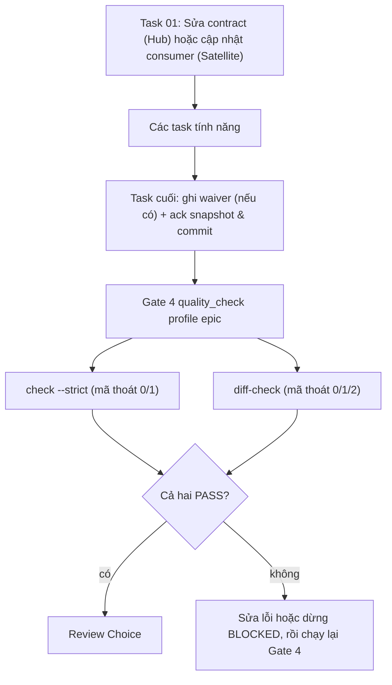

# Thiết kế Contract Diff Gate

## Mục lục

- [Tóm tắt](#tóm-tắt)
- [Mục tiêu và ngoài phạm vi](#mục-tiêu-và-ngoài-phạm-vi)
- [Cảnh báo Shared Contract](#cảnh-báo-shared-contract)
- [Các quyết định đã chốt](#các-quyết-định-đã-chốt)
- [Thiết kế](#thiết-kế)
  - [Chữ ký CLI và mã thoát](#chữ-ký-cli-và-mã-thoát)
  - [File map contract](#file-map-contract)
  - [Quy tắc Hub](#quy-tắc-hub)
  - [Quy tắc Satellite](#quy-tắc-satellite)
  - [Ngữ nghĩa diff của Waiver](#ngữ-nghĩa-diff-của-waiver)
  - [Cảnh báo ở brainstorming và xác nhận của con người](#cảnh-báo-ở-brainstorming-và-xác-nhận-của-con-người)
  - [Tích hợp Gate 4 và Quality Schema](#tích-hợp-gate-4-và-quality-schema)
- [Triển khai và ranh giới repo](#triển-khai-và-ranh-giới-repo)
- [Kiểm thử](#kiểm-thử)
- [File thay đổi](#file-thay-đổi)
- [Rủi ro và giới hạn](#rủi-ro-và-giới-hạn)

## Tóm tắt

`sync_contracts.py check --strict` chỉ chứng minh một repo đã `ack` snapshot contract hiện tại. Nó không phát
hiện code đã đổi route, DTO hay schema trong khi contract không đổi. Thiết kế này thêm
`sync_contracts.py diff-check`, một capability của Gate 4, so diff git của epic với bản map file mang contract
của từng repo. Nhờ đó một thay đổi liên quan contract không thể tới bước merge nếu thiếu cập nhật contract,
`ack` hoặc waiver có kiểm toán.

## Mục tiêu và ngoài phạm vi

Mục tiêu:

- Hub (`D3Nexus`): mọi file thay đổi khớp map của một domain phải được bao phủ bởi thay đổi dưới `shared-contracts/<domain>/`, hoặc bởi một waiver mới thêm có `paths` khớp file đó trong cùng domain.
- Satellite (`lyrics-sync`, `nexus`): mọi file thay đổi khớp map của một domain phải được bao phủ bởi `ack` mới cấp domain của snapshot hiện tại trong cùng diff, hoặc bởi một waiver mới thêm có `paths` khớp file đó trong cùng domain.
- `dev-brainstorming` cảnh báo drift contract ở chế độ chỉ đọc và đòi quyết định rõ ràng của con người cho từng cảnh báo trước khi qua Gate 1.
- Phân biệt tất định ba trạng thái `PASS` (`0`), `FAIL` (`1`) và `BLOCKED` (`2`) xuyên suốt đầu ra CLI và các schema quality provider.
- Tái dùng bộ resolve topology hiện có; chỉ dùng thư viện chuẩn Python.

Ngoài phạm vi:

- Phân tích mã nguồn để tự tìm endpoint (quét heuristic vẫn giữ ở `brief`).
- Chứng minh ngữ nghĩa rằng logic code khớp hoàn toàn với contract (`ack` vẫn là tuyên bố có con người duyệt).
- Commit sang các repo khác ngoài `ai-agent-tools` từ epic này.

## Cảnh báo Shared Contract

Không có cảnh báo shared-contract (`ai-agent-tools` là repo bộ plugin kit và không có thư mục `shared-contracts/`; đã kiểm tra khi bắt đầu phiên).

## Các quyết định đã chốt

| # | Quyết định |
|---|---|
| 1 | Phát hiện đánh giá diff git đã commit trên khoảng `merge-base(effective_base_ref, HEAD)..HEAD` qua `git diff --no-ext-diff --no-renames --name-only -z M..HEAD` để các đường dẫn phân tách bởi NUL không bị Git bọc ngoặc kép C-escape và luôn giữ đủ cả đường dẫn nguồn lẫn đích khi đổi tên/di chuyển file. |
| 2 | Mỗi repo tự khai báo map glob file → domain trong `.agents/contract_map.json`; nghĩa vụ bao phủ của domain được đánh giá trên hợp (union) của bản đồ baseline (`M:.agents/contract_map.json`, khi đã tồn tại) và bản đồ `HEAD` (mỗi phiên bản áp dụng độc lập `paths` và `exclude` của chính nó) để chỉnh sửa map không thể tự miễn trừ cho file thay đổi. |
| 3 | Ngoại lệ là các waiver giới hạn theo đường dẫn (`paths`) ghi trong `.agents/contract_map.json`, in ra báo cáo, và chỉ hợp lệ khi mới được thêm trong diff đang kiểm tra. Sửa đổi một ID waiver cũ sẽ làm gate fail. |
| 4 | Bằng chứng ở Satellite cho domain `D` là thay đổi `ack` cấp domain trong `.agents/contract_sync.json` thuộc `M..HEAD` có `snapshot_id` ở `HEAD` bằng đúng snapshot hiện hành, hoặc waiver mới khớp đường dẫn (trích dẫn `GAP-XX` có thật khi đang chờ Hub bổ sung contract). |
| 5 | Cài đặt là subcommand `diff-check` mới trong `sync_contracts.py` (Hướng A) trả mã thoát `0` (`PASS`), `1` (`FAIL`) và `2` (`BLOCKED`). |
| 6 | `dev-brainstorming` chỉ check và cảnh báo; không bao giờ sửa contract, `ack` hay đổi code. Mọi cảnh báo đòi hỏi quyết định tường minh của con người ghi dưới mục `## Shared Contract Warnings` (`.en.md`) và `## Cảnh báo Shared Contract` (`.vi.md`). |

## Thiết kế

### Chữ ký CLI và mã thoát

```bash
python3 sync_contracts.py diff-check \
  [--repo-root <path>] \
  [--base-ref <ref>] \
  [--domain <name>] \
  [--json]
```

- `--repo-root <path>`: Thư mục gốc của repo đích hoặc worktree cô lập (mặc định là thư mục hiện tại). Symlink trong worktree được phân giải về repo gốc chính qua `resolve_topology`.
- `--base-ref <ref>`: Nhánh hoặc commit gốc tường minh (ví dụ `develop` hoặc `main`). Ghi đè `base_ref` trong `.agents/contract_map.json`; mặc định đọc `base_ref` của `contract_map.json` khi bỏ trống.
- `--domain <name>`: Bộ lọc tùy chọn (có thể lặp lại) giới hạn kiểm tra vào các domain chỉ định. Truyền một tên domain không tồn tại trong `contract_map.json` trả mã thoát `2` (`BLOCKED`). Mặc định kiểm tra toàn bộ domain đã cấu hình khi bỏ trống.
- `--json`: Xuất JSON có cấu trúc gồm `status` (`"PASS"`, `"FAIL"` hoặc `"BLOCKED"`), `mode` khả rỗng (`"hub"`, `"satellite"` hoặc `null` khi bị chặn trước bước topology), `base_ref`, `merge_base` khả rỗng, `head_sha`, `domains` (danh sách `{"domain", "changed_files", "proof": "none" | "contract_edit" | "ack" | "waiver" | "uncovered"}`), `violations` (danh sách `{"domain", "path", "reason"}`), `active_waivers` và `blockers`.

Bảng mã thoát tất định:

| Mã thoát | Trạng thái | Điều kiện kích hoạt |
|---|---|---|
| `0` | `PASS` | Cây làm việc sạch, map hợp lệ, và diff rỗng (`merge-base == HEAD`), không có file được map thay đổi, hoặc mọi file được map thay đổi đều được bao phủ bởi cập nhật contract / `ack` mới cấp domain / waiver mới hợp lệ. |
| `1` | `FAIL` | Có file được map thay đổi chưa được bao phủ (theo map ở `HEAD` hoặc ở baseline `M`), xóa domain có từ baseline trong khi file khớp map baseline của domain đó bị thay đổi, `ack` trong diff mang snapshot cũ, sửa đổi ID waiver lịch sử, hoặc waiver trích dẫn `GAP-XX` không tồn tại hay có trạng thái `INACTIVE` (`SUPERSEDED`/`REJECTED`). |
| `2` | `BLOCKED` | Thiếu hoặc sai định dạng `.agents/contract_map.json` (tại `HEAD` hoặc tại `merge-base`), bộ lọc `--domain` không xác định, map của Satellite khai báo domain khác với mục tiêu symlink `shared-contracts` đã liên kết, cây làm việc bẩn (có file tracked đang staged/unstaged), không phân giải được `base_ref` hoặc lỗi lệnh git, hoặc hỏng topology/symlink `shared-contracts`. |

Đối với các capability quản trị và contract (`contracts`, `contracts_<domain>` và `contract_diff`), các quality provider (`rust-quality-check`, `python-quality-check`, `flutter-quality-check`, `android-quality-check`, `ios-quality-check`) ánh xạ mã thoát `2` (hoặc JSON `"status": "BLOCKED"`) sang trạng thái check `BLOCKED`, mã thoát `1` sang `FAIL`, và mã thoát `0` sang `PASS`; mọi capability khác giữ nguyên quy tắc mã thoát khác `0` ánh xạ sang `FAIL`.

### File map contract

```json
{
  "schema_version": 1,
  "base_ref": "develop",
  "domains": {
    "lyrics-sync": {
      "paths": ["crates/**/routes/**", "crates/**/dto/**"],
      "exclude": ["**/tests/**"]
    }
  },
  "waivers": [
    {
      "id": "W-001",
      "domain": "lyrics-sync",
      "paths": ["crates/x/routes/y.rs"],
      "reason": "Internal refactor, wire format unchanged",
      "gap": null
    }
  ]
}
```

Quy tắc kiểm tra hợp lệ và khởi tạo mẫu:

- `schema_version` phải bằng `1`; `base_ref` là chuỗi khác rỗng; `domains` là object khác rỗng trong đó mỗi domain khai báo `paths` khác rỗng (`list[str]`) và `exclude` tùy chọn (`list[str]`).
- Mỗi phần tử trong `waivers` (tùy chọn, mặc định `[]`) bắt buộc có `id` chuỗi duy nhất, `domain` chuỗi khớp một domain đã cấu hình, `paths` khác rỗng (`list[str]`), `reason` khác rỗng, và `gap` kiểu chuỗi hoặc `null`.
- So khớp đường dẫn biên dịch các mẫu glob tương đối chuẩn hóa POSIX thành biểu thức chính quy neo toàn đường dẫn (theo đúng quy ước `task_contract.py` của bộ kit trong đó `**/` khớp 0 hoặc nhiều cấp thư mục và `*` / `?` không vượt qua `/`, tránh lỗi khớp không neo của `PurePosixPath.match()` trên Python 3.12). Một file thuộc domain `D` nếu khớp bất kỳ mẫu nào trong `domains[D].paths` và không khớp mẫu nào trong `domains[D].exclude`.
- Thiếu hoặc sai schema `.agents/contract_map.json` trả mã thoát `2` (`BLOCKED`, fail-closed). Vì gate không bao giờ tự đoán glob của repo, `setup-shared-contracts` cung cấp file mẫu tham chiếu có tài liệu (`resources/templates/contract_map.json.tmpl`) thay vì tự sinh glob giả định khi chạy `init-hub` hoặc `link-satellite`.

### Quy tắc Hub

1. Các điều kiện tiên quyết chạy trước tiên và dừng fail-closed với `2` (`BLOCKED`) khi có bất kỳ lỗi nào: kiểm tra hợp lệ `.agents/contract_map.json` tại `HEAD`, xác nhận mọi bộ lọc `--domain` đều tồn tại trong `domains` của `HEAD`, kiểm tra độ sạch cây làm việc tracked qua `git status --porcelain --untracked-files=no`, phân giải `M = git merge-base <effective_base_ref> HEAD`, và phân giải topology `shared-contracts/<D>/` cho từng domain `D` ở `HEAD`.
2. Nếu `M == HEAD`, không có commit nào rẽ nhánh khỏi base; trả `0` (`PASS`). Ngược lại lấy danh sách file đổi qua `git diff --no-ext-diff --no-renames --name-only -z M..HEAD` và tách theo ký tự NUL (`surrogateescape`) để khi đổi tên/di chuyển luôn xuất cả đường dẫn nguồn lẫn đích và tên file có khoảng trắng hay ký tự non-ASCII không bị Git bọc ngoặc kép C-escape.
3. Đánh giá các domain trên hợp (union) của `HEAD` và `M:.agents/contract_map.json` (khi truyền `--domain`, giới hạn đánh giá vào các domain đã xác thực đó; khi bỏ trống `--domain`, đánh giá `sorted(set(head_domains) | set(baseline_domains))`). Một đường dẫn thay đổi `f` thuộc nghĩa vụ của domain `D` nếu khớp `head_domains[D]` (`paths` trừ `exclude`) **hoặc** (khi `M:.agents/contract_map.json` tồn tại và có khai báo `D`) khớp `baseline_domains[D]` (`paths` trừ `exclude`). Nếu `M:.agents/contract_map.json` chưa tồn tại tại `M` (khởi tạo bootstrap lần đầu), chỉ áp dụng `head_domains`. Nếu `D` từng có ở `M` nhưng bị xóa khỏi `HEAD`: trả `1` (`FAIL`) khi có ít nhất một file thay đổi khớp `baseline_domains[D]`, hoặc cho `D` pass khi không có file thay đổi nào khớp `baseline_domains[D]`.
4. Domain `D` pass toàn cục (`proof: "contract_edit"`) nếu tập file thay đổi phân tách bởi NUL của `M..HEAD` có ít nhất một file chuẩn dưới `shared-contracts/<D>/` (`api_contract.md`, `architecture_and_flow.md` hoặc `gaps_and_rfcs.md`).
5. Ngược lại, **mọi** file được map bị đổi `f` trong domain `D` phải khớp `paths` của ít nhất một **waiver mới thêm** cho domain `D` (`proof: "waiver"`; xem [Ngữ nghĩa diff của Waiver](#ngữ-nghĩa-diff-của-waiver)). Bất kỳ file `f` nào chưa được bao phủ sẽ trả mã thoát `1` (`FAIL`, `proof: "uncovered"`), liệt kê `D` và `f`.
6. `check --strict` vẫn chạy như một capability song hành, nên sửa `shared-contracts/<D>/` ở `task_01` mà quên chạy `ack` ở task cuối vẫn làm Gate 4 fail.

### Quy tắc Satellite

Ở các repo Satellite, `shared-contracts/` là outbound symlink chỉ đọc, nên gate không bao giờ yêu cầu sửa file dưới `shared-contracts/`.

1. Các điều kiện tiên quyết chạy trước tiên và dừng fail-closed với `2` (`BLOCKED`) khi có bất kỳ lỗi nào: kiểm tra hợp lệ `.agents/contract_map.json` tại `HEAD`, xác nhận mọi bộ lọc `--domain` đều tồn tại trong `domains` của `HEAD`, kiểm tra độ sạch cây làm việc tracked, phân giải `M = git merge-base <effective_base_ref> HEAD`, và phân giải topology `shared-contracts` (kể cả symlink đứt hoặc vòng lặp). Vì mỗi Satellite liên kết tới đúng một domain của Hub (`contract_dir.name`), mọi domain khai báo trong `.agents/contract_map.json` tại `HEAD` phải bằng đúng `contract_dir.name`, nếu không trả `2` (`BLOCKED`). Nếu `M == HEAD`, trả `0` (`PASS`). Tập đường dẫn thay đổi được trích xuất qua `git diff --no-ext-diff --no-renames --name-only -z M..HEAD` và đối chiếu với hợp (union) của domain mapping giữa `HEAD` và `M` (giữ độc lập `paths` và `exclude` của từng phiên bản, fallback bootstrap khi chưa có `M:.agents/contract_map.json`, và trả `1` `FAIL` nếu một domain ở baseline bị xóa trong khi có file khớp baseline của nó thay đổi).
2. Với mỗi domain `D` được đánh giá có ít nhất một file được map bị đổi trong `M..HEAD`:
   - Kiểm tra sự tồn tại của `.agents/contract_sync.json` tại `M` qua `git ls-tree -r --name-only <M> -- .agents/contract_sync.json` (stdout rỗng với mã thoát `0` -> `{}`; mã thoát git khác `0` -> `2` `BLOCKED`) và đọc `git show <M>:.agents/contract_sync.json` khi file tồn tại. So sánh `domains[D]` giữa `M` và `HEAD`: domain `D` pass toàn cục (`proof: "ack"`) nếu `domains[D]` mới được thêm hoặc cập nhật trong `M..HEAD` (kể cả cập nhật `last_synced_at` khi chạy lại `ack` trên một snapshot upstream không đổi) **và** `domains[D].snapshot_id` tại `HEAD` bằng đúng `snapshot_id` hiện hành tính từ các file `shared-contracts` đã phân giải. Một lệnh `ack` chỉ tác động tới domain khác `D2` sẽ không thỏa mãn `D`.
   - Ngược lại, **mọi** file được map bị đổi `f` trong domain `D` phải khớp `paths` của ít nhất một **waiver mới hợp lệ** cho domain `D` (`proof: "waiver"`).
3. `snapshot_id` cũ hoặc lệch trong `.agents/contract_sync.json` không bao phủ được các thay đổi file được map.
4. Bất kỳ file nào chưa được bao phủ đều trả mã thoát `1` (`FAIL`, `proof: "uncovered"`), liệt kê domain và đường dẫn file vi phạm.

### Ngữ nghĩa diff của Waiver

Waiver được giới hạn theo diff của từng epic và theo từng glob đường dẫn để waiver lịch sử không bao giờ âm thầm che các chỉnh sửa về sau, và waiver cho một file không vô tình che các file khác cùng domain:

1. **Trích xuất baseline lịch sử**: Kiểm tra sự tồn tại của `.agents/contract_map.json` tại commit `M` qua `git ls-tree -r --name-only <M> -- .agents/contract_map.json`.
   - Mọi mã thoát khác `0` từ `git ls-tree` (hoặc từ `git show <M>:.agents/contract_map.json` khi file tồn tại) đều trả mã thoát `2` (`BLOCKED`, fail-closed).
   - Nếu `git ls-tree` thoát `0` với stdout rỗng (`.agents/contract_map.json` chưa tồn tại ở `M`, bootstrap), cả `baseline_domains` lẫn `baseline_waivers` đều rỗng (`{}`).
   - Nếu tồn tại ở `M` và vượt qua kiểm tra hợp lệ toàn phần (`schema_version == 1`, `domains`, `waivers`), trích xuất `baseline_domains` (phục vụ đánh giá hợp domain) và lập chỉ mục `baseline_waivers` theo `id`; lỗi cú pháp JSON hoặc sai schema tại `M` trả mã thoát `2` (`BLOCKED`, fail-closed).
2. **Tính bất biến của waiver lịch sử**: Với mọi `id` có mặt ở cả `baseline_waivers` lẫn `HEAD`, các trường chuẩn (`domain`, `paths`, `reason`, `gap`) phải giống hệt nhau. Sửa đổi một ID waiver cũ để nới rộng `paths` hoặc đổi `domain` lập tức trả mã thoát `1` (`FAIL`). Việc xóa bỏ các waiver lịch sử không còn cần thiết được cho phép.
3. **Waiver mới thêm**: Chỉ những waiver có `id` xuất hiện ở `HEAD` nhưng **không** có trong `baseline_waivers` mới có hiệu lực bao phủ file thay đổi trong `M..HEAD`.
4. **Bao phủ cấp đường dẫn**: Một waiver mới `W` bao phủ file thay đổi `f` thuộc domain `D` khi và chỉ khi `W.domain == D` và `f` khớp ít nhất một glob có neo trong `W.paths`.
5. **Xác thực `GAP-XX`**: Khi `W.gap` khác `null` (ví dụ `"GAP-08"` hoặc `"GAP-NEX-08"`), `diff-check` parse file `gaps_and_rfcs.md` của domain qua `parse_gaps_and_rfcs` và kiểm tra `W.gap` tồn tại trong `rfcs` với trạng thái chuẩn hóa là `"ACTIONABLE_PENDING"` hoặc `"ACKNOWLEDGED_ACTIVE"` (theo `normalize_rfc_status`). Thiếu khóa `GAP` hoặc trích dẫn mục `"INACTIVE"` (`SUPERSEDED`/`REJECTED`) sẽ trả mã thoát `1` (`FAIL`).
6. **Minh bạch kiểm toán**: Tóm tắt kết quả từng domain (`domain`, `changed_files`, `proof`) cùng mọi waiver mới đang kích hoạt (`id`, `domain`, `paths`, `reason`, `gap`) đều được in rõ trong đầu ra text và JSON để Human Architect duyệt tại Gate 4 và Gate 5.

### Cảnh báo ở brainstorming và xác nhận của con người

Khi `shared-contracts/` tồn tại (thư mục vật lý = Hub, symlink = Satellite), `dev-brainstorming` chạy các lệnh chỉ đọc `sync_contracts.py check --domain <domain>` và `brief` rồi chỉ cảnh báo. Nó không bao giờ sửa contract, không chạy `ack` và không sửa mã nguồn.

1. Cảnh báo được trình bày trong một tin nhắn riêng: drift contract hiện hữu, các mục `MISSING_IN_CODE`, hoặc ý tưởng người dùng chạm tới route, DTO, schema hay pipeline state.
2. Người dùng phải quyết định tường minh cho từng cảnh báo:
   - đưa vào phạm vi của epic này,
   - tách sang một epic kế tiếp có đặt tên rõ, hoặc
   - bỏ qua kèm lý do cụ thể.
   Im lặng không phải là đồng ý, và agent không bao giờ tự chọn thay người dùng.
3. Gate 1 không thể đi qua khi còn bất kỳ cảnh báo nào chưa có quyết định của người dùng.
4. Các quyết định được lưu dưới mục `## Shared Contract Warnings` trong `.en.md` và `## Cảnh báo Shared Contract` trong `.vi.md`, để `dev-designer` đọc ở Stage 2 khi tạo `task_01` và các waiver dự kiến. Khi không có cảnh báo, mục này ghi một dòng nêu `snapshot_id` đã kiểm tra (hoặc ghi nhận repo không có `shared-contracts/`).

### Tích hợp Gate 4 và Quality Schema



Đấu nối capability ở các repo đích (thực hiện trong các epic áp dụng riêng cho từng repo):

| Repo | Manifest | Capability trong `epic` và `pr` |
|---|---|---|
| D3Nexus | `rust-quality.json` | `contract_diff`, `contracts_lyrics_sync`, `contracts_nexus` |
| lyrics-sync | `python-quality.json` | `contract_diff`, `contracts` |
| nexus | `flutter-quality.json` | `contract_diff`, `contracts` |

Đồng bộ schema provider, `{skills_dir}` và `{base_ref}` trên toàn họ `*-quality-check`:

- Cập nhật `resources/schemas/*-quality.schema.json` trên cả năm quality provider (`rust`, `python`, `flutter`, `android`, `ios`) để `properties.capabilities` cho phép `contracts` và `contract_diff` (schema mảng chuỗi lệnh) cùng `patternProperties` cho `^contracts_[a-z0-9_]+$`, đồng thời bổ sung `db_hygiene` vào `rust-quality.schema.json` để capability hiện có của `D3Nexus` hợp lệ với schema.
- Tài liệu hóa quy tắc phân giải tiền tố `{skills_dir}`, phép thế placeholder `{base_ref}` (lấy từ tham số `base_ref` đã chuẩn hóa của `quality_check`, cho phép khai báo `["python3", "{skills_dir}/.../sync_contracts.py", "diff-check", "--base-ref", "{base_ref}"]`) và ánh xạ mã thoát `2` → `BLOCKED` giới hạn riêng cho các capability quản trị và contract (`contracts`, `contracts_<domain>` và `contract_diff`, trong khi mọi capability khác giữ nguyên mã thoát khác `0` → `FAIL`) trên cả năm quality provider (`SKILL.md` cho cả năm, cộng với `references/{rust,python}-capability-contract.md` cho hai provider có file tham chiếu contract riêng).
- Trong `dev-designer`, việc sửa contract ở Hub vẫn nằm nghiêm ngặt ở `task_01` (theo quy tắc Contract-First), còn `Allowed files` của task cuối bao gồm `.agents/contract_sync.json` và (khi có kế hoạch dùng waiver) `.agents/contract_map.json`, chạy trước Gate 4 để commit SHA của Gate 4 giữ nguyên bất biến.

## Triển khai và ranh giới repo

Epic này chỉ sửa đổi `ai-agent-tools` và phát hành phiên bản plugin mới trước. Việc áp dụng ở `D3Nexus`, `lyrics-sync` và `nexus` (tạo `.agents/contract_map.json`, rà soát `brief`, sửa code hoặc ghi `GAP-XX`, chạy `ack` và bật `contract_diff`) diễn ra trong các epic riêng của từng repo. Không tự ý commit sang các repo lân cận.

## Kiểm thử

Bộ test `unittest` thư viện chuẩn dùng các repo git tạm, đấu nối vào `scripts/verify.sh`:

- **Hub**: đổi file được map + sửa contract → `0` (`PASS`); chỉ đổi file được map → `1` (`FAIL`); đổi tên file được map ra ngoài thư mục map hoặc tên file cần Git quoting (khoảng trắng/non-ASCII) khi chưa bao phủ → `1` (`FAIL`) và khi có sửa contract → `0` (`PASS`); đổi file được map + waiver mới khớp đường dẫn → `0` (`PASS`); waiver chỉ che một phần để sót file cùng domain → `1` (`FAIL`); waiver cũ tại `merge-base` không che thay đổi mới → `1` (`FAIL`); sửa nội dung ID waiver cũ → `1` (`FAIL`); thu hẹp `domains[D].paths`, thêm đường dẫn đổi vào `exclude` hoặc xóa `domains[D]` tại `HEAD` trong khi file khớp baseline bị đổi → `1` (`FAIL`); gỡ bỏ domain baseline không có file thay đổi → `0` (`PASS`); bootstrap khi chưa có `M:.agents/contract_map.json` → đánh giá theo map `HEAD`; `contract_map.json` lỗi định dạng tại `merge-base` → `2` (`BLOCKED`); `merge-base == HEAD` → `0` (`PASS`); thiếu/sai `contract_map.json` tại `HEAD` → `2` (`BLOCKED`); cây tracked bẩn → `2` (`BLOCKED`).
- **Satellite**: đổi file được map + `ack` mới cấp domain khớp `snapshot_id` hiện hành → `0` (`PASS`); đổi tên file được map ra ngoài thư mục map hoặc tên file cần Git quoting khi thiếu `ack` → `1` (`FAIL`) và khi có `ack` mới cấp domain → `0` (`PASS`); `ack` chỉ chạm domain khác `D2` → `1` (`FAIL`); `ack` mang snapshot cũ → `1` (`FAIL`); waiver mới trích dẫn `GAP-XX` đang hoạt động/chờ xử lý → `0` (`PASS`); waiver mới trích dẫn `GAP-XX` không tồn tại hoặc `INACTIVE` (`REJECTED`/`SUPERSEDED`) → `1` (`FAIL`); waiver mới với `gap: null` → `0` (`PASS`) kèm hiển thị trong báo cáo; `contract_map.json` của Satellite khai báo domain khác với mục tiêu symlink đã liên kết → `2` (`BLOCKED`); symlink đứt → `2` (`BLOCKED`).
- **Worktree, Globbing & CLI**: phân giải symlink trong `.worktrees/<epic>`, khớp glob `**` có neo trên 0 và nhiều cấp thư mục, thứ tự ưu tiên `--base-ref`, `--domain` không xác định trả `2` (`BLOCKED`), và schema đầu ra `--json`.
- **Schema Provider, Lifecycle & Tài liệu**: unit test trong `test_validate_*_quality.py` kiểm tra cấu trúc `*-quality.schema.json` (bằng stdlib `json`) và sự chấp nhận của validator đối với `contracts`, `contracts_<domain>`, `contract_diff` và `db_hygiene`, cùng `scripts/test_lifecycle_document_contract.py`, `check_document.py` và `scripts/verify.sh`.

## File thay đổi

- `skills/sync-shared-contracts/resources/scripts/sync_contracts.py` (subcommand `diff-check`, bộ kiểm tra `contract_map.json`, bộ khớp glob POSIX có neo, bộ đánh giá git diff & waiver, mã thoát `0`/`1`/`2`).
- `skills/sync-shared-contracts/resources/scripts/test_sync_contracts.py` (unit & integration test cho Hub, Satellite, waiver, worktree, globbing và mã thoát).
- `skills/sync-shared-contracts/SKILL.md` (tham chiếu CLI `diff-check`, schema `contract_map.json`, mã thoát).
- `skills/setup-shared-contracts/resources/templates/contract_map.json.tmpl` (file mẫu tham chiếu mới) và `skills/setup-shared-contracts/SKILL.md` (tài liệu hóa thiết lập `.agents/contract_map.json`).
- `skills/dev-brainstorming/SKILL.md` (chỉ check & cảnh báo ở chế độ đọc, cổng xác nhận con người cho từng cảnh báo, mục bắt buộc `## Shared Contract Warnings` / `## Cảnh báo Shared Contract` trong spec).
- `skills/dev-designer/SKILL.md` (tiêu thụ `## Shared Contract Warnings`, giữ nguyên quy tắc Contract-First ở `task_01`, `Allowed files` của task cuối cho `.agents/contract_sync.json` và `.agents/contract_map.json`).
- `skills/{rust,python,flutter,android,ios}-quality-check/SKILL.md`, `skills/{rust,python}-quality-check/references/{rust,python}-capability-contract.md`, `skills/{rust,python,flutter,android,ios}-quality-check/resources/schemas/*-quality.schema.json` và `skills/{rust,python,flutter,android,ios}-quality-check/resources/scripts/test_validate_*_quality.py` (placeholder `{skills_dir}` và `{base_ref}`, mã thoát `2` → `BLOCKED`, định nghĩa schema `contracts*` / `contract_diff` / `db_hygiene`).
- `scripts/test_lifecycle_document_contract.py` (kiểm tra ràng buộc tài liệu cho hướng dẫn mới của `dev-brainstorming` và `dev-designer`).
- `CHANGELOG.md` và các manifest phát hành plugin (`scripts/release.sh` sau khi người dùng duyệt).

## Rủi ro và giới hạn

- `ack` vẫn là tuyên bố có con người duyệt; `diff-check` chứng minh rằng luôn có `ack`, cập nhật contract hoặc waiver khớp đường dẫn đi kèm mọi thay đổi trên file được map, không chứng minh tương đương ngữ nghĩa của logic nghiệp vụ.
- Trích dẫn `GAP-XX` chứng minh gap đã được ghi vào sổ cái của Hub, không chứng minh Hub đã cài đặt xong gap đó.
- Các mẫu glob trong `contract_map.json` cần được bảo trì khi cấu trúc thư mục thay đổi; thiếu file map sẽ bị `BLOCKED`, còn thư mục mới chưa đưa vào map dựa vào bước review ở Gate 2 / Gate 4.
- Waiver chỉ có hiệu lực cho diff tạo ra `id` của nó, chủ đích ngăn chặn các ngoại lệ vĩnh viễn âm thầm.
- Các repo còn chạy bản plugin cũ trong cache sẽ chưa gọi được `diff-check` hoặc mở rộng `{skills_dir}` / `{base_ref}` cho tới khi cập nhật plugin.
