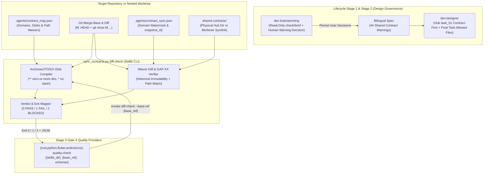
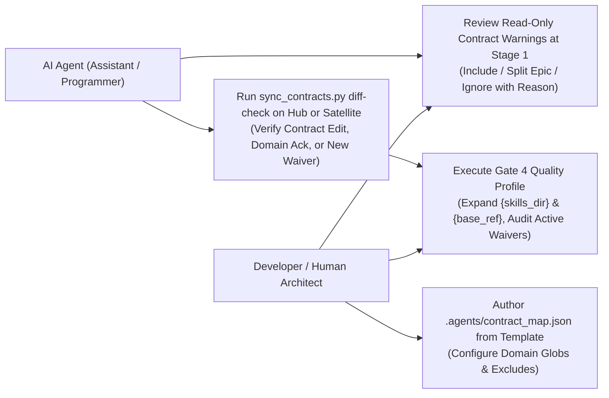

# Contract Diff Gate High-Level Design

## Table of Contents

- [Meta Data](#meta-data)
- [Background](#background)
- [Goals and Non-Goals](#goals-and-non-goals)
- [Architecture and Technical Design](#architecture-and-technical-design)
- [Integration Test Plan and Boundary Matrix](#integration-test-plan-and-boundary-matrix)
- [Verification Environment](#verification-environment)
- [Shared Contract Impact](#shared-contract-impact)
- [Comprehensive BDD Scenario Coverage](#comprehensive-bdd-scenario-coverage)
- [Rollout Strategy and Mitigation](#rollout-strategy-and-mitigation)
- [Kanban Tasks Breakdown](#kanban-tasks-breakdown)

## Meta Data

- **Epic name**: `contract_diff_gate`
- **Status**: Packaged
- **Target release**: Next plugin release (1.19.0)
- **Platform**: Python tooling / agent skill kit
- **Source Spec**: [Approved Contract Diff Gate design](2026-10-31-contract-diff-gate-design.en.md)

## Background

While `sync_contracts.py check --strict` verifies that a target repository has acknowledged the latest canonical contract snapshot in `.agents/contract_sync.json`, it cannot detect silent reverse drift: a branch or epic that modifies contract-bearing routes, DTOs, schemas, or worker adapters while leaving `shared-contracts/<domain>/` (in Hub mode) or domain-level acknowledgement (in Satellite mode) untouched.

In addition:
1. During `dev-brainstorming` (Stage 1), contract drift or missing code coverage discovered by `sync_contracts.py check` / `brief` previously lacked a mandatory human confirmation gate per warning before Gate 1 approval, risking unacknowledged drift or accidental in-session contract edits.
2. Across the five platform quality providers (`rust`, `python`, `flutter`, `android`, `ios`), `resources/schemas/*-quality.schema.json` enforced `"additionalProperties": false` without declaring `contracts`, `contracts_<domain>`, or `contract_diff` (and lacked `db_hygiene` on `rust-quality.schema.json`), while `{skills_dir}`, `{base_ref}`, and exit-code `2` (`BLOCKED`) mapping were not uniformly documented across the provider family.

This epic delivers `sync_contracts.py diff-check`, the `.agents/contract_map.json` reference template and anchored POSIX glob engine, path-scoped immutable waiver diff evaluation, the read-only brainstorming warning confirmation gate, and unified quality provider schema/placeholder support across `ai-agent-tools`.

## Goals and Non-Goals

### Goals

- Extend `skills/sync-shared-contracts/resources/scripts/sync_contracts.py` with the `diff-check` subcommand returning deterministic exit codes `0` (`PASS`), `1` (`FAIL`), and `2` (`BLOCKED`) across `merge-base(effective_base_ref, HEAD)..HEAD` via NUL-delimited `git diff --no-ext-diff --no-renames --name-only -z M..HEAD` using Python's standard library only.
- Validate `.agents/contract_map.json` (`schema_version == 1`, `base_ref`, `domains` with `paths`/`exclude`, optional `waivers`), compile repository-relative POSIX globs into full-path anchored regular expressions matching `task_contract.py` (`**/` matches zero or more directory levels; `*` and `?` never cross `/`), and evaluate domain obligations across the union of baseline (`M:.agents/contract_map.json`, when present) and `HEAD` domain mappings (preserving each version's exclusions independently, failing when a deleted baseline domain has changed files, and bootstrapping cleanly when absent at `M`).
- Enforce **Hub diff rules**: every changed file matched by `domains[D]` must be covered either by a canonical edit under `shared-contracts/<D>/` (`api_contract.md`, `architecture_and_flow.md`, or `gaps_and_rfcs.md`) in `M..HEAD`, or by a newly added path-matching waiver for domain `D`.
- Enforce **Satellite diff rules**: every changed file matched by `domains[D]` must be covered either by an added/updated `domains[D]` entry in `.agents/contract_sync.json` within `M..HEAD` whose `HEAD` `snapshot_id` equals the live `shared-contracts` `snapshot_id`, or by a newly added path-matching waiver for domain `D` (verifying `W.gap` in `gaps_and_rfcs.md` when non-null).
- Enforce **Immutable Historical Waivers**: compare `HEAD` waivers against `git show <M>:.agents/contract_map.json`; reject mutated historical waiver IDs (`1` `FAIL`), fail closed on malformed historical maps (`2` `BLOCKED`), allow removing obsolete waivers, and print all active newly added waivers in text and JSON output.
- Ship `skills/setup-shared-contracts/resources/templates/contract_map.json.tmpl` and document manual glob setup in `skills/setup-shared-contracts/SKILL.md`.
- Update `skills/dev-brainstorming/SKILL.md` (read-only check & warn only; mandatory human decision per warning persisted under `## Shared Contract Warnings` / `## Cảnh báo Shared Contract`) and `skills/dev-designer/SKILL.md` (consuming warnings, preserving Hub `task_01` Contract-First rule, and adding `.agents/contract_sync.json` and `.agents/contract_map.json` to the final task's `Allowed files` before Gate 4).
- Align all five quality providers (`rust`, `python`, `flutter`, `android`, `ios`) for `contracts`, `contracts_<domain>`, `contract_diff` (plus `db_hygiene` in `rust-quality.schema.json`), `{skills_dir}` and `{base_ref}` placeholder expansion, and exit-code `2` -> `BLOCKED` mapping.

### Non-Goals

- AST or regex parsing of application source code to infer routes or DTOs automatically (`brief` retains heuristic token scanning).
- Proving semantic business-logic equivalence between source code and contract prose (`ack` remains a human-reviewed declaration).
- Committing changes directly to downstream repositories (`D3Nexus`, `lyrics-sync`, `nexus`) during this epic.

## Architecture and Technical Design

### High-Level Architecture



### Use Cases



### Sequence Diagram

```mermaid
sequenceDiagram
    participant Dev as Human Architect
    participant Brain as dev-brainstorming / dev-designer
    participant Git as Git Repo / Worktree (M..HEAD)
    participant CLI as sync_contracts.py diff-check
    participant Gate as Gate 4 (*-quality-check)

    Brain->>CLI: Stage 1 read-only check & brief (never edit contract / never ack)
    CLI-->>Brain: Drift & MISSING_IN_CODE warnings + live snapshot_id
    Brain->>Dev: Present warnings and pause for explicit decision per warning
    Dev-->>Brain: Confirm include / split follow-up epic / ignore with rationale
    Brain->>Brain: Persist ## Shared Contract Warnings (Gate 1) & plan task_01 + final task (Gate 2)
    Note over Git,Gate: Stage 3 implementation commits task_01..task_N (including ack / new waivers)
    Gate->>CLI: Invoke diff-check --base-ref <effective_base_ref> [--json]
    CLI->>Git: Check clean tracked tree & resolve M = merge-base(base_ref, HEAD)
    CLI->>Git: Read HEAD & M:.agents/contract_map.json + diff --no-ext-diff --no-renames --name-only -z M..HEAD
    CLI->>Git: Match union(M, HEAD) domains; Hub checks shared-contracts/<D>/* diff; Satellite checks contract_sync.json + live snapshot_id
    CLI->>Git: Validate immutable old waivers, path-match new waivers, verify GAP-XX in gaps_and_rfcs.md
    CLI-->>Gate: Emit PASS (0), FAIL (1), or BLOCKED (2) + active_waivers report
    Gate-->>Dev: Render Gate 4 verdict & surface active_waivers for Gate 4 / Gate 5 review
```

## Integration Test Plan and Boundary Matrix

Integration test roots: skills/sync-shared-contracts/resources/scripts/, skills/rust-quality-check/resources/scripts/, skills/python-quality-check/resources/scripts/, skills/flutter-quality-check/resources/scripts/, skills/android-quality-check/resources/scripts/, skills/ios-quality-check/resources/scripts/, scripts/

Protected paths: .agents/quality/**, .devtool/epic/contract_diff_gate/bdd_scenarios.en.md, .devtool/epic/contract_diff_gate/bdd_scenarios.vi.md

Integration results: python3 scripts/run_unittest_junit.py --junitxml build/test-results/contract-diff-gate.xml skills/sync-shared-contracts/resources/scripts/test_sync_contracts.py skills/rust-quality-check/resources/scripts/test_validate_rust_quality.py skills/python-quality-check/resources/scripts/test_validate_python_quality.py skills/flutter-quality-check/resources/scripts/test_validate_flutter_quality.py skills/android-quality-check/resources/scripts/test_validate_android_quality.py skills/ios-quality-check/resources/scripts/test_validate_ios_quality.py scripts/test_lifecycle_document_contract.py -> build/test-results/contract-diff-gate.xml

| Component | Test File | Test Cases | Target Boundary |
|---|---|---|---|
| Anchored Glob & Map Schema | `test_sync_contracts.py` | `test_cdg_ec_01_*`, `test_cdg_st_04_*`, `test_cdg_fr_01_*` | Multi-level `**/` POSIX globs, excludes, union(`M`, `HEAD`) domain mappings, bootstrap, and `contract_map.json` validation |
| Hub & Satellite Diff Gate | `test_sync_contracts.py` | `test_cdg_hp_01_*`, `test_cdg_hp_02_*`, `test_cdg_ec_02_*`, `test_cdg_ec_03_*`, `test_cdg_ec_05_*` | Temporary git repos testing `--no-renames -z` `M..HEAD` diffs, renames/quoted paths, canonical contract edits, and domain `ack` |
| Waiver Diff & GAP Audit | `test_sync_contracts.py` | `test_cdg_ec_04_*`, `test_cdg_st_01_*`, `test_cdg_st_02_*`, `test_cdg_st_03_*` | New path-scoped waivers, partial coverage failure, historical waiver immutability, and `GAP-XX` ledger lookup |
| Worktree & Fail-Closed Guards | `test_sync_contracts.py` | `test_cdg_ar_01_*`, `test_cdg_ar_02_*`, `test_cdg_fr_02_*` | Nested `.worktrees/<epic>` symlink resolution, dirty tracked tree detection, broken symlinks, and bad `base_ref` |
| Quality Providers & Schemas | `test_validate_*_quality.py` | `test_cdg_hp_03_*` | JSON schema and validator support for `contracts`, `contracts_<domain>`, `contract_diff`, `db_hygiene`, `{skills_dir}`, `{base_ref}` |
| Lifecycle & Release Harness | `test_lifecycle_document_contract.py` | `test_cdg_hp_04_*` | `dev-brainstorming`, `dev-designer`, `setup-shared-contracts`, `sync-shared-contracts` docs and `scripts/verify.sh` |

## Verification Environment

- **Runtime**: Python 3.11+ (Standard Library only: `argparse`, `datetime`, `hashlib`, `json`, `os`, `pathlib`, `re`, `subprocess`, `sys`, `tempfile`, `unittest`).
- **Isolation**: Every unit and integration test creates disposable git repositories and worktrees inside `tempfile.TemporaryDirectory()` with local `git config` settings; zero network calls, zero live database connections, and zero mutations to sibling repositories (`D3Nexus`, `lyrics-sync`, `nexus`).
- **Environment Variables (`Needs`)**: None (`—`).
- **Tooling & Lint**: `ruff check` and `mypy` for Python scripts, `check_document.py` for Markdown/Mermaid/TOC parity, and `bash scripts/verify.sh` for end-to-end plugin kit verification.

## Shared Contract Impact

`None — self-contained developer tooling skill (governs and audits shared contracts across target repositories without modifying canonical shared-contracts/ schemas in this repository)`.

## Comprehensive BDD Scenario Coverage

Full Gherkin scenarios across all 5 mandatory dimensions are maintained in `bdd_scenarios.en.md` and `bdd_scenarios.vi.md`:

- **Dimension 1 — Happy Paths**:
  - `[CDG-HP-01]`: Hub mapped file change covered by canonical `shared-contracts/<domain>/` update exits `0` (`PASS`).
  - `[CDG-HP-02]`: Satellite mapped file change covered by fresh domain-level `ack` matching live `snapshot_id` exits `0` (`PASS`).
  - `[CDG-HP-03]`: All five `*-quality-check` provider schemas, validators, and docs accept `contracts`, `contracts_<domain>`, `contract_diff` (plus `db_hygiene` on Rust), `{skills_dir}`, `{base_ref}`, and `2 -> BLOCKED`.
  - `[CDG-HP-04]`: Lifecycle skill contracts (`dev-brainstorming`, `dev-designer`, `setup-shared-contracts`, `sync-shared-contracts`) and `scripts/verify.sh` pass end-to-end.
- **Dimension 2 — Edge Cases and Boundaries**:
  - `[CDG-EC-01]`: Anchored POSIX glob compiler matches zero- and multi-directory `**/`, enforces single-segment `*`/`?`, and applies `exclude` precedence.
  - `[CDG-EC-02]`: Empty diff (`merge-base == HEAD`) or unmapped-only file changes exit `0` (`PASS`).
  - `[CDG-EC-03]`: `--base-ref` CLI override precedence and repeatable `--domain` filter (exiting `2` `BLOCKED` on unknown domain).
  - `[CDG-EC-04]`: Newly added path-scoped waivers with `gap: null` or documented `GAP-XX` cover matching files, surface in `active_waivers`, and exit `0` (`PASS`).
  - `[CDG-EC-05]`: NUL-delimited `--no-renames -z` diff detects renames out of mapped directories and filenames requiring Git C-quoting across both Hub and Satellite repositories.
- **Dimension 3 — State Transitions**:
  - `[CDG-ST-01]`: Uncovered mapped file changes and partial waivers leaving a sibling mapped file uncovered transition verdict to `1` (`FAIL`).
  - `[CDG-ST-02]`: Historical waivers at `merge-base` do not mask new edits (`1` `FAIL`), mutating a historical waiver ID exits `1` (`FAIL`), and deleting an obsolete historical waiver exits `0` (`PASS`).
  - `[CDG-ST-03]`: Satellite `ack` touching only another domain `D2`, stale `snapshot_id` at `HEAD`, or waiver citing a nonexistent `GAP-999` exits `1` (`FAIL`).
  - `[CDG-ST-04]`: Baseline-union domain mapping rejects self-exempting `exclude` additions, glob narrowing, and domain deletions when baseline-mapped files change (`1` `FAIL`), while allowing untouched domain retirement (`0` `PASS`) and first-time bootstrap when `M:.agents/contract_map.json` is absent.
- **Dimension 4 — Async and Multi-Repo Concurrency**:
  - `[CDG-AR-01]`: Running `diff-check` inside a nested `.worktrees/<epic>` Satellite worktree resolves outbound relative symlinks via the primary repository root and exits `0` (`PASS`).
  - `[CDG-AR-02]`: Dirty tracked working tree (staged or unstaged tracked edits, ignoring untracked build outputs) fails closed with exit `2` (`BLOCKED`).
- **Dimension 5 — Failures and Storage Resilience**:
  - `[CDG-FR-01]`: Missing or schema-invalid `.agents/contract_map.json` at `HEAD` or corrupted JSON in `M:.agents/contract_map.json` fails closed with exit `2` (`BLOCKED`).
  - `[CDG-FR-02]`: Unresolvable `base_ref` or missing/dangling/circular `shared-contracts` topology fails closed with exit `2` (`BLOCKED`).

## Rollout Strategy and Mitigation

- **Phase 1 (This Epic — `ai-agent-tools`)**: Ship `sync_contracts.py diff-check`, `contract_map.json.tmpl`, lifecycle skill updates, and all five quality provider schema/placeholder updates; verify with `bash scripts/verify.sh` and publish plugin release `1.19.0` (after explicit user approval to push).
- **Phase 2 (Downstream Per-Repo Epics)**: Adopt `.agents/contract_map.json` and wire `contract_diff` into `D3Nexus`, `lyrics-sync`, and `nexus` in separate per-repository epics.
- **Rollback**: Reverting the epic merge commit in `ai-agent-tools` cleanly restores `sync_contracts.py`, lifecycle skill prose, and provider schemas without breaking existing `check`/`brief`/`ack` watermarks.

## Kanban Tasks Breakdown

- [Task 1: Implement Contract Map Validator, Anchored Glob Matcher, and sync_contracts.py diff-check Engine](task_1_contract_map_and_diff_check_cli.md) — Covers: `[CDG-HP-01]`, `[CDG-HP-02]`, `[CDG-EC-01]`, `[CDG-EC-02]`, `[CDG-EC-03]`, `[CDG-EC-04]`, `[CDG-EC-05]`, `[CDG-ST-01]`, `[CDG-ST-02]`, `[CDG-ST-03]`, `[CDG-ST-04]`, `[CDG-AR-01]`, `[CDG-AR-02]`, `[CDG-FR-01]`, `[CDG-FR-02]`
- [Task 2: Align Quality Provider Schemas, {skills_dir} and {base_ref} Placeholders, and BLOCKED Exit Mapping](task_2_quality_providers_schemas_and_placeholders.md) — Covers: `[CDG-HP-03]`
- [Task 3: Update Brainstorming, Designer, Shared-Contract Skill Docs, and Lifecycle Contract Suite](task_3_lifecycle_skills_docs_and_verify_harness.md) — Covers: `[CDG-HP-04]`

