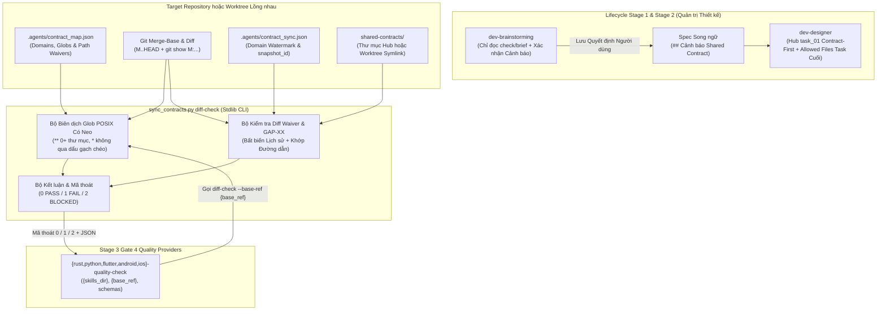
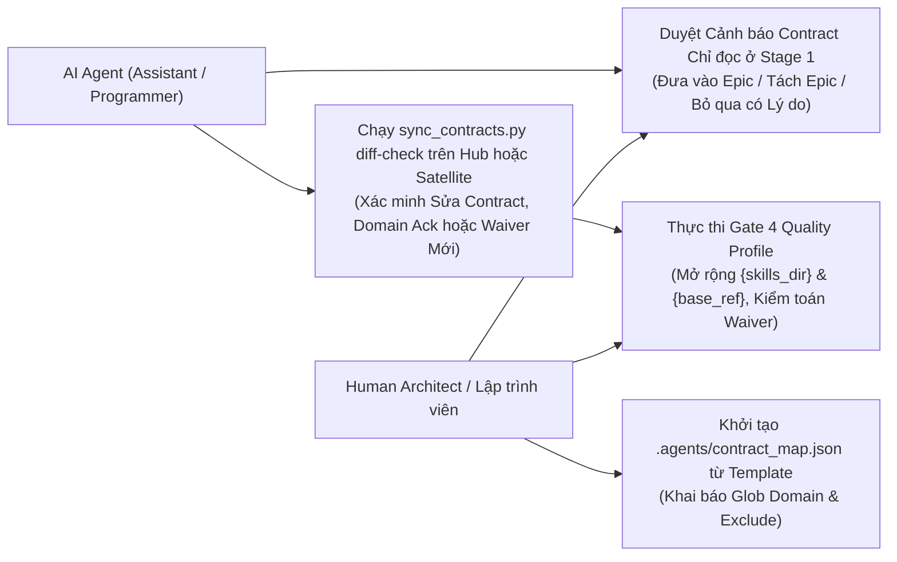

# Thiết Kế Chi Tiết Contract Diff Gate

## Mục lục

- [Meta Data](#meta-data)
- [Bối cảnh](#bối-cảnh)
- [Mục tiêu và Ngoài phạm vi](#mục-tiêu-và-ngoài-phạm-vi)
- [Kiến trúc và Thiết kế Kỹ thuật](#kiến-trúc-và-thiết-kế-kỹ-thuật)
- [Kế hoạch Kiểm thử Tích hợp và Ma trận Ranh giới](#kế-hoạch-kiểm-thử-tích-hợp-và-ma-trận-ranh-giới)
- [Môi trường Xác minh](#môi-trường-xác-minh)
- [Tác động Hợp đồng Dùng chung](#tác-động-hợp-đồng-dùng-chung)
- [Độ bao phủ Kịch bản BDD Toàn diện](#độ-bao-phủ-kịch-bản-bdd-toàn-diện)
- [Chiến lược Triển khai và Giảm thiểu Rủi ro](#chiến-lược-triển-khai-và-giảm-thiểu-rủi-ro)
- [Phân rã Công việc Kanban](#phân-rã-công-việc-kanban)

## Meta Data

- **Tên Epic**: `contract_diff_gate`
- **Trạng thái**: Packaged
- **Phiên bản đích**: Bản phát hành plugin tiếp theo (1.19.0)
- **Nền tảng**: Python tooling / agent skill kit
- **Spec gốc**: [Thiết kế Contract Diff Gate đã duyệt](2026-10-31-contract-diff-gate-design.vi.md)

## Bối cảnh

Dù `sync_contracts.py check --strict` chứng minh được rằng repo đích đã xác nhận (`ack`) snapshot contract mới nhất trong `.agents/contract_sync.json`, lệnh này không phát hiện được chiều lệch ngược âm thầm: một nhánh hoặc epic sửa đổi các route, DTO, schema hoặc worker adapter mang tính hợp đồng nhưng giữ nguyên `shared-contracts/<domain>/` (ở chế độ Hub) hoặc không cập nhật `ack` cấp domain (ở chế độ Satellite).

Bên cạnh đó:
1. Ở bước `dev-brainstorming` (Stage 1), các cảnh báo drift contract hoặc mục `MISSING_IN_CODE` từ `sync_contracts.py check` / `brief` trước đây chưa có cổng xác nhận bắt buộc của con người cho từng cảnh báo trước khi qua Gate 1, dẫn tới nguy cơ bỏ sót cảnh báo hoặc tự ý sửa contract ngay trong lúc brainstorm.
2. Trên cả năm quality provider (`rust`, `python`, `flutter`, `android`, `ios`), các file `resources/schemas/*-quality.schema.json` đặt `"additionalProperties": false` nhưng chưa khai báo `contracts`, `contracts_<domain>` và `contract_diff` (đồng thời thiếu `db_hygiene` trên `rust-quality.schema.json`), cũng như chưa đồng bộ tài liệu về `{skills_dir}`, `{base_ref}` và quy tắc ánh xạ mã thoát `2` (`BLOCKED`).

Epic này bổ sung lệnh `sync_contracts.py diff-check`, mẫu tham chiếu `.agents/contract_map.json` cùng bộ khớp glob POSIX có neo, cơ chế kiểm tra diff waiver bất biến theo đường dẫn, cổng xác nhận cảnh báo chỉ đọc ở brainstorming, và đồng bộ toàn diện schema/placeholder cho cả năm quality provider trong `ai-agent-tools`.

## Mục tiêu và Ngoài phạm vi

### Mục tiêu

- Mở rộng `skills/sync-shared-contracts/resources/scripts/sync_contracts.py` với subcommand `diff-check` trả về mã thoát tất định `0` (`PASS`), `1` (`FAIL`) và `2` (`BLOCKED`) trên khoảng `merge-base(effective_base_ref, HEAD)..HEAD` qua lệnh phân tách NUL `git diff --no-ext-diff --no-renames --name-only -z M..HEAD`, chỉ dùng thư viện chuẩn Python.
- Kiểm tra tính hợp lệ của `.agents/contract_map.json` (`schema_version == 1`, `base_ref`, `domains` chứa `paths`/`exclude`, `waivers` tùy chọn), biên dịch glob POSIX tương đối thành biểu thức chính quy neo toàn đường dẫn theo chuẩn `task_contract.py` (`**/` khớp 0 hoặc nhiều cấp thư mục; `*` và `?` không vượt qua `/`), và đánh giá nghĩa vụ domain trên hợp (union) của bản đồ baseline (`M:.agents/contract_map.json`, khi đã tồn tại) và bản đồ `HEAD` (giữ độc lập `exclude` của từng phiên bản, trả `FAIL` khi xóa domain baseline có file thay đổi, và bootstrap sạch khi chưa có map ở `M`).
- Thực thi **quy tắc diff tại Hub**: mọi file thay đổi khớp `domains[D]` phải được bao phủ bởi thay đổi trên ít nhất một file chuẩn dưới `shared-contracts/<D>/` (`api_contract.md`, `architecture_and_flow.md` hoặc `gaps_and_rfcs.md`) trong `M..HEAD`, hoặc bởi một waiver mới thêm có `paths` khớp file đó trong domain `D`.
- Thực thi **quy tắc diff tại Satellite**: mọi file thay đổi khớp `domains[D]` phải được bao phủ bởi mục `domains[D]` mới thêm hoặc cập nhật trong `.agents/contract_sync.json` thuộc `M..HEAD` có `snapshot_id` ở `HEAD` bằng đúng `snapshot_id` hiện hành của `shared-contracts`, hoặc bởi một waiver mới thêm có `paths` khớp file đó trong domain `D` (kèm kiểm tra `W.gap` trong `gaps_and_rfcs.md` khi khác `null`).
- Thực thi **tính bất biến của waiver lịch sử**: đối chiếu danh sách waiver ở `HEAD` với `git show <M>:.agents/contract_map.json`; từ chối hành vi sửa nội dung ID waiver cũ (`1` `FAIL`), dừng an toàn khi file map lịch sử lỗi cú pháp (`2` `BLOCKED`), cho phép xóa waiver cũ hết hiệu lực, và in đầy đủ các waiver mới đang kích hoạt ở cả đầu ra text lẫn JSON.
- Cung cấp file mẫu `skills/setup-shared-contracts/resources/templates/contract_map.json.tmpl` và hướng dẫn cấu hình glob thủ công trong `skills/setup-shared-contracts/SKILL.md`.
- Cập nhật `skills/dev-brainstorming/SKILL.md` (chỉ kiểm tra và cảnh báo ở chế độ đọc; bắt buộc con người quyết định từng cảnh báo và lưu vào `## Shared Contract Warnings` / `## Cảnh báo Shared Contract`) cùng `skills/dev-designer/SKILL.md` (đọc mục cảnh báo, giữ nguyên quy tắc Contract-First ở `task_01` của Hub, và đưa `.agents/contract_sync.json` cùng `.agents/contract_map.json` vào `Allowed files` của task cuối trước Gate 4).
- Đồng bộ cả năm quality provider (`rust`, `python`, `flutter`, `android`, `ios`) cho `contracts`, `contracts_<domain>`, `contract_diff` (cộng thêm `db_hygiene` trong `rust-quality.schema.json`), phép thế `{skills_dir}` và `{base_ref}`, cùng quy tắc ánh xạ mã thoát `2` -> `BLOCKED`.

### Ngoài phạm vi

- Không phân tích cú pháp AST hay regex trên mã nguồn ứng dụng để tự suy diễn route hoặc DTO (việc quét token heuristic vẫn thuộc lệnh `brief`).
- Không chứng minh tương đương ngữ nghĩa của logic nghiệp vụ giữa mã nguồn và văn bản contract (`ack` vẫn là tuyên bố có con người duyệt).
- Không tự ý tạo commit trên các repo vệ tinh/đích (`D3Nexus`, `lyrics-sync`, `nexus`) trong phạm vi epic này.

## Kiến trúc và Thiết kế Kỹ thuật

### Kiến trúc Tổng thể



### Sơ đồ Use Cases



### Sơ đồ Tuần tự (Sequence Diagram)

```mermaid
sequenceDiagram
    participant Dev as Human Architect
    participant Brain as dev-brainstorming / dev-designer
    participant Git as Git Repo / Worktree (M..HEAD)
    participant CLI as sync_contracts.py diff-check
    participant Gate as Gate 4 (*-quality-check)

    Brain->>CLI: Stage 1 chạy chỉ đọc check & brief (không sửa contract / không ack)
    CLI-->>Brain: Danh sách cảnh báo drift, MISSING_IN_CODE & live snapshot_id
    Brain->>Dev: Trình bày cảnh báo và dừng chờ quyết định cho từng mục
    Dev-->>Brain: Xác nhận đưa vào epic / tách epic kế tiếp / bỏ qua kèm lý do
    Brain->>Brain: Lưu ## Cảnh báo Shared Contract (Gate 1) & lập task_01 + task cuối (Gate 2)
    Note over Git,Gate: Stage 3 commit các task_01..task_N (gồm ack / waiver mới nếu có)
    Gate->>CLI: Gọi diff-check --base-ref <effective_base_ref> [--json]
    CLI->>Git: Kiểm tra cây tracked sạch & tìm M = merge-base(base_ref, HEAD)
    CLI->>Git: Đọc HEAD & M:.agents/contract_map.json + diff --no-ext-diff --no-renames --name-only -z M..HEAD
    CLI->>Git: Khớp domain theo union(M, HEAD); Hub kiểm tra diff shared-contracts/<D>/*; Satellite đối chiếu contract_sync.json + live snapshot_id
    CLI->>Git: Kiểm tra bất biến waiver cũ, khớp đường dẫn waiver mới, xác thực GAP-XX trong gaps_and_rfcs.md
    CLI-->>Gate: Trả về PASS (0), FAIL (1), hoặc BLOCKED (2) + báo cáo active_waivers
    Gate-->>Dev: Xuất kết quả Gate 4 & hiển thị active_waivers cho bước duyệt Gate 4 / Gate 5
```

## Kế hoạch Kiểm thử Tích hợp và Ma trận Ranh giới

Integration test roots: skills/sync-shared-contracts/resources/scripts/, skills/rust-quality-check/resources/scripts/, skills/python-quality-check/resources/scripts/, skills/flutter-quality-check/resources/scripts/, skills/android-quality-check/resources/scripts/, skills/ios-quality-check/resources/scripts/, scripts/

Protected paths: .agents/quality/**, .devtool/epic/contract_diff_gate/bdd_scenarios.en.md, .devtool/epic/contract_diff_gate/bdd_scenarios.vi.md

Integration results: python3 scripts/run_unittest_junit.py --junitxml build/test-results/contract-diff-gate.xml skills/sync-shared-contracts/resources/scripts/test_sync_contracts.py skills/rust-quality-check/resources/scripts/test_validate_rust_quality.py skills/python-quality-check/resources/scripts/test_validate_python_quality.py skills/flutter-quality-check/resources/scripts/test_validate_flutter_quality.py skills/android-quality-check/resources/scripts/test_validate_android_quality.py skills/ios-quality-check/resources/scripts/test_validate_ios_quality.py scripts/test_lifecycle_document_contract.py -> build/test-results/contract-diff-gate.xml

| Thành phần | File Kiểm thử | Kịch bản Kiểm thử | Ranh giới Mục tiêu |
|---|---|---|---|
| Glob Có Neo & Schema Map | `test_sync_contracts.py` | `test_cdg_ec_01_*`, `test_cdg_st_04_*`, `test_cdg_fr_01_*` | Glob POSIX đa tầng `**/`, `exclude`, hợp domain `union(M, HEAD)`, bootstrap và kiểm tra `contract_map.json` |
| Cổng Diff Hub & Satellite | `test_sync_contracts.py` | `test_cdg_hp_01_*`, `test_cdg_hp_02_*`, `test_cdg_ec_02_*`, `test_cdg_ec_03_*`, `test_cdg_ec_05_*` | Repo git tạm kiểm thử diff `--no-renames -z` `M..HEAD`, đổi tên/tên file quoting, sửa contract chuẩn và domain `ack` |
| Diff Waiver & Kiểm toán GAP | `test_sync_contracts.py` | `test_cdg_ec_04_*`, `test_cdg_st_01_*`, `test_cdg_st_02_*`, `test_cdg_st_03_*` | Waiver mới theo đường dẫn, lỗi bao phủ thiếu file cùng domain, bất biến waiver lịch sử và tra cứu `GAP-XX` |
| Worktree & Bảo vệ Fail-Closed | `test_sync_contracts.py` | `test_cdg_ar_01_*`, `test_cdg_ar_02_*`, `test_cdg_fr_02_*` | Phân giải symlink trong `.worktrees/<epic>`, phát hiện cây tracked bẩn, symlink đứt và `base_ref` không hợp lệ |
| Quality Providers & Schemas | `test_validate_*_quality.py` | `test_cdg_hp_03_*` | Hỗ trợ JSON schema và validator cho `contracts`, `contracts_<domain>`, `contract_diff`, `db_hygiene`, `{skills_dir}`, `{base_ref}` |
| Lifecycle & Harness Phát hành | `test_lifecycle_document_contract.py` | `test_cdg_hp_04_*` | Tài liệu `dev-brainstorming`, `dev-designer`, `setup-shared-contracts`, `sync-shared-contracts` và `scripts/verify.sh` |

## Môi trường Xác minh

- **Môi trường chạy**: Python 3.11+ (Chỉ dùng Thư viện Tiêu chuẩn: `argparse`, `datetime`, `hashlib`, `json`, `os`, `pathlib`, `re`, `subprocess`, `sys`, `tempfile`, `unittest`).
- **Cô lập**: Mọi bài kiểm thử đơn vị và tích hợp đều khởi tạo các kho git và worktree tạm bên trong `tempfile.TemporaryDirectory()` với cấu hình `git config` cục bộ; không gọi mạng, không kết nối cơ sở dữ liệu thật và không chạm tới các repo lân cận (`D3Nexus`, `lyrics-sync`, `nexus`).
- **Biến môi trường (`Needs`)**: Không yêu cầu (`—`).
- **Công cụ & Kiểm chuẩn**: `ruff check` và `mypy` cho các script Python, `check_document.py` cho chuẩn Markdown/Mermaid/TOC song ngữ, và `bash scripts/verify.sh` cho kiểm định toàn bộ plugin kit.

## Tác động Hợp đồng Dùng chung

`None — self-contained developer tooling skill (governs and audits shared contracts across target repositories without modifying canonical shared-contracts/ schemas in this repository)`.

## Độ bao phủ Kịch bản BDD Toàn diện

Các kịch bản Gherkin đầy đủ trên cả 5 chiều bắt buộc được lưu trong `bdd_scenarios.en.md` và `bdd_scenarios.vi.md`:

- **Chiều 1 — Tuyến thực thi thành công**:
  - `[CDG-HP-01]`: Thay đổi file được map trên Hub đi kèm cập nhật `shared-contracts/<domain>/` trả mã thoát `0` (`PASS`).
  - `[CDG-HP-02]`: Thay đổi file được map trên Satellite đi kèm `ack` mới cấp domain khớp `snapshot_id` hiện hành trả mã thoát `0` (`PASS`).
  - `[CDG-HP-03]`: Cả năm provider `*-quality-check` (schema, validator và tài liệu) chấp nhận `contracts`, `contracts_<domain>`, `contract_diff` (cộng `db_hygiene` trên Rust), `{skills_dir}`, `{base_ref}` và ánh xạ `2 -> BLOCKED`.
  - `[CDG-HP-04]`: Ràng buộc tài liệu lifecycle (`dev-brainstorming`, `dev-designer`, `setup-shared-contracts`, `sync-shared-contracts`) và `scripts/verify.sh` vượt qua kiểm tra toàn trình.
- **Chiều 2 — Trường hợp biên và ranh giới**:
  - `[CDG-EC-01]`: Bộ biên dịch glob POSIX có neo khớp `**/` với 0 hoặc nhiều cấp thư mục, giữ `*`/`?` trong một phân đoạn và ưu tiên `exclude`.
  - `[CDG-EC-02]`: Diff rỗng (`merge-base == HEAD`) hoặc chỉ sửa các file nằm ngoài map trả mã thoát `0` (`PASS`).
  - `[CDG-EC-03]`: Thứ tự ưu tiên ghi đè `--base-ref` từ CLI và bộ lọc lặp `--domain` (trả `2` `BLOCKED` khi truyền domain lạ).
  - `[CDG-EC-04]`: Waiver mới khớp đường dẫn với `gap: null` hoặc `GAP-XX` có thật trong sổ cái bao phủ đúng file, xuất hiện trong `active_waivers` và trả mã thoát `0` (`PASS`).
  - `[CDG-EC-05]`: Diff phân tách NUL `--no-renames -z` phát hiện việc đổi tên file thoát khỏi thư mục được map và khớp chính xác tên file bị Git bọc C-quoting trên cả Hub lẫn Satellite.
- **Chiều 3 — Chuyển đổi trạng thái**:
  - `[CDG-ST-01]`: Thay đổi file được map không có bao phủ hoặc waiver chỉ khớp một phần để sót file cùng domain chuyển kết luận sang `1` (`FAIL`).
  - `[CDG-ST-02]`: Waiver lịch sử tại `merge-base` không che chỉnh sửa mới (`1` `FAIL`), sửa nội dung ID waiver cũ trả `1` (`FAIL`), và xóa waiver cũ không còn cần thiết trả `0` (`PASS`).
  - `[CDG-ST-03]`: Lệnh `ack` trên Satellite chỉ chạm domain khác `D2`, `snapshot_id` ở `HEAD` bị cũ, hoặc waiver trích dẫn `GAP-999` không tồn tại đều trả `1` (`FAIL`).
  - `[CDG-ST-04]`: Đánh giá hợp domain mapping với baseline chặn việc tự miễn trừ bằng cách thêm `exclude`, thu hẹp `paths` hoặc xóa domain khi có file baseline thay đổi (`1` `FAIL`), nhưng cho phép gỡ domain không chạm tới (`0` `PASS`) và bootstrap lần đầu khi chưa có `M:.agents/contract_map.json`.
- **Chiều 4 — Bất đồng bộ và đồng thời đa repo**:
  - `[CDG-AR-01]`: Chạy `diff-check` bên trong Satellite worktree lồng `.worktrees/<epic>` phân giải đúng outbound symlink tương đối qua repo gốc chính và trả `0` (`PASS`).
  - `[CDG-AR-02]`: Cây làm việc bẩn trên các file tracked (staged hoặc unstaged, bỏ qua file untracked) dừng an toàn với mã thoát `2` (`BLOCKED`).
- **Chiều 5 — Lỗi và khả năng phục hồi lưu trữ**:
  - `[CDG-FR-01]`: Thiếu hoặc sai schema `.agents/contract_map.json` tại `HEAD` hoặc lỗi cú pháp JSON trong `M:.agents/contract_map.json` dừng an toàn với mã thoát `2` (`BLOCKED`).
  - `[CDG-FR-02]`: Không phân giải được `base_ref` hoặc hỏng topology `shared-contracts` (thiếu, đứt symlink, vòng lặp symlink) dừng an toàn với mã thoát `2` (`BLOCKED`).

## Chiến lược Triển khai và Giảm thiểu Rủi ro

- **Giai đoạn 1 (Epic này — `ai-agent-tools`)**: Hoàn thiện `sync_contracts.py diff-check`, `contract_map.json.tmpl`, cập nhật các skill lifecycle và đồng bộ schema/placeholder cho cả năm quality provider; xác minh bằng `bash scripts/verify.sh` và phát hành plugin `1.19.0` (sau khi người dùng cho phép đẩy lên remote).
- **Giai đoạn 2 (Các Epic Áp dụng Trên Từng Repo Đích)**: Khởi tạo `.agents/contract_map.json` và đấu nối `contract_diff` vào `D3Nexus`, `lyrics-sync` và `nexus` thông qua các epic độc lập trên từng repo.
- **Khôi phục (Rollback)**: Hoàn tác commit merge của epic trong `ai-agent-tools` sẽ đưa `sync_contracts.py`, tài liệu lifecycle và các schema provider về trạng thái trước đó mà không làm hỏng dữ liệu `.agents/contract_sync.json` sẵn có.

## Phân rã Công việc Kanban

- [Task 1: Implement Contract Map Validator, Anchored Glob Matcher, and sync_contracts.py diff-check Engine](task_1_contract_map_and_diff_check_cli.md) — Covers: `[CDG-HP-01]`, `[CDG-HP-02]`, `[CDG-EC-01]`, `[CDG-EC-02]`, `[CDG-EC-03]`, `[CDG-EC-04]`, `[CDG-EC-05]`, `[CDG-ST-01]`, `[CDG-ST-02]`, `[CDG-ST-03]`, `[CDG-ST-04]`, `[CDG-AR-01]`, `[CDG-AR-02]`, `[CDG-FR-01]`, `[CDG-FR-02]`
- [Task 2: Align Quality Provider Schemas, {skills_dir} and {base_ref} Placeholders, and BLOCKED Exit Mapping](task_2_quality_providers_schemas_and_placeholders.md) — Covers: `[CDG-HP-03]`
- [Task 3: Update Brainstorming, Designer, Shared-Contract Skill Docs, and Lifecycle Contract Suite](task_3_lifecycle_skills_docs_and_verify_harness.md) — Covers: `[CDG-HP-04]`

