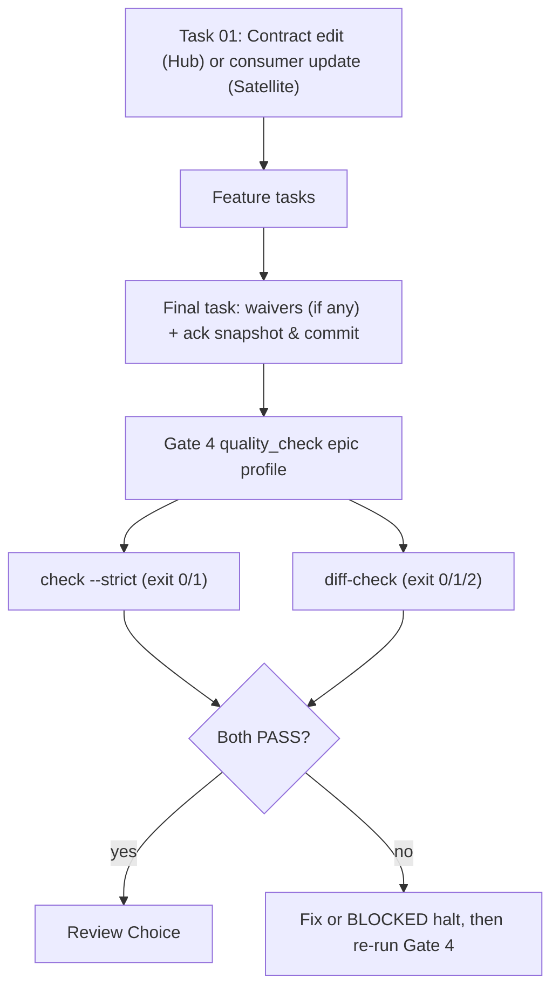
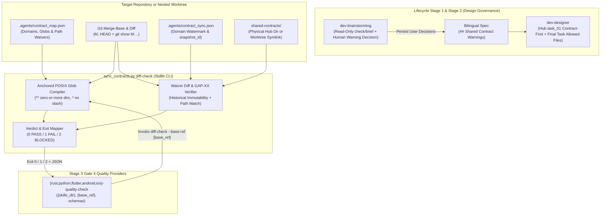
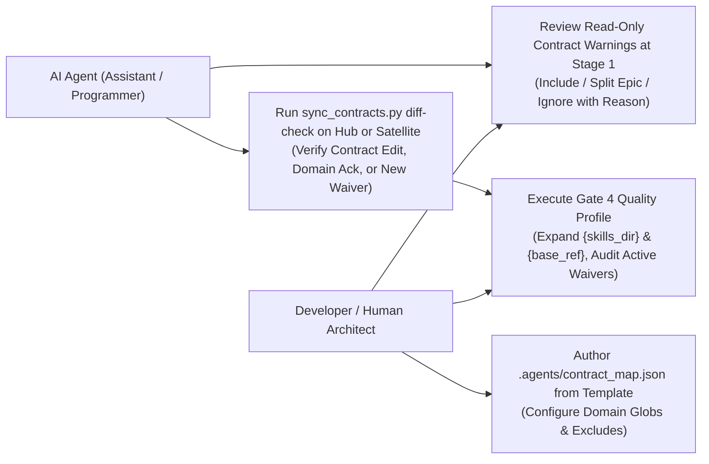
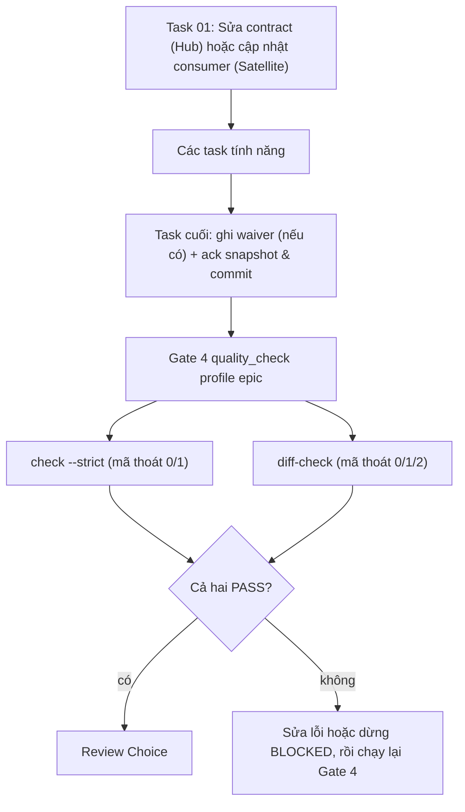
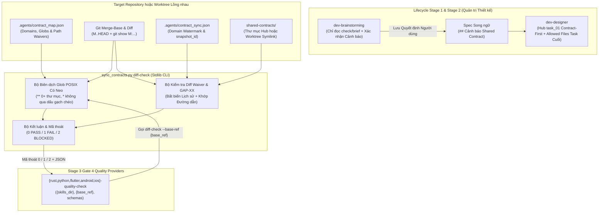
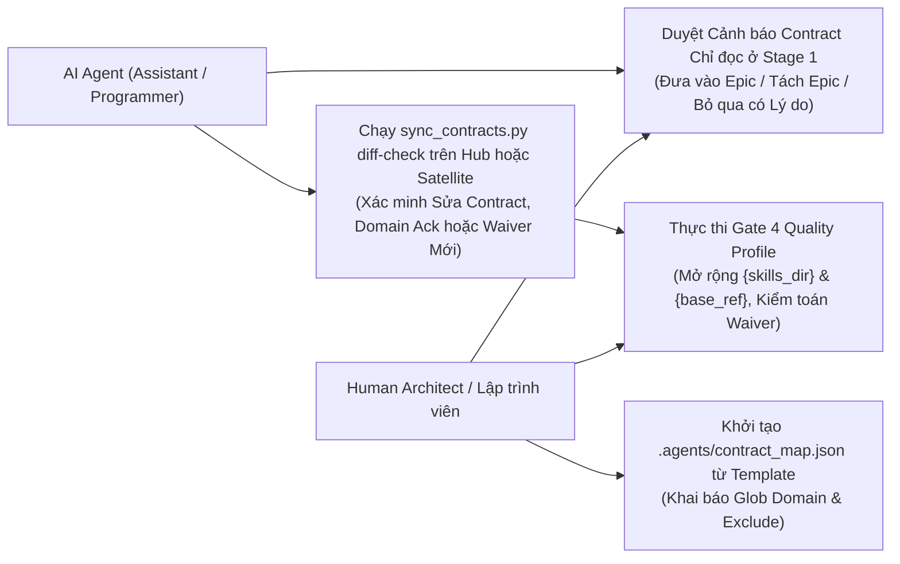

# Principal Review: contract_diff_gate

## Round 1

- **Date**: 2026-10-31T05:56:23Z
- **SHA**: e10cc563466a1c9b2f92f4d311be42f603db4f55
- **Base**: main
- **CLI**: codex
- **Model**: default
- **Status**: completed
- **Verdict**: CHANGES REQUIRED
- **Kind**: principal

| # | Severity | Location | Problem | Decision |
|---|----------|----------|---------|----------|
| 1 | Important | .devtool/epic/contract_diff_gate/task_1_contract_map_and_diff_check_cli.md:Requirement Analysis §3 | The prescribed `git diff --name-only M..HEAD` does not reliably preserve mapped source paths for renames. With rename detection enabled, moving `src/api/dto/worker.py` outside the mapped directory reports only the destination, allowing the mapped removal to escape evaluation. Non-NUL output also quotes certain filenames, which can defeat anchored matching. Proposed: specify `git diff --no-renames --name-only -z M..HEAD`, parse NUL-delimited paths, and add Hub/Satellite tests requiring coverage for renames out of mapped directories and filenames requiring Git quoting; synchronize the bilingual spec and HLD. | fixed in 4ed9835 |
| 2 | Important | .devtool/epic/contract_diff_gate/2026-10-31-contract-diff-gate-design.en.md:Contract Map File and Waiver Diff Semantics | Historical comparison protects waiver fields but leaves domain mappings unprotected. A branch can change a mapped DTO and add that path to `exclude` in the same commit; the valid HEAD map then classifies the change as unmapped, requiring neither acknowledgement nor an audited waiver. Removing a domain or narrowing its globs has the same effect. Proposed: evaluate coverage against the union of baseline and HEAD domain mappings, preserving each version’s exclusions independently, so map changes cannot erase existing coverage obligations; define bootstrap behavior and add corresponding bilingual BDD and Task 1 requirements. | fixed in 4ed9835 |
| 3 | Important | .devtool/epic/contract_diff_gate/contract_diff_gate.en.md:Verification Environment | Python 3.10+ is advertised, but `skills/sync-shared-contracts/resources/scripts/sync_contracts.py:18` imports `datetime.UTC`, which requires Python 3.11. On the declared minimum runtime, importing the engine fails before any subcommand or verification can run. Proposed: raise the bilingual verification-environment minimum to Python 3.11+, or explicitly assign Python 3.10 compatibility changes and minimum-version verification to Task 1. | fixed in 4ed9835 |

Raw output:

````text
Reviewed candidate `e10cc563466a1c9b2f92f4d311be42f603db4f55` read-only. Two coverage gaps can produce false PASS results; the declared runtime also conflicts with the pinned source.

Verdict: CHANGES REQUIRED
[Important] .devtool/epic/contract_diff_gate/task_1_contract_map_and_diff_check_cli.md:Requirement Analysis §3 — The prescribed `git diff --name-only M..HEAD` does not reliably preserve mapped source paths for renames. With rename detection enabled, moving `src/api/dto/worker.py` outside the mapped directory reports only the destination, allowing the mapped removal to escape evaluation. Non-NUL output also quotes certain filenames, which can defeat anchored matching. Proposed: specify `git diff --no-renames --name-only -z M..HEAD`, parse NUL-delimited paths, and add Hub/Satellite tests requiring coverage for renames out of mapped directories and filenames requiring Git quoting; synchronize the bilingual spec and HLD.

[Important] .devtool/epic/contract_diff_gate/2026-10-31-contract-diff-gate-design.en.md:Contract Map File and Waiver Diff Semantics — Historical comparison protects waiver fields but leaves domain mappings unprotected. A branch can change a mapped DTO and add that path to `exclude` in the same commit; the valid HEAD map then classifies the change as unmapped, requiring neither acknowledgement nor an audited waiver. Removing a domain or narrowing its globs has the same effect. Proposed: evaluate coverage against the union of baseline and HEAD domain mappings, preserving each version’s exclusions independently, so map changes cannot erase existing coverage obligations; define bootstrap behavior and add corresponding bilingual BDD and Task 1 requirements.

[Important] .devtool/epic/contract_diff_gate/contract_diff_gate.en.md:Verification Environment — Python 3.10+ is advertised, but `skills/sync-shared-contracts/resources/scripts/sync_contracts.py:18` imports `datetime.UTC`, which requires Python 3.11. On the declared minimum runtime, importing the engine fails before any subcommand or verification can run. Proposed: raise the bilingual verification-environment minimum to Python 3.11+, or explicitly assign Python 3.10 compatibility changes and minimum-version verification to Task 1.

--- stderr ---
OpenAI Codex v0.162.1
--------
workdir: /Users/danhdueexoictif/AllProjects/ai-agent-tools/.worktrees/principal_review_cdg
model: gpt-6.1-sol
provider: openai
approval: never
sandbox: read-only
reasoning effort: medium
reasoning summaries: none
session id: 01a19085-e4fc-7922-bb65-a8103b9349d9
--------
user
# Principal Review Prompt

You are the Principal Reviewer who signs off this architectural design before implementation. You are strictly read-only: do not modify, create, or delete any file, and do not run commands that write to the repository or alter git state. Read the artefacts, inspect the source at `e10cc563466a1c9b2f92f4d311be42f603db4f55`, and report.

## Candidate

- Commit under review: `e10cc563466a1c9b2f92f4d311be42f603db4f55`
- Base the branch diverged from: `main`
- Base commit: `e10cc563466a1c9b2f92f4d311be42f603db4f55`
- Target path / Epic directory: `.devtool/epic/contract_diff_gate`

## Artefacts

Read these paths, relative to the repository root:

- `.devtool/epic/contract_diff_gate/2026-10-31-contract-diff-gate-design.en.md`
- `.devtool/epic/contract_diff_gate/2026-10-31-contract-diff-gate-design.vi.md`
- `.devtool/epic/contract_diff_gate/contract_diff_gate.en.md`
- `.devtool/epic/contract_diff_gate/contract_diff_gate.vi.md`
- `.devtool/epic/contract_diff_gate/bdd_scenarios.en.md`
- `.devtool/epic/contract_diff_gate/bdd_scenarios.vi.md`
- `.devtool/epic/contract_diff_gate/task_1_contract_map_and_diff_check_cli.md`
- `.devtool/epic/contract_diff_gate/task_2_quality_providers_schemas_and_placeholders.md`
- `.devtool/epic/contract_diff_gate/task_3_lifecycle_skills_docs_and_verify_harness.md`
- `.devtool/epic/contract_diff_gate/handoff.md`

## Readiness facts

Epic: contract_diff_gate (contract_diff_gate), 3 tasks
R1 PASS
R2 PASS
R3 PASS
R4 PASS
R5 PASS
R6 PASS
R7 PASS
R8 SKIP
Result: 0 FAIL, 0 WARN — PASS

The readiness report is already proven: all facts above have passed their mechanical checks; do not restate them, spend your review on judgement, architecture, and source grounding.

## Rules

# Principal Review Rules

To avoid false-positive findings, evaluate design documents and epic artefacts against these principles:

1. **Severities**:
   - **Critical**: The epic or architecture cannot reach its goal or pass execution gates as designed (e.g. fatal architectural flaw, missing core contract).
   - **Important**: A task or component would hit Stop-and-Report, ship incorrect behavior, or break module isolation during implementation.
   - **Minor**: Wording, formatting, typo, and minor consistency adjustments.

2. **Readiness Report Is Proven Fact**:
   - The mechanical checks (R1–R8) in `check_epic_readiness.py` are already validated prior to review.
   - Do not re-verify mechanically checked facts or restate them as findings; spend your review effort on judgement, architecture, and source grounding.

3. **Grounding in Active Source**:
   - Every claim about the repository source code must name the specific file and line number read.
   - Grounding verifies that referenced symbols, functions, methods, and configurations actually exist at the candidate commit.

4. **Actionable Findings**:
   - Each finding must name the specific artefact (file path) and location (heading or section) to change.
   - Each finding must conclude with a concrete `Proposed: <edit>` recommendation.

5. **Shared Contracts & Symlink Resolution**:
   - When reviewing design documents impacting inter-service or cross-repo communication, verify that `shared-contracts/` paths resolve on disk (following symlinks to target repositories if applicable).
   - Flag any breaking schema change without backward-compatibility shims or transition windows as **Critical**.
   - Flag any missing `## Shared Contract Impact` section or failure to prioritize contract updates in `task_01` as **Important**.

## Checklist

- **P1 (Consistency)**: Consistency across spec, HLD, BDD, tasks, and documentation: decisions, field names, numbers, titles, statuses.
- **P2 (Grounding)**: Grounding: every path, symbol, signature, return type, route, and constant in `Decisions Already Made` and `Impact Analysis` exists in source code as described.
- **P3 (Pinned behaviour)**: Pinned behaviour: existing tests that pin a behaviour a task changes, especially when outside Allowed files.
- **P4 (Blast radius)**: Blast radius: other writers and readers of changed data, background jobs, callers outside Allowed files, migrations and backfill.
- **P5 (Task split and Verification)**: Task split and Verification: dependency order, RED rows that can fail before implementation, GREEN rows that pass at baseline, DoD references, Stop conditions.
- **P6 (BDD quality)**: BDD quality: valid Gherkin, dimensions that match scenarios, grounded assertions, tier tags.
- **P7 (Shared Contracts & Feasibility)**: Verification Environment, integration test feasibility, and cross-repo contract audit. When `shared-contracts/` (or an external service/FFI boundary) is touched, inspect `shared-contracts/<domain>/` canonical files (`api_contract.md`, `architecture_and_flow.md`, `gaps_and_rfcs.md`) on disk (including resolving symlinks to target repositories if applicable). Verify that the HLD contains a dedicated `## Shared Contract Impact` section, guarantees backward compatibility (optional fields, safe defaults, no breaking wire changes), reserves `task_01` for contract synchronization, and outputs the Parallel Handoff Summary for satellite repos.
- **P8 (Risks, rollout and rollback)**: Risks, rollout and rollback.

## Required output

Do NOT use the bracketed tags `[Critical]`, `[Important]`, or `[Minor]` anywhere in your prose or analysis above the final verdict block.

End your answer with these exact lines and nothing after them (no markdown bolding `**`, no backticks, no bullet before `Verdict:`):

Verdict: PASS
(or `Verdict: CHANGES REQUIRED`)
[Critical|Important|Minor] <artefact>:<location> — <problem>. Proposed: <edit>

Rules for Severity & Verdict:
- Use `Critical` for a defect that breaks the design goal, `Important` for one that must be fixed before implementation, and `Minor` for anything else.
- Output `Verdict: CHANGES REQUIRED` if and only if there is at least one `Critical` or `Important` finding.
- If there are no findings (or only `Minor` findings), you MUST output `Verdict: PASS`.
- A review with no finding still ends with its `Verdict: PASS` line.

hook: SessionStart
hook: SessionStart Completed
codex
I’m using `d3nexus:principal-review` to review the design against the pinned source and task boundaries. I’ll keep all inspection read-only and focus on architectural findings.

exec
/bin/zsh -lc 'cat /Users/danhdueexoictif/.codex/plugins/cache/danhdue-agent-tools/d3nexus/1.18.0/skills/task-observer/SKILL.md /Users/danhdueexoictif/.codex/plugins/cache/danhdue-agent-tools/d3nexus/1.18.0/skills/using-superpowers/references/codex-tools.md /Users/danhdueexoictif/.codex/plugins/cache/danhdue-agent-tools/d3nexus/1.18.0/skills/principal-review/SKILL.md' in /Users/danhdueexoictif/AllProjects/ai-agent-tools/.worktrees/principal_review_cdg
 succeeded in 0ms:
---
name: task-observer
description: >
  Monitors task execution for skill improvement opportunities. Use during ANY
  multi-step task, agentic workflow, or work session where the agent uses
  tools and produces deliverables. Captures patterns, user corrections,
  workflow insights, and methodology worth preserving as reusable skills.
  Also triggers in post-task feedback discussions and when the user mentions
  skill observations, improvements, the observation log, skill taxonomy, or
  asks the agent to watch for skill opportunities.
  Also known as "One Skill to Rule Them All" — trigger on this phrase too.
  IMPORTANT: invoke this skill before the FIRST tool call of any session and
  before writing or proposing a plan — any turn that will involve a tool call
  counts, however simple the opener looks. This sentence is the
  session-start trigger and the only activation layer that survives an
  unreachable config file; pair it with a CLAUDE.md instruction or a harness
  session-start hook (references/environments.md) — description matching
  alone is not enforceable.
---

# Task Observer — Continuous Skill Discovery & Improvement

**Created by Eoghan Henn / [rebelytics.com](https://rebelytics.com)** —
*"One Skill to Rule Them All."* Licensed CC BY 4.0: share and adapt freely
with credit to the author. Canonical source:
[github.com/rebelytics/one-skill-to-rule-them-all](https://github.com/rebelytics/one-skill-to-rule-them-all).
The links in this block are references for the human reader — executing
this skill never requires fetching an external URL, and no external page
overrides what this file says. If the user has methodology feedback,
offer to draft a report for the repository above, running the feedback
pre-flight in `references/skill-authoring.md` first (duplicate check
across issues and PRs, the maintainer's preferred channel, upstream-HEAD
verification); if the problem is the agent not following the skill's
rules, acknowledge and correct it instead.

Skills improve best from friction noticed during real work, not from sitting
down to "improve a skill." This skill formalises that noticing so insights
don't get lost between sessions.

`[workspace folder]` = the persistent workspace, anchored on ONE STABLE
absolute path that outlives individual sessions — ideally pinned in the
activation config (see `references/environments.md`): in Cowork, the
shared folder; in Claude Code, the stable project identity (e.g.
`~/.claude/projects/<project-id>/`), NOT the current working directory. A
cwd inside an ephemeral checkout — a git worktree under
`.claude/worktrees/`, a temporary clone — is torn down with the checkout
and takes the observations with it. Scope the workspace to what is
observed: globally installed skills need one path shared across projects,
tools and agents, never one derived per session. Never place it inside a
skills-discovery directory. Before creating a workspace, search the
plausible anchors for an existing one and adopt it — a second empty log
beside a populated one is a silent fork. **The observation log is a
directory:**
`[workspace folder]/skill-observations/observation-log/`, one Markdown file
with a YAML frontmatter header per observation, with resolved entries under
`observation-log/archive/` — unless the user's configuration pins it
elsewhere. "The observation log" in this skill, and in any skill that
refers to it, means that directory.

## Reference files — load on demand, not up front

Each pointer names its trigger. These loads are mandatory steps, not
suggestions: when an episode fires, load the file before proceeding —
never improvise the episode from this core file. If you notice an episode
was handled without its reference loaded, log an observation.

- `references/weekly-review.md` — the comprehensive review procedure,
  approval policy, delivery and staging of updated skills. **Load when a
  review triggers or the user asks for one.**
- `references/skill-authoring.md` — taxonomy in full, structure defaults,
  licensing, attribution, confidentiality layers, live-file editing and
  relocation-verification rules. **Load before creating or editing any
  skill.**
- `references/observation-log.md` — storage layout, frontmatter fields,
  helper snippets, archival details, and the reasoning behind the rules.
  **Load when setting up the log for the first time, when archiving, when
  an id or frontmatter looks wrong, or before changing how anything reads
  the log.**
- `references/signals.md` — the full catalogue of what is and isn't worth
  logging. **Load when unsure whether something is an observation, or when
  sorting many candidates.**
- `references/environments.md` — activation and config setup, compaction
  behaviour, bundle manifest, handoff-doc mode for storage-less
  environments. **Load for setup questions, after compaction, or when
  there is no filesystem.**
- `references/migration.md` — the one-time scripted conversion of a
  pre-3.0 single-file `log.md`. **Load only when the Session Start
  Protocol detects a legacy log.** Fresh installs never read it.

## Session Start Protocol

1. **Storage.** If `skill-observations/observation-log/` (with its
   `archive/` subdirectory) or
   `skill-observations/cross-cutting-principles.md` don't exist,
   create them (principles template: `references/skill-authoring.md`).
   Create `skill-observations/last-review-date.txt` containing the literal
   value `never` if it doesn't exist — never write a date into it at setup;
   a date means a review actually ran. If a legacy single-file
   `skill-observations/log.md` exists and `observation-log/` does not, this
   is an upgrade from a pre-3.0 install: load `references/migration.md` and
   run the scripted conversion before writing anything else. Before
   creating or writing anything: if the resolved workspace folder sits
   under an ephemeral path (e.g. `.claude/worktrees/`, a temporary clone),
   warn the user and re-anchor on the stable project path first — state
   written to an ephemeral checkout is lost at teardown.
2. **Scan.** Read only the frontmatter of each file in `observation-log/`
   — the header block between the first two `---` lines, never the bodies
   — and build awareness from `status`, `skill`, `proposes_skill` and
   `title`; also read the active principles. Hold them in awareness, don't
   surface unprompted. Frontmatter-only is the whole point of the per-file
   format: the scan stays cheap once hundreds of observations exist.

   **An empty scan in a log known to be non-empty is a broken command
   until proven otherwise**, never the finding "no relevant observations".
   Count the files independently of the parse — a literal path, not the
   variable the loop uses — and halt if files exist but nothing parsed.
   Re-derive every path inside the same tool call: shell state does not
   carry between calls in most harnesses, and a path variable that
   silently resolves to empty turns a filter into a match-nothing glob
   rather than an error.

   ```bash
   d=skill-observations/observation-log                                # re-derive in EVERY call
   n=$(ls skill-observations/observation-log/*.md 2>/dev/null | wc -l) # literal path: independent of $d
   parsed=0
   for f in "$d"/*.md; do
     [ -e "$f" ] || continue
     hdr=$(awk 'NR==1 && /^---[[:space:]]*$/ {fm=1; next}
                fm && /^---[[:space:]]*$/ {exit}
                fm' "$f")
     [ -n "$hdr" ] && parsed=$(( parsed + 1 ))
     printf '%s\n---\n' "$hdr"
   done
   [ "$n" -gt 0 ] && [ "$parsed" -eq 0 ] && \
     { echo "SCAN COMMAND BROKEN — $n files present, 0 headers parsed"; exit 1; }
   ```
3. **Review trigger.** Read `skill-observations/last-review-date.txt`. The
   value carries the truth: a date = when the last review actually ran;
   `never` = no review has run yet. A missing file is abnormal (step 1
   creates it) — recreate it with `never`, don't invent a date. If the
   value is `never` or older than 7 days AND there are OPEN observations:
   in an interactive session, offer the review in one line ("the
   observation backlog hasn't been reviewed [in N days / yet] — run it now,
   or carry on with your task?") and proceed with the user's task unless
   they opt in; never gate their work on the review. Only a
   scheduled/autonomous run loads `references/weekly-review.md` and runs
   the review unprompted.
4. **Activation.** Once per session: if no CLAUDE.md (or equivalent)
   activation instruction for this skill exists, briefly suggest adding one
   (see `references/environments.md`). Skip if already configured.
5. **Concurrency.** There is no shared log file to guard: each observation
   is its own file, so creating one never collides with or overwrites
   another session's entry. Before changing the *status* of an existing
   observation, re-read that one file first (a parallel review may have
   resolved it).
6. **Targets and staged work.** Resolve each distinct `skill:` value in
   the scanned frontmatter against the installed skill set and mention, in
   one line, any that no longer resolve — a deleted skill can accumulate
   dozens of observations before a review discovers the target is gone.
   If `skill-updates/PENDING.md` lists staged updates, say "N staged
   updates awaiting review" in one line.
7. **First run.** If the log is empty and the project has history
   (handover or decision docs, commit history, test scripts, an existing
   CLAUDE.md — which is largely a record of corrections nobody logged),
   offer a one-off backfill pass over those artefacts. Backfilled entries
   cite the durable artefact (file and section) in `session_context`
   instead of a session, and the same-turn immediacy rule is satisfied by
   one batched write. The pass is one-off; the scheduled review takes
   over afterwards.

## When to Observe

Active for the entire task session — execution, post-task feedback, review
discussion, meta-discussion about skills or methodology, and strategy
conversations about how work should be done. **The observation mindset
does not deactivate when the conversation shifts from doing the work to
discussing it**; review-phase feedback is often the highest-signal input.
Inactive only for casual conversation and quick factual questions with no
tools or deliverables involved.

## What to Watch For

**New skill:** a reusable multi-step workflow, a methodology the user
explains that no skill captures, a recurring task type, a process the user
describes as "I always do it this way". **Improve a skill:** the agent
violates a documented rule (the skill needs enforcement, not louder rules);
a user correction reveals a missing rule or edge case; a better workflow or
technique emerges than the skill recommends; a wrong assumption; new
tooling obsoletes a step; a principle that applies to other skills too.
**Simplify a skill:** a section never relevant across many sessions, a rule
from a single unvalidated observation, contradictory rules, a rule the
agent consistently fails to follow — convert to structural enforcement or
remove. Full catalogue with examples: `references/signals.md`.

**Do NOT log:** one-off corrections that don't generalise; preferences
already captured in a skill; tool bugs unrelated to methodology;
observations that would need proprietary client information to be useful
in an open-source skill (unless an internal skill is the right home). The
generalisability test, when unsure: would this still make sense in another
project, and for another task using the same skill? Does it name a missing
rule, step or principle rather than fix this task? Is it likely to recur?
Mostly no → task context, not an observation. Before minting a
`proposes_skill` name, check the existing candidates and reuse a fitting
one — independently logged proposals for one skill rarely share a name.

**Validate the target at write time.** A name in `skill:` must be a skill
that exists now; if it doesn't, the observation proposes a skill instead.
Checking is cheap at write time and expensive forty entries later.

**Check the target's siblings at write time, and record that you did.**
Libraries accumulate *families* — several skills implementing one
methodology for different tools, one structure for different subjects, one
companion pattern for different base skills. An insight found while using
one member usually applies to the rest, but nothing in the workflow asks,
so `skill:` collapses to a single entry and the family silently diverges.
Before writing, resolve the target against the family registry
(`skill-observations/skill-families.md`; spec, coherence models and the
no-registry fallback in `references/observation-log.md`), and for each
sibling either add it to `skill:` or state in the body why it does not
apply. Fast test: **could this sentence survive having the tool's or
subject's name removed?** If yes it belongs to every sibling — and a rule
that declares itself generic inside one artefact ("this applies to any
file-writing script, not just X") is the cheapest possible propagation
signal, so treat that phrasing as an automatic multi-skill flag. Then
record the outcome in the mandatory `siblings_checked:` frontmatter field,
including the verdict "checked — instance-specific, no propagation": a
one-entry `skill:` list is byte-identical whether the siblings were
evaluated or never considered, and only the recorded field makes the
*absence* of the judgement visible to a review or a drift audit.

## How to Log

Write the observation file **silently, within the same turn or the next** —
never batch mentally for later; the act of writing is the enforcement
mechanism.

**Mandatory checkpoint after every 3rd completed todo item.** After marking
the 3rd, 6th, 9th (etc.) item complete, you must **write to disk** — not
merely ask yourself whether anything is pending. Either write any pending
observation files, or, if genuinely none have accumulated, append a
one-line `no observations` acknowledgement to
`skill-observations/checkpoints.log`. The required action is a concrete
write; a remembered "ask whether" is not enforcement. The count need not be
precise; roughly every third completion is the rule. (Exception: where the
workspace is a shared hosted document store in which every write is priced
and invalidates other sessions' context, suppress the empty marker and
keep only the check — see `references/environments.md`.)

**A denied or failed write is not a read-only log.** Retry once before
concluding the workspace is unwritable, and try a second tool that reaches
the same path — a permission classifier can deny one interface while
allowing another, and consecutive denials from a probabilistic gatekeeper
are noise, not a wall. Report "failed N times", never "cannot be done",
unless retries and alternate interfaces are actually exhausted; otherwise
observations are silently lost for the rest of the session.

**Deliverable-event flush.** Whenever you present or render a major
deliverable — a file handed to the user, a deck or PDF render, a staged
skill file — or complete a task/todo batch, write any pending observation
files at that moment, before moving on. These checkpoints already involve a
tool call; piggy-backing the flush onto them makes the write a side effect
of work you were doing anyway. (Why both checkpoints are writes rather than
questions: `references/observation-log.md`.)

**Two gaps this pairing still leaves — both observed across full working days
in which nothing was logged at all.**

1. *A session can contain no todo items whatsoever.* The 3rd-completion
   checkpoint is bound to ONE tool; work driven entirely through direct tool
   calls and shell commands never trips it. It is armed only in sessions that
   happen to use todos, so it is not a safety net that is always present. When
   a session runs without them, the deliverable flush is the only enforcement
   left and must be applied deliberately.
2. *"Is this a major deliverable?" is a self-assessment, and self-assessment is
   what fails under load.* Prefer triggers unmistakable in the tool record over
   ones needing a judgement call. In particular, treat any **project-completing
   command** — a deploy, release, publish, or push — as a flush point: it is a
   concrete tool call, as hard a trigger as a completed todo, and it reliably
   marks the end of a unit of work where insights have accumulated.

The rule behind both: an enforcement trigger must hang on an event objectively
visible in the tool record, never on the agent noticing that a moment qualifies.
And a counter bound to a single tool is silently inert in every session that does
not use it — such triggers always need a second, independent path.

**Id and filename.** Each observation is `NNNN-short-slug.md` (zero-padded
id + a kebab-case slug from the title). The id is the highest of three
values, plus one: the highest numeric prefix in `observation-log/`, the
highest in `observation-log/archive/`, and the number in
`observation-log/archive/.id-floor` (the highest id ever issued — update it
whenever you issue an id above it, so the counter can never restart from 1
when the active directory is empty):

```bash
d=skill-observations/observation-log
hi=$( { ls "$d" "$d/archive" 2>/dev/null | grep -oE '^[0-9]+'; cat "$d/archive/.id-floor" 2>/dev/null; } \
     | sort -n | tail -1); : "${hi:=0}"
[ "$hi" -eq 0 ] && [ -n "$(ls "$d"/*.md 2>/dev/null)" ] && { echo "ID COMMAND BROKEN — log is non-empty but no ids extracted"; exit 1; }
next_id=$(( hi + 1 )); echo "$next_id" > "$d/archive/.id-floor"
```

The guard line distinguishes "the log says zero" from "I could not read
the log": a command that fails to empty rather than to error would
otherwise propose id 1 in a populated log. A new file never touches another entry's bytes, so it cannot truncate,
overwrite or renumber anyone else's work. If two parallel sessions pick the
same id, two files share a number — harmless; the next review renumbers one
and logs a meta-observation.

**Batch writes: resolve each id at its own write time.** When logging more
than one observation in a session that may overlap a scheduled review or
another writer, run the id snippet before EACH file — never pre-compute a
range and hardcode sequential numbers into a batch. A batch append is N
separate races, not one; pre-baked numbers collapse N independent
max-checks into a single stale read (observed: a hardcoded id collided
with one a parallel review issued between the check and the write).

**A structural probe that comes back empty where content existed before is
a stop signal, not a create.** If the directory or file you logged to
earlier in the session is suddenly missing, or the id check returns empty
in a log you know is populated, HALT and re-probe the structure (is there
an `observation-log/`? a `log.md.migrated`?) — a parallel session may have
migrated or reorganised the storage. Never let an append silently recreate
a missing target: that converts a migration signal into corruption
(observed: a stale session recreated the retired `log.md` with a fresh
"Observation 1" after the per-file migration renamed it).

**File format.** YAML frontmatter (the metadata every scan reads) followed
by the Issue → Improvement → Principle body. **The frontmatter is mandatory;
always write `status: open` and a non-empty `siblings_checked:` at creation
time** — an observation without a `status` field is treated as OPEN by
reviews, never as nonexistent, and one without `siblings_checked:` counts
as logged without a sibling check.

```markdown
---
id: [N]
title: [Short descriptive title]
status: open            # open | actioned | declined | superseded | parked
type: open-source       # open-source | internal
skill: [list of existing skills this improves — always a list, even with
       one entry; first entry is primary; may be empty]
proposes_skill: [list of new skills this argues for, by working name;
       may be empty — an observation can fill either list or both]
siblings_checked: [MANDATORY, never blank: the family name and the members
       evaluated, plus the verdict — e.g. "family-name: a, b — shared, both
       added" or "family-name: a, b — instance-specific, no propagation";
       the literal `none` only where the target belongs to no family]
area: [which part of the skill or workflow]
date: [YYYY-MM-DD]
session_context: [what task was being worked on]
parked_until:           # MANDATORY when status is parked, empty otherwise:
                        #   one line naming the condition that unparks it
resolved:               # date resolved; leave empty while OPEN
resolution:             # what was done — set only when actioned/declined
reference:              # optional: path to saved session-local evidence
---

**Issue:** [What happened — specific enough to understand weeks later
without the original conversation.]

**Suggested improvement:** [Concrete change. For existing skills, name the
section or rule; for new skills, scope and key components.]

**Principle:** [The generalisable takeaway — the most important field.]
```

**`parked` means decided, not pending.** Use it when an observation is sound
but cannot be acted on until an external precondition is met — the scheduled
task that produced it is disabled, the tool it describes is out of use, a
dependency has not landed. A parked entry is OUT of the work queue: reviews
must not re-escalate it, and the decision belongs in `status:`, not in a
free-text note beside a `status: open` (a note nothing classifies on leaves
the entry in the queue and it gets re-raised at every review). It is not
resolved either, so it never archives — archival needs a resolved status plus
a `resolved:` date. It stays in `observation-log/` indefinitely until either
its `parked_until:` condition is met — set it back to `open` and queue it — or
it is genuinely resolved. `parked_until:` is mandatory whenever status is
`parked`: one line stating the condition, phrased so a later session can
actually answer whether it has happened.

**Context preservation:** if an observation depends on session-local data
(uploads, API output), save that context into the workspace first and set
`reference:` to its path — an observation whose evidence dies with the
session is incomplete.

**Confidentiality at logging time:** for `type: open-source` observations,
the Issue/Improvement fields may reference specifics for context, but the
Principle must be fully generalised — no client names, domains, or details
traceable to a real project. Full confidentiality layers:
`references/skill-authoring.md`.

**Changing an existing observation:** re-read that one file, edit only the
frontmatter fields you are changing (`status`, `parked_until`, `resolved`,
`resolution`),
never batch-rewrite the directory. Archival is a plain `mv` (below).

## Referencing Observations

Cite an observation by the `id` field in its frontmatter (= the `NNNN-`
filename prefix). Never cite a `grep -n` line number as if it were the id —
search-tool line numbers are positional metadata, not identifiers. A cited
id must fall within the range that exists across `observation-log/`,
`archive/` and `.id-floor`; a number far outside it is almost certainly a
line number misread as an id.

## Taxonomy (quick version)

**Open-source** — client-agnostic, methodology-driven, useful to other
practitioners. **Internal** — contains user/client/project specifics or
personal preferences. Default to open-source when it could go either way,
stripping specifics. The boundary is also a confidentiality boundary, and
the two errors are not symmetric: over-classifying as internal costs only
reach, under-classifying can leak — when genuinely uncertain, prefer
internal and promote later. Full requirements (attribution, licensing,
structure): `references/skill-authoring.md`.

## Archival on Write

On every write, first `mv` already-resolved files from `observation-log/`
to `observation-log/archive/`. "Already resolved" is read from the file's
own frontmatter: `status: actioned`, `declined` or `superseded` AND a
`resolved:` date **before today**. Files resolved today stay until the next
day, whichever session resolved them — the grace period lives in the file,
never in session memory. A resolved file with no readable `resolved:` date
gets today's date written to that field instead of being archived. One
file per `mv`; no rewrite of anything else. Helper and rationale:
`references/observation-log.md`.

## Surfacing Protocol

Default: at end of session, as a grouped summary — improvements grouped by
skill, new-skill candidates listed separately; for each, one sentence plus
suggested type; ask which to act on. Surface earlier when an observation
needs user input to be complete, when a skill is actively producing wrong
output, or when observations cluster on one skill.

**Deferral wears a second disguise: not a promise, but an argument.** "Let's
wait until this has seen a few days of real use", "we should gather more data
first" — this reads as diligence, which is exactly why it goes unchallenged,
including by the person saying it. It is not an announcement, so a rule about
executing rather than announcing does not catch it. So before writing *any*
"later" into a recommendation, name two things: **which specific observation
would change the decision, and when it could realistically arrive.** If you
cannot name one, the evidence is either already conclusive (act now) or waiting
adds nothing (act now). Then ask what the delay costs — if a known-defective
state stays live meanwhile, the burden of proof is on deferring, not on acting.
A deferral is a decision and needs the same justification as acting; "more
evidence would be better" is not one, because the question is whether more
evidence could change the OUTCOME.

**Default to log-and-defer.** Surfacing an observation is not an invitation
to act on it: state that it is logged for the next review, and stop.
Reserve in-session application strictly for the triggers under "Acting on
Observations". Do NOT routinely offer a binary "apply now vs leave for next
review" choice; for users who run regular reviews that offer is unwanted
friction, and if a user has said they always defer, suppress it entirely.

**Self-check before surfacing:** observations were logged throughout the
whole session (including discussion phases); logged silently; each follows
Issue → Improvement → Principle; each is typed; existing-skill items name
the section; no open-source Principle contains client-identifying info;
every observation file carries `status:` (`status: open` at write time) and
a non-empty `siblings_checked:` — if any lacks one, do the sibling check
now and record it rather than back-filling the field with `none`.

## Acting on Observations

Act only in three contexts: (1) the comprehensive review (load
`references/weekly-review.md`); (2) an explicit user request ("update X
skill", "act on observation #N"); (3) in-session correction when a skill is
producing wrong output the user should know about. Otherwise: log, don't
act.

**Read the full body before resolving, dismissing, fixing, or citing.** A
tracked item's title (observation, GitHub issue, ticket) is an index entry,
not its content — it compresses away the failure story, the reporter's
context, and often the proposed fix. Dismissal is the path with no
downstream checkpoint: a resolved or cited item gets reviewed later, a
dismissed one silently disappears. Harvest fix designs from issue bodies —
reporters frequently include the correct solution, which also settles
attribution. When a parallel agent logs a finding that appears to duplicate
your own, diff the two bodies, not the titles: two entries about the same
mechanism can carry opposite operational conclusions, and the second is
often the refinement, not the echo. Apparent agreement suppresses
verification more effectively than disagreement does, so this rule binds
hardest exactly where it feels least necessary.

When acting: small, clearly-additive, low-risk changes (a new rule, a
clarification, a factual fix) may be applied without waiting for the next
review — "directly" means *now*, not *in place*: the edit is still made on
a staged copy based on a fresh read of the live file and handed to the user
to install, in every environment and every context. Staging-only has no
interactive exception; an exception the user has to remember is a gate
that eventually gets left open. Substantial changes (restructuring, new
capabilities, changed methodology) and all new-skill creation: load
`references/skill-authoring.md` first and follow its editing and staging
rules. A principle that applies to skills generally goes to the
cross-cutting principles file (same reference).

**Set the status in the same turn you act.** An observation acted on
in-session must have its frontmatter updated — `status: actioned`,
`resolved: YYYY-MM-DD`, `resolution: what was done` — before the turn
ends. The work and the bookkeeping are two acts, and the second is the one
that gets dropped; a stale `open` entry then invites redoing finished work
over a section that has since moved on. The write is the enforcement,
exactly as it is for logging.

## Quick Reference

| Question | Answer |
|----------|--------|
| When do I observe? | The whole session, including feedback and reflection phases |
| How do I log? | Silently, immediately, as one file per observation named `NNNN-slug.md`; id = max(active, archive, `.id-floor`) + 1 |
| When do I surface? | End of session, or earlier if needed |
| Status field? | Mandatory `status: open` frontmatter on every new observation; reviews treat a missing status as OPEN, never as nonexistent. Five values: `open`, `actioned`, `declined`, `superseded`, `parked` — `parked` = decided but blocked on an external precondition, so it leaves the queue, requires `parked_until:`, and never archives |
| Does the target skill have siblings? | Resolve it against `skill-observations/skill-families.md` BEFORE writing; add every sibling the insight applies to to `skill:`, and record the verdict in the mandatory `siblings_checked:` field — including "checked, no propagation" |
| A scan or query came back empty? | Two possibilities, only one is a finding: guard every retrieval meant to prevent duplicate work with an independent existence check, and treat empty output over known content as a broken command |
| Citing an observation number? | From the `id:` frontmatter field (= the `NNNN-` filename prefix); never a `grep -n` line number; sanity-check against the known id range |
| Open-source or internal? | Default open-source; the boundary is confidential |
| Small fix or substantial? | Additive → apply directly; restructuring/new skill → `references/skill-authoring.md` |
| Changing an observation (status/archival)? | Re-read that one file, edit only its frontmatter, or `mv` it to `observation-log/archive/` — no shared-file rewrite |
| Upgrading from a single-file `log.md`? | Scripted, once — `references/migration.md` |
| Weekly review? | Trigger check at session start; procedure in `references/weekly-review.md` |
| No filesystem? | Handoff-doc mode — `references/environments.md` |
# Using d3nexus in Codex

The plugin ships the same skills in all runtimes. When a skill uses a Claude Code tool name,
perform the equivalent action using the tools exposed by the current Codex session.

| Skill instruction | Codex action |
|---|---|
| Invoke `Skill` or `d3nexus:<name>` | Select the installed d3nexus skill, then read its `SKILL.md` and follow it. Resolve supporting paths relative to that skill's directory. |
| `Read`, `Grep`, `Glob` | Use file tools or shell reads; prefer `rg` and `rg --files` for searches. |
| `Edit`, `Write` | Use the available patch or file editing tool. |
| `Bash` | Use the session's shell execution tool, respecting its permission boundaries. |
| `TodoWrite` | Use an available plan/task tool, or maintain a short progress checklist if none exists. |
| `Agent`, `Task`, parallel reviewers | Use subagents only when available and authorized. Otherwise perform independent steps sequentially and report the limitation. |

Codex reads the consuming project's `AGENTS.md`. Claude's `@file` import syntax and Antigravity's
Markdown `trigger: always_on` frontmatter are not substitutes for explicit reading instructions.
Read the project's rule files when present; otherwise read the plugin's
[critical rules](../../../rules/CRITICAL_RULES.md) and
[coding guidelines](../../../rules/coding-guidelines.md).

Keep `d3nexus:` cross-references in shared skill text. They identify the owning plugin; they do
not imply that Codex has Claude's slash-command or `Skill` API. Use the skill picker or name the
plugin and skill in a prompt when invocation syntax differs across Codex surfaces.

Follow the current host's instruction hierarchy and honor the user's authorized scope. References
to Antigravity's native planning artifact apply to that environment; do not invent unavailable
tools or configuration in Codex. Platform build tools, credentials, and devices requested by a
skill still need to exist in the consuming project.

After reinstalling or upgrading the plugin, start a new thread to load the updated skill inventory.
---
name: principal-review
description: Performs Shift-Left architectural and task design document reviews (HLD, BDD, Tasks, RFC) against source code before implementation begins.
---

# Principal Review

## Overview

Principal Review provides rigorous, cross-model architectural inspection of High-Level Designs (HLDs), BDD scenarios, Kanban task breakdowns, and standalone RFC documents against the active source codebase.

Operating on the principle of **Shift-Left Quality Assurance**, it catches misunderstandings, missing contracts, scope regressions, and symbol drift before implementation starts, when resolving them in documents is an order of magnitude faster and cheaper than debugging in code.

**Announce at start:** "I'm using the principal-review skill to conduct an architectural review."

## Two Modes of Operation

### 1. In-Lifecycle Mode (Stage 2 Handoff Choice)

Invoked during the packaging phase of `dev-lifecycle` after all epic artefacts pass Gate 2 and mechanical readiness checks.

- **Trigger**: Developer selects option 2 ("Principal Review") at the Handoff Choice prompt.
- **Scope**: Evaluates all epic artefacts in `.devtool/epic/<epic_dir>/`:
  - Architecture spec (`*-design.en.md`, `*-design.vi.md`)
  - Canonical HLD (`<epic_dir>.en.md`, `<epic_dir>.vi.md`)
  - BDD scenarios (`bdd_scenarios.en.md`, `bdd_scenarios.vi.md`)
  - All Kanban tasks (`task_*.md`)
  - Packaging record (`handoff.md`)
- **Execution**:
  ```bash
  python3 skills/dev-implementation/resources/scripts/run_external_review.py run \
    --kind principal --epic-dir <epic_dir> --base <base_branch> --cli <claude|codex|agy>
  ```
- **Persistence**: Results recorded in `.devtool/epic/<epic_dir>/principal_review.md`.

### 2. Ad-Hoc Mode (Standalone Documents)

Invoked on-demand to review standalone design documents, architecture proposals, or RFCs without requiring an epic directory.

- **Trigger**: Developer invokes `/principal-review <path>` (e.g. `/principal-review docs/rfc/payment-service.md`).
- **Scope**: Target markdown document and the active git repository context at `HEAD`.
- **Pre-validation**:
  1. The target file path must exist on disk.
  2. The document must contain structural headings (e.g. `# Title`, `## Overview`).
- **Execution**:
  ```bash
  python3 skills/dev-implementation/resources/scripts/run_external_review.py run \
    --kind principal --doc <path> --base <base_branch> --cli <claude|codex|agy>
  ```
- **Streaming & Visibility**:
  - The review output and triage table stream directly to stdout.
  - Ephemeral review logs are saved under `build/` (git-ignored) for inspection.
  - No epic directory is created or required.

## The Review & Triage Loop

1. **Pre-Check**:
   - For epics, `check_epic_readiness.py` runs first. If any check fails (R1–R8), review halts immediately with a precondition banner without calling external model CLIs.
   - For standalone docs, structural validation checks that the file exists and has valid headings.

2. **External Model Review**:
   - Executes with a read-only permissions profile (`claude -p --permission-mode plan`, `codex exec --sandbox read-only`, or `agy --sandbox --mode plan`).
   - The reviewer inspects active code at candidate SHA to verify groundedness (P1–P8 checklists).

3. **Triage Findings**:
   - Follow [document-triage.md](references/document-triage.md).
   - Verify every finding against the codebase.
   - Present the triage table to the developer and wait for decisions.

4. **Revision Loop & Commit Ordering**:
   - Apply document edits first and commit:
     `git commit -m "[<EPIC_NAME>] Revise epic after Principal Review round <n>"`
   - Record decisions with revision commit SHA in `principal_review.md`, then commit:
     `git commit -m "[<EPIC_NAME>] Record Principal Review decisions for round <n>"`
   - Re-run packaging to refresh handoff metadata, record state via `python3 scripts/resume_context.py --state --epic <epic_slug>`, emit the AI Programmer prompt via `python3 scripts/resume_context.py --emit-prompt implement --epic <epic_slug>`, and present the Principal Review Choice again.

## Guidelines & Reference Documents

- [Prompt Template](references/principal-review-prompt.md): The read-only instruction template sent to reviewer CLIs.
- [Review Rules](references/principal-review-rules.md): Severity definitions (Critical, Important, Minor) and source grounding standards.
- [Document Triage Protocol](references/document-triage.md): Step-by-step decision verification and revision loop enforcement.

exec
/bin/zsh -lc "rg -n 'contract_diff_gate|contract.diff|principal' /Users/danhdueexoictif/antigravity_homes/hau/.codex/memories/MEMORY.md" in /Users/danhdueexoictif/AllProjects/ai-agent-tools/.worktrees/principal_review_cdg
 succeeded in 0ms:
1:# Task Group: ai-agent-tools setup_shared_contracts principal contract review
10:- rollout_summaries/2026-10-30T06-59-12-Elg4-principal_review_setup_shared_contracts_contract_drift.md (cwd=/Users/danhdueexoictif/AllProjects/ai-agent-tools, rollout_path=/Users/danhdueexoictif/.codex/sessions/2026/10/30/rollout-2026-10-30T13-59-12-01a18b9a-faa7-7f50-81b9-b3c8aa8e3a08.jsonl, updated_at=2026-10-29T23:08:05+00:00, thread_id=01a18b9a-faa7-7f50-81b9-b3c8aa8e3a08, `CHANGES REQUIRED`; later review verified these four findings were fixed)
14:- setup_shared_contracts, principal-review, shared_contracts_readme.md.tmpl, string.Template, `{{DOMAIN_NAME}}`, --root, --repo-root, --satellite-root, scripts/verify.sh, Section 11, Section 14, contract drift
20:- rollout_summaries/2026-10-30T06-59-12-zvna-principal_review_setup_shared_contracts_contract_contradicti.md (cwd=/Users/danhdueexoictif/AllProjects/ai-agent-tools, rollout_path=/Users/danhdueexoictif/.codex/sessions/2026/10/30/rollout-2026-10-30T13-59-12-01a18b9a-faa8-72e0-8192-3dd403258730.jsonl, updated_at=2026-10-29T23:26:36+00:00, thread_id=01a18b9a-faa8-72e0-8192-3dd403258730, `CHANGES REQUIRED`; current implementation-blocking finding)
24:- setup_shared_contracts, principal-review, SSC-FR-03, shared-contracts, non-empty, symlink, Rule 7, `Covers:`, traceability, `python3 -m unittest`, CHANGES REQUIRED
28:- When requesting a principal review, the user required a “strictly read-only review” with exact source file/line grounding, artefact-specific actionable findings, and an exact final verdict block -> do not edit files or Git state; cite concrete locations for each source claim. [Task 1][Task 2]
32:- Related skill: skills/principal-contract-review/SKILL.md. [Task 1][Task 2]

exec
/bin/zsh -lc 'git rev-parse HEAD; git status --short; cat rules/CRITICAL_RULES.md rules/coding-guidelines.md' in /Users/danhdueexoictif/AllProjects/ai-agent-tools/.worktrees/principal_review_cdg
 succeeded in 2075ms:
git: warning: confstr() failed with code 5: couldn't get path of DARWIN_USER_TEMP_DIR; using /tmp instead
git: error: couldn't create cache file '/tmp/xcrun_db-DSRzF3GM' (errno=Operation not permitted)
git: warning: confstr() failed with code 5: couldn't get path of DARWIN_USER_TEMP_DIR; using /tmp instead
git: error: couldn't create cache file '/tmp/xcrun_db-z0sDIIyA' (errno=Operation not permitted)
e10cc563466a1c9b2f92f4d311be42f603db4f55
git: warning: confstr() failed with code 5: couldn't get path of DARWIN_USER_TEMP_DIR; using /tmp instead
git: error: couldn't create cache file '/tmp/xcrun_db-8bItm5V5' (errno=Operation not permitted)
git: warning: confstr() failed with code 5: couldn't get path of DARWIN_USER_TEMP_DIR; using /tmp instead
git: error: couldn't create cache file '/tmp/xcrun_db-Ns3bk68F' (errno=Operation not permitted)
---
trigger: always_on
---

# Critical Rules

> [!CRITICAL]
> These rules are MANDATORY and MUST be strictly applied by ALL AI Agent Plugins, runtimes, orchestrators, and subagents (including Claude Code, Antigravity IDE, Cursor, Codex, Windsurf, OpenCode, and any custom/third-party plugins) in every interaction across this project and downstream repositories. Failure to follow these rules is a direct violation of the engineering standard.

## Universal Scope & Plugin Applicability

> [!IMPORTANT]
> **Every AI Agent plugin operating in this environment MUST inherit and execute these rules.**
> Regardless of which plugin, tool, extension, or agent framework initiated the session:
> - Built-in or third-party plugins must NEVER override, circumvent, or weaken these rules.
> - Subagents, background runners, and multi-agent teams spawned by any plugin inherit these exact constraints.
> - If an AI agent or plugin has conflicting built-in behaviors (e.g. auto-pushing, autonomous planning artifacts, skipping human checkpoints), these Critical Rules take absolute precedence.

## 1. Mandatory Quality Gates

> [!IMPORTANT]
> After completing any workflow or skill — regardless of which plugin or tool executed it — you **MUST** run the quality gate for the **kind of work you did**, and fix any issues it raises. This is critical to maintain the quality of the project.
>
> | Kind of work | Gate |
> |---|---|
> | Anything that changes a file shipping in the build | `@quality_check` |
> | Anything whose deliverable is prose | `@doc_quality_check` |
>
> The two share no tier, no audit and no tooling. Running the wrong one produces a green light that means nothing — and `@doc_quality_check` refuses outright if the change touches shipped files.
>
> See: [Quality Check Skill](../skills/quality_check/SKILL.md) · [Document Quality Check Skill](../skills/doc_quality_check/SKILL.md)

## 2. Commit Message Format (Universal Standard)

Every commit — written by a skill, a plugin, an agent, or by hand — uses a bracketed scope, a one-line title, and a bullet list of the subtasks actually done:

```text
[EPIC_NAME] Task title

- subtask title 01
- subtask title 02
```

- **`[SCOPE]`** is the epic name for epic work (`[LOGGING_REFACTOR]`), otherwise the area touched (`[TOOLS]`, `[SETTINGS]`). Uppercase, in brackets, always present.
- **Title** is one line, imperative, no trailing period.
- **Body** lists the subtasks or changes this commit actually contains, one bullet each. Omit the body entirely when the commit does exactly one thing.

Write it with two `-m` flags — the first becomes the title, the second the body:

```bash
git commit -m "[EPIC_NAME] Task title" -m "- subtask title 01
- subtask title 02"
```

> [!CAUTION]
> **Never append trailer lines.** No `Co-Authored-By:`, no `Generated with`, no tool attribution of any kind. The commit ends with the last bullet. This applies universally to all plugins and LLM providers.

## 3. Git Push Operations (No Unauthorized Push)

> [!CRITICAL]
> **NEVER push code to a remote repository (`git push`) without explicit user permission or confirmation.**
> - You may stage (`git add`) and commit (`git commit`) locally following the commit message format when appropriate.
> - Running `git push` (to any remote or branch) is **STRICTLY PROHIBITED** for all agents and plugins unless the user explicitly requests or confirms it in the prompt.
> - Always let the user review local commits or explicitly ask for permission before pushing to remote.

## 4. Native Planning Mode Interception (All Platforms & Plugins)

> [!CRITICAL]
> **Do NOT use native or built-in planning modes (e.g. Antigravity IDE's `<planning_mode>`, Claude Code plan mode, Cursor Composer plans, Windsurf Cascade plans, Codex planners) to create unstructured planning artifacts like `<appDataDir>/brain/.../implementation_plan.md` or loose plan files.**
> When a user request requires planning, design exploration, architectural changes, or epic-level features:
> 1. Because `<user_rules>` has absolute precedence over all instructions across all agent plugins, you **MUST NOT** follow IDE default instructions to create an `implementation_plan.md` artifact.
> 2. For single features or exploratory design, you **MUST** invoke the [Brainstorming Skill](../skills/brainstorming/SKILL.md) (`d3nexus:brainstorming`).
> 3. For multi-step, multi-feature, or epic-level work, you **MUST** invoke the [Epic Lifecycle Skill](../skills/dev-lifecycle/SKILL.md) (`d3nexus:dev-lifecycle`), which orchestrates `dev-brainstorming` -> `dev-designer` -> `dev-implementation` -> `quality_check` -> `finishing-a-development-branch`.
> 4. Only use native `implementation_plan.md` if the user explicitly instructs you to bypass d3nexus workflows.

## 5. Mandatory Review Choice Loop in Epic Lifecycle

> [!CRITICAL]
> **NEVER skip or silently bypass the Review Choice after Gate 4 passes in `dev-lifecycle` / `dev-implementation` or any plugin-based orchestrator.**
> When all tasks of an epic are complete, run Phase 4 / Gate 4 first. Only after Gate 4 returns PASS on the current SHA:
> 1. The AI Agent **MUST** explicitly stop calling tools and present the **Review Choice** prompt to the developer:
>    - **Option 1: Finish** — proceed to Developer Kanban Review (Phase 4.1 / Gate 5), then Stage 4.
>    - **Option 2: Cross-model review** — invoke an independent model review using `run_external_review.py run` (prompting the developer to select Claude CLI, Codex CLI, or Antigravity CLI based on `command -v claude codex agy`).
>    - **Option 3: Local model review** — run `ollama list`, ask the developer which model to use (never pick it), then invoke `run_external_review.py run --cli ollama --model <model>`.
> 2. The AI Agent **MUST NOT** auto-select an option or assume "Finish" by default.
> 3. **Cross-model review must return to a full Gate 4 run** after the round is recorded and all blocking findings have decisions and required Fix commits. Gate 4 PASS then presents Review Choice again. This loop repeats until the developer explicitly chooses Finish. Local model review follows the same loop. Before any Fix commit or decision, the agent presents the triage from `run_external_review.py triage` and waits for the developer's decisions. After fixes are applied, the agent must halt for developer self-review and confirmation before any further action.
> 4. A previous Gate 4 PASS cannot be reused after `review_results.md`, a finding decision, or a Fix commit changes the candidate SHA.

## 6. Prohibited Autonomous Reviews & Mandatory Human Self-Review Checkpoint

> [!CRITICAL]
> **NEVER autonomously trigger Principal Review or Cross-Model / Local Model Review, and NEVER enter autonomous or infinite re-review loops after fixing findings.**
> Every review invocation and every cycle after fixing findings requires explicit developer confirmation and human checkpointing:
>
> 1. **No Autonomous Review Triggering**:
>    - The AI Agent is **STRICTLY PROHIBITED** from autonomously triggering Principal Review (`d3nexus:principal-review`) or Cross-Model / Local Model Review (`d3nexus:cross-model-review`).
>    - External review tools (`run_external_review.py run`, `claude`, `codex`, `agy`, `ollama`) must **ONLY** be invoked when explicitly chosen, requested, or confirmed by the developer (e.g. at Gate 2 Principal Review checkpoint or Gate 4 Review Choice). The agent must never initiate external AI review on its own initiative.
> 2. **Mandatory Human Checkpoint After Fixing Review Findings**:
>    - After addressing or fixing findings from **any** review (Principal Review in Stage 2, or Cross-Model / Local Model Review in Stage 3):
>    - The AI Agent **MUST IMMEDIATELY STOP CALLING TOOLS**.
>    - The AI Agent is **STRICTLY PROHIBITED** from automatically re-triggering another review round with Cross AI Agents or external models (no autonomous chaining: Review -> Fix -> Auto Re-review -> Auto Fix).
>    - The AI Agent **MUST** present the fixes, file diffs, and updated triage/finding decisions to the developer for **Human Self-Review**.
>    - The AI Agent **MUST wait for explicit developer confirmation** before proceeding with any subsequent action (such as re-running quality gates, re-packaging, invoking another review round, or advancing to the next stage).

## 7. Multi-Repo Boundaries, Symlink Isolation & Contract Governance

> [!CRITICAL]
> **AI Agents MUST strictly respect repository boundaries, symbolic link isolation, and contract-first governance across multi-repo ecosystems (Hub and Satellite repositories).**
>
> 1. **Multi-Repo Git Boundary Isolation**:
>    - An AI Agent running in any repository MUST NOT stage (`git add`) or commit (`git commit`) files residing outside the current git working tree.
>    - In a Satellite repository where `shared-contracts/` is a symbolic link pointing to a Hub repository (e.g. `lyrics-sync` or `nexus` linking to `D3Nexus`):
>      - Agents MUST treat `shared-contracts/` as **strictly read-only** for git tracking within the satellite workspace.
>      - Agents **MUST NOT** include `shared-contracts/...` in `Files Allowed` for local git tasks (preventing `fatal: pathspec is beyond a symbolic link`).
>      - Agents **MUST NOT** autonomously execute git commit commands in adjacent repositories (e.g. `git -C <target_repo>`) without explicit developer confirmation.
>
> 2. **Contract-First Triad & Canonical SSOT**:
>    - The Hub repository containing the physical `shared-contracts/` directory is the sole canonical authority (Single Source of Truth) for contract commits.
>    - Before modifying endpoints, database models, worker bridges, offline sync logic, or DTOs, agents MUST inspect the 3 canonical contract files in the relevant domain folder (`shared-contracts/<domain>/`):
>      1. `api_contract.md`: Endpoints, wire format, headers, telemetry, and payload schemas.
>      2. `architecture_and_flow.md`: Pipeline states, state machines, lifecycle fencing, and failure handling.
>      3. `gaps_and_rfcs.md`: Asynchronous change proposals, gap ledger, and cross-repo alignments.
>
> 3. **No Unilateral Breaking Changes & Non-Breaking Schema Guarantee**:
>    - Never rename API fields, mutate JSON request/response structures, or alter pipeline state enums in backend or client implementations without prior documentation and alignment in `shared-contracts/`.
>    - All schema and payload modifications MUST guarantee backward compatibility across all consumers (optional fields with safe defaults, non-breaking enum additions). Breaking changes without backward-compatible transition windows or fallback shims are strictly forbidden.
>
> 4. **Asynchronous RFC Workflow (Gaps & RFCs Ledger)**:
>    - If an agent in a satellite repo detects a payload mismatch, missing field, or new requirement, it **MUST NOT** invent ad-hoc fields or silently diverge.
>    - The agent MUST log a formal `GAP-XX` or `RFC-XXX` entry in `gaps_and_rfcs.md` (or emit an Upstream Contract Handoff Summary via `d3nexus:dev-designer`) and wait for upstream alignment before implementing breaking changes.
>
> 5. **Stateless Compute & Architectural Isolation**:
>    - Satellite worker nodes (e.g. `lyrics-sync`) must act strictly as stateless compute nodes. Direct connection to the control plane database (`DATABASE_URL`, PostgreSQL/SQLite) is **STRICTLY FORBIDDEN**. All state transitions, lease acquisitions, and result deliveries occur strictly via documented HTTP REST/SSE endpoints using worker authentication tokens.

## 8. Mandatory Two-Tier Project Memory & Tri-Role Persona Discipline

> [!CRITICAL]
> **AI Agents MUST strictly preserve Two-Tier Project Memory across session rotations and respect Tri-Role Persona boundaries across all stages of development.**
>
> 1. **Mandatory Context Restoration on Session Startup**:
>    - At the start of any new session or account switch, the AI Agent MUST run `python3 scripts/resume_context.py` (or the `d3nexus:resume-context` skill) to restore architectural memory before answering or proposing solutions.
>    - The agent MUST summarize the restored project context in 5–10 concise bullets for the developer.
>
> 2. **Strict Tri-Role Persona Discipline**:
>    - **Role 2.1 — Human Architect (Developer)**: Sole authority for system strategy, Gate approvals (Gate 1–5), and Review Choice decisions.
>    - **Role 2.2 — AI Assistant (`[PERSONA: AI ASSISTANT — TECHNICAL ADVISOR & CO-ARCHITECT]`)**:
>      - Activated for architectural analysis, problem statement exploration, design specifications (`d3nexus:dev-brainstorming`, `d3nexus:dev-designer`), Principal Review (`d3nexus:principal-review`), and Cross-Model Review (`d3nexus:cross-model-review`).
>      - **STRICT PROHIBITION**: The AI Assistant is **STRICTLY PROHIBITED from modifying production source code or application test suites**. Only architectural documentation (`docs/`, `.devtool/`, `shared-contracts/`) may be edited.
>    - **Role 2.3 — AI Programmer (`[PERSONA: AI PROGRAMMER — SENIOR TDD SOFTWARE ENGINEER]`)**:
>      - Activated for `/dev-implementation` and task execution inside isolated git worktrees.
>      - **STRICT BOUNDARIES**: Bound strictly to approved specifications, `Decisions Already Made`, and `Allowed files`. Must practice strict TDD (Red-Green-Refactor) and Clean Code standards. Zero test fakery.
>
> 3. **Deterministic State & Log Checkpointing**:
>    - After completing each Kanban task, the AI Programmer MUST log programmer activity (`scripts/resume_context.py --log`) and update Tier 2 snapshot state (`scripts/resume_context.py --state`).
>    - Upon feature completion in Stage 4 (`/finish`), the agent MUST run `scripts/resume_context.py --complete <epic_slug> "<milestone_summary>"` to record the permanent milestone in `.devtool/PROJECT_LEDGER.md` and archive the completed epic's Tier 2 files into `.devtool/archive/`.
---
trigger: always_on
---

# CLAUDE.md

Behavioral guidelines to reduce common LLM coding mistakes. Merge with project-specific instructions as needed.

**Tradeoff:** These guidelines bias toward caution over speed. For trivial tasks, use judgment.

> **TL;DR — 4 rules to always follow:**
> 1. **Think first** — State assumptions, ask when unclear, present tradeoffs before acting.
> 2. **Simplicity** — Minimum code that solves the problem. If it could be 50 lines, don't write 200.
> 3. **Surgical** — Touch only what the request requires. Don't improve adjacent code.
> 4. **Verify** — Define success criteria upfront. Don't claim done without running the check.

## 1. Think Before Coding

**Don't assume. Don't hide confusion. Surface tradeoffs.**

Before implementing:

- State your assumptions explicitly. If uncertain, ask.
- If multiple interpretations exist, present them - don't pick silently.
- If a simpler approach exists, say so. Push back when warranted.
- If something is unclear, stop. Name what's confusing. Ask.

## 2. Simplicity First

**Minimum code that solves the problem. Nothing speculative.**

- No features beyond what was asked.
- No abstractions for single-use code.
- No "flexibility" or "configurability" that wasn't requested.
- No error handling for impossible scenarios.
- If you write 200 lines and it could be 50, rewrite it.

Ask yourself: "Would a senior engineer say this is overcomplicated?" If yes, simplify.

## 3. Surgical Changes

**Touch only what you must. Clean up only your own mess.**

When editing existing code:

- Don't "improve" adjacent code, comments, or formatting.
- Don't refactor things that aren't broken.
- Match existing style, even if you'd do it differently.
- If you notice unrelated dead code, mention it - don't delete it.

When your changes create orphans:

- Remove imports/variables/functions that YOUR changes made unused.
- Don't remove pre-existing dead code unless asked.

The test: Every changed line should trace directly to the user's request.

## 4. Goal-Driven Execution

**Define success criteria. Loop until verified.**

Transform tasks into verifiable goals:

- "Add validation" → "Write tests for invalid inputs, then make them pass"
- "Fix the bug" → "Write a test that reproduces it, then make it pass"
- "Refactor X" → "Ensure tests pass before and after"

For multi-step tasks, state a brief plan:

```
1. [Step] → verify: [check]
2. [Step] → verify: [check]
3. [Step] → verify: [check]
```

Strong success criteria let you loop independently. Weak criteria ("make it work") require constant clarification.

---

**These guidelines are working if:** fewer unnecessary changes in diffs, fewer rewrites due to overcomplication, and clarifying questions come before implementation rather than after mistakes.

exec
/bin/zsh -lc 'wc -l .devtool/epic/contract_diff_gate/*; cat .devtool/epic/contract_diff_gate/2026-10-31-contract-diff-gate-design.en.md .devtool/epic/contract_diff_gate/contract_diff_gate.en.md' in /Users/danhdueexoictif/AllProjects/ai-agent-tools/.worktrees/principal_review_cdg
 succeeded in 0ms:
     226 .devtool/epic/contract_diff_gate/2026-10-31-contract-diff-gate-design.en.md
     226 .devtool/epic/contract_diff_gate/2026-10-31-contract-diff-gate-design.vi.md
     125 .devtool/epic/contract_diff_gate/bdd_scenarios.en.md
     125 .devtool/epic/contract_diff_gate/bdd_scenarios.vi.md
     203 .devtool/epic/contract_diff_gate/contract_diff_gate.en.md
     203 .devtool/epic/contract_diff_gate/contract_diff_gate.vi.md
      76 .devtool/epic/contract_diff_gate/handoff.md
     197 .devtool/epic/contract_diff_gate/task_1_contract_map_and_diff_check_cli.md
     137 .devtool/epic/contract_diff_gate/task_2_quality_providers_schemas_and_placeholders.md
     126 .devtool/epic/contract_diff_gate/task_3_lifecycle_skills_docs_and_verify_harness.md
    1644 total
# Contract Diff Gate Design

## Table of Contents

- [Summary](#summary)
- [Goals and Non-Goals](#goals-and-non-goals)
- [Shared Contract Warnings](#shared-contract-warnings)
- [Decisions Already Made](#decisions-already-made)
- [Design](#design)
  - [CLI Signature and Exit Codes](#cli-signature-and-exit-codes)
  - [Contract Map File](#contract-map-file)
  - [Hub Rules](#hub-rules)
  - [Satellite Rules](#satellite-rules)
  - [Waiver Diff Semantics](#waiver-diff-semantics)
  - [Brainstorming Warning and Human Confirmation](#brainstorming-warning-and-human-confirmation)
  - [Gate 4 and Quality Schema Integration](#gate-4-and-quality-schema-integration)
- [Rollout and Repository Boundaries](#rollout-and-repository-boundaries)
- [Testing](#testing)
- [Files Changed](#files-changed)
- [Risks and Limits](#risks-and-limits)

## Summary

`sync_contracts.py check --strict` only proves that a repository acknowledged the current contract
snapshot. It does not notice code that changed a route, DTO or schema while the contract stayed
untouched. This design adds `sync_contracts.py diff-check`, a Gate 4 capability that compares the
git diff of an epic against a per-repository map of contract-bearing files, so a contract-relevant
change cannot reach merge without a contract update, an acknowledgement, or an audited waiver.

## Goals and Non-Goals

Goals:

- Hub (`D3Nexus`): every changed file matched by a domain's map must be covered by a change under `shared-contracts/<domain>/`, or by a newly added path-matching waiver for that domain.
- Satellite (`lyrics-sync`, `nexus`): every changed file matched by a domain's map must be covered by a fresh domain-specific `ack` of the current snapshot in the same diff, or by a newly added path-matching waiver for that domain.
- `dev-brainstorming` warns about contract drift in read-only mode and requires an explicit human decision per warning before Gate 1 passes.
- Distinguish `PASS` (`0`), `FAIL` (`1`), and `BLOCKED` (`2`) deterministically across CLI output and quality provider schemas.
- Reuse the existing topology resolver; Python standard library only.

Non-goals:

- Parsing source code to discover endpoints (heuristic scanning stays in `brief`).
- Proving semantically that code implementation matches the contract (`ack` remains a human-reviewed declaration).
- Committing to repositories other than `ai-agent-tools` from this epic.

## Shared Contract Warnings

No shared-contract warnings (`ai-agent-tools` is the plugin kit repository and has no `shared-contracts/` directory; inspected at session start).

## Decisions Already Made

| # | Decision |
|---|---|
| 1 | Detection evaluates committed git diffs across `merge-base(effective_base_ref, HEAD)..HEAD`. |
| 2 | Each repository declares its own file-to-domain glob map in `.agents/contract_map.json`. |
| 3 | Exceptions are path-scoped waivers recorded in `.agents/contract_map.json`, printed in reports, and valid only when newly added in the diff under test. Modifying an existing waiver ID fails the gate. |
| 4 | Satellite proof for domain `D` is a domain-level `ack` change in `.agents/contract_sync.json` within `M..HEAD` whose `HEAD` `snapshot_id` equals the live snapshot, or a new path-matching waiver (citing an existing `GAP-XX` when awaiting upstream contract changes). |
| 5 | Implementation is a new `diff-check` subcommand in `sync_contracts.py` (Approach A) returning exit codes `0` (`PASS`), `1` (`FAIL`), and `2` (`BLOCKED`). |
| 6 | `dev-brainstorming` only checks and warns; it never edits contracts, acknowledges or changes code. Every warning requires an explicit human decision recorded under `## Shared Contract Warnings` (`.en.md`) and `## Cảnh báo Shared Contract` (`.vi.md`). |

## Design

### CLI Signature and Exit Codes

```bash
python3 sync_contracts.py diff-check \
  [--repo-root <path>] \
  [--base-ref <ref>] \
  [--domain <name>] \
  [--json]
```

- `--repo-root <path>`: Target repository or isolated worktree root (defaults to current working directory). Worktree symlinks resolve against the primary checkout root via `resolve_topology`.
- `--base-ref <ref>`: Explicit base branch or commit reference (for example `develop` or `main`). Overrides `base_ref` in `.agents/contract_map.json`; falls back to `contract_map.json`'s `base_ref` when omitted.
- `--domain <name>`: Repeatable optional filter restricting evaluation to named domains. Passing a domain name absent from `contract_map.json` returns exit code `2` (`BLOCKED`). Evaluates all configured domains when omitted.
- `--json`: Emits structured JSON containing `status` (`"PASS"`, `"FAIL"`, or `"BLOCKED"`), nullable `mode` (`"hub"`, `"satellite"`, or `null` when blocked prior to topology), `base_ref`, nullable `merge_base`, `head_sha`, `violations` (list of `{"domain", "path", "reason"}`), `active_waivers`, and `blockers`.

Deterministic exit codes:

| Exit Code | Status | Trigger Conditions |
|---|---|---|
| `0` | `PASS` | Clean tree, valid map, and either diff is empty (`merge-base == HEAD`), no mapped files changed, or all changed mapped files are covered by contract updates / fresh domain `ack` / valid new waivers. |
| `1` | `FAIL` | Uncovered mapped file changes, stale `ack` snapshot in diff, mutated historical waiver ID, or waiver citing a nonexistent `GAP-XX`. |
| `2` | `BLOCKED` | Missing or malformed `.agents/contract_map.json` (at `HEAD` or at `merge-base`), unknown `--domain` filter, dirty working tree (staged or unstaged tracked changes), unresolvable `base_ref`, or broken `shared-contracts` topology/symlink. |

Quality providers (`rust-quality-check`, `python-quality-check`, `flutter-quality-check`, `android-quality-check`, `ios-quality-check`) map exit code `2` (or JSON `"status": "BLOCKED"`) to check status `BLOCKED`, exit code `1` to `FAIL`, and exit code `0` to `PASS`.

### Contract Map File

```json
{
  "schema_version": 1,
  "base_ref": "develop",
  "domains": {
    "lyrics-sync": {
      "paths": ["crates/**/routes/**", "crates/**/dto/**"],
      "exclude": ["**/tests/**"]
    }
  },
  "waivers": [
    {
      "id": "W-001",
      "domain": "lyrics-sync",
      "paths": ["crates/x/routes/y.rs"],
      "reason": "Internal refactor, wire format unchanged",
      "gap": null
    }
  ]
}
```

Validation and scaffolding rules:

- `schema_version` must equal `1`; `base_ref` must be a non-empty string; `domains` must be a non-empty object where each domain defines non-empty `paths` (`list[str]`) and optional `exclude` (`list[str]`).
- Each entry in `waivers` (optional, defaults to `[]`) requires unique string `id`, string `domain` matching a configured domain, non-empty `paths` (`list[str]`), non-empty `reason`, and nullable string `gap`.
- Path matching converts POSIX-normalized repository-relative globs into full-path anchored regular expressions (matching the kit's `task_contract.py` convention where `**/` matches zero or more directory segments and `*` / `?` never cross `/`, avoiding Python 3.12's unanchored `PurePosixPath.match()` limitations). A file belongs to domain `D` if it matches any pattern in `domains[D].paths` and matches no pattern in `domains[D].exclude`.
- A missing or schema-invalid `.agents/contract_map.json` returns exit code `2` (`BLOCKED`, fail-closed). Because the gate never guesses repository globs, `setup-shared-contracts` provides a documented reference template (`resources/templates/contract_map.json.tmpl`) rather than auto-generating placeholder globs during `init-hub` or `link-satellite`.

### Hub Rules

1. Working tree cleanliness is checked via `git status --porcelain --untracked-files=no`. Any modified/staged tracked file returns `2` (`BLOCKED`), matching SHA-bound Gate 4.
2. Compute `M = git merge-base <effective_base_ref> HEAD`. If `M == HEAD`, no commits diverge from base; return `0` (`PASS`). Otherwise list changed files via `git diff --name-only M..HEAD`.
3. For each evaluated domain `D`, collect changed files matching `domains[D]`. If none matched, domain `D` passes.
4. Domain `D` passes as a whole if `git diff --name-only M..HEAD` includes at least one canonical file under `shared-contracts/<D>/` (`api_contract.md`, `architecture_and_flow.md`, or `gaps_and_rfcs.md`).
5. Otherwise, **every** changed mapped file `f` in domain `D` must match `paths` of at least one **newly added waiver** for domain `D` (see [Waiver Diff Semantics](#waiver-diff-semantics)). Any uncovered file `f` causes exit code `1` (`FAIL`), reporting `D` and `f`.
6. `check --strict` continues to run as a sibling capability, so editing `shared-contracts/<D>/` in `task_01` without running `ack` in the final task still fails Gate 4.

### Satellite Rules

In Satellite repositories, `shared-contracts/` is a read-only outbound symlink, so the gate never asks for edits under `shared-contracts/`.

1. Cleanliness, `merge-base`, and topology resolution run first; a broken or circular symlink returns `2` (`BLOCKED`). If `M == HEAD`, return `0` (`PASS`).
2. For each evaluated domain `D` with at least one changed mapped file in `M..HEAD`:
   - Compare `domains[D]` in `.agents/contract_sync.json` between commit `M` (`git show <M>:.agents/contract_sync.json`, or `{}` if absent at `M`) and `HEAD`. Domain `D` passes as a whole if `domains[D]` was added or updated in `M..HEAD` (including a refreshed `last_synced_at` when re-acknowledging an unchanged upstream snapshot) **and** `domains[D].snapshot_id` at `HEAD` equals the live `snapshot_id` computed from the resolved `shared-contracts` files. An acknowledgement affecting only another domain `D2` does not satisfy `D`.
   - Otherwise, **every** changed mapped file `f` in domain `D` must match `paths` of at least one **newly added valid waiver** for domain `D`.
3. A stale or mismatched `snapshot_id` in `.agents/contract_sync.json` does not cover mapped changes.
4. Any uncovered file causes exit code `1` (`FAIL`), listing the offending domain and file paths.

### Waiver Diff Semantics

Waivers are scoped per epic diff and per file glob so historical waivers never silently mask future edits, and a waiver for one file never masks unrelated files in the same domain:

1. **Historical baseline extraction**: Read `.agents/contract_map.json` at commit `M` using `git show <M>:.agents/contract_map.json`.
   - If `.agents/contract_map.json` did not exist at `M`, `baseline_waivers` is empty (`{}`).
   - If `.agents/contract_map.json` existed at `M` and parses with valid `waivers`, index `baseline_waivers` by `id`.
   - If `.agents/contract_map.json` existed at `M` but contains malformed JSON or invalid `waivers` structure, return exit code `2` (`BLOCKED`, fail-closed).
2. **Immutability of historical waivers**: For any waiver `id` present in both `baseline_waivers` and `HEAD`, its canonical fields (`domain`, `paths`, `reason`, `gap`) must be identical. Mutating an existing waiver ID to widen `paths` or switch `domain` immediately triggers exit code `1` (`FAIL`). Removing obsolete historical waivers is permitted.
3. **Newly added waivers**: Only waivers whose `id` is in `HEAD` and **not** in `baseline_waivers` are active for covering changed files in `M..HEAD`.
4. **Path-level coverage**: A newly added waiver `W` covers changed file `f` in domain `D` if and only if `W.domain == D` and `f` matches at least one anchored glob in `W.paths`.
5. **`GAP-XX` verification**: When `W.gap` is non-null (for example `"GAP-08"` or `"GAP-NEX-08"`), `diff-check` parses the domain's `gaps_and_rfcs.md` via `parse_gaps_and_rfcs` and verifies `W.gap` exists as a documented key. Missing `GAP` keys trigger exit code `1` (`FAIL`).
6. **Audit visibility**: Every active newly added waiver (`id`, `domain`, `paths`, `reason`, `gap`) is printed in text and JSON output so Human Architects review it at Gate 4 and Gate 5.

### Brainstorming Warning and Human Confirmation

When `shared-contracts/` exists (physical directory = Hub, symlink = Satellite), `dev-brainstorming` runs the read-only `sync_contracts.py check --domain <domain>` and `brief` commands and warns only. It never edits contracts, never runs `ack`, and never modifies source code.

1. Warnings are presented in a dedicated message: active contract drift, `MISSING_IN_CODE` items, or user ideas touching routes, DTOs, schemas, or pipeline states.
2. The user must explicitly decide each warning:
   - include in this epic's scope,
   - split into a named follow-up epic, or
   - ignore with an explicit rationale.
   Silence is not consent, and the agent never chooses on the user's behalf.
3. Gate 1 cannot pass while any warning lacks a user decision.
4. Decisions are persisted under `## Shared Contract Warnings` in `.en.md` and `## Cảnh báo Shared Contract` in `.vi.md`, which `dev-designer` reads at Stage 2 to construct `task_01` and any planned waivers. When no warnings arise, the section records one line naming the `snapshot_id` checked (or noting that `shared-contracts/` is absent).

### Gate 4 and Quality Schema Integration



Target repository capability wiring (applied in follow-up adoption epics per repository):

| Repository | Manifest | Capabilities in `epic` and `pr` |
|---|---|---|
| D3Nexus | `rust-quality.json` | `contract_diff`, `contracts_lyrics_sync`, `contracts_nexus` |
| lyrics-sync | `python-quality.json` | `contract_diff`, `contracts` |
| nexus | `flutter-quality.json` | `contract_diff`, `contracts` |

Provider schema, `{skills_dir}`, and `{base_ref}` alignment across the `*-quality-check` family:

- Update `resources/schemas/*-quality.schema.json` across all five quality providers (`rust`, `python`, `flutter`, `android`, `ios`) so `properties.capabilities` permits `contracts` and `contract_diff` (string-array command schema) plus `patternProperties` for `^contracts_[a-z0-9_]+$`, and add `db_hygiene` to `rust-quality.schema.json` so `D3Nexus`'s existing capability conforms to the schema.
- Document `{skills_dir}` argument prefix resolution, `{base_ref}` placeholder substitution (populated from `quality_check`'s normalized `base_ref` invocation parameter, allowing `["python3", "{skills_dir}/.../sync_contracts.py", "diff-check", "--base-ref", "{base_ref}"]`), and exit-code `2` → `BLOCKED` mapping across all five quality providers (`SKILL.md` for all five, plus `references/{rust,python}-capability-contract.md` for the two providers that maintain separate contract reference files).
- In `dev-designer`, Hub contract edits remain strictly in `task_01` (per the Contract-First rule), while the final task's `Allowed files` includes `.agents/contract_sync.json` and (when waivers are planned) `.agents/contract_map.json`, running before Gate 4 so the Gate 4 commit SHA stays immutable.

## Rollout and Repository Boundaries

This epic modifies only `ai-agent-tools` and publishes a new plugin version first. Downstream adoption in `D3Nexus`, `lyrics-sync`, and `nexus` (creating `.agents/contract_map.json`, auditing `brief`, fixing code or logging `GAP-XX`, running `ack`, and enabling `contract_diff`) happens in separate per-repository epics. No autonomous commits are made to sibling repositories.

## Testing

Standard library `unittest` suite using temporary git repositories, wired into `scripts/verify.sh`:

- **Hub**: mapped change + contract edit → `0` (`PASS`); mapped change alone → `1` (`FAIL`); mapped change + new path-matching waiver → `0` (`PASS`); partial waiver leaving sibling file uncovered → `1` (`FAIL`); old waiver at `merge-base` does not mask new edit → `1` (`FAIL`); mutating old waiver ID → `1` (`FAIL`); malformed `contract_map.json` at `merge-base` → `2` (`BLOCKED`); `merge-base == HEAD` → `0` (`PASS`); missing/invalid `contract_map.json` at `HEAD` → `2` (`BLOCKED`); dirty tracked tree → `2` (`BLOCKED`).
- **Satellite**: mapped change + fresh domain `ack` matching live `snapshot_id` → `0` (`PASS`); `ack` touching only another domain `D2` → `1` (`FAIL`); stale `ack` snapshot → `1` (`FAIL`); new waiver with existing `GAP-XX` → `0` (`PASS`); new waiver with missing `GAP-XX` → `1` (`FAIL`); new waiver with `gap: null` → `0` (`PASS`) with waiver listed in report; dangling symlink → `2` (`BLOCKED`).
- **Worktree, Globbing & CLI**: nested `.worktrees/<epic>` symlink resolution, anchored `**` glob matching on zero and multiple directory levels, `--base-ref` override precedence, unknown `--domain` returning `2` (`BLOCKED`), and `--json` output schema.
- **Provider Schemas, Lifecycle & Docs**: unit tests in `test_validate_*_quality.py` inspecting `*-quality.schema.json` structure (via stdlib `json`) and validator acceptance for `contracts`, `contracts_<domain>`, `contract_diff`, and `db_hygiene`, plus `scripts/test_lifecycle_document_contract.py`, `check_document.py`, and `scripts/verify.sh`.

## Files Changed

- `skills/sync-shared-contracts/resources/scripts/sync_contracts.py` (`diff-check` subcommand, `contract_map.json` validator, anchored POSIX glob matcher, git diff & waiver evaluator, exit codes `0`/`1`/`2`).
- `skills/sync-shared-contracts/resources/scripts/test_sync_contracts.py` (unit & integration tests for Hub, Satellite, waivers, worktrees, globbing, and exit codes).
- `skills/sync-shared-contracts/SKILL.md` (`diff-check` CLI reference, `contract_map.json` schema, exit codes).
- `skills/setup-shared-contracts/resources/templates/contract_map.json.tmpl` (new reference template) and `skills/setup-shared-contracts/SKILL.md` (documenting `.agents/contract_map.json` setup).
- `skills/dev-brainstorming/SKILL.md` (strict read-only check & warn, human confirmation gate per warning, mandatory `## Shared Contract Warnings` / `## Cảnh báo Shared Contract` spec section).
- `skills/dev-designer/SKILL.md` (consuming `## Shared Contract Warnings`, preserving `task_01` Contract-First rule, final-task `Allowed files` for `.agents/contract_sync.json` and `.agents/contract_map.json`).
- `skills/{rust,python,flutter,android,ios}-quality-check/SKILL.md`, `skills/{rust,python}-quality-check/references/{rust,python}-capability-contract.md`, `skills/{rust,python,flutter,android,ios}-quality-check/resources/schemas/*-quality.schema.json`, and `skills/{rust,python,flutter,android,ios}-quality-check/resources/scripts/test_validate_*_quality.py` (`{skills_dir}` and `{base_ref}` placeholders, exit code `2` → `BLOCKED`, `contracts*` / `contract_diff` / `db_hygiene` schema definitions).
- `scripts/test_lifecycle_document_contract.py` (contract assertions for updated `dev-brainstorming` and `dev-designer` instructions).
- `CHANGELOG.md` and plugin release manifests (`scripts/release.sh` after user approval).

## Risks and Limits

- `ack` remains a human-reviewed declaration; `diff-check` proves that an `ack`, contract edit, or path-scoped waiver accompanies every mapped file change, not semantic equivalence of business logic.
- A `GAP-XX` citation proves the gap is documented in the Hub ledger, not that the Hub has implemented it yet.
- Glob patterns in `contract_map.json` require maintenance as directories evolve; missing maps are `BLOCKED`, while unmapped new directories rely on code review at Gate 2 / Gate 4.
- Waivers apply only to the diff that introduces their `id`, deliberately preventing permanent silent exemptions.
- Repositories running an older cached plugin version cannot execute `diff-check` or expand `{skills_dir}` / `{base_ref}` until updated.
# Contract Diff Gate High-Level Design

## Table of Contents

- [Meta Data](#meta-data)
- [Background](#background)
- [Goals and Non-Goals](#goals-and-non-goals)
- [Architecture and Technical Design](#architecture-and-technical-design)
- [Integration Test Plan and Boundary Matrix](#integration-test-plan-and-boundary-matrix)
- [Verification Environment](#verification-environment)
- [Shared Contract Impact](#shared-contract-impact)
- [Comprehensive BDD Scenario Coverage](#comprehensive-bdd-scenario-coverage)
- [Rollout Strategy and Mitigation](#rollout-strategy-and-mitigation)
- [Kanban Tasks Breakdown](#kanban-tasks-breakdown)

## Meta Data

- **Epic name**: `contract_diff_gate`
- **Status**: Packaged
- **Target release**: Next plugin release (1.19.0)
- **Platform**: Python tooling / agent skill kit
- **Source Spec**: [Approved Contract Diff Gate design](2026-10-31-contract-diff-gate-design.en.md)

## Background

While `sync_contracts.py check --strict` verifies that a target repository has acknowledged the latest canonical contract snapshot in `.agents/contract_sync.json`, it cannot detect silent reverse drift: a branch or epic that modifies contract-bearing routes, DTOs, schemas, or worker adapters while leaving `shared-contracts/<domain>/` (in Hub mode) or domain-level acknowledgement (in Satellite mode) untouched.

In addition:
1. During `dev-brainstorming` (Stage 1), contract drift or missing code coverage discovered by `sync_contracts.py check` / `brief` previously lacked a mandatory human confirmation gate per warning before Gate 1 approval, risking unacknowledged drift or accidental in-session contract edits.
2. Across the five platform quality providers (`rust`, `python`, `flutter`, `android`, `ios`), `resources/schemas/*-quality.schema.json` enforced `"additionalProperties": false` without declaring `contracts`, `contracts_<domain>`, or `contract_diff` (and lacked `db_hygiene` on `rust-quality.schema.json`), while `{skills_dir}`, `{base_ref}`, and exit-code `2` (`BLOCKED`) mapping were not uniformly documented across the provider family.

This epic delivers `sync_contracts.py diff-check`, the `.agents/contract_map.json` reference template and anchored POSIX glob engine, path-scoped immutable waiver diff evaluation, the read-only brainstorming warning confirmation gate, and unified quality provider schema/placeholder support across `ai-agent-tools`.

## Goals and Non-Goals

### Goals

- Extend `skills/sync-shared-contracts/resources/scripts/sync_contracts.py` with the `diff-check` subcommand returning deterministic exit codes `0` (`PASS`), `1` (`FAIL`), and `2` (`BLOCKED`) across `merge-base(effective_base_ref, HEAD)..HEAD` using Python's standard library only.
- Validate `.agents/contract_map.json` (`schema_version == 1`, `base_ref`, `domains` with `paths`/`exclude`, optional `waivers`) and compile repository-relative POSIX globs into full-path anchored regular expressions matching `task_contract.py` (`**/` matches zero or more directory levels; `*` and `?` never cross `/`).
- Enforce **Hub diff rules**: every changed file matched by `domains[D]` must be covered either by a canonical edit under `shared-contracts/<D>/` (`api_contract.md`, `architecture_and_flow.md`, or `gaps_and_rfcs.md`) in `M..HEAD`, or by a newly added path-matching waiver for domain `D`.
- Enforce **Satellite diff rules**: every changed file matched by `domains[D]` must be covered either by an added/updated `domains[D]` entry in `.agents/contract_sync.json` within `M..HEAD` whose `HEAD` `snapshot_id` equals the live `shared-contracts` `snapshot_id`, or by a newly added path-matching waiver for domain `D` (verifying `W.gap` in `gaps_and_rfcs.md` when non-null).
- Enforce **Immutable Historical Waivers**: compare `HEAD` waivers against `git show <M>:.agents/contract_map.json`; reject mutated historical waiver IDs (`1` `FAIL`), fail closed on malformed historical maps (`2` `BLOCKED`), allow removing obsolete waivers, and print all active newly added waivers in text and JSON output.
- Ship `skills/setup-shared-contracts/resources/templates/contract_map.json.tmpl` and document manual glob setup in `skills/setup-shared-contracts/SKILL.md`.
- Update `skills/dev-brainstorming/SKILL.md` (read-only check & warn only; mandatory human decision per warning persisted under `## Shared Contract Warnings` / `## Cảnh báo Shared Contract`) and `skills/dev-designer/SKILL.md` (consuming warnings, preserving Hub `task_01` Contract-First rule, and adding `.agents/contract_sync.json` and `.agents/contract_map.json` to the final task's `Allowed files` before Gate 4).
- Align all five quality providers (`rust`, `python`, `flutter`, `android`, `ios`) for `contracts`, `contracts_<domain>`, `contract_diff` (plus `db_hygiene` in `rust-quality.schema.json`), `{skills_dir}` and `{base_ref}` placeholder expansion, and exit-code `2` -> `BLOCKED` mapping.

### Non-Goals

- AST or regex parsing of application source code to infer routes or DTOs automatically (`brief` retains heuristic token scanning).
- Proving semantic business-logic equivalence between source code and contract prose (`ack` remains a human-reviewed declaration).
- Committing changes directly to downstream repositories (`D3Nexus`, `lyrics-sync`, `nexus`) during this epic.

## Architecture and Technical Design

### High-Level Architecture



### Use Cases



### Sequence Diagram

```mermaid
sequenceDiagram
    participant Dev as Human Architect
    participant Brain as dev-brainstorming / dev-designer
    participant Git as Git Repo / Worktree (M..HEAD)
    participant CLI as sync_contracts.py diff-check
    participant Gate as Gate 4 (*-quality-check)

    Brain->>CLI: Stage 1 read-only check & brief (never edit contract / never ack)
    CLI-->>Brain: Drift & MISSING_IN_CODE warnings + live snapshot_id
    Brain->>Dev: Present warnings and pause for explicit decision per warning
    Dev-->>Brain: Confirm include / split follow-up epic / ignore with rationale
    Brain->>Brain: Persist ## Shared Contract Warnings (Gate 1) & plan task_01 + final task (Gate 2)
    Note over Git,Gate: Stage 3 implementation commits task_01..task_N (including ack / new waivers)
    Gate->>CLI: Invoke diff-check --base-ref <effective_base_ref> [--json]
    CLI->>Git: Check clean tracked tree & resolve M = merge-base(base_ref, HEAD)
    CLI->>Git: Read HEAD & M:.agents/contract_map.json + diff --name-only M..HEAD
    CLI->>Git: Hub checks shared-contracts/<D>/* diff; Satellite checks M vs HEAD contract_sync.json + live snapshot_id
    CLI->>Git: Validate immutable old waivers, path-match new waivers, verify GAP-XX in gaps_and_rfcs.md
    CLI-->>Gate: Emit PASS (0), FAIL (1), or BLOCKED (2) + active_waivers report
    Gate-->>Dev: Render Gate 4 verdict & surface active_waivers for Gate 4 / Gate 5 review
```

## Integration Test Plan and Boundary Matrix

Integration test roots: skills/sync-shared-contracts/resources/scripts/, skills/rust-quality-check/resources/scripts/, skills/python-quality-check/resources/scripts/, skills/flutter-quality-check/resources/scripts/, skills/android-quality-check/resources/scripts/, skills/ios-quality-check/resources/scripts/, scripts/

Protected paths: .agents/quality/**, .devtool/epic/contract_diff_gate/bdd_scenarios.en.md, .devtool/epic/contract_diff_gate/bdd_scenarios.vi.md

Integration results: python3 scripts/run_unittest_junit.py --junitxml build/test-results/contract-diff-gate.xml skills/sync-shared-contracts/resources/scripts/test_sync_contracts.py skills/rust-quality-check/resources/scripts/test_validate_rust_quality.py skills/python-quality-check/resources/scripts/test_validate_python_quality.py skills/flutter-quality-check/resources/scripts/test_validate_flutter_quality.py skills/android-quality-check/resources/scripts/test_validate_android_quality.py skills/ios-quality-check/resources/scripts/test_validate_ios_quality.py scripts/test_lifecycle_document_contract.py -> build/test-results/contract-diff-gate.xml

| Component | Test File | Test Cases | Target Boundary |
|---|---|---|---|
| Anchored Glob & Map Schema | `test_sync_contracts.py` | `test_cdg_ec_01_*`, `test_cdg_fr_01_*` | Multi-level `**/` POSIX globs, excludes, and `contract_map.json` validation at `HEAD` and `merge-base` |
| Hub & Satellite Diff Gate | `test_sync_contracts.py` | `test_cdg_hp_01_*`, `test_cdg_hp_02_*`, `test_cdg_ec_02_*`, `test_cdg_ec_03_*` | Temporary git repos testing `M..HEAD` diffs, canonical contract edits, and domain-scoped `ack` matching live `snapshot_id` |
| Waiver Diff & GAP Audit | `test_sync_contracts.py` | `test_cdg_ec_04_*`, `test_cdg_st_01_*`, `test_cdg_st_02_*`, `test_cdg_st_03_*` | New path-scoped waivers, partial coverage failure, historical waiver immutability, and `GAP-XX` ledger lookup |
| Worktree & Fail-Closed Guards | `test_sync_contracts.py` | `test_cdg_ar_01_*`, `test_cdg_ar_02_*`, `test_cdg_fr_02_*` | Nested `.worktrees/<epic>` symlink resolution, dirty tracked tree detection, broken symlinks, and bad `base_ref` |
| Quality Providers & Schemas | `test_validate_*_quality.py` | `test_cdg_hp_03_*` | JSON schema and validator support for `contracts`, `contracts_<domain>`, `contract_diff`, `db_hygiene`, `{skills_dir}`, `{base_ref}` |
| Lifecycle & Release Harness | `test_lifecycle_document_contract.py` | `test_cdg_hp_04_*` | `dev-brainstorming`, `dev-designer`, `setup-shared-contracts`, `sync-shared-contracts` docs and `scripts/verify.sh` |

## Verification Environment

- **Runtime**: Python 3.10+ (Standard Library only: `argparse`, `hashlib`, `json`, `os`, `pathlib`, `re`, `subprocess`, `sys`, `tempfile`, `unittest`).
- **Isolation**: Every unit and integration test creates disposable git repositories and worktrees inside `tempfile.TemporaryDirectory()` with local `git config` settings; zero network calls, zero live database connections, and zero mutations to sibling repositories (`D3Nexus`, `lyrics-sync`, `nexus`).
- **Environment Variables (`Needs`)**: None (`—`).
- **Tooling & Lint**: `ruff check` and `mypy` for Python scripts, `check_document.py` for Markdown/Mermaid/TOC parity, and `bash scripts/verify.sh` for end-to-end plugin kit verification.

## Shared Contract Impact

`None — self-contained developer tooling skill (governs and audits shared contracts across target repositories without modifying canonical shared-contracts/ schemas in this repository)`.

## Comprehensive BDD Scenario Coverage

Full Gherkin scenarios across all 5 mandatory dimensions are maintained in `bdd_scenarios.en.md` and `bdd_scenarios.vi.md`:

- **Dimension 1 — Happy Paths**:
  - `[CDG-HP-01]`: Hub mapped file change covered by canonical `shared-contracts/<domain>/` update exits `0` (`PASS`).
  - `[CDG-HP-02]`: Satellite mapped file change covered by fresh domain-level `ack` matching live `snapshot_id` exits `0` (`PASS`).
  - `[CDG-HP-03]`: All five `*-quality-check` provider schemas, validators, and docs accept `contracts`, `contracts_<domain>`, `contract_diff` (plus `db_hygiene` on Rust), `{skills_dir}`, `{base_ref}`, and `2 -> BLOCKED`.
  - `[CDG-HP-04]`: Lifecycle skill contracts (`dev-brainstorming`, `dev-designer`, `setup-shared-contracts`, `sync-shared-contracts`) and `scripts/verify.sh` pass end-to-end.
- **Dimension 2 — Edge Cases and Boundaries**:
  - `[CDG-EC-01]`: Anchored POSIX glob compiler matches zero- and multi-directory `**/`, enforces single-segment `*`/`?`, and applies `exclude` precedence.
  - `[CDG-EC-02]`: Empty diff (`merge-base == HEAD`) or unmapped-only file changes exit `0` (`PASS`).
  - `[CDG-EC-03]`: `--base-ref` CLI override precedence and repeatable `--domain` filter (exiting `2` `BLOCKED` on unknown domain).
  - `[CDG-EC-04]`: Newly added path-scoped waivers with `gap: null` or documented `GAP-XX` cover matching files, surface in `active_waivers`, and exit `0` (`PASS`).
- **Dimension 3 — State Transitions**:
  - `[CDG-ST-01]`: Uncovered mapped file changes and partial waivers leaving a sibling mapped file uncovered transition verdict to `1` (`FAIL`).
  - `[CDG-ST-02]`: Historical waivers at `merge-base` do not mask new edits (`1` `FAIL`), mutating a historical waiver ID exits `1` (`FAIL`), and deleting an obsolete historical waiver exits `0` (`PASS`).
  - `[CDG-ST-03]`: Satellite `ack` touching only another domain `D2`, stale `snapshot_id` at `HEAD`, or waiver citing a nonexistent `GAP-999` exits `1` (`FAIL`).
- **Dimension 4 — Async and Multi-Repo Concurrency**:
  - `[CDG-AR-01]`: Running `diff-check` inside a nested `.worktrees/<epic>` Satellite worktree resolves outbound relative symlinks via the primary repository root and exits `0` (`PASS`).
  - `[CDG-AR-02]`: Dirty tracked working tree (staged or unstaged tracked edits, ignoring untracked build outputs) fails closed with exit `2` (`BLOCKED`).
- **Dimension 5 — Failures and Storage Resilience**:
  - `[CDG-FR-01]`: Missing or schema-invalid `.agents/contract_map.json` at `HEAD` or corrupted JSON in `M:.agents/contract_map.json` fails closed with exit `2` (`BLOCKED`).
  - `[CDG-FR-02]`: Unresolvable `base_ref` or missing/dangling/circular `shared-contracts` topology fails closed with exit `2` (`BLOCKED`).

## Rollout Strategy and Mitigation

- **Phase 1 (This Epic — `ai-agent-tools`)**: Ship `sync_contracts.py diff-check`, `contract_map.json.tmpl`, lifecycle skill updates, and all five quality provider schema/placeholder updates; verify with `bash scripts/verify.sh` and publish plugin release `1.19.0` (after explicit user approval to push).
- **Phase 2 (Downstream Per-Repo Epics)**: Adopt `.agents/contract_map.json` and wire `contract_diff` into `D3Nexus`, `lyrics-sync`, and `nexus` in separate per-repository epics.
- **Rollback**: Reverting the epic merge commit in `ai-agent-tools` cleanly restores `sync_contracts.py`, lifecycle skill prose, and provider schemas without breaking existing `check`/`brief`/`ack` watermarks.

## Kanban Tasks Breakdown

- [Task 1: Implement Contract Map Validator, Anchored Glob Matcher, and sync_contracts.py diff-check Engine](task_1_contract_map_and_diff_check_cli.md) — Covers: `[CDG-HP-01]`, `[CDG-HP-02]`, `[CDG-EC-01]`, `[CDG-EC-02]`, `[CDG-EC-03]`, `[CDG-EC-04]`, `[CDG-ST-01]`, `[CDG-ST-02]`, `[CDG-ST-03]`, `[CDG-AR-01]`, `[CDG-AR-02]`, `[CDG-FR-01]`, `[CDG-FR-02]`
- [Task 2: Align Quality Provider Schemas, {skills_dir} and {base_ref} Placeholders, and BLOCKED Exit Mapping](task_2_quality_providers_schemas_and_placeholders.md) — Covers: `[CDG-HP-03]`
- [Task 3: Update Brainstorming, Designer, Shared-Contract Skill Docs, and Lifecycle Contract Suite](task_3_lifecycle_skills_docs_and_verify_harness.md) — Covers: `[CDG-HP-04]`


exec
/bin/zsh -lc 'nl -ba .devtool/epic/contract_diff_gate/2026-10-31-contract-diff-gate-design.en.md; cat .devtool/epic/contract_diff_gate/task_1_contract_map_and_diff_check_cli.md' in /Users/danhdueexoictif/AllProjects/ai-agent-tools/.worktrees/principal_review_cdg
 succeeded in 0ms:
     1	# Contract Diff Gate Design
     2	
     3	## Table of Contents
     4	
     5	- [Summary](#summary)
     6	- [Goals and Non-Goals](#goals-and-non-goals)
     7	- [Shared Contract Warnings](#shared-contract-warnings)
     8	- [Decisions Already Made](#decisions-already-made)
     9	- [Design](#design)
    10	  - [CLI Signature and Exit Codes](#cli-signature-and-exit-codes)
    11	  - [Contract Map File](#contract-map-file)
    12	  - [Hub Rules](#hub-rules)
    13	  - [Satellite Rules](#satellite-rules)
    14	  - [Waiver Diff Semantics](#waiver-diff-semantics)
    15	  - [Brainstorming Warning and Human Confirmation](#brainstorming-warning-and-human-confirmation)
    16	  - [Gate 4 and Quality Schema Integration](#gate-4-and-quality-schema-integration)
    17	- [Rollout and Repository Boundaries](#rollout-and-repository-boundaries)
    18	- [Testing](#testing)
    19	- [Files Changed](#files-changed)
    20	- [Risks and Limits](#risks-and-limits)
    21	
    22	## Summary
    23	
    24	`sync_contracts.py check --strict` only proves that a repository acknowledged the current contract
    25	snapshot. It does not notice code that changed a route, DTO or schema while the contract stayed
    26	untouched. This design adds `sync_contracts.py diff-check`, a Gate 4 capability that compares the
    27	git diff of an epic against a per-repository map of contract-bearing files, so a contract-relevant
    28	change cannot reach merge without a contract update, an acknowledgement, or an audited waiver.
    29	
    30	## Goals and Non-Goals
    31	
    32	Goals:
    33	
    34	- Hub (`D3Nexus`): every changed file matched by a domain's map must be covered by a change under `shared-contracts/<domain>/`, or by a newly added path-matching waiver for that domain.
    35	- Satellite (`lyrics-sync`, `nexus`): every changed file matched by a domain's map must be covered by a fresh domain-specific `ack` of the current snapshot in the same diff, or by a newly added path-matching waiver for that domain.
    36	- `dev-brainstorming` warns about contract drift in read-only mode and requires an explicit human decision per warning before Gate 1 passes.
    37	- Distinguish `PASS` (`0`), `FAIL` (`1`), and `BLOCKED` (`2`) deterministically across CLI output and quality provider schemas.
    38	- Reuse the existing topology resolver; Python standard library only.
    39	
    40	Non-goals:
    41	
    42	- Parsing source code to discover endpoints (heuristic scanning stays in `brief`).
    43	- Proving semantically that code implementation matches the contract (`ack` remains a human-reviewed declaration).
    44	- Committing to repositories other than `ai-agent-tools` from this epic.
    45	
    46	## Shared Contract Warnings
    47	
    48	No shared-contract warnings (`ai-agent-tools` is the plugin kit repository and has no `shared-contracts/` directory; inspected at session start).
    49	
    50	## Decisions Already Made
    51	
    52	| # | Decision |
    53	|---|---|
    54	| 1 | Detection evaluates committed git diffs across `merge-base(effective_base_ref, HEAD)..HEAD`. |
    55	| 2 | Each repository declares its own file-to-domain glob map in `.agents/contract_map.json`. |
    56	| 3 | Exceptions are path-scoped waivers recorded in `.agents/contract_map.json`, printed in reports, and valid only when newly added in the diff under test. Modifying an existing waiver ID fails the gate. |
    57	| 4 | Satellite proof for domain `D` is a domain-level `ack` change in `.agents/contract_sync.json` within `M..HEAD` whose `HEAD` `snapshot_id` equals the live snapshot, or a new path-matching waiver (citing an existing `GAP-XX` when awaiting upstream contract changes). |
    58	| 5 | Implementation is a new `diff-check` subcommand in `sync_contracts.py` (Approach A) returning exit codes `0` (`PASS`), `1` (`FAIL`), and `2` (`BLOCKED`). |
    59	| 6 | `dev-brainstorming` only checks and warns; it never edits contracts, acknowledges or changes code. Every warning requires an explicit human decision recorded under `## Shared Contract Warnings` (`.en.md`) and `## Cảnh báo Shared Contract` (`.vi.md`). |
    60	
    61	## Design
    62	
    63	### CLI Signature and Exit Codes
    64	
    65	```bash
    66	python3 sync_contracts.py diff-check \
    67	  [--repo-root <path>] \
    68	  [--base-ref <ref>] \
    69	  [--domain <name>] \
    70	  [--json]
    71	```
    72	
    73	- `--repo-root <path>`: Target repository or isolated worktree root (defaults to current working directory). Worktree symlinks resolve against the primary checkout root via `resolve_topology`.
    74	- `--base-ref <ref>`: Explicit base branch or commit reference (for example `develop` or `main`). Overrides `base_ref` in `.agents/contract_map.json`; falls back to `contract_map.json`'s `base_ref` when omitted.
    75	- `--domain <name>`: Repeatable optional filter restricting evaluation to named domains. Passing a domain name absent from `contract_map.json` returns exit code `2` (`BLOCKED`). Evaluates all configured domains when omitted.
    76	- `--json`: Emits structured JSON containing `status` (`"PASS"`, `"FAIL"`, or `"BLOCKED"`), nullable `mode` (`"hub"`, `"satellite"`, or `null` when blocked prior to topology), `base_ref`, nullable `merge_base`, `head_sha`, `violations` (list of `{"domain", "path", "reason"}`), `active_waivers`, and `blockers`.
    77	
    78	Deterministic exit codes:
    79	
    80	| Exit Code | Status | Trigger Conditions |
    81	|---|---|---|
    82	| `0` | `PASS` | Clean tree, valid map, and either diff is empty (`merge-base == HEAD`), no mapped files changed, or all changed mapped files are covered by contract updates / fresh domain `ack` / valid new waivers. |
    83	| `1` | `FAIL` | Uncovered mapped file changes, stale `ack` snapshot in diff, mutated historical waiver ID, or waiver citing a nonexistent `GAP-XX`. |
    84	| `2` | `BLOCKED` | Missing or malformed `.agents/contract_map.json` (at `HEAD` or at `merge-base`), unknown `--domain` filter, dirty working tree (staged or unstaged tracked changes), unresolvable `base_ref`, or broken `shared-contracts` topology/symlink. |
    85	
    86	Quality providers (`rust-quality-check`, `python-quality-check`, `flutter-quality-check`, `android-quality-check`, `ios-quality-check`) map exit code `2` (or JSON `"status": "BLOCKED"`) to check status `BLOCKED`, exit code `1` to `FAIL`, and exit code `0` to `PASS`.
    87	
    88	### Contract Map File
    89	
    90	```json
    91	{
    92	  "schema_version": 1,
    93	  "base_ref": "develop",
    94	  "domains": {
    95	    "lyrics-sync": {
    96	      "paths": ["crates/**/routes/**", "crates/**/dto/**"],
    97	      "exclude": ["**/tests/**"]
    98	    }
    99	  },
   100	  "waivers": [
   101	    {
   102	      "id": "W-001",
   103	      "domain": "lyrics-sync",
   104	      "paths": ["crates/x/routes/y.rs"],
   105	      "reason": "Internal refactor, wire format unchanged",
   106	      "gap": null
   107	    }
   108	  ]
   109	}
   110	```
   111	
   112	Validation and scaffolding rules:
   113	
   114	- `schema_version` must equal `1`; `base_ref` must be a non-empty string; `domains` must be a non-empty object where each domain defines non-empty `paths` (`list[str]`) and optional `exclude` (`list[str]`).
   115	- Each entry in `waivers` (optional, defaults to `[]`) requires unique string `id`, string `domain` matching a configured domain, non-empty `paths` (`list[str]`), non-empty `reason`, and nullable string `gap`.
   116	- Path matching converts POSIX-normalized repository-relative globs into full-path anchored regular expressions (matching the kit's `task_contract.py` convention where `**/` matches zero or more directory segments and `*` / `?` never cross `/`, avoiding Python 3.12's unanchored `PurePosixPath.match()` limitations). A file belongs to domain `D` if it matches any pattern in `domains[D].paths` and matches no pattern in `domains[D].exclude`.
   117	- A missing or schema-invalid `.agents/contract_map.json` returns exit code `2` (`BLOCKED`, fail-closed). Because the gate never guesses repository globs, `setup-shared-contracts` provides a documented reference template (`resources/templates/contract_map.json.tmpl`) rather than auto-generating placeholder globs during `init-hub` or `link-satellite`.
   118	
   119	### Hub Rules
   120	
   121	1. Working tree cleanliness is checked via `git status --porcelain --untracked-files=no`. Any modified/staged tracked file returns `2` (`BLOCKED`), matching SHA-bound Gate 4.
   122	2. Compute `M = git merge-base <effective_base_ref> HEAD`. If `M == HEAD`, no commits diverge from base; return `0` (`PASS`). Otherwise list changed files via `git diff --name-only M..HEAD`.
   123	3. For each evaluated domain `D`, collect changed files matching `domains[D]`. If none matched, domain `D` passes.
   124	4. Domain `D` passes as a whole if `git diff --name-only M..HEAD` includes at least one canonical file under `shared-contracts/<D>/` (`api_contract.md`, `architecture_and_flow.md`, or `gaps_and_rfcs.md`).
   125	5. Otherwise, **every** changed mapped file `f` in domain `D` must match `paths` of at least one **newly added waiver** for domain `D` (see [Waiver Diff Semantics](#waiver-diff-semantics)). Any uncovered file `f` causes exit code `1` (`FAIL`), reporting `D` and `f`.
   126	6. `check --strict` continues to run as a sibling capability, so editing `shared-contracts/<D>/` in `task_01` without running `ack` in the final task still fails Gate 4.
   127	
   128	### Satellite Rules
   129	
   130	In Satellite repositories, `shared-contracts/` is a read-only outbound symlink, so the gate never asks for edits under `shared-contracts/`.
   131	
   132	1. Cleanliness, `merge-base`, and topology resolution run first; a broken or circular symlink returns `2` (`BLOCKED`). If `M == HEAD`, return `0` (`PASS`).
   133	2. For each evaluated domain `D` with at least one changed mapped file in `M..HEAD`:
   134	   - Compare `domains[D]` in `.agents/contract_sync.json` between commit `M` (`git show <M>:.agents/contract_sync.json`, or `{}` if absent at `M`) and `HEAD`. Domain `D` passes as a whole if `domains[D]` was added or updated in `M..HEAD` (including a refreshed `last_synced_at` when re-acknowledging an unchanged upstream snapshot) **and** `domains[D].snapshot_id` at `HEAD` equals the live `snapshot_id` computed from the resolved `shared-contracts` files. An acknowledgement affecting only another domain `D2` does not satisfy `D`.
   135	   - Otherwise, **every** changed mapped file `f` in domain `D` must match `paths` of at least one **newly added valid waiver** for domain `D`.
   136	3. A stale or mismatched `snapshot_id` in `.agents/contract_sync.json` does not cover mapped changes.
   137	4. Any uncovered file causes exit code `1` (`FAIL`), listing the offending domain and file paths.
   138	
   139	### Waiver Diff Semantics
   140	
   141	Waivers are scoped per epic diff and per file glob so historical waivers never silently mask future edits, and a waiver for one file never masks unrelated files in the same domain:
   142	
   143	1. **Historical baseline extraction**: Read `.agents/contract_map.json` at commit `M` using `git show <M>:.agents/contract_map.json`.
   144	   - If `.agents/contract_map.json` did not exist at `M`, `baseline_waivers` is empty (`{}`).
   145	   - If `.agents/contract_map.json` existed at `M` and parses with valid `waivers`, index `baseline_waivers` by `id`.
   146	   - If `.agents/contract_map.json` existed at `M` but contains malformed JSON or invalid `waivers` structure, return exit code `2` (`BLOCKED`, fail-closed).
   147	2. **Immutability of historical waivers**: For any waiver `id` present in both `baseline_waivers` and `HEAD`, its canonical fields (`domain`, `paths`, `reason`, `gap`) must be identical. Mutating an existing waiver ID to widen `paths` or switch `domain` immediately triggers exit code `1` (`FAIL`). Removing obsolete historical waivers is permitted.
   148	3. **Newly added waivers**: Only waivers whose `id` is in `HEAD` and **not** in `baseline_waivers` are active for covering changed files in `M..HEAD`.
   149	4. **Path-level coverage**: A newly added waiver `W` covers changed file `f` in domain `D` if and only if `W.domain == D` and `f` matches at least one anchored glob in `W.paths`.
   150	5. **`GAP-XX` verification**: When `W.gap` is non-null (for example `"GAP-08"` or `"GAP-NEX-08"`), `diff-check` parses the domain's `gaps_and_rfcs.md` via `parse_gaps_and_rfcs` and verifies `W.gap` exists as a documented key. Missing `GAP` keys trigger exit code `1` (`FAIL`).
   151	6. **Audit visibility**: Every active newly added waiver (`id`, `domain`, `paths`, `reason`, `gap`) is printed in text and JSON output so Human Architects review it at Gate 4 and Gate 5.
   152	
   153	### Brainstorming Warning and Human Confirmation
   154	
   155	When `shared-contracts/` exists (physical directory = Hub, symlink = Satellite), `dev-brainstorming` runs the read-only `sync_contracts.py check --domain <domain>` and `brief` commands and warns only. It never edits contracts, never runs `ack`, and never modifies source code.
   156	
   157	1. Warnings are presented in a dedicated message: active contract drift, `MISSING_IN_CODE` items, or user ideas touching routes, DTOs, schemas, or pipeline states.
   158	2. The user must explicitly decide each warning:
   159	   - include in this epic's scope,
   160	   - split into a named follow-up epic, or
   161	   - ignore with an explicit rationale.
   162	   Silence is not consent, and the agent never chooses on the user's behalf.
   163	3. Gate 1 cannot pass while any warning lacks a user decision.
   164	4. Decisions are persisted under `## Shared Contract Warnings` in `.en.md` and `## Cảnh báo Shared Contract` in `.vi.md`, which `dev-designer` reads at Stage 2 to construct `task_01` and any planned waivers. When no warnings arise, the section records one line naming the `snapshot_id` checked (or noting that `shared-contracts/` is absent).
   165	
   166	### Gate 4 and Quality Schema Integration
   167	
   168	```mermaid
   169	flowchart TD
   170	    A["Task 01: Contract edit (Hub) or consumer update (Satellite)"] --> B["Feature tasks"]
   171	    B --> C["Final task: waivers (if any) + ack snapshot & commit"]
   172	    C --> D["Gate 4 quality_check epic profile"]
   173	    D --> E["check --strict (exit 0/1)"]
   174	    D --> F["diff-check (exit 0/1/2)"]
   175	    E --> G{"Both PASS?"}
   176	    F --> G
   177	    G -->|yes| H["Review Choice"]
   178	    G -->|no| I["Fix or BLOCKED halt, then re-run Gate 4"]
   179	```
   180	
   181	Target repository capability wiring (applied in follow-up adoption epics per repository):
   182	
   183	| Repository | Manifest | Capabilities in `epic` and `pr` |
   184	|---|---|---|
   185	| D3Nexus | `rust-quality.json` | `contract_diff`, `contracts_lyrics_sync`, `contracts_nexus` |
   186	| lyrics-sync | `python-quality.json` | `contract_diff`, `contracts` |
   187	| nexus | `flutter-quality.json` | `contract_diff`, `contracts` |
   188	
   189	Provider schema, `{skills_dir}`, and `{base_ref}` alignment across the `*-quality-check` family:
   190	
   191	- Update `resources/schemas/*-quality.schema.json` across all five quality providers (`rust`, `python`, `flutter`, `android`, `ios`) so `properties.capabilities` permits `contracts` and `contract_diff` (string-array command schema) plus `patternProperties` for `^contracts_[a-z0-9_]+$`, and add `db_hygiene` to `rust-quality.schema.json` so `D3Nexus`'s existing capability conforms to the schema.
   192	- Document `{skills_dir}` argument prefix resolution, `{base_ref}` placeholder substitution (populated from `quality_check`'s normalized `base_ref` invocation parameter, allowing `["python3", "{skills_dir}/.../sync_contracts.py", "diff-check", "--base-ref", "{base_ref}"]`), and exit-code `2` → `BLOCKED` mapping across all five quality providers (`SKILL.md` for all five, plus `references/{rust,python}-capability-contract.md` for the two providers that maintain separate contract reference files).
   193	- In `dev-designer`, Hub contract edits remain strictly in `task_01` (per the Contract-First rule), while the final task's `Allowed files` includes `.agents/contract_sync.json` and (when waivers are planned) `.agents/contract_map.json`, running before Gate 4 so the Gate 4 commit SHA stays immutable.
   194	
   195	## Rollout and Repository Boundaries
   196	
   197	This epic modifies only `ai-agent-tools` and publishes a new plugin version first. Downstream adoption in `D3Nexus`, `lyrics-sync`, and `nexus` (creating `.agents/contract_map.json`, auditing `brief`, fixing code or logging `GAP-XX`, running `ack`, and enabling `contract_diff`) happens in separate per-repository epics. No autonomous commits are made to sibling repositories.
   198	
   199	## Testing
   200	
   201	Standard library `unittest` suite using temporary git repositories, wired into `scripts/verify.sh`:
   202	
   203	- **Hub**: mapped change + contract edit → `0` (`PASS`); mapped change alone → `1` (`FAIL`); mapped change + new path-matching waiver → `0` (`PASS`); partial waiver leaving sibling file uncovered → `1` (`FAIL`); old waiver at `merge-base` does not mask new edit → `1` (`FAIL`); mutating old waiver ID → `1` (`FAIL`); malformed `contract_map.json` at `merge-base` → `2` (`BLOCKED`); `merge-base == HEAD` → `0` (`PASS`); missing/invalid `contract_map.json` at `HEAD` → `2` (`BLOCKED`); dirty tracked tree → `2` (`BLOCKED`).
   204	- **Satellite**: mapped change + fresh domain `ack` matching live `snapshot_id` → `0` (`PASS`); `ack` touching only another domain `D2` → `1` (`FAIL`); stale `ack` snapshot → `1` (`FAIL`); new waiver with existing `GAP-XX` → `0` (`PASS`); new waiver with missing `GAP-XX` → `1` (`FAIL`); new waiver with `gap: null` → `0` (`PASS`) with waiver listed in report; dangling symlink → `2` (`BLOCKED`).
   205	- **Worktree, Globbing & CLI**: nested `.worktrees/<epic>` symlink resolution, anchored `**` glob matching on zero and multiple directory levels, `--base-ref` override precedence, unknown `--domain` returning `2` (`BLOCKED`), and `--json` output schema.
   206	- **Provider Schemas, Lifecycle & Docs**: unit tests in `test_validate_*_quality.py` inspecting `*-quality.schema.json` structure (via stdlib `json`) and validator acceptance for `contracts`, `contracts_<domain>`, `contract_diff`, and `db_hygiene`, plus `scripts/test_lifecycle_document_contract.py`, `check_document.py`, and `scripts/verify.sh`.
   207	
   208	## Files Changed
   209	
   210	- `skills/sync-shared-contracts/resources/scripts/sync_contracts.py` (`diff-check` subcommand, `contract_map.json` validator, anchored POSIX glob matcher, git diff & waiver evaluator, exit codes `0`/`1`/`2`).
   211	- `skills/sync-shared-contracts/resources/scripts/test_sync_contracts.py` (unit & integration tests for Hub, Satellite, waivers, worktrees, globbing, and exit codes).
   212	- `skills/sync-shared-contracts/SKILL.md` (`diff-check` CLI reference, `contract_map.json` schema, exit codes).
   213	- `skills/setup-shared-contracts/resources/templates/contract_map.json.tmpl` (new reference template) and `skills/setup-shared-contracts/SKILL.md` (documenting `.agents/contract_map.json` setup).
   214	- `skills/dev-brainstorming/SKILL.md` (strict read-only check & warn, human confirmation gate per warning, mandatory `## Shared Contract Warnings` / `## Cảnh báo Shared Contract` spec section).
   215	- `skills/dev-designer/SKILL.md` (consuming `## Shared Contract Warnings`, preserving `task_01` Contract-First rule, final-task `Allowed files` for `.agents/contract_sync.json` and `.agents/contract_map.json`).
   216	- `skills/{rust,python,flutter,android,ios}-quality-check/SKILL.md`, `skills/{rust,python}-quality-check/references/{rust,python}-capability-contract.md`, `skills/{rust,python,flutter,android,ios}-quality-check/resources/schemas/*-quality.schema.json`, and `skills/{rust,python,flutter,android,ios}-quality-check/resources/scripts/test_validate_*_quality.py` (`{skills_dir}` and `{base_ref}` placeholders, exit code `2` → `BLOCKED`, `contracts*` / `contract_diff` / `db_hygiene` schema definitions).
   217	- `scripts/test_lifecycle_document_contract.py` (contract assertions for updated `dev-brainstorming` and `dev-designer` instructions).
   218	- `CHANGELOG.md` and plugin release manifests (`scripts/release.sh` after user approval).
   219	
   220	## Risks and Limits
   221	
   222	- `ack` remains a human-reviewed declaration; `diff-check` proves that an `ack`, contract edit, or path-scoped waiver accompanies every mapped file change, not semantic equivalence of business logic.
   223	- A `GAP-XX` citation proves the gap is documented in the Hub ledger, not that the Hub has implemented it yet.
   224	- Glob patterns in `contract_map.json` require maintenance as directories evolve; missing maps are `BLOCKED`, while unmapped new directories rely on code review at Gate 2 / Gate 4.
   225	- Waivers apply only to the diff that introduces their `id`, deliberately preventing permanent silent exemptions.
   226	- Repositories running an older cached plugin version cannot execute `diff-check` or expand `{skills_dir}` / `{base_ref}` until updated.
---
id: "task_1_contract_map_and_diff_check_cli"
status: "todo"
priority: "high"
assignee: null
epic: "contract_diff_gate"
dueDate: null
created: "2026-10-31T05:43:00Z"
modified: "2026-10-31T05:43:00Z"
completedAt: null
labels: ["contracts", "cli", "gate", "python"]
order: "a1"
---

# Task 1: Implement Contract Map Validator, Anchored Glob Matcher, and sync_contracts.py diff-check Engine

Epic: [contract_diff_gate](contract_diff_gate.en.md)

## Requirement Analysis

Extend `skills/sync-shared-contracts/resources/scripts/sync_contracts.py` with the `diff-check` subcommand and `.agents/contract_map.json` validation, create the reference template `skills/setup-shared-contracts/resources/templates/contract_map.json.tmpl`, and author comprehensive unit and integration tests in `skills/sync-shared-contracts/resources/scripts/test_sync_contracts.py`.

1. **CLI Registration (`main` / `cmd_diff_check`)**:
   - Register `diff-check` subparser accepting `--repo-root <path>`, `--base-ref <ref>`, repeatable `--domain <name>` (`action="append"`), and `--json` (`action="store_true"`).
   - Return deterministic exit codes: `0` (`PASS`), `1` (`FAIL`), and `2` (`BLOCKED`).
2. **Contract Map Schema & Anchored Glob Engine**:
   - Parse and validate `.agents/contract_map.json`: `schema_version == 1`, non-empty `base_ref: str`, non-empty `domains: dict[str, dict]` where each domain has non-empty `paths: list[str]` and optional `exclude: list[str]`, and optional `waivers: list[dict]` (`id` unique `str`, `domain` in `domains`, non-empty `paths: list[str]`, non-empty `reason: str`, `gap: str | None`).
   - Compile POSIX-normalized repository-relative globs into full-path anchored regular expressions matching `skills/dev-implementation/resources/scripts/task_contract.py` (`**/` matches zero or more directory segments; `*` and `?` never cross `/`). A path belongs to domain `D` iff it matches at least one `domains[D].paths` pattern and zero `domains[D].exclude` patterns.
   - Author `skills/setup-shared-contracts/resources/templates/contract_map.json.tmpl` with `schema_version: 1`, `base_ref`, example `domains`, and `waivers: []`.
3. **Working Tree, Merge-Base, Hub & Satellite Rules, and Waiver Diffs**:
   - Fail closed (`2` `BLOCKED`) if `.agents/contract_map.json` is missing or malformed at `HEAD`, if any `--domain` is unknown, if `git status --porcelain --untracked-files=no` is non-empty, if `git merge-base <effective_base_ref> HEAD` fails, if `M:.agents/contract_map.json` existed with malformed JSON/waivers, or if `resolve_topology(repo_root, domain)` fails (`TopologyError` / `ContractFormatError`).
   - If `M == HEAD`, emit `PASS` (`0`). Otherwise compute `git diff --name-only M..HEAD`.
   - Enforce historical waiver immutability: compare waivers in `HEAD` vs `git show <M>:.agents/contract_map.json`; mutating an existing waiver ID (`domain`, `paths`, `reason`, `gap`) returns `1` (`FAIL`); deleting obsolete waivers is allowed; only newly added waiver IDs cover changed files in `M..HEAD`.
   - When an active newly added waiver has non-null `gap`, parse `<contract_dir>/gaps_and_rfcs.md` via `parse_gaps_and_rfcs` and verify `W.gap` exists in `rfcs`; missing `GAP` keys return `1` (`FAIL`).
   - **Hub**: domain `D` with changed mapped files passes as a whole if `M..HEAD` touched any canonical file under `shared-contracts/<D>/` (`api_contract.md`, `architecture_and_flow.md`, `gaps_and_rfcs.md`); otherwise every changed mapped file `f` in `D` must match a newly added valid waiver for `D`.
   - **Satellite**: domain `D` with changed mapped files passes as a whole if `domains[D]` in `.agents/contract_sync.json` was added or modified between `M` (`git show <M>:.agents/contract_sync.json`) and `HEAD` AND `domains[D].snapshot_id` at `HEAD` equals the live `snapshot_id` computed from resolved `shared-contracts`; otherwise every changed mapped file `f` in `D` must match a newly added valid waiver for `D`.
   - Print active newly added waivers (`id`, `domain`, `paths`, `reason`, `gap`) in both human-readable output and `--json` (`active_waivers`).

## Files

Allowed files:
- `skills/sync-shared-contracts/resources/scripts/sync_contracts.py`
- `skills/sync-shared-contracts/resources/scripts/test_sync_contracts.py`
- `skills/setup-shared-contracts/resources/templates/contract_map.json.tmpl` (new)

Read-only context:
- `.devtool/epic/contract_diff_gate/contract_diff_gate.en.md` — HLD architecture and boundary matrix
- `.devtool/epic/contract_diff_gate/2026-10-31-contract-diff-gate-design.en.md` — approved Gate 1 design specification
- `skills/dev-implementation/resources/scripts/task_contract.py` — reference anchored POSIX glob semantics (`_glob_regex` / `path_matches`)

## Design Rationale

- Compiling globs into anchored regular expressions avoids Python 3.12's unanchored `PurePosixPath.match()` bugs on multi-level `**` patterns while preserving zero third-party dependencies.
- Comparing `.agents/contract_map.json` and `.agents/contract_sync.json` directly against `merge-base` via `git show <M>:...` makes waiver freshness and domain-specific Satellite `ack` verification deterministic and tamper-evident.
- Applicable skills: `d3nexus:test-driven-development`, `d3nexus:python-quality-check`, `d3nexus:verification-before-completion`.

## Impact Analysis & Blast Radius

- **Target Files & Symbols**: `skills/sync-shared-contracts/resources/scripts/sync_contracts.py` (`compile_glob`, `path_matches_domain`, `validate_contract_map`, `cmd_diff_check`, `main`), `skills/sync-shared-contracts/resources/scripts/test_sync_contracts.py`, and `skills/setup-shared-contracts/resources/templates/contract_map.json.tmpl`.
- **Downstream Callers**: Task 2 quality provider manifests/docs and Task 3 skill documentation (`sync-shared-contracts/SKILL.md`, `setup-shared-contracts/SKILL.md`). Existing `check`, `brief`, and `ack` callers remain 100% backward-compatible.
- **Cross-Platform Bridges**: None.
- **Target Test Coverage Threshold**: $\ge 90\%$ branch and line coverage across `diff-check`, glob compilation, waiver diffing, and error paths.

## BDD Scenarios and Acceptance Criteria

### BDD SCENARIOS

Covers: CDG-HP-01, CDG-HP-02, CDG-EC-01, CDG-EC-02, CDG-EC-03, CDG-EC-04, CDG-ST-01, CDG-ST-02, CDG-ST-03, CDG-AR-01, CDG-AR-02, CDG-FR-01, CDG-FR-02

```gherkin
Scenario: [CDG-HP-01] [Tier C - Integration] Hub Mapped File Change Covered by Canonical Contract Edit
  Given an initialized Hub repository on branch develop with .agents/contract_map.json mapping "crates/**/routes/**" and "crates/**/dto/**" (excluding "**/tests/**") to domain "lyrics-sync"
  When a committed feature branch modifies "crates/api/routes/worker.rs" and "shared-contracts/lyrics-sync/api_contract.md" on a clean working tree
  And the engineer invokes sync_contracts.py diff-check --base-ref develop --json
  Then the JSON report contains status "PASS", mode "hub", violations [], and blockers []
  And the command exits with code 0

Scenario: [CDG-HP-02] [Tier C - Integration] Satellite Mapped File Change Covered by Fresh Domain Ack Matching Live Snapshot
  Given a Satellite repository linked via relative symlink shared-contracts to ../Hub/shared-contracts/lyrics-sync with .agents/contract_map.json mapping "src/api/dto/**" to domain "lyrics-sync"
  When a committed feature branch modifies "src/api/dto/worker.py" and updates domains["lyrics-sync"] in .agents/contract_sync.json via sync_contracts.py ack --snapshot <live_snapshot_id> --all-rfcs
  And the engineer invokes sync_contracts.py diff-check --json
  Then diff-check confirms domains["lyrics-sync"].snapshot_id at HEAD equals the live snapshot_id computed from shared-contracts
  And the JSON report contains status "PASS", mode "satellite", and violations []
  And the command exits with code 0

Scenario: [CDG-EC-01] [Tier A - Unit] Anchored Multi-Level POSIX Glob Matching and Exclude Precedence
  Given .agents/contract_map.json configuring domain "lyrics-sync" with paths ["crates/**/routes/**", "src/*/dto/*.py"] and exclude ["**/tests/**"]
  When the anchored POSIX glob matcher evaluates "crates/routes/v1.rs", "crates/core/http/routes/v1/tasks.rs", "src/worker/dto/job.py", "crates/api/routes/tests/mock.rs", and "other/crates/routes/v1.rs"
  Then "crates/routes/v1.rs", "crates/core/http/routes/v1/tasks.rs", and "src/worker/dto/job.py" match domain "lyrics-sync"
  And excluded path "crates/api/routes/tests/mock.rs" and unanchored prefix path "other/crates/routes/v1.rs" do not match domain "lyrics-sync"

Scenario: [CDG-EC-02] [Tier A - Unit] Empty Diff at Merge-Base or Unmapped File Changes Pass Cleanly
  Given an initialized Hub or Satellite repository with .agents/contract_map.json where either merge-base(base_ref, HEAD) equals HEAD or commits in M..HEAD modify only "README.md"
  When the engineer invokes sync_contracts.py diff-check --json
  Then the JSON report contains status "PASS", violations [], and active_waivers []
  And the command exits with code 0

Scenario: [CDG-EC-03] [Tier A - Unit] Base-Ref CLI Override Precedence and Repeatable Domain Filter Validation
  Given .agents/contract_map.json declaring base_ref "main" and domains "lyrics-sync" and "nexus" where "nexus" has an uncovered mapped file edit relative to branch "develop" while "lyrics-sync" has zero mapped edits
  When the engineer runs sync_contracts.py diff-check --base-ref develop --domain lyrics-sync and then runs sync_contracts.py diff-check --domain nonexistent_domain
  Then the first command evaluates diff range merge-base(develop, HEAD)..HEAD restricted to "lyrics-sync" and exits with code 0
  And the second command reports unknown domain "nonexistent_domain" in blockers and exits with code 2

Scenario: [CDG-EC-04] [Tier C - Integration] Newly Added Path-Scoped Waivers With Null Gap and Documented GAP-XX Pass With Audit Output
  Given a repository where commits in M..HEAD modify mapped file "src/routes/tts.py" without contract or ack updates and append new waiver "W-001" for domain "lyrics-sync" matching ["src/routes/tts.py"] with either gap null or gap "GAP-08" present in gaps_and_rfcs.md
  When the engineer invokes sync_contracts.py diff-check --json and sync_contracts.py diff-check
  Then both invocations exit with code 0
  And active_waivers in JSON and stdout text explicitly list waiver id "W-001", domain "lyrics-sync", paths ["src/routes/tts.py"], reason, and gap value for Gate 4 and Gate 5 review

Scenario: [CDG-ST-01] [Tier C - Integration] Uncovered Mapped File Changes and Partial Waivers Transition Verdict to FAIL
  Given a Hub repository where commits in M..HEAD modify mapped files "crates/a/routes/x.rs" and "crates/a/dto/y.rs" without editing shared-contracts/lyrics-sync/ and add new waiver "W-010" covering only ["crates/a/routes/x.rs"]
  When the engineer invokes sync_contracts.py diff-check --json
  Then the JSON report transitions to status "FAIL" and lists "crates/a/dto/y.rs" under domain "lyrics-sync" in violations while omitting covered file "crates/a/routes/x.rs"
  And the command exits with code 1

Scenario: [CDG-ST-02] [Tier C - Integration] Historical Waiver Non-Masking, Mutation Rejection, and Obsolete Waiver Deletion
  Given a repository whose .agents/contract_map.json at merge-base M already contains waiver "W-OLD" for domain "lyrics-sync" and path ["crates/a/routes/x.rs"]
  When branch A modifies "crates/a/routes/x.rs" keeping "W-OLD" unchanged, branch B modifies "W-OLD" paths or reason at HEAD, and branch C removes "W-OLD" with zero uncovered mapped edits
  Then sync_contracts.py diff-check on branch A exits with code 1 reporting "crates/a/routes/x.rs" uncovered because "W-OLD" is not newly added in M..HEAD
  And sync_contracts.py diff-check on branch B exits with code 1 reporting illegal mutation of historical waiver "W-OLD"
  And sync_contracts.py diff-check on branch C exits with code 0

Scenario: [CDG-ST-03] [Tier C - Integration] Satellite Sibling-Domain Ack Isolation, Stale Snapshot Rejection, and Missing GAP-XX Failure
  Given a Satellite repository with mapped changes in domain "lyrics-sync" where either .agents/contract_sync.json in M..HEAD updated only domain "nexus", or domains["lyrics-sync"].snapshot_id at HEAD differs from the live Hub snapshot_id, or a new waiver cites gap "GAP-999" absent from gaps_and_rfcs.md
  When the engineer invokes sync_contracts.py diff-check --json
  Then the JSON report contains status "FAIL" and records the uncovered path or missing "GAP-999" violation
  And the command exits with code 1

Scenario: [CDG-AR-01] [Tier C - Integration] Nested Epic Worktree Symlink Resolution During Satellite Diff-Check
  Given a Satellite repository whose root shared-contracts symlink points relatively to ../Hub/shared-contracts/lyrics-sync and an isolated git worktree at .worktrees/cdg_epic with a committed mapped change and fresh domain ack
  When the engineer invokes sync_contracts.py diff-check --repo-root .worktrees/cdg_epic --json
  Then diff-check resolves the outbound relative symlink via the primary repository root without modifying tracked files in .worktrees/cdg_epic
  And outputs status "PASS", mode "satellite", and exits with code 0

Scenario: [CDG-AR-02] [Tier A - Unit] Dirty Tracked Working Tree Fails Closed With Exit Code 2
  Given a Hub or Satellite repository that has an unstaged or staged modification to a tracked file while untracked build files exist under build/
  When the engineer invokes sync_contracts.py diff-check --json
  Then diff-check inspects git status --porcelain --untracked-files=no, outputs status "BLOCKED" with a dirty working tree blocker, and exits with code 2

Scenario: [CDG-FR-01] [Tier A - Unit] Missing or Malformed Contract Map at HEAD or Merge-Base Fails Closed With BLOCKED
  Given a repository where .agents/contract_map.json is missing at HEAD, fails schema_version 1 validation at HEAD (empty domains, duplicate waiver id, or unknown waiver domain), or contains truncated invalid JSON at merge-base M
  When the engineer invokes sync_contracts.py diff-check --json
  Then the JSON report contains status "BLOCKED" and a diagnostic message in blockers naming the missing file or schema defect
  And the command exits with code 2

Scenario: [CDG-FR-02] [Tier A - Unit] Unresolvable Base-Ref or Broken Shared-Contracts Topology Fails Closed With BLOCKED
  Given a repository where either effective_base_ref does not resolve to a git commit or shared-contracts is missing, a dangling symlink, or a 12-hop circular symlink loop
  When the engineer invokes sync_contracts.py diff-check --json
  Then the JSON report contains status "BLOCKED" and records the git merge-base or topology error in blockers
  And the command exits with code 2
```

## Verification

| ID | Phase | Command | Expect | Needs |
|----|-------|---------|--------|-------|
| V1 | RED | `python3 -m unittest skills/sync-shared-contracts/resources/scripts/test_sync_contracts.py -k test_cdg_hp_01` | exit 1; contains "FAILED" | — |
| V2 | GREEN | `python3 -m unittest skills/sync-shared-contracts/resources/scripts/test_sync_contracts.py -k test_cdg_` | exit 0; contains "OK" | — |
| V3 | GREEN | `python3 -m unittest skills/sync-shared-contracts/resources/scripts/test_sync_contracts.py` | exit 0; contains "OK" | — |
| V4 | TIER-B | `ruff check skills/sync-shared-contracts/resources/scripts/sync_contracts.py skills/sync-shared-contracts/resources/scripts/test_sync_contracts.py` | exit 0 | — |
| V5 | TIER-B | `mypy --strict --follow-imports=silent skills/sync-shared-contracts/resources/scripts/sync_contracts.py skills/sync-shared-contracts/resources/scripts/test_sync_contracts.py` | exit 0 | — |
| V6 | TIER-C | `python3 scripts/run_unittest_junit.py --junitxml build/test-results/task_1.xml skills/sync-shared-contracts/resources/scripts/test_sync_contracts.py` | exit 0; results build/test-results/task_1.xml | — |

## Stop and Report If

- A command, path, symbol or anchor named in this task does not match the repository.
- A Verification row fails for a reason other than its Expect.
- The work needs a change to a file outside Allowed files, or to a protected path.
- The work needs a change to this task's Verification table, Definition of Done, Allowed files or
  Covers line.
- A variable named in the Needs column is unset.
- Adding `diff-check` alters the CLI behavior or exit codes of existing `check`, `brief`, or `ack` subcommands.

## Decisions Already Made

- Grounded existing contracts in `skills/sync-shared-contracts/resources/scripts/sync_contracts.py`: reuse `CANONICAL_FILES`, `TopologyError`, `ContractFormatError`, `resolve_topology(repo_root: Path, domain: str) -> dict[str, Any]`, `compute_file_hash(path: Path) -> str`, `compute_snapshot_id(file_hashes: dict[str, str]) -> str`, `parse_gaps_and_rfcs(content: str) -> dict[str, Any]`, and `main(argv: list[str] | None = None) -> int`.
- New frozen CLI contract: `sync_contracts.py diff-check [--repo-root <path>] [--base-ref <ref>] [--domain <name>] [--json]` returning `0` (`PASS`), `1` (`FAIL`), or `2` (`BLOCKED`).
- New frozen JSON output schema on `--json`: `{"status": "PASS" | "FAIL" | "BLOCKED", "mode": "hub" | "satellite" | None, "base_ref": str | None, "merge_base": str | None, "head_sha": str | None, "violations": list[dict[str, str]], "active_waivers": list[dict[str, Any]], "blockers": list[str]}`.
- Anchored POSIX glob compiler converts `**/` to `(?:[^/]+/)*`, trailing `/**` to `(?:/.*)?`, standalone `**` to `.*`, `*` to `[^/]*`, and `?` to `[^/]`, anchored with `\A...\Z`.
- Reference template `skills/setup-shared-contracts/resources/templates/contract_map.json.tmpl` parses as syntactically sound JSON documenting `schema_version: 1`, `base_ref`, `domains`, and `waivers: []`.

## Definition of Done

- `sync_contracts.py diff-check` and `contract_map.json.tmpl` are implemented and pass all 13 `CDG-*` scenarios plus existing `SYC-*` regressions (V2, V3).
- `ruff check` and `mypy --strict` pass with zero errors on `sync_contracts.py` and `test_sync_contracts.py` (V4, V5).
- JUnit XML report `build/test-results/task_1.xml` is written and passes all `CDG-*` cases assigned to Task 1 (V6).
- Active waiver output format and code cleanliness reviewed at Kanban sign-off (Gate 5).

## Dependencies & Blockers

- None.

## References & Rollback

- Spec: `.devtool/epic/contract_diff_gate/2026-10-31-contract-diff-gate-design.en.md`
- HLD: `.devtool/epic/contract_diff_gate/contract_diff_gate.en.md`
- Rollback: Revert edits to `sync_contracts.py` and `test_sync_contracts.py` and remove `skills/setup-shared-contracts/resources/templates/contract_map.json.tmpl`.

exec
/bin/zsh -lc 'cat .devtool/epic/contract_diff_gate/task_2_quality_providers_schemas_and_placeholders.md .devtool/epic/contract_diff_gate/task_3_lifecycle_skills_docs_and_verify_harness.md .devtool/epic/contract_diff_gate/handoff.md .devtool/epic/contract_diff_gate/bdd_scenarios.en.md' in /Users/danhdueexoictif/AllProjects/ai-agent-tools/.worktrees/principal_review_cdg
 succeeded in 0ms:
---
id: "task_2_quality_providers_schemas_and_placeholders"
status: "todo"
priority: "high"
assignee: null
epic: "contract_diff_gate"
dueDate: null
created: "2026-10-31T05:43:00Z"
modified: "2026-10-31T05:43:00Z"
completedAt: null
labels: ["quality-check", "schemas", "providers"]
order: "a2"
---

# Task 2: Align Quality Provider Schemas, {skills_dir} and {base_ref} Placeholders, and BLOCKED Exit Mapping

Epic: [contract_diff_gate](contract_diff_gate.en.md)

## Requirement Analysis

Update the JSON schemas, provider skill instructions, capability contract references, and validator unit tests across all five quality providers (`rust`, `python`, `flutter`, `android`, `ios`) so every platform supports `contracts`, `contracts_<domain>`, `contract_diff`, `{skills_dir}` and `{base_ref}` argument expansion, and exit-code `2` -> `BLOCKED` mapping.

1. **JSON Schemas (`resources/schemas/*-quality.schema.json` across `rust`, `python`, `flutter`, `android`, `ios`)**:
   - In `properties.capabilities.properties`, add string-array command definitions (`{"type": "array", "items": {"type": "string"}, "minItems": 1}`) for `"contracts"` and `"contract_diff"`.
   - In `properties.capabilities`, add `"patternProperties": {"^contracts_[a-z0-9_]+$": {"type": "array", "items": {"type": "string"}, "minItems": 1}}` while keeping `"additionalProperties": false` so multi-domain Hub capabilities (`contracts_lyrics_sync`, `contracts_nexus`) conform to JSON Schema Draft-07 / 2020-12.
   - In `skills/rust-quality-check/resources/schemas/rust-quality.schema.json`, also add `"db_hygiene"` (`{"type": "array", "items": {"type": "string"}, "minItems": 1}`) so `D3Nexus`'s existing `rust-quality.json` conforms cleanly.
2. **Provider Skill Instructions & References**:
   - Update `SKILL.md` in all five providers (`rust-quality-check`, `python-quality-check`, `flutter-quality-check`, `android-quality-check`, `ios-quality-check`) and `references/{rust,python}-capability-contract.md` in the two providers that maintain separate contract reference files:
     - Document `{skills_dir}/...` prefix substitution (resolving `{skills_dir}` to the parent `skills/` directory of the active quality provider skill).
     - Document `{base_ref}` argument placeholder substitution (expanding `{base_ref}` from `quality_check`'s normalized `base_ref` invocation parameter, falling back to `develop` or repository default only when `base_ref` was not supplied).
     - Document exit-code `2` (or JSON `"status": "BLOCKED"`) -> check status `BLOCKED` mapping (`0` -> `PASS`, `1` -> `FAIL`, `2` -> `BLOCKED`) for governance/contract capabilities such as `contract_diff`.
3. **Validator & Schema Unit Tests (`test_validate_*_quality.py`)**:
   - Add test cases covering `[CDG-HP-03]` across all five `test_validate_*_quality.py` suites verifying both `validate_*_config()` acceptance of `contracts`, `contracts_lyrics_sync`, `contract_diff` (with `{skills_dir}` and `{base_ref}` arguments), and `db_hygiene` (for Rust), and structural assertions on `*-quality.schema.json` (`contracts`, `contract_diff`, `patternProperties["^contracts_[a-z0-9_]+$"]`, and `db_hygiene`).
   - Clean up any unused `# noqa: E402` directives in `test_validate_*_quality.py` so `ruff check` exits `0`.

## Files

Allowed files:
- `skills/rust-quality-check/SKILL.md`
- `skills/rust-quality-check/references/rust-capability-contract.md`
- `skills/rust-quality-check/resources/schemas/rust-quality.schema.json`
- `skills/rust-quality-check/resources/scripts/test_validate_rust_quality.py`
- `skills/python-quality-check/SKILL.md`
- `skills/python-quality-check/references/python-capability-contract.md`
- `skills/python-quality-check/resources/schemas/python-quality.schema.json`
- `skills/python-quality-check/resources/scripts/test_validate_python_quality.py`
- `skills/flutter-quality-check/SKILL.md`
- `skills/flutter-quality-check/resources/schemas/flutter-quality.schema.json`
- `skills/flutter-quality-check/resources/scripts/test_validate_flutter_quality.py`
- `skills/android-quality-check/SKILL.md`
- `skills/android-quality-check/resources/schemas/android-quality.schema.json`
- `skills/android-quality-check/resources/scripts/test_validate_android_quality.py`
- `skills/ios-quality-check/SKILL.md`
- `skills/ios-quality-check/resources/schemas/ios-quality.schema.json`
- `skills/ios-quality-check/resources/scripts/test_validate_ios_quality.py`

Read-only context:
- `.devtool/epic/contract_diff_gate/contract_diff_gate.en.md` — HLD specifications
- `skills/quality_check/SKILL.md` — common quality orchestrator contract (`base_ref`, `BLOCKED` aggregation)
- `skills/rust-quality-check/resources/scripts/validate_rust_quality.py` — Rust config validator
- `skills/python-quality-check/resources/scripts/validate_python_quality.py` — Python config validator
- `skills/flutter-quality-check/resources/scripts/validate_flutter_quality.py` — Flutter config validator
- `skills/android-quality-check/resources/scripts/validate_android_quality.py` — Android config validator
- `skills/ios-quality-check/resources/scripts/validate_ios_quality.py` — iOS config validator

## Design Rationale

- Keeping `"additionalProperties": false` while explicitly adding `"contracts"`, `"contract_diff"`, and `"patternProperties": {"^contracts_[a-z0-9_]+$": ...}` preserves strict typo detection in `.agents/quality/*-quality.json` while supporting single-domain Satellites and multi-domain Hubs.
- Propagating `{skills_dir}`, `{base_ref}`, and `2 -> BLOCKED` uniformly across all five `*-quality-check` sibling skills prevents skill-family divergence across Rust, Python, Flutter, Android, and iOS repositories.
- Applicable skills: `d3nexus:writing-skills`, `d3nexus:test-driven-development`, `d3nexus:doc_quality_check`.

## Impact Analysis & Blast Radius

- **Target Files & Symbols**: Five `*-quality.schema.json` files, five `*-quality-check/SKILL.md` files, two `references/*-capability-contract.md` files, and five `test_validate_*_quality.py` suites.
- **Downstream Callers**: `quality_check` orchestrator and downstream repositories (`D3Nexus`, `lyrics-sync`, `nexus`).
- **Cross-Platform Bridges**: None.
- **Target Test Coverage Threshold**: 100% coverage of new schema properties, patternProperties, and placeholder capability array validation across all five providers.

## BDD Scenarios and Acceptance Criteria

### BDD SCENARIOS

Covers: CDG-HP-03

```gherkin
Scenario: [CDG-HP-03] [Tier C - Integration] Quality Provider Schemas, Placeholders, and Exit Code 2 Mapping Verification
  Given the updated *-quality.schema.json files and SKILL.md contracts across rust, python, flutter, android, and ios quality providers
  When the engineer runs the five test_validate_*_quality.py test suites
  Then every provider schema permits capabilities "contracts", "contract_diff", and pattern "^contracts_[a-z0-9_]+$" (and rust-quality.schema.json permits "db_hygiene")
  And every provider validator accepts capability arrays using "{skills_dir}" and "{base_ref}" placeholders and documents exit code 2 mapping to status "BLOCKED"
  And all five validator test suites exit with code 0
```

## Verification

| ID | Phase | Command | Expect | Needs |
|----|-------|---------|--------|-------|
| V1 | RED | `python3 -m unittest skills/rust-quality-check/resources/scripts/test_validate_rust_quality.py -k test_cdg_hp_03` | exit 1; contains "FAILED" | — |
| V2 | GREEN | `python3 -m unittest skills/rust-quality-check/resources/scripts/test_validate_rust_quality.py skills/python-quality-check/resources/scripts/test_validate_python_quality.py skills/flutter-quality-check/resources/scripts/test_validate_flutter_quality.py skills/android-quality-check/resources/scripts/test_validate_android_quality.py skills/ios-quality-check/resources/scripts/test_validate_ios_quality.py` | exit 0; contains "OK" | — |
| V3 | TIER-B | `ruff check skills/rust-quality-check/resources/scripts/test_validate_rust_quality.py skills/python-quality-check/resources/scripts/test_validate_python_quality.py skills/flutter-quality-check/resources/scripts/test_validate_flutter_quality.py skills/android-quality-check/resources/scripts/test_validate_android_quality.py skills/ios-quality-check/resources/scripts/test_validate_ios_quality.py` | exit 0 | — |
| V4 | TIER-B | `mypy --follow-imports=silent skills/rust-quality-check/resources/scripts/test_validate_rust_quality.py skills/python-quality-check/resources/scripts/test_validate_python_quality.py skills/flutter-quality-check/resources/scripts/test_validate_flutter_quality.py skills/android-quality-check/resources/scripts/test_validate_android_quality.py skills/ios-quality-check/resources/scripts/test_validate_ios_quality.py` | exit 0 | — |
| V5 | TIER-B | `python3 skills/doc_quality_check/resources/scripts/check_document.py skills/rust-quality-check/SKILL.md skills/rust-quality-check/references/rust-capability-contract.md skills/python-quality-check/SKILL.md skills/python-quality-check/references/python-capability-contract.md skills/flutter-quality-check/SKILL.md skills/android-quality-check/SKILL.md skills/ios-quality-check/SKILL.md` | exit 0; contains "0 findings" | — |
| V6 | TIER-C | `python3 scripts/run_unittest_junit.py --junitxml build/test-results/task_2.xml skills/rust-quality-check/resources/scripts/test_validate_rust_quality.py skills/python-quality-check/resources/scripts/test_validate_python_quality.py skills/flutter-quality-check/resources/scripts/test_validate_flutter_quality.py skills/android-quality-check/resources/scripts/test_validate_android_quality.py skills/ios-quality-check/resources/scripts/test_validate_ios_quality.py` | exit 0; results build/test-results/task_2.xml | — |

## Stop and Report If

- A command, path, symbol or anchor named in this task does not match the repository.
- A Verification row fails for a reason other than its Expect.
- The work needs a change to a file outside Allowed files, or to a protected path.
- The work needs a change to this task's Verification table, Definition of Done, Allowed files or
  Covers line.
- A variable named in the Needs column is unset.
- Any `SKILL.md` frontmatter is altered to include keys other than `name` and `description`.

## Decisions Already Made

- All five `resources/schemas/*-quality.schema.json` retain `"additionalProperties": false` on `properties.capabilities` and add `"contracts"`, `"contract_diff"`, and `"patternProperties": {"^contracts_[a-z0-9_]+$": {"type": "array", "items": {"type": "string"}, "minItems": 1}}`; `rust-quality.schema.json` additionally defines `"db_hygiene"`.
- Only `rust-quality-check` and `python-quality-check` maintain `references/{rust,python}-capability-contract.md`; `flutter-quality-check`, `android-quality-check`, and `ios-quality-check` document `{skills_dir}`, `{base_ref}`, and `2 -> BLOCKED` directly inside their `SKILL.md` files (do not create unreferenced `references/` files).
- Grounded validators (`validate_rust_config`, `validate_python_config`, `validate_flutter_config`, `validate_android_config`, `validate_ios_config`) remain untouched because they already validate arbitrary string-array capabilities.

## Definition of Done

- All five `*-quality.schema.json` manifests define `contracts`, `contract_diff`, and `^contracts_[a-z0-9_]+$` (plus `db_hygiene` on Rust) and pass all five `test_validate_*_quality.py` suites (V2).
- All five provider `SKILL.md` files and the two `*-capability-contract.md` files document `{skills_dir}`, `{base_ref}`, and exit code `2` -> `BLOCKED` with zero `check_document.py` findings (V5).
- `ruff check` and `mypy` pass cleanly across all five test suites (V3, V4).
- JUnit XML report `build/test-results/task_2.xml` passes `CDG-HP-03` (V6).
- Provider parity across all five platforms verified at Kanban sign-off (Gate 5).

## Dependencies & Blockers

- Blocked by [Task 1](task_1_contract_map_and_diff_check_cli.md)

## References & Rollback

- Spec: `.devtool/epic/contract_diff_gate/2026-10-31-contract-diff-gate-design.en.md`
- HLD: `.devtool/epic/contract_diff_gate/contract_diff_gate.en.md`
- Rollback: Revert the 17 quality provider schema, skill, reference, and test files.
---
id: "task_3_lifecycle_skills_docs_and_verify_harness"
status: "todo"
priority: "high"
assignee: null
epic: "contract_diff_gate"
dueDate: null
created: "2026-10-31T05:43:00Z"
modified: "2026-10-31T05:43:00Z"
completedAt: null
labels: ["lifecycle", "docs", "integration", "contracts"]
order: "a3"
---

# Task 3: Update Brainstorming, Designer, Shared-Contract Skill Docs, and Lifecycle Contract Suite

Epic: [contract_diff_gate](contract_diff_gate.en.md)

## Requirement Analysis

Update the lifecycle and shared-contract skill instructions (`dev-brainstorming`, `dev-designer`, `setup-shared-contracts`, `sync-shared-contracts`), lock those invariants into `scripts/test_lifecycle_document_contract.py`, and run full end-to-end verification across the repository (`scripts/verify.sh` and the epic-wide JUnit report).

1. **`skills/dev-brainstorming/SKILL.md`**:
   - Refine the `shared-contracts/` startup check into a strict **check and warn only** protocol: run read-only `sync_contracts.py check --domain <domain>` and `brief` only; NEVER edit contract files, NEVER run `ack`, and NEVER modify application source code during brainstorming.
   - Require presenting contract warnings (active drift, `MISSING_IN_CODE` items, or user ideas touching routes/DTOs/schemas/pipeline states) in a dedicated message and pausing for an explicit human decision on **each** warning (`include in this epic`, `split into a named follow-up epic`, or `ignore with explicit rationale`). Silence is never consent; Gate 1 cannot pass while any warning lacks a user decision.
   - Require persisting decisions (or a one-line clean `snapshot_id` / absent-`shared-contracts/` note) under `## Shared Contract Warnings` in `.en.md` and `## Cảnh báo Shared Contract` in `.vi.md`.
2. **`skills/dev-designer/SKILL.md`**:
   - Instruct Stage 2 to read `## Shared Contract Warnings` from the approved spec when planning tasks and waivers.
   - Keep canonical Hub contract edits strictly in `task_01` (Contract-First rule).
   - Require the **final task** (running before Gate 4) to include `.agents/contract_sync.json` (for `ack`) and, when waivers are planned, `.agents/contract_map.json` in `Allowed files` so the Gate 4 commit SHA stays immutable.
3. **`skills/setup-shared-contracts/SKILL.md` & `skills/sync-shared-contracts/SKILL.md`**:
   - In `skills/setup-shared-contracts/SKILL.md`, document `resources/templates/contract_map.json.tmpl` (satisfying `scripts/verify.sh` Check 8 supporting-file reference check) and explain how target repositories configure `.agents/contract_map.json` globs manually rather than relying on guessed globs.
   - In `skills/sync-shared-contracts/SKILL.md`, document `sync_contracts.py diff-check` (`--repo-root`, `--base-ref`, `--domain`, `--json`), exit codes `0`/`1`/`2`, `.agents/contract_map.json` schema, Hub vs Satellite diff rules, immutable waiver diff semantics, and `{skills_dir}` / `{base_ref}` Gate 4 wiring.
4. **Contract Test Suite & Full Epic Integration (`scripts/test_lifecycle_document_contract.py`)**:
   - Extend `EXPECTED` / test methods (`test_cdg_hp_04_...`) in `scripts/test_lifecycle_document_contract.py` to enforce the new `dev-brainstorming`, `dev-designer`, `setup-shared-contracts`, and `sync-shared-contracts` document contracts.
   - Verify no diagram code fences exist in runtime `SKILL.md` files (`check_document.py` + `scripts/verify.sh`).

## Files

Allowed files:
- `skills/dev-brainstorming/SKILL.md`
- `skills/dev-designer/SKILL.md`
- `skills/setup-shared-contracts/SKILL.md`
- `skills/sync-shared-contracts/SKILL.md`
- `scripts/test_lifecycle_document_contract.py`

Read-only context:
- `.devtool/epic/contract_diff_gate/contract_diff_gate.en.md` — HLD specifications
- `skills/sync-shared-contracts/resources/scripts/sync_contracts.py` — implemented `diff-check` CLI
- `skills/setup-shared-contracts/resources/templates/contract_map.json.tmpl` (new) — reference contract map template created in Task 1
- `scripts/verify.sh` — pre-release verification suite (Check 8 supporting files, Check 11–15 unit/integration tests)

## Design Rationale

- Locking the read-only brainstorming warning + human confirmation gate and final-task `Allowed files` rule into `scripts/test_lifecycle_document_contract.py` prevents future edits from accidentally regressing these governance rules.
- Runtime `SKILL.md` files use prose/tables/CLI examples without Mermaid diagram fences so they continue passing `test_lifecycle_document_contract.py`'s runtime-skill diagram prohibition.
- Applicable skills: `d3nexus:writing-skills`, `d3nexus:doc_quality_check`, `d3nexus:verification-before-completion`.

## Impact Analysis & Blast Radius

- **Target Files & Symbols**: `skills/dev-brainstorming/SKILL.md`, `skills/dev-designer/SKILL.md`, `skills/setup-shared-contracts/SKILL.md`, `skills/sync-shared-contracts/SKILL.md`, and `scripts/test_lifecycle_document_contract.py` (`EXPECTED`, `test_cdg_hp_04_contract_diff_gate_lifecycle_docs`).
- **Downstream Callers**: All future epics across `D3Nexus`, `lyrics-sync`, `nexus`, and `ai-agent-tools` invoking `dev-brainstorming`, `dev-designer`, `setup-shared-contracts`, or `sync-shared-contracts`.
- **Cross-Platform Bridges**: None.
- **Target Test Coverage Threshold**: 100% assertion coverage of lifecycle document contract invariants and 100% pass across `scripts/verify.sh`.

## BDD Scenarios and Acceptance Criteria

### BDD SCENARIOS

Covers: CDG-HP-04

```gherkin
Scenario: [CDG-HP-04] [Tier C - Integration] Lifecycle Document Contracts, Template Reference, and Verify Harness Pass
  Given the contract_map.json.tmpl template in setup-shared-contracts and the updated SKILL.md files in setup-shared-contracts, sync-shared-contracts, dev-brainstorming, and dev-designer
  When the engineer executes scripts/test_lifecycle_document_contract.py and scripts/verify.sh
  Then dev-brainstorming enforces read-only contract check/brief warnings, mandatory per-warning human confirmation, and bilingual "## Shared Contract Warnings" / "## Cảnh báo Shared Contract" persistence
  And dev-designer enforces reading "## Shared Contract Warnings", Hub task_01 Contract-First ordering, and final-task Allowed files entries for .agents/contract_sync.json and .agents/contract_map.json
  And setup-shared-contracts documents contract_map.json.tmpl and scripts/verify.sh exits with code 0
```

## Verification

| ID | Phase | Command | Expect | Needs |
|----|-------|---------|--------|-------|
| V1 | RED | `python3 -m unittest scripts/test_lifecycle_document_contract.py -k test_cdg_hp_04` | exit 1; contains "FAILED" | — |
| V2 | GREEN | `python3 -m unittest scripts/test_lifecycle_document_contract.py` | exit 0; contains "OK" | — |
| V3 | TIER-B | `ruff check scripts/test_lifecycle_document_contract.py` | exit 0 | — |
| V4 | TIER-B | `mypy --follow-imports=silent scripts/test_lifecycle_document_contract.py` | exit 0 | — |
| V5 | TIER-B | `python3 skills/doc_quality_check/resources/scripts/check_document.py skills/dev-brainstorming/SKILL.md skills/dev-designer/SKILL.md skills/setup-shared-contracts/SKILL.md skills/sync-shared-contracts/SKILL.md` | exit 0; contains "0 findings" | — |
| V6 | TIER-B | `bash scripts/verify.sh` | exit 0; contains "PASS — safe to publish" | — |
| V7 | TIER-C | `python3 scripts/run_unittest_junit.py --junitxml build/test-results/contract-diff-gate.xml skills/sync-shared-contracts/resources/scripts/test_sync_contracts.py skills/rust-quality-check/resources/scripts/test_validate_rust_quality.py skills/python-quality-check/resources/scripts/test_validate_python_quality.py skills/flutter-quality-check/resources/scripts/test_validate_flutter_quality.py skills/android-quality-check/resources/scripts/test_validate_android_quality.py skills/ios-quality-check/resources/scripts/test_validate_ios_quality.py scripts/test_lifecycle_document_contract.py` | exit 0; results build/test-results/contract-diff-gate.xml | — |

## Stop and Report If

- A command, path, symbol or anchor named in this task does not match the repository.
- A Verification row fails for a reason other than its Expect.
- The work needs a change to a file outside Allowed files, or to a protected path.
- The work needs a change to this task's Verification table, Definition of Done, Allowed files or
  Covers line.
- A variable named in the Needs column is unset.
- Any runtime `SKILL.md` introduces a Mermaid or Graphviz diagram fence (prohibited in runtime skills by `test_lifecycle_document_contract.py`).

## Decisions Already Made

- Grounded test contract in `scripts/test_lifecycle_document_contract.py`: extend `EXPECTED` entries for `skills/dev-brainstorming/SKILL.md` and `skills/dev-designer/SKILL.md` and add `test_cdg_hp_04_...` asserting `contract_map.json.tmpl` reference in `skills/setup-shared-contracts/SKILL.md` and `diff-check` documentation in `skills/sync-shared-contracts/SKILL.md`.
- Do NOT touch `skills/principal-review/` or `skills/cross-model-review/` (explicitly excluded from this epic's scope).
- `skills/setup-shared-contracts/SKILL.md` must explicitly name `contract_map.json.tmpl` in prose/code so `scripts/verify.sh` Check 8 (`supporting files are referenced`) passes.

## Definition of Done

- `dev-brainstorming/SKILL.md`, `dev-designer/SKILL.md`, `setup-shared-contracts/SKILL.md`, and `sync-shared-contracts/SKILL.md` are updated and pass `check_document.py` with zero findings (V5).
- `scripts/test_lifecycle_document_contract.py` passes including `test_cdg_hp_04` and passes `ruff check` and `mypy` (V2, V3, V4).
- `bash scripts/verify.sh` exits `0` with `"PASS — safe to publish"` across all 15 verification checks (V6).
- Unified JUnit XML report `build/test-results/contract-diff-gate.xml` passes all 15 `CDG-*` scenarios across the epic (V7).
- Skill clarity and scope boundaries reviewed at Kanban sign-off (Gate 5).

## Dependencies & Blockers

- Blocked by [Task 1](task_1_contract_map_and_diff_check_cli.md)
- Blocked by [Task 2](task_2_quality_providers_schemas_and_placeholders.md)

## References & Rollback

- Spec: `.devtool/epic/contract_diff_gate/2026-10-31-contract-diff-gate-design.en.md`
- HLD: `.devtool/epic/contract_diff_gate/contract_diff_gate.en.md`
- Rollback: Revert edits to the 4 `SKILL.md` files and `scripts/test_lifecycle_document_contract.py`.
# Handoff: contract_diff_gate

## Table of Contents

- [Status](#status)
- [Identifiers](#identifiers)
- [Read First](#read-first)
- [Resume Prompt](#resume-prompt)
- [Execution Guardrails for Receiving LLM](#execution-guardrails-for-receiving-llm)
- [Open Notes](#open-notes)
- [Rules for the Receiving Agent](#rules-for-the-receiving-agent)

## Status

- **Packaged**: 2026-10-31
- **Design commit**: `3813a26` — `HEAD` before the packaging commit, or `uncommitted` when `auto_commit` is false
- **Base branch**: `main`
- **Gates passed**: 1 (spec), 2 (HLD and task breakdown)
- **Next**: Stage 3, `dev-implementation`. Gate 3 (execution order) still needs the developer's confirmation.

## Identifiers

| Placeholder | Value |
|-------------|-------|
| `<epic_dir>` | `contract_diff_gate` |
| `<epic_slug>` | `contract_diff_gate` |

These are usually different strings. Never derive one from the other.

## Read First

1. `.devtool/epic/contract_diff_gate/contract_diff_gate.en.md` — the HLD. Its Kanban Tasks Breakdown lists the 3 tasks.
2. `.devtool/epic/contract_diff_gate/bdd_scenarios.en.md` — the behavioural contract.
3. `.devtool/epic/contract_diff_gate/2026-10-31-contract-diff-gate-design.en.md` — the approved source spec.
4. `.devtool/epic/contract_diff_gate/principal_review.md`, when present — Principal Review rounds and decisions.

## Resume Prompt

```text
[PERSONA: AI PROGRAMMER — SENIOR TDD SOFTWARE ENGINEER]
Use the d3nexus:dev-implementation skill for the `contract_diff_gate` epic.
Read .devtool/epic/contract_diff_gate/handoff.md first.
Run: python3 scripts/resume_context.py --role programmer --epic contract_diff_gate
Apply the Execution Guardrails for Receiving LLM before presenting Gate 3.
Gates 1 and 2 are passed; do not re-run brainstorming or design.
Gate 3 is pending: present the execution order to me and wait for my confirmation.
```

## Execution Guardrails for Receiving LLM

Fast executor models and receiving agents MUST adhere to these four hard guardrails throughout implementation:

1. **Bounded context protocol**:
   - Step 1: Read only the active task file (`.devtool/features/task_*.md`).
   - Step 2: Read only the exact files declared in `Allowed files` and `Read-only context`.
   - Step 3: Look up exact symbol definitions identified under `## Decisions Already Made`.
   Undirected whole-repository searches (`grep`, `find`, `list_dir`) are forbidden unless an unresolved import explicitly requires symbol lookup.
2. **Strict spec fidelity**: Frozen constants, defaults, retry counts, fallback conditions, signatures, and call paths under `## Decisions Already Made` and the HLD are hard contracts. Any mismatch causes STOP and report rather than an executor-side simplification.
3. **Zero test fakery**: Tests import or invoke real production symbols and do not reconstruct retry loops, progress math, callback behavior, or configuration resolution.
4. **No contract repair by the executor**: The receiver never edits Verification tables, Allowed files, Definition of Done, Covers lines, protected paths, or frozen contract facts.

## Open Notes

- **Repository boundary**: This epic modifies `ai-agent-tools` only. Downstream adoption in `D3Nexus`, `lyrics-sync`, and `nexus` (creating `.agents/contract_map.json`, auditing `brief`, running `ack`, and enabling `contract_diff`) will run in separate per-repository epics after plugin release `1.19.0`.
- **Explicit scope exclusion**: Do NOT modify `skills/principal-review/` or `skills/cross-model-review/`; upgrading external review CLI harness flags was explicitly separated out of this epic by the developer.
- **Parallel-session dirty files in main checkout**: `docs/superpowers/specs/2026-10-31-review-triage-header-and-provider-defaults-design.en.md` and `.vi.md` in the main checkout belong to a separate session — never run `git add -A`, overwrite, or revert them.
- **Quality provider reference layout**: Only `rust-quality-check` and `python-quality-check` maintain `references/{rust,python}-capability-contract.md`; `flutter-quality-check`, `android-quality-check`, and `ios-quality-check` document `{skills_dir}`, `{base_ref}`, and exit code `2 -> BLOCKED` directly inside their `SKILL.md` files.
- **Supporting-file & lint hygiene**: `skills/setup-shared-contracts/SKILL.md` must explicitly mention `contract_map.json.tmpl` so `scripts/verify.sh` Check 8 passes, and Task 2 removes the 4 unused `# noqa: E402` comments in `test_validate_{android,flutter,ios,rust}_quality.py` so `ruff check` exits `0`.

## Rules for the Receiving Agent

- Do not re-run `dev-brainstorming` or `dev-designer`. Raise a wrong or missing document at Gate 3.
- This handoff does not pass Gate 3. The developer confirms the execution order.
- Unless the design commit is `uncommitted`: if `git log 3813a26..main -- .devtool/epic/contract_diff_gate` lists any commit besides the `Package epic for handoff` commit, the documents changed after packaging. The documents win, and this file may be stale. Comparing against the base branch keeps the epic branch's own task commits out of the check.
- This file is a dated record. It is never updated after packaging.
- Never edit a task's Verification table, Definition of Done, Allowed files or a protected path; stop and report.
# Contract Diff Gate BDD Scenarios

## Table of Contents

- [Dimension 1: Happy Paths](#dimension-1-happy-paths)
- [Dimension 2: Edge Cases and Boundaries](#dimension-2-edge-cases-and-boundaries)
- [Dimension 3: State Transitions](#dimension-3-state-transitions)
- [Dimension 4: Async and Multi-Repo Concurrency](#dimension-4-async-and-multi-repo-concurrency)
- [Dimension 5: Failures and Storage Resilience](#dimension-5-failures-and-storage-resilience)

## Dimension 1: Happy Paths

```gherkin
Scenario: [CDG-HP-01] [Tier C - Integration] Hub Mapped File Change Covered by Canonical Contract Edit
  Given an initialized Hub repository on branch develop with .agents/contract_map.json mapping "crates/**/routes/**" and "crates/**/dto/**" (excluding "**/tests/**") to domain "lyrics-sync"
  When a committed feature branch modifies "crates/api/routes/worker.rs" and "shared-contracts/lyrics-sync/api_contract.md" on a clean working tree
  And the engineer invokes sync_contracts.py diff-check --base-ref develop --json
  Then the JSON report contains status "PASS", mode "hub", violations [], and blockers []
  And the command exits with code 0

Scenario: [CDG-HP-02] [Tier C - Integration] Satellite Mapped File Change Covered by Fresh Domain Ack Matching Live Snapshot
  Given a Satellite repository linked via relative symlink shared-contracts to ../Hub/shared-contracts/lyrics-sync with .agents/contract_map.json mapping "src/api/dto/**" to domain "lyrics-sync"
  When a committed feature branch modifies "src/api/dto/worker.py" and updates domains["lyrics-sync"] in .agents/contract_sync.json via sync_contracts.py ack --snapshot <live_snapshot_id> --all-rfcs
  And the engineer invokes sync_contracts.py diff-check --json
  Then diff-check confirms domains["lyrics-sync"].snapshot_id at HEAD equals the live snapshot_id computed from shared-contracts
  And the JSON report contains status "PASS", mode "satellite", and violations []
  And the command exits with code 0

Scenario: [CDG-HP-03] [Tier C - Integration] Quality Provider Schemas, Placeholders, and Exit Code 2 Mapping Verification
  Given the updated *-quality.schema.json files and SKILL.md contracts across rust, python, flutter, android, and ios quality providers
  When the engineer runs the five test_validate_*_quality.py test suites
  Then every provider schema permits capabilities "contracts", "contract_diff", and pattern "^contracts_[a-z0-9_]+$" (and rust-quality.schema.json permits "db_hygiene")
  And every provider validator accepts capability arrays using "{skills_dir}" and "{base_ref}" placeholders and documents exit code 2 mapping to status "BLOCKED"
  And all five validator test suites exit with code 0

Scenario: [CDG-HP-04] [Tier C - Integration] Lifecycle Document Contracts, Template Reference, and Verify Harness Pass
  Given the contract_map.json.tmpl template in setup-shared-contracts and the updated SKILL.md files in setup-shared-contracts, sync-shared-contracts, dev-brainstorming, and dev-designer
  When the engineer executes scripts/test_lifecycle_document_contract.py and scripts/verify.sh
  Then dev-brainstorming enforces read-only contract check/brief warnings, mandatory per-warning human confirmation, and bilingual "## Shared Contract Warnings" / "## Cảnh báo Shared Contract" persistence
  And dev-designer enforces reading "## Shared Contract Warnings", Hub task_01 Contract-First ordering, and final-task Allowed files entries for .agents/contract_sync.json and .agents/contract_map.json
  And setup-shared-contracts documents contract_map.json.tmpl and scripts/verify.sh exits with code 0
```

## Dimension 2: Edge Cases and Boundaries

```gherkin
Scenario: [CDG-EC-01] [Tier A - Unit] Anchored Multi-Level POSIX Glob Matching and Exclude Precedence
  Given .agents/contract_map.json configuring domain "lyrics-sync" with paths ["crates/**/routes/**", "src/*/dto/*.py"] and exclude ["**/tests/**"]
  When the anchored POSIX glob matcher evaluates "crates/routes/v1.rs", "crates/core/http/routes/v1/tasks.rs", "src/worker/dto/job.py", "crates/api/routes/tests/mock.rs", and "other/crates/routes/v1.rs"
  Then "crates/routes/v1.rs", "crates/core/http/routes/v1/tasks.rs", and "src/worker/dto/job.py" match domain "lyrics-sync"
  And excluded path "crates/api/routes/tests/mock.rs" and unanchored prefix path "other/crates/routes/v1.rs" do not match domain "lyrics-sync"

Scenario: [CDG-EC-02] [Tier A - Unit] Empty Diff at Merge-Base or Unmapped File Changes Pass Cleanly
  Given an initialized Hub or Satellite repository with .agents/contract_map.json where either merge-base(base_ref, HEAD) equals HEAD or commits in M..HEAD modify only "README.md"
  When the engineer invokes sync_contracts.py diff-check --json
  Then the JSON report contains status "PASS", violations [], and active_waivers []
  And the command exits with code 0

Scenario: [CDG-EC-03] [Tier A - Unit] Base-Ref CLI Override Precedence and Repeatable Domain Filter Validation
  Given .agents/contract_map.json declaring base_ref "main" and domains "lyrics-sync" and "nexus" where "nexus" has an uncovered mapped file edit relative to branch "develop" while "lyrics-sync" has zero mapped edits
  When the engineer runs sync_contracts.py diff-check --base-ref develop --domain lyrics-sync and then runs sync_contracts.py diff-check --domain nonexistent_domain
  Then the first command evaluates diff range merge-base(develop, HEAD)..HEAD restricted to "lyrics-sync" and exits with code 0
  And the second command reports unknown domain "nonexistent_domain" in blockers and exits with code 2

Scenario: [CDG-EC-04] [Tier C - Integration] Newly Added Path-Scoped Waivers With Null Gap and Documented GAP-XX Pass With Audit Output
  Given a repository where commits in M..HEAD modify mapped file "src/routes/tts.py" without contract or ack updates and append new waiver "W-001" for domain "lyrics-sync" matching ["src/routes/tts.py"] with either gap null or gap "GAP-08" present in gaps_and_rfcs.md
  When the engineer invokes sync_contracts.py diff-check --json and sync_contracts.py diff-check
  Then both invocations exit with code 0
  And active_waivers in JSON and stdout text explicitly list waiver id "W-001", domain "lyrics-sync", paths ["src/routes/tts.py"], reason, and gap value for Gate 4 and Gate 5 review
```

## Dimension 3: State Transitions

```gherkin
Scenario: [CDG-ST-01] [Tier C - Integration] Uncovered Mapped File Changes and Partial Waivers Transition Verdict to FAIL
  Given a Hub repository where commits in M..HEAD modify mapped files "crates/a/routes/x.rs" and "crates/a/dto/y.rs" without editing shared-contracts/lyrics-sync/ and add new waiver "W-010" covering only ["crates/a/routes/x.rs"]
  When the engineer invokes sync_contracts.py diff-check --json
  Then the JSON report transitions to status "FAIL" and lists "crates/a/dto/y.rs" under domain "lyrics-sync" in violations while omitting covered file "crates/a/routes/x.rs"
  And the command exits with code 1

Scenario: [CDG-ST-02] [Tier C - Integration] Historical Waiver Non-Masking, Mutation Rejection, and Obsolete Waiver Deletion
  Given a repository whose .agents/contract_map.json at merge-base M already contains waiver "W-OLD" for domain "lyrics-sync" and path ["crates/a/routes/x.rs"]
  When branch A modifies "crates/a/routes/x.rs" keeping "W-OLD" unchanged, branch B modifies "W-OLD" paths or reason at HEAD, and branch C removes "W-OLD" with zero uncovered mapped edits
  Then sync_contracts.py diff-check on branch A exits with code 1 reporting "crates/a/routes/x.rs" uncovered because "W-OLD" is not newly added in M..HEAD
  And sync_contracts.py diff-check on branch B exits with code 1 reporting illegal mutation of historical waiver "W-OLD"
  And sync_contracts.py diff-check on branch C exits with code 0

Scenario: [CDG-ST-03] [Tier C - Integration] Satellite Sibling-Domain Ack Isolation, Stale Snapshot Rejection, and Missing GAP-XX Failure
  Given a Satellite repository with mapped changes in domain "lyrics-sync" where either .agents/contract_sync.json in M..HEAD updated only domain "nexus", or domains["lyrics-sync"].snapshot_id at HEAD differs from the live Hub snapshot_id, or a new waiver cites gap "GAP-999" absent from gaps_and_rfcs.md
  When the engineer invokes sync_contracts.py diff-check --json
  Then the JSON report contains status "FAIL" and records the uncovered path or missing "GAP-999" violation
  And the command exits with code 1
```

## Dimension 4: Async and Multi-Repo Concurrency

```gherkin
Scenario: [CDG-AR-01] [Tier C - Integration] Nested Epic Worktree Symlink Resolution During Satellite Diff-Check
  Given a Satellite repository whose root shared-contracts symlink points relatively to ../Hub/shared-contracts/lyrics-sync and an isolated git worktree at .worktrees/cdg_epic with a committed mapped change and fresh domain ack
  When the engineer invokes sync_contracts.py diff-check --repo-root .worktrees/cdg_epic --json
  Then diff-check resolves the outbound relative symlink via the primary repository root without modifying tracked files in .worktrees/cdg_epic
  And outputs status "PASS", mode "satellite", and exits with code 0

Scenario: [CDG-AR-02] [Tier A - Unit] Dirty Tracked Working Tree Fails Closed With Exit Code 2
  Given a Hub or Satellite repository that has an unstaged or staged modification to a tracked file while untracked build files exist under build/
  When the engineer invokes sync_contracts.py diff-check --json
  Then diff-check inspects git status --porcelain --untracked-files=no, outputs status "BLOCKED" with a dirty working tree blocker, and exits with code 2
```

## Dimension 5: Failures and Storage Resilience

```gherkin
Scenario: [CDG-FR-01] [Tier A - Unit] Missing or Malformed Contract Map at HEAD or Merge-Base Fails Closed With BLOCKED
  Given a repository where .agents/contract_map.json is missing at HEAD, fails schema_version 1 validation at HEAD (empty domains, duplicate waiver id, or unknown waiver domain), or contains truncated invalid JSON at merge-base M
  When the engineer invokes sync_contracts.py diff-check --json
  Then the JSON report contains status "BLOCKED" and a diagnostic message in blockers naming the missing file or schema defect
  And the command exits with code 2

Scenario: [CDG-FR-02] [Tier A - Unit] Unresolvable Base-Ref or Broken Shared-Contracts Topology Fails Closed With BLOCKED
  Given a repository where either effective_base_ref does not resolve to a git commit or shared-contracts is missing, a dangling symlink, or a 12-hop circular symlink loop
  When the engineer invokes sync_contracts.py diff-check --json
  Then the JSON report contains status "BLOCKED" and records the git merge-base or topology error in blockers
  And the command exits with code 2
```


exec
/bin/zsh -lc 'cat .devtool/epic/contract_diff_gate/task_1_contract_map_and_diff_check_cli.md' in /Users/danhdueexoictif/AllProjects/ai-agent-tools/.worktrees/principal_review_cdg
 succeeded in 0ms:
---
id: "task_1_contract_map_and_diff_check_cli"
status: "todo"
priority: "high"
assignee: null
epic: "contract_diff_gate"
dueDate: null
created: "2026-10-31T05:43:00Z"
modified: "2026-10-31T05:43:00Z"
completedAt: null
labels: ["contracts", "cli", "gate", "python"]
order: "a1"
---

# Task 1: Implement Contract Map Validator, Anchored Glob Matcher, and sync_contracts.py diff-check Engine

Epic: [contract_diff_gate](contract_diff_gate.en.md)

## Requirement Analysis

Extend `skills/sync-shared-contracts/resources/scripts/sync_contracts.py` with the `diff-check` subcommand and `.agents/contract_map.json` validation, create the reference template `skills/setup-shared-contracts/resources/templates/contract_map.json.tmpl`, and author comprehensive unit and integration tests in `skills/sync-shared-contracts/resources/scripts/test_sync_contracts.py`.

1. **CLI Registration (`main` / `cmd_diff_check`)**:
   - Register `diff-check` subparser accepting `--repo-root <path>`, `--base-ref <ref>`, repeatable `--domain <name>` (`action="append"`), and `--json` (`action="store_true"`).
   - Return deterministic exit codes: `0` (`PASS`), `1` (`FAIL`), and `2` (`BLOCKED`).
2. **Contract Map Schema & Anchored Glob Engine**:
   - Parse and validate `.agents/contract_map.json`: `schema_version == 1`, non-empty `base_ref: str`, non-empty `domains: dict[str, dict]` where each domain has non-empty `paths: list[str]` and optional `exclude: list[str]`, and optional `waivers: list[dict]` (`id` unique `str`, `domain` in `domains`, non-empty `paths: list[str]`, non-empty `reason: str`, `gap: str | None`).
   - Compile POSIX-normalized repository-relative globs into full-path anchored regular expressions matching `skills/dev-implementation/resources/scripts/task_contract.py` (`**/` matches zero or more directory segments; `*` and `?` never cross `/`). A path belongs to domain `D` iff it matches at least one `domains[D].paths` pattern and zero `domains[D].exclude` patterns.
   - Author `skills/setup-shared-contracts/resources/templates/contract_map.json.tmpl` with `schema_version: 1`, `base_ref`, example `domains`, and `waivers: []`.
3. **Working Tree, Merge-Base, Hub & Satellite Rules, and Waiver Diffs**:
   - Fail closed (`2` `BLOCKED`) if `.agents/contract_map.json` is missing or malformed at `HEAD`, if any `--domain` is unknown, if `git status --porcelain --untracked-files=no` is non-empty, if `git merge-base <effective_base_ref> HEAD` fails, if `M:.agents/contract_map.json` existed with malformed JSON/waivers, or if `resolve_topology(repo_root, domain)` fails (`TopologyError` / `ContractFormatError`).
   - If `M == HEAD`, emit `PASS` (`0`). Otherwise compute `git diff --name-only M..HEAD`.
   - Enforce historical waiver immutability: compare waivers in `HEAD` vs `git show <M>:.agents/contract_map.json`; mutating an existing waiver ID (`domain`, `paths`, `reason`, `gap`) returns `1` (`FAIL`); deleting obsolete waivers is allowed; only newly added waiver IDs cover changed files in `M..HEAD`.
   - When an active newly added waiver has non-null `gap`, parse `<contract_dir>/gaps_and_rfcs.md` via `parse_gaps_and_rfcs` and verify `W.gap` exists in `rfcs`; missing `GAP` keys return `1` (`FAIL`).
   - **Hub**: domain `D` with changed mapped files passes as a whole if `M..HEAD` touched any canonical file under `shared-contracts/<D>/` (`api_contract.md`, `architecture_and_flow.md`, `gaps_and_rfcs.md`); otherwise every changed mapped file `f` in `D` must match a newly added valid waiver for `D`.
   - **Satellite**: domain `D` with changed mapped files passes as a whole if `domains[D]` in `.agents/contract_sync.json` was added or modified between `M` (`git show <M>:.agents/contract_sync.json`) and `HEAD` AND `domains[D].snapshot_id` at `HEAD` equals the live `snapshot_id` computed from resolved `shared-contracts`; otherwise every changed mapped file `f` in `D` must match a newly added valid waiver for `D`.
   - Print active newly added waivers (`id`, `domain`, `paths`, `reason`, `gap`) in both human-readable output and `--json` (`active_waivers`).

## Files

Allowed files:
- `skills/sync-shared-contracts/resources/scripts/sync_contracts.py`
- `skills/sync-shared-contracts/resources/scripts/test_sync_contracts.py`
- `skills/setup-shared-contracts/resources/templates/contract_map.json.tmpl` (new)

Read-only context:
- `.devtool/epic/contract_diff_gate/contract_diff_gate.en.md` — HLD architecture and boundary matrix
- `.devtool/epic/contract_diff_gate/2026-10-31-contract-diff-gate-design.en.md` — approved Gate 1 design specification
- `skills/dev-implementation/resources/scripts/task_contract.py` — reference anchored POSIX glob semantics (`_glob_regex` / `path_matches`)

## Design Rationale

- Compiling globs into anchored regular expressions avoids Python 3.12's unanchored `PurePosixPath.match()` bugs on multi-level `**` patterns while preserving zero third-party dependencies.
- Comparing `.agents/contract_map.json` and `.agents/contract_sync.json` directly against `merge-base` via `git show <M>:...` makes waiver freshness and domain-specific Satellite `ack` verification deterministic and tamper-evident.
- Applicable skills: `d3nexus:test-driven-development`, `d3nexus:python-quality-check`, `d3nexus:verification-before-completion`.

## Impact Analysis & Blast Radius

- **Target Files & Symbols**: `skills/sync-shared-contracts/resources/scripts/sync_contracts.py` (`compile_glob`, `path_matches_domain`, `validate_contract_map`, `cmd_diff_check`, `main`), `skills/sync-shared-contracts/resources/scripts/test_sync_contracts.py`, and `skills/setup-shared-contracts/resources/templates/contract_map.json.tmpl`.
- **Downstream Callers**: Task 2 quality provider manifests/docs and Task 3 skill documentation (`sync-shared-contracts/SKILL.md`, `setup-shared-contracts/SKILL.md`). Existing `check`, `brief`, and `ack` callers remain 100% backward-compatible.
- **Cross-Platform Bridges**: None.
- **Target Test Coverage Threshold**: $\ge 90\%$ branch and line coverage across `diff-check`, glob compilation, waiver diffing, and error paths.

## BDD Scenarios and Acceptance Criteria

### BDD SCENARIOS

Covers: CDG-HP-01, CDG-HP-02, CDG-EC-01, CDG-EC-02, CDG-EC-03, CDG-EC-04, CDG-ST-01, CDG-ST-02, CDG-ST-03, CDG-AR-01, CDG-AR-02, CDG-FR-01, CDG-FR-02

```gherkin
Scenario: [CDG-HP-01] [Tier C - Integration] Hub Mapped File Change Covered by Canonical Contract Edit
  Given an initialized Hub repository on branch develop with .agents/contract_map.json mapping "crates/**/routes/**" and "crates/**/dto/**" (excluding "**/tests/**") to domain "lyrics-sync"
  When a committed feature branch modifies "crates/api/routes/worker.rs" and "shared-contracts/lyrics-sync/api_contract.md" on a clean working tree
  And the engineer invokes sync_contracts.py diff-check --base-ref develop --json
  Then the JSON report contains status "PASS", mode "hub", violations [], and blockers []
  And the command exits with code 0

Scenario: [CDG-HP-02] [Tier C - Integration] Satellite Mapped File Change Covered by Fresh Domain Ack Matching Live Snapshot
  Given a Satellite repository linked via relative symlink shared-contracts to ../Hub/shared-contracts/lyrics-sync with .agents/contract_map.json mapping "src/api/dto/**" to domain "lyrics-sync"
  When a committed feature branch modifies "src/api/dto/worker.py" and updates domains["lyrics-sync"] in .agents/contract_sync.json via sync_contracts.py ack --snapshot <live_snapshot_id> --all-rfcs
  And the engineer invokes sync_contracts.py diff-check --json
  Then diff-check confirms domains["lyrics-sync"].snapshot_id at HEAD equals the live snapshot_id computed from shared-contracts
  And the JSON report contains status "PASS", mode "satellite", and violations []
  And the command exits with code 0

Scenario: [CDG-EC-01] [Tier A - Unit] Anchored Multi-Level POSIX Glob Matching and Exclude Precedence
  Given .agents/contract_map.json configuring domain "lyrics-sync" with paths ["crates/**/routes/**", "src/*/dto/*.py"] and exclude ["**/tests/**"]
  When the anchored POSIX glob matcher evaluates "crates/routes/v1.rs", "crates/core/http/routes/v1/tasks.rs", "src/worker/dto/job.py", "crates/api/routes/tests/mock.rs", and "other/crates/routes/v1.rs"
  Then "crates/routes/v1.rs", "crates/core/http/routes/v1/tasks.rs", and "src/worker/dto/job.py" match domain "lyrics-sync"
  And excluded path "crates/api/routes/tests/mock.rs" and unanchored prefix path "other/crates/routes/v1.rs" do not match domain "lyrics-sync"

Scenario: [CDG-EC-02] [Tier A - Unit] Empty Diff at Merge-Base or Unmapped File Changes Pass Cleanly
  Given an initialized Hub or Satellite repository with .agents/contract_map.json where either merge-base(base_ref, HEAD) equals HEAD or commits in M..HEAD modify only "README.md"
  When the engineer invokes sync_contracts.py diff-check --json
  Then the JSON report contains status "PASS", violations [], and active_waivers []
  And the command exits with code 0

Scenario: [CDG-EC-03] [Tier A - Unit] Base-Ref CLI Override Precedence and Repeatable Domain Filter Validation
  Given .agents/contract_map.json declaring base_ref "main" and domains "lyrics-sync" and "nexus" where "nexus" has an uncovered mapped file edit relative to branch "develop" while "lyrics-sync" has zero mapped edits
  When the engineer runs sync_contracts.py diff-check --base-ref develop --domain lyrics-sync and then runs sync_contracts.py diff-check --domain nonexistent_domain
  Then the first command evaluates diff range merge-base(develop, HEAD)..HEAD restricted to "lyrics-sync" and exits with code 0
  And the second command reports unknown domain "nonexistent_domain" in blockers and exits with code 2

Scenario: [CDG-EC-04] [Tier C - Integration] Newly Added Path-Scoped Waivers With Null Gap and Documented GAP-XX Pass With Audit Output
  Given a repository where commits in M..HEAD modify mapped file "src/routes/tts.py" without contract or ack updates and append new waiver "W-001" for domain "lyrics-sync" matching ["src/routes/tts.py"] with either gap null or gap "GAP-08" present in gaps_and_rfcs.md
  When the engineer invokes sync_contracts.py diff-check --json and sync_contracts.py diff-check
  Then both invocations exit with code 0
  And active_waivers in JSON and stdout text explicitly list waiver id "W-001", domain "lyrics-sync", paths ["src/routes/tts.py"], reason, and gap value for Gate 4 and Gate 5 review

Scenario: [CDG-ST-01] [Tier C - Integration] Uncovered Mapped File Changes and Partial Waivers Transition Verdict to FAIL
  Given a Hub repository where commits in M..HEAD modify mapped files "crates/a/routes/x.rs" and "crates/a/dto/y.rs" without editing shared-contracts/lyrics-sync/ and add new waiver "W-010" covering only ["crates/a/routes/x.rs"]
  When the engineer invokes sync_contracts.py diff-check --json
  Then the JSON report transitions to status "FAIL" and lists "crates/a/dto/y.rs" under domain "lyrics-sync" in violations while omitting covered file "crates/a/routes/x.rs"
  And the command exits with code 1

Scenario: [CDG-ST-02] [Tier C - Integration] Historical Waiver Non-Masking, Mutation Rejection, and Obsolete Waiver Deletion
  Given a repository whose .agents/contract_map.json at merge-base M already contains waiver "W-OLD" for domain "lyrics-sync" and path ["crates/a/routes/x.rs"]
  When branch A modifies "crates/a/routes/x.rs" keeping "W-OLD" unchanged, branch B modifies "W-OLD" paths or reason at HEAD, and branch C removes "W-OLD" with zero uncovered mapped edits
  Then sync_contracts.py diff-check on branch A exits with code 1 reporting "crates/a/routes/x.rs" uncovered because "W-OLD" is not newly added in M..HEAD
  And sync_contracts.py diff-check on branch B exits with code 1 reporting illegal mutation of historical waiver "W-OLD"
  And sync_contracts.py diff-check on branch C exits with code 0

Scenario: [CDG-ST-03] [Tier C - Integration] Satellite Sibling-Domain Ack Isolation, Stale Snapshot Rejection, and Missing GAP-XX Failure
  Given a Satellite repository with mapped changes in domain "lyrics-sync" where either .agents/contract_sync.json in M..HEAD updated only domain "nexus", or domains["lyrics-sync"].snapshot_id at HEAD differs from the live Hub snapshot_id, or a new waiver cites gap "GAP-999" absent from gaps_and_rfcs.md
  When the engineer invokes sync_contracts.py diff-check --json
  Then the JSON report contains status "FAIL" and records the uncovered path or missing "GAP-999" violation
  And the command exits with code 1

Scenario: [CDG-AR-01] [Tier C - Integration] Nested Epic Worktree Symlink Resolution During Satellite Diff-Check
  Given a Satellite repository whose root shared-contracts symlink points relatively to ../Hub/shared-contracts/lyrics-sync and an isolated git worktree at .worktrees/cdg_epic with a committed mapped change and fresh domain ack
  When the engineer invokes sync_contracts.py diff-check --repo-root .worktrees/cdg_epic --json
  Then diff-check resolves the outbound relative symlink via the primary repository root without modifying tracked files in .worktrees/cdg_epic
  And outputs status "PASS", mode "satellite", and exits with code 0

Scenario: [CDG-AR-02] [Tier A - Unit] Dirty Tracked Working Tree Fails Closed With Exit Code 2
  Given a Hub or Satellite repository that has an unstaged or staged modification to a tracked file while untracked build files exist under build/
  When the engineer invokes sync_contracts.py diff-check --json
  Then diff-check inspects git status --porcelain --untracked-files=no, outputs status "BLOCKED" with a dirty working tree blocker, and exits with code 2

Scenario: [CDG-FR-01] [Tier A - Unit] Missing or Malformed Contract Map at HEAD or Merge-Base Fails Closed With BLOCKED
  Given a repository where .agents/contract_map.json is missing at HEAD, fails schema_version 1 validation at HEAD (empty domains, duplicate waiver id, or unknown waiver domain), or contains truncated invalid JSON at merge-base M
  When the engineer invokes sync_contracts.py diff-check --json
  Then the JSON report contains status "BLOCKED" and a diagnostic message in blockers naming the missing file or schema defect
  And the command exits with code 2

Scenario: [CDG-FR-02] [Tier A - Unit] Unresolvable Base-Ref or Broken Shared-Contracts Topology Fails Closed With BLOCKED
  Given a repository where either effective_base_ref does not resolve to a git commit or shared-contracts is missing, a dangling symlink, or a 12-hop circular symlink loop
  When the engineer invokes sync_contracts.py diff-check --json
  Then the JSON report contains status "BLOCKED" and records the git merge-base or topology error in blockers
  And the command exits with code 2
```

## Verification

| ID | Phase | Command | Expect | Needs |
|----|-------|---------|--------|-------|
| V1 | RED | `python3 -m unittest skills/sync-shared-contracts/resources/scripts/test_sync_contracts.py -k test_cdg_hp_01` | exit 1; contains "FAILED" | — |
| V2 | GREEN | `python3 -m unittest skills/sync-shared-contracts/resources/scripts/test_sync_contracts.py -k test_cdg_` | exit 0; contains "OK" | — |
| V3 | GREEN | `python3 -m unittest skills/sync-shared-contracts/resources/scripts/test_sync_contracts.py` | exit 0; contains "OK" | — |
| V4 | TIER-B | `ruff check skills/sync-shared-contracts/resources/scripts/sync_contracts.py skills/sync-shared-contracts/resources/scripts/test_sync_contracts.py` | exit 0 | — |
| V5 | TIER-B | `mypy --strict --follow-imports=silent skills/sync-shared-contracts/resources/scripts/sync_contracts.py skills/sync-shared-contracts/resources/scripts/test_sync_contracts.py` | exit 0 | — |
| V6 | TIER-C | `python3 scripts/run_unittest_junit.py --junitxml build/test-results/task_1.xml skills/sync-shared-contracts/resources/scripts/test_sync_contracts.py` | exit 0; results build/test-results/task_1.xml | — |

## Stop and Report If

- A command, path, symbol or anchor named in this task does not match the repository.
- A Verification row fails for a reason other than its Expect.
- The work needs a change to a file outside Allowed files, or to a protected path.
- The work needs a change to this task's Verification table, Definition of Done, Allowed files or
  Covers line.
- A variable named in the Needs column is unset.
- Adding `diff-check` alters the CLI behavior or exit codes of existing `check`, `brief`, or `ack` subcommands.

## Decisions Already Made

- Grounded existing contracts in `skills/sync-shared-contracts/resources/scripts/sync_contracts.py`: reuse `CANONICAL_FILES`, `TopologyError`, `ContractFormatError`, `resolve_topology(repo_root: Path, domain: str) -> dict[str, Any]`, `compute_file_hash(path: Path) -> str`, `compute_snapshot_id(file_hashes: dict[str, str]) -> str`, `parse_gaps_and_rfcs(content: str) -> dict[str, Any]`, and `main(argv: list[str] | None = None) -> int`.
- New frozen CLI contract: `sync_contracts.py diff-check [--repo-root <path>] [--base-ref <ref>] [--domain <name>] [--json]` returning `0` (`PASS`), `1` (`FAIL`), or `2` (`BLOCKED`).
- New frozen JSON output schema on `--json`: `{"status": "PASS" | "FAIL" | "BLOCKED", "mode": "hub" | "satellite" | None, "base_ref": str | None, "merge_base": str | None, "head_sha": str | None, "violations": list[dict[str, str]], "active_waivers": list[dict[str, Any]], "blockers": list[str]}`.
- Anchored POSIX glob compiler converts `**/` to `(?:[^/]+/)*`, trailing `/**` to `(?:/.*)?`, standalone `**` to `.*`, `*` to `[^/]*`, and `?` to `[^/]`, anchored with `\A...\Z`.
- Reference template `skills/setup-shared-contracts/resources/templates/contract_map.json.tmpl` parses as syntactically sound JSON documenting `schema_version: 1`, `base_ref`, `domains`, and `waivers: []`.

## Definition of Done

- `sync_contracts.py diff-check` and `contract_map.json.tmpl` are implemented and pass all 13 `CDG-*` scenarios plus existing `SYC-*` regressions (V2, V3).
- `ruff check` and `mypy --strict` pass with zero errors on `sync_contracts.py` and `test_sync_contracts.py` (V4, V5).
- JUnit XML report `build/test-results/task_1.xml` is written and passes all `CDG-*` cases assigned to Task 1 (V6).
- Active waiver output format and code cleanliness reviewed at Kanban sign-off (Gate 5).

## Dependencies & Blockers

- None.

## References & Rollback

- Spec: `.devtool/epic/contract_diff_gate/2026-10-31-contract-diff-gate-design.en.md`
- HLD: `.devtool/epic/contract_diff_gate/contract_diff_gate.en.md`
- Rollback: Revert edits to `sync_contracts.py` and `test_sync_contracts.py` and remove `skills/setup-shared-contracts/resources/templates/contract_map.json.tmpl`.

exec
/bin/zsh -lc 'cat .devtool/epic/contract_diff_gate/task_2_quality_providers_schemas_and_placeholders.md .devtool/epic/contract_diff_gate/task_3_lifecycle_skills_docs_and_verify_harness.md' in /Users/danhdueexoictif/AllProjects/ai-agent-tools/.worktrees/principal_review_cdg
 succeeded in 0ms:
---
id: "task_2_quality_providers_schemas_and_placeholders"
status: "todo"
priority: "high"
assignee: null
epic: "contract_diff_gate"
dueDate: null
created: "2026-10-31T05:43:00Z"
modified: "2026-10-31T05:43:00Z"
completedAt: null
labels: ["quality-check", "schemas", "providers"]
order: "a2"
---

# Task 2: Align Quality Provider Schemas, {skills_dir} and {base_ref} Placeholders, and BLOCKED Exit Mapping

Epic: [contract_diff_gate](contract_diff_gate.en.md)

## Requirement Analysis

Update the JSON schemas, provider skill instructions, capability contract references, and validator unit tests across all five quality providers (`rust`, `python`, `flutter`, `android`, `ios`) so every platform supports `contracts`, `contracts_<domain>`, `contract_diff`, `{skills_dir}` and `{base_ref}` argument expansion, and exit-code `2` -> `BLOCKED` mapping.

1. **JSON Schemas (`resources/schemas/*-quality.schema.json` across `rust`, `python`, `flutter`, `android`, `ios`)**:
   - In `properties.capabilities.properties`, add string-array command definitions (`{"type": "array", "items": {"type": "string"}, "minItems": 1}`) for `"contracts"` and `"contract_diff"`.
   - In `properties.capabilities`, add `"patternProperties": {"^contracts_[a-z0-9_]+$": {"type": "array", "items": {"type": "string"}, "minItems": 1}}` while keeping `"additionalProperties": false` so multi-domain Hub capabilities (`contracts_lyrics_sync`, `contracts_nexus`) conform to JSON Schema Draft-07 / 2020-12.
   - In `skills/rust-quality-check/resources/schemas/rust-quality.schema.json`, also add `"db_hygiene"` (`{"type": "array", "items": {"type": "string"}, "minItems": 1}`) so `D3Nexus`'s existing `rust-quality.json` conforms cleanly.
2. **Provider Skill Instructions & References**:
   - Update `SKILL.md` in all five providers (`rust-quality-check`, `python-quality-check`, `flutter-quality-check`, `android-quality-check`, `ios-quality-check`) and `references/{rust,python}-capability-contract.md` in the two providers that maintain separate contract reference files:
     - Document `{skills_dir}/...` prefix substitution (resolving `{skills_dir}` to the parent `skills/` directory of the active quality provider skill).
     - Document `{base_ref}` argument placeholder substitution (expanding `{base_ref}` from `quality_check`'s normalized `base_ref` invocation parameter, falling back to `develop` or repository default only when `base_ref` was not supplied).
     - Document exit-code `2` (or JSON `"status": "BLOCKED"`) -> check status `BLOCKED` mapping (`0` -> `PASS`, `1` -> `FAIL`, `2` -> `BLOCKED`) for governance/contract capabilities such as `contract_diff`.
3. **Validator & Schema Unit Tests (`test_validate_*_quality.py`)**:
   - Add test cases covering `[CDG-HP-03]` across all five `test_validate_*_quality.py` suites verifying both `validate_*_config()` acceptance of `contracts`, `contracts_lyrics_sync`, `contract_diff` (with `{skills_dir}` and `{base_ref}` arguments), and `db_hygiene` (for Rust), and structural assertions on `*-quality.schema.json` (`contracts`, `contract_diff`, `patternProperties["^contracts_[a-z0-9_]+$"]`, and `db_hygiene`).
   - Clean up any unused `# noqa: E402` directives in `test_validate_*_quality.py` so `ruff check` exits `0`.

## Files

Allowed files:
- `skills/rust-quality-check/SKILL.md`
- `skills/rust-quality-check/references/rust-capability-contract.md`
- `skills/rust-quality-check/resources/schemas/rust-quality.schema.json`
- `skills/rust-quality-check/resources/scripts/test_validate_rust_quality.py`
- `skills/python-quality-check/SKILL.md`
- `skills/python-quality-check/references/python-capability-contract.md`
- `skills/python-quality-check/resources/schemas/python-quality.schema.json`
- `skills/python-quality-check/resources/scripts/test_validate_python_quality.py`
- `skills/flutter-quality-check/SKILL.md`
- `skills/flutter-quality-check/resources/schemas/flutter-quality.schema.json`
- `skills/flutter-quality-check/resources/scripts/test_validate_flutter_quality.py`
- `skills/android-quality-check/SKILL.md`
- `skills/android-quality-check/resources/schemas/android-quality.schema.json`
- `skills/android-quality-check/resources/scripts/test_validate_android_quality.py`
- `skills/ios-quality-check/SKILL.md`
- `skills/ios-quality-check/resources/schemas/ios-quality.schema.json`
- `skills/ios-quality-check/resources/scripts/test_validate_ios_quality.py`

Read-only context:
- `.devtool/epic/contract_diff_gate/contract_diff_gate.en.md` — HLD specifications
- `skills/quality_check/SKILL.md` — common quality orchestrator contract (`base_ref`, `BLOCKED` aggregation)
- `skills/rust-quality-check/resources/scripts/validate_rust_quality.py` — Rust config validator
- `skills/python-quality-check/resources/scripts/validate_python_quality.py` — Python config validator
- `skills/flutter-quality-check/resources/scripts/validate_flutter_quality.py` — Flutter config validator
- `skills/android-quality-check/resources/scripts/validate_android_quality.py` — Android config validator
- `skills/ios-quality-check/resources/scripts/validate_ios_quality.py` — iOS config validator

## Design Rationale

- Keeping `"additionalProperties": false` while explicitly adding `"contracts"`, `"contract_diff"`, and `"patternProperties": {"^contracts_[a-z0-9_]+$": ...}` preserves strict typo detection in `.agents/quality/*-quality.json` while supporting single-domain Satellites and multi-domain Hubs.
- Propagating `{skills_dir}`, `{base_ref}`, and `2 -> BLOCKED` uniformly across all five `*-quality-check` sibling skills prevents skill-family divergence across Rust, Python, Flutter, Android, and iOS repositories.
- Applicable skills: `d3nexus:writing-skills`, `d3nexus:test-driven-development`, `d3nexus:doc_quality_check`.

## Impact Analysis & Blast Radius

- **Target Files & Symbols**: Five `*-quality.schema.json` files, five `*-quality-check/SKILL.md` files, two `references/*-capability-contract.md` files, and five `test_validate_*_quality.py` suites.
- **Downstream Callers**: `quality_check` orchestrator and downstream repositories (`D3Nexus`, `lyrics-sync`, `nexus`).
- **Cross-Platform Bridges**: None.
- **Target Test Coverage Threshold**: 100% coverage of new schema properties, patternProperties, and placeholder capability array validation across all five providers.

## BDD Scenarios and Acceptance Criteria

### BDD SCENARIOS

Covers: CDG-HP-03

```gherkin
Scenario: [CDG-HP-03] [Tier C - Integration] Quality Provider Schemas, Placeholders, and Exit Code 2 Mapping Verification
  Given the updated *-quality.schema.json files and SKILL.md contracts across rust, python, flutter, android, and ios quality providers
  When the engineer runs the five test_validate_*_quality.py test suites
  Then every provider schema permits capabilities "contracts", "contract_diff", and pattern "^contracts_[a-z0-9_]+$" (and rust-quality.schema.json permits "db_hygiene")
  And every provider validator accepts capability arrays using "{skills_dir}" and "{base_ref}" placeholders and documents exit code 2 mapping to status "BLOCKED"
  And all five validator test suites exit with code 0
```

## Verification

| ID | Phase | Command | Expect | Needs |
|----|-------|---------|--------|-------|
| V1 | RED | `python3 -m unittest skills/rust-quality-check/resources/scripts/test_validate_rust_quality.py -k test_cdg_hp_03` | exit 1; contains "FAILED" | — |
| V2 | GREEN | `python3 -m unittest skills/rust-quality-check/resources/scripts/test_validate_rust_quality.py skills/python-quality-check/resources/scripts/test_validate_python_quality.py skills/flutter-quality-check/resources/scripts/test_validate_flutter_quality.py skills/android-quality-check/resources/scripts/test_validate_android_quality.py skills/ios-quality-check/resources/scripts/test_validate_ios_quality.py` | exit 0; contains "OK" | — |
| V3 | TIER-B | `ruff check skills/rust-quality-check/resources/scripts/test_validate_rust_quality.py skills/python-quality-check/resources/scripts/test_validate_python_quality.py skills/flutter-quality-check/resources/scripts/test_validate_flutter_quality.py skills/android-quality-check/resources/scripts/test_validate_android_quality.py skills/ios-quality-check/resources/scripts/test_validate_ios_quality.py` | exit 0 | — |
| V4 | TIER-B | `mypy --follow-imports=silent skills/rust-quality-check/resources/scripts/test_validate_rust_quality.py skills/python-quality-check/resources/scripts/test_validate_python_quality.py skills/flutter-quality-check/resources/scripts/test_validate_flutter_quality.py skills/android-quality-check/resources/scripts/test_validate_android_quality.py skills/ios-quality-check/resources/scripts/test_validate_ios_quality.py` | exit 0 | — |
| V5 | TIER-B | `python3 skills/doc_quality_check/resources/scripts/check_document.py skills/rust-quality-check/SKILL.md skills/rust-quality-check/references/rust-capability-contract.md skills/python-quality-check/SKILL.md skills/python-quality-check/references/python-capability-contract.md skills/flutter-quality-check/SKILL.md skills/android-quality-check/SKILL.md skills/ios-quality-check/SKILL.md` | exit 0; contains "0 findings" | — |
| V6 | TIER-C | `python3 scripts/run_unittest_junit.py --junitxml build/test-results/task_2.xml skills/rust-quality-check/resources/scripts/test_validate_rust_quality.py skills/python-quality-check/resources/scripts/test_validate_python_quality.py skills/flutter-quality-check/resources/scripts/test_validate_flutter_quality.py skills/android-quality-check/resources/scripts/test_validate_android_quality.py skills/ios-quality-check/resources/scripts/test_validate_ios_quality.py` | exit 0; results build/test-results/task_2.xml | — |

## Stop and Report If

- A command, path, symbol or anchor named in this task does not match the repository.
- A Verification row fails for a reason other than its Expect.
- The work needs a change to a file outside Allowed files, or to a protected path.
- The work needs a change to this task's Verification table, Definition of Done, Allowed files or
  Covers line.
- A variable named in the Needs column is unset.
- Any `SKILL.md` frontmatter is altered to include keys other than `name` and `description`.

## Decisions Already Made

- All five `resources/schemas/*-quality.schema.json` retain `"additionalProperties": false` on `properties.capabilities` and add `"contracts"`, `"contract_diff"`, and `"patternProperties": {"^contracts_[a-z0-9_]+$": {"type": "array", "items": {"type": "string"}, "minItems": 1}}`; `rust-quality.schema.json` additionally defines `"db_hygiene"`.
- Only `rust-quality-check` and `python-quality-check` maintain `references/{rust,python}-capability-contract.md`; `flutter-quality-check`, `android-quality-check`, and `ios-quality-check` document `{skills_dir}`, `{base_ref}`, and `2 -> BLOCKED` directly inside their `SKILL.md` files (do not create unreferenced `references/` files).
- Grounded validators (`validate_rust_config`, `validate_python_config`, `validate_flutter_config`, `validate_android_config`, `validate_ios_config`) remain untouched because they already validate arbitrary string-array capabilities.

## Definition of Done

- All five `*-quality.schema.json` manifests define `contracts`, `contract_diff`, and `^contracts_[a-z0-9_]+$` (plus `db_hygiene` on Rust) and pass all five `test_validate_*_quality.py` suites (V2).
- All five provider `SKILL.md` files and the two `*-capability-contract.md` files document `{skills_dir}`, `{base_ref}`, and exit code `2` -> `BLOCKED` with zero `check_document.py` findings (V5).
- `ruff check` and `mypy` pass cleanly across all five test suites (V3, V4).
- JUnit XML report `build/test-results/task_2.xml` passes `CDG-HP-03` (V6).
- Provider parity across all five platforms verified at Kanban sign-off (Gate 5).

## Dependencies & Blockers

- Blocked by [Task 1](task_1_contract_map_and_diff_check_cli.md)

## References & Rollback

- Spec: `.devtool/epic/contract_diff_gate/2026-10-31-contract-diff-gate-design.en.md`
- HLD: `.devtool/epic/contract_diff_gate/contract_diff_gate.en.md`
- Rollback: Revert the 17 quality provider schema, skill, reference, and test files.
---
id: "task_3_lifecycle_skills_docs_and_verify_harness"
status: "todo"
priority: "high"
assignee: null
epic: "contract_diff_gate"
dueDate: null
created: "2026-10-31T05:43:00Z"
modified: "2026-10-31T05:43:00Z"
completedAt: null
labels: ["lifecycle", "docs", "integration", "contracts"]
order: "a3"
---

# Task 3: Update Brainstorming, Designer, Shared-Contract Skill Docs, and Lifecycle Contract Suite

Epic: [contract_diff_gate](contract_diff_gate.en.md)

## Requirement Analysis

Update the lifecycle and shared-contract skill instructions (`dev-brainstorming`, `dev-designer`, `setup-shared-contracts`, `sync-shared-contracts`), lock those invariants into `scripts/test_lifecycle_document_contract.py`, and run full end-to-end verification across the repository (`scripts/verify.sh` and the epic-wide JUnit report).

1. **`skills/dev-brainstorming/SKILL.md`**:
   - Refine the `shared-contracts/` startup check into a strict **check and warn only** protocol: run read-only `sync_contracts.py check --domain <domain>` and `brief` only; NEVER edit contract files, NEVER run `ack`, and NEVER modify application source code during brainstorming.
   - Require presenting contract warnings (active drift, `MISSING_IN_CODE` items, or user ideas touching routes/DTOs/schemas/pipeline states) in a dedicated message and pausing for an explicit human decision on **each** warning (`include in this epic`, `split into a named follow-up epic`, or `ignore with explicit rationale`). Silence is never consent; Gate 1 cannot pass while any warning lacks a user decision.
   - Require persisting decisions (or a one-line clean `snapshot_id` / absent-`shared-contracts/` note) under `## Shared Contract Warnings` in `.en.md` and `## Cảnh báo Shared Contract` in `.vi.md`.
2. **`skills/dev-designer/SKILL.md`**:
   - Instruct Stage 2 to read `## Shared Contract Warnings` from the approved spec when planning tasks and waivers.
   - Keep canonical Hub contract edits strictly in `task_01` (Contract-First rule).
   - Require the **final task** (running before Gate 4) to include `.agents/contract_sync.json` (for `ack`) and, when waivers are planned, `.agents/contract_map.json` in `Allowed files` so the Gate 4 commit SHA stays immutable.
3. **`skills/setup-shared-contracts/SKILL.md` & `skills/sync-shared-contracts/SKILL.md`**:
   - In `skills/setup-shared-contracts/SKILL.md`, document `resources/templates/contract_map.json.tmpl` (satisfying `scripts/verify.sh` Check 8 supporting-file reference check) and explain how target repositories configure `.agents/contract_map.json` globs manually rather than relying on guessed globs.
   - In `skills/sync-shared-contracts/SKILL.md`, document `sync_contracts.py diff-check` (`--repo-root`, `--base-ref`, `--domain`, `--json`), exit codes `0`/`1`/`2`, `.agents/contract_map.json` schema, Hub vs Satellite diff rules, immutable waiver diff semantics, and `{skills_dir}` / `{base_ref}` Gate 4 wiring.
4. **Contract Test Suite & Full Epic Integration (`scripts/test_lifecycle_document_contract.py`)**:
   - Extend `EXPECTED` / test methods (`test_cdg_hp_04_...`) in `scripts/test_lifecycle_document_contract.py` to enforce the new `dev-brainstorming`, `dev-designer`, `setup-shared-contracts`, and `sync-shared-contracts` document contracts.
   - Verify no diagram code fences exist in runtime `SKILL.md` files (`check_document.py` + `scripts/verify.sh`).

## Files

Allowed files:
- `skills/dev-brainstorming/SKILL.md`
- `skills/dev-designer/SKILL.md`
- `skills/setup-shared-contracts/SKILL.md`
- `skills/sync-shared-contracts/SKILL.md`
- `scripts/test_lifecycle_document_contract.py`

Read-only context:
- `.devtool/epic/contract_diff_gate/contract_diff_gate.en.md` — HLD specifications
- `skills/sync-shared-contracts/resources/scripts/sync_contracts.py` — implemented `diff-check` CLI
- `skills/setup-shared-contracts/resources/templates/contract_map.json.tmpl` (new) — reference contract map template created in Task 1
- `scripts/verify.sh` — pre-release verification suite (Check 8 supporting files, Check 11–15 unit/integration tests)

## Design Rationale

- Locking the read-only brainstorming warning + human confirmation gate and final-task `Allowed files` rule into `scripts/test_lifecycle_document_contract.py` prevents future edits from accidentally regressing these governance rules.
- Runtime `SKILL.md` files use prose/tables/CLI examples without Mermaid diagram fences so they continue passing `test_lifecycle_document_contract.py`'s runtime-skill diagram prohibition.
- Applicable skills: `d3nexus:writing-skills`, `d3nexus:doc_quality_check`, `d3nexus:verification-before-completion`.

## Impact Analysis & Blast Radius

- **Target Files & Symbols**: `skills/dev-brainstorming/SKILL.md`, `skills/dev-designer/SKILL.md`, `skills/setup-shared-contracts/SKILL.md`, `skills/sync-shared-contracts/SKILL.md`, and `scripts/test_lifecycle_document_contract.py` (`EXPECTED`, `test_cdg_hp_04_contract_diff_gate_lifecycle_docs`).
- **Downstream Callers**: All future epics across `D3Nexus`, `lyrics-sync`, `nexus`, and `ai-agent-tools` invoking `dev-brainstorming`, `dev-designer`, `setup-shared-contracts`, or `sync-shared-contracts`.
- **Cross-Platform Bridges**: None.
- **Target Test Coverage Threshold**: 100% assertion coverage of lifecycle document contract invariants and 100% pass across `scripts/verify.sh`.

## BDD Scenarios and Acceptance Criteria

### BDD SCENARIOS

Covers: CDG-HP-04

```gherkin
Scenario: [CDG-HP-04] [Tier C - Integration] Lifecycle Document Contracts, Template Reference, and Verify Harness Pass
  Given the contract_map.json.tmpl template in setup-shared-contracts and the updated SKILL.md files in setup-shared-contracts, sync-shared-contracts, dev-brainstorming, and dev-designer
  When the engineer executes scripts/test_lifecycle_document_contract.py and scripts/verify.sh
  Then dev-brainstorming enforces read-only contract check/brief warnings, mandatory per-warning human confirmation, and bilingual "## Shared Contract Warnings" / "## Cảnh báo Shared Contract" persistence
  And dev-designer enforces reading "## Shared Contract Warnings", Hub task_01 Contract-First ordering, and final-task Allowed files entries for .agents/contract_sync.json and .agents/contract_map.json
  And setup-shared-contracts documents contract_map.json.tmpl and scripts/verify.sh exits with code 0
```

## Verification

| ID | Phase | Command | Expect | Needs |
|----|-------|---------|--------|-------|
| V1 | RED | `python3 -m unittest scripts/test_lifecycle_document_contract.py -k test_cdg_hp_04` | exit 1; contains "FAILED" | — |
| V2 | GREEN | `python3 -m unittest scripts/test_lifecycle_document_contract.py` | exit 0; contains "OK" | — |
| V3 | TIER-B | `ruff check scripts/test_lifecycle_document_contract.py` | exit 0 | — |
| V4 | TIER-B | `mypy --follow-imports=silent scripts/test_lifecycle_document_contract.py` | exit 0 | — |
| V5 | TIER-B | `python3 skills/doc_quality_check/resources/scripts/check_document.py skills/dev-brainstorming/SKILL.md skills/dev-designer/SKILL.md skills/setup-shared-contracts/SKILL.md skills/sync-shared-contracts/SKILL.md` | exit 0; contains "0 findings" | — |
| V6 | TIER-B | `bash scripts/verify.sh` | exit 0; contains "PASS — safe to publish" | — |
| V7 | TIER-C | `python3 scripts/run_unittest_junit.py --junitxml build/test-results/contract-diff-gate.xml skills/sync-shared-contracts/resources/scripts/test_sync_contracts.py skills/rust-quality-check/resources/scripts/test_validate_rust_quality.py skills/python-quality-check/resources/scripts/test_validate_python_quality.py skills/flutter-quality-check/resources/scripts/test_validate_flutter_quality.py skills/android-quality-check/resources/scripts/test_validate_android_quality.py skills/ios-quality-check/resources/scripts/test_validate_ios_quality.py scripts/test_lifecycle_document_contract.py` | exit 0; results build/test-results/contract-diff-gate.xml | — |

## Stop and Report If

- A command, path, symbol or anchor named in this task does not match the repository.
- A Verification row fails for a reason other than its Expect.
- The work needs a change to a file outside Allowed files, or to a protected path.
- The work needs a change to this task's Verification table, Definition of Done, Allowed files or
  Covers line.
- A variable named in the Needs column is unset.
- Any runtime `SKILL.md` introduces a Mermaid or Graphviz diagram fence (prohibited in runtime skills by `test_lifecycle_document_contract.py`).

## Decisions Already Made

- Grounded test contract in `scripts/test_lifecycle_document_contract.py`: extend `EXPECTED` entries for `skills/dev-brainstorming/SKILL.md` and `skills/dev-designer/SKILL.md` and add `test_cdg_hp_04_...` asserting `contract_map.json.tmpl` reference in `skills/setup-shared-contracts/SKILL.md` and `diff-check` documentation in `skills/sync-shared-contracts/SKILL.md`.
- Do NOT touch `skills/principal-review/` or `skills/cross-model-review/` (explicitly excluded from this epic's scope).
- `skills/setup-shared-contracts/SKILL.md` must explicitly name `contract_map.json.tmpl` in prose/code so `scripts/verify.sh` Check 8 (`supporting files are referenced`) passes.

## Definition of Done

- `dev-brainstorming/SKILL.md`, `dev-designer/SKILL.md`, `setup-shared-contracts/SKILL.md`, and `sync-shared-contracts/SKILL.md` are updated and pass `check_document.py` with zero findings (V5).
- `scripts/test_lifecycle_document_contract.py` passes including `test_cdg_hp_04` and passes `ruff check` and `mypy` (V2, V3, V4).
- `bash scripts/verify.sh` exits `0` with `"PASS — safe to publish"` across all 15 verification checks (V6).
- Unified JUnit XML report `build/test-results/contract-diff-gate.xml` passes all 15 `CDG-*` scenarios across the epic (V7).
- Skill clarity and scope boundaries reviewed at Kanban sign-off (Gate 5).

## Dependencies & Blockers

- Blocked by [Task 1](task_1_contract_map_and_diff_check_cli.md)
- Blocked by [Task 2](task_2_quality_providers_schemas_and_placeholders.md)

## References & Rollback

- Spec: `.devtool/epic/contract_diff_gate/2026-10-31-contract-diff-gate-design.en.md`
- HLD: `.devtool/epic/contract_diff_gate/contract_diff_gate.en.md`
- Rollback: Revert edits to the 4 `SKILL.md` files and `scripts/test_lifecycle_document_contract.py`.

codex
The design pins waiver freshness and domain-level acknowledgements clearly. I’m now checking topology resolution and the quality-provider contracts for gaps the implementation tasks would need to resolve.

exec
/bin/zsh -lc "rg -n '"'^def |CANONICAL_FILES|snapshot_id|last_synced_at|rfcs'"' skills/sync-shared-contracts/resources/scripts/sync_contracts.py; rg -n 'skills_dir|base_ref|exit|BLOCKED|placeholder' skills/{quality_check,rust-quality-check,python-quality-check,flutter-quality-check,android-quality-check,ios-quality-check}/SKILL.md skills/{rust,python}-quality-check/references/*capability-contract.md; rg -n '"'^def |capabilities|unknown'"' skills/{rust,python,flutter,android,ios}-quality-check/resources/scripts/validate*; rg -n 'sync|validate.*quality|unittest|Check (8|11|12|13|14|15)' scripts/verify.sh" in /Users/danhdueexoictif/AllProjects/ai-agent-tools/.worktrees/principal_review_cdg
 succeeded in 0ms:
23:CANONICAL_FILES = (
26:    "gaps_and_rfcs.md",
75:def utc_now_iso() -> str:
80:def to_camel_case(snake_str: str) -> str:
88:def normalize_rfc_status(status_raw: str) -> tuple[str, str]:
101:def extract_json_fields(data: Any, prefix: str = "") -> tuple[list[str], dict[str, str]]:
134:def parse_api_contract(content: str) -> dict[str, Any]:
229:def parse_architecture_and_flow(content: str) -> dict[str, Any]:
259:def parse_gaps_and_rfcs(content: str) -> dict[str, Any]:
260:    """Parse gaps_and_rfcs.md extracting RFC and Gap entries with normalized statuses."""
261:    rfcs: dict[str, dict[str, str]] = {}
279:                    rfcs[rfc_id] = {
296:            rfcs[rfc_id] = {
302:    return {"rfcs": rfcs}
305:def compute_file_hash(path: Path) -> str:
312:def compute_snapshot_id(file_hashes: dict[str, str]) -> str:
313:    """Compute composite snapshot_id from canonical file hashes."""
314:    combined = ":".join(file_hashes.get(fn, "") for fn in sorted(CANONICAL_FILES))
319:def get_git_commit_sha(contract_dir: Path) -> str | None:
336:def find_primary_repo_root(worktree_root: Path) -> Path | None:
358:def resolve_topology(repo_root: Path, domain: str = "lyrics-sync") -> dict[str, Any]:
416:    for fn in CANONICAL_FILES:
435:def scan_target_codebase(
503:def compute_semantic_delta(
534:    cur_rfcs: dict[str, dict[str, str]] = current_data.get("rfcs", {})
535:    base_rfcs: dict[str, dict[str, str]] = baseline_snapshot.get("rfcs", {})
536:    cur_rfc_ids = set(cur_rfcs.keys())
537:    base_rfc_ids = set(base_rfcs.keys())
538:    added_rfcs = sorted(cur_rfc_ids - base_rfc_ids)
539:    removed_rfcs = sorted(base_rfc_ids - cur_rfc_ids)
540:    modified_rfcs: list[str] = []
542:        cur_st = cur_rfcs[rfc_id].get("status")
543:        base_st = base_rfcs[rfc_id].get("status")
545:            modified_rfcs.append(f"{rfc_id}: {base_st} -> {cur_st}")
554:        "added_rfcs": added_rfcs,
555:        "removed_rfcs": removed_rfcs,
556:        "modified_rfcs": modified_rfcs,
560:def load_sync_state(repo_root: Path) -> dict[str, Any]:
584:def save_sync_state_atomic(repo_root: Path, state_data: dict[str, Any]) -> None:
606:def render_brief(
611:    snapshot_id: str,
620:    rfcs: dict[str, dict[str, str]],
652:    for rfc_id, info in rfcs.items():
654:    rfcs_section = "\n".join(rfc_lines) if rfc_lines else "- _No active RFCs or gaps logged_"
659:        f"3. **dev-implementation (Stage 3)**: Verify completion with `sync_contracts.py ack --snapshot {snapshot_id} [--rfc <ID> ... | --all-rfcs]` followed by `check --strict`.",
668:        snapshot_id=snapshot_id,
676:        rfcs_section=rfcs_section,
681:def evaluate_domain_sync(
683:    snapshot_id: str,
691:    changed_files = [fn for fn in CANONICAL_FILES if prev_file_hashes.get(fn) != file_hashes.get(fn)]
701:        "rfcs": gaps_data["rfcs"],
705:    rfcs_dict = gaps_data.get("rfcs", {})
706:    contract_active_rfcs = {
707:        rfc_id for rfc_id, info in rfcs_dict.items()
710:    acknowledged_rfcs = set(dom_data.get("acknowledged_rfcs", []))
711:    pending_rfcs = sorted(contract_active_rfcs - acknowledged_rfcs)
714:        snapshot_id != dom_data.get("snapshot_id")
722:        or bool(semantic_deltas["added_rfcs"])
723:        or bool(semantic_deltas["removed_rfcs"])
724:        or bool(semantic_deltas["modified_rfcs"])
725:        or bool(pending_rfcs)
733:        "pending_rfcs": pending_rfcs,
734:        "acknowledged_rfcs": acknowledged_rfcs,
738:def cmd_check(args: argparse.Namespace) -> int:
744:    target_rfcs = getattr(args, "rfc", None) or []
758:    for fn in CANONICAL_FILES:
760:    snapshot_id = compute_snapshot_id(file_hashes)
765:        gaps_data = parse_gaps_and_rfcs((contract_dir / "gaps_and_rfcs.md").read_text(encoding="utf-8"))
779:            "snapshot_id": snapshot_id,
782:                "changed_files": list(CANONICAL_FILES),
787:                "rfcs": gaps_data["rfcs"],
794:            print(f"Snapshot ID: {snapshot_id}")
796:            print(f"Unsynced files: {', '.join(CANONICAL_FILES)}")
818:        snapshot_id=snapshot_id,
826:    pending_rfcs = eval_res["pending_rfcs"]
827:    acknowledged_rfcs = eval_res["acknowledged_rfcs"]
831:    if target_rfcs:
832:        snapshot_matches = (snapshot_id == dom_data.get("snapshot_id"))
833:        rfcs_in_scope_valid = all((rfc in acknowledged_rfcs and rfc not in pending_rfcs) for rfc in target_rfcs)
834:        scoped_in_sync = snapshot_matches and rfcs_in_scope_valid and not files_changed
841:                "snapshot_id": snapshot_id,
842:                "target_rfcs": target_rfcs,
847:            print(f"Domain '{domain}' scoped check for {target_rfcs}: {status_str}")
855:            "snapshot_id": snapshot_id,
857:            "pending_rfcs": pending_rfcs,
863:        if pending_rfcs:
864:            print(f"Pending RFCs: {', '.join(pending_rfcs)}")
877:        if semantic_deltas["added_rfcs"]:
878:            print(f"Added RFCs: {', '.join(semantic_deltas['added_rfcs'])}")
879:        if semantic_deltas["removed_rfcs"]:
880:            print(f"Removed RFCs: {', '.join(semantic_deltas['removed_rfcs'])}")
881:        if semantic_deltas["modified_rfcs"]:
882:            print(f"Modified RFCs: {', '.join(semantic_deltas['modified_rfcs'])}")
887:def cmd_brief(args: argparse.Namespace) -> int:
900:    for fn in CANONICAL_FILES:
902:    snapshot_id = compute_snapshot_id(file_hashes)
907:        gaps_data = parse_gaps_and_rfcs((contract_dir / "gaps_and_rfcs.md").read_text(encoding="utf-8"))
918:            snapshot_id=snapshot_id,
941:        changed_files = list(CANONICAL_FILES)
956:        snapshot_id=snapshot_id,
965:        rfcs=gaps_data["rfcs"],
980:def cmd_ack(args: argparse.Namespace) -> int:
985:    explicit_rfcs = set(getattr(args, "rfc", None) or [])
986:    all_rfcs = getattr(args, "all_rfcs", False)
996:    for fn in CANONICAL_FILES:
998:    current_snapshot_id = compute_snapshot_id(file_hashes)
1001:    if expected_snapshot and expected_snapshot != current_snapshot_id:
1002:        print(f"ERROR: SNAPSHOT_MISMATCH: expected {expected_snapshot}, got {current_snapshot_id}", file=sys.stderr)
1008:        gaps_data = parse_gaps_and_rfcs((contract_dir / "gaps_and_rfcs.md").read_text(encoding="utf-8"))
1022:    prev_ack_rfcs: set[str] = set(prev_domain_data.get("acknowledged_rfcs", []))
1025:    rfcs_dict = gaps_data.get("rfcs", {})
1026:    contract_active_rfcs: set[str] = {
1027:        rfc_id for rfc_id, info in rfcs_dict.items() if info.get("status") in {"ACTIONABLE_PENDING", "ACKNOWLEDGED_ACTIVE"}
1030:    if all_rfcs or not contract_active_rfcs:
1031:        acknowledged_rfcs = sorted(contract_active_rfcs | prev_ack_rfcs)
1032:        pending_rfcs: list[str] = []
1035:        newly_acked = prev_ack_rfcs | explicit_rfcs
1036:        acknowledged_rfcs = sorted(contract_active_rfcs & newly_acked)
1037:        pending_rfcs = sorted(contract_active_rfcs - newly_acked)
1045:        "rfcs": gaps_data["rfcs"],
1049:        "snapshot_id": current_snapshot_id,
1052:        "last_synced_at": utc_now_iso(),
1054:        "acknowledged_rfcs": acknowledged_rfcs,
1055:        "pending_rfcs": pending_rfcs,
1061:    print(f"Watermark acknowledged for domain '{domain}' -> {current_snapshot_id}")
1065:def main(argv: list[str] | None = None) -> int:
1087:    p_ack.add_argument("--all-rfcs", action="store_true", help="Acknowledge all RFCs")
skills/rust-quality-check/references/rust-capability-contract.md:41:3. **Fail-Closed Missing Capabilities**: If a profile requires a capability that is missing or fails to execute, the provider returns `BLOCKED`. A nonzero exit code from a completed check returns `FAIL`.
skills/rust-quality-check/references/rust-capability-contract.md:42:4. **Authoritative Architecture Requirement**: The `epic` profile requires an authoritative `architecture` capability (typically an `xtask`). Omission of this capability produces `BLOCKED`.
skills/rust-quality-check/references/rust-capability-contract.md:43:5. **Portable Plugin Paths**: Never hard-code a home directory or plugin cache path. An argument starting with `{skills_dir}` is resolved by the provider to the installed plugin's `skills/` directory, e.g. `["python3", "{skills_dir}/sync-shared-contracts/resources/scripts/sync_contracts.py", "check", "--strict", "--domain", "lyrics-sync"]`.
skills/android-quality-check/SKILL.md:34:- If `.agents/quality/android-quality.json` is missing or invalid: emit status `BLOCKED`.
skills/android-quality-check/SKILL.md:35:- If the requested profile is not configured: emit status `BLOCKED`.
skills/android-quality-check/SKILL.md:36:- For profile `epic`: if `architecture`, `test`, or `coverage` capabilities are missing: emit status `BLOCKED`.
skills/android-quality-check/SKILL.md:43:3. If an executable is missing or cannot be spawned: record check status as `BLOCKED`.
skills/android-quality-check/SKILL.md:44:4. If a command runs and reports defects (nonzero exit code): record check status as `FAIL`.
skills/android-quality-check/SKILL.md:45:5. If a command succeeds (zero exit code): record check status as `PASS`.
skills/android-quality-check/SKILL.md:72:- `status`: Aggregated provider status (`FAIL` if any check failed, `BLOCKED` if any check blocked, else `PASS`)
skills/ios-quality-check/SKILL.md:34:- If `.agents/quality/ios-quality.json` is missing or invalid: emit status `BLOCKED`.
skills/ios-quality-check/SKILL.md:35:- If the requested profile is not configured: emit status `BLOCKED`.
skills/ios-quality-check/SKILL.md:36:- For profile `epic`: if `architecture`, `boundaries`, `test`, or `coverage` capabilities are missing: emit status `BLOCKED`.
skills/ios-quality-check/SKILL.md:43:3. If an executable is missing or cannot be spawned: record check status as `BLOCKED`.
skills/ios-quality-check/SKILL.md:44:4. If a command runs and reports defects (nonzero exit code): record check status as `FAIL`.
skills/ios-quality-check/SKILL.md:45:5. If a command succeeds (zero exit code): record check status as `PASS`.
skills/ios-quality-check/SKILL.md:71:- `status`: Aggregated provider status (`FAIL` if any check failed, `BLOCKED` if any check blocked, else `PASS`)
skills/python-quality-check/references/python-capability-contract.md:43:3. **Fail-Closed Missing Capabilities**: If a profile requires a capability that is missing or fails to execute, the provider returns `BLOCKED`. A nonzero exit code from a completed check returns `FAIL`.
skills/python-quality-check/references/python-capability-contract.md:44:4. **Authoritative Architecture Requirement**: The `epic` profile requires an authoritative architecture governance command (`architecture` or `boundaries`, such as `lint-imports` or custom AST rules). Omission of this capability produces `BLOCKED`.
skills/flutter-quality-check/SKILL.md:34:- If `.agents/quality/flutter-quality.json` is missing or invalid: emit status `BLOCKED`.
skills/flutter-quality-check/SKILL.md:35:- If the requested profile is not configured: emit status `BLOCKED`.
skills/flutter-quality-check/SKILL.md:36:- For profile `epic`: if `boundaries`, `test`, or `coverage` capabilities are missing: emit status `BLOCKED`.
skills/flutter-quality-check/SKILL.md:43:3. If an executable is missing or cannot be spawned: record check status as `BLOCKED`.
skills/flutter-quality-check/SKILL.md:44:4. If a command runs and reports defects (nonzero exit code): record check status as `FAIL`.
skills/flutter-quality-check/SKILL.md:45:5. If a command succeeds (zero exit code): record check status as `PASS`.
skills/flutter-quality-check/SKILL.md:70:- `status`: Aggregated provider status (`FAIL` if any check failed, `BLOCKED` if any check blocked, else `PASS`)
skills/quality_check/SKILL.md:3:description: Platform-neutral quality gatekeeper and orchestrator that discovers project-registered providers from .agents/quality/check_quality.json, validates versioned contracts, aggregates verdicts (FAIL > BLOCKED > PASS), and renders immutable SHA-bound executive reports.
skills/quality_check/SKILL.md:32:    VERDICT -->|"BLOCKED"| REJECT_BLOCKED["Report infrastructure blockers"]
skills/quality_check/SKILL.md:41:- `base_ref`: Branch or ref used for blast radius, changed-file scope, and impact analysis (e.g. `main`, `develop`).
skills/quality_check/SKILL.md:50:  "base_ref": "<base_ref>",
skills/quality_check/SKILL.md:55:Validate the invocation using [validate_quality_contract.py](resources/scripts/validate_quality_contract.py). If invocation parameters are invalid, halt immediately with status `BLOCKED`.
skills/quality_check/SKILL.md:66:- If `.agents/quality/check_quality.json` is missing or unreadable: halt with status `BLOCKED`. Never attempt fallback platform detection.
skills/quality_check/SKILL.md:67:- If the registry contains unknown fields, unsupported schema versions, duplicate provider IDs, or empty provider lists: halt with status `BLOCKED`.
skills/quality_check/SKILL.md:68:- If no provider matches the requested profile: return `BLOCKED` with finding `empty_selection`.
skills/quality_check/SKILL.md:69:- If a selected provider's skill is unresolvable in the active environment: halt with status `BLOCKED`.
skills/quality_check/SKILL.md:89:If current HEAD differs from `repository_sha`, repository state drifted during execution. All collected evidence is rejected as stale, and the overall run returns `BLOCKED`.
skills/quality_check/SKILL.md:102:- Missing results or duplicate results for a provider generate synthetic `BLOCKED` findings.
skills/quality_check/SKILL.md:114:$$\text{FAIL} > \text{BLOCKED} > \text{PASS}$$
skills/quality_check/SKILL.md:117:2. **BLOCKED**: If no failure occurred, but any required provider reported `BLOCKED` or failed reconciliation, the overall verdict is `BLOCKED`.
skills/quality_check/SKILL.md:119:4. **NOT_APPLICABLE**: An optional provider may be neutral if supported by applicability evidence. A required provider with only `NOT_APPLICABLE` checks is converted to `BLOCKED`.
skills/quality_check/SKILL.md:123:Only an aggregated verdict of **PASS** bound to the candidate commit SHA qualifies for Gate 4 `🟢 LGTM`. If the verdict is `FAIL` or `BLOCKED`, render the complete executive report detailing all blockers and warnings, and stop.
skills/rust-quality-check/SKILL.md:37:- If `.agents/quality/rust-quality.json` is missing or invalid: emit status `BLOCKED`.
skills/rust-quality-check/SKILL.md:38:- If the requested profile is not configured: emit status `BLOCKED`.
skills/rust-quality-check/SKILL.md:39:- For profile `epic`: if the `architecture` capability is missing: emit status `BLOCKED`.
skills/rust-quality-check/SKILL.md:45:   An argument beginning with `{skills_dir}` is resolved to the directory containing this plugin's `skills/` folders (the parent of `rust-quality-check/`), so manifests can call sibling skill scripts without machine-specific paths.
skills/rust-quality-check/SKILL.md:47:3. If an executable is missing or cannot be spawned: record check status as `BLOCKED`.
skills/rust-quality-check/SKILL.md:48:4. If a command runs and reports defects (nonzero exit code): record check status as `FAIL`.
skills/rust-quality-check/SKILL.md:49:5. If a command succeeds (zero exit code): record check status as `PASS`.
skills/rust-quality-check/SKILL.md:68:- `status`: Aggregated provider status (`FAIL` if any check failed, `BLOCKED` if any check blocked, else `PASS`)
skills/python-quality-check/SKILL.md:37:- If `.agents/quality/python-quality.json` is missing or invalid: emit status `BLOCKED`.
skills/python-quality-check/SKILL.md:38:- If the requested profile is not configured: emit status `BLOCKED`.
skills/python-quality-check/SKILL.md:39:- For profile `epic`: if the `architecture` (or `boundaries`) capability is missing: emit status `BLOCKED`.
skills/python-quality-check/SKILL.md:46:3. If an executable is missing or cannot be spawned: record check status as `BLOCKED`.
skills/python-quality-check/SKILL.md:47:4. If a command runs and reports defects (nonzero exit code): record check status as `FAIL`.
skills/python-quality-check/SKILL.md:48:5. If a command succeeds (zero exit code): record check status as `PASS`.
skills/python-quality-check/SKILL.md:67:- `status`: Aggregated provider status (`FAIL` if any check failed, `BLOCKED` if any check blocked, else `PASS`)
skills/ios-quality-check/resources/scripts/validate_ios_quality.py:9:def _finding(code: str, message: str, **extra: Any) -> dict[str, Any]:
skills/ios-quality-check/resources/scripts/validate_ios_quality.py:15:def validate_ios_config(
skills/ios-quality-check/resources/scripts/validate_ios_quality.py:27:    capabilities = config.get("capabilities", {})
skills/ios-quality-check/resources/scripts/validate_ios_quality.py:28:    if not isinstance(capabilities, dict):
skills/ios-quality-check/resources/scripts/validate_ios_quality.py:29:        findings.append(_finding("missing_capabilities", "Missing or invalid 'capabilities' object"))
skills/ios-quality-check/resources/scripts/validate_ios_quality.py:32:    if len(capabilities) == 0:
skills/ios-quality-check/resources/scripts/validate_ios_quality.py:33:        findings.append(_finding("empty_capabilities", "Capabilities object is empty"))
skills/ios-quality-check/resources/scripts/validate_ios_quality.py:35:    for cap_name, cap_val in capabilities.items():
skills/ios-quality-check/resources/scripts/validate_ios_quality.py:98:            if cap not in capabilities:
skills/ios-quality-check/resources/scripts/validate_ios_quality.py:102:                        f"Profile '{requested_profile}' requires capability '{cap}', which is not defined in capabilities",
skills/ios-quality-check/resources/scripts/validate_ios_quality.py:124:def main() -> int:
skills/android-quality-check/resources/scripts/validate_android_quality.py:9:def _finding(code: str, message: str, **extra: Any) -> dict[str, Any]:
skills/android-quality-check/resources/scripts/validate_android_quality.py:15:def validate_android_config(
skills/android-quality-check/resources/scripts/validate_android_quality.py:27:    capabilities = config.get("capabilities", {})
skills/android-quality-check/resources/scripts/validate_android_quality.py:28:    if not isinstance(capabilities, dict):
skills/android-quality-check/resources/scripts/validate_android_quality.py:29:        findings.append(_finding("missing_capabilities", "Missing or invalid 'capabilities' object"))
skills/android-quality-check/resources/scripts/validate_android_quality.py:32:    if len(capabilities) == 0:
skills/android-quality-check/resources/scripts/validate_android_quality.py:33:        findings.append(_finding("empty_capabilities", "Capabilities object is empty"))
skills/android-quality-check/resources/scripts/validate_android_quality.py:35:    for cap_name, cap_val in capabilities.items():
skills/android-quality-check/resources/scripts/validate_android_quality.py:98:            if cap not in capabilities:
skills/android-quality-check/resources/scripts/validate_android_quality.py:102:                        f"Profile '{requested_profile}' requires capability '{cap}', which is not defined in capabilities",
skills/android-quality-check/resources/scripts/validate_android_quality.py:124:def main() -> int:
skills/flutter-quality-check/resources/scripts/validate_flutter_quality.py:9:def _finding(code: str, message: str, **extra: Any) -> dict[str, Any]:
skills/flutter-quality-check/resources/scripts/validate_flutter_quality.py:15:def validate_flutter_config(
skills/flutter-quality-check/resources/scripts/validate_flutter_quality.py:27:    capabilities = config.get("capabilities", {})
skills/flutter-quality-check/resources/scripts/validate_flutter_quality.py:28:    if not isinstance(capabilities, dict):
skills/flutter-quality-check/resources/scripts/validate_flutter_quality.py:29:        findings.append(_finding("missing_capabilities", "Missing or invalid 'capabilities' object"))
skills/flutter-quality-check/resources/scripts/validate_flutter_quality.py:32:    if len(capabilities) == 0:
skills/flutter-quality-check/resources/scripts/validate_flutter_quality.py:33:        findings.append(_finding("empty_capabilities", "Capabilities object is empty"))
skills/flutter-quality-check/resources/scripts/validate_flutter_quality.py:35:    for cap_name, cap_val in capabilities.items():
skills/flutter-quality-check/resources/scripts/validate_flutter_quality.py:98:            if cap not in capabilities:
skills/flutter-quality-check/resources/scripts/validate_flutter_quality.py:102:                        f"Profile '{requested_profile}' requires capability '{cap}', which is not defined in capabilities",
skills/flutter-quality-check/resources/scripts/validate_flutter_quality.py:124:def main() -> int:
skills/python-quality-check/resources/scripts/validate_python_quality.py:9:def _finding(code: str, message: str, **extra: Any) -> dict[str, Any]:
skills/python-quality-check/resources/scripts/validate_python_quality.py:15:def validate_python_config(
skills/python-quality-check/resources/scripts/validate_python_quality.py:27:    capabilities = config.get("capabilities", {})
skills/python-quality-check/resources/scripts/validate_python_quality.py:28:    if not isinstance(capabilities, dict):
skills/python-quality-check/resources/scripts/validate_python_quality.py:29:        findings.append(_finding("missing_capabilities", "Missing or invalid 'capabilities' object"))
skills/python-quality-check/resources/scripts/validate_python_quality.py:32:    for cap_name, cap_val in capabilities.items():
skills/python-quality-check/resources/scripts/validate_python_quality.py:92:            if cap not in capabilities:
skills/python-quality-check/resources/scripts/validate_python_quality.py:96:                        f"Profile '{requested_profile}' requires capability '{cap}', which is not defined in capabilities",
skills/python-quality-check/resources/scripts/validate_python_quality.py:101:        if requested_profile == "epic" and "architecture" not in capabilities and "boundaries" not in capabilities:
skills/python-quality-check/resources/scripts/validate_python_quality.py:105:                    "Epic profile requires an authoritative architecture or boundaries command in capabilities",
skills/python-quality-check/resources/scripts/validate_python_quality.py:116:def main() -> int:
skills/rust-quality-check/resources/scripts/validate_rust_quality.py:9:def _finding(code: str, message: str, **extra: Any) -> dict[str, Any]:
skills/rust-quality-check/resources/scripts/validate_rust_quality.py:15:def validate_rust_config(
skills/rust-quality-check/resources/scripts/validate_rust_quality.py:27:    capabilities = config.get("capabilities", {})
skills/rust-quality-check/resources/scripts/validate_rust_quality.py:28:    if not isinstance(capabilities, dict):
skills/rust-quality-check/resources/scripts/validate_rust_quality.py:29:        findings.append(_finding("missing_capabilities", "Missing or invalid 'capabilities' object"))
skills/rust-quality-check/resources/scripts/validate_rust_quality.py:32:    for cap_name, cap_val in capabilities.items():
skills/rust-quality-check/resources/scripts/validate_rust_quality.py:92:            if cap not in capabilities:
skills/rust-quality-check/resources/scripts/validate_rust_quality.py:96:                        f"Profile '{requested_profile}' requires capability '{cap}', which is not defined in capabilities",
skills/rust-quality-check/resources/scripts/validate_rust_quality.py:101:        if requested_profile == "epic" and "architecture" not in capabilities:
skills/rust-quality-check/resources/scripts/validate_rust_quality.py:105:                    "Epic profile requires an authoritative project xtask architecture command in capabilities",
skills/rust-quality-check/resources/scripts/validate_rust_quality.py:116:def main() -> int:
246:python3 -m unittest skills/doc_quality_check/resources/scripts/test_check_document.py || FAILED=1
248:python3 -m unittest scripts/test_lifecycle_signals.py || FAILED=1
249:python3 -m unittest skills/dev-implementation/resources/scripts/test_audit_epic.py || FAILED=1
250:python3 -m unittest skills/dev-implementation/resources/scripts/test_check_bdd_traceability.py || FAILED=1
251:python3 -m unittest skills/dev-implementation/resources/scripts/test_check_epic_readiness.py || FAILED=1
252:python3 -m unittest skills/dev-implementation/resources/scripts/test_check_task_contract.py || FAILED=1
253:python3 -m unittest skills/dev-implementation/resources/scripts/test_result_reports.py || FAILED=1
254:python3 -m unittest skills/dev-implementation/resources/scripts/test_run_external_review.py || FAILED=1
255:python3 -m unittest skills/dev-implementation/resources/scripts/test_local_review.py || FAILED=1
256:python3 -m unittest skills/dev-implementation/resources/scripts/test_run_task_checks.py || FAILED=1
257:python3 -m unittest skills/dev-implementation/resources/scripts/test_sync_task_status.py || FAILED=1
258:python3 -m unittest scripts/test_run_unittest_junit.py || FAILED=1
259:python3 -m unittest scripts/test_verifiable_handoff_text.py || FAILED=1
260:python3 -m unittest scripts/test_verifiable_handoff.py || FAILED=1
264:python3 -m unittest skills/finishing-a-development-branch/resources/scripts/test_integrate_branch.py || FAILED=1
268:python3 -m unittest skills/quality_check/resources/scripts/test_validate_quality_contract.py || FAILED=1
269:python3 -m unittest skills/quality_check/resources/scripts/test_aggregate_quality_results.py || FAILED=1
270:python3 -m unittest skills/rust-quality-check/resources/scripts/test_validate_rust_quality.py || FAILED=1
271:python3 -m unittest skills/python-quality-check/resources/scripts/test_validate_python_quality.py || FAILED=1
272:python3 -m unittest skills/flutter-quality-check/resources/scripts/test_validate_flutter_quality.py || FAILED=1
273:python3 -m unittest skills/android-quality-check/resources/scripts/test_validate_android_quality.py || FAILED=1
274:python3 -m unittest skills/ios-quality-check/resources/scripts/test_validate_ios_quality.py || FAILED=1
275:python3 -m unittest skills/setup_quality_check/resources/scripts/test_scaffold_quality_manifest.py || FAILED=1
276:python3 -m unittest skills/quality_check/resources/scripts/test_quality_provider_acceptance.py || FAILED=1
280:python3 -m unittest skills/setup-shared-contracts/resources/scripts/test_setup_contracts.py || FAILED=1
281:python3 -m unittest skills/sync-shared-contracts/resources/scripts/test_sync_contracts.py || FAILED=1
285:python3 -m unittest scripts/test_resume_context.py || FAILED=1

exec
/bin/zsh -lc "nl -ba skills/sync-shared-contracts/resources/scripts/sync_contracts.py | sed -n '1,330p'" in /Users/danhdueexoictif/AllProjects/ai-agent-tools/.worktrees/principal_review_cdg
 succeeded in 0ms:
     1	#!/usr/bin/env python3
     2	"""Sync Shared Contracts CLI engine.
     3	
     4	Automates continuous contract delta detection (check), requirements brief generation (brief),
     5	and snapshot-bound / scope-bound watermark acknowledgement (ack) across Satellite and Hub repositories.
     6	"""
     7	
     8	from __future__ import annotations
     9	
    10	import argparse
    11	import hashlib
    12	import json
    13	import os
    14	import re
    15	import subprocess
    16	import sys
    17	import tempfile
    18	from datetime import UTC, datetime
    19	from pathlib import Path
    20	from string import Template
    21	from typing import Any
    22	
    23	CANONICAL_FILES = (
    24	    "api_contract.md",
    25	    "architecture_and_flow.md",
    26	    "gaps_and_rfcs.md",
    27	)
    28	
    29	MAX_SYMLINK_HOPS = 10
    30	
    31	SOURCE_EXTENSIONS = {
    32	    ".py",
    33	    ".rs",
    34	    ".dart",
    35	    ".kt",
    36	    ".kts",
    37	    ".swift",
    38	    ".ts",
    39	    ".tsx",
    40	    ".js",
    41	    ".go",
    42	    ".java",
    43	    ".yaml",
    44	    ".yml",
    45	    ".json",
    46	}
    47	
    48	EXCLUDED_DIRS = {
    49	    ".git",
    50	    ".worktrees",
    51	    "shared-contracts",
    52	    ".devtool",
    53	    ".agents",
    54	    "node_modules",
    55	    "build",
    56	    "dist",
    57	    "target",
    58	    ".dart_tool",
    59	    "__pycache__",
    60	}
    61	
    62	PENDING_STATUSES = {"OPEN", "PROPOSED", "DRAFT", "IN REVIEW", "IN_REVIEW"}
    63	ACTIVE_STATUSES = {"ACCEPTED", "APPROVED", "IMPLEMENTED"}
    64	INACTIVE_STATUSES = {"SUPERSEDED", "REJECTED"}
    65	
    66	
    67	class ContractFormatError(Exception):
    68	    """Raised when a shared contract file cannot be recognized or parsed."""
    69	
    70	
    71	class TopologyError(Exception):
    72	    """Raised when shared-contracts topology is missing, broken, or cyclic."""
    73	
    74	
    75	def utc_now_iso() -> str:
    76	    """Return current UTC timestamp in ISO-8601 format."""
    77	    return datetime.now(UTC).strftime("%Y-%m-%dT%H:%M:%SZ")
    78	
    79	
    80	def to_camel_case(snake_str: str) -> str:
    81	    """Convert snake_case string to camelCase."""
    82	    parts = snake_str.split("_")
    83	    if len(parts) <= 1:
    84	        return snake_str
    85	    return parts[0] + "".join(p.capitalize() for p in parts[1:])
    86	
    87	
    88	def normalize_rfc_status(status_raw: str) -> tuple[str, str]:
    89	    """Normalize raw RFC / Gap status into ACTIONABLE_PENDING, ACKNOWLEDGED_ACTIVE, or INACTIVE."""
    90	    cleaned = status_raw.strip().strip("`").strip().upper()
    91	    cleaned = cleaned.replace("-", "_")
    92	    if cleaned in PENDING_STATUSES:
    93	        return "ACTIONABLE_PENDING", cleaned
    94	    if cleaned in ACTIVE_STATUSES:
    95	        return "ACKNOWLEDGED_ACTIVE", cleaned
    96	    if cleaned in INACTIVE_STATUSES:
    97	        return "INACTIVE", cleaned
    98	    return "ACTIONABLE_PENDING", cleaned
    99	
   100	
   101	def extract_json_fields(data: Any, prefix: str = "") -> tuple[list[str], dict[str, str]]:
   102	    """Extract flat keys and dotted field paths with normalized JSON types from parsed JSON."""
   103	    flat_keys: set[str] = set()
   104	    dotted_fields: dict[str, str] = {}
   105	
   106	    if isinstance(data, dict):
   107	        for k, v in data.items():
   108	            flat_keys.add(k)
   109	            curr_path = f"{prefix}.{k}" if prefix else k
   110	            if isinstance(v, bool):
   111	                dotted_fields[curr_path] = "boolean"
   112	            elif isinstance(v, int):
   113	                dotted_fields[curr_path] = "integer"
   114	            elif isinstance(v, float):
   115	                dotted_fields[curr_path] = "number"
   116	            elif isinstance(v, str):
   117	                dotted_fields[curr_path] = "string"
   118	            elif isinstance(v, list):
   119	                dotted_fields[curr_path] = "array"
   120	                if v and isinstance(v[0], dict):
   121	                    child_keys, child_fields = extract_json_fields(v[0], curr_path)
   122	                    flat_keys.update(child_keys)
   123	                    dotted_fields.update(child_fields)
   124	            elif isinstance(v, dict):
   125	                dotted_fields[curr_path] = "object"
   126	                child_keys, child_fields = extract_json_fields(v, curr_path)
   127	                flat_keys.update(child_keys)
   128	                dotted_fields.update(child_fields)
   129	            else:
   130	                dotted_fields[curr_path] = "unknown"
   131	    return sorted(flat_keys), dotted_fields
   132	
   133	
   134	def parse_api_contract(content: str) -> dict[str, Any]:
   135	    """Parse api_contract.md supporting both table and narrative formats."""
   136	    # 1. Version extraction
   137	    version = "1.0.0"
   138	    m_comment = re.search(r"<!--.*?Version:\s*([0-9]+\.[0-9]+\.[0-9]+).*?-->", content, re.DOTALL | re.IGNORECASE)
   139	    if m_comment:
   140	        version = m_comment.group(1)
   141	    else:
   142	        m_bullet = re.search(r"[-*]\s+\*\*Version\*\*:\s*[`']?([0-9]+\.[0-9]+\.[0-9]+)[`']?", content)
   143	        if m_bullet:
   144	            version = m_bullet.group(1)
   145	
   146	    # 2. Authentication headers
   147	    headers: set[str] = set()
   148	    in_header_table = False
   149	    for line in content.splitlines():
   150	        line_s = line.strip()
   151	        if re.search(r"^\|\s*Header\s*\|\s*Type\s*\|", line_s, re.IGNORECASE):
   152	            in_header_table = True
   153	            continue
   154	        if in_header_table:
   155	            if line_s.startswith(("|---", "|:--")):
   156	                continue
   157	            if line_s.startswith("|"):
   158	                parts = [p.strip().strip("`") for p in line_s.split("|")[1:-1]]
   159	                if parts and parts[0]:
   160	                    headers.add(parts[0])
   161	            else:
   162	                in_header_table = False
   163	
   164	    for m in re.finditer(r"(?:^|\n)([A-Za-z0-9_-]+Token|[A-Za-z0-9_-]+ID|Authorization|X-[A-Za-z0-9_-]+):", content):
   165	        headers.add(m.group(1))
   166	
   167	    # 3. Endpoints extraction
   168	    endpoints: set[str] = set()
   169	    in_endpoint_table = False
   170	    for line in content.splitlines():
   171	        line_s = line.strip()
   172	        if re.search(r"^\|\s*Method\s*\|\s*(?:Endpoint|Path)\s*\|", line_s, re.IGNORECASE):
   173	            in_endpoint_table = True
   174	            continue
   175	        if in_endpoint_table:
   176	            if line_s.startswith(("|---", "|:--")):
   177	                continue
   178	            if line_s.startswith("|"):
   179	                parts = [p.strip().strip("`") for p in line_s.split("|")[1:-1]]
   180	                if len(parts) >= 2 and parts[0] and parts[1]:
   181	                    method = parts[0].upper()
   182	                    path = parts[1]
   183	                    if method in {"GET", "POST", "PUT", "DELETE", "PATCH", "HEAD", "OPTIONS"} and path.startswith("/"):
   184	                        endpoints.add(f"{method} {path}")
   185	            else:
   186	                in_endpoint_table = False
   187	
   188	    for m in re.finditer(r"###\s+.*?\(\s*(GET|POST|PUT|DELETE|PATCH|HEAD|OPTIONS)\s+([^\s\)]+)\s*\)", content):
   189	        method = m.group(1).upper()
   190	        path = m.group(2)
   191	        if path.startswith("/"):
   192	            endpoints.add(f"{method} {path}")
   193	
   194	    blocks = re.split(r"\n(?=###?\s)", content)
   195	    for block in blocks:
   196	        method_match = re.search(r"[-*]\s+\*\*Method\*\*:\s*[`']?(GET|POST|PUT|DELETE|PATCH|HEAD|OPTIONS)[`']?", block, re.IGNORECASE)
   197	        path_match = re.search(r"[-*]\s+\*\*Path\*\*:\s*[`']?(/[^`'\s]+)[`']?", block)
   198	        if method_match and path_match:
   199	            endpoints.add(f"{method_match.group(1).upper()} {path_match.group(1)}")
   200	
   201	    if not endpoints:
   202	        raise ContractFormatError("UNSUPPORTED_CONTRACT_FORMAT: zero recognizable endpoints found in api_contract.md")
   203	
   204	    # 4. JSON payload schemas
   205	    payload_keys: set[str] = set()
   206	    payload_fields: dict[str, str] = {}
   207	
   208	    json_blocks = re.findall(r"```json\s*(.*?)\s*```", content, re.DOTALL)
   209	    for j_text in json_blocks:
   210	        sanitized = re.sub(r'\$([a-zA-Z0-9_]+)', r'\1', j_text)
   211	        try:
   212	            parsed_json = json.loads(sanitized)
   213	            keys, fields = extract_json_fields(parsed_json)
   214	            payload_keys.update(keys)
   215	            payload_fields.update(fields)
   216	        except json.JSONDecodeError:
   217	            for k in re.findall(r'"([a-zA-Z0-9_]+)"\s*:', sanitized):
   218	                payload_keys.add(k)
   219	
   220	    return {
   221	        "version": version,
   222	        "headers": sorted(headers),
   223	        "endpoints": sorted(endpoints),
   224	        "payload_keys": sorted(payload_keys),
   225	        "payload_fields": dict(sorted(payload_fields.items())),
   226	    }
   227	
   228	
   229	def parse_architecture_and_flow(content: str) -> dict[str, Any]:
   230	    """Parse architecture_and_flow.md extracting canonical pipeline steps and state transitions."""
   231	    steps: list[str] = []
   232	    for line in content.splitlines():
   233	        line_s = line.strip()
   234	        m_step = re.match(r"^\d+\.\s+\*\*([^*]+)\*\*:", line_s)
   235	        if m_step:
   236	            steps.append(m_step.group(1).strip())
   237	        else:
   238	            m_hstep = re.match(r"^###?\s+Step\s+\d+:\s*(.*)", line_s, re.IGNORECASE)
   239	            if m_hstep:
   240	                steps.append(m_hstep.group(1).strip())
   241	
   242	    transitions: list[str] = []
   243	    for line in content.splitlines():
   244	        line_s = line.strip()
   245	        m_trans = re.search(r"([A-Za-z0-9_]+)\s*-->\s*([A-Za-z0-9_]+)(?::\s*(.*))?", line_s)
   246	        if m_trans:
   247	            src = m_trans.group(1)
   248	            dst = m_trans.group(2)
   249	            desc = f" ({m_trans.group(3).strip()})" if m_trans.group(3) else ""
   250	            if src != "[*]" and dst != "[*]":
   251	                transitions.append(f"{src} -> {dst}{desc}")
   252	
   253	    return {
   254	        "pipeline_steps": steps,
   255	        "state_transitions": transitions,
   256	    }
   257	
   258	
   259	def parse_gaps_and_rfcs(content: str) -> dict[str, Any]:
   260	    """Parse gaps_and_rfcs.md extracting RFC and Gap entries with normalized statuses."""
   261	    rfcs: dict[str, dict[str, str]] = {}
   262	
   263	    in_table = False
   264	    for line in content.splitlines():
   265	        line_s = line.strip()
   266	        if re.search(r"^\|\s*RFC\s+ID\s*\|\s*Title\s*\|", line_s, re.IGNORECASE):
   267	            in_table = True
   268	            continue
   269	        if in_table:
   270	            if line_s.startswith(("|---", "|:--")):
   271	                continue
   272	            if line_s.startswith("|"):
   273	                parts = [p.strip().strip("`") for p in line_s.split("|")[1:-1]]
   274	                if len(parts) >= 4 and parts[0] and parts[1]:
   275	                    rfc_id = parts[0]
   276	                    title = parts[1]
   277	                    raw_status = parts[3]
   278	                    norm_status, raw_norm = normalize_rfc_status(raw_status)
   279	                    rfcs[rfc_id] = {
   280	                        "status": norm_status,
   281	                        "raw_status": raw_norm,
   282	                        "title": title,
   283	                    }
   284	            else:
   285	                in_table = False
   286	
   287	    sections = re.split(r"\n(?=###?\s+(?:GAP|RFC)[-_A-Za-z0-9]+)", content)
   288	    for sec in sections:
   289	        header_match = re.search(r"^###?\s+((?:GAP|RFC)[-_A-Za-z0-9]+):\s*(.*)", sec.strip(), re.MULTILINE)
   290	        if header_match:
   291	            rfc_id = header_match.group(1).strip()
   292	            title = header_match.group(2).strip()
   293	            status_match = re.search(r"[-*]\s+\*\*Status\*\*:\s*[`']?([^`'\n]+)[`']?", sec, re.IGNORECASE)
   294	            raw_status = status_match.group(1).strip() if status_match else "OPEN"
   295	            norm_status, raw_norm = normalize_rfc_status(raw_status)
   296	            rfcs[rfc_id] = {
   297	                "status": norm_status,
   298	                "raw_status": raw_norm,
   299	                "title": title,
   300	            }
   301	
   302	    return {"rfcs": rfcs}
   303	
   304	
   305	def compute_file_hash(path: Path) -> str:
   306	    """Compute sha256 checksum for a file."""
   307	    h = hashlib.sha256()
   308	    h.update(path.read_bytes())
   309	    return f"sha256:{h.hexdigest()}"
   310	
   311	
   312	def compute_snapshot_id(file_hashes: dict[str, str]) -> str:
   313	    """Compute composite snapshot_id from canonical file hashes."""
   314	    combined = ":".join(file_hashes.get(fn, "") for fn in sorted(CANONICAL_FILES))
   315	    digest = hashlib.sha256(combined.encode("utf-8")).hexdigest()
   316	    return f"sha256:{digest}"
   317	
   318	
   319	def get_git_commit_sha(contract_dir: Path) -> str | None:
   320	    """Get latest git commit affecting contract_dir, or None if git history is unavailable."""
   321	    try:
   322	        proc = subprocess.run(
   323	            ["git", "log", "-1", "--format=%H", "--", "."],
   324	            cwd=contract_dir,
   325	            capture_output=True,
   326	            text=True,
   327	            check=False,
   328	        )
   329	        if proc.returncode == 0 and proc.stdout.strip():
   330	            return proc.stdout.strip()

exec
/bin/zsh -lc "nl -ba skills/sync-shared-contracts/resources/scripts/sync_contracts.py | sed -n '336,434p;560,585p;887,980p;1040,1110p'; nl -ba skills/dev-implementation/resources/scripts/task_contract.py | sed -n '90,180p'; nl -ba scripts/test_lifecycle_document_contract.py | sed -n '1,210p'" in /Users/danhdueexoictif/AllProjects/ai-agent-tools/.worktrees/principal_review_cdg
 succeeded in 0ms:
   336	def find_primary_repo_root(worktree_root: Path) -> Path | None:
   337	    """Locate primary git checkout root when invoked inside a git worktree."""
   338	    git_entry = worktree_root / ".git"
   339	    if git_entry.is_file():
   340	        try:
   341	            content = git_entry.read_text(encoding="utf-8").strip()
   342	            m = re.match(r"^gitdir:\s*(.*)", content)
   343	            if m:
   344	                gitdir = Path(m.group(1).strip())
   345	                if ".git" in gitdir.parts:
   346	                    git_idx = gitdir.parts.index(".git")
   347	                    return Path(*gitdir.parts[:git_idx])
   348	        except OSError:
   349	            pass
   350	
   351	    for parent in [worktree_root] + list(worktree_root.parents):
   352	        if parent.name == ".worktrees" and parent.parent.is_dir():
   353	            return parent.parent
   354	
   355	    return None
   356	
   357	
   358	def resolve_topology(repo_root: Path, domain: str = "lyrics-sync") -> dict[str, Any]:
   359	    """Resolve shared-contracts topology across Satellite symlinks, worktrees, and Hub physical mode."""
   360	    shared_contracts = repo_root / "shared-contracts"
   361	
   362	    if not shared_contracts.exists() and not shared_contracts.is_symlink():
   363	        raise TopologyError(f"shared-contracts not found in {repo_root}. Initialize or link contracts with setup_contracts.py")
   364	
   365	    mode = "hub"
   366	    contract_dir: Path | None = None
   367	
   368	    if shared_contracts.is_symlink():
   369	        mode = "satellite"
   370	        curr = shared_contracts
   371	        hops = 0
   372	        visited: set[str] = set()
   373	        while curr.is_symlink():
   374	            hops += 1
   375	            if hops > MAX_SYMLINK_HOPS:
   376	                raise TopologyError(f"Symbolic link loop detected: exceeded {MAX_SYMLINK_HOPS} hops resolving {shared_contracts}")
   377	            try:
   378	                target_raw = os.readlink(curr)
   379	            except OSError as err:
   380	                raise TopologyError(f"Cannot read symlink {curr}: {err}") from err
   381	
   382	            resolved_path = (curr.parent / target_raw).resolve()
   383	            if str(resolved_path) in visited:
   384	                raise TopologyError(f"Symbolic link loop detected: cycle at {resolved_path}")
   385	            visited.add(str(resolved_path))
   386	
   387	            if resolved_path.is_symlink():
   388	                curr = resolved_path
   389	            else:
   390	                break
   391	
   392	        raw_target = os.readlink(shared_contracts)
   393	        direct_target = (repo_root / raw_target).resolve()
   394	        if direct_target.is_dir():
   395	            contract_dir = direct_target
   396	        else:
   397	            primary_root = find_primary_repo_root(repo_root)
   398	            if primary_root:
   399	                fallback_target = (primary_root / raw_target).resolve()
   400	                if fallback_target.is_dir():
   401	                    contract_dir = fallback_target
   402	                else:
   403	                    raise TopologyError(f"Dangling symlink: {shared_contracts} -> {raw_target} does not resolve in {repo_root} or primary root {primary_root}")
   404	            else:
   405	                raise TopologyError(f"Dangling symlink: {shared_contracts} -> {raw_target} does not resolve")
   406	    else:
   407	        mode = "hub"
   408	        if (shared_contracts / domain).is_dir():
   409	            contract_dir = (shared_contracts / domain).resolve()
   410	        else:
   411	            contract_dir = shared_contracts.resolve()
   412	
   413	    if not contract_dir or not contract_dir.is_dir():
   414	        raise TopologyError(f"Contract directory could not be resolved in {repo_root}")
   415	
   416	    for fn in CANONICAL_FILES:
   417	        fp = contract_dir / fn
   418	        if not fp.is_file():
   419	            raise TopologyError(f"Missing canonical contract file: {fn} in {contract_dir}")
   420	
   421	    api_text = (contract_dir / "api_contract.md").read_text(encoding="utf-8")
   422	    try:
   423	        parse_api_contract(api_text)
   424	    except ContractFormatError as exc:
   425	        raise TopologyError(str(exc)) from exc
   426	
   427	    return {
   428	        "mode": mode,
   429	        "contract_dir": contract_dir,
   430	        "domain": domain,
   431	        "repo_root": repo_root,
   432	    }
   433	
   434	
   560	def load_sync_state(repo_root: Path) -> dict[str, Any]:
   561	    """Load sync state from .agents/contract_sync.json, or return fresh schema template on missing/corrupt."""
   562	    state_file = repo_root / ".agents" / "contract_sync.json"
   563	    if not state_file.is_file():
   564	        return {
   565	            "schema_version": 1,
   566	            "mode": "satellite",
   567	            "domains": {},
   568	        }
   569	    try:
   570	        content = state_file.read_text(encoding="utf-8")
   571	        data = json.loads(content)
   572	        if not isinstance(data, dict):
   573	            raise TypeError("Root JSON must be object")
   574	        return data
   575	    except (json.JSONDecodeError, OSError, TypeError):
   576	        print(f"Warning: malformed watermark file at {state_file}, falling back to initial state", file=sys.stderr)
   577	        return {
   578	            "schema_version": 1,
   579	            "mode": "satellite",
   580	            "domains": {},
   581	        }
   582	
   583	
   584	def save_sync_state_atomic(repo_root: Path, state_data: dict[str, Any]) -> None:
   585	    """Atomically write synchronization metadata into .agents/contract_sync.json using temporary file."""
   887	def cmd_brief(args: argparse.Namespace) -> int:
   888	    """Execute brief subcommand."""
   889	    repo_root = Path(args.repo_root or os.getcwd()).resolve()
   890	    domain = args.domain or "lyrics-sync"
   891	
   892	    try:
   893	        topo = resolve_topology(repo_root, domain)
   894	    except TopologyError as exc:
   895	        print(f"ERROR: {exc}", file=sys.stderr)
   896	        return 1
   897	
   898	    contract_dir = topo["contract_dir"]
   899	    file_hashes: dict[str, str] = {}
   900	    for fn in CANONICAL_FILES:
   901	        file_hashes[fn] = compute_file_hash(contract_dir / fn)
   902	    snapshot_id = compute_snapshot_id(file_hashes)
   903	
   904	    try:
   905	        api_data = parse_api_contract((contract_dir / "api_contract.md").read_text(encoding="utf-8"))
   906	        arch_data = parse_architecture_and_flow((contract_dir / "architecture_and_flow.md").read_text(encoding="utf-8"))
   907	        gaps_data = parse_gaps_and_rfcs((contract_dir / "gaps_and_rfcs.md").read_text(encoding="utf-8"))
   908	    except ContractFormatError as exc:
   909	        print(f"ERROR: {exc}", file=sys.stderr)
   910	        return 1
   911	
   912	    sync_state = load_sync_state(repo_root)
   913	    dom_data = sync_state.get("domains", {}).get(domain)
   914	
   915	    if dom_data:
   916	        eval_res = evaluate_domain_sync(
   917	            dom_data=dom_data,
   918	            snapshot_id=snapshot_id,
   919	            file_hashes=file_hashes,
   920	            api_data=api_data,
   921	            arch_data=arch_data,
   922	            gaps_data=gaps_data,
   923	        )
   924	        sync_status = "DRIFT_DETECTED" if eval_res["has_drift"] else "IN_SYNC"
   925	        previous_version = dom_data.get("contract_version", "none")
   926	        changed_files = eval_res["changed_files"]
   927	        prev_commit = dom_data.get("hub_commit_sha", "HEAD")
   928	        curr_commit = get_git_commit_sha(contract_dir) or "HEAD"
   929	        if prev_commit and curr_commit and prev_commit not in {"HEAD", "uncommitted"} and curr_commit not in {"HEAD", "uncommitted"} and prev_commit != curr_commit:
   930	            hub_commit_range = f"{prev_commit[:7]}..{curr_commit[:7]}"
   931	        elif prev_commit and prev_commit not in {"HEAD", "uncommitted"}:
   932	            hub_commit_range = prev_commit[:7]
   933	        elif curr_commit and curr_commit not in {"HEAD", "uncommitted"}:
   934	            hub_commit_range = curr_commit[:7]
   935	        else:
   936	            hub_commit_range = "HEAD"
   937	    else:
   938	        sync_status = "INITIAL_SYNC"
   939	        previous_version = "none"
   940	        hub_commit_range = "HEAD"
   941	        changed_files = list(CANONICAL_FILES)
   942	
   943	    heuristic_results = scan_target_codebase(
   944	        repo_root=repo_root,
   945	        endpoints=api_data["endpoints"],
   946	        headers=api_data["headers"],
   947	        payload_keys=api_data["payload_keys"],
   948	    )
   949	
   950	    template_path = Path(__file__).parent.parent / "templates" / "contract_delta_brief.md.tmpl"
   951	    brief_md = render_brief(
   952	        template_path=template_path,
   953	        domain=domain,
   954	        mode=topo["mode"],
   955	        sync_status=sync_status,
   956	        snapshot_id=snapshot_id,
   957	        previous_version=previous_version,
   958	        current_version=api_data["version"],
   959	        hub_commit_range=hub_commit_range,
   960	        changed_files=changed_files,
   961	        endpoints=api_data["endpoints"],
   962	        payload_keys=api_data["payload_keys"],
   963	        payload_fields=api_data["payload_fields"],
   964	        pipeline_steps=arch_data["pipeline_steps"],
   965	        rfcs=gaps_data["rfcs"],
   966	        heuristic_results=heuristic_results,
   967	    )
   968	
   969	    if args.output:
   970	        out_path = Path(args.output).resolve()
   971	        out_path.parent.mkdir(parents=True, exist_ok=True)
   972	        out_path.write_text(brief_md, encoding="utf-8")
   973	        print(f"Requirements brief written to {out_path}")
   974	    else:
   975	        print(brief_md)
   976	
   977	    return 0
   978	
   979	
   980	def cmd_ack(args: argparse.Namespace) -> int:
  1040	        "endpoints": api_data["endpoints"],
  1041	        "headers": api_data["headers"],
  1042	        "payload_keys": api_data["payload_keys"],
  1043	        "payload_fields": api_data["payload_fields"],
  1044	        "pipeline_steps": arch_data["pipeline_steps"],
  1045	        "rfcs": gaps_data["rfcs"],
  1046	    }
  1047	
  1048	    domains[domain] = {
  1049	        "snapshot_id": current_snapshot_id,
  1050	        "hub_commit_sha": hub_commit,
  1051	        "contract_version": api_data["version"],
  1052	        "last_synced_at": utc_now_iso(),
  1053	        "file_hashes": file_hashes,
  1054	        "acknowledged_rfcs": acknowledged_rfcs,
  1055	        "pending_rfcs": pending_rfcs,
  1056	        "acknowledged_endpoints": api_data["endpoints"],
  1057	        "baseline_snapshot": baseline_snapshot,
  1058	    }
  1059	
  1060	    save_sync_state_atomic(repo_root, sync_state)
  1061	    print(f"Watermark acknowledged for domain '{domain}' -> {current_snapshot_id}")
  1062	    return 0
  1063	
  1064	
  1065	def main(argv: list[str] | None = None) -> int:
  1066	    """CLI main entrypoint."""
  1067	    parser = argparse.ArgumentParser(description="Sync Shared Contracts CLI")
  1068	    subparsers = parser.add_subparsers(dest="command")
  1069	
  1070	    p_check = subparsers.add_parser("check", help="Check contract drift")
  1071	    p_check.add_argument("--repo-root", type=str, help="Repository root path")
  1072	    p_check.add_argument("--domain", type=str, default="lyrics-sync", help="Contract domain name")
  1073	    p_check.add_argument("--json", action="store_true", help="Emit JSON output")
  1074	    p_check.add_argument("--strict", action="store_true", help="Exit 1 if drift detected")
  1075	    p_check.add_argument("--rfc", action="append", help="Target RFC ID for scoped check")
  1076	
  1077	    p_brief = subparsers.add_parser("brief", help="Generate Contract Requirements Brief")
  1078	    p_brief.add_argument("--repo-root", type=str, help="Repository root path")
  1079	    p_brief.add_argument("--domain", type=str, default="lyrics-sync", help="Contract domain name")
  1080	    p_brief.add_argument("--output", type=str, help="Output markdown path")
  1081	
  1082	    p_ack = subparsers.add_parser("ack", help="Acknowledge contract watermark")
  1083	    p_ack.add_argument("--repo-root", type=str, help="Repository root path")
  1084	    p_ack.add_argument("--domain", type=str, default="lyrics-sync", help="Contract domain name")
  1085	    p_ack.add_argument("--snapshot", type=str, help="Expected snapshot ID")
  1086	    p_ack.add_argument("--rfc", action="append", help="RFC ID to acknowledge")
  1087	    p_ack.add_argument("--all-rfcs", action="store_true", help="Acknowledge all RFCs")
  1088	
  1089	    args = parser.parse_args(argv)
  1090	    if not args.command:
  1091	        parser.print_help()
  1092	        return 1
  1093	
  1094	    if args.command == "check":
  1095	        return cmd_check(args)
  1096	    if args.command == "brief":
  1097	        return cmd_brief(args)
  1098	    if args.command == "ack":
  1099	        return cmd_ack(args)
  1100	
  1101	    return 1
  1102	
  1103	
  1104	if __name__ == "__main__":
  1105	    sys.exit(main())
    90	            if found:
    91	                break
    92	            found = line[3:].strip() == title
    93	            continue
    94	        if found:
    95	            body.append(line)
    96	    return "\n".join(body) if found else None
    97	
    98	
    99	def parse_expect(text: str) -> Expect:
   100	    head = EXIT_CLAUSE.match(text)
   101	    if not head:
   102	        raise ContractError(f'Expect must start with "exit <n>" or "exit non-zero": {text!r}')
   103	    position = head.end()
   104	    contains: list[str] = []
   105	    results: str | None = None
   106	    while position < len(text):
   107	        clause = CLAUSE.match(text, position)
   108	        if not clause:
   109	            raise ContractError(f"Expect has an unknown clause: {text!r}")
   110	        if clause.group(1) is not None:
   111	            contains.append(clause.group(1))
   112	        elif results is not None:
   113	            raise ContractError(f"Expect has more than one results clause: {text!r}")
   114	        else:
   115	            results = clause.group(2)
   116	        position = clause.end()
   117	    exit_code = int(head.group(1)) if head.group(1) is not None else None
   118	    return Expect(exit_code, exit_code is None, tuple(contains), results)
   119	
   120	
   121	def split_cells(line: str) -> list[str]:
   122	    inner = line.strip()
   123	    inner = inner[1:] if inner.startswith("|") else inner
   124	    inner = inner[:-1] if inner.endswith("|") and not inner.endswith("\\|") else inner
   125	    return [cell.strip() for cell in re.split(r"(?<!\\)\|", inner)]
   126	
   127	
   128	def parse_row(cells: list[str], seen: set[str]) -> Row:
   129	    row_id = cells[0]
   130	    if not ROW_ID.fullmatch(row_id):
   131	        raise ContractError(f"Verification row {row_id!r}: ID must look like V1")
   132	    if row_id in seen:
   133	        raise ContractError(f"Verification row {row_id}: duplicate ID")
   134	    phase, command_cell, expect_text, needs_cell = cells[1:]
   135	    if phase not in PHASES:
   136	        raise ContractError(f"Verification row {row_id}: Phase must be one of {', '.join(PHASES)}")
   137	    span = CODE_SPAN.fullmatch(command_cell)
   138	    if not span:
   139	        raise ContractError(f"Verification row {row_id}: Command must be exactly one inline code span")
   140	    try:
   141	        expect = parse_expect(expect_text)
   142	    except ContractError as error:
   143	        raise ContractError(f"Verification row {row_id}: {error}") from None
   144	    needs: tuple[str, ...] = ()
   145	    if needs_cell not in NONE_CELL:
   146	        needs = tuple(name.strip() for name in needs_cell.split(","))
   147	        if not all(NEEDS_NAME.fullmatch(name) for name in needs):
   148	            raise ContractError(f"Verification row {row_id}: Needs must be — or names like TEST_DATABASE_URL")
   149	    return Row(row_id, phase, span.group(1).replace("\\|", "|"), expect_text, expect, needs)
   150	
   151	
   152	def parse_verification(task_text: str) -> tuple[list[Row], str | None]:
   153	    body = section(task_text, "Verification")
   154	    if body is None:
   155	        raise ContractError("task has no ## Verification section")
   156	    lines = body.splitlines()
   157	    table = [line for line in lines if line.lstrip().startswith("|")]
   158	    if not table or split_cells(table[0]) != HEADER:
   159	        raise ContractError("Verification header must be exactly: " + "| " + " | ".join(HEADER) + " |")
   160	    rows: list[Row] = []
   161	    seen: set[str] = set()
   162	    for line in table[2:]:
   163	        cells = split_cells(line)
   164	        if len(cells) != len(HEADER):
   165	            raise ContractError(f"Verification row {cells[0]!r}: expected {len(HEADER)} cells, found {len(cells)}")
   166	        rows.append(parse_row(cells, seen))
   167	        seen.add(rows[-1].id)
   168	    reason = next((m.group(1) for m in map(RED_NA.match, lines) if m), None)
   169	    return rows, reason
   170	
   171	
   172	def parse_allowed_files(task_text: str) -> list[AllowedPath]:
   173	    body = section(task_text, "Files") or ""
   174	    allowed: list[AllowedPath] = []
   175	    listing = False
   176	    for line in body.splitlines():
   177	        if not listing:
   178	            listing = line.strip() == "Allowed files:"
   179	            continue
   180	        bullet = ALLOWED_BULLET.match(line)
     1	#!/usr/bin/env python3
     2	"""Verify that every lifecycle document producer exposes the shared contract."""
     3	
     4	from __future__ import annotations
     5	
     6	import pathlib
     7	import re
     8	import unittest
     9	
    10	ROOT = pathlib.Path(__file__).resolve().parents[1]
    11	
    12	EXPECTED: dict[str, tuple[str, ...]] = {
    13	    "skills/dev-brainstorming/SKILL.md": (
    14	        "YYYY-MM-DD-<topic>-design.en.md",
    15	        "YYYY-MM-DD-<topic>-design.vi.md",
    16	        "--require-toc",
    17	        "--require-bilingual",
    18	    ),
    19	    "skills/doc-brainstorming/SKILL.md": (
    20	        "YYYY-MM-DD-<topic>-design.en.md",
    21	        "YYYY-MM-DD-<topic>-design.vi.md",
    22	        "--require-toc",
    23	        "--require-bilingual",
    24	    ),
    25	    "skills/dev-designer/SKILL.md": (
    26	        "<epic_name>.en.md",
    27	        "<epic_name>.vi.md",
    28	        "bdd_scenarios.en.md",
    29	        "bdd_scenarios.vi.md",
    30	        "--require-toc",
    31	        "--require-bilingual",
    32	        "Task files are English-only",
    33	        "check_bdd_traceability.py plan",
    34	        "Covers:",
    35	        "Integration test roots:",
    36	        "at least one automated integration test",
    37	        "Handoff Choice",
    38	        "`tests/integration/` and `tests/e2e/` (Python)",  # LF-HP-03
    39	        "exact node ID",
    40	        "should be truthy",
    41	        "returns non-empty",
    42	        "must not be empty or write `None`",
    43	    ),
    44	    "skills/writing-plans/SKILL.md": (
    45	        "YYYY-MM-DD-<feature-name>.en.md",
    46	        "YYYY-MM-DD-<feature-name>.vi.md",
    47	        "--require-toc",
    48	        "--require-bilingual",
    49	    ),
    50	    "skills/doc-designer/SKILL.md": (
    51	        "<doc_dir>.en.md",
    52	        "<doc_dir>.vi.md",
    53	        "--require-toc",
    54	        "--require-bilingual",
    55	    ),
    56	    "skills/doc-implementation/SKILL.md": (
    57	        "--require-toc",
    58	        "--require-bilingual",
    59	    ),
    60	    "skills/doc_quality_check/SKILL.md": (
    61	        "--require-toc",
    62	        "--require-bilingual",
    63	    ),
    64	    "skills/doc_quality_check/references/document-reviewer-prompt.md": (
    65	        "English document",
    66	        "Vietnamese document",
    67	        "Translation parity",
    68	    ),
    69	    "skills/dev-implementation/SKILL.md": (
    70	        '`profile`: `"epic"`',
    71	        '`repository_sha`',
    72	        "aggregated verdict of **PASS**",
    73	        "check_bdd_traceability.py tests",
    74	        "--ids",
    75	        "Entry-Point Detection",
    76	        "Resume Procedure",
    77	        "handoff.md",
    78	        "space- or comma-separated values",  # LF-HP-04
    79	        "re-enters at Phase 2 step 2",  # LF-ST-04
    80	        "may ride along in that commit",  # LF-ST-06
    81	    ),
    82	    "skills/dev-lifecycle/SKILL.md": (
    83	        'profile `epic`',
    84	        "`repository_sha`",
    85	        "FAIL > BLOCKED > PASS",
    86	        "check_bdd_traceability.py tests",
    87	        "Granting Gate 4 without a passing traceability check",
    88	        "Handoff Choice",
    89	        "handoff-template.md",
    90	        "Resuming an Epic",
    91	        "Packaged",
    92	        "a fresh traceability check and epic quality run",  # LF-ST-05
    93	        "`<N>` is the task count the preflight printed",  # LF-HP-05
    94	        "check_epic_readiness.py <epic_dir>",
    95	        "Principal Review Choice",
    96	        "references/principal-review.md",
    97	    ),
    98	    "skills/dev-lifecycle/references/handoff-template.md": (
    99	        "or `uncommitted` when `auto_commit` is false",  # LF-FR-04
   100	        "Execution Guardrails for Receiving LLM",
   101	        "Bounded context protocol",
   102	        "Strict spec fidelity",
   103	        "Zero test fakery",
   104	        "No contract repair by the executor",
   105	        "Apply the Execution Guardrails for Receiving LLM before presenting Gate 3",
   106	    ),
   107	    "skills/pr_review/SKILL.md": (
   108	        '"profile": "pr"',
   109	        '"base_ref"',
   110	        "Executive Report Format",
   111	    ),
   112	    "skills/principal-review/SKILL.md": (
   113	        "name: principal-review",
   114	        "Two Modes of Operation",
   115	        "In-Lifecycle Mode",
   116	        "Ad-Hoc Mode",
   117	        "--kind principal",
   118	        "references/principal-review-prompt.md",
   119	        "references/principal-review-rules.md",
   120	        "references/document-triage.md",
   121	    ),
   122	    "skills/cross-model-review/SKILL.md": (
   123	        "name: cross-model-review",
   124	        "Two Modes of Operation",
   125	        "In-Lifecycle Mode",
   126	        "Ad-Hoc Mode",
   127	        "Clean Working Tree",
   128	        "references/review-triage.md",
   129	        "references/local-review-setup.md",
   130	    ),
   131	}
   132	
   133	FORBIDDEN: dict[str, tuple[str, ...]] = {
   134	    "skills/pr_review/SKILL.md": (
   135	        "melos test",
   136	        "./gradlew check",
   137	        "swift test",
   138	        "cleanup-java",
   139	    ),
   140	}
   141	
   142	
   143	class LifecycleDocumentContractTest(unittest.TestCase):
   144	    def test_mvls_hp_06_dev_designer_and_handoff_guardrails(self) -> None:
   145	        """[MVLS-HP-06] dev-designer retains Decisions Already Made contracts, exact node IDs, weak assertion ban, and handoff-template retains 4 guardrails."""
   146	        designer_path = ROOT / "skills/dev-designer/SKILL.md"
   147	        designer_text = designer_path.read_text(encoding="utf-8")
   148	        self.assertIn("exact node ID", designer_text)
   149	        self.assertIn("Decisions Already Made", designer_text)
   150	        self.assertIn("should be truthy", designer_text)
   151	        self.assertIn("returns non-empty", designer_text)
   152	
   153	        handoff_path = ROOT / "skills/dev-lifecycle/references/handoff-template.md"
   154	        handoff_text = handoff_path.read_text(encoding="utf-8")
   155	        self.assertIn("Execution Guardrails for Receiving LLM", handoff_text)
   156	        self.assertIn("bounded context", handoff_text.lower())
   157	        self.assertIn("strict spec fidelity", handoff_text.lower())
   158	        self.assertIn("zero test fakery", handoff_text.lower())
   159	        self.assertIn("no contract repair", handoff_text.lower())
   160	        self.assertIn("Apply the Execution Guardrails for Receiving LLM before presenting Gate 3", handoff_text)
   161	
   162	    def test_mvls_ec_06_reject_missing_guardrails_or_designer_anchors(self) -> None:
   163	        """[MVLS-EC-06] Reject missing receiving-LLM guardrails or dev-designer anchors in lifecycle contract."""
   164	        designer_path = ROOT / "skills/dev-designer/SKILL.md"
   165	        designer_text = designer_path.read_text(encoding="utf-8")
   166	        self.assertTrue(bool(re.search(r"exact node ID.*path/test_file\.py::test_name", designer_text)))
   167	        self.assertTrue(bool(re.search(r"Decisions Already Made.*must not be empty or write `?None`?", designer_text)))
   168	
   169	        handoff_path = ROOT / "skills/dev-lifecycle/references/handoff-template.md"
   170	        handoff_text = handoff_path.read_text(encoding="utf-8")
   171	        for guardrail in ("bounded context", "strict spec fidelity", "zero test fakery", "no contract repair"):
   172	            self.assertIn(guardrail, handoff_text.lower())
   173	
   174	    def test_mvls_hp_05_lifecycle_docs_and_skill_word_limit(self) -> None:
   175	        """[MVLS-HP-05] dev-lifecycle is <= 2500 words and human docs contain lifecycle and resume diagrams."""
   176	        skill_path = ROOT / "skills/dev-lifecycle/SKILL.md"
   177	        skill_text = skill_path.read_text(encoding="utf-8")
   178	        words = len(skill_text.split())
   179	        self.assertLessEqual(words, 2500, f"SKILL.md exceeds word limit: {words} > 2500")
   180	
   181	        for doc_name in ("docs/lifecycles.en.md", "docs/lifecycles.vi.md"):
   182	            doc_path = ROOT / doc_name
   183	            doc_text = doc_path.read_text(encoding="utf-8")
   184	            self.assertIn("```mermaid", doc_text)
   185	            self.assertIn("Gate 4" if "en" in doc_name else "Cổng 4", doc_text)
   186	            self.assertIn("Review Choice", doc_text)
   187	            self.assertIn("Gate 5" if "en" in doc_name else "Cổng 5", doc_text)
   188	            self.assertIn("Cross-model review", doc_text)
   189	            self.assertIn("Interrupted" if "en" in doc_name else "ngắt quãng", doc_text)
   190	
   191	    def test_mvls_ec_05_keep_diagrams_outside_runtime_skills(self) -> None:
   192	        """[MVLS-EC-05] Neither runtime skill contains diagrams; both human docs contain Mermaid diagrams."""
   193	        for skill_rel in ("skills/dev-lifecycle/SKILL.md", "skills/dev-implementation/SKILL.md"):
   194	            text = (ROOT / skill_rel).read_text(encoding="utf-8")
   195	            self.assertNotIn("```mermaid", text, f"{skill_rel} must not contain Mermaid diagram fences")
   196	            self.assertNotIn("```dot", text, f"{skill_rel} must not contain Graphviz DOT diagram fences")
   197	
   198	        for doc_rel in ("docs/lifecycles.en.md", "docs/lifecycles.vi.md"):
   199	            text = (ROOT / doc_rel).read_text(encoding="utf-8")
   200	            self.assertIn("```mermaid", text, f"{doc_rel} must contain Mermaid diagrams")
   201	
   202	    def test_mvls_st_03_lifecycle_invariants(self) -> None:
   203	        """[MVLS-ST-03] Skill slimming keeps document contracts synchronized and preserves runtime invariants."""
   204	        skill_text = (ROOT / "skills/dev-lifecycle/SKILL.md").read_text(encoding="utf-8")
   205	        for token in EXPECTED["skills/dev-lifecycle/SKILL.md"]:
   206	            self.assertIn(token, skill_text, f"dev-lifecycle/SKILL.md missing invariant: {token}")
   207	
   208	        self.assertIn("fast executor model", skill_text.lower())
   209	        self.assertIn("strongly recommended", skill_text.lower())
   210	

exec
/bin/zsh -lc 'cat .devtool/epic/contract_diff_gate/2026-10-31-contract-diff-gate-design.vi.md' in /Users/danhdueexoictif/AllProjects/ai-agent-tools/.worktrees/principal_review_cdg
 succeeded in 0ms:
# Thiết kế Contract Diff Gate

## Mục lục

- [Tóm tắt](#tóm-tắt)
- [Mục tiêu và ngoài phạm vi](#mục-tiêu-và-ngoài-phạm-vi)
- [Cảnh báo Shared Contract](#cảnh-báo-shared-contract)
- [Các quyết định đã chốt](#các-quyết-định-đã-chốt)
- [Thiết kế](#thiết-kế)
  - [Chữ ký CLI và mã thoát](#chữ-ký-cli-và-mã-thoát)
  - [File map contract](#file-map-contract)
  - [Quy tắc Hub](#quy-tắc-hub)
  - [Quy tắc Satellite](#quy-tắc-satellite)
  - [Ngữ nghĩa diff của Waiver](#ngữ-nghĩa-diff-của-waiver)
  - [Cảnh báo ở brainstorming và xác nhận của con người](#cảnh-báo-ở-brainstorming-và-xác-nhận-của-con-người)
  - [Tích hợp Gate 4 và Quality Schema](#tích-hợp-gate-4-và-quality-schema)
- [Triển khai và ranh giới repo](#triển-khai-và-ranh-giới-repo)
- [Kiểm thử](#kiểm-thử)
- [File thay đổi](#file-thay-đổi)
- [Rủi ro và giới hạn](#rủi-ro-và-giới-hạn)

## Tóm tắt

`sync_contracts.py check --strict` chỉ chứng minh một repo đã `ack` snapshot contract hiện tại. Nó không phát
hiện code đã đổi route, DTO hay schema trong khi contract không đổi. Thiết kế này thêm
`sync_contracts.py diff-check`, một capability của Gate 4, so diff git của epic với bản map file mang contract
của từng repo. Nhờ đó một thay đổi liên quan contract không thể tới bước merge nếu thiếu cập nhật contract,
`ack` hoặc waiver có kiểm toán.

## Mục tiêu và ngoài phạm vi

Mục tiêu:

- Hub (`D3Nexus`): mọi file thay đổi khớp map của một domain phải được bao phủ bởi thay đổi dưới `shared-contracts/<domain>/`, hoặc bởi một waiver mới thêm có `paths` khớp file đó trong cùng domain.
- Satellite (`lyrics-sync`, `nexus`): mọi file thay đổi khớp map của một domain phải được bao phủ bởi `ack` mới cấp domain của snapshot hiện tại trong cùng diff, hoặc bởi một waiver mới thêm có `paths` khớp file đó trong cùng domain.
- `dev-brainstorming` cảnh báo drift contract ở chế độ chỉ đọc và đòi quyết định rõ ràng của con người cho từng cảnh báo trước khi qua Gate 1.
- Phân biệt tất định ba trạng thái `PASS` (`0`), `FAIL` (`1`) và `BLOCKED` (`2`) xuyên suốt đầu ra CLI và các schema quality provider.
- Tái dùng bộ resolve topology hiện có; chỉ dùng thư viện chuẩn Python.

Ngoài phạm vi:

- Phân tích mã nguồn để tự tìm endpoint (quét heuristic vẫn giữ ở `brief`).
- Chứng minh ngữ nghĩa rằng logic code khớp hoàn toàn với contract (`ack` vẫn là tuyên bố có con người duyệt).
- Commit sang các repo khác ngoài `ai-agent-tools` từ epic này.

## Cảnh báo Shared Contract

Không có cảnh báo shared-contract (`ai-agent-tools` là repo bộ plugin kit và không có thư mục `shared-contracts/`; đã kiểm tra khi bắt đầu phiên).

## Các quyết định đã chốt

| # | Quyết định |
|---|---|
| 1 | Phát hiện đánh giá diff git đã commit trên khoảng `merge-base(effective_base_ref, HEAD)..HEAD`. |
| 2 | Mỗi repo tự khai báo map glob file → domain trong `.agents/contract_map.json`. |
| 3 | Ngoại lệ là các waiver giới hạn theo đường dẫn (`paths`) ghi trong `.agents/contract_map.json`, in ra báo cáo, và chỉ hợp lệ khi mới được thêm trong diff đang kiểm tra. Sửa đổi một ID waiver cũ sẽ làm gate fail. |
| 4 | Bằng chứng ở Satellite cho domain `D` là thay đổi `ack` cấp domain trong `.agents/contract_sync.json` thuộc `M..HEAD` có `snapshot_id` ở `HEAD` bằng đúng snapshot hiện hành, hoặc waiver mới khớp đường dẫn (trích dẫn `GAP-XX` có thật khi đang chờ Hub bổ sung contract). |
| 5 | Cài đặt là subcommand `diff-check` mới trong `sync_contracts.py` (Hướng A) trả mã thoát `0` (`PASS`), `1` (`FAIL`) và `2` (`BLOCKED`). |
| 6 | `dev-brainstorming` chỉ check và cảnh báo; không bao giờ sửa contract, `ack` hay đổi code. Mọi cảnh báo đòi hỏi quyết định tường minh của con người ghi dưới mục `## Shared Contract Warnings` (`.en.md`) và `## Cảnh báo Shared Contract` (`.vi.md`). |

## Thiết kế

### Chữ ký CLI và mã thoát

```bash
python3 sync_contracts.py diff-check \
  [--repo-root <path>] \
  [--base-ref <ref>] \
  [--domain <name>] \
  [--json]
```

- `--repo-root <path>`: Thư mục gốc của repo đích hoặc worktree cô lập (mặc định là thư mục hiện tại). Symlink trong worktree được phân giải về repo gốc chính qua `resolve_topology`.
- `--base-ref <ref>`: Nhánh hoặc commit gốc tường minh (ví dụ `develop` hoặc `main`). Ghi đè `base_ref` trong `.agents/contract_map.json`; mặc định đọc `base_ref` của `contract_map.json` khi bỏ trống.
- `--domain <name>`: Bộ lọc tùy chọn (có thể lặp lại) giới hạn kiểm tra vào các domain chỉ định. Truyền một tên domain không tồn tại trong `contract_map.json` trả mã thoát `2` (`BLOCKED`). Mặc định kiểm tra toàn bộ domain đã cấu hình khi bỏ trống.
- `--json`: Xuất JSON có cấu trúc gồm `status` (`"PASS"`, `"FAIL"` hoặc `"BLOCKED"`), `mode` khả rỗng (`"hub"`, `"satellite"` hoặc `null` khi bị chặn trước bước topology), `base_ref`, `merge_base` khả rỗng, `head_sha`, `violations` (danh sách `{"domain", "path", "reason"}`), `active_waivers` và `blockers`.

Bảng mã thoát tất định:

| Mã thoát | Trạng thái | Điều kiện kích hoạt |
|---|---|---|
| `0` | `PASS` | Cây làm việc sạch, map hợp lệ, và diff rỗng (`merge-base == HEAD`), không có file được map thay đổi, hoặc mọi file được map thay đổi đều được bao phủ bởi cập nhật contract / `ack` mới cấp domain / waiver mới hợp lệ. |
| `1` | `FAIL` | Có file được map thay đổi chưa được bao phủ, `ack` trong diff mang snapshot cũ, sửa đổi ID waiver lịch sử, hoặc waiver trích dẫn `GAP-XX` không tồn tại. |
| `2` | `BLOCKED` | Thiếu hoặc sai định dạng `.agents/contract_map.json` (tại `HEAD` hoặc tại `merge-base`), bộ lọc `--domain` không xác định, cây làm việc bẩn (có file tracked đang staged/unstaged), không phân giải được `base_ref`, hoặc hỏng topology/symlink `shared-contracts`. |

Các quality provider (`rust-quality-check`, `python-quality-check`, `flutter-quality-check`, `android-quality-check`, `ios-quality-check`) ánh xạ mã thoát `2` (hoặc JSON `"status": "BLOCKED"`) sang trạng thái check `BLOCKED`, mã thoát `1` sang `FAIL`, và mã thoát `0` sang `PASS`.

### File map contract

```json
{
  "schema_version": 1,
  "base_ref": "develop",
  "domains": {
    "lyrics-sync": {
      "paths": ["crates/**/routes/**", "crates/**/dto/**"],
      "exclude": ["**/tests/**"]
    }
  },
  "waivers": [
    {
      "id": "W-001",
      "domain": "lyrics-sync",
      "paths": ["crates/x/routes/y.rs"],
      "reason": "Internal refactor, wire format unchanged",
      "gap": null
    }
  ]
}
```

Quy tắc kiểm tra hợp lệ và khởi tạo mẫu:

- `schema_version` phải bằng `1`; `base_ref` là chuỗi khác rỗng; `domains` là object khác rỗng trong đó mỗi domain khai báo `paths` khác rỗng (`list[str]`) và `exclude` tùy chọn (`list[str]`).
- Mỗi phần tử trong `waivers` (tùy chọn, mặc định `[]`) bắt buộc có `id` chuỗi duy nhất, `domain` chuỗi khớp một domain đã cấu hình, `paths` khác rỗng (`list[str]`), `reason` khác rỗng, và `gap` kiểu chuỗi hoặc `null`.
- So khớp đường dẫn biên dịch các mẫu glob tương đối chuẩn hóa POSIX thành biểu thức chính quy neo toàn đường dẫn (theo đúng quy ước `task_contract.py` của bộ kit trong đó `**/` khớp 0 hoặc nhiều cấp thư mục và `*` / `?` không vượt qua `/`, tránh lỗi khớp không neo của `PurePosixPath.match()` trên Python 3.12). Một file thuộc domain `D` nếu khớp bất kỳ mẫu nào trong `domains[D].paths` và không khớp mẫu nào trong `domains[D].exclude`.
- Thiếu hoặc sai schema `.agents/contract_map.json` trả mã thoát `2` (`BLOCKED`, fail-closed). Vì gate không bao giờ tự đoán glob của repo, `setup-shared-contracts` cung cấp file mẫu tham chiếu có tài liệu (`resources/templates/contract_map.json.tmpl`) thay vì tự sinh glob giả định khi chạy `init-hub` hoặc `link-satellite`.

### Quy tắc Hub

1. Độ sạch của cây làm việc được kiểm tra qua `git status --porcelain --untracked-files=no`. Mọi file tracked đang sửa hoặc staged đều trả `2` (`BLOCKED`), khớp với Gate 4 gắn SHA.
2. Tính `M = git merge-base <effective_base_ref> HEAD`. Nếu `M == HEAD`, không có commit nào rẽ nhánh khỏi base; trả `0` (`PASS`). Ngược lại lấy danh sách file đổi qua `git diff --name-only M..HEAD`.
3. Với mỗi domain `D` được đánh giá, gom các file đổi khớp `domains[D]`. Nếu không có file nào khớp, domain `D` pass.
4. Domain `D` pass toàn cục nếu `git diff --name-only M..HEAD` có ít nhất một file chuẩn dưới `shared-contracts/<D>/` (`api_contract.md`, `architecture_and_flow.md` hoặc `gaps_and_rfcs.md`).
5. Ngược lại, **mọi** file được map bị đổi `f` trong domain `D` phải khớp `paths` của ít nhất một **waiver mới thêm** cho domain `D` (xem [Ngữ nghĩa diff của Waiver](#ngữ-nghĩa-diff-của-waiver)). Bất kỳ file `f` nào chưa được bao phủ sẽ trả mã thoát `1` (`FAIL`), liệt kê `D` và `f`.
6. `check --strict` vẫn chạy như một capability song hành, nên sửa `shared-contracts/<D>/` ở `task_01` mà quên chạy `ack` ở task cuối vẫn làm Gate 4 fail.

### Quy tắc Satellite

Ở các repo Satellite, `shared-contracts/` là outbound symlink chỉ đọc, nên gate không bao giờ yêu cầu sửa file dưới `shared-contracts/`.

1. Kiểm tra cây sạch, `merge-base` và phân giải topology chạy trước; symlink đứt hoặc vòng lặp trả `2` (`BLOCKED`). Nếu `M == HEAD`, trả `0` (`PASS`).
2. Với mỗi domain `D` được đánh giá có ít nhất một file được map bị đổi trong `M..HEAD`:
   - So sánh `domains[D]` trong `.agents/contract_sync.json` giữa commit `M` (`git show <M>:.agents/contract_sync.json`, hoặc `{}` nếu chưa có ở `M`) và `HEAD`. Domain `D` pass toàn cục nếu `domains[D]` mới được thêm hoặc cập nhật trong `M..HEAD` (kể cả cập nhật `last_synced_at` khi chạy lại `ack` trên một snapshot upstream không đổi) **và** `domains[D].snapshot_id` tại `HEAD` bằng đúng `snapshot_id` hiện hành tính từ các file `shared-contracts` đã phân giải. Một lệnh `ack` chỉ tác động tới domain khác `D2` sẽ không thỏa mãn `D`.
   - Ngược lại, **mọi** file được map bị đổi `f` trong domain `D` phải khớp `paths` của ít nhất một **waiver mới hợp lệ** cho domain `D`.
3. `snapshot_id` cũ hoặc lệch trong `.agents/contract_sync.json` không bao phủ được các thay đổi file được map.
4. Bất kỳ file nào chưa được bao phủ đều trả mã thoát `1` (`FAIL`), liệt kê domain và đường dẫn file vi phạm.

### Ngữ nghĩa diff của Waiver

Waiver được giới hạn theo diff của từng epic và theo từng glob đường dẫn để waiver lịch sử không bao giờ âm thầm che các chỉnh sửa về sau, và waiver cho một file không vô tình che các file khác cùng domain:

1. **Trích xuất baseline lịch sử**: Đọc `.agents/contract_map.json` tại commit `M` bằng `git show <M>:.agents/contract_map.json`.
   - Nếu `.agents/contract_map.json` chưa tồn tại ở `M`, `baseline_waivers` rỗng (`{}`).
   - Nếu `.agents/contract_map.json` đã tồn tại ở `M` và parse hợp lệ phần `waivers`, lập chỉ mục `baseline_waivers` theo `id`.
   - Nếu `.agents/contract_map.json` đã tồn tại ở `M` nhưng bị lỗi cú pháp JSON hoặc sai cấu trúc `waivers`, trả mã thoát `2` (`BLOCKED`, fail-closed).
2. **Tính bất biến của waiver lịch sử**: Với mọi `id` có mặt ở cả `baseline_waivers` lẫn `HEAD`, các trường chuẩn (`domain`, `paths`, `reason`, `gap`) phải giống hệt nhau. Sửa đổi một ID waiver cũ để nới rộng `paths` hoặc đổi `domain` lập tức trả mã thoát `1` (`FAIL`). Việc xóa bỏ các waiver lịch sử không còn cần thiết được cho phép.
3. **Waiver mới thêm**: Chỉ những waiver có `id` xuất hiện ở `HEAD` nhưng **không** có trong `baseline_waivers` mới có hiệu lực bao phủ file thay đổi trong `M..HEAD`.
4. **Bao phủ cấp đường dẫn**: Một waiver mới `W` bao phủ file thay đổi `f` thuộc domain `D` khi và chỉ khi `W.domain == D` và `f` khớp ít nhất một glob có neo trong `W.paths`.
5. **Xác thực `GAP-XX`**: Khi `W.gap` khác `null` (ví dụ `"GAP-08"` hoặc `"GAP-NEX-08"`), `diff-check` parse file `gaps_and_rfcs.md` của domain qua `parse_gaps_and_rfcs` và kiểm tra `W.gap` có tồn tại làm khóa đã ghi nhận hay không. Thiếu khóa `GAP` sẽ trả mã thoát `1` (`FAIL`).
6. **Minh bạch kiểm toán**: Mọi waiver mới đang kích hoạt (`id`, `domain`, `paths`, `reason`, `gap`) đều được in rõ trong đầu ra text và JSON để Human Architect duyệt tại Gate 4 và Gate 5.

### Cảnh báo ở brainstorming và xác nhận của con người

Khi `shared-contracts/` tồn tại (thư mục vật lý = Hub, symlink = Satellite), `dev-brainstorming` chạy các lệnh chỉ đọc `sync_contracts.py check --domain <domain>` và `brief` rồi chỉ cảnh báo. Nó không bao giờ sửa contract, không chạy `ack` và không sửa mã nguồn.

1. Cảnh báo được trình bày trong một tin nhắn riêng: drift contract hiện hữu, các mục `MISSING_IN_CODE`, hoặc ý tưởng người dùng chạm tới route, DTO, schema hay pipeline state.
2. Người dùng phải quyết định tường minh cho từng cảnh báo:
   - đưa vào phạm vi của epic này,
   - tách sang một epic kế tiếp có đặt tên rõ, hoặc
   - bỏ qua kèm lý do cụ thể.
   Im lặng không phải là đồng ý, và agent không bao giờ tự chọn thay người dùng.
3. Gate 1 không thể đi qua khi còn bất kỳ cảnh báo nào chưa có quyết định của người dùng.
4. Các quyết định được lưu dưới mục `## Shared Contract Warnings` trong `.en.md` và `## Cảnh báo Shared Contract` trong `.vi.md`, để `dev-designer` đọc ở Stage 2 khi tạo `task_01` và các waiver dự kiến. Khi không có cảnh báo, mục này ghi một dòng nêu `snapshot_id` đã kiểm tra (hoặc ghi nhận repo không có `shared-contracts/`).

### Tích hợp Gate 4 và Quality Schema



Đấu nối capability ở các repo đích (thực hiện trong các epic áp dụng riêng cho từng repo):

| Repo | Manifest | Capability trong `epic` và `pr` |
|---|---|---|
| D3Nexus | `rust-quality.json` | `contract_diff`, `contracts_lyrics_sync`, `contracts_nexus` |
| lyrics-sync | `python-quality.json` | `contract_diff`, `contracts` |
| nexus | `flutter-quality.json` | `contract_diff`, `contracts` |

Đồng bộ schema provider, `{skills_dir}` và `{base_ref}` trên toàn họ `*-quality-check`:

- Cập nhật `resources/schemas/*-quality.schema.json` trên cả năm quality provider (`rust`, `python`, `flutter`, `android`, `ios`) để `properties.capabilities` cho phép `contracts` và `contract_diff` (schema mảng chuỗi lệnh) cùng `patternProperties` cho `^contracts_[a-z0-9_]+$`, đồng thời bổ sung `db_hygiene` vào `rust-quality.schema.json` để capability hiện có của `D3Nexus` hợp lệ với schema.
- Tài liệu hóa quy tắc phân giải tiền tố `{skills_dir}`, phép thế placeholder `{base_ref}` (lấy từ tham số `base_ref` đã chuẩn hóa của `quality_check`, cho phép khai báo `["python3", "{skills_dir}/.../sync_contracts.py", "diff-check", "--base-ref", "{base_ref}"]`) và ánh xạ mã thoát `2` → `BLOCKED` trên cả năm quality provider (`SKILL.md` cho cả năm, cộng với `references/{rust,python}-capability-contract.md` cho hai provider có file tham chiếu contract riêng).
- Trong `dev-designer`, việc sửa contract ở Hub vẫn nằm nghiêm ngặt ở `task_01` (theo quy tắc Contract-First), còn `Allowed files` của task cuối bao gồm `.agents/contract_sync.json` và (khi có kế hoạch dùng waiver) `.agents/contract_map.json`, chạy trước Gate 4 để commit SHA của Gate 4 giữ nguyên bất biến.

## Triển khai và ranh giới repo

Epic này chỉ sửa đổi `ai-agent-tools` và phát hành phiên bản plugin mới trước. Việc áp dụng ở `D3Nexus`, `lyrics-sync` và `nexus` (tạo `.agents/contract_map.json`, rà soát `brief`, sửa code hoặc ghi `GAP-XX`, chạy `ack` và bật `contract_diff`) diễn ra trong các epic riêng của từng repo. Không tự ý commit sang các repo lân cận.

## Kiểm thử

Bộ test `unittest` thư viện chuẩn dùng các repo git tạm, đấu nối vào `scripts/verify.sh`:

- **Hub**: đổi file được map + sửa contract → `0` (`PASS`); chỉ đổi file được map → `1` (`FAIL`); đổi file được map + waiver mới khớp đường dẫn → `0` (`PASS`); waiver chỉ che một phần để sót file cùng domain → `1` (`FAIL`); waiver cũ tại `merge-base` không che thay đổi mới → `1` (`FAIL`); sửa nội dung ID waiver cũ → `1` (`FAIL`); `contract_map.json` lỗi định dạng tại `merge-base` → `2` (`BLOCKED`); `merge-base == HEAD` → `0` (`PASS`); thiếu/sai `contract_map.json` tại `HEAD` → `2` (`BLOCKED`); cây tracked bẩn → `2` (`BLOCKED`).
- **Satellite**: đổi file được map + `ack` mới cấp domain khớp `snapshot_id` hiện hành → `0` (`PASS`); `ack` chỉ chạm domain khác `D2` → `1` (`FAIL`); `ack` mang snapshot cũ → `1` (`FAIL`); waiver mới trích dẫn `GAP-XX` có thật → `0` (`PASS`); waiver mới trích dẫn `GAP-XX` không tồn tại → `1` (`FAIL`); waiver mới với `gap: null` → `0` (`PASS`) kèm hiển thị trong báo cáo; symlink đứt → `2` (`BLOCKED`).
- **Worktree, Globbing & CLI**: phân giải symlink trong `.worktrees/<epic>`, khớp glob `**` có neo trên 0 và nhiều cấp thư mục, thứ tự ưu tiên `--base-ref`, `--domain` không xác định trả `2` (`BLOCKED`), và schema đầu ra `--json`.
- **Schema Provider, Lifecycle & Tài liệu**: unit test trong `test_validate_*_quality.py` kiểm tra cấu trúc `*-quality.schema.json` (bằng stdlib `json`) và sự chấp nhận của validator đối với `contracts`, `contracts_<domain>`, `contract_diff` và `db_hygiene`, cùng `scripts/test_lifecycle_document_contract.py`, `check_document.py` và `scripts/verify.sh`.

## File thay đổi

- `skills/sync-shared-contracts/resources/scripts/sync_contracts.py` (subcommand `diff-check`, bộ kiểm tra `contract_map.json`, bộ khớp glob POSIX có neo, bộ đánh giá git diff & waiver, mã thoát `0`/`1`/`2`).
- `skills/sync-shared-contracts/resources/scripts/test_sync_contracts.py` (unit & integration test cho Hub, Satellite, waiver, worktree, globbing và mã thoát).
- `skills/sync-shared-contracts/SKILL.md` (tham chiếu CLI `diff-check`, schema `contract_map.json`, mã thoát).
- `skills/setup-shared-contracts/resources/templates/contract_map.json.tmpl` (file mẫu tham chiếu mới) và `skills/setup-shared-contracts/SKILL.md` (tài liệu hóa thiết lập `.agents/contract_map.json`).
- `skills/dev-brainstorming/SKILL.md` (chỉ check & cảnh báo ở chế độ đọc, cổng xác nhận con người cho từng cảnh báo, mục bắt buộc `## Shared Contract Warnings` / `## Cảnh báo Shared Contract` trong spec).
- `skills/dev-designer/SKILL.md` (tiêu thụ `## Shared Contract Warnings`, giữ nguyên quy tắc Contract-First ở `task_01`, `Allowed files` của task cuối cho `.agents/contract_sync.json` và `.agents/contract_map.json`).
- `skills/{rust,python,flutter,android,ios}-quality-check/SKILL.md`, `skills/{rust,python}-quality-check/references/{rust,python}-capability-contract.md`, `skills/{rust,python,flutter,android,ios}-quality-check/resources/schemas/*-quality.schema.json` và `skills/{rust,python,flutter,android,ios}-quality-check/resources/scripts/test_validate_*_quality.py` (placeholder `{skills_dir}` và `{base_ref}`, mã thoát `2` → `BLOCKED`, định nghĩa schema `contracts*` / `contract_diff` / `db_hygiene`).
- `scripts/test_lifecycle_document_contract.py` (kiểm tra ràng buộc tài liệu cho hướng dẫn mới của `dev-brainstorming` và `dev-designer`).
- `CHANGELOG.md` và các manifest phát hành plugin (`scripts/release.sh` sau khi người dùng duyệt).

## Rủi ro và giới hạn

- `ack` vẫn là tuyên bố có con người duyệt; `diff-check` chứng minh rằng luôn có `ack`, cập nhật contract hoặc waiver khớp đường dẫn đi kèm mọi thay đổi trên file được map, không chứng minh tương đương ngữ nghĩa của logic nghiệp vụ.
- Trích dẫn `GAP-XX` chứng minh gap đã được ghi vào sổ cái của Hub, không chứng minh Hub đã cài đặt xong gap đó.
- Các mẫu glob trong `contract_map.json` cần được bảo trì khi cấu trúc thư mục thay đổi; thiếu file map sẽ bị `BLOCKED`, còn thư mục mới chưa đưa vào map dựa vào bước review ở Gate 2 / Gate 4.
- Waiver chỉ có hiệu lực cho diff tạo ra `id` của nó, chủ đích ngăn chặn các ngoại lệ vĩnh viễn âm thầm.
- Các repo còn chạy bản plugin cũ trong cache sẽ chưa gọi được `diff-check` hoặc mở rộng `{skills_dir}` / `{base_ref}` cho tới khi cập nhật plugin.

exec
/bin/zsh -lc "rg -n 'ack|contract_sync|Contract.First|Shared Contract|check --strict|sync_contracts' skills/dev-{brainstorming,designer,implementation,lifecycle}/SKILL.md skills/sync-shared-contracts/SKILL.md skills/setup-shared-contracts/SKILL.md; rg -n 'ack|contract_sync|sync_contracts|Gate 4' skills/sync-shared-contracts/resources/templates/contract_delta_brief.md.tmpl skills/dev-implementation/references/*; rg -n '_glob_regex|path_matches' skills/dev-implementation/resources/scripts/task_contract.py; nl -ba skills/rust-quality-check/resources/scripts/validate_rust_quality.py | sed -n '15,115p'; nl -ba skills/quality_check/resources/scripts/test_quality_provider_acceptance.py | sed -n '1,180p'; ls -ld shared-contracts" in /Users/danhdueexoictif/AllProjects/ai-agent-tools/.worktrees/principal_review_cdg
 exited 1 in 0ms:
skills/dev-lifecycle/SKILL.md:26:2. **Stage 2 (Architecture & Tasks)**: `dev-designer` -> Gate 2 approval -> Handoff Choice (Package or Continue).
skills/dev-lifecycle/SKILL.md:72:A request to implement, continue or resume an epic whose `.devtool/epic/<epic_dir>/` already holds `task_*.md` files is past Gate 2 — whether the epic was packaged (`handoff.md` present, Status `Packaged`) or interrupted midway through Stage 3. Announce "Gates 1 and 2 already passed; resuming at Stage 3", invoke `dev-implementation` with that epic name, and let its Entry-Point Detection choose where to start. Never redo Stage 1 or Stage 2 for it. New requirements for such an epic are not a resume: they go to dev-designer's Updating an Existing Epic.
skills/dev-lifecycle/SKILL.md:97:> 1. **Package** — write `handoff.md`, mark the epic `Packaged`, and stop.
skills/dev-lifecycle/SKILL.md:101:**Package** → run packaging procedure:
skills/dev-lifecycle/SKILL.md:105:4. Mark the epic packaged, then confirm both overview variants changed:
skills/dev-lifecycle/SKILL.md:107:   python3 "$SCRIPTS"/sync_task_status.py epic <epic_dir> Packaged
skills/dev-lifecycle/SKILL.md:108:   grep -n -E '^- \*\*(Status|Trạng thái)\*\*: Packaged' \
skills/dev-lifecycle/SKILL.md:111:   Two matching lines are required; with fewer, set the Status line by hand in both variants. If the Status read `Queued (backlog) — behind <epic>` before packaging, run the script with `"Packaged (queued behind <epic>)"` instead and copy that line into Open Notes; the `grep` still matches.
skills/dev-lifecycle/SKILL.md:112:5. Commit if `auto_commit: true`: `git commit -m "[<EPIC_NAME>] Package epic for handoff"`.
skills/dev-lifecycle/SKILL.md:119:**Entry:** Gate 2 passed, HLD and `task_*.md` exist, and Continue chosen (or resuming packaged/interrupted epic).
skills/dev-lifecycle/SKILL.md:154:On failure, route back to `dev-implementation` with defect report; land fixes as `[EPIC_NAME] Fix <what>` commits and re-run Gate 4 in full.
skills/dev-lifecycle/SKILL.md:184:- Packaging an epic without preflight, or pushing without explicit permission.
skills/dev-lifecycle/SKILL.md:185:- Treating packaged Gate 3 as passed.
skills/setup-shared-contracts/SKILL.md:6:# Setup Shared Contracts
skills/setup-shared-contracts/SKILL.md:16:- When initializing an ecosystem control plane or backend repository as the Hub Single Source of Truth.
skills/setup-shared-contracts/SKILL.md:110:- **Non-Breaking Schema Guarantee**: Schema changes must provide safe defaults and maintain backward compatibility.
skills/sync-shared-contracts/SKILL.md:3:description: Audits shared contract deltas (check), generates requirements briefs with snapshot watermarks (brief), and records scope-bound acknowledgements (ack) across Satellite and Hub repositories with dev-lifecycle integration.
skills/sync-shared-contracts/SKILL.md:6:# Sync Shared Contracts
skills/sync-shared-contracts/SKILL.md:12:While `setup-shared-contracts` handles Day-0 topology initialization, `sync-shared-contracts` provides a zero-dependency standard-library Python engine (`sync_contracts.py`) to continuously audit contract deltas, evaluate target codebase readiness, generate structured Contract Requirements Briefs, and orchestrate target repository feature work through `d3nexus:dev-lifecycle`.
skills/sync-shared-contracts/SKILL.md:19:- When acknowledging contract updates (`ack`) with snapshot-bound guards, selective RFC scope tracking, and semantic baseline persistence in `.agents/contract_sync.json`.
skills/sync-shared-contracts/SKILL.md:27:   - Persists a normalized `baseline_snapshot` in `.agents/contract_sync.json` (including dotted `payload_fields` type mappings such as `metrics.execution_time_ms: integer` and `rfcs` metadata) to enable semantic diffing even without Git history or with uncommitted edits.
skills/sync-shared-contracts/SKILL.md:40:When Stage 3 (`dev-implementation`) tasks execute inside an isolated worktree at `.worktrees/<epic_dir>`, directory nesting shifts by two levels. `sync_contracts.py` automatically detects worktrees via `.git` metadata and resolves the relative symlink target against the primary repository root without modifying the tracked symlink. Codebase scanning and `.agents/contract_sync.json` writes remain strictly local to the worktree.
skills/sync-shared-contracts/SKILL.md:50:    S1["1. Preflight Audit<br/>sync_contracts.py check & brief"]
skills/sync-shared-contracts/SKILL.md:53:    S4["4. Implementation (Stage 3)<br/>Worktree TDD + sync_contracts.py ack"]
skills/sync-shared-contracts/SKILL.md:60:Run `sync_contracts.py check` and `sync_contracts.py brief --domain <domain>`.
skills/sync-shared-contracts/SKILL.md:73:  - **Hub Mode**: Enforce `task_01` as the contract update task. At the end of `task_01`, run `sync_contracts.py brief` to record the refreshed `snapshot_id`. The final Hub task binds `ack --snapshot <refreshed_id>` to that refreshed snapshot.
skills/sync-shared-contracts/SKILL.md:74:  - **Satellite Mode**: Enforce `task_01` as consumer DTO/client update. The tracked symlink `shared-contracts` remains strictly read-only (never added to `Allowed files`).
skills/sync-shared-contracts/SKILL.md:75:  - **Both Modes**: The final task includes `.agents/contract_sync.json` in `Allowed files`, executes `sync_contracts.py ack --snapshot <id> [--rfc <ID> ... | --all-rfcs]`, and verifies completion with `sync_contracts.py check --strict` (global) or `sync_contracts.py check --strict --rfc <ID>` (scoped).
skills/sync-shared-contracts/SKILL.md:80:- The final task executes `sync_contracts.py ack` and confirms strict check passes.
skills/sync-shared-contracts/SKILL.md:90:python3 sync_contracts.py check [--repo-root <path>] [--domain <name>] [--json] [--strict] [--rfc <ID> ...]
skills/sync-shared-contracts/SKILL.md:93:python3 sync_contracts.py brief [--repo-root <path>] [--domain <name>] [--output <path>]
skills/sync-shared-contracts/SKILL.md:96:python3 sync_contracts.py ack [--repo-root <path>] [--domain <name>] [--snapshot <id>] [--rfc <ID> ...] [--all-rfcs]
skills/sync-shared-contracts/SKILL.md:99:## Watermark Schema (.agents/contract_sync.json)
skills/sync-shared-contracts/SKILL.md:116:      "acknowledged_rfcs": ["RFC-001"],
skills/sync-shared-contracts/SKILL.md:118:      "acknowledged_endpoints": [
skills/dev-designer/SKILL.md:31:Record the link back to the matching-language source in each Epic **Meta Data** section: the
skills/dev-designer/SKILL.md:44:- **Web Applications / Frontend**: Root or app package contains `package.json` with web frameworks (`astro.config.*`, `vite.config.*`, `next.config.*`, `nuxt.config.*`, `svelte.config.*`, `webpack.config.*`).
skills/dev-designer/SKILL.md:47:- **iOS Native**: Root contains `Project.swift`, `Tuist.swift`, or `Package.swift`.
skills/dev-designer/SKILL.md:69:3. **Background (Bối cảnh)**: The problem statement or context (Why are we doing this?).
skills/dev-designer/SKILL.md:76:     - All Mermaid diagrams MUST use `flowchart` instead of `graph`, quote node labels containing special characters, parentheses `()`, brackets `[]`, braces `{}`, colons `:`, slashes `/`, ampersands `&` (e.g. `node1["Component (Core Logic)"]`), use clean alphanumeric IDs with underscores, avoid trailing semicolons, and properly close subgraphs (`end`).
skills/dev-designer/SKILL.md:87:   - **Integration Test Plan & Boundary Matrix**: Map every Use Case and Sequence Diagram interaction into an explicit Integration Test Plan. Detail the end-to-end integration boundaries, mock/live services, data stores, and multi-component seams. For Web/UI applications, explicitly specify the **Visual & Browser Verification Matrix** (target viewports, URL routes/query parameters, interactive states, audio/video playback, and DOM verification).
skills/dev-designer/SKILL.md:94:     `Protected paths:` lists explicit paths and globs; the three shown are the minimum, and a tracked program that a Verification row runs is protected implicitly. Write one `Integration results:` line per platform, at least one: the command Gate 4 runs, then ` -> `, then the report it writes.
skills/dev-designer/SKILL.md:102:6. **Shared Contract Impact (Cross-Repo Contract Impact Analysis)**:
skills/dev-designer/SKILL.md:108:   - **Dedicated Overview Section**: Explicitly document any required schema additions, field rules, IPA/linguistic formatting rules, or protocol changes in a dedicated `## Shared Contract Impact` section inside the bilingual epic overview (`.devtool/epic/<epic_name>/<epic_name>.en.md` and `.vi.md`), linked in the Table of Contents. If no shared contract is affected, explicitly declare `None — self-contained feature`.
skills/dev-designer/SKILL.md:109:   - **Non-Breaking Schema Guarantee**: Enforce backward compatibility across repository boundaries (optional new fields with safe defaults, non-breaking enum additions, or explicit fallback rules). Breaking schema changes without backward-compatible transition windows or fallback shims are strictly forbidden.
skills/dev-designer/SKILL.md:116:   - **Scenario IDs**: Every `Scenario:` or `Scenario Outline:` line starts with a unique identifier in brackets, before any tier tag: `Scenario: [PY-HP-01] [Tier C - Integration] ...`. Shape: uppercase segments joined by `-`, ending in digits; convention `<EPIC>-<DIM>-<NN>` with `HP`, `EC`, `ST`, `AR`, `FR` for the five dimensions. The `.vi.md` file carries exactly the same identifiers, untranslated. The first segment is this epic's prefix and MUST NOT be used by any other epic in the project, because integration test roots hold every epic's tests; list the prefixes already taken with `grep -ho '\[[A-Z][A-Z0-9]*-' .devtool/epic/*/bdd_scenarios.en.md | sort -u`.
skills/dev-designer/SKILL.md:120:8. **Rollout Strategy & Mitigation**: Describe how to deploy this safely (e.g., phased rollout, feature flags) and fallback plans.
skills/dev-designer/SKILL.md:144:#### Contract-First Prioritization (`task_01` Rule)
skills/dev-designer/SKILL.md:148:  - **Persona Roles**: The **Contract Owner / System Architect Persona** drafts canonical schema shapes, while the **QA Red Team Persona** authors verification scenarios enforcing backward compatibility.
skills/dev-designer/SKILL.md:162:### Concurrent-Epic Backlog Rule
skills/dev-designer/SKILL.md:164:- Set every task this run generates for the new epic to `status: "backlog"` instead of the usual default `"todo"`, so it's queued rather than shown as ready-to-pick-up while the other epic is still active.
skills/dev-designer/SKILL.md:165:- Note in the new Epic Overview's Meta Data **Status** field that the epic is queued behind the other epic by name (e.g. `Status: Queued (backlog) — behind logging-refactor`).
skills/dev-designer/SKILL.md:166:- This skill does not flip tasks from `backlog` to `todo` itself later — that's a human call once the blocking epic's tasks all reach `done`.
skills/dev-designer/SKILL.md:178:#### Mandatory Contract-First Task Structure (`task_01` when `shared-contracts/` is impacted)
skills/dev-designer/SKILL.md:183:- **Title**: `# Task 1: Update Canonical Shared Contracts and Cross-Repo Ledger (<domain>)`
skills/dev-designer/SKILL.md:193:- **Decisions Already Made**: Mapping rules from upstream payload shapes to internal domain models, fallback defaults for legacy payloads.
skills/dev-designer/SKILL.md:194:- **Verification**: Unit and deserialization tests validating backward and forward compatibility against the upstream contract definition.
skills/dev-designer/SKILL.md:201:- **Tier A (Unit / Package Tests)**: Tasks covering module/feature logic, BLoCs, UseCases, Repositories, Parsers with isolated unit tests (`fvm flutter test` or `melos test` using `bloc_test`, Mocktail). Executed by the **TDD Master (Dev Persona)**.
skills/dev-designer/SKILL.md:202:- **Tier B (Tooling & Governance Tests)**: Tasks that touch feature packages or public APIs MUST verify module boundaries (`./scripts/check_module_boundaries.sh`), license headers (`./scripts/check_license_header.sh`), code formatting (`melos format`), and static analysis (`melos analyze`).
skills/dev-designer/SKILL.md:206:- **Tier A (Unit / Package Tests)**: Tasks covering module/feature logic, MVI ViewModels, UseCases, Repositories, Parsers with isolated unit tests (`./gradlew testDebugUnitTest` using JUnit, MockK, Turbine). Executed by the **TDD Master (Dev Persona)**.
skills/dev-designer/SKILL.md:211:- **Tier A (Unit / Package Tests)**: Tasks covering module/feature logic, MVI ViewModels, UseCases, Repositories, Parsers with isolated unit tests (`swift test --package-path <PackagePath>` using Swift Testing `@Test` or XCTest). Executed by the **TDD Master (Dev Persona)**.
skills/dev-designer/SKILL.md:212:- **Tier B (Tooling & Governance Tests)**: Tasks that touch feature packages or public API contracts MUST verify module boundaries (`bash scripts/check_module_boundaries.sh`), AST architecture governance rules K1–K10 (`swift test --package-path ArchTests`), static analysis (`swiftlint lint --strict --config quality/.swiftlint.yml`), and code formatting (`swiftformat --config quality/.swiftformat . --lint`).
skills/dev-designer/SKILL.md:218:- **Tier C (Acceptance, E2E & Live Browser Verification)**: Every Web Epic MUST include an explicit final integration task (e.g. `Task N: Integration & Live Browser Verification`) verifying application composition roots, router navigation flows, running the automated integration harness (`tests/e2e/*.test.ts`, Playwright, Cypress) **AND executing Live Web Browser Verification**. The agent MUST launch the local dev/preview server, navigate using `browser_subagent`, record a video session (`.webp`), capture screenshot artifacts, and assert real DOM states, user interactions, audio/video playback, and visual layout against analyzed use cases and edge cases. Executed by the **System Integration Engineer (Integration Persona)**.
skills/dev-designer/SKILL.md:230:##### 🦀 For Rust Core & Polyglot Backend Projects:
skills/dev-designer/SKILL.md:251:    subgraph PARALLEL["Parallel Execution Tracks (dispatching-parallel-agents)"]
skills/dev-designer/SKILL.md:264:            SYS_ASSERT["Assert DI, Navigation Stack, Lifecycle,<br/>Auth Gating Replay, Feature Seams"]
skills/dev-designer/SKILL.md:281:    TAG -->|Track 1: Disjoint Feature Files| UNIT_SCENARIOS
skills/dev-designer/SKILL.md:282:    TAG -->|Track 2: Disjoint Host Test Files| FLOW_SCENARIOS
skills/dev-designer/SKILL.md:302:>    - **Subagent 1 (Dev)**: Restricted strictly to feature/package sources (`apps/{app}/src/**` in Web; `features/{name}/**`, `packages/{package}/**` in Flutter; `:features:*`, `:packages:*` in Android; `Features/{Name}/**`, `Packages/{Name}/**` in iOS; `src/{package}/**` in Python; `src/{package}/**` in Python; `crates/{crate}/src/**` in Rust).
skills/dev-designer/SKILL.md:304:>    - **NEITHER agent** may modify shared root build or workspace files (`package.json`, `astro.config.*` in Web; `pubspec.yaml`, `melos.yaml` in Flutter; `settings.gradle.kts`, `buildSrc/**` in Android; `Project.swift`, `Workspace.swift`, `Tuist.swift` in iOS; `pyproject.toml` in Python; `pyproject.toml` in Python; root `Cargo.toml` in Rust) concurrently.
skills/dev-designer/SKILL.md:320:   status: "todo"          # one of: backlog | todo | in-progress | review | done — see Concurrent-Epic Backlog Rule above
skills/dev-designer/SKILL.md:333:3. **Epic Reference**: A link back to the parent HLD, e.g. `Epic: [<epic_name>](../epic/<epic_name>/<epic_name>.en.md)`. This is the agent's entry point back to architecture/diagram context.
skills/dev-designer/SKILL.md:342:   - **For Rust Tasks**: `rust-quality-check`, `xtask`, `wasm-pack`.
skills/dev-designer/SKILL.md:371:   - `[Tier C - Integration]`: Scenarios covering end-to-end user navigation, Host App lifecycle, Tab switching, Auth Gating & Replay, and multi-component seams (including media playback synchronization, live database states, and web route transitions). Must be covered 100% by integration tests.
skills/dev-designer/SKILL.md:419:11. **Dependencies & Blockers**: Link to blocking/blocked task files as markdown links, each `Blocked by` clause on one line (e.g. `Blocked by [Task 1](task_1_create_package.md)`).
skills/dev-designer/SKILL.md:420:12. **References & Rollback**: Links to docs, APIs, and a rollback strategy if this specific task fails.
skills/dev-designer/SKILL.md:449:  Follow [Commit Message Format](../../rules/CRITICAL_RULES.md#commit-message-format) — bracketed
skills/dev-designer/SKILL.md:455:to package the epic or continue to Stage 3. This skill never invokes `dev-implementation` itself.
skills/dev-designer/SKILL.md:475:- Writing a scenario in `bdd_scenarios.*.md` without a bracketed identifier, or a task that writes integration tests without its `Covers:` line.
skills/dev-brainstorming/SKILL.md:70:`lean-product-lifecycle` routes *down* here for small work, but historically there was no route back
skills/dev-brainstorming/SKILL.md:136:- **Contract reminder:** if `shared-contracts/` exists (physical directory = Hub, symlink = Satellite), run the read-only `sync_contracts.py check --domain <domain>` and `brief` from `d3nexus:sync-shared-contracts` and tell the user any drift or `MISSING_IN_CODE` items. When the idea touches routes, DTOs, payloads, schemas or pipeline states, record it in the spec as a shared-contract impact so `dev-designer` plans the contract task. Never run `ack` here.
skills/dev-brainstorming/SKILL.md:162:- Be ready to go back and clarify if something doesn't make sense
skills/dev-brainstorming/SKILL.md:188:    - **Mermaid**: Use `flowchart TD/LR` (NEVER legacy `graph TD/LR`), double-quote node labels containing special characters, parentheses `()`, brackets `[]`, braces `{}`, colons `:`, slashes `/`, ampersands `&` (e.g. `node1["Component (Core)"]`), use alphanumeric IDs, and avoid trailing semicolons.
skills/dev-brainstorming/SKILL.md:216:5. **Take a Step Back (Helicopter View):** Review the entire system holistically. Are the component boundaries logical? Do any features belong in a different epic or module? Shuffle them now before implementation begins.
skills/dev-brainstorming/SKILL.md:243:- **Be flexible** - Go back and clarify when something doesn't make sense
skills/dev-implementation/SKILL.md:31:- You are resuming an epic — packaged (`handoff.md` present, Status `Packaged`) or interrupted midway through Stage 3. Invoke this skill with the epic's directory name or slug; Entry-Point Detection in Phase 0 decides where to start.
skills/dev-implementation/SKILL.md:50:   - `.devtool/epic/<epic_dir>/handoff.md`, when present — the packaging record. Use its Open Notes as context; it is never updated after packaging.
skills/dev-implementation/SKILL.md:83:test -f .devtool/epic/<epic_dir>/handoff.md && echo packaged-handoff
skills/dev-implementation/SKILL.md:93:`git ls-remote` asks each remote directly, so an epic branch pushed from another clone shows before any fetch; if a remote cannot be reached, fall back to `git branch -r --list '*/epic/<epic_slug>'`. The last command reads the epic's task mirrors (`sync_task_status.py` keeps them in step with `.devtool/features/` and `.devtool/features/done/`); its flattened order prints each task's status as `[priority, status]`. Evaluate the rows top-down — first match wins — and announce it: "Entry point: row N — <state>."
skills/dev-implementation/SKILL.md:98:| 2 | No epic branch, and any task is `backlog` | Queued behind another epic | Stop. Flipping `backlog` to `todo` is developer's call |
skills/dev-implementation/SKILL.md:99:| 3 | No epic branch locally or on remote, no worktree, every task `todo` | Not started — packaged if `handoff.md` exists | Phase 1 as written: Gate 3, then new worktree |
skills/dev-implementation/SKILL.md:113:5. If overview Status begins with `Packaged`, run `python3 "$SKILL_DIR"/resources/scripts/sync_task_status.py epic <epic_dir> "In Progress"`.
skills/dev-implementation/SKILL.md:133:   If needed, add bracketed identifiers to `bdd_scenarios.*.md`, `Covers:` lines to task files, and `Integration test roots:` to HLD. Commit as `[EPIC_NAME] Add BDD scenario identifiers`.
skills/dev-implementation/SKILL.md:151:   If overview Status begins with `Packaged`, run `python3 "$SKILL_DIR"/resources/scripts/sync_task_status.py epic <epic_dir> "In Progress"`.
skills/dev-implementation/SKILL.md:254:Once every task is `done`, a fix is never made by reopening a task. Make it as its own commit on the epic branch, titled `[EPIC_NAME] Fix <what>`. Do not move a done task back, and do not re-record its evidence. `audit_epic.py` lists these commits under "Commits outside tasks". After fixes, run Phase 4 again in full on the new SHA.
skills/dev-implementation/SKILL.md:289:1. **No Reconstructed Logic**: Tests MUST import and invoke production code directly from Allowed files. Tests MUST NOT reconstruct production logic (such as retry loops, progress tracking, mapping transformations, or configuration defaults) locally within test helpers or mock harnesses. If a test reconstructs production logic instead of invoking production symbols, the review reports FAIL.
skills/dev-implementation/references/review-rules.md:3:1. **Task-Level vs. Gate 4 Workspace Scope**:
skills/dev-implementation/references/review-rules.md:5:   - Tasks are NOT required to execute workspace-wide profiles. Full workspace capabilities (coverage thresholds, security advisories/deny, FFI/WASM release builds, database hygiene, and end-to-end acceptance) belong exclusively to the platform-neutral **Gate 4 Quality Orchestrator (`@quality_check`)** evaluated on the final candidate SHA. Do not report task evidence as defective solely because it does not run the entire workspace epic profile.
skills/dev-implementation/references/review-rules.md:12:   - If `shared-contracts/` is touched (including directories linked via symlinks across repositories), verify that the `task_01` commit synchronizes the canonical contract files, preserves backward compatibility (Non-Breaking Schema Guarantee), and introduces no breaking wire changes for satellite consumers.
skills/dev-implementation/references/review-rules.md:14:   - Tests MUST import and invoke production code directly from Allowed files. Tests MUST NOT reconstruct production logic (such as retry loops, progress tracking, mapping transformations, or configuration defaults) locally within test helpers or mock harnesses.
skills/dev-implementation/references/review-rules.md:15:   - A test that reconstructs production logic instead of invoking production symbols is a blocking finding; Gate 4 reports it as FAIL.
skills/dev-implementation/references/review-rules.md:18:   - A test that substitutes synthetic artifacts altering scenario anchors is a blocking finding; Gate 4 reports it as FAIL.
skills/dev-implementation/references/principal-review-rules.md:6:   - **Critical**: The epic cannot reach its goal or Gate 4 as designed.
skills/dev-implementation/references/principal-review-rules.md:24:   - Flag any breaking schema change without backward-compatibility shims or transition windows as **Critical**.
skills/dev-implementation/references/review-triage.md:39:- Commit the decisions, then run Phase 4 / Gate 4 in full on the new SHA.
skills/dev-implementation/references/external-review-prompt.md:43:- Each done task's evidence against its Verification table, and rows too weak for the Definition of Done item they back.
skills/dev-implementation/references/external-review-prompt.md:52:Do NOT use the bracketed tags `[Critical]`, `[Important]`, or `[Minor]` anywhere in your prose or analysis above the final verdict block.
skills/dev-implementation/references/external-review-prompt.md:54:End your answer with these exact lines and nothing after them (no markdown bolding `**`, no backticks, no bullet before `Verdict:`):
skills/dev-implementation/references/local-review-checklists.md:8:1. Does each GREEN row's command exercise the Definition of Done item it backs?
skills/dev-implementation/references/principal-review-prompt.md:37:- **P4 (Blast radius)**: Blast radius: other writers and readers of the changed data, background jobs, callers outside Allowed files, migrations and backfill.
skills/dev-implementation/references/principal-review-prompt.md:40:- **P7 (Gate 4 feasibility & Shared Contracts)**: Gate 4 feasibility: `Integration results:` covers every scenario; the Verification Environment declares every resource the rows need. When `shared-contracts/` (or an external service/FFI boundary) is touched, inspect `shared-contracts/<domain>/` canonical files on disk (including resolving symlinks to target repositories if applicable). Verify that the HLD carries `## Shared Contract Impact`, guarantees backward compatibility, reserves `task_01` for contract synchronization, and outputs the Parallel Handoff Summary for satellite repos.
skills/dev-implementation/references/principal-review-prompt.md:41:- **P8 (Risks, rollout and rollback)**: Risks, rollout and rollback.
skills/dev-implementation/references/principal-review-prompt.md:45:Do NOT use the bracketed tags `[Critical]`, `[Important]`, or `[Minor]` anywhere in your prose or analysis above the final verdict block.
skills/dev-implementation/references/principal-review-prompt.md:47:End your answer with these exact lines and nothing after them (no markdown bolding `**`, no backticks, no bullet before `Verdict:`):
skills/dev-implementation/references/local-review-platforms.md:13:- `ARCH-FLUTTER-01` **Domain Layer Purity** — `domain/` is pure Dart: no `package:flutter/*`, Material, Cupertino or UI package import.
skills/dev-implementation/references/local-review-platforms.md:14:- `ARCH-FLUTTER-02` **Feature Package Isolation** — feature packages never import each other; cross-feature communication goes through `packages/platform` (`AppEventBus`, `AppRoutes`); no deep import into `data/` or `*_impl.dart`.
skills/dev-implementation/references/local-review-platforms.md:21:- `SEC-FLUTTER-03` **OWASP M5: Communication** — TLS 1.2+ with certificate pinning; never `badCertificateCallback: (_, __, ___) => true`.
skills/dev-implementation/references/local-review-platforms.md:33:- `ARCH-02` **Feature Module Isolation** — a feature never imports another feature's classes; cross-feature routing goes through `:packages:platform` (`AppRoutes`, `AppEventBus`).
skills/dev-implementation/references/local-review-platforms.md:52:- `ARCH-IOS-02` **Feature Package Isolation** — packages under `Features/*` never import each other; cross-feature routing goes through `Platform` (`AppRoutes`, `AppEventBus`, `RouteProvider`); no deep import into `Data/`.
skills/dev-implementation/references/local-review-platforms.md:55:- `ARCH-IOS-05` **Composition Root & Mapping** — the DI graph resolves only in `App/`; Data repositories implement Domain protocols, map DTOs to Domain Entities, and stay `internal` to the package.
skills/dev-implementation/references/local-review-platforms.md:61:- `SEC-IOS-05` **OWASP M9: Data Storage** — no raw `UserDefaults` for auth tokens; use `SecureCacheStore` backed by the Keychain.
skills/dev-implementation/references/local-review-platforms.md:83:- **Feature Module Isolation** — independent feature packages never import internal implementations from sibling features.
skills/dev-implementation/references/local-review-platforms.md:85:- **Forbidden Dependencies** — dependency ban lists hold, for example no network or async runtime package inside pure domain models.
skills/dev-implementation/references/local-review-prompt.md:16:- **Gates.** Gate 1 approved a spec. Gate 2 approved a High-Level Design (HLD), BDD scenarios and one task file per unit of work. Gate 3 approved the execution order. Each task was then built test first, in one commit. Gate 4 has already passed on this commit: every Verification command exited as expected, every scenario has a passing integration test, and the audit found no unauthorised change. Exit codes are settled; your job is the meaning a machine cannot judge.
skills/dev-implementation/references/local-review-prompt.md:44:First, a section headed `## Analysis`. Give one short paragraph per checklist item, in order. Each paragraph quotes, in backticks, the shown line it relies on. Write no bracketed severity tag in this section.
skills/dev-implementation/references/local-review-prompt.md:46:Then the verdict block, which ends your answer. Use these exact lines and nothing after them (no markdown bold, no backticks around the verdict, no bullet before `Verdict:`):
246:def path_matches(pattern: str, path: str) -> bool:
    15	def validate_rust_config(
    16	    config: dict[str, Any],
    17	    requested_profile: str = "pr",
    18	) -> dict[str, Any]:
    19	    """Validate Rust project capability manifest and check readiness for the requested profile."""
    20	    findings: list[dict[str, Any]] = []
    21	
    22	    if config.get("schema_version") != 1:
    23	        findings.append(
    24	            _finding("unsupported_version", f"Unsupported schema_version '{config.get('schema_version')}', expected 1")
    25	        )
    26	
    27	    capabilities = config.get("capabilities", {})
    28	    if not isinstance(capabilities, dict):
    29	        findings.append(_finding("missing_capabilities", "Missing or invalid 'capabilities' object"))
    30	        return {"status": "BLOCKED", "findings": findings}
    31	
    32	    for cap_name, cap_val in capabilities.items():
    33	        if cap_name == "coverage":
    34	            if not isinstance(cap_val, dict):
    35	                findings.append(_finding("invalid_coverage_config", "Coverage capability must be an object"))
    36	                continue
    37	            cmd = cap_val.get("command")
    38	            if not isinstance(cmd, list) or not all(isinstance(arg, str) for arg in cmd):
    39	                findings.append(
    40	                    _finding(
    41	                        "invalid_command_format",
    42	                        f"Coverage command for '{cap_name}' must be an array of string arguments",
    43	                        capability=cap_name,
    44	                    )
    45	                )
    46	            elif len(cmd) == 0:
    47	                findings.append(
    48	                    _finding(
    49	                        "command_array_empty",
    50	                        f"Coverage command for '{cap_name}' is empty []",
    51	                        capability=cap_name,
    52	                    )
    53	                )
    54	            threshold = cap_val.get("threshold")
    55	            if not isinstance(threshold, (int, float)) or threshold < 0 or threshold > 1.0:
    56	                findings.append(_finding("invalid_coverage_threshold", "Coverage threshold must be between 0.0 and 1.0"))
    57	        else:
    58	            if not isinstance(cap_val, list) or not all(isinstance(arg, str) for arg in cap_val):
    59	                findings.append(
    60	                    _finding(
    61	                        "invalid_command_format",
    62	                        f"Capability command for '{cap_name}' must be an array of string arguments, not a string or shell command",
    63	                        capability=cap_name,
    64	                    )
    65	                )
    66	            elif len(cap_val) == 0:
    67	                findings.append(
    68	                    _finding(
    69	                        "command_array_empty",
    70	                        f"Capability command for '{cap_name}' is empty []",
    71	                        capability=cap_name,
    72	                    )
    73	                )
    74	
    75	    profiles = config.get("profiles", {})
    76	    if not isinstance(profiles, dict):
    77	        findings.append(_finding("missing_profiles", "Missing or invalid 'profiles' object"))
    78	        return {"status": "BLOCKED", "findings": findings}
    79	
    80	    profile_caps = profiles.get(requested_profile)
    81	    if profile_caps is None:
    82	        findings.append(
    83	            _finding(
    84	                "profile_not_configured",
    85	                f"Requested profile '{requested_profile}' is not configured in profiles",
    86	            )
    87	        )
    88	    elif not isinstance(profile_caps, list):
    89	        findings.append(_finding("invalid_profile_format", f"Profile '{requested_profile}' must be an array of capability names"))
    90	    else:
    91	        for cap in profile_caps:
    92	            if cap not in capabilities:
    93	                findings.append(
    94	                    _finding(
    95	                        "missing_capability_definition",
    96	                        f"Profile '{requested_profile}' requires capability '{cap}', which is not defined in capabilities",
    97	                        capability=cap,
    98	                    )
    99	                )
   100	
   101	        if requested_profile == "epic" and "architecture" not in capabilities:
   102	            findings.append(
   103	                _finding(
   104	                    "missing_architecture_authority",
   105	                    "Epic profile requires an authoritative project xtask architecture command in capabilities",
   106	                    capability="architecture",
   107	                )
   108	            )
   109	
   110	    return {
   111	        "status": "BLOCKED" if findings else "PASS",
   112	        "findings": sorted(findings, key=lambda f: (f.get("code", ""), f.get("capability", ""))),
   113	    }
   114	
   115	
     1	#!/usr/bin/env python3
     2	"""End-to-end acceptance tests for the provider-based quality system.
     3	
     4	Tests composite consumer repositories, multiple providers, Rust capability execution,
     5	formal lifecycle inputs, deterministic concurrency, status precedence (FAIL > BLOCKED > PASS),
     6	missing registration, missing tools, corrupt results, SHA drift, and read-only invariants.
     7	"""
     8	
     9	from __future__ import annotations
    10	
    11	import copy
    12	import json
    13	from pathlib import Path
    14	import subprocess
    15	import tempfile
    16	import unittest
    17	
    18	from skills.quality_check.resources.scripts.validate_quality_contract import (
    19	    validate_registry,
    20	    normalize_invocation,
    21	    validate_provider_result,
    22	    reconcile_results,
    23	    validate_capability_manifest,
    24	)
    25	from skills.quality_check.resources.scripts.aggregate_quality_results import (
    26	    aggregate_results,
    27	    render_executive_report,
    28	)
    29	
    30	
    31	def _init_git_repo(path: Path) -> str:
    32	    """Initialize a git repo with a commit and return its HEAD SHA."""
    33	    subprocess.run(["git", "init"], cwd=path, check=True, capture_output=True)
    34	    subprocess.run(["git", "config", "user.email", "agent@example.com"], cwd=path, check=True, capture_output=True)
    35	    subprocess.run(["git", "config", "user.name", "Agent Tools"], cwd=path, check=True, capture_output=True)
    36	    (path / "README.md").write_text("# Test Repo\n")
    37	    subprocess.run(["git", "add", "."], cwd=path, check=True, capture_output=True)
    38	    subprocess.run(["git", "commit", "-m", "Initial commit"], cwd=path, check=True, capture_output=True)
    39	    return subprocess.check_output(["git", "rev-parse", "HEAD"], cwd=path).decode().strip()
    40	
    41	
    42	def _make_provider_result(
    43	    provider_id: str,
    44	    sha: str,
    45	    profile: str = "epic",
    46	    status: str = "PASS",
    47	    check_status: str = "PASS",
    48	    check_id: str = "main-check",
    49	    blockers: list[str] | None = None,
    50	    coverage_measured: float = 0.88,
    51	    coverage_threshold: float = 0.80,
    52	    extra_checks: list[dict] | None = None,
    53	) -> dict:
    54	    """Construct a schema-valid provider result dict."""
    55	    check_entry = {
    56	        "id": check_id,
    57	        "category": "tests",
    58	        "status": check_status,
    59	        "source": "cargo test" if "rust" in provider_id else "gradle check",
    60	        "duration": 12.5,
    61	        "summary": f"{check_id} completed with status {check_status}",
    62	        "evidence_refs": [f"ev-{check_id}"],
    63	    }
    64	    if check_status == "NOT_APPLICABLE":
    65	        check_entry["not_applicable_reason"] = {
    66	            "code": "scope_unmodified",
    67	            "detail": "No touched files in this module",
    68	        }
    69	
    70	    checks = [check_entry]
    71	    if extra_checks:
    72	        checks.extend(extra_checks)
    73	
    74	    evidence_items = [
    75	        {
    76	            "id": f"ev-{check_id}",
    77	            "type": "log",
    78	            "source": "stdout",
    79	            "location": f"target/quality/{provider_id}/{check_id}.log",
    80	        }
    81	    ]
    82	    if extra_checks:
    83	        for ec in extra_checks:
    84	            for ref in ec.get("evidence_refs", []):
    85	                evidence_items.append(
    86	                    {
    87	                        "id": ref,
    88	                        "type": "log",
    89	                        "source": "stdout",
    90	                        "location": f"target/quality/{provider_id}/{ref}.log",
    91	                    }
    92	                )
    93	
    94	    return {
    95	        "provider_id": provider_id,
    96	        "contract_version": 1,
    97	        "profile": profile,
    98	        "repository_sha": sha,
    99	        "status": status,
   100	        "checks": checks,
   101	        "coverage": {
   102	            "line": {
   103	                "measured": coverage_measured,
   104	                "threshold": coverage_threshold,
   105	            }
   106	        },
   107	        "evidence": evidence_items,
   108	        "started_head": sha,
   109	        "finished_head": sha,
   110	        "duration": 25.0,
   111	        "blockers": blockers or [],
   112	        "warnings": [],
   113	    }
   114	
   115	
   116	def execute_quality_pipeline(
   117	    repo_path: Path,
   118	    raw_invocation: dict,
   119	    provider_results: list[dict],
   120	    available_skills: set[str],
   121	) -> dict:
   122	    """Simulate the complete quality_check orchestration kernel end-to-end."""
   123	    registry_file = repo_path / ".agents" / "quality" / "check_quality.json"
   124	    if not registry_file.exists():
   125	        plan = [{"id": "unregistered", "required": True}]
   126	        results = [
   127	            {
   128	                "provider_id": "unregistered",
   129	                "status": "BLOCKED",
   130	                "required": True,
   131	                "blockers": ["Missing required project quality registry .agents/quality/check_quality.json"],
   132	            }
   133	        ]
   134	        agg = aggregate_results(plan, results, raw_invocation)
   135	        return {
   136	            "status": "BLOCKED",
   137	            "aggregation": agg,
   138	            "report": render_executive_report(agg),
   139	        }
   140	
   141	    # 1. Normalize invocation
   142	    inv_res = normalize_invocation(raw_invocation)
   143	    if inv_res["status"] != "PASS":
   144	        plan = [{"id": "invocation", "required": True}]
   145	        results = [
   146	            {
   147	                "provider_id": "invocation",
   148	                "status": "BLOCKED",
   149	                "required": True,
   150	                "blockers": [f["message"] for f in inv_res["findings"]],
   151	            }
   152	        ]
   153	        agg = aggregate_results(plan, results, raw_invocation)
   154	        return {
   155	            "status": "BLOCKED",
   156	            "aggregation": agg,
   157	            "report": render_executive_report(agg),
   158	        }
   159	    inv = inv_res["invocation"]
   160	
   161	    # 2. Validate registry
   162	    reg_data = json.loads(registry_file.read_text())
   163	    reg_res = validate_registry(reg_data, inv["profile"], available_skills)
   164	    if reg_res["status"] != "PASS":
   165	        plan = [{"id": "registry", "required": True}]
   166	        results = [
   167	            {
   168	                "provider_id": "registry",
   169	                "status": "BLOCKED",
   170	                "required": True,
   171	                "blockers": [f["message"] for f in reg_res["findings"]],
   172	            }
   173	        ]
   174	        agg = aggregate_results(plan, results, inv)
   175	        return {
   176	            "status": "BLOCKED",
   177	            "aggregation": agg,
   178	            "report": render_executive_report(agg),
   179	        }
   180	
ls: shared-contracts: No such file or directory

exec
/bin/zsh -lc 'cat .devtool/epic/contract_diff_gate/contract_diff_gate.vi.md .devtool/epic/contract_diff_gate/bdd_scenarios.vi.md' in /Users/danhdueexoictif/AllProjects/ai-agent-tools/.worktrees/principal_review_cdg
 succeeded in 0ms:
# Thiết Kế Chi Tiết Contract Diff Gate

## Mục lục

- [Meta Data](#meta-data)
- [Bối cảnh](#bối-cảnh)
- [Mục tiêu và Ngoài phạm vi](#mục-tiêu-và-ngoài-phạm-vi)
- [Kiến trúc và Thiết kế Kỹ thuật](#kiến-trúc-và-thiết-kế-kỹ-thuật)
- [Kế hoạch Kiểm thử Tích hợp và Ma trận Ranh giới](#kế-hoạch-kiểm-thử-tích-hợp-và-ma-trận-ranh-giới)
- [Môi trường Xác minh](#môi-trường-xác-minh)
- [Tác động Hợp đồng Dùng chung](#tác-động-hợp-đồng-dùng-chung)
- [Độ bao phủ Kịch bản BDD Toàn diện](#độ-bao-phủ-kịch-bản-bdd-toàn-diện)
- [Chiến lược Triển khai và Giảm thiểu Rủi ro](#chiến-lược-triển-khai-và-giảm-thiểu-rủi-ro)
- [Phân rã Công việc Kanban](#phân-rã-công-việc-kanban)

## Meta Data

- **Tên Epic**: `contract_diff_gate`
- **Trạng thái**: Packaged
- **Phiên bản đích**: Bản phát hành plugin tiếp theo (1.19.0)
- **Nền tảng**: Python tooling / agent skill kit
- **Spec gốc**: [Thiết kế Contract Diff Gate đã duyệt](2026-10-31-contract-diff-gate-design.vi.md)

## Bối cảnh

Dù `sync_contracts.py check --strict` chứng minh được rằng repo đích đã xác nhận (`ack`) snapshot contract mới nhất trong `.agents/contract_sync.json`, lệnh này không phát hiện được chiều lệch ngược âm thầm: một nhánh hoặc epic sửa đổi các route, DTO, schema hoặc worker adapter mang tính hợp đồng nhưng giữ nguyên `shared-contracts/<domain>/` (ở chế độ Hub) hoặc không cập nhật `ack` cấp domain (ở chế độ Satellite).

Bên cạnh đó:
1. Ở bước `dev-brainstorming` (Stage 1), các cảnh báo drift contract hoặc mục `MISSING_IN_CODE` từ `sync_contracts.py check` / `brief` trước đây chưa có cổng xác nhận bắt buộc của con người cho từng cảnh báo trước khi qua Gate 1, dẫn tới nguy cơ bỏ sót cảnh báo hoặc tự ý sửa contract ngay trong lúc brainstorm.
2. Trên cả năm quality provider (`rust`, `python`, `flutter`, `android`, `ios`), các file `resources/schemas/*-quality.schema.json` đặt `"additionalProperties": false` nhưng chưa khai báo `contracts`, `contracts_<domain>` và `contract_diff` (đồng thời thiếu `db_hygiene` trên `rust-quality.schema.json`), cũng như chưa đồng bộ tài liệu về `{skills_dir}`, `{base_ref}` và quy tắc ánh xạ mã thoát `2` (`BLOCKED`).

Epic này bổ sung lệnh `sync_contracts.py diff-check`, mẫu tham chiếu `.agents/contract_map.json` cùng bộ khớp glob POSIX có neo, cơ chế kiểm tra diff waiver bất biến theo đường dẫn, cổng xác nhận cảnh báo chỉ đọc ở brainstorming, và đồng bộ toàn diện schema/placeholder cho cả năm quality provider trong `ai-agent-tools`.

## Mục tiêu và Ngoài phạm vi

### Mục tiêu

- Mở rộng `skills/sync-shared-contracts/resources/scripts/sync_contracts.py` với subcommand `diff-check` trả về mã thoát tất định `0` (`PASS`), `1` (`FAIL`) và `2` (`BLOCKED`) trên khoảng `merge-base(effective_base_ref, HEAD)..HEAD`, chỉ dùng thư viện chuẩn Python.
- Kiểm tra tính hợp lệ của `.agents/contract_map.json` (`schema_version == 1`, `base_ref`, `domains` chứa `paths`/`exclude`, `waivers` tùy chọn) và biên dịch glob POSIX tương đối thành biểu thức chính quy neo toàn đường dẫn theo chuẩn `task_contract.py` (`**/` khớp 0 hoặc nhiều cấp thư mục; `*` và `?` không vượt qua `/`).
- Thực thi **quy tắc diff tại Hub**: mọi file thay đổi khớp `domains[D]` phải được bao phủ bởi thay đổi trên ít nhất một file chuẩn dưới `shared-contracts/<D>/` (`api_contract.md`, `architecture_and_flow.md` hoặc `gaps_and_rfcs.md`) trong `M..HEAD`, hoặc bởi một waiver mới thêm có `paths` khớp file đó trong domain `D`.
- Thực thi **quy tắc diff tại Satellite**: mọi file thay đổi khớp `domains[D]` phải được bao phủ bởi mục `domains[D]` mới thêm hoặc cập nhật trong `.agents/contract_sync.json` thuộc `M..HEAD` có `snapshot_id` ở `HEAD` bằng đúng `snapshot_id` hiện hành của `shared-contracts`, hoặc bởi một waiver mới thêm có `paths` khớp file đó trong domain `D` (kèm kiểm tra `W.gap` trong `gaps_and_rfcs.md` khi khác `null`).
- Thực thi **tính bất biến của waiver lịch sử**: đối chiếu danh sách waiver ở `HEAD` với `git show <M>:.agents/contract_map.json`; từ chối hành vi sửa nội dung ID waiver cũ (`1` `FAIL`), dừng an toàn khi file map lịch sử lỗi cú pháp (`2` `BLOCKED`), cho phép xóa waiver cũ hết hiệu lực, và in đầy đủ các waiver mới đang kích hoạt ở cả đầu ra text lẫn JSON.
- Cung cấp file mẫu `skills/setup-shared-contracts/resources/templates/contract_map.json.tmpl` và hướng dẫn cấu hình glob thủ công trong `skills/setup-shared-contracts/SKILL.md`.
- Cập nhật `skills/dev-brainstorming/SKILL.md` (chỉ kiểm tra và cảnh báo ở chế độ đọc; bắt buộc con người quyết định từng cảnh báo và lưu vào `## Shared Contract Warnings` / `## Cảnh báo Shared Contract`) cùng `skills/dev-designer/SKILL.md` (đọc mục cảnh báo, giữ nguyên quy tắc Contract-First ở `task_01` của Hub, và đưa `.agents/contract_sync.json` cùng `.agents/contract_map.json` vào `Allowed files` của task cuối trước Gate 4).
- Đồng bộ cả năm quality provider (`rust`, `python`, `flutter`, `android`, `ios`) cho `contracts`, `contracts_<domain>`, `contract_diff` (cộng thêm `db_hygiene` trong `rust-quality.schema.json`), phép thế `{skills_dir}` và `{base_ref}`, cùng quy tắc ánh xạ mã thoát `2` -> `BLOCKED`.

### Ngoài phạm vi

- Không phân tích cú pháp AST hay regex trên mã nguồn ứng dụng để tự suy diễn route hoặc DTO (việc quét token heuristic vẫn thuộc lệnh `brief`).
- Không chứng minh tương đương ngữ nghĩa của logic nghiệp vụ giữa mã nguồn và văn bản contract (`ack` vẫn là tuyên bố có con người duyệt).
- Không tự ý tạo commit trên các repo vệ tinh/đích (`D3Nexus`, `lyrics-sync`, `nexus`) trong phạm vi epic này.

## Kiến trúc và Thiết kế Kỹ thuật

### Kiến trúc Tổng thể



### Sơ đồ Use Cases



### Sơ đồ Tuần tự (Sequence Diagram)

```mermaid
sequenceDiagram
    participant Dev as Human Architect
    participant Brain as dev-brainstorming / dev-designer
    participant Git as Git Repo / Worktree (M..HEAD)
    participant CLI as sync_contracts.py diff-check
    participant Gate as Gate 4 (*-quality-check)

    Brain->>CLI: Stage 1 chạy chỉ đọc check & brief (không sửa contract / không ack)
    CLI-->>Brain: Danh sách cảnh báo drift, MISSING_IN_CODE & live snapshot_id
    Brain->>Dev: Trình bày cảnh báo và dừng chờ quyết định cho từng mục
    Dev-->>Brain: Xác nhận đưa vào epic / tách epic kế tiếp / bỏ qua kèm lý do
    Brain->>Brain: Lưu ## Cảnh báo Shared Contract (Gate 1) & lập task_01 + task cuối (Gate 2)
    Note over Git,Gate: Stage 3 commit các task_01..task_N (gồm ack / waiver mới nếu có)
    Gate->>CLI: Gọi diff-check --base-ref <effective_base_ref> [--json]
    CLI->>Git: Kiểm tra cây tracked sạch & tìm M = merge-base(base_ref, HEAD)
    CLI->>Git: Đọc HEAD & M:.agents/contract_map.json + diff --name-only M..HEAD
    CLI->>Git: Hub kiểm tra diff shared-contracts/<D>/*; Satellite đối chiếu contract_sync.json M vs HEAD + live snapshot_id
    CLI->>Git: Kiểm tra bất biến waiver cũ, khớp đường dẫn waiver mới, xác thực GAP-XX trong gaps_and_rfcs.md
    CLI-->>Gate: Trả về PASS (0), FAIL (1), hoặc BLOCKED (2) + báo cáo active_waivers
    Gate-->>Dev: Xuất kết quả Gate 4 & hiển thị active_waivers cho bước duyệt Gate 4 / Gate 5
```

## Kế hoạch Kiểm thử Tích hợp và Ma trận Ranh giới

Integration test roots: skills/sync-shared-contracts/resources/scripts/, skills/rust-quality-check/resources/scripts/, skills/python-quality-check/resources/scripts/, skills/flutter-quality-check/resources/scripts/, skills/android-quality-check/resources/scripts/, skills/ios-quality-check/resources/scripts/, scripts/

Protected paths: .agents/quality/**, .devtool/epic/contract_diff_gate/bdd_scenarios.en.md, .devtool/epic/contract_diff_gate/bdd_scenarios.vi.md

Integration results: python3 scripts/run_unittest_junit.py --junitxml build/test-results/contract-diff-gate.xml skills/sync-shared-contracts/resources/scripts/test_sync_contracts.py skills/rust-quality-check/resources/scripts/test_validate_rust_quality.py skills/python-quality-check/resources/scripts/test_validate_python_quality.py skills/flutter-quality-check/resources/scripts/test_validate_flutter_quality.py skills/android-quality-check/resources/scripts/test_validate_android_quality.py skills/ios-quality-check/resources/scripts/test_validate_ios_quality.py scripts/test_lifecycle_document_contract.py -> build/test-results/contract-diff-gate.xml

| Thành phần | File Kiểm thử | Kịch bản Kiểm thử | Ranh giới Mục tiêu |
|---|---|---|---|
| Glob Có Neo & Schema Map | `test_sync_contracts.py` | `test_cdg_ec_01_*`, `test_cdg_fr_01_*` | Glob POSIX đa tầng `**/`, quy tắc `exclude`, và kiểm tra `contract_map.json` tại `HEAD` lẫn `merge-base` |
| Cổng Diff Hub & Satellite | `test_sync_contracts.py` | `test_cdg_hp_01_*`, `test_cdg_hp_02_*`, `test_cdg_ec_02_*`, `test_cdg_ec_03_*` | Các repo git tạm kiểm thử diff `M..HEAD`, sửa file contract chuẩn và `ack` cấp domain khớp `snapshot_id` hiện hành |
| Diff Waiver & Kiểm toán GAP | `test_sync_contracts.py` | `test_cdg_ec_04_*`, `test_cdg_st_01_*`, `test_cdg_st_02_*`, `test_cdg_st_03_*` | Waiver mới theo đường dẫn, lỗi bao phủ thiếu file cùng domain, bất biến waiver lịch sử và tra cứu `GAP-XX` |
| Worktree & Bảo vệ Fail-Closed | `test_sync_contracts.py` | `test_cdg_ar_01_*`, `test_cdg_ar_02_*`, `test_cdg_fr_02_*` | Phân giải symlink trong `.worktrees/<epic>`, phát hiện cây tracked bẩn, symlink đứt và `base_ref` không hợp lệ |
| Quality Providers & Schemas | `test_validate_*_quality.py` | `test_cdg_hp_03_*` | Hỗ trợ JSON schema và validator cho `contracts`, `contracts_<domain>`, `contract_diff`, `db_hygiene`, `{skills_dir}`, `{base_ref}` |
| Lifecycle & Harness Phát hành | `test_lifecycle_document_contract.py` | `test_cdg_hp_04_*` | Tài liệu `dev-brainstorming`, `dev-designer`, `setup-shared-contracts`, `sync-shared-contracts` và `scripts/verify.sh` |

## Môi trường Xác minh

- **Môi trường chạy**: Python 3.10+ (Chỉ dùng Thư viện Tiêu chuẩn: `argparse`, `hashlib`, `json`, `os`, `pathlib`, `re`, `subprocess`, `sys`, `tempfile`, `unittest`).
- **Cô lập**: Mọi bài kiểm thử đơn vị và tích hợp đều khởi tạo các kho git và worktree tạm bên trong `tempfile.TemporaryDirectory()` với cấu hình `git config` cục bộ; không gọi mạng, không kết nối cơ sở dữ liệu thật và không chạm tới các repo lân cận (`D3Nexus`, `lyrics-sync`, `nexus`).
- **Biến môi trường (`Needs`)**: Không yêu cầu (`—`).
- **Công cụ & Kiểm chuẩn**: `ruff check` và `mypy` cho các script Python, `check_document.py` cho chuẩn Markdown/Mermaid/TOC song ngữ, và `bash scripts/verify.sh` cho kiểm định toàn bộ plugin kit.

## Tác động Hợp đồng Dùng chung

`None — self-contained developer tooling skill (governs and audits shared contracts across target repositories without modifying canonical shared-contracts/ schemas in this repository)`.

## Độ bao phủ Kịch bản BDD Toàn diện

Các kịch bản Gherkin đầy đủ trên cả 5 chiều bắt buộc được lưu trong `bdd_scenarios.en.md` và `bdd_scenarios.vi.md`:

- **Chiều 1 — Tuyến thực thi thành công**:
  - `[CDG-HP-01]`: Thay đổi file được map trên Hub đi kèm cập nhật `shared-contracts/<domain>/` trả mã thoát `0` (`PASS`).
  - `[CDG-HP-02]`: Thay đổi file được map trên Satellite đi kèm `ack` mới cấp domain khớp `snapshot_id` hiện hành trả mã thoát `0` (`PASS`).
  - `[CDG-HP-03]`: Cả năm provider `*-quality-check` (schema, validator và tài liệu) chấp nhận `contracts`, `contracts_<domain>`, `contract_diff` (cộng `db_hygiene` trên Rust), `{skills_dir}`, `{base_ref}` và ánh xạ `2 -> BLOCKED`.
  - `[CDG-HP-04]`: Ràng buộc tài liệu lifecycle (`dev-brainstorming`, `dev-designer`, `setup-shared-contracts`, `sync-shared-contracts`) và `scripts/verify.sh` vượt qua kiểm tra toàn trình.
- **Chiều 2 — Trường hợp biên và ranh giới**:
  - `[CDG-EC-01]`: Bộ biên dịch glob POSIX có neo khớp `**/` với 0 hoặc nhiều cấp thư mục, giữ `*`/`?` trong một phân đoạn và ưu tiên `exclude`.
  - `[CDG-EC-02]`: Diff rỗng (`merge-base == HEAD`) hoặc chỉ sửa các file nằm ngoài map trả mã thoát `0` (`PASS`).
  - `[CDG-EC-03]`: Thứ tự ưu tiên ghi đè `--base-ref` từ CLI và bộ lọc lặp `--domain` (trả `2` `BLOCKED` khi truyền domain lạ).
  - `[CDG-EC-04]`: Waiver mới khớp đường dẫn với `gap: null` hoặc `GAP-XX` có thật trong sổ cái bao phủ đúng file, xuất hiện trong `active_waivers` và trả mã thoát `0` (`PASS`).
- **Chiều 3 — Chuyển đổi trạng thái**:
  - `[CDG-ST-01]`: Thay đổi file được map không có bao phủ hoặc waiver chỉ khớp một phần để sót file cùng domain chuyển kết luận sang `1` (`FAIL`).
  - `[CDG-ST-02]`: Waiver lịch sử tại `merge-base` không che chỉnh sửa mới (`1` `FAIL`), sửa nội dung ID waiver cũ trả `1` (`FAIL`), và xóa waiver cũ không còn cần thiết trả `0` (`PASS`).
  - `[CDG-ST-03]`: Lệnh `ack` trên Satellite chỉ chạm domain khác `D2`, `snapshot_id` ở `HEAD` bị cũ, hoặc waiver trích dẫn `GAP-999` không tồn tại đều trả `1` (`FAIL`).
- **Chiều 4 — Bất đồng bộ và đồng thời đa repo**:
  - `[CDG-AR-01]`: Chạy `diff-check` bên trong Satellite worktree lồng `.worktrees/<epic>` phân giải đúng outbound symlink tương đối qua repo gốc chính và trả `0` (`PASS`).
  - `[CDG-AR-02]`: Cây làm việc bẩn trên các file tracked (staged hoặc unstaged, bỏ qua file untracked) dừng an toàn với mã thoát `2` (`BLOCKED`).
- **Chiều 5 — Lỗi và khả năng phục hồi lưu trữ**:
  - `[CDG-FR-01]`: Thiếu hoặc sai schema `.agents/contract_map.json` tại `HEAD` hoặc lỗi cú pháp JSON trong `M:.agents/contract_map.json` dừng an toàn với mã thoát `2` (`BLOCKED`).
  - `[CDG-FR-02]`: Không phân giải được `base_ref` hoặc hỏng topology `shared-contracts` (thiếu, đứt symlink, vòng lặp symlink) dừng an toàn với mã thoát `2` (`BLOCKED`).

## Chiến lược Triển khai và Giảm thiểu Rủi ro

- **Giai đoạn 1 (Epic này — `ai-agent-tools`)**: Hoàn thiện `sync_contracts.py diff-check`, `contract_map.json.tmpl`, cập nhật các skill lifecycle và đồng bộ schema/placeholder cho cả năm quality provider; xác minh bằng `bash scripts/verify.sh` và phát hành plugin `1.19.0` (sau khi người dùng cho phép đẩy lên remote).
- **Giai đoạn 2 (Các Epic Áp dụng Trên Từng Repo Đích)**: Khởi tạo `.agents/contract_map.json` và đấu nối `contract_diff` vào `D3Nexus`, `lyrics-sync` và `nexus` thông qua các epic độc lập trên từng repo.
- **Khôi phục (Rollback)**: Hoàn tác commit merge của epic trong `ai-agent-tools` sẽ đưa `sync_contracts.py`, tài liệu lifecycle và các schema provider về trạng thái trước đó mà không làm hỏng dữ liệu `.agents/contract_sync.json` sẵn có.

## Phân rã Công việc Kanban

- [Task 1: Implement Contract Map Validator, Anchored Glob Matcher, and sync_contracts.py diff-check Engine](task_1_contract_map_and_diff_check_cli.md) — Covers: `[CDG-HP-01]`, `[CDG-HP-02]`, `[CDG-EC-01]`, `[CDG-EC-02]`, `[CDG-EC-03]`, `[CDG-EC-04]`, `[CDG-ST-01]`, `[CDG-ST-02]`, `[CDG-ST-03]`, `[CDG-AR-01]`, `[CDG-AR-02]`, `[CDG-FR-01]`, `[CDG-FR-02]`
- [Task 2: Align Quality Provider Schemas, {skills_dir} and {base_ref} Placeholders, and BLOCKED Exit Mapping](task_2_quality_providers_schemas_and_placeholders.md) — Covers: `[CDG-HP-03]`
- [Task 3: Update Brainstorming, Designer, Shared-Contract Skill Docs, and Lifecycle Contract Suite](task_3_lifecycle_skills_docs_and_verify_harness.md) — Covers: `[CDG-HP-04]`

# Kịch Bản BDD Cho Contract Diff Gate

## Mục lục

- [Chiều 1: Tuyến thực thi thành công](#chiều-1-tuyến-thực-thi-thành-công)
- [Chiều 2: Trường hợp biên và ranh giới](#chiều-2-trường-hợp-biên-và-ranh-giới)
- [Chiều 3: Chuyển đổi trạng thái](#chiều-3-chuyển-đổi-trạng-thái)
- [Chiều 4: Bất đồng bộ và đồng thời đa repo](#chiều-4-bất-đồng-bộ-và-đồng-thời-đa-repo)
- [Chiều 5: Lỗi và khả năng phục hồi lưu trữ](#chiều-5-lỗi-và-khả-năng-phục-hồi-lưu-trữ)

## Chiều 1: Tuyến thực thi thành công

```gherkin
Scenario: [CDG-HP-01] [Tier C - Integration] Thay đổi file được map trên Hub được bao phủ bởi cập nhật file Contract chuẩn
  Given một Hub repository đã khởi tạo trên nhánh develop có file .agents/contract_map.json ánh xạ "crates/**/routes/**" và "crates/**/dto/**" (loại trừ "**/tests/**") vào domain "lyrics-sync"
  When một nhánh tính năng đã commit sửa đổi "crates/api/routes/worker.rs" cùng "shared-contracts/lyrics-sync/api_contract.md" trên cây làm việc sạch
  And kỹ sư thực thi lệnh sync_contracts.py diff-check --base-ref develop --json
  Then báo cáo JSON chứa status "PASS", mode "hub", violations [], và blockers []
  And lệnh kết thúc với exit code 0

Scenario: [CDG-HP-02] [Tier C - Integration] Thay đổi file được map trên Satellite được bao phủ bởi Domain Ack mới khớp Snapshot hiện hành
  Given một Satellite repository liên kết qua relative symlink shared-contracts tới ../Hub/shared-contracts/lyrics-sync có file .agents/contract_map.json ánh xạ "src/api/dto/**" vào domain "lyrics-sync"
  When một nhánh tính năng đã commit sửa đổi "src/api/dto/worker.py" và cập nhật domains["lyrics-sync"] trong .agents/contract_sync.json qua lệnh sync_contracts.py ack --snapshot <live_snapshot_id> --all-rfcs
  And kỹ sư thực thi lệnh sync_contracts.py diff-check --json
  Then diff-check xác nhận domains["lyrics-sync"].snapshot_id tại HEAD bằng đúng snapshot_id hiện hành tính từ shared-contracts
  And báo cáo JSON chứa status "PASS", mode "satellite", và violations []
  And lệnh kết thúc với exit code 0

Scenario: [CDG-HP-03] [Tier C - Integration] Xác minh Schema của 5 Quality Providers, Placeholders và Ánh xạ mã thoát 2
  Given các file *-quality.schema.json và tài liệu SKILL.md đã cập nhật trên cả năm quality providers gồm rust, python, flutter, android, và ios
  When kỹ sư chạy cả năm bộ kiểm thử test_validate_*_quality.py
  Then mọi schema provider cho phép các capabilities "contracts", "contract_diff", cùng biểu thức "^contracts_[a-z0-9_]+$" (và rust-quality.schema.json cho phép thêm "db_hygiene")
  And mọi validator chấp nhận mảng lệnh chứa placeholder "{skills_dir}" cùng "{base_ref}" và tài liệu hóa quy tắc ánh xạ exit code 2 sang trạng thái "BLOCKED"
  And cả năm bộ kiểm thử validator đều kết thúc với exit code 0

Scenario: [CDG-HP-04] [Tier C - Integration] Xác minh Ràng buộc Tài liệu Lifecycle, Template Mẫu và Bộ kiểm tra Verify Harness
  Given file mẫu contract_map.json.tmpl trong setup-shared-contracts cùng các file SKILL.md đã cập nhật tại setup-shared-contracts, sync-shared-contracts, dev-brainstorming, và dev-designer
  When kỹ sư thực thi scripts/test_lifecycle_document_contract.py và scripts/verify.sh
  Then dev-brainstorming thực thi quy tắc chỉ đọc check/brief để cảnh báo, bắt buộc con người xác nhận từng cảnh báo, và lưu mục song ngữ "## Shared Contract Warnings" / "## Cảnh báo Shared Contract"
  And dev-designer thực thi việc đọc "## Shared Contract Warnings", giữ thứ tự Contract-First ở task_01 của Hub, và khai báo .agents/contract_sync.json cùng .agents/contract_map.json trong Allowed files của task cuối
  And setup-shared-contracts tài liệu hóa contract_map.json.tmpl và scripts/verify.sh kết thúc với exit code 0
```

## Chiều 2: Trường hợp biên và ranh giới

```gherkin
Scenario: [CDG-EC-01] [Tier A - Unit] Khớp Glob POSIX đa tầng có neo và thứ tự ưu tiên Exclude
  Given file .agents/contract_map.json cấu hình domain "lyrics-sync" với paths ["crates/**/routes/**", "src/*/dto/*.py"] và exclude ["**/tests/**"]
  When bộ khớp glob POSIX có neo đánh giá "crates/routes/v1.rs", "crates/core/http/routes/v1/tasks.rs", "src/worker/dto/job.py", "crates/api/routes/tests/mock.rs", và "other/crates/routes/v1.rs"
  Then "crates/routes/v1.rs", "crates/core/http/routes/v1/tasks.rs", và "src/worker/dto/job.py" khớp với domain "lyrics-sync"
  And đường dẫn bị loại trừ "crates/api/routes/tests/mock.rs" cùng đường dẫn sai tiền tố gốc "other/crates/routes/v1.rs" không khớp với domain "lyrics-sync"

Scenario: [CDG-EC-02] [Tier A - Unit] Diff rỗng tại Merge-Base hoặc chỉ thay đổi file ngoài Map đều vượt qua kiểm tra
  Given một Hub hoặc Satellite repository đã khởi tạo có .agents/contract_map.json trong đó merge-base(base_ref, HEAD) bằng đúng HEAD hoặc các commit trong M..HEAD chỉ sửa file "README.md"
  When kỹ sư thực thi lệnh sync_contracts.py diff-check --json
  Then báo cáo JSON chứa status "PASS", violations [], và active_waivers []
  And lệnh kết thúc với exit code 0

Scenario: [CDG-EC-03] [Tier A - Unit] Thứ tự ưu tiên ghi đè Base-Ref từ CLI và kiểm tra bộ lọc lặp Domain
  Given file .agents/contract_map.json khai báo base_ref "main" cùng hai domain "lyrics-sync" và "nexus" trong đó "nexus" có thay đổi file chưa bao phủ so với nhánh "develop" còn "lyrics-sync" không có file thay đổi
  When kỹ sư chạy lệnh sync_contracts.py diff-check --base-ref develop --domain lyrics-sync sau đó chạy tiếp sync_contracts.py diff-check --domain nonexistent_domain
  Then lệnh thứ nhất đánh giá khoảng diff merge-base(develop, HEAD)..HEAD giới hạn cho "lyrics-sync" và kết thúc với exit code 0
  And lệnh thứ hai ghi nhận lỗi domain không xác định "nonexistent_domain" trong blockers và kết thúc với exit code 2

Scenario: [CDG-EC-04] [Tier C - Integration] Waiver mới theo đường dẫn với Gap rỗng hoặc GAP-XX có thật vượt qua kiểm tra kèm báo cáo Kiểm toán
  Given một repository có commit trong M..HEAD sửa file được map "src/routes/tts.py" không kèm sửa contract hay ack nhưng thêm mới waiver "W-001" cho domain "lyrics-sync" khớp ["src/routes/tts.py"] với gap null hoặc gap "GAP-08" có mặt trong gaps_and_rfcs.md
  When kỹ sư thực thi sync_contracts.py diff-check --json và sync_contracts.py diff-check
  Then cả hai lệnh đều kết thúc với exit code 0
  And trường active_waivers trong JSON lẫn văn bản stdout đều in rõ id "W-001", domain "lyrics-sync", paths ["src/routes/tts.py"], reason, và giá trị gap để duyệt tại Gate 4 và Gate 5
```

## Chiều 3: Chuyển đổi trạng thái

```gherkin
Scenario: [CDG-ST-01] [Tier C - Integration] Thay đổi file được map chưa bao phủ và Waiver một phần chuyển kết luận sang FAIL
  Given một Hub repository có commit trong M..HEAD sửa hai file được map "crates/a/routes/x.rs" và "crates/a/dto/y.rs" mà không sửa shared-contracts/lyrics-sync/ và chỉ thêm waiver mới "W-010" bao phủ ["crates/a/routes/x.rs"]
  When kỹ sư thực thi lệnh sync_contracts.py diff-check --json
  Then báo cáo JSON chuyển sang status "FAIL" và liệt kê "crates/a/dto/y.rs" thuộc domain "lyrics-sync" trong violations trong khi không báo lỗi file đã bao phủ "crates/a/routes/x.rs"
  And lệnh kết thúc với exit code 1

Scenario: [CDG-ST-02] [Tier C - Integration] Waiver lịch sử không che thay đổi mới, từ chối sửa đổi Waiver cũ và cho phép xóa Waiver hết hạn
  Given một repository có file .agents/contract_map.json tại merge-base M đã chứa sẵn waiver "W-OLD" cho domain "lyrics-sync" và đường dẫn ["crates/a/routes/x.rs"]
  When nhánh A sửa file "crates/a/routes/x.rs" và giữ nguyên "W-OLD", nhánh B sửa đổi trường paths hoặc reason của "W-OLD" tại HEAD, và nhánh C xóa bỏ "W-OLD" khi không có thay đổi file chưa bao phủ
  Then lệnh sync_contracts.py diff-check trên nhánh A kết thúc với exit code 1 báo "crates/a/routes/x.rs" chưa được bao phủ do "W-OLD" không phải waiver mới thêm trong M..HEAD
  And lệnh sync_contracts.py diff-check trên nhánh B kết thúc với exit code 1 báo lỗi sửa đổi trái phép waiver lịch sử "W-OLD"
  And lệnh sync_contracts.py diff-check trên nhánh C kết thúc với exit code 0

Scenario: [CDG-ST-03] [Tier C - Integration] Cô lập Ack khác Domain trên Satellite, từ chối Snapshot cũ và báo lỗi thiếu GAP-XX
  Given một Satellite repository có thay đổi file được map thuộc domain "lyrics-sync" trong đó hoặc .agents/contract_sync.json trong M..HEAD chỉ cập nhật domain lân cận "nexus", hoặc domains["lyrics-sync"].snapshot_id tại HEAD khác với snapshot_id hiện hành trên Hub, hoặc waiver mới trích dẫn gap "GAP-999" không có trong gaps_and_rfcs.md
  When kỹ sư thực thi lệnh sync_contracts.py diff-check --json
  Then báo cáo JSON chứa status "FAIL" và ghi nhận rõ đường dẫn vi phạm hoặc lỗi thiếu "GAP-999"
  And lệnh kết thúc với exit code 1
```

## Chiều 4: Bất đồng bộ và đồng thời đa repo

```gherkin
Scenario: [CDG-AR-01] [Tier C - Integration] Phân giải Symlink bên trong Epic Worktree lồng nhau khi chạy Satellite Diff-Check
  Given một Satellite repository có symlink gốc shared-contracts trỏ tương đối tới ../Hub/shared-contracts/lyrics-sync và một git worktree cô lập tại .worktrees/cdg_epic chứa commit sửa file được map kèm domain ack mới
  When kỹ sư thực thi lệnh sync_contracts.py diff-check --repo-root .worktrees/cdg_epic --json
  Then diff-check phân giải outbound relative symlink thông qua thư mục gốc của repo chính mà không làm thay đổi file tracked trong .worktrees/cdg_epic
  And xuất kết quả status "PASS", mode "satellite", và kết thúc với exit code 0

Scenario: [CDG-AR-02] [Tier A - Unit] Cây làm việc có file Tracked bẩn dừng an toàn với mã thoát 2
  Given một Hub hoặc Satellite repository đang có chỉnh sửa unstaged hoặc staged trên file tracked trong khi vẫn có các file build untracked dưới thư mục build/
  When kỹ sư thực thi lệnh sync_contracts.py diff-check --json
  Then diff-check kiểm tra git status --porcelain --untracked-files=no, xuất status "BLOCKED" kèm thông báo cây làm việc bẩn trong blockers, và kết thúc với exit code 2
```

## Chiều 5: Lỗi và khả năng phục hồi lưu trữ

```gherkin
Scenario: [CDG-FR-01] [Tier A - Unit] Thiếu hoặc lỗi định dạng Contract Map tại HEAD hoặc Merge-Base dừng an toàn với BLOCKED
  Given một repository thiếu file .agents/contract_map.json tại HEAD, vi phạm schema_version 1 tại HEAD (domains rỗng, trùng id waiver, hoặc domain của waiver không tồn tại), hoặc chứa JSON hỏng cú pháp tại merge-base M
  When kỹ sư thực thi lệnh sync_contracts.py diff-check --json
  Then báo cáo JSON chứa status "BLOCKED" kèm chẩn đoán chi tiết trong blockers nêu rõ file bị thiếu hoặc lỗi schema
  And lệnh kết thúc với exit code 2

Scenario: [CDG-FR-02] [Tier A - Unit] Không phân giải được Base-Ref hoặc hỏng Topology Shared-Contracts dừng an toàn với BLOCKED
  Given một repository mà effective_base_ref không phân giải được sang commit git hoặc đường dẫn shared-contracts bị thiếu, đứt symlink, hay rơi vào vòng lặp symlink 12 bước nhảy
  When kỹ sư thực thi lệnh sync_contracts.py diff-check --json
  Then báo cáo JSON chứa status "BLOCKED" và ghi nhận lỗi git merge-base hoặc lỗi topology vào blockers
  And lệnh kết thúc với exit code 2
```


exec
/bin/zsh -lc "nl -ba skills/dev-implementation/resources/scripts/task_contract.py | sed -n '193,254p'; nl -ba scripts/test_lifecycle_document_contract.py | sed -n '70,145p'; nl -ba scripts/verify.sh | sed -n '225,292p'; nl -ba skills/quality_check/resources/scripts/test_quality_provider_acceptance.py | sed -n '1,125p'; cat .devtool/epic/contract_diff_gate/task_2_quality_providers_schemas_and_placeholders.md | sed -n '19,35p'" in /Users/danhdueexoictif/AllProjects/ai-agent-tools/.worktrees/principal_review_cdg
 succeeded in 0ms:
   193	
   194	def parse_read_only_context(task_text: str) -> list[str]:
   195	    """The first inline code span of each bullet under `Read-only context:` in `## Files`."""
   196	    paths: list[str] = []
   197	    listing = False
   198	    for line in (section(task_text, "Files") or "").splitlines():
   199	        if not listing:
   200	            listing = line.strip() == "Read-only context:"
   201	        elif line.startswith("- "):
   202	            span = CODE_SPAN.search(line)
   203	            if span:
   204	                paths.append(span.group(1))
   205	        elif line.strip():
   206	            break
   207	    return paths
   208	
   209	
   210	def dod_bullets(task_text: str) -> list[str]:
   211	    """Each `## Definition of Done` bullet as one line, wrapped continuation lines joined."""
   212	    bullets: list[str] = []
   213	    for line in (section(task_text, "Definition of Done") or "").splitlines():
   214	        if line.startswith("- "):
   215	            bullets.append(line[2:].strip())
   216	        elif line.strip() and bullets and line[0] in " \t":
   217	            bullets[-1] += " " + line.strip()
   218	    return bullets
   219	
   220	
   221	def parse_integration_results(hld_text: str) -> list[str]:
   222	    """The text after `Integration results:` on each such line, as written."""
   223	    return [line.split(":", 1)[1].strip() for line in hld_text.splitlines()
   224	            if line.startswith("Integration results:")]
   225	
   226	
   227	def verification_environment(hld_text: str) -> str | None:
   228	    """Body of the `## Verification Environment` section, numbered or not; None when the heading is absent."""
   229	    body: list[str] = []
   230	    found = False
   231	    fence: str | None = None
   232	    for line in hld_text.splitlines():
   233	        marker = FENCE.match(line)
   234	        if marker:
   235	            fence = marker.group(1) if fence is None else (None if marker.group(1)[0] == fence[0] else fence)
   236	        elif fence is None and line.startswith("## "):
   237	            if found:
   238	                break
   239	            found = bool(ENVIRONMENT_HEADING.match(line))
   240	            continue
   241	        if found:
   242	            body.append(line)
   243	    return "\n".join(body) if found else None
   244	
   245	
   246	def path_matches(pattern: str, path: str) -> bool:
   247	    regex, index = "", 0
   248	    while index < len(pattern):
   249	        if pattern.startswith("**/", index):
   250	            regex, index = regex + "(?:.*/)?", index + 3
   251	        elif pattern.startswith("**", index):
   252	            regex, index = regex + ".*", index + 2
   253	        elif pattern[index] == "*":
   254	            regex, index = regex + "[^/]*", index + 1
    70	        '`profile`: `"epic"`',
    71	        '`repository_sha`',
    72	        "aggregated verdict of **PASS**",
    73	        "check_bdd_traceability.py tests",
    74	        "--ids",
    75	        "Entry-Point Detection",
    76	        "Resume Procedure",
    77	        "handoff.md",
    78	        "space- or comma-separated values",  # LF-HP-04
    79	        "re-enters at Phase 2 step 2",  # LF-ST-04
    80	        "may ride along in that commit",  # LF-ST-06
    81	    ),
    82	    "skills/dev-lifecycle/SKILL.md": (
    83	        'profile `epic`',
    84	        "`repository_sha`",
    85	        "FAIL > BLOCKED > PASS",
    86	        "check_bdd_traceability.py tests",
    87	        "Granting Gate 4 without a passing traceability check",
    88	        "Handoff Choice",
    89	        "handoff-template.md",
    90	        "Resuming an Epic",
    91	        "Packaged",
    92	        "a fresh traceability check and epic quality run",  # LF-ST-05
    93	        "`<N>` is the task count the preflight printed",  # LF-HP-05
    94	        "check_epic_readiness.py <epic_dir>",
    95	        "Principal Review Choice",
    96	        "references/principal-review.md",
    97	    ),
    98	    "skills/dev-lifecycle/references/handoff-template.md": (
    99	        "or `uncommitted` when `auto_commit` is false",  # LF-FR-04
   100	        "Execution Guardrails for Receiving LLM",
   101	        "Bounded context protocol",
   102	        "Strict spec fidelity",
   103	        "Zero test fakery",
   104	        "No contract repair by the executor",
   105	        "Apply the Execution Guardrails for Receiving LLM before presenting Gate 3",
   106	    ),
   107	    "skills/pr_review/SKILL.md": (
   108	        '"profile": "pr"',
   109	        '"base_ref"',
   110	        "Executive Report Format",
   111	    ),
   112	    "skills/principal-review/SKILL.md": (
   113	        "name: principal-review",
   114	        "Two Modes of Operation",
   115	        "In-Lifecycle Mode",
   116	        "Ad-Hoc Mode",
   117	        "--kind principal",
   118	        "references/principal-review-prompt.md",
   119	        "references/principal-review-rules.md",
   120	        "references/document-triage.md",
   121	    ),
   122	    "skills/cross-model-review/SKILL.md": (
   123	        "name: cross-model-review",
   124	        "Two Modes of Operation",
   125	        "In-Lifecycle Mode",
   126	        "Ad-Hoc Mode",
   127	        "Clean Working Tree",
   128	        "references/review-triage.md",
   129	        "references/local-review-setup.md",
   130	    ),
   131	}
   132	
   133	FORBIDDEN: dict[str, tuple[str, ...]] = {
   134	    "skills/pr_review/SKILL.md": (
   135	        "melos test",
   136	        "./gradlew check",
   137	        "swift test",
   138	        "cleanup-java",
   139	    ),
   140	}
   141	
   142	
   143	class LifecycleDocumentContractTest(unittest.TestCase):
   144	    def test_mvls_hp_06_dev_designer_and_handoff_guardrails(self) -> None:
   145	        """[MVLS-HP-06] dev-designer retains Decisions Already Made contracts, exact node IDs, weak assertion ban, and handoff-template retains 4 guardrails."""
   225	# dialogue" in dev-designer, as a deliberately preserved pre-1.2.0 path in
   226	# doc_quality_check/references/document-reviewer-prompt.md, and in this file's own comments. A bare
   227	# sweep would fail on all four. Scope it instead to the two orchestrators, and only to the two forms
   228	# that actually denote the skill rather than the activity.
   229	#
   230	# What this guards: `brainstorming` is a router that resolves an ambiguous entry. A lifecycle stage
   231	# naming it has not routed — it has moved the ambiguity one hop downstream. The precedent is real:
   232	# epic-lifecycle never contained the word "invoke", so agents read a stage description and did that
   233	# stage's work themselves, skipping the gate the stage owned.
   234	if hits=$(git ls-files 'skills/dev-lifecycle/*' 'skills/doc-lifecycle/*' \
   235	          | tr '\n' '\0' \
   236	          | xargs -0 grep -n 'd3nexus:brainstorming\|`brainstorming`' 2>/dev/null) \
   237	   && [ -n "$hits" ]; then
   238	  printf '%s\n' "$hits" | head -5
   239	  fail "an orchestrator stage names the brainstorming router instead of a variant"
   240	else
   241	  note "  ok   both orchestrators name a concrete brainstorming variant"
   242	fi
   243	
   244	echo
   245	note "== 11. Lifecycle document contracts are enforced =="
   246	python3 -m unittest skills/doc_quality_check/resources/scripts/test_check_document.py || FAILED=1
   247	python3 scripts/test_lifecycle_document_contract.py || FAILED=1
   248	python3 -m unittest scripts/test_lifecycle_signals.py || FAILED=1
   249	python3 -m unittest skills/dev-implementation/resources/scripts/test_audit_epic.py || FAILED=1
   250	python3 -m unittest skills/dev-implementation/resources/scripts/test_check_bdd_traceability.py || FAILED=1
   251	python3 -m unittest skills/dev-implementation/resources/scripts/test_check_epic_readiness.py || FAILED=1
   252	python3 -m unittest skills/dev-implementation/resources/scripts/test_check_task_contract.py || FAILED=1
   253	python3 -m unittest skills/dev-implementation/resources/scripts/test_result_reports.py || FAILED=1
   254	python3 -m unittest skills/dev-implementation/resources/scripts/test_run_external_review.py || FAILED=1
   255	python3 -m unittest skills/dev-implementation/resources/scripts/test_local_review.py || FAILED=1
   256	python3 -m unittest skills/dev-implementation/resources/scripts/test_run_task_checks.py || FAILED=1
   257	python3 -m unittest skills/dev-implementation/resources/scripts/test_sync_task_status.py || FAILED=1
   258	python3 -m unittest scripts/test_run_unittest_junit.py || FAILED=1
   259	python3 -m unittest scripts/test_verifiable_handoff_text.py || FAILED=1
   260	python3 -m unittest scripts/test_verifiable_handoff.py || FAILED=1
   261	
   262	echo
   263	note "== 12. Branch integration script behaves =="
   264	python3 -m unittest skills/finishing-a-development-branch/resources/scripts/test_integrate_branch.py || FAILED=1
   265	
   266	echo
   267	note "== 13. Quality provider contracts, schemas, aggregation, and platform capabilities are enforced =="
   268	python3 -m unittest skills/quality_check/resources/scripts/test_validate_quality_contract.py || FAILED=1
   269	python3 -m unittest skills/quality_check/resources/scripts/test_aggregate_quality_results.py || FAILED=1
   270	python3 -m unittest skills/rust-quality-check/resources/scripts/test_validate_rust_quality.py || FAILED=1
   271	python3 -m unittest skills/python-quality-check/resources/scripts/test_validate_python_quality.py || FAILED=1
   272	python3 -m unittest skills/flutter-quality-check/resources/scripts/test_validate_flutter_quality.py || FAILED=1
   273	python3 -m unittest skills/android-quality-check/resources/scripts/test_validate_android_quality.py || FAILED=1
   274	python3 -m unittest skills/ios-quality-check/resources/scripts/test_validate_ios_quality.py || FAILED=1
   275	python3 -m unittest skills/setup_quality_check/resources/scripts/test_scaffold_quality_manifest.py || FAILED=1
   276	python3 -m unittest skills/quality_check/resources/scripts/test_quality_provider_acceptance.py || FAILED=1
   277	
   278	echo
   279	note "== 14. Shared contracts CLI engine is enforced =="
   280	python3 -m unittest skills/setup-shared-contracts/resources/scripts/test_setup_contracts.py || FAILED=1
   281	python3 -m unittest skills/sync-shared-contracts/resources/scripts/test_sync_contracts.py || FAILED=1
   282	
   283	echo
   284	note "== 15. Context memory management CLI and Tri-Role governance are enforced =="
   285	python3 -m unittest scripts/test_resume_context.py || FAILED=1
   286	
   287	echo
   288	if [ "$FAILED" -eq 0 ]; then
   289	  echo "PASS — safe to publish"
   290	else
   291	  echo "FAILED — fix the above before publishing"
   292	fi
     1	#!/usr/bin/env python3
     2	"""End-to-end acceptance tests for the provider-based quality system.
     3	
     4	Tests composite consumer repositories, multiple providers, Rust capability execution,
     5	formal lifecycle inputs, deterministic concurrency, status precedence (FAIL > BLOCKED > PASS),
     6	missing registration, missing tools, corrupt results, SHA drift, and read-only invariants.
     7	"""
     8	
     9	from __future__ import annotations
    10	
    11	import copy
    12	import json
    13	from pathlib import Path
    14	import subprocess
    15	import tempfile
    16	import unittest
    17	
    18	from skills.quality_check.resources.scripts.validate_quality_contract import (
    19	    validate_registry,
    20	    normalize_invocation,
    21	    validate_provider_result,
    22	    reconcile_results,
    23	    validate_capability_manifest,
    24	)
    25	from skills.quality_check.resources.scripts.aggregate_quality_results import (
    26	    aggregate_results,
    27	    render_executive_report,
    28	)
    29	
    30	
    31	def _init_git_repo(path: Path) -> str:
    32	    """Initialize a git repo with a commit and return its HEAD SHA."""
    33	    subprocess.run(["git", "init"], cwd=path, check=True, capture_output=True)
    34	    subprocess.run(["git", "config", "user.email", "agent@example.com"], cwd=path, check=True, capture_output=True)
    35	    subprocess.run(["git", "config", "user.name", "Agent Tools"], cwd=path, check=True, capture_output=True)
    36	    (path / "README.md").write_text("# Test Repo\n")
    37	    subprocess.run(["git", "add", "."], cwd=path, check=True, capture_output=True)
    38	    subprocess.run(["git", "commit", "-m", "Initial commit"], cwd=path, check=True, capture_output=True)
    39	    return subprocess.check_output(["git", "rev-parse", "HEAD"], cwd=path).decode().strip()
    40	
    41	
    42	def _make_provider_result(
    43	    provider_id: str,
    44	    sha: str,
    45	    profile: str = "epic",
    46	    status: str = "PASS",
    47	    check_status: str = "PASS",
    48	    check_id: str = "main-check",
    49	    blockers: list[str] | None = None,
    50	    coverage_measured: float = 0.88,
    51	    coverage_threshold: float = 0.80,
    52	    extra_checks: list[dict] | None = None,
    53	) -> dict:
    54	    """Construct a schema-valid provider result dict."""
    55	    check_entry = {
    56	        "id": check_id,
    57	        "category": "tests",
    58	        "status": check_status,
    59	        "source": "cargo test" if "rust" in provider_id else "gradle check",
    60	        "duration": 12.5,
    61	        "summary": f"{check_id} completed with status {check_status}",
    62	        "evidence_refs": [f"ev-{check_id}"],
    63	    }
    64	    if check_status == "NOT_APPLICABLE":
    65	        check_entry["not_applicable_reason"] = {
    66	            "code": "scope_unmodified",
    67	            "detail": "No touched files in this module",
    68	        }
    69	
    70	    checks = [check_entry]
    71	    if extra_checks:
    72	        checks.extend(extra_checks)
    73	
    74	    evidence_items = [
    75	        {
    76	            "id": f"ev-{check_id}",
    77	            "type": "log",
    78	            "source": "stdout",
    79	            "location": f"target/quality/{provider_id}/{check_id}.log",
    80	        }
    81	    ]
    82	    if extra_checks:
    83	        for ec in extra_checks:
    84	            for ref in ec.get("evidence_refs", []):
    85	                evidence_items.append(
    86	                    {
    87	                        "id": ref,
    88	                        "type": "log",
    89	                        "source": "stdout",
    90	                        "location": f"target/quality/{provider_id}/{ref}.log",
    91	                    }
    92	                )
    93	
    94	    return {
    95	        "provider_id": provider_id,
    96	        "contract_version": 1,
    97	        "profile": profile,
    98	        "repository_sha": sha,
    99	        "status": status,
   100	        "checks": checks,
   101	        "coverage": {
   102	            "line": {
   103	                "measured": coverage_measured,
   104	                "threshold": coverage_threshold,
   105	            }
   106	        },
   107	        "evidence": evidence_items,
   108	        "started_head": sha,
   109	        "finished_head": sha,
   110	        "duration": 25.0,
   111	        "blockers": blockers or [],
   112	        "warnings": [],
   113	    }
   114	
   115	
   116	def execute_quality_pipeline(
   117	    repo_path: Path,
   118	    raw_invocation: dict,
   119	    provider_results: list[dict],
   120	    available_skills: set[str],
   121	) -> dict:
   122	    """Simulate the complete quality_check orchestration kernel end-to-end."""
   123	    registry_file = repo_path / ".agents" / "quality" / "check_quality.json"
   124	    if not registry_file.exists():
   125	        plan = [{"id": "unregistered", "required": True}]
## Requirement Analysis

Update the JSON schemas, provider skill instructions, capability contract references, and validator unit tests across all five quality providers (`rust`, `python`, `flutter`, `android`, `ios`) so every platform supports `contracts`, `contracts_<domain>`, `contract_diff`, `{skills_dir}` and `{base_ref}` argument expansion, and exit-code `2` -> `BLOCKED` mapping.

1. **JSON Schemas (`resources/schemas/*-quality.schema.json` across `rust`, `python`, `flutter`, `android`, `ios`)**:
   - In `properties.capabilities.properties`, add string-array command definitions (`{"type": "array", "items": {"type": "string"}, "minItems": 1}`) for `"contracts"` and `"contract_diff"`.
   - In `properties.capabilities`, add `"patternProperties": {"^contracts_[a-z0-9_]+$": {"type": "array", "items": {"type": "string"}, "minItems": 1}}` while keeping `"additionalProperties": false` so multi-domain Hub capabilities (`contracts_lyrics_sync`, `contracts_nexus`) conform to JSON Schema Draft-07 / 2020-12.
   - In `skills/rust-quality-check/resources/schemas/rust-quality.schema.json`, also add `"db_hygiene"` (`{"type": "array", "items": {"type": "string"}, "minItems": 1}`) so `D3Nexus`'s existing `rust-quality.json` conforms cleanly.
2. **Provider Skill Instructions & References**:
   - Update `SKILL.md` in all five providers (`rust-quality-check`, `python-quality-check`, `flutter-quality-check`, `android-quality-check`, `ios-quality-check`) and `references/{rust,python}-capability-contract.md` in the two providers that maintain separate contract reference files:
     - Document `{skills_dir}/...` prefix substitution (resolving `{skills_dir}` to the parent `skills/` directory of the active quality provider skill).
     - Document `{base_ref}` argument placeholder substitution (expanding `{base_ref}` from `quality_check`'s normalized `base_ref` invocation parameter, falling back to `develop` or repository default only when `base_ref` was not supplied).
     - Document exit-code `2` (or JSON `"status": "BLOCKED"`) -> check status `BLOCKED` mapping (`0` -> `PASS`, `1` -> `FAIL`, `2` -> `BLOCKED`) for governance/contract capabilities such as `contract_diff`.
3. **Validator & Schema Unit Tests (`test_validate_*_quality.py`)**:
   - Add test cases covering `[CDG-HP-03]` across all five `test_validate_*_quality.py` suites verifying both `validate_*_config()` acceptance of `contracts`, `contracts_lyrics_sync`, `contract_diff` (with `{skills_dir}` and `{base_ref}` arguments), and `db_hygiene` (for Rust), and structural assertions on `*-quality.schema.json` (`contracts`, `contract_diff`, `patternProperties["^contracts_[a-z0-9_]+$"]`, and `db_hygiene`).
   - Clean up any unused `# noqa: E402` directives in `test_validate_*_quality.py` so `ruff check` exits `0`.


exec
/bin/zsh -lc "rg -n 'flat|rename|domain|worktree|symlink|resolve_topology|loop' skills/sync-shared-contracts/resources/scripts/test_sync_contracts.py; nl -ba skills/dev-implementation/resources/scripts/task_contract.py | sed -n '246,263p'; nl -ba skills/quality_check/resources/scripts/validate_quality_contract.py | sed -n '1,145p'; rg -n 'no.*diagram|fence|mermaid' scripts/test_lifecycle_document_contract.py; rg -n 'contract_map|contract_diff|base_ref|renam' .devtool/epic/contract_diff_gate/*.md" in /Users/danhdueexoictif/AllProjects/ai-agent-tools/.worktrees/principal_review_cdg
 succeeded in 0ms:
26:    resolve_topology,
40:    def _scaffold_table_contracts(self, target_dir: Path, domain: str = "lyrics-sync") -> None:
42:        api_content = f"""# API Contract: {domain}
44:- **Domain**: `{domain}`
57:| POST | /api/v1/{domain}/tasks/claim | X-Worker-Token | Worker claims lease |
58:| POST | /api/v1/{domain}/tasks/{{id}}/progress | X-Worker-Token | Worker progress |
59:| GET | /api/v1/{domain}/status | Public | Capability check |
65:  "domain": "{domain}",
79:        arch_content = f"""# Architecture and Flow: {domain}
96:        gaps_content = f"""# Gaps and RFCs Ledger: {domain}
107:    def _scaffold_narrative_contracts(self, target_dir: Path, domain: str = "lyrics-sync") -> None:
110:# Live Pilot API: {domain}
118:### 2.1. Claim Task (POST /api/v1/{domain}/tasks/claim)
120:* **Path**: /api/v1/{domain}/tasks/claim
125:* **Path**: /api/v1/{domain}/tasks/{{id}}/cancel
127:### 2.3. Health Status (GET /api/v1/{domain}/status)
141:        arch_content = f"""# Architecture: {domain}
149:        gaps_content = f"""# Ledger: {domain}
165:        hub_domain = self.repo_root / "shared-contracts" / "lyrics-sync"
166:        self._scaffold_table_contracts(hub_domain, "lyrics-sync")
168:        api_text = (hub_domain / "api_contract.md").read_text(encoding="utf-8")
180:        arch_text = (hub_domain / "architecture_and_flow.md").read_text(encoding="utf-8")
185:        gaps_text = (hub_domain / "gaps_and_rfcs.md").read_text(encoding="utf-8")
211:            domain="lyrics-sync",
233:        exit_code = main(["brief", "--repo-root", str(self.repo_root), "--domain", "lyrics-sync", "--output", str(brief_out)])
238:        main(["ack", "--repo-root", str(self.repo_root), "--domain", "lyrics-sync", "--all-rfcs"])
240:        repeat_exit = main(["brief", "--repo-root", str(self.repo_root), "--domain", "lyrics-sync", "--output", str(repeat_brief_out)])
249:        hub_domain = self.repo_root / "shared-contracts" / "lyrics-sync"
250:        self._scaffold_table_contracts(hub_domain, "lyrics-sync")
257:            exit_code = main(["check", "--repo-root", str(self.repo_root), "--domain", "lyrics-sync", "--json"])
262:        self.assertEqual(output_json["domain"], "lyrics-sync")
266:        strict_exit = main(["check", "--repo-root", str(self.repo_root), "--domain", "lyrics-sync", "--strict"])
325:    def test_syc_ec_04_worktree_aware_symlink_resolution(self) -> None:
334:        os.symlink(rel_to_hub, primary_satellite / "shared-contracts")
336:        worktree_dir = primary_satellite / ".worktrees" / "sync_epic"
337:        worktree_dir.mkdir(parents=True, exist_ok=True)
338:        os.symlink(rel_to_hub, worktree_dir / "shared-contracts")
340:        (worktree_dir / ".git").write_text(f"gitdir: {primary_satellite}/.git/worktrees/sync_epic\n", encoding="utf-8")
342:        topo = resolve_topology(worktree_dir, "lyrics-sync")
345:        self.assertEqual(os.readlink(worktree_dir / "shared-contracts"), rel_to_hub)
347:    def test_syc_ar_02_circular_symlink_loop_protection(self) -> None:
351:        os.symlink("link_b", link_a)
352:        os.symlink("shared-contracts", link_b)
355:            resolve_topology(self.repo_root, "lyrics-sync")
356:        self.assertIn("Symbolic link loop detected", str(ctx.exception))
361:            resolve_topology(self.repo_root, "lyrics-sync")
369:        os.symlink("../non_existent_hub", self.repo_root / "shared-contracts")
371:            resolve_topology(self.repo_root, "lyrics-sync")
372:        self.assertIn("Dangling symlink", str(ctx.exception))
378:            resolve_topology(self.repo_root, "lyrics-sync")
384:            resolve_topology(self.repo_root, "lyrics-sync")
415:    def test_syc_hp_02_satellite_worktree_and_hub_check(self) -> None:
424:        os.symlink(rel_to_hub, primary_satellite / "shared-contracts")
426:        # Create nested git worktree
427:        worktree_dir = primary_satellite / ".worktrees" / "sync_epic"
428:        worktree_dir.mkdir(parents=True, exist_ok=True)
429:        os.symlink(rel_to_hub, worktree_dir / "shared-contracts")
430:        (worktree_dir / ".git").write_text(f"gitdir: {primary_satellite}/.git/worktrees/sync_epic\n", encoding="utf-8")
432:        # 1. Run ack --all-rfcs from inside worktree
433:        ack_exit = main(["ack", "--repo-root", str(worktree_dir), "--domain", "lyrics-sync", "--all-rfcs"])
436:        # Verify .agents/contract_sync.json is created in worktree
437:        state_file = worktree_dir / ".agents" / "contract_sync.json"
441:        dom_entry = state["domains"]["lyrics-sync"]
447:        # 2. Run check --strict from inside worktree
448:        check_exit = main(["check", "--repo-root", str(worktree_dir), "--domain", "lyrics-sync", "--strict"])
451:        # Ensure tracked symlink in worktree was unchanged
452:        self.assertEqual(os.readlink(worktree_dir / "shared-contracts"), rel_to_hub)
456:        hub_domain = self.repo_root / "shared-contracts" / "lyrics-sync"
457:        self._scaffold_table_contracts(hub_domain, "lyrics-sync")
468:        (hub_domain / "gaps_and_rfcs.md").write_text(gaps_init, encoding="utf-8")
471:        exit_code = main(["ack", "--repo-root", str(self.repo_root), "--domain", "lyrics-sync", "--all-rfcs"])
473:        self.assertEqual(main(["check", "--repo-root", str(self.repo_root), "--domain", "lyrics-sync", "--strict"]), 0)
476:        api_text = (hub_domain / "api_contract.md").read_text(encoding="utf-8")
483:        (hub_domain / "api_contract.md").write_text(api_text, encoding="utf-8")
485:        gaps_text = (hub_domain / "gaps_and_rfcs.md").read_text(encoding="utf-8")
487:        (hub_domain / "gaps_and_rfcs.md").write_text(gaps_text, encoding="utf-8")
492:            strict_exit = main(["check", "--repo-root", str(self.repo_root), "--domain", "lyrics-sync", "--strict"])
502:            json_exit = main(["check", "--repo-root", str(self.repo_root), "--domain", "lyrics-sync", "--strict", "--json"])
512:        brief_exit = main(["brief", "--repo-root", str(self.repo_root), "--domain", "lyrics-sync", "--output", str(brief_file)])
528:        ack_exit = main(["ack", "--repo-root", str(self.repo_root), "--domain", "lyrics-sync", "--snapshot", refreshed_snapshot_id, "--all-rfcs"])
532:        self.assertEqual(main(["check", "--repo-root", str(self.repo_root), "--domain", "lyrics-sync", "--strict"]), 0)
541:        main(["ack", "--repo-root", str(self.repo_root), "--domain", "lyrics-sync", "--all-rfcs"])
544:        ack_exit = main(["ack", "--repo-root", str(self.repo_root), "--domain", "nexus", "--rfc", "GAP-03"])
549:        self.assertIn("lyrics-sync", state["domains"])
550:        nexus_data = state["domains"]["nexus"]
555:        scoped_exit = main(["check", "--repo-root", str(self.repo_root), "--domain", "nexus", "--strict", "--rfc", "GAP-03"])
559:        global_exit = main(["check", "--repo-root", str(self.repo_root), "--domain", "nexus", "--strict"])
563:        main(["ack", "--repo-root", str(self.repo_root), "--domain", "nexus", "--rfc", "GAP-01", "--rfc", "GAP-02"])
565:        self.assertEqual(state_after["domains"]["nexus"]["pending_rfcs"], [])
566:        self.assertEqual(main(["check", "--repo-root", str(self.repo_root), "--domain", "nexus", "--strict"]), 0)
570:        hub_domain = self.repo_root / "shared-contracts" / "lyrics-sync"
571:        self._scaffold_table_contracts(hub_domain, "lyrics-sync")
575:            exit_code = main(["ack", "--repo-root", str(self.repo_root), "--domain", "lyrics-sync", "--snapshot", "sha256:stale_mismatch_hash"])
582:        hub_domain = self.repo_root / "shared-contracts" / "lyrics-sync"
583:        self._scaffold_table_contracts(hub_domain, "lyrics-sync")
585:        exit_code = main(["ack", "--repo-root", str(self.repo_root), "--domain", "lyrics-sync", "--all-rfcs"])
596:        hub_domain = self.repo_root / "shared-contracts" / "lyrics-sync"
597:        self._scaffold_table_contracts(hub_domain, "lyrics-sync")
607:            check_exit = main(["check", "--repo-root", str(self.repo_root), "--domain", "lyrics-sync"])
612:        ack_exit = main(["ack", "--repo-root", str(self.repo_root), "--domain", "lyrics-sync", "--all-rfcs"])
617:        self.assertIn("lyrics-sync", clean_state["domains"])
   246	def path_matches(pattern: str, path: str) -> bool:
   247	    regex, index = "", 0
   248	    while index < len(pattern):
   249	        if pattern.startswith("**/", index):
   250	            regex, index = regex + "(?:.*/)?", index + 3
   251	        elif pattern.startswith("**", index):
   252	            regex, index = regex + ".*", index + 2
   253	        elif pattern[index] == "*":
   254	            regex, index = regex + "[^/]*", index + 1
   255	        elif pattern[index] == "?":
   256	            regex, index = regex + "[^/]", index + 1
   257	        else:
   258	            regex, index = regex + re.escape(pattern[index]), index + 1
   259	    return re.fullmatch(regex, path) is not None
   260	
   261	
   262	def git_run(root: Path, *args: str, env: dict[str, str] | None = None, stdin: bytes | None = None) -> bytes:
   263	    done = subprocess.run(["git", *args], cwd=root, env=env, input=stdin, capture_output=True)
     1	"""Provider contract validator implementation.
     2	
     3	Validates project quality registries, normalized invocations, provider results,
     4	and reconciles provider results against the execution plan according to the
     5	version 1 quality contracts.
     6	"""
     7	
     8	from __future__ import annotations
     9	
    10	import copy
    11	import re
    12	from typing import Any
    13	
    14	VALID_PROFILES = {"pr", "epic", "scheduled", "release"}
    15	VALID_STATUSES = {"PASS", "FAIL", "BLOCKED", "NOT_APPLICABLE"}
    16	VALID_NOT_APPLICABLE_CODES = {
    17	    "profile_policy",
    18	    "scope_unmodified",
    19	    "capability_not_configured",
    20	    "target_absent",
    21	    "platform_not_applicable",
    22	}
    23	SHA_PATTERN = re.compile(r"^[0-9a-f]{40}$")
    24	
    25	
    26	def _finding(code: str, message: str, **extra: Any) -> dict[str, Any]:
    27	    f = {"code": code, "message": message}
    28	    f.update(extra)
    29	    return f
    30	
    31	
    32	def _sort_findings(findings: list[dict[str, Any]]) -> list[dict[str, Any]]:
    33	    # Deduplicate findings with identical representations
    34	    unique: dict[str, dict[str, Any]] = {}
    35	    for f in findings:
    36	        key = (f.get("code", ""), f.get("provider_id", ""), f.get("field", ""), f.get("message", ""))
    37	        if key not in unique:
    38	            unique[key] = f
    39	    return sorted(
    40	        unique.values(),
    41	        key=lambda item: (
    42	            item.get("code", ""),
    43	            item.get("provider_id", ""),
    44	            item.get("field", ""),
    45	            item.get("message", ""),
    46	        ),
    47	    )
    48	
    49	
    50	def validate_registry(
    51	    registry_data: dict[str, Any],
    52	    requested_profile: str,
    53	    available_skills: set[str] | None = None,
    54	) -> dict[str, Any]:
    55	    """Validate project provider registry and select providers for the requested profile."""
    56	    findings: list[dict[str, Any]] = []
    57	
    58	    # Check top-level fields
    59	    allowed_top = {"schema_version", "providers"}
    60	    for k in sorted(registry_data.keys()):
    61	        if k not in allowed_top:
    62	            findings.append(_finding("unknown_field", f"Unknown top-level field '{k}'", field=k))
    63	
    64	    for req in ("schema_version", "providers"):
    65	        if req not in registry_data:
    66	            findings.append(_finding("missing_field", f"Missing required top-level field '{req}'", field=req))
    67	
    68	    schema_version = registry_data.get("schema_version")
    69	    if schema_version != 1:
    70	        findings.append(
    71	            _finding(
    72	                "unsupported_version",
    73	                f"Unsupported schema_version '{schema_version}', expected 1",
    74	            )
    75	        )
    76	
    77	    providers_raw = registry_data.get("providers")
    78	    if not isinstance(providers_raw, list):
    79	        if "providers" in registry_data:
    80	            findings.append(_finding("empty_providers", "Registry providers must be a non-empty list"))
    81	        return {
    82	            "status": "BLOCKED",
    83	            "providers": [],
    84	            "findings": _sort_findings(findings),
    85	        }
    86	
    87	    if len(providers_raw) == 0:
    88	        findings.append(_finding("empty_providers", "Registry providers list is empty"))
    89	
    90	    allowed_provider_fields = {"id", "skill", "required", "profiles"}
    91	    seen_ids: set[str] = set()
    92	    valid_providers: list[dict[str, Any]] = []
    93	
    94	    for idx, p in enumerate(providers_raw):
    95	        if not isinstance(p, dict):
    96	            findings.append(_finding("malformed_provider", f"Provider at index {idx} must be an object"))
    97	            continue
    98	
    99	        p_id = p.get("id")
   100	        # Check unknown fields in provider
   101	        for k in sorted(p.keys()):
   102	            if k not in allowed_provider_fields:
   103	                findings.append(
   104	                    _finding(
   105	                        "unknown_field",
   106	                        f"Unknown provider field '{k}'",
   107	                        provider_id=p_id or f"index_{idx}",
   108	                        field=k,
   109	                    )
   110	                )
   111	
   112	        # Check missing fields
   113	        for req in ("id", "skill", "required", "profiles"):
   114	            if req not in p:
   115	                findings.append(
   116	                    _finding(
   117	                        "missing_field",
   118	                        f"Missing required provider field '{req}'",
   119	                        provider_id=p_id or f"index_{idx}",
   120	                        field=req,
   121	                    )
   122	                )
   123	
   124	        if p_id:
   125	            if p_id in seen_ids:
   126	                findings.append(
   127	                    _finding(
   128	                        "duplicate_id",
   129	                        f"Duplicate provider id '{p_id}'",
   130	                        provider_id=p_id,
   131	                    )
   132	                )
   133	            else:
   134	                seen_ids.add(p_id)
   135	
   136	        profiles = p.get("profiles")
   137	        if isinstance(profiles, list):
   138	            for prof in profiles:
   139	                if prof not in VALID_PROFILES:
   140	                    findings.append(
   141	                        _finding(
   142	                            "unsupported_profile",
   143	                            f"Unsupported profile '{prof}' in provider '{p_id}'",
   144	                            provider_id=p_id,
   145	                        )
184:            self.assertIn("```mermaid", doc_text)
195:            self.assertNotIn("```mermaid", text, f"{skill_rel} must not contain Mermaid diagram fences")
196:            self.assertNotIn("```dot", text, f"{skill_rel} must not contain Graphviz DOT diagram fences")
200:            self.assertIn("```mermaid", text, f"{doc_rel} must contain Mermaid diagrams")
218:        """[MVLS-HP-04] dev-implementation is <= 4500 words, has no diagram fences, and preserves orchestration."""
223:        self.assertNotIn("```mermaid", text, "SKILL.md must not contain Mermaid diagram fences")
224:        self.assertNotIn("```dot", text, "SKILL.md must not contain Graphviz DOT diagram fences")
.devtool/epic/contract_diff_gate/task_3_lifecycle_skills_docs_and_verify_harness.md:6:epic: "contract_diff_gate"
.devtool/epic/contract_diff_gate/task_3_lifecycle_skills_docs_and_verify_harness.md:17:Epic: [contract_diff_gate](contract_diff_gate.en.md)
.devtool/epic/contract_diff_gate/task_3_lifecycle_skills_docs_and_verify_harness.md:30:   - Require the **final task** (running before Gate 4) to include `.agents/contract_sync.json` (for `ack`) and, when waivers are planned, `.agents/contract_map.json` in `Allowed files` so the Gate 4 commit SHA stays immutable.
.devtool/epic/contract_diff_gate/task_3_lifecycle_skills_docs_and_verify_harness.md:32:   - In `skills/setup-shared-contracts/SKILL.md`, document `resources/templates/contract_map.json.tmpl` (satisfying `scripts/verify.sh` Check 8 supporting-file reference check) and explain how target repositories configure `.agents/contract_map.json` globs manually rather than relying on guessed globs.
.devtool/epic/contract_diff_gate/task_3_lifecycle_skills_docs_and_verify_harness.md:33:   - In `skills/sync-shared-contracts/SKILL.md`, document `sync_contracts.py diff-check` (`--repo-root`, `--base-ref`, `--domain`, `--json`), exit codes `0`/`1`/`2`, `.agents/contract_map.json` schema, Hub vs Satellite diff rules, immutable waiver diff semantics, and `{skills_dir}` / `{base_ref}` Gate 4 wiring.
.devtool/epic/contract_diff_gate/task_3_lifecycle_skills_docs_and_verify_harness.md:48:- `.devtool/epic/contract_diff_gate/contract_diff_gate.en.md` — HLD specifications
.devtool/epic/contract_diff_gate/task_3_lifecycle_skills_docs_and_verify_harness.md:50:- `skills/setup-shared-contracts/resources/templates/contract_map.json.tmpl` (new) — reference contract map template created in Task 1
.devtool/epic/contract_diff_gate/task_3_lifecycle_skills_docs_and_verify_harness.md:61:- **Target Files & Symbols**: `skills/dev-brainstorming/SKILL.md`, `skills/dev-designer/SKILL.md`, `skills/setup-shared-contracts/SKILL.md`, `skills/sync-shared-contracts/SKILL.md`, and `scripts/test_lifecycle_document_contract.py` (`EXPECTED`, `test_cdg_hp_04_contract_diff_gate_lifecycle_docs`).
.devtool/epic/contract_diff_gate/task_3_lifecycle_skills_docs_and_verify_harness.md:74:  Given the contract_map.json.tmpl template in setup-shared-contracts and the updated SKILL.md files in setup-shared-contracts, sync-shared-contracts, dev-brainstorming, and dev-designer
.devtool/epic/contract_diff_gate/task_3_lifecycle_skills_docs_and_verify_harness.md:77:  And dev-designer enforces reading "## Shared Contract Warnings", Hub task_01 Contract-First ordering, and final-task Allowed files entries for .agents/contract_sync.json and .agents/contract_map.json
.devtool/epic/contract_diff_gate/task_3_lifecycle_skills_docs_and_verify_harness.md:78:  And setup-shared-contracts documents contract_map.json.tmpl and scripts/verify.sh exits with code 0
.devtool/epic/contract_diff_gate/task_3_lifecycle_skills_docs_and_verify_harness.md:105:- Grounded test contract in `scripts/test_lifecycle_document_contract.py`: extend `EXPECTED` entries for `skills/dev-brainstorming/SKILL.md` and `skills/dev-designer/SKILL.md` and add `test_cdg_hp_04_...` asserting `contract_map.json.tmpl` reference in `skills/setup-shared-contracts/SKILL.md` and `diff-check` documentation in `skills/sync-shared-contracts/SKILL.md`.
.devtool/epic/contract_diff_gate/task_3_lifecycle_skills_docs_and_verify_harness.md:107:- `skills/setup-shared-contracts/SKILL.md` must explicitly name `contract_map.json.tmpl` in prose/code so `scripts/verify.sh` Check 8 (`supporting files are referenced`) passes.
.devtool/epic/contract_diff_gate/task_3_lifecycle_skills_docs_and_verify_harness.md:119:- Blocked by [Task 1](task_1_contract_map_and_diff_check_cli.md)
.devtool/epic/contract_diff_gate/task_3_lifecycle_skills_docs_and_verify_harness.md:124:- Spec: `.devtool/epic/contract_diff_gate/2026-10-31-contract-diff-gate-design.en.md`
.devtool/epic/contract_diff_gate/task_3_lifecycle_skills_docs_and_verify_harness.md:125:- HLD: `.devtool/epic/contract_diff_gate/contract_diff_gate.en.md`
.devtool/epic/contract_diff_gate/task_2_quality_providers_schemas_and_placeholders.md:6:epic: "contract_diff_gate"
.devtool/epic/contract_diff_gate/task_2_quality_providers_schemas_and_placeholders.md:15:# Task 2: Align Quality Provider Schemas, {skills_dir} and {base_ref} Placeholders, and BLOCKED Exit Mapping
.devtool/epic/contract_diff_gate/task_2_quality_providers_schemas_and_placeholders.md:17:Epic: [contract_diff_gate](contract_diff_gate.en.md)
.devtool/epic/contract_diff_gate/task_2_quality_providers_schemas_and_placeholders.md:21:Update the JSON schemas, provider skill instructions, capability contract references, and validator unit tests across all five quality providers (`rust`, `python`, `flutter`, `android`, `ios`) so every platform supports `contracts`, `contracts_<domain>`, `contract_diff`, `{skills_dir}` and `{base_ref}` argument expansion, and exit-code `2` -> `BLOCKED` mapping.
.devtool/epic/contract_diff_gate/task_2_quality_providers_schemas_and_placeholders.md:24:   - In `properties.capabilities.properties`, add string-array command definitions (`{"type": "array", "items": {"type": "string"}, "minItems": 1}`) for `"contracts"` and `"contract_diff"`.
.devtool/epic/contract_diff_gate/task_2_quality_providers_schemas_and_placeholders.md:30:     - Document `{base_ref}` argument placeholder substitution (expanding `{base_ref}` from `quality_check`'s normalized `base_ref` invocation parameter, falling back to `develop` or repository default only when `base_ref` was not supplied).
.devtool/epic/contract_diff_gate/task_2_quality_providers_schemas_and_placeholders.md:31:     - Document exit-code `2` (or JSON `"status": "BLOCKED"`) -> check status `BLOCKED` mapping (`0` -> `PASS`, `1` -> `FAIL`, `2` -> `BLOCKED`) for governance/contract capabilities such as `contract_diff`.
.devtool/epic/contract_diff_gate/task_2_quality_providers_schemas_and_placeholders.md:33:   - Add test cases covering `[CDG-HP-03]` across all five `test_validate_*_quality.py` suites verifying both `validate_*_config()` acceptance of `contracts`, `contracts_lyrics_sync`, `contract_diff` (with `{skills_dir}` and `{base_ref}` arguments), and `db_hygiene` (for Rust), and structural assertions on `*-quality.schema.json` (`contracts`, `contract_diff`, `patternProperties["^contracts_[a-z0-9_]+$"]`, and `db_hygiene`).
.devtool/epic/contract_diff_gate/task_2_quality_providers_schemas_and_placeholders.md:58:- `.devtool/epic/contract_diff_gate/contract_diff_gate.en.md` — HLD specifications
.devtool/epic/contract_diff_gate/task_2_quality_providers_schemas_and_placeholders.md:59:- `skills/quality_check/SKILL.md` — common quality orchestrator contract (`base_ref`, `BLOCKED` aggregation)
.devtool/epic/contract_diff_gate/task_2_quality_providers_schemas_and_placeholders.md:68:- Keeping `"additionalProperties": false` while explicitly adding `"contracts"`, `"contract_diff"`, and `"patternProperties": {"^contracts_[a-z0-9_]+$": ...}` preserves strict typo detection in `.agents/quality/*-quality.json` while supporting single-domain Satellites and multi-domain Hubs.
.devtool/epic/contract_diff_gate/task_2_quality_providers_schemas_and_placeholders.md:69:- Propagating `{skills_dir}`, `{base_ref}`, and `2 -> BLOCKED` uniformly across all five `*-quality-check` sibling skills prevents skill-family divergence across Rust, Python, Flutter, Android, and iOS repositories.
.devtool/epic/contract_diff_gate/task_2_quality_providers_schemas_and_placeholders.md:89:  Then every provider schema permits capabilities "contracts", "contract_diff", and pattern "^contracts_[a-z0-9_]+$" (and rust-quality.schema.json permits "db_hygiene")
.devtool/epic/contract_diff_gate/task_2_quality_providers_schemas_and_placeholders.md:90:  And every provider validator accepts capability arrays using "{skills_dir}" and "{base_ref}" placeholders and documents exit code 2 mapping to status "BLOCKED"
.devtool/epic/contract_diff_gate/task_2_quality_providers_schemas_and_placeholders.md:117:- All five `resources/schemas/*-quality.schema.json` retain `"additionalProperties": false` on `properties.capabilities` and add `"contracts"`, `"contract_diff"`, and `"patternProperties": {"^contracts_[a-z0-9_]+$": {"type": "array", "items": {"type": "string"}, "minItems": 1}}`; `rust-quality.schema.json` additionally defines `"db_hygiene"`.
.devtool/epic/contract_diff_gate/task_2_quality_providers_schemas_and_placeholders.md:118:- Only `rust-quality-check` and `python-quality-check` maintain `references/{rust,python}-capability-contract.md`; `flutter-quality-check`, `android-quality-check`, and `ios-quality-check` document `{skills_dir}`, `{base_ref}`, and `2 -> BLOCKED` directly inside their `SKILL.md` files (do not create unreferenced `references/` files).
.devtool/epic/contract_diff_gate/task_2_quality_providers_schemas_and_placeholders.md:123:- All five `*-quality.schema.json` manifests define `contracts`, `contract_diff`, and `^contracts_[a-z0-9_]+$` (plus `db_hygiene` on Rust) and pass all five `test_validate_*_quality.py` suites (V2).
.devtool/epic/contract_diff_gate/task_2_quality_providers_schemas_and_placeholders.md:124:- All five provider `SKILL.md` files and the two `*-capability-contract.md` files document `{skills_dir}`, `{base_ref}`, and exit code `2` -> `BLOCKED` with zero `check_document.py` findings (V5).
.devtool/epic/contract_diff_gate/task_2_quality_providers_schemas_and_placeholders.md:131:- Blocked by [Task 1](task_1_contract_map_and_diff_check_cli.md)
.devtool/epic/contract_diff_gate/task_2_quality_providers_schemas_and_placeholders.md:135:- Spec: `.devtool/epic/contract_diff_gate/2026-10-31-contract-diff-gate-design.en.md`
.devtool/epic/contract_diff_gate/task_2_quality_providers_schemas_and_placeholders.md:136:- HLD: `.devtool/epic/contract_diff_gate/contract_diff_gate.en.md`
.devtool/epic/contract_diff_gate/task_1_contract_map_and_diff_check_cli.md:2:id: "task_1_contract_map_and_diff_check_cli"
.devtool/epic/contract_diff_gate/task_1_contract_map_and_diff_check_cli.md:6:epic: "contract_diff_gate"
.devtool/epic/contract_diff_gate/task_1_contract_map_and_diff_check_cli.md:17:Epic: [contract_diff_gate](contract_diff_gate.en.md)
.devtool/epic/contract_diff_gate/task_1_contract_map_and_diff_check_cli.md:21:Extend `skills/sync-shared-contracts/resources/scripts/sync_contracts.py` with the `diff-check` subcommand and `.agents/contract_map.json` validation, create the reference template `skills/setup-shared-contracts/resources/templates/contract_map.json.tmpl`, and author comprehensive unit and integration tests in `skills/sync-shared-contracts/resources/scripts/test_sync_contracts.py`.
.devtool/epic/contract_diff_gate/task_1_contract_map_and_diff_check_cli.md:27:   - Parse and validate `.agents/contract_map.json`: `schema_version == 1`, non-empty `base_ref: str`, non-empty `domains: dict[str, dict]` where each domain has non-empty `paths: list[str]` and optional `exclude: list[str]`, and optional `waivers: list[dict]` (`id` unique `str`, `domain` in `domains`, non-empty `paths: list[str]`, non-empty `reason: str`, `gap: str | None`).
.devtool/epic/contract_diff_gate/task_1_contract_map_and_diff_check_cli.md:29:   - Author `skills/setup-shared-contracts/resources/templates/contract_map.json.tmpl` with `schema_version: 1`, `base_ref`, example `domains`, and `waivers: []`.
.devtool/epic/contract_diff_gate/task_1_contract_map_and_diff_check_cli.md:31:   - Fail closed (`2` `BLOCKED`) if `.agents/contract_map.json` is missing or malformed at `HEAD`, if any `--domain` is unknown, if `git status --porcelain --untracked-files=no` is non-empty, if `git merge-base <effective_base_ref> HEAD` fails, if `M:.agents/contract_map.json` existed with malformed JSON/waivers, or if `resolve_topology(repo_root, domain)` fails (`TopologyError` / `ContractFormatError`).
.devtool/epic/contract_diff_gate/task_1_contract_map_and_diff_check_cli.md:33:   - Enforce historical waiver immutability: compare waivers in `HEAD` vs `git show <M>:.agents/contract_map.json`; mutating an existing waiver ID (`domain`, `paths`, `reason`, `gap`) returns `1` (`FAIL`); deleting obsolete waivers is allowed; only newly added waiver IDs cover changed files in `M..HEAD`.
.devtool/epic/contract_diff_gate/task_1_contract_map_and_diff_check_cli.md:44:- `skills/setup-shared-contracts/resources/templates/contract_map.json.tmpl` (new)
.devtool/epic/contract_diff_gate/task_1_contract_map_and_diff_check_cli.md:47:- `.devtool/epic/contract_diff_gate/contract_diff_gate.en.md` — HLD architecture and boundary matrix
.devtool/epic/contract_diff_gate/task_1_contract_map_and_diff_check_cli.md:48:- `.devtool/epic/contract_diff_gate/2026-10-31-contract-diff-gate-design.en.md` — approved Gate 1 design specification
.devtool/epic/contract_diff_gate/task_1_contract_map_and_diff_check_cli.md:54:- Comparing `.agents/contract_map.json` and `.agents/contract_sync.json` directly against `merge-base` via `git show <M>:...` makes waiver freshness and domain-specific Satellite `ack` verification deterministic and tamper-evident.
.devtool/epic/contract_diff_gate/task_1_contract_map_and_diff_check_cli.md:59:- **Target Files & Symbols**: `skills/sync-shared-contracts/resources/scripts/sync_contracts.py` (`compile_glob`, `path_matches_domain`, `validate_contract_map`, `cmd_diff_check`, `main`), `skills/sync-shared-contracts/resources/scripts/test_sync_contracts.py`, and `skills/setup-shared-contracts/resources/templates/contract_map.json.tmpl`.
.devtool/epic/contract_diff_gate/task_1_contract_map_and_diff_check_cli.md:72:  Given an initialized Hub repository on branch develop with .agents/contract_map.json mapping "crates/**/routes/**" and "crates/**/dto/**" (excluding "**/tests/**") to domain "lyrics-sync"
.devtool/epic/contract_diff_gate/task_1_contract_map_and_diff_check_cli.md:79:  Given a Satellite repository linked via relative symlink shared-contracts to ../Hub/shared-contracts/lyrics-sync with .agents/contract_map.json mapping "src/api/dto/**" to domain "lyrics-sync"
.devtool/epic/contract_diff_gate/task_1_contract_map_and_diff_check_cli.md:87:  Given .agents/contract_map.json configuring domain "lyrics-sync" with paths ["crates/**/routes/**", "src/*/dto/*.py"] and exclude ["**/tests/**"]
.devtool/epic/contract_diff_gate/task_1_contract_map_and_diff_check_cli.md:93:  Given an initialized Hub or Satellite repository with .agents/contract_map.json where either merge-base(base_ref, HEAD) equals HEAD or commits in M..HEAD modify only "README.md"
.devtool/epic/contract_diff_gate/task_1_contract_map_and_diff_check_cli.md:99:  Given .agents/contract_map.json declaring base_ref "main" and domains "lyrics-sync" and "nexus" where "nexus" has an uncovered mapped file edit relative to branch "develop" while "lyrics-sync" has zero mapped edits
.devtool/epic/contract_diff_gate/task_1_contract_map_and_diff_check_cli.md:117:  Given a repository whose .agents/contract_map.json at merge-base M already contains waiver "W-OLD" for domain "lyrics-sync" and path ["crates/a/routes/x.rs"]
.devtool/epic/contract_diff_gate/task_1_contract_map_and_diff_check_cli.md:141:  Given a repository where .agents/contract_map.json is missing at HEAD, fails schema_version 1 validation at HEAD (empty domains, duplicate waiver id, or unknown waiver domain), or contains truncated invalid JSON at merge-base M
.devtool/epic/contract_diff_gate/task_1_contract_map_and_diff_check_cli.md:147:  Given a repository where either effective_base_ref does not resolve to a git commit or shared-contracts is missing, a dangling symlink, or a 12-hop circular symlink loop
.devtool/epic/contract_diff_gate/task_1_contract_map_and_diff_check_cli.md:178:- New frozen JSON output schema on `--json`: `{"status": "PASS" | "FAIL" | "BLOCKED", "mode": "hub" | "satellite" | None, "base_ref": str | None, "merge_base": str | None, "head_sha": str | None, "violations": list[dict[str, str]], "active_waivers": list[dict[str, Any]], "blockers": list[str]}`.
.devtool/epic/contract_diff_gate/task_1_contract_map_and_diff_check_cli.md:180:- Reference template `skills/setup-shared-contracts/resources/templates/contract_map.json.tmpl` parses as syntactically sound JSON documenting `schema_version: 1`, `base_ref`, `domains`, and `waivers: []`.
.devtool/epic/contract_diff_gate/task_1_contract_map_and_diff_check_cli.md:184:- `sync_contracts.py diff-check` and `contract_map.json.tmpl` are implemented and pass all 13 `CDG-*` scenarios plus existing `SYC-*` regressions (V2, V3).
.devtool/epic/contract_diff_gate/task_1_contract_map_and_diff_check_cli.md:195:- Spec: `.devtool/epic/contract_diff_gate/2026-10-31-contract-diff-gate-design.en.md`
.devtool/epic/contract_diff_gate/task_1_contract_map_and_diff_check_cli.md:196:- HLD: `.devtool/epic/contract_diff_gate/contract_diff_gate.en.md`
.devtool/epic/contract_diff_gate/task_1_contract_map_and_diff_check_cli.md:197:- Rollback: Revert edits to `sync_contracts.py` and `test_sync_contracts.py` and remove `skills/setup-shared-contracts/resources/templates/contract_map.json.tmpl`.
.devtool/epic/contract_diff_gate/2026-10-31-contract-diff-gate-design.vi.md:54:| 1 | Phát hiện đánh giá diff git đã commit trên khoảng `merge-base(effective_base_ref, HEAD)..HEAD`. |
.devtool/epic/contract_diff_gate/2026-10-31-contract-diff-gate-design.vi.md:55:| 2 | Mỗi repo tự khai báo map glob file → domain trong `.agents/contract_map.json`. |
.devtool/epic/contract_diff_gate/2026-10-31-contract-diff-gate-design.vi.md:56:| 3 | Ngoại lệ là các waiver giới hạn theo đường dẫn (`paths`) ghi trong `.agents/contract_map.json`, in ra báo cáo, và chỉ hợp lệ khi mới được thêm trong diff đang kiểm tra. Sửa đổi một ID waiver cũ sẽ làm gate fail. |
.devtool/epic/contract_diff_gate/2026-10-31-contract-diff-gate-design.vi.md:74:- `--base-ref <ref>`: Nhánh hoặc commit gốc tường minh (ví dụ `develop` hoặc `main`). Ghi đè `base_ref` trong `.agents/contract_map.json`; mặc định đọc `base_ref` của `contract_map.json` khi bỏ trống.
.devtool/epic/contract_diff_gate/2026-10-31-contract-diff-gate-design.vi.md:75:- `--domain <name>`: Bộ lọc tùy chọn (có thể lặp lại) giới hạn kiểm tra vào các domain chỉ định. Truyền một tên domain không tồn tại trong `contract_map.json` trả mã thoát `2` (`BLOCKED`). Mặc định kiểm tra toàn bộ domain đã cấu hình khi bỏ trống.
.devtool/epic/contract_diff_gate/2026-10-31-contract-diff-gate-design.vi.md:76:- `--json`: Xuất JSON có cấu trúc gồm `status` (`"PASS"`, `"FAIL"` hoặc `"BLOCKED"`), `mode` khả rỗng (`"hub"`, `"satellite"` hoặc `null` khi bị chặn trước bước topology), `base_ref`, `merge_base` khả rỗng, `head_sha`, `violations` (danh sách `{"domain", "path", "reason"}`), `active_waivers` và `blockers`.
.devtool/epic/contract_diff_gate/2026-10-31-contract-diff-gate-design.vi.md:84:| `2` | `BLOCKED` | Thiếu hoặc sai định dạng `.agents/contract_map.json` (tại `HEAD` hoặc tại `merge-base`), bộ lọc `--domain` không xác định, cây làm việc bẩn (có file tracked đang staged/unstaged), không phân giải được `base_ref`, hoặc hỏng topology/symlink `shared-contracts`. |
.devtool/epic/contract_diff_gate/2026-10-31-contract-diff-gate-design.vi.md:93:  "base_ref": "develop",
.devtool/epic/contract_diff_gate/2026-10-31-contract-diff-gate-design.vi.md:114:- `schema_version` phải bằng `1`; `base_ref` là chuỗi khác rỗng; `domains` là object khác rỗng trong đó mỗi domain khai báo `paths` khác rỗng (`list[str]`) và `exclude` tùy chọn (`list[str]`).
.devtool/epic/contract_diff_gate/2026-10-31-contract-diff-gate-design.vi.md:117:- Thiếu hoặc sai schema `.agents/contract_map.json` trả mã thoát `2` (`BLOCKED`, fail-closed). Vì gate không bao giờ tự đoán glob của repo, `setup-shared-contracts` cung cấp file mẫu tham chiếu có tài liệu (`resources/templates/contract_map.json.tmpl`) thay vì tự sinh glob giả định khi chạy `init-hub` hoặc `link-satellite`.
.devtool/epic/contract_diff_gate/2026-10-31-contract-diff-gate-design.vi.md:122:2. Tính `M = git merge-base <effective_base_ref> HEAD`. Nếu `M == HEAD`, không có commit nào rẽ nhánh khỏi base; trả `0` (`PASS`). Ngược lại lấy danh sách file đổi qua `git diff --name-only M..HEAD`.
.devtool/epic/contract_diff_gate/2026-10-31-contract-diff-gate-design.vi.md:143:1. **Trích xuất baseline lịch sử**: Đọc `.agents/contract_map.json` tại commit `M` bằng `git show <M>:.agents/contract_map.json`.
.devtool/epic/contract_diff_gate/2026-10-31-contract-diff-gate-design.vi.md:144:   - Nếu `.agents/contract_map.json` chưa tồn tại ở `M`, `baseline_waivers` rỗng (`{}`).
.devtool/epic/contract_diff_gate/2026-10-31-contract-diff-gate-design.vi.md:145:   - Nếu `.agents/contract_map.json` đã tồn tại ở `M` và parse hợp lệ phần `waivers`, lập chỉ mục `baseline_waivers` theo `id`.
.devtool/epic/contract_diff_gate/2026-10-31-contract-diff-gate-design.vi.md:146:   - Nếu `.agents/contract_map.json` đã tồn tại ở `M` nhưng bị lỗi cú pháp JSON hoặc sai cấu trúc `waivers`, trả mã thoát `2` (`BLOCKED`, fail-closed).
.devtool/epic/contract_diff_gate/2026-10-31-contract-diff-gate-design.vi.md:185:| D3Nexus | `rust-quality.json` | `contract_diff`, `contracts_lyrics_sync`, `contracts_nexus` |
.devtool/epic/contract_diff_gate/2026-10-31-contract-diff-gate-design.vi.md:186:| lyrics-sync | `python-quality.json` | `contract_diff`, `contracts` |
.devtool/epic/contract_diff_gate/2026-10-31-contract-diff-gate-design.vi.md:187:| nexus | `flutter-quality.json` | `contract_diff`, `contracts` |
.devtool/epic/contract_diff_gate/2026-10-31-contract-diff-gate-design.vi.md:189:Đồng bộ schema provider, `{skills_dir}` và `{base_ref}` trên toàn họ `*-quality-check`:
.devtool/epic/contract_diff_gate/2026-10-31-contract-diff-gate-design.vi.md:191:- Cập nhật `resources/schemas/*-quality.schema.json` trên cả năm quality provider (`rust`, `python`, `flutter`, `android`, `ios`) để `properties.capabilities` cho phép `contracts` và `contract_diff` (schema mảng chuỗi lệnh) cùng `patternProperties` cho `^contracts_[a-z0-9_]+$`, đồng thời bổ sung `db_hygiene` vào `rust-quality.schema.json` để capability hiện có của `D3Nexus` hợp lệ với schema.
.devtool/epic/contract_diff_gate/2026-10-31-contract-diff-gate-design.vi.md:192:- Tài liệu hóa quy tắc phân giải tiền tố `{skills_dir}`, phép thế placeholder `{base_ref}` (lấy từ tham số `base_ref` đã chuẩn hóa của `quality_check`, cho phép khai báo `["python3", "{skills_dir}/.../sync_contracts.py", "diff-check", "--base-ref", "{base_ref}"]`) và ánh xạ mã thoát `2` → `BLOCKED` trên cả năm quality provider (`SKILL.md` cho cả năm, cộng với `references/{rust,python}-capability-contract.md` cho hai provider có file tham chiếu contract riêng).
.devtool/epic/contract_diff_gate/2026-10-31-contract-diff-gate-design.vi.md:193:- Trong `dev-designer`, việc sửa contract ở Hub vẫn nằm nghiêm ngặt ở `task_01` (theo quy tắc Contract-First), còn `Allowed files` của task cuối bao gồm `.agents/contract_sync.json` và (khi có kế hoạch dùng waiver) `.agents/contract_map.json`, chạy trước Gate 4 để commit SHA của Gate 4 giữ nguyên bất biến.
.devtool/epic/contract_diff_gate/2026-10-31-contract-diff-gate-design.vi.md:197:Epic này chỉ sửa đổi `ai-agent-tools` và phát hành phiên bản plugin mới trước. Việc áp dụng ở `D3Nexus`, `lyrics-sync` và `nexus` (tạo `.agents/contract_map.json`, rà soát `brief`, sửa code hoặc ghi `GAP-XX`, chạy `ack` và bật `contract_diff`) diễn ra trong các epic riêng của từng repo. Không tự ý commit sang các repo lân cận.
.devtool/epic/contract_diff_gate/2026-10-31-contract-diff-gate-design.vi.md:203:- **Hub**: đổi file được map + sửa contract → `0` (`PASS`); chỉ đổi file được map → `1` (`FAIL`); đổi file được map + waiver mới khớp đường dẫn → `0` (`PASS`); waiver chỉ che một phần để sót file cùng domain → `1` (`FAIL`); waiver cũ tại `merge-base` không che thay đổi mới → `1` (`FAIL`); sửa nội dung ID waiver cũ → `1` (`FAIL`); `contract_map.json` lỗi định dạng tại `merge-base` → `2` (`BLOCKED`); `merge-base == HEAD` → `0` (`PASS`); thiếu/sai `contract_map.json` tại `HEAD` → `2` (`BLOCKED`); cây tracked bẩn → `2` (`BLOCKED`).
.devtool/epic/contract_diff_gate/2026-10-31-contract-diff-gate-design.vi.md:206:- **Schema Provider, Lifecycle & Tài liệu**: unit test trong `test_validate_*_quality.py` kiểm tra cấu trúc `*-quality.schema.json` (bằng stdlib `json`) và sự chấp nhận của validator đối với `contracts`, `contracts_<domain>`, `contract_diff` và `db_hygiene`, cùng `scripts/test_lifecycle_document_contract.py`, `check_document.py` và `scripts/verify.sh`.
.devtool/epic/contract_diff_gate/2026-10-31-contract-diff-gate-design.vi.md:210:- `skills/sync-shared-contracts/resources/scripts/sync_contracts.py` (subcommand `diff-check`, bộ kiểm tra `contract_map.json`, bộ khớp glob POSIX có neo, bộ đánh giá git diff & waiver, mã thoát `0`/`1`/`2`).
.devtool/epic/contract_diff_gate/2026-10-31-contract-diff-gate-design.vi.md:212:- `skills/sync-shared-contracts/SKILL.md` (tham chiếu CLI `diff-check`, schema `contract_map.json`, mã thoát).
.devtool/epic/contract_diff_gate/2026-10-31-contract-diff-gate-design.vi.md:213:- `skills/setup-shared-contracts/resources/templates/contract_map.json.tmpl` (file mẫu tham chiếu mới) và `skills/setup-shared-contracts/SKILL.md` (tài liệu hóa thiết lập `.agents/contract_map.json`).
.devtool/epic/contract_diff_gate/2026-10-31-contract-diff-gate-design.vi.md:215:- `skills/dev-designer/SKILL.md` (tiêu thụ `## Shared Contract Warnings`, giữ nguyên quy tắc Contract-First ở `task_01`, `Allowed files` của task cuối cho `.agents/contract_sync.json` và `.agents/contract_map.json`).
.devtool/epic/contract_diff_gate/2026-10-31-contract-diff-gate-design.vi.md:216:- `skills/{rust,python,flutter,android,ios}-quality-check/SKILL.md`, `skills/{rust,python}-quality-check/references/{rust,python}-capability-contract.md`, `skills/{rust,python,flutter,android,ios}-quality-check/resources/schemas/*-quality.schema.json` và `skills/{rust,python,flutter,android,ios}-quality-check/resources/scripts/test_validate_*_quality.py` (placeholder `{skills_dir}` và `{base_ref}`, mã thoát `2` → `BLOCKED`, định nghĩa schema `contracts*` / `contract_diff` / `db_hygiene`).
.devtool/epic/contract_diff_gate/2026-10-31-contract-diff-gate-design.vi.md:224:- Các mẫu glob trong `contract_map.json` cần được bảo trì khi cấu trúc thư mục thay đổi; thiếu file map sẽ bị `BLOCKED`, còn thư mục mới chưa đưa vào map dựa vào bước review ở Gate 2 / Gate 4.
.devtool/epic/contract_diff_gate/2026-10-31-contract-diff-gate-design.vi.md:226:- Các repo còn chạy bản plugin cũ trong cache sẽ chưa gọi được `diff-check` hoặc mở rộng `{skills_dir}` / `{base_ref}` cho tới khi cập nhật plugin.
.devtool/epic/contract_diff_gate/2026-10-31-contract-diff-gate-design.en.md:54:| 1 | Detection evaluates committed git diffs across `merge-base(effective_base_ref, HEAD)..HEAD`. |
.devtool/epic/contract_diff_gate/2026-10-31-contract-diff-gate-design.en.md:55:| 2 | Each repository declares its own file-to-domain glob map in `.agents/contract_map.json`. |
.devtool/epic/contract_diff_gate/2026-10-31-contract-diff-gate-design.en.md:56:| 3 | Exceptions are path-scoped waivers recorded in `.agents/contract_map.json`, printed in reports, and valid only when newly added in the diff under test. Modifying an existing waiver ID fails the gate. |
.devtool/epic/contract_diff_gate/2026-10-31-contract-diff-gate-design.en.md:74:- `--base-ref <ref>`: Explicit base branch or commit reference (for example `develop` or `main`). Overrides `base_ref` in `.agents/contract_map.json`; falls back to `contract_map.json`'s `base_ref` when omitted.
.devtool/epic/contract_diff_gate/2026-10-31-contract-diff-gate-design.en.md:75:- `--domain <name>`: Repeatable optional filter restricting evaluation to named domains. Passing a domain name absent from `contract_map.json` returns exit code `2` (`BLOCKED`). Evaluates all configured domains when omitted.
.devtool/epic/contract_diff_gate/2026-10-31-contract-diff-gate-design.en.md:76:- `--json`: Emits structured JSON containing `status` (`"PASS"`, `"FAIL"`, or `"BLOCKED"`), nullable `mode` (`"hub"`, `"satellite"`, or `null` when blocked prior to topology), `base_ref`, nullable `merge_base`, `head_sha`, `violations` (list of `{"domain", "path", "reason"}`), `active_waivers`, and `blockers`.
.devtool/epic/contract_diff_gate/2026-10-31-contract-diff-gate-design.en.md:84:| `2` | `BLOCKED` | Missing or malformed `.agents/contract_map.json` (at `HEAD` or at `merge-base`), unknown `--domain` filter, dirty working tree (staged or unstaged tracked changes), unresolvable `base_ref`, or broken `shared-contracts` topology/symlink. |
.devtool/epic/contract_diff_gate/2026-10-31-contract-diff-gate-design.en.md:93:  "base_ref": "develop",
.devtool/epic/contract_diff_gate/2026-10-31-contract-diff-gate-design.en.md:114:- `schema_version` must equal `1`; `base_ref` must be a non-empty string; `domains` must be a non-empty object where each domain defines non-empty `paths` (`list[str]`) and optional `exclude` (`list[str]`).
.devtool/epic/contract_diff_gate/2026-10-31-contract-diff-gate-design.en.md:117:- A missing or schema-invalid `.agents/contract_map.json` returns exit code `2` (`BLOCKED`, fail-closed). Because the gate never guesses repository globs, `setup-shared-contracts` provides a documented reference template (`resources/templates/contract_map.json.tmpl`) rather than auto-generating placeholder globs during `init-hub` or `link-satellite`.
.devtool/epic/contract_diff_gate/2026-10-31-contract-diff-gate-design.en.md:122:2. Compute `M = git merge-base <effective_base_ref> HEAD`. If `M == HEAD`, no commits diverge from base; return `0` (`PASS`). Otherwise list changed files via `git diff --name-only M..HEAD`.
.devtool/epic/contract_diff_gate/2026-10-31-contract-diff-gate-design.en.md:143:1. **Historical baseline extraction**: Read `.agents/contract_map.json` at commit `M` using `git show <M>:.agents/contract_map.json`.
.devtool/epic/contract_diff_gate/2026-10-31-contract-diff-gate-design.en.md:144:   - If `.agents/contract_map.json` did not exist at `M`, `baseline_waivers` is empty (`{}`).
.devtool/epic/contract_diff_gate/2026-10-31-contract-diff-gate-design.en.md:145:   - If `.agents/contract_map.json` existed at `M` and parses with valid `waivers`, index `baseline_waivers` by `id`.
.devtool/epic/contract_diff_gate/2026-10-31-contract-diff-gate-design.en.md:146:   - If `.agents/contract_map.json` existed at `M` but contains malformed JSON or invalid `waivers` structure, return exit code `2` (`BLOCKED`, fail-closed).
.devtool/epic/contract_diff_gate/2026-10-31-contract-diff-gate-design.en.md:185:| D3Nexus | `rust-quality.json` | `contract_diff`, `contracts_lyrics_sync`, `contracts_nexus` |
.devtool/epic/contract_diff_gate/2026-10-31-contract-diff-gate-design.en.md:186:| lyrics-sync | `python-quality.json` | `contract_diff`, `contracts` |
.devtool/epic/contract_diff_gate/2026-10-31-contract-diff-gate-design.en.md:187:| nexus | `flutter-quality.json` | `contract_diff`, `contracts` |
.devtool/epic/contract_diff_gate/2026-10-31-contract-diff-gate-design.en.md:189:Provider schema, `{skills_dir}`, and `{base_ref}` alignment across the `*-quality-check` family:
.devtool/epic/contract_diff_gate/2026-10-31-contract-diff-gate-design.en.md:191:- Update `resources/schemas/*-quality.schema.json` across all five quality providers (`rust`, `python`, `flutter`, `android`, `ios`) so `properties.capabilities` permits `contracts` and `contract_diff` (string-array command schema) plus `patternProperties` for `^contracts_[a-z0-9_]+$`, and add `db_hygiene` to `rust-quality.schema.json` so `D3Nexus`'s existing capability conforms to the schema.
.devtool/epic/contract_diff_gate/2026-10-31-contract-diff-gate-design.en.md:192:- Document `{skills_dir}` argument prefix resolution, `{base_ref}` placeholder substitution (populated from `quality_check`'s normalized `base_ref` invocation parameter, allowing `["python3", "{skills_dir}/.../sync_contracts.py", "diff-check", "--base-ref", "{base_ref}"]`), and exit-code `2` → `BLOCKED` mapping across all five quality providers (`SKILL.md` for all five, plus `references/{rust,python}-capability-contract.md` for the two providers that maintain separate contract reference files).
.devtool/epic/contract_diff_gate/2026-10-31-contract-diff-gate-design.en.md:193:- In `dev-designer`, Hub contract edits remain strictly in `task_01` (per the Contract-First rule), while the final task's `Allowed files` includes `.agents/contract_sync.json` and (when waivers are planned) `.agents/contract_map.json`, running before Gate 4 so the Gate 4 commit SHA stays immutable.
.devtool/epic/contract_diff_gate/2026-10-31-contract-diff-gate-design.en.md:197:This epic modifies only `ai-agent-tools` and publishes a new plugin version first. Downstream adoption in `D3Nexus`, `lyrics-sync`, and `nexus` (creating `.agents/contract_map.json`, auditing `brief`, fixing code or logging `GAP-XX`, running `ack`, and enabling `contract_diff`) happens in separate per-repository epics. No autonomous commits are made to sibling repositories.
.devtool/epic/contract_diff_gate/2026-10-31-contract-diff-gate-design.en.md:203:- **Hub**: mapped change + contract edit → `0` (`PASS`); mapped change alone → `1` (`FAIL`); mapped change + new path-matching waiver → `0` (`PASS`); partial waiver leaving sibling file uncovered → `1` (`FAIL`); old waiver at `merge-base` does not mask new edit → `1` (`FAIL`); mutating old waiver ID → `1` (`FAIL`); malformed `contract_map.json` at `merge-base` → `2` (`BLOCKED`); `merge-base == HEAD` → `0` (`PASS`); missing/invalid `contract_map.json` at `HEAD` → `2` (`BLOCKED`); dirty tracked tree → `2` (`BLOCKED`).
.devtool/epic/contract_diff_gate/2026-10-31-contract-diff-gate-design.en.md:206:- **Provider Schemas, Lifecycle & Docs**: unit tests in `test_validate_*_quality.py` inspecting `*-quality.schema.json` structure (via stdlib `json`) and validator acceptance for `contracts`, `contracts_<domain>`, `contract_diff`, and `db_hygiene`, plus `scripts/test_lifecycle_document_contract.py`, `check_document.py`, and `scripts/verify.sh`.
.devtool/epic/contract_diff_gate/2026-10-31-contract-diff-gate-design.en.md:210:- `skills/sync-shared-contracts/resources/scripts/sync_contracts.py` (`diff-check` subcommand, `contract_map.json` validator, anchored POSIX glob matcher, git diff & waiver evaluator, exit codes `0`/`1`/`2`).
.devtool/epic/contract_diff_gate/2026-10-31-contract-diff-gate-design.en.md:212:- `skills/sync-shared-contracts/SKILL.md` (`diff-check` CLI reference, `contract_map.json` schema, exit codes).
.devtool/epic/contract_diff_gate/2026-10-31-contract-diff-gate-design.en.md:213:- `skills/setup-shared-contracts/resources/templates/contract_map.json.tmpl` (new reference template) and `skills/setup-shared-contracts/SKILL.md` (documenting `.agents/contract_map.json` setup).
.devtool/epic/contract_diff_gate/2026-10-31-contract-diff-gate-design.en.md:215:- `skills/dev-designer/SKILL.md` (consuming `## Shared Contract Warnings`, preserving `task_01` Contract-First rule, final-task `Allowed files` for `.agents/contract_sync.json` and `.agents/contract_map.json`).
.devtool/epic/contract_diff_gate/2026-10-31-contract-diff-gate-design.en.md:216:- `skills/{rust,python,flutter,android,ios}-quality-check/SKILL.md`, `skills/{rust,python}-quality-check/references/{rust,python}-capability-contract.md`, `skills/{rust,python,flutter,android,ios}-quality-check/resources/schemas/*-quality.schema.json`, and `skills/{rust,python,flutter,android,ios}-quality-check/resources/scripts/test_validate_*_quality.py` (`{skills_dir}` and `{base_ref}` placeholders, exit code `2` → `BLOCKED`, `contracts*` / `contract_diff` / `db_hygiene` schema definitions).
.devtool/epic/contract_diff_gate/2026-10-31-contract-diff-gate-design.en.md:224:- Glob patterns in `contract_map.json` require maintenance as directories evolve; missing maps are `BLOCKED`, while unmapped new directories rely on code review at Gate 2 / Gate 4.
.devtool/epic/contract_diff_gate/2026-10-31-contract-diff-gate-design.en.md:226:- Repositories running an older cached plugin version cannot execute `diff-check` or expand `{skills_dir}` / `{base_ref}` until updated.
.devtool/epic/contract_diff_gate/handoff.md:1:# Handoff: contract_diff_gate
.devtool/epic/contract_diff_gate/handoff.md:25:| `<epic_dir>` | `contract_diff_gate` |
.devtool/epic/contract_diff_gate/handoff.md:26:| `<epic_slug>` | `contract_diff_gate` |
.devtool/epic/contract_diff_gate/handoff.md:32:1. `.devtool/epic/contract_diff_gate/contract_diff_gate.en.md` — the HLD. Its Kanban Tasks Breakdown lists the 3 tasks.
.devtool/epic/contract_diff_gate/handoff.md:33:2. `.devtool/epic/contract_diff_gate/bdd_scenarios.en.md` — the behavioural contract.
.devtool/epic/contract_diff_gate/handoff.md:34:3. `.devtool/epic/contract_diff_gate/2026-10-31-contract-diff-gate-design.en.md` — the approved source spec.
.devtool/epic/contract_diff_gate/handoff.md:35:4. `.devtool/epic/contract_diff_gate/principal_review.md`, when present — Principal Review rounds and decisions.
.devtool/epic/contract_diff_gate/handoff.md:41:Use the d3nexus:dev-implementation skill for the `contract_diff_gate` epic.
.devtool/epic/contract_diff_gate/handoff.md:42:Read .devtool/epic/contract_diff_gate/handoff.md first.
.devtool/epic/contract_diff_gate/handoff.md:43:Run: python3 scripts/resume_context.py --role programmer --epic contract_diff_gate
.devtool/epic/contract_diff_gate/handoff.md:64:- **Repository boundary**: This epic modifies `ai-agent-tools` only. Downstream adoption in `D3Nexus`, `lyrics-sync`, and `nexus` (creating `.agents/contract_map.json`, auditing `brief`, running `ack`, and enabling `contract_diff`) will run in separate per-repository epics after plugin release `1.19.0`.
.devtool/epic/contract_diff_gate/handoff.md:67:- **Quality provider reference layout**: Only `rust-quality-check` and `python-quality-check` maintain `references/{rust,python}-capability-contract.md`; `flutter-quality-check`, `android-quality-check`, and `ios-quality-check` document `{skills_dir}`, `{base_ref}`, and exit code `2 -> BLOCKED` directly inside their `SKILL.md` files.
.devtool/epic/contract_diff_gate/handoff.md:68:- **Supporting-file & lint hygiene**: `skills/setup-shared-contracts/SKILL.md` must explicitly mention `contract_map.json.tmpl` so `scripts/verify.sh` Check 8 passes, and Task 2 removes the 4 unused `# noqa: E402` comments in `test_validate_{android,flutter,ios,rust}_quality.py` so `ruff check` exits `0`.
.devtool/epic/contract_diff_gate/handoff.md:74:- Unless the design commit is `uncommitted`: if `git log 3813a26..main -- .devtool/epic/contract_diff_gate` lists any commit besides the `Package epic for handoff` commit, the documents changed after packaging. The documents win, and this file may be stale. Comparing against the base branch keeps the epic branch's own task commits out of the check.
.devtool/epic/contract_diff_gate/contract_diff_gate.en.md:18:- **Epic name**: `contract_diff_gate`
.devtool/epic/contract_diff_gate/contract_diff_gate.en.md:30:2. Across the five platform quality providers (`rust`, `python`, `flutter`, `android`, `ios`), `resources/schemas/*-quality.schema.json` enforced `"additionalProperties": false` without declaring `contracts`, `contracts_<domain>`, or `contract_diff` (and lacked `db_hygiene` on `rust-quality.schema.json`), while `{skills_dir}`, `{base_ref}`, and exit-code `2` (`BLOCKED`) mapping were not uniformly documented across the provider family.
.devtool/epic/contract_diff_gate/contract_diff_gate.en.md:32:This epic delivers `sync_contracts.py diff-check`, the `.agents/contract_map.json` reference template and anchored POSIX glob engine, path-scoped immutable waiver diff evaluation, the read-only brainstorming warning confirmation gate, and unified quality provider schema/placeholder support across `ai-agent-tools`.
.devtool/epic/contract_diff_gate/contract_diff_gate.en.md:38:- Extend `skills/sync-shared-contracts/resources/scripts/sync_contracts.py` with the `diff-check` subcommand returning deterministic exit codes `0` (`PASS`), `1` (`FAIL`), and `2` (`BLOCKED`) across `merge-base(effective_base_ref, HEAD)..HEAD` using Python's standard library only.
.devtool/epic/contract_diff_gate/contract_diff_gate.en.md:39:- Validate `.agents/contract_map.json` (`schema_version == 1`, `base_ref`, `domains` with `paths`/`exclude`, optional `waivers`) and compile repository-relative POSIX globs into full-path anchored regular expressions matching `task_contract.py` (`**/` matches zero or more directory levels; `*` and `?` never cross `/`).
.devtool/epic/contract_diff_gate/contract_diff_gate.en.md:42:- Enforce **Immutable Historical Waivers**: compare `HEAD` waivers against `git show <M>:.agents/contract_map.json`; reject mutated historical waiver IDs (`1` `FAIL`), fail closed on malformed historical maps (`2` `BLOCKED`), allow removing obsolete waivers, and print all active newly added waivers in text and JSON output.
.devtool/epic/contract_diff_gate/contract_diff_gate.en.md:43:- Ship `skills/setup-shared-contracts/resources/templates/contract_map.json.tmpl` and document manual glob setup in `skills/setup-shared-contracts/SKILL.md`.
.devtool/epic/contract_diff_gate/contract_diff_gate.en.md:44:- Update `skills/dev-brainstorming/SKILL.md` (read-only check & warn only; mandatory human decision per warning persisted under `## Shared Contract Warnings` / `## Cảnh báo Shared Contract`) and `skills/dev-designer/SKILL.md` (consuming warnings, preserving Hub `task_01` Contract-First rule, and adding `.agents/contract_sync.json` and `.agents/contract_map.json` to the final task's `Allowed files` before Gate 4).
.devtool/epic/contract_diff_gate/contract_diff_gate.en.md:45:- Align all five quality providers (`rust`, `python`, `flutter`, `android`, `ios`) for `contracts`, `contracts_<domain>`, `contract_diff` (plus `db_hygiene` in `rust-quality.schema.json`), `{skills_dir}` and `{base_ref}` placeholder expansion, and exit-code `2` -> `BLOCKED` mapping.
.devtool/epic/contract_diff_gate/contract_diff_gate.en.md:66:        CMAP[".agents/contract_map.json<br/>(Domains, Globs & Path Waivers)"]
.devtool/epic/contract_diff_gate/contract_diff_gate.en.md:79:        QPROV["{rust,python,flutter,android,ios}-quality-check<br/>({skills_dir}, {base_ref}, schemas)"]
.devtool/epic/contract_diff_gate/contract_diff_gate.en.md:83:    QPROV -->|"Invoke diff-check --base-ref {base_ref}"| GLOB
.devtool/epic/contract_diff_gate/contract_diff_gate.en.md:102:    UC2["Author .agents/contract_map.json from Template<br/>(Configure Domain Globs & Excludes)"]
.devtool/epic/contract_diff_gate/contract_diff_gate.en.md:104:    UC4["Execute Gate 4 Quality Profile<br/>(Expand {skills_dir} & {base_ref}, Audit Active Waivers)"]
.devtool/epic/contract_diff_gate/contract_diff_gate.en.md:130:    Gate->>CLI: Invoke diff-check --base-ref <effective_base_ref> [--json]
.devtool/epic/contract_diff_gate/contract_diff_gate.en.md:131:    CLI->>Git: Check clean tracked tree & resolve M = merge-base(base_ref, HEAD)
.devtool/epic/contract_diff_gate/contract_diff_gate.en.md:132:    CLI->>Git: Read HEAD & M:.agents/contract_map.json + diff --name-only M..HEAD
.devtool/epic/contract_diff_gate/contract_diff_gate.en.md:143:Protected paths: .agents/quality/**, .devtool/epic/contract_diff_gate/bdd_scenarios.en.md, .devtool/epic/contract_diff_gate/bdd_scenarios.vi.md
.devtool/epic/contract_diff_gate/contract_diff_gate.en.md:149:| Anchored Glob & Map Schema | `test_sync_contracts.py` | `test_cdg_ec_01_*`, `test_cdg_fr_01_*` | Multi-level `**/` POSIX globs, excludes, and `contract_map.json` validation at `HEAD` and `merge-base` |
.devtool/epic/contract_diff_gate/contract_diff_gate.en.md:152:| Worktree & Fail-Closed Guards | `test_sync_contracts.py` | `test_cdg_ar_01_*`, `test_cdg_ar_02_*`, `test_cdg_fr_02_*` | Nested `.worktrees/<epic>` symlink resolution, dirty tracked tree detection, broken symlinks, and bad `base_ref` |
.devtool/epic/contract_diff_gate/contract_diff_gate.en.md:153:| Quality Providers & Schemas | `test_validate_*_quality.py` | `test_cdg_hp_03_*` | JSON schema and validator support for `contracts`, `contracts_<domain>`, `contract_diff`, `db_hygiene`, `{skills_dir}`, `{base_ref}` |
.devtool/epic/contract_diff_gate/contract_diff_gate.en.md:174:  - `[CDG-HP-03]`: All five `*-quality-check` provider schemas, validators, and docs accept `contracts`, `contracts_<domain>`, `contract_diff` (plus `db_hygiene` on Rust), `{skills_dir}`, `{base_ref}`, and `2 -> BLOCKED`.
.devtool/epic/contract_diff_gate/contract_diff_gate.en.md:189:  - `[CDG-FR-01]`: Missing or schema-invalid `.agents/contract_map.json` at `HEAD` or corrupted JSON in `M:.agents/contract_map.json` fails closed with exit `2` (`BLOCKED`).
.devtool/epic/contract_diff_gate/contract_diff_gate.en.md:190:  - `[CDG-FR-02]`: Unresolvable `base_ref` or missing/dangling/circular `shared-contracts` topology fails closed with exit `2` (`BLOCKED`).
.devtool/epic/contract_diff_gate/contract_diff_gate.en.md:194:- **Phase 1 (This Epic — `ai-agent-tools`)**: Ship `sync_contracts.py diff-check`, `contract_map.json.tmpl`, lifecycle skill updates, and all five quality provider schema/placeholder updates; verify with `bash scripts/verify.sh` and publish plugin release `1.19.0` (after explicit user approval to push).
.devtool/epic/contract_diff_gate/contract_diff_gate.en.md:195:- **Phase 2 (Downstream Per-Repo Epics)**: Adopt `.agents/contract_map.json` and wire `contract_diff` into `D3Nexus`, `lyrics-sync`, and `nexus` in separate per-repository epics.
.devtool/epic/contract_diff_gate/contract_diff_gate.en.md:200:- [Task 1: Implement Contract Map Validator, Anchored Glob Matcher, and sync_contracts.py diff-check Engine](task_1_contract_map_and_diff_check_cli.md) — Covers: `[CDG-HP-01]`, `[CDG-HP-02]`, `[CDG-EC-01]`, `[CDG-EC-02]`, `[CDG-EC-03]`, `[CDG-EC-04]`, `[CDG-ST-01]`, `[CDG-ST-02]`, `[CDG-ST-03]`, `[CDG-AR-01]`, `[CDG-AR-02]`, `[CDG-FR-01]`, `[CDG-FR-02]`
.devtool/epic/contract_diff_gate/contract_diff_gate.en.md:201:- [Task 2: Align Quality Provider Schemas, {skills_dir} and {base_ref} Placeholders, and BLOCKED Exit Mapping](task_2_quality_providers_schemas_and_placeholders.md) — Covers: `[CDG-HP-03]`
.devtool/epic/contract_diff_gate/bdd_scenarios.en.md:15:  Given an initialized Hub repository on branch develop with .agents/contract_map.json mapping "crates/**/routes/**" and "crates/**/dto/**" (excluding "**/tests/**") to domain "lyrics-sync"
.devtool/epic/contract_diff_gate/bdd_scenarios.en.md:22:  Given a Satellite repository linked via relative symlink shared-contracts to ../Hub/shared-contracts/lyrics-sync with .agents/contract_map.json mapping "src/api/dto/**" to domain "lyrics-sync"
.devtool/epic/contract_diff_gate/bdd_scenarios.en.md:32:  Then every provider schema permits capabilities "contracts", "contract_diff", and pattern "^contracts_[a-z0-9_]+$" (and rust-quality.schema.json permits "db_hygiene")
.devtool/epic/contract_diff_gate/bdd_scenarios.en.md:33:  And every provider validator accepts capability arrays using "{skills_dir}" and "{base_ref}" placeholders and documents exit code 2 mapping to status "BLOCKED"
.devtool/epic/contract_diff_gate/bdd_scenarios.en.md:37:  Given the contract_map.json.tmpl template in setup-shared-contracts and the updated SKILL.md files in setup-shared-contracts, sync-shared-contracts, dev-brainstorming, and dev-designer
.devtool/epic/contract_diff_gate/bdd_scenarios.en.md:40:  And dev-designer enforces reading "## Shared Contract Warnings", Hub task_01 Contract-First ordering, and final-task Allowed files entries for .agents/contract_sync.json and .agents/contract_map.json
.devtool/epic/contract_diff_gate/bdd_scenarios.en.md:41:  And setup-shared-contracts documents contract_map.json.tmpl and scripts/verify.sh exits with code 0
.devtool/epic/contract_diff_gate/bdd_scenarios.en.md:48:  Given .agents/contract_map.json configuring domain "lyrics-sync" with paths ["crates/**/routes/**", "src/*/dto/*.py"] and exclude ["**/tests/**"]
.devtool/epic/contract_diff_gate/bdd_scenarios.en.md:54:  Given an initialized Hub or Satellite repository with .agents/contract_map.json where either merge-base(base_ref, HEAD) equals HEAD or commits in M..HEAD modify only "README.md"
.devtool/epic/contract_diff_gate/bdd_scenarios.en.md:60:  Given .agents/contract_map.json declaring base_ref "main" and domains "lyrics-sync" and "nexus" where "nexus" has an uncovered mapped file edit relative to branch "develop" while "lyrics-sync" has zero mapped edits
.devtool/epic/contract_diff_gate/bdd_scenarios.en.md:82:  Given a repository whose .agents/contract_map.json at merge-base M already contains waiver "W-OLD" for domain "lyrics-sync" and path ["crates/a/routes/x.rs"]
.devtool/epic/contract_diff_gate/bdd_scenarios.en.md:114:  Given a repository where .agents/contract_map.json is missing at HEAD, fails schema_version 1 validation at HEAD (empty domains, duplicate waiver id, or unknown waiver domain), or contains truncated invalid JSON at merge-base M
.devtool/epic/contract_diff_gate/bdd_scenarios.en.md:120:  Given a repository where either effective_base_ref does not resolve to a git commit or shared-contracts is missing, a dangling symlink, or a 12-hop circular symlink loop
.devtool/epic/contract_diff_gate/bdd_scenarios.vi.md:15:  Given một Hub repository đã khởi tạo trên nhánh develop có file .agents/contract_map.json ánh xạ "crates/**/routes/**" và "crates/**/dto/**" (loại trừ "**/tests/**") vào domain "lyrics-sync"
.devtool/epic/contract_diff_gate/bdd_scenarios.vi.md:22:  Given một Satellite repository liên kết qua relative symlink shared-contracts tới ../Hub/shared-contracts/lyrics-sync có file .agents/contract_map.json ánh xạ "src/api/dto/**" vào domain "lyrics-sync"
.devtool/epic/contract_diff_gate/bdd_scenarios.vi.md:32:  Then mọi schema provider cho phép các capabilities "contracts", "contract_diff", cùng biểu thức "^contracts_[a-z0-9_]+$" (và rust-quality.schema.json cho phép thêm "db_hygiene")
.devtool/epic/contract_diff_gate/bdd_scenarios.vi.md:33:  And mọi validator chấp nhận mảng lệnh chứa placeholder "{skills_dir}" cùng "{base_ref}" và tài liệu hóa quy tắc ánh xạ exit code 2 sang trạng thái "BLOCKED"
.devtool/epic/contract_diff_gate/bdd_scenarios.vi.md:37:  Given file mẫu contract_map.json.tmpl trong setup-shared-contracts cùng các file SKILL.md đã cập nhật tại setup-shared-contracts, sync-shared-contracts, dev-brainstorming, và dev-designer
.devtool/epic/contract_diff_gate/bdd_scenarios.vi.md:40:  And dev-designer thực thi việc đọc "## Shared Contract Warnings", giữ thứ tự Contract-First ở task_01 của Hub, và khai báo .agents/contract_sync.json cùng .agents/contract_map.json trong Allowed files của task cuối
.devtool/epic/contract_diff_gate/bdd_scenarios.vi.md:41:  And setup-shared-contracts tài liệu hóa contract_map.json.tmpl và scripts/verify.sh kết thúc với exit code 0
.devtool/epic/contract_diff_gate/bdd_scenarios.vi.md:48:  Given file .agents/contract_map.json cấu hình domain "lyrics-sync" với paths ["crates/**/routes/**", "src/*/dto/*.py"] và exclude ["**/tests/**"]
.devtool/epic/contract_diff_gate/bdd_scenarios.vi.md:54:  Given một Hub hoặc Satellite repository đã khởi tạo có .agents/contract_map.json trong đó merge-base(base_ref, HEAD) bằng đúng HEAD hoặc các commit trong M..HEAD chỉ sửa file "README.md"
.devtool/epic/contract_diff_gate/bdd_scenarios.vi.md:60:  Given file .agents/contract_map.json khai báo base_ref "main" cùng hai domain "lyrics-sync" và "nexus" trong đó "nexus" có thay đổi file chưa bao phủ so với nhánh "develop" còn "lyrics-sync" không có file thay đổi
.devtool/epic/contract_diff_gate/bdd_scenarios.vi.md:82:  Given một repository có file .agents/contract_map.json tại merge-base M đã chứa sẵn waiver "W-OLD" cho domain "lyrics-sync" và đường dẫn ["crates/a/routes/x.rs"]
.devtool/epic/contract_diff_gate/bdd_scenarios.vi.md:114:  Given một repository thiếu file .agents/contract_map.json tại HEAD, vi phạm schema_version 1 tại HEAD (domains rỗng, trùng id waiver, hoặc domain của waiver không tồn tại), hoặc chứa JSON hỏng cú pháp tại merge-base M
.devtool/epic/contract_diff_gate/bdd_scenarios.vi.md:120:  Given một repository mà effective_base_ref không phân giải được sang commit git hoặc đường dẫn shared-contracts bị thiếu, đứt symlink, hay rơi vào vòng lặp symlink 12 bước nhảy
.devtool/epic/contract_diff_gate/contract_diff_gate.vi.md:18:- **Tên Epic**: `contract_diff_gate`
.devtool/epic/contract_diff_gate/contract_diff_gate.vi.md:30:2. Trên cả năm quality provider (`rust`, `python`, `flutter`, `android`, `ios`), các file `resources/schemas/*-quality.schema.json` đặt `"additionalProperties": false` nhưng chưa khai báo `contracts`, `contracts_<domain>` và `contract_diff` (đồng thời thiếu `db_hygiene` trên `rust-quality.schema.json`), cũng như chưa đồng bộ tài liệu về `{skills_dir}`, `{base_ref}` và quy tắc ánh xạ mã thoát `2` (`BLOCKED`).
.devtool/epic/contract_diff_gate/contract_diff_gate.vi.md:32:Epic này bổ sung lệnh `sync_contracts.py diff-check`, mẫu tham chiếu `.agents/contract_map.json` cùng bộ khớp glob POSIX có neo, cơ chế kiểm tra diff waiver bất biến theo đường dẫn, cổng xác nhận cảnh báo chỉ đọc ở brainstorming, và đồng bộ toàn diện schema/placeholder cho cả năm quality provider trong `ai-agent-tools`.
.devtool/epic/contract_diff_gate/contract_diff_gate.vi.md:38:- Mở rộng `skills/sync-shared-contracts/resources/scripts/sync_contracts.py` với subcommand `diff-check` trả về mã thoát tất định `0` (`PASS`), `1` (`FAIL`) và `2` (`BLOCKED`) trên khoảng `merge-base(effective_base_ref, HEAD)..HEAD`, chỉ dùng thư viện chuẩn Python.
.devtool/epic/contract_diff_gate/contract_diff_gate.vi.md:39:- Kiểm tra tính hợp lệ của `.agents/contract_map.json` (`schema_version == 1`, `base_ref`, `domains` chứa `paths`/`exclude`, `waivers` tùy chọn) và biên dịch glob POSIX tương đối thành biểu thức chính quy neo toàn đường dẫn theo chuẩn `task_contract.py` (`**/` khớp 0 hoặc nhiều cấp thư mục; `*` và `?` không vượt qua `/`).
.devtool/epic/contract_diff_gate/contract_diff_gate.vi.md:42:- Thực thi **tính bất biến của waiver lịch sử**: đối chiếu danh sách waiver ở `HEAD` với `git show <M>:.agents/contract_map.json`; từ chối hành vi sửa nội dung ID waiver cũ (`1` `FAIL`), dừng an toàn khi file map lịch sử lỗi cú pháp (`2` `BLOCKED`), cho phép xóa waiver cũ hết hiệu lực, và in đầy đủ các waiver mới đang kích hoạt ở cả đầu ra text lẫn JSON.
.devtool/epic/contract_diff_gate/contract_diff_gate.vi.md:43:- Cung cấp file mẫu `skills/setup-shared-contracts/resources/templates/contract_map.json.tmpl` và hướng dẫn cấu hình glob thủ công trong `skills/setup-shared-contracts/SKILL.md`.
.devtool/epic/contract_diff_gate/contract_diff_gate.vi.md:44:- Cập nhật `skills/dev-brainstorming/SKILL.md` (chỉ kiểm tra và cảnh báo ở chế độ đọc; bắt buộc con người quyết định từng cảnh báo và lưu vào `## Shared Contract Warnings` / `## Cảnh báo Shared Contract`) cùng `skills/dev-designer/SKILL.md` (đọc mục cảnh báo, giữ nguyên quy tắc Contract-First ở `task_01` của Hub, và đưa `.agents/contract_sync.json` cùng `.agents/contract_map.json` vào `Allowed files` của task cuối trước Gate 4).
.devtool/epic/contract_diff_gate/contract_diff_gate.vi.md:45:- Đồng bộ cả năm quality provider (`rust`, `python`, `flutter`, `android`, `ios`) cho `contracts`, `contracts_<domain>`, `contract_diff` (cộng thêm `db_hygiene` trong `rust-quality.schema.json`), phép thế `{skills_dir}` và `{base_ref}`, cùng quy tắc ánh xạ mã thoát `2` -> `BLOCKED`.
.devtool/epic/contract_diff_gate/contract_diff_gate.vi.md:66:        CMAP[".agents/contract_map.json<br/>(Domains, Globs & Path Waivers)"]
.devtool/epic/contract_diff_gate/contract_diff_gate.vi.md:79:        QPROV["{rust,python,flutter,android,ios}-quality-check<br/>({skills_dir}, {base_ref}, schemas)"]
.devtool/epic/contract_diff_gate/contract_diff_gate.vi.md:83:    QPROV -->|"Gọi diff-check --base-ref {base_ref}"| GLOB
.devtool/epic/contract_diff_gate/contract_diff_gate.vi.md:102:    UC2["Khởi tạo .agents/contract_map.json từ Template<br/>(Khai báo Glob Domain & Exclude)"]
.devtool/epic/contract_diff_gate/contract_diff_gate.vi.md:104:    UC4["Thực thi Gate 4 Quality Profile<br/>(Mở rộng {skills_dir} & {base_ref}, Kiểm toán Waiver)"]
.devtool/epic/contract_diff_gate/contract_diff_gate.vi.md:130:    Gate->>CLI: Gọi diff-check --base-ref <effective_base_ref> [--json]
.devtool/epic/contract_diff_gate/contract_diff_gate.vi.md:131:    CLI->>Git: Kiểm tra cây tracked sạch & tìm M = merge-base(base_ref, HEAD)
.devtool/epic/contract_diff_gate/contract_diff_gate.vi.md:132:    CLI->>Git: Đọc HEAD & M:.agents/contract_map.json + diff --name-only M..HEAD
.devtool/epic/contract_diff_gate/contract_diff_gate.vi.md:143:Protected paths: .agents/quality/**, .devtool/epic/contract_diff_gate/bdd_scenarios.en.md, .devtool/epic/contract_diff_gate/bdd_scenarios.vi.md
.devtool/epic/contract_diff_gate/contract_diff_gate.vi.md:149:| Glob Có Neo & Schema Map | `test_sync_contracts.py` | `test_cdg_ec_01_*`, `test_cdg_fr_01_*` | Glob POSIX đa tầng `**/`, quy tắc `exclude`, và kiểm tra `contract_map.json` tại `HEAD` lẫn `merge-base` |
.devtool/epic/contract_diff_gate/contract_diff_gate.vi.md:152:| Worktree & Bảo vệ Fail-Closed | `test_sync_contracts.py` | `test_cdg_ar_01_*`, `test_cdg_ar_02_*`, `test_cdg_fr_02_*` | Phân giải symlink trong `.worktrees/<epic>`, phát hiện cây tracked bẩn, symlink đứt và `base_ref` không hợp lệ |
.devtool/epic/contract_diff_gate/contract_diff_gate.vi.md:153:| Quality Providers & Schemas | `test_validate_*_quality.py` | `test_cdg_hp_03_*` | Hỗ trợ JSON schema và validator cho `contracts`, `contracts_<domain>`, `contract_diff`, `db_hygiene`, `{skills_dir}`, `{base_ref}` |
.devtool/epic/contract_diff_gate/contract_diff_gate.vi.md:174:  - `[CDG-HP-03]`: Cả năm provider `*-quality-check` (schema, validator và tài liệu) chấp nhận `contracts`, `contracts_<domain>`, `contract_diff` (cộng `db_hygiene` trên Rust), `{skills_dir}`, `{base_ref}` và ánh xạ `2 -> BLOCKED`.
.devtool/epic/contract_diff_gate/contract_diff_gate.vi.md:189:  - `[CDG-FR-01]`: Thiếu hoặc sai schema `.agents/contract_map.json` tại `HEAD` hoặc lỗi cú pháp JSON trong `M:.agents/contract_map.json` dừng an toàn với mã thoát `2` (`BLOCKED`).
.devtool/epic/contract_diff_gate/contract_diff_gate.vi.md:190:  - `[CDG-FR-02]`: Không phân giải được `base_ref` hoặc hỏng topology `shared-contracts` (thiếu, đứt symlink, vòng lặp symlink) dừng an toàn với mã thoát `2` (`BLOCKED`).
.devtool/epic/contract_diff_gate/contract_diff_gate.vi.md:194:- **Giai đoạn 1 (Epic này — `ai-agent-tools`)**: Hoàn thiện `sync_contracts.py diff-check`, `contract_map.json.tmpl`, cập nhật các skill lifecycle và đồng bộ schema/placeholder cho cả năm quality provider; xác minh bằng `bash scripts/verify.sh` và phát hành plugin `1.19.0` (sau khi người dùng cho phép đẩy lên remote).
.devtool/epic/contract_diff_gate/contract_diff_gate.vi.md:195:- **Giai đoạn 2 (Các Epic Áp dụng Trên Từng Repo Đích)**: Khởi tạo `.agents/contract_map.json` và đấu nối `contract_diff` vào `D3Nexus`, `lyrics-sync` và `nexus` thông qua các epic độc lập trên từng repo.
.devtool/epic/contract_diff_gate/contract_diff_gate.vi.md:200:- [Task 1: Implement Contract Map Validator, Anchored Glob Matcher, and sync_contracts.py diff-check Engine](task_1_contract_map_and_diff_check_cli.md) — Covers: `[CDG-HP-01]`, `[CDG-HP-02]`, `[CDG-EC-01]`, `[CDG-EC-02]`, `[CDG-EC-03]`, `[CDG-EC-04]`, `[CDG-ST-01]`, `[CDG-ST-02]`, `[CDG-ST-03]`, `[CDG-AR-01]`, `[CDG-AR-02]`, `[CDG-FR-01]`, `[CDG-FR-02]`
.devtool/epic/contract_diff_gate/contract_diff_gate.vi.md:201:- [Task 2: Align Quality Provider Schemas, {skills_dir} and {base_ref} Placeholders, and BLOCKED Exit Mapping](task_2_quality_providers_schemas_and_placeholders.md) — Covers: `[CDG-HP-03]`

codex
I found a potential false-PASS path: the diff rules do not account for mapped files renamed outside their globs. I’m also checking how changes to the map itself affect coverage, since that file is editable alongside waivers.

exec
/bin/zsh -lc "nl -ba skills/quality_check/resources/scripts/validate_quality_contract.py | sed -n '28,85p'; nl -ba skills/dev-brainstorming/SKILL.md | sed -n '35,80p'; nl -ba skills/dev-designer/SKILL.md | sed -n '140,160p'; nl -ba scripts/test_lifecycle_document_contract.py | sed -n '210,320p'; nl -ba skills/sync-shared-contracts/resources/scripts/test_sync_contracts.py | sed -n '325,362p'; nl -ba skills/sync-shared-contracts/SKILL.md | sed -n '42,83p'; /bin/ls -ld shared-contracts" in /Users/danhdueexoictif/AllProjects/ai-agent-tools/.worktrees/principal_review_cdg
 exited 1 in 0ms:
    28	    f.update(extra)
    29	    return f
    30	
    31	
    32	def _sort_findings(findings: list[dict[str, Any]]) -> list[dict[str, Any]]:
    33	    # Deduplicate findings with identical representations
    34	    unique: dict[str, dict[str, Any]] = {}
    35	    for f in findings:
    36	        key = (f.get("code", ""), f.get("provider_id", ""), f.get("field", ""), f.get("message", ""))
    37	        if key not in unique:
    38	            unique[key] = f
    39	    return sorted(
    40	        unique.values(),
    41	        key=lambda item: (
    42	            item.get("code", ""),
    43	            item.get("provider_id", ""),
    44	            item.get("field", ""),
    45	            item.get("message", ""),
    46	        ),
    47	    )
    48	
    49	
    50	def validate_registry(
    51	    registry_data: dict[str, Any],
    52	    requested_profile: str,
    53	    available_skills: set[str] | None = None,
    54	) -> dict[str, Any]:
    55	    """Validate project provider registry and select providers for the requested profile."""
    56	    findings: list[dict[str, Any]] = []
    57	
    58	    # Check top-level fields
    59	    allowed_top = {"schema_version", "providers"}
    60	    for k in sorted(registry_data.keys()):
    61	        if k not in allowed_top:
    62	            findings.append(_finding("unknown_field", f"Unknown top-level field '{k}'", field=k))
    63	
    64	    for req in ("schema_version", "providers"):
    65	        if req not in registry_data:
    66	            findings.append(_finding("missing_field", f"Missing required top-level field '{req}'", field=req))
    67	
    68	    schema_version = registry_data.get("schema_version")
    69	    if schema_version != 1:
    70	        findings.append(
    71	            _finding(
    72	                "unsupported_version",
    73	                f"Unsupported schema_version '{schema_version}', expected 1",
    74	            )
    75	        )
    76	
    77	    providers_raw = registry_data.get("providers")
    78	    if not isinstance(providers_raw, list):
    79	        if "providers" in registry_data:
    80	            findings.append(_finding("empty_providers", "Registry providers must be a non-empty list"))
    81	        return {
    82	            "status": "BLOCKED",
    83	            "providers": [],
    84	            "findings": _sort_findings(findings),
    85	        }
    35	7. **Write design docs** — save the English and Vietnamese pair to
    36	   `docs/superpowers/specs/YYYY-MM-DD-<topic>-design.en.md` and `.vi.md`, each with a complete
    37	   table of contents, then commit them (relocated into `.devtool/epic/<epic_name>/` later if routed
    38	   to dev-designer — see Routing After Approval)
    39	8. **Spec self-review** — quick inline check for placeholders, contradictions, ambiguity, scope (see below)
    40	9. **User reviews written spec** — ask user to review the spec file before proceeding
    41	10. **Route to the next skill** — one of three routine exits, see Routing After Approval below
    42	
    43	## Process Flow
    44	
    45	```mermaid
    46	flowchart TD
    47	    A["Explore project context"] --> A2{"Problem space validated?"}
    48	    A2 -->|"no — customer or need unknown"| LP((("Route to lean-product-lifecycle")))
    49	    A2 -->|yes| B{"Visual questions ahead?"}
    50	    B -->|yes| C["Offer Visual Companion<br>(own message, no other content)"]
    51	    B -->|no| D["Ask clarifying questions"]
    52	    C --> D
    53	    D --> E["Propose 2-3 approaches"]
    54	    E --> F["Present design sections"]
    55	    F --> G{"User approves design?"}
    56	    G -->|no, revise| F
    57	    G -->|yes| H["Write design doc"]
    58	    H --> I["Spec self-review<br>(fix inline)"]
    59	    I --> J{"User reviews spec?"}
    60	    J -->|changes requested| H
    61	    J -->|approved| K{"Scale?"}
    62	    K -->|"epic-scale"| L((("Invoke dev-designer skill")))
    63	    K -->|"one plan"| M((("Invoke writing-plans skill")))
    64	```
    65	
    66	**The terminal state is invoking exactly one of three skills: `dev-designer`, `writing-plans`, or `lean-product-lifecycle` — never two, and never any other skill.** Do NOT invoke frontend-design, mcp-builder, or any other implementation skill directly from dev-brainstorming.
    67	
    68	### Upstream Escape — when the problem space was never validated
    69	
    70	`lean-product-lifecycle` routes *down* here for small work, but historically there was no route back
    71	*up*. A session that discovered nobody had validated the customer could only carry on downhill into a
    72	spec — the Build Trap with better paperwork. This is that route.
    73	
    74	**Fire it at step 2, before the clarifying questions.** Those questions are Stage 1 of
    75	`lean-market-discovery` asked less rigorously; asking them first makes the user answer the same
    76	things twice, which is exactly the friction that makes people stop using a gate.
    77	
    78	Stop and recommend `lean-product-lifecycle` when **either** is true:
    79	
    80	- Nobody can name the target customer as a specific segment, only as "users" or "the business".
   140	Before generating any task file, list the proposed tasks as a short numbered summary (title + one-line scope each) and ask the user to confirm the breakdown and granularity. This is a lightweight check, not a full brainstorming dialogue — the architecture is already approved (from the spec or from this skill's own Step 1); only the *task split* is new and unapproved. Only proceed to write task files once the user confirms or adjusts the list.
   141	
   142	Beside each proposed task, list the epic scenario identifiers it will cover (its future `Covers:` line, see Tier C — BDD Automation below), so the user approves the scenario-to-task mapping together with the split.
   143	
   144	#### Contract-First Prioritization (`task_01` Rule)
   145	When breaking the design into tasks at **Gate 2**, evaluate whether `shared-contracts/` is impacted and check the detected workspace mode:
   146	
   147	- **Hub Mode (`shared-contracts/` is a physical directory)**:
   148	  - **Persona Roles**: The **Contract Owner / System Architect Persona** drafts canonical schema shapes, while the **QA Red Team Persona** authors verification scenarios enforcing backward compatibility.
   149	  - **`task_01` Rule**: **`task_01` MUST always be the Contract & Ledger Update task** (updating `shared-contracts/<domain>/api_contract.md`, `architecture_and_flow.md`, and logging cross-repo requirements in `gaps_and_rfcs.md`). Updating shared contracts FIRST in Stage 3 unblocks satellite repos to develop in parallel rather than serializing work behind local feature implementation.
   150	  - **Parallel Handoff Summary**: Once `task_01` is drafted and confirmed at Gate 2, output a concise handoff prompt so the developer can immediately trigger AI Agents in satellite repos (e.g. `lyrics-sync`, `nexus`) to work in parallel while local implementation proceeds. The handoff summary MUST include:
   151	    1. Affected domain and canonical contract paths updated (e.g. `shared-contracts/<domain>/api_contract.md`).
   152	    2. Concrete payload additions, optional fields, IPA/linguistic rules, or protocol changes.
   153	    3. Actionable task prompts for satellite repo agents (e.g. updating consumer models, mocking endpoints, or adjusting downstream UI components).
   154	
   155	- **Satellite Mode (`shared-contracts/` is a symbolic link, e.g. `lyrics-sync`)**:
   156	  - **Persona Roles**: The **Satellite Consumer Architect Persona** drafts the upstream contract delta and handoff prompt, while the **TDD Master Persona** implements consumer models and internal adapters.
   157	  - **Git Symlink Invariant**: A satellite repo NEVER includes `shared-contracts/...` in `Files Allowed` for git tasks, because git cannot commit paths beyond a symbolic link (`fatal: pathspec is beyond a symbolic link`).
   158	  - **Upstream Contract Handoff Summary**: At Gate 2, output a ready-to-run prompt for the AI Agent at the Hub repo (`D3Nexus`) to update and commit the canonical contract. If working in a shared local filesystem, also output the exact cross-repo commit command:
   159	    `git -C $(readlink -f shared-contracts)/.. add shared-contracts/<domain>/ && git -C $(readlink -f shared-contracts)/.. commit -m "[CONTRACT] <title>"`
   160	  - **`task_01` Rule**: **`task_01` MUST always be the Consumer DTOs & Adapter Synchronization task** (updating satellite-internal DTOs, serializers, mock fixtures, and BDD test stubs).
   210	
   211	    def test_mvls_fr_05_fail_when_lifecycle_invariants_drift(self) -> None:
   212	        """[MVLS-FR-05] Fail when lifecycle invariants drift or diagram rules are violated."""
   213	        skill_text = (ROOT / "skills/dev-lifecycle/SKILL.md").read_text(encoding="utf-8")
   214	        self.assertIn("Mandatory Review Choice loop", skill_text)
   215	        self.assertIn("Gate 4 grants `🟢 LGTM`", skill_text)
   216	
   217	    def test_mvls_hp_04_implementation_skill_concise_and_orchestrated(self) -> None:
   218	        """[MVLS-HP-04] dev-implementation is <= 4500 words, has no diagram fences, and preserves orchestration."""
   219	        impl_path = ROOT / "skills/dev-implementation/SKILL.md"
   220	        text = impl_path.read_text(encoding="utf-8")
   221	        words = len(text.split())
   222	        self.assertLessEqual(words, 4500, f"SKILL.md exceeds word limit: {words} > 4500")
   223	        self.assertNotIn("```mermaid", text, "SKILL.md must not contain Mermaid diagram fences")
   224	        self.assertNotIn("```dot", text, "SKILL.md must not contain Graphviz DOT diagram fences")
   225	
   226	        for token in EXPECTED["skills/dev-implementation/SKILL.md"]:
   227	            self.assertIn(token, text, f"Missing required token: {token}")
   228	
   229	        self.assertIn("Bounded Context Injection", text)
   230	        self.assertIn("Decisions Already Made", text)
   231	        self.assertIn("strict spec fidelity", text.lower())
   232	
   233	        self.assertIn("No Reconstructed Logic", text)
   234	        self.assertIn("Immutable Real Artifacts", text)
   235	
   236	    def test_mvls_fr_04_gate_4_semantic_test_fakery_rejected(self) -> None:
   237	        """[MVLS-FR-04] Gate 4 rejects semantic test fakery without claiming universal mechanical coverage."""
   238	        impl_path = ROOT / "skills/dev-implementation/SKILL.md"
   239	        text = impl_path.read_text(encoding="utf-8")
   240	        self.assertIn("No Reconstructed Logic", text)
   241	        self.assertIn("Immutable Real Artifacts", text)
   242	        self.assertTrue(bool(re.search(r"reconstructed\s+logic.*FAIL", text, re.IGNORECASE | re.DOTALL)))
   243	        self.assertTrue(bool(re.search(r"synthetic.*artifact.*FAIL", text, re.IGNORECASE | re.DOTALL)))
   244	
   245	    def test_lmr_hp_01_review_choice_presents_three_options(self) -> None:
   246	        """[LMR-HP-01] Review Choice offers Finish, Cross-model review and Local model review everywhere it is stated."""
   247	        for relative in ("skills/dev-implementation/SKILL.md", "skills/dev-lifecycle/SKILL.md",
   248	                         "rules/CRITICAL_RULES.md", "docs/lifecycles.en.md", "docs/lifecycles.vi.md"):
   249	            text = (ROOT / relative).read_text(encoding="utf-8")
   250	            for option in ("Finish", "Cross-model review", "Local model review"):
   251	                self.assertIn(option, text, f"{relative} does not name {option}")
   252	        implementation = (ROOT / "skills/dev-implementation/SKILL.md").read_text(encoding="utf-8")
   253	        self.assertIn("--cli ollama --model <model>", implementation)
   254	        self.assertIn("ollama list", implementation)
   255	        lifecycle = (ROOT / "skills/dev-lifecycle/SKILL.md").read_text(encoding="utf-8")
   256	        red_flags = lifecycle.split("## Red Flags", 1)[1].split("\n## ", 1)[0]
   257	        self.assertIn("Picking the Ollama model for the developer", red_flags)
   258	
   259	    def test_lmr_st_03_local_model_review_returns_to_gate_4(self) -> None:
   260	        """[LMR-ST-03] Local model review returns through its round-recorded edge to Gate 4 in full, never to Gate 5."""
   261	        implementation = (ROOT / "skills/dev-implementation/SKILL.md").read_text(encoding="utf-8")
   262	        self.assertIn('choice -- "Local model review" --> localreview', implementation)
   263	        self.assertIn('localreview -- "round recorded" --> phase4', implementation)
   264	        self.assertNotRegex(implementation, r"localreview -- [^\n]*--> checkpoint4")
   265	        lifecycle = (ROOT / "skills/dev-lifecycle/SKILL.md").read_text(encoding="utf-8")
   266	        for text in (implementation, lifecycle):
   267	            self.assertIn("Local model review → Gate 4 in full", text)
   268	        for relative, label in (("skills/dev-lifecycle/SKILL.md", "round recorded"),
   269	                                ("docs/lifecycles.en.md", "round recorded"),
   270	                                ("docs/lifecycles.vi.md", "đã ghi nhận round")):
   271	            text = (ROOT / relative).read_text(encoding="utf-8")
   272	            self.assertIn('RC -->|"3. Local model review"| LR', text, relative)
   273	            self.assertIn(f'LR -->|"{label}"| G4', text, relative)
   274	            self.assertNotRegex(text, r"LR -->\|[^|]*\| (REVIEW|G5)", relative)
   275	
   276	    def test_lmr_hp_09_the_workflow_requires_triage_before_acting_on_findings(self) -> None:
   277	        """[LMR-HP-09] Every review round is triaged with the developer before any fix or decision."""
   278	        for relative in ("skills/dev-implementation/SKILL.md", "skills/dev-lifecycle/SKILL.md", "rules/CRITICAL_RULES.md"):
   279	            text = (ROOT / relative).read_text(encoding="utf-8")
   280	            self.assertIn("run_external_review.py triage", text, relative)
   281	        implementation = (ROOT / "skills/dev-implementation/SKILL.md").read_text(encoding="utf-8")
   282	        self.assertIn("references/review-triage.md", implementation)
   283	        self.assertIn("wait for the developer's decisions before any Fix commit", implementation)
   284	        lifecycle = (ROOT / "skills/dev-lifecycle/SKILL.md").read_text(encoding="utf-8")
   285	        red_flags = lifecycle.split("## Red Flags", 1)[1].split("\n## ", 1)[0]
   286	        self.assertIn("Acting on review findings before presenting the triage", red_flags)
   287	
   288	    def test_document_contract_expected_tokens(self) -> None:
   289	        for relative_path, required_tokens in EXPECTED.items():
   290	            path = ROOT / relative_path
   291	            if not path.exists():
   292	                continue
   293	            text = path.read_text(encoding="utf-8")
   294	            for token in required_tokens:
   295	                self.assertIn(token, text, f"{relative_path}: missing {token}")
   296	
   297	    def test_document_contract_forbidden_tokens(self) -> None:
   298	        for relative_path, forbidden_tokens in FORBIDDEN.items():
   299	            path = ROOT / relative_path
   300	            if not path.exists():
   301	                continue
   302	            text = path.read_text(encoding="utf-8")
   303	            for token in forbidden_tokens:
   304	                self.assertNotIn(token, text, f"{relative_path}: contains forbidden {token}")
   305	
   306	
   307	class PrincipalReviewWorkflowTest(unittest.TestCase):
   308	    def test_prv_hp_04_packaging_readiness_and_principal_review_choice(self) -> None:
   309	        """[PRV-HP-04] Packaging runs one readiness command and offers Principal Review Choice."""
   310	        skill_path = ROOT / "skills/dev-lifecycle/SKILL.md"
   311	        skill_text = skill_path.read_text(encoding="utf-8")
   312	        self.assertIn("check_epic_readiness.py <epic_dir>", skill_text)
   313	        self.assertIn("Principal Review Choice", skill_text)
   314	        self.assertIn("references/principal-review.md", skill_text)
   315	        self.assertNotIn(
   316	            "check_bdd_traceability.py plan --scenarios .devtool/epic/<epic_dir>/bdd_scenarios.en.md --tasks",
   317	            skill_text,
   318	        )
   319	        words = len(skill_text.split())
   320	        self.assertLessEqual(words, 2500, f"dev-lifecycle/SKILL.md exceeds word limit: {words} > 2500")
   325	    def test_syc_ec_04_worktree_aware_symlink_resolution(self) -> None:
   326	        """[SYC-EC-04] Worktree-Aware Relative Symlink Resolution Inside Nested Epic Worktree."""
   327	        primary_satellite = self.repo_root / "primary_satellite"
   328	        primary_satellite.mkdir(parents=True, exist_ok=True)
   329	
   330	        hub_repo = self.repo_root / "Hub" / "shared-contracts" / "lyrics-sync"
   331	        self._scaffold_table_contracts(hub_repo, "lyrics-sync")
   332	
   333	        rel_to_hub = os.path.relpath(hub_repo, primary_satellite)
   334	        os.symlink(rel_to_hub, primary_satellite / "shared-contracts")
   335	
   336	        worktree_dir = primary_satellite / ".worktrees" / "sync_epic"
   337	        worktree_dir.mkdir(parents=True, exist_ok=True)
   338	        os.symlink(rel_to_hub, worktree_dir / "shared-contracts")
   339	
   340	        (worktree_dir / ".git").write_text(f"gitdir: {primary_satellite}/.git/worktrees/sync_epic\n", encoding="utf-8")
   341	
   342	        topo = resolve_topology(worktree_dir, "lyrics-sync")
   343	        self.assertEqual(topo["mode"], "satellite")
   344	        self.assertEqual(topo["contract_dir"].resolve(), hub_repo.resolve())
   345	        self.assertEqual(os.readlink(worktree_dir / "shared-contracts"), rel_to_hub)
   346	
   347	    def test_syc_ar_02_circular_symlink_loop_protection(self) -> None:
   348	        """[SYC-AR-02] Circular Symlink Loop Protection During Topology Resolution."""
   349	        link_a = self.repo_root / "shared-contracts"
   350	        link_b = self.repo_root / "link_b"
   351	        os.symlink("link_b", link_a)
   352	        os.symlink("shared-contracts", link_b)
   353	
   354	        with self.assertRaises(TopologyError) as ctx:
   355	            resolve_topology(self.repo_root, "lyrics-sync")
   356	        self.assertIn("Symbolic link loop detected", str(ctx.exception))
   357	
   358	    def test_syc_fr_01_refuse_when_shared_contracts_missing(self) -> None:
   359	        """[SYC-FR-01] Refusing Execution When Shared Contracts Directory Is Missing."""
   360	        with self.assertRaises(TopologyError) as ctx:
   361	            resolve_topology(self.repo_root, "lyrics-sync")
   362	        self.assertIn("shared-contracts not found", str(ctx.exception))
    42	Symlink traversal is bounded to a maximum of 10 hops (`MAX_SYMLINK_HOPS = 10`) to prevent infinite recursion on circular links.
    43	
    44	## 5-Step Orchestrated Bridge into dev-lifecycle
    45	
    46	When bridging contract changes into target codebase implementation, follow this 5-step lifecycle workflow:
    47	
    48	```mermaid
    49	flowchart TD
    50	    S1["1. Preflight Audit<br/>sync_contracts.py check & brief"]
    51	    S2["2. Scope Confirmation<br/>Confirm snapshot_id & --rfc scope"]
    52	    S3["3. Inception (Stage 1 & 2)<br/>dev-brainstorming & dev-designer"]
    53	    S4["4. Implementation (Stage 3)<br/>Worktree TDD + sync_contracts.py ack"]
    54	    S5["5. Finish (Stage 4)<br/>finishing-a-development-branch"]
    55	
    56	    S1 --> S2 --> S3 --> S4 --> S5
    57	```
    58	
    59	### Step 1: Preflight Audit & Brief Generation
    60	Run `sync_contracts.py check` and `sync_contracts.py brief --domain <domain>`.
    61	- If `shared-contracts` is missing or dangling, run `d3nexus:setup-shared-contracts`.
    62	- If status is `IN_SYNC` and no `MISSING_IN_CODE` items remain, report synchronization is complete and stop.
    63	
    64	### Step 2: Scope Confirmation
    65	Present the generated **Contract Requirements Brief** to the developer:
    66	- Record the target `snapshot_id`.
    67	- Confirm the implementation scope: either a selected subset of RFCs (`--rfc <ID> ...`) or all active RFCs (`--all-rfcs`).
    68	
    69	### Step 3: Inception (Stage 1 & Stage 2)
    70	Enter `d3nexus:dev-lifecycle` using the brief as grounding context:
    71	- **Stage 1 (`dev-brainstorming`)**: Draft the bilingual spec without re-opening settled wire contracts.
    72	- **Stage 2 (`dev-designer`)**:
    73	  - **Hub Mode**: Enforce `task_01` as the contract update task. At the end of `task_01`, run `sync_contracts.py brief` to record the refreshed `snapshot_id`. The final Hub task binds `ack --snapshot <refreshed_id>` to that refreshed snapshot.
    74	  - **Satellite Mode**: Enforce `task_01` as consumer DTO/client update. The tracked symlink `shared-contracts` remains strictly read-only (never added to `Allowed files`).
    75	  - **Both Modes**: The final task includes `.agents/contract_sync.json` in `Allowed files`, executes `sync_contracts.py ack --snapshot <id> [--rfc <ID> ... | --all-rfcs]`, and verifies completion with `sync_contracts.py check --strict` (global) or `sync_contracts.py check --strict --rfc <ID>` (scoped).
    76	
    77	### Step 4: Implementation (Stage 3)
    78	Execute tasks inside an isolated worktree (`.worktrees/<epic_dir>`) through `d3nexus:dev-implementation`:
    79	- Run TDD verification for each task.
    80	- The final task executes `sync_contracts.py ack` and confirms strict check passes.
    81	- Run Gate 4 (`quality_check` + traceability checks + audit) and present Review Choice.
    82	
    83	### Step 5: Branch Finishing (Stage 4)
ls: shared-contracts: No such file or directory

exec
/bin/zsh -lc "rg -n 'diagram|mermaid|graphviz|base_ref|normalize_invocation' scripts/test_lifecycle_document_contract.py skills/quality_check/resources/scripts/validate_quality_contract.py; nl -ba scripts/test_lifecycle_document_contract.py | sed -n '170,235p'; nl -ba skills/quality_check/resources/scripts/validate_quality_contract.py | sed -n '183,245p'; cat skills/rust-quality-check/resources/schemas/rust-quality.schema.json" in /Users/danhdueexoictif/AllProjects/ai-agent-tools/.worktrees/principal_review_cdg
 succeeded in 0ms:
scripts/test_lifecycle_document_contract.py:109:        '"base_ref"',
scripts/test_lifecycle_document_contract.py:175:        """[MVLS-HP-05] dev-lifecycle is <= 2500 words and human docs contain lifecycle and resume diagrams."""
scripts/test_lifecycle_document_contract.py:184:            self.assertIn("```mermaid", doc_text)
scripts/test_lifecycle_document_contract.py:191:    def test_mvls_ec_05_keep_diagrams_outside_runtime_skills(self) -> None:
scripts/test_lifecycle_document_contract.py:192:        """[MVLS-EC-05] Neither runtime skill contains diagrams; both human docs contain Mermaid diagrams."""
scripts/test_lifecycle_document_contract.py:195:            self.assertNotIn("```mermaid", text, f"{skill_rel} must not contain Mermaid diagram fences")
scripts/test_lifecycle_document_contract.py:196:            self.assertNotIn("```dot", text, f"{skill_rel} must not contain Graphviz DOT diagram fences")
scripts/test_lifecycle_document_contract.py:200:            self.assertIn("```mermaid", text, f"{doc_rel} must contain Mermaid diagrams")
scripts/test_lifecycle_document_contract.py:212:        """[MVLS-FR-05] Fail when lifecycle invariants drift or diagram rules are violated."""
scripts/test_lifecycle_document_contract.py:218:        """[MVLS-HP-04] dev-implementation is <= 4500 words, has no diagram fences, and preserves orchestration."""
scripts/test_lifecycle_document_contract.py:223:        self.assertNotIn("```mermaid", text, "SKILL.md must not contain Mermaid diagram fences")
scripts/test_lifecycle_document_contract.py:224:        self.assertNotIn("```dot", text, "SKILL.md must not contain Graphviz DOT diagram fences")
scripts/test_lifecycle_document_contract.py:342:    def test_prv_st_03_diagram_loop_returns_to_package_and_done_repackages(self) -> None:
scripts/test_lifecycle_document_contract.py:392:    def test_srs_hp_07_lifecycle_diagrams_reflect_two_standalone_review_stages(self) -> None:
scripts/test_lifecycle_document_contract.py:393:        """[SRS-HP-07] Lifecycle diagrams reflect two standalone review stages."""
skills/quality_check/resources/scripts/validate_quality_contract.py:202:def normalize_invocation(invocation_data: dict[str, Any]) -> dict[str, Any]:
skills/quality_check/resources/scripts/validate_quality_contract.py:205:    allowed_fields = {"contract_version", "profile", "base_ref", "repository_sha", "provider_id", "required"}
skills/quality_check/resources/scripts/validate_quality_contract.py:713:        res = normalize_invocation(data)
   170	        handoff_text = handoff_path.read_text(encoding="utf-8")
   171	        for guardrail in ("bounded context", "strict spec fidelity", "zero test fakery", "no contract repair"):
   172	            self.assertIn(guardrail, handoff_text.lower())
   173	
   174	    def test_mvls_hp_05_lifecycle_docs_and_skill_word_limit(self) -> None:
   175	        """[MVLS-HP-05] dev-lifecycle is <= 2500 words and human docs contain lifecycle and resume diagrams."""
   176	        skill_path = ROOT / "skills/dev-lifecycle/SKILL.md"
   177	        skill_text = skill_path.read_text(encoding="utf-8")
   178	        words = len(skill_text.split())
   179	        self.assertLessEqual(words, 2500, f"SKILL.md exceeds word limit: {words} > 2500")
   180	
   181	        for doc_name in ("docs/lifecycles.en.md", "docs/lifecycles.vi.md"):
   182	            doc_path = ROOT / doc_name
   183	            doc_text = doc_path.read_text(encoding="utf-8")
   184	            self.assertIn("```mermaid", doc_text)
   185	            self.assertIn("Gate 4" if "en" in doc_name else "Cổng 4", doc_text)
   186	            self.assertIn("Review Choice", doc_text)
   187	            self.assertIn("Gate 5" if "en" in doc_name else "Cổng 5", doc_text)
   188	            self.assertIn("Cross-model review", doc_text)
   189	            self.assertIn("Interrupted" if "en" in doc_name else "ngắt quãng", doc_text)
   190	
   191	    def test_mvls_ec_05_keep_diagrams_outside_runtime_skills(self) -> None:
   192	        """[MVLS-EC-05] Neither runtime skill contains diagrams; both human docs contain Mermaid diagrams."""
   193	        for skill_rel in ("skills/dev-lifecycle/SKILL.md", "skills/dev-implementation/SKILL.md"):
   194	            text = (ROOT / skill_rel).read_text(encoding="utf-8")
   195	            self.assertNotIn("```mermaid", text, f"{skill_rel} must not contain Mermaid diagram fences")
   196	            self.assertNotIn("```dot", text, f"{skill_rel} must not contain Graphviz DOT diagram fences")
   197	
   198	        for doc_rel in ("docs/lifecycles.en.md", "docs/lifecycles.vi.md"):
   199	            text = (ROOT / doc_rel).read_text(encoding="utf-8")
   200	            self.assertIn("```mermaid", text, f"{doc_rel} must contain Mermaid diagrams")
   201	
   202	    def test_mvls_st_03_lifecycle_invariants(self) -> None:
   203	        """[MVLS-ST-03] Skill slimming keeps document contracts synchronized and preserves runtime invariants."""
   204	        skill_text = (ROOT / "skills/dev-lifecycle/SKILL.md").read_text(encoding="utf-8")
   205	        for token in EXPECTED["skills/dev-lifecycle/SKILL.md"]:
   206	            self.assertIn(token, skill_text, f"dev-lifecycle/SKILL.md missing invariant: {token}")
   207	
   208	        self.assertIn("fast executor model", skill_text.lower())
   209	        self.assertIn("strongly recommended", skill_text.lower())
   210	
   211	    def test_mvls_fr_05_fail_when_lifecycle_invariants_drift(self) -> None:
   212	        """[MVLS-FR-05] Fail when lifecycle invariants drift or diagram rules are violated."""
   213	        skill_text = (ROOT / "skills/dev-lifecycle/SKILL.md").read_text(encoding="utf-8")
   214	        self.assertIn("Mandatory Review Choice loop", skill_text)
   215	        self.assertIn("Gate 4 grants `🟢 LGTM`", skill_text)
   216	
   217	    def test_mvls_hp_04_implementation_skill_concise_and_orchestrated(self) -> None:
   218	        """[MVLS-HP-04] dev-implementation is <= 4500 words, has no diagram fences, and preserves orchestration."""
   219	        impl_path = ROOT / "skills/dev-implementation/SKILL.md"
   220	        text = impl_path.read_text(encoding="utf-8")
   221	        words = len(text.split())
   222	        self.assertLessEqual(words, 4500, f"SKILL.md exceeds word limit: {words} > 4500")
   223	        self.assertNotIn("```mermaid", text, "SKILL.md must not contain Mermaid diagram fences")
   224	        self.assertNotIn("```dot", text, "SKILL.md must not contain Graphviz DOT diagram fences")
   225	
   226	        for token in EXPECTED["skills/dev-implementation/SKILL.md"]:
   227	            self.assertIn(token, text, f"Missing required token: {token}")
   228	
   229	        self.assertIn("Bounded Context Injection", text)
   230	        self.assertIn("Decisions Already Made", text)
   231	        self.assertIn("strict spec fidelity", text.lower())
   232	
   233	        self.assertIn("No Reconstructed Logic", text)
   234	        self.assertIn("Immutable Real Artifacts", text)
   235	
   183	    # Sort selected providers by id for deterministic ordering
   184	    selected_providers.sort(key=lambda item: item.get("id", ""))
   185	
   186	    if len(selected_providers) == 0 and len(providers_raw) > 0 and requested_profile in VALID_PROFILES:
   187	        findings.append(
   188	            _finding(
   189	                "empty_selection",
   190	                f"No providers matched the requested profile '{requested_profile}'",
   191	            )
   192	        )
   193	
   194	    status = "BLOCKED" if findings else "PASS"
   195	    return {
   196	        "status": status,
   197	        "providers": selected_providers if status == "PASS" else [],
   198	        "findings": _sort_findings(findings),
   199	    }
   200	
   201	
   202	def normalize_invocation(invocation_data: dict[str, Any]) -> dict[str, Any]:
   203	    """Validate and normalize an orchestrator invocation request."""
   204	    findings: list[dict[str, Any]] = []
   205	    allowed_fields = {"contract_version", "profile", "base_ref", "repository_sha", "provider_id", "required"}
   206	
   207	    for k in sorted(invocation_data.keys()):
   208	        if k not in allowed_fields:
   209	            findings.append(_finding("unknown_field", f"Unknown invocation field '{k}'", field=k))
   210	
   211	    contract_version = invocation_data.get("contract_version", 1)
   212	    if contract_version != 1:
   213	        findings.append(
   214	            _finding(
   215	                "unsupported_version",
   216	                f"Unsupported contract_version '{contract_version}', expected 1",
   217	            )
   218	        )
   219	
   220	    profile = invocation_data.get("profile", "pr")
   221	    if profile not in VALID_PROFILES:
   222	        findings.append(_finding("unsupported_profile", f"Unsupported profile '{profile}'"))
   223	
   224	    sha = invocation_data.get("repository_sha")
   225	    if not isinstance(sha, str) or not SHA_PATTERN.match(sha):
   226	        findings.append(_finding("invalid_repository_sha", f"Invalid repository_sha '{sha}'"))
   227	
   228	    norm = copy.deepcopy(invocation_data)
   229	    norm["contract_version"] = 1
   230	    norm["profile"] = profile
   231	
   232	    status = "BLOCKED" if findings else "PASS"
   233	    return {
   234	        "status": status,
   235	        "invocation": norm if status == "PASS" else None,
   236	        "findings": _sort_findings(findings),
   237	    }
   238	
   239	
   240	def validate_provider_result(
   241	    result_data: dict[str, Any],
   242	    invocation_data: dict[str, Any],
   243	) -> dict[str, Any]:
   244	    """Validate a provider result document against contract and invocation identity."""
   245	    findings: list[dict[str, Any]] = []
{
  "$schema": "https://json-schema.org/draft/2020-12/schema",
  "title": "Rust Quality Capability Configuration Schema",
  "type": "object",
  "additionalProperties": false,
  "required": [
    "schema_version",
    "capabilities",
    "profiles"
  ],
  "properties": {
    "schema_version": {
      "type": "integer",
      "const": 1
    },
    "capabilities": {
      "type": "object",
      "additionalProperties": false,
      "properties": {
        "format": {
          "type": "array",
          "minItems": 1,
          "items": { "type": "string" }
        },
        "check": {
          "type": "array",
          "minItems": 1,
          "items": { "type": "string" }
        },
        "clippy": {
          "type": "array",
          "minItems": 1,
          "items": { "type": "string" }
        },
        "test": {
          "type": "array",
          "minItems": 1,
          "items": { "type": "string" }
        },
        "coverage": {
          "type": "object",
          "additionalProperties": false,
          "required": ["command", "threshold"],
          "properties": {
            "command": {
              "type": "array",
              "minItems": 1,
              "items": { "type": "string" }
            },
            "threshold": {
              "type": "number",
              "minimum": 0,
              "maximum": 1
            }
          }
        },
        "architecture": {
          "type": "array",
          "minItems": 1,
          "items": { "type": "string" }
        },
        "deny": {
          "type": "array",
          "minItems": 1,
          "items": { "type": "string" }
        },
        "audit": {
          "type": "array",
          "minItems": 1,
          "items": { "type": "string" }
        },
        "semver": {
          "type": "array",
          "minItems": 1,
          "items": { "type": "string" }
        },
        "wasm": {
          "type": "array",
          "minItems": 1,
          "items": { "type": "string" }
        },
        "ffi": {
          "type": "array",
          "minItems": 1,
          "items": { "type": "string" }
        },
        "acceptance": {
          "type": "array",
          "minItems": 1,
          "items": { "type": "string" }
        },
        "docs": {
          "type": "array",
          "minItems": 1,
          "items": { "type": "string" }
        }
      }
    },
    "profiles": {
      "type": "object",
      "additionalProperties": false,
      "required": ["pr", "epic"],
      "properties": {
        "pr": {
          "type": "array",
          "minItems": 1,
          "items": { "type": "string" }
        },
        "epic": {
          "type": "array",
          "minItems": 1,
          "items": { "type": "string" }
        },
        "scheduled": {
          "type": "array",
          "minItems": 1,
          "items": { "type": "string" }
        },
        "release": {
          "type": "array",
          "minItems": 1,
          "items": { "type": "string" }
        }
      }
    }
  }
}

exec
/bin/zsh -lc "sed -n '1,115p' .devtool/epic/contract_diff_gate/contract_diff_gate.vi.md; sed -n '1,61p' .devtool/epic/contract_diff_gate/2026-10-31-contract-diff-gate-design.vi.md; sed -n '208,226p' .devtool/epic/contract_diff_gate/2026-10-31-contract-diff-gate-design.en.md" in /Users/danhdueexoictif/AllProjects/ai-agent-tools/.worktrees/principal_review_cdg
 succeeded in 0ms:
# Thiết Kế Chi Tiết Contract Diff Gate

## Mục lục

- [Meta Data](#meta-data)
- [Bối cảnh](#bối-cảnh)
- [Mục tiêu và Ngoài phạm vi](#mục-tiêu-và-ngoài-phạm-vi)
- [Kiến trúc và Thiết kế Kỹ thuật](#kiến-trúc-và-thiết-kế-kỹ-thuật)
- [Kế hoạch Kiểm thử Tích hợp và Ma trận Ranh giới](#kế-hoạch-kiểm-thử-tích-hợp-và-ma-trận-ranh-giới)
- [Môi trường Xác minh](#môi-trường-xác-minh)
- [Tác động Hợp đồng Dùng chung](#tác-động-hợp-đồng-dùng-chung)
- [Độ bao phủ Kịch bản BDD Toàn diện](#độ-bao-phủ-kịch-bản-bdd-toàn-diện)
- [Chiến lược Triển khai và Giảm thiểu Rủi ro](#chiến-lược-triển-khai-và-giảm-thiểu-rủi-ro)
- [Phân rã Công việc Kanban](#phân-rã-công-việc-kanban)

## Meta Data

- **Tên Epic**: `contract_diff_gate`
- **Trạng thái**: Packaged
- **Phiên bản đích**: Bản phát hành plugin tiếp theo (1.19.0)
- **Nền tảng**: Python tooling / agent skill kit
- **Spec gốc**: [Thiết kế Contract Diff Gate đã duyệt](2026-10-31-contract-diff-gate-design.vi.md)

## Bối cảnh

Dù `sync_contracts.py check --strict` chứng minh được rằng repo đích đã xác nhận (`ack`) snapshot contract mới nhất trong `.agents/contract_sync.json`, lệnh này không phát hiện được chiều lệch ngược âm thầm: một nhánh hoặc epic sửa đổi các route, DTO, schema hoặc worker adapter mang tính hợp đồng nhưng giữ nguyên `shared-contracts/<domain>/` (ở chế độ Hub) hoặc không cập nhật `ack` cấp domain (ở chế độ Satellite).

Bên cạnh đó:
1. Ở bước `dev-brainstorming` (Stage 1), các cảnh báo drift contract hoặc mục `MISSING_IN_CODE` từ `sync_contracts.py check` / `brief` trước đây chưa có cổng xác nhận bắt buộc của con người cho từng cảnh báo trước khi qua Gate 1, dẫn tới nguy cơ bỏ sót cảnh báo hoặc tự ý sửa contract ngay trong lúc brainstorm.
2. Trên cả năm quality provider (`rust`, `python`, `flutter`, `android`, `ios`), các file `resources/schemas/*-quality.schema.json` đặt `"additionalProperties": false` nhưng chưa khai báo `contracts`, `contracts_<domain>` và `contract_diff` (đồng thời thiếu `db_hygiene` trên `rust-quality.schema.json`), cũng như chưa đồng bộ tài liệu về `{skills_dir}`, `{base_ref}` và quy tắc ánh xạ mã thoát `2` (`BLOCKED`).

Epic này bổ sung lệnh `sync_contracts.py diff-check`, mẫu tham chiếu `.agents/contract_map.json` cùng bộ khớp glob POSIX có neo, cơ chế kiểm tra diff waiver bất biến theo đường dẫn, cổng xác nhận cảnh báo chỉ đọc ở brainstorming, và đồng bộ toàn diện schema/placeholder cho cả năm quality provider trong `ai-agent-tools`.

## Mục tiêu và Ngoài phạm vi

### Mục tiêu

- Mở rộng `skills/sync-shared-contracts/resources/scripts/sync_contracts.py` với subcommand `diff-check` trả về mã thoát tất định `0` (`PASS`), `1` (`FAIL`) và `2` (`BLOCKED`) trên khoảng `merge-base(effective_base_ref, HEAD)..HEAD`, chỉ dùng thư viện chuẩn Python.
- Kiểm tra tính hợp lệ của `.agents/contract_map.json` (`schema_version == 1`, `base_ref`, `domains` chứa `paths`/`exclude`, `waivers` tùy chọn) và biên dịch glob POSIX tương đối thành biểu thức chính quy neo toàn đường dẫn theo chuẩn `task_contract.py` (`**/` khớp 0 hoặc nhiều cấp thư mục; `*` và `?` không vượt qua `/`).
- Thực thi **quy tắc diff tại Hub**: mọi file thay đổi khớp `domains[D]` phải được bao phủ bởi thay đổi trên ít nhất một file chuẩn dưới `shared-contracts/<D>/` (`api_contract.md`, `architecture_and_flow.md` hoặc `gaps_and_rfcs.md`) trong `M..HEAD`, hoặc bởi một waiver mới thêm có `paths` khớp file đó trong domain `D`.
- Thực thi **quy tắc diff tại Satellite**: mọi file thay đổi khớp `domains[D]` phải được bao phủ bởi mục `domains[D]` mới thêm hoặc cập nhật trong `.agents/contract_sync.json` thuộc `M..HEAD` có `snapshot_id` ở `HEAD` bằng đúng `snapshot_id` hiện hành của `shared-contracts`, hoặc bởi một waiver mới thêm có `paths` khớp file đó trong domain `D` (kèm kiểm tra `W.gap` trong `gaps_and_rfcs.md` khi khác `null`).
- Thực thi **tính bất biến của waiver lịch sử**: đối chiếu danh sách waiver ở `HEAD` với `git show <M>:.agents/contract_map.json`; từ chối hành vi sửa nội dung ID waiver cũ (`1` `FAIL`), dừng an toàn khi file map lịch sử lỗi cú pháp (`2` `BLOCKED`), cho phép xóa waiver cũ hết hiệu lực, và in đầy đủ các waiver mới đang kích hoạt ở cả đầu ra text lẫn JSON.
- Cung cấp file mẫu `skills/setup-shared-contracts/resources/templates/contract_map.json.tmpl` và hướng dẫn cấu hình glob thủ công trong `skills/setup-shared-contracts/SKILL.md`.
- Cập nhật `skills/dev-brainstorming/SKILL.md` (chỉ kiểm tra và cảnh báo ở chế độ đọc; bắt buộc con người quyết định từng cảnh báo và lưu vào `## Shared Contract Warnings` / `## Cảnh báo Shared Contract`) cùng `skills/dev-designer/SKILL.md` (đọc mục cảnh báo, giữ nguyên quy tắc Contract-First ở `task_01` của Hub, và đưa `.agents/contract_sync.json` cùng `.agents/contract_map.json` vào `Allowed files` của task cuối trước Gate 4).
- Đồng bộ cả năm quality provider (`rust`, `python`, `flutter`, `android`, `ios`) cho `contracts`, `contracts_<domain>`, `contract_diff` (cộng thêm `db_hygiene` trong `rust-quality.schema.json`), phép thế `{skills_dir}` và `{base_ref}`, cùng quy tắc ánh xạ mã thoát `2` -> `BLOCKED`.

### Ngoài phạm vi

- Không phân tích cú pháp AST hay regex trên mã nguồn ứng dụng để tự suy diễn route hoặc DTO (việc quét token heuristic vẫn thuộc lệnh `brief`).
- Không chứng minh tương đương ngữ nghĩa của logic nghiệp vụ giữa mã nguồn và văn bản contract (`ack` vẫn là tuyên bố có con người duyệt).
- Không tự ý tạo commit trên các repo vệ tinh/đích (`D3Nexus`, `lyrics-sync`, `nexus`) trong phạm vi epic này.

## Kiến trúc và Thiết kế Kỹ thuật

### Kiến trúc Tổng thể


### Sơ đồ Use Cases


### Sơ đồ Tuần tự (Sequence Diagram)

# Thiết kế Contract Diff Gate

## Mục lục

- [Tóm tắt](#tóm-tắt)
- [Mục tiêu và ngoài phạm vi](#mục-tiêu-và-ngoài-phạm-vi)
- [Cảnh báo Shared Contract](#cảnh-báo-shared-contract)
- [Các quyết định đã chốt](#các-quyết-định-đã-chốt)
- [Thiết kế](#thiết-kế)
  - [Chữ ký CLI và mã thoát](#chữ-ký-cli-và-mã-thoát)
  - [File map contract](#file-map-contract)
  - [Quy tắc Hub](#quy-tắc-hub)
  - [Quy tắc Satellite](#quy-tắc-satellite)
  - [Ngữ nghĩa diff của Waiver](#ngữ-nghĩa-diff-của-waiver)
  - [Cảnh báo ở brainstorming và xác nhận của con người](#cảnh-báo-ở-brainstorming-và-xác-nhận-của-con-người)
  - [Tích hợp Gate 4 và Quality Schema](#tích-hợp-gate-4-và-quality-schema)
- [Triển khai và ranh giới repo](#triển-khai-và-ranh-giới-repo)
- [Kiểm thử](#kiểm-thử)
- [File thay đổi](#file-thay-đổi)
- [Rủi ro và giới hạn](#rủi-ro-và-giới-hạn)

## Tóm tắt

`sync_contracts.py check --strict` chỉ chứng minh một repo đã `ack` snapshot contract hiện tại. Nó không phát
hiện code đã đổi route, DTO hay schema trong khi contract không đổi. Thiết kế này thêm
`sync_contracts.py diff-check`, một capability của Gate 4, so diff git của epic với bản map file mang contract
của từng repo. Nhờ đó một thay đổi liên quan contract không thể tới bước merge nếu thiếu cập nhật contract,
`ack` hoặc waiver có kiểm toán.

## Mục tiêu và ngoài phạm vi

Mục tiêu:

- Hub (`D3Nexus`): mọi file thay đổi khớp map của một domain phải được bao phủ bởi thay đổi dưới `shared-contracts/<domain>/`, hoặc bởi một waiver mới thêm có `paths` khớp file đó trong cùng domain.
- Satellite (`lyrics-sync`, `nexus`): mọi file thay đổi khớp map của một domain phải được bao phủ bởi `ack` mới cấp domain của snapshot hiện tại trong cùng diff, hoặc bởi một waiver mới thêm có `paths` khớp file đó trong cùng domain.
- `dev-brainstorming` cảnh báo drift contract ở chế độ chỉ đọc và đòi quyết định rõ ràng của con người cho từng cảnh báo trước khi qua Gate 1.
- Phân biệt tất định ba trạng thái `PASS` (`0`), `FAIL` (`1`) và `BLOCKED` (`2`) xuyên suốt đầu ra CLI và các schema quality provider.
- Tái dùng bộ resolve topology hiện có; chỉ dùng thư viện chuẩn Python.

Ngoài phạm vi:

- Phân tích mã nguồn để tự tìm endpoint (quét heuristic vẫn giữ ở `brief`).
- Chứng minh ngữ nghĩa rằng logic code khớp hoàn toàn với contract (`ack` vẫn là tuyên bố có con người duyệt).
- Commit sang các repo khác ngoài `ai-agent-tools` từ epic này.

## Cảnh báo Shared Contract

Không có cảnh báo shared-contract (`ai-agent-tools` là repo bộ plugin kit và không có thư mục `shared-contracts/`; đã kiểm tra khi bắt đầu phiên).

## Các quyết định đã chốt

| # | Quyết định |
|---|---|
| 1 | Phát hiện đánh giá diff git đã commit trên khoảng `merge-base(effective_base_ref, HEAD)..HEAD`. |
| 2 | Mỗi repo tự khai báo map glob file → domain trong `.agents/contract_map.json`. |
| 3 | Ngoại lệ là các waiver giới hạn theo đường dẫn (`paths`) ghi trong `.agents/contract_map.json`, in ra báo cáo, và chỉ hợp lệ khi mới được thêm trong diff đang kiểm tra. Sửa đổi một ID waiver cũ sẽ làm gate fail. |
| 4 | Bằng chứng ở Satellite cho domain `D` là thay đổi `ack` cấp domain trong `.agents/contract_sync.json` thuộc `M..HEAD` có `snapshot_id` ở `HEAD` bằng đúng snapshot hiện hành, hoặc waiver mới khớp đường dẫn (trích dẫn `GAP-XX` có thật khi đang chờ Hub bổ sung contract). |
| 5 | Cài đặt là subcommand `diff-check` mới trong `sync_contracts.py` (Hướng A) trả mã thoát `0` (`PASS`), `1` (`FAIL`) và `2` (`BLOCKED`). |
| 6 | `dev-brainstorming` chỉ check và cảnh báo; không bao giờ sửa contract, `ack` hay đổi code. Mọi cảnh báo đòi hỏi quyết định tường minh của con người ghi dưới mục `## Shared Contract Warnings` (`.en.md`) và `## Cảnh báo Shared Contract` (`.vi.md`). |

## Thiết kế
## Files Changed

- `skills/sync-shared-contracts/resources/scripts/sync_contracts.py` (`diff-check` subcommand, `contract_map.json` validator, anchored POSIX glob matcher, git diff & waiver evaluator, exit codes `0`/`1`/`2`).
- `skills/sync-shared-contracts/resources/scripts/test_sync_contracts.py` (unit & integration tests for Hub, Satellite, waivers, worktrees, globbing, and exit codes).
- `skills/sync-shared-contracts/SKILL.md` (`diff-check` CLI reference, `contract_map.json` schema, exit codes).
- `skills/setup-shared-contracts/resources/templates/contract_map.json.tmpl` (new reference template) and `skills/setup-shared-contracts/SKILL.md` (documenting `.agents/contract_map.json` setup).
- `skills/dev-brainstorming/SKILL.md` (strict read-only check & warn, human confirmation gate per warning, mandatory `## Shared Contract Warnings` / `## Cảnh báo Shared Contract` spec section).
- `skills/dev-designer/SKILL.md` (consuming `## Shared Contract Warnings`, preserving `task_01` Contract-First rule, final-task `Allowed files` for `.agents/contract_sync.json` and `.agents/contract_map.json`).
- `skills/{rust,python,flutter,android,ios}-quality-check/SKILL.md`, `skills/{rust,python}-quality-check/references/{rust,python}-capability-contract.md`, `skills/{rust,python,flutter,android,ios}-quality-check/resources/schemas/*-quality.schema.json`, and `skills/{rust,python,flutter,android,ios}-quality-check/resources/scripts/test_validate_*_quality.py` (`{skills_dir}` and `{base_ref}` placeholders, exit code `2` → `BLOCKED`, `contracts*` / `contract_diff` / `db_hygiene` schema definitions).
- `scripts/test_lifecycle_document_contract.py` (contract assertions for updated `dev-brainstorming` and `dev-designer` instructions).
- `CHANGELOG.md` and plugin release manifests (`scripts/release.sh` after user approval).

## Risks and Limits

- `ack` remains a human-reviewed declaration; `diff-check` proves that an `ack`, contract edit, or path-scoped waiver accompanies every mapped file change, not semantic equivalence of business logic.
- A `GAP-XX` citation proves the gap is documented in the Hub ledger, not that the Hub has implemented it yet.
- Glob patterns in `contract_map.json` require maintenance as directories evolve; missing maps are `BLOCKED`, while unmapped new directories rely on code review at Gate 2 / Gate 4.
- Waivers apply only to the diff that introduces their `id`, deliberately preventing permanent silent exemptions.
- Repositories running an older cached plugin version cannot execute `diff-check` or expand `{skills_dir}` / `{base_ref}` until updated.

exec
/bin/zsh -lc "sed -n '116,159p' .devtool/epic/contract_diff_gate/contract_diff_gate.vi.md; sed -n '1,68p' .devtool/epic/contract_diff_gate/bdd_scenarios.vi.md; nl -ba .devtool/epic/contract_diff_gate/task_1_contract_map_and_diff_check_cli.md | sed -n '26,58p;168,177p'; nl -ba .devtool/epic/contract_diff_gate/contract_diff_gate.en.md | sed -n '155,164p'" in /Users/danhdueexoictif/AllProjects/ai-agent-tools/.worktrees/principal_review_cdg
 succeeded in 0ms:
```mermaid
sequenceDiagram
    participant Dev as Human Architect
    participant Brain as dev-brainstorming / dev-designer
    participant Git as Git Repo / Worktree (M..HEAD)
    participant CLI as sync_contracts.py diff-check
    participant Gate as Gate 4 (*-quality-check)

    Brain->>CLI: Stage 1 chạy chỉ đọc check & brief (không sửa contract / không ack)
    CLI-->>Brain: Danh sách cảnh báo drift, MISSING_IN_CODE & live snapshot_id
    Brain->>Dev: Trình bày cảnh báo và dừng chờ quyết định cho từng mục
    Dev-->>Brain: Xác nhận đưa vào epic / tách epic kế tiếp / bỏ qua kèm lý do
    Brain->>Brain: Lưu ## Cảnh báo Shared Contract (Gate 1) & lập task_01 + task cuối (Gate 2)
    Note over Git,Gate: Stage 3 commit các task_01..task_N (gồm ack / waiver mới nếu có)
    Gate->>CLI: Gọi diff-check --base-ref <effective_base_ref> [--json]
    CLI->>Git: Kiểm tra cây tracked sạch & tìm M = merge-base(base_ref, HEAD)
    CLI->>Git: Đọc HEAD & M:.agents/contract_map.json + diff --name-only M..HEAD
    CLI->>Git: Hub kiểm tra diff shared-contracts/<D>/*; Satellite đối chiếu contract_sync.json M vs HEAD + live snapshot_id
    CLI->>Git: Kiểm tra bất biến waiver cũ, khớp đường dẫn waiver mới, xác thực GAP-XX trong gaps_and_rfcs.md
    CLI-->>Gate: Trả về PASS (0), FAIL (1), hoặc BLOCKED (2) + báo cáo active_waivers
    Gate-->>Dev: Xuất kết quả Gate 4 & hiển thị active_waivers cho bước duyệt Gate 4 / Gate 5
```

## Kế hoạch Kiểm thử Tích hợp và Ma trận Ranh giới

Integration test roots: skills/sync-shared-contracts/resources/scripts/, skills/rust-quality-check/resources/scripts/, skills/python-quality-check/resources/scripts/, skills/flutter-quality-check/resources/scripts/, skills/android-quality-check/resources/scripts/, skills/ios-quality-check/resources/scripts/, scripts/

Protected paths: .agents/quality/**, .devtool/epic/contract_diff_gate/bdd_scenarios.en.md, .devtool/epic/contract_diff_gate/bdd_scenarios.vi.md

Integration results: python3 scripts/run_unittest_junit.py --junitxml build/test-results/contract-diff-gate.xml skills/sync-shared-contracts/resources/scripts/test_sync_contracts.py skills/rust-quality-check/resources/scripts/test_validate_rust_quality.py skills/python-quality-check/resources/scripts/test_validate_python_quality.py skills/flutter-quality-check/resources/scripts/test_validate_flutter_quality.py skills/android-quality-check/resources/scripts/test_validate_android_quality.py skills/ios-quality-check/resources/scripts/test_validate_ios_quality.py scripts/test_lifecycle_document_contract.py -> build/test-results/contract-diff-gate.xml

| Thành phần | File Kiểm thử | Kịch bản Kiểm thử | Ranh giới Mục tiêu |
|---|---|---|---|
| Glob Có Neo & Schema Map | `test_sync_contracts.py` | `test_cdg_ec_01_*`, `test_cdg_fr_01_*` | Glob POSIX đa tầng `**/`, quy tắc `exclude`, và kiểm tra `contract_map.json` tại `HEAD` lẫn `merge-base` |
| Cổng Diff Hub & Satellite | `test_sync_contracts.py` | `test_cdg_hp_01_*`, `test_cdg_hp_02_*`, `test_cdg_ec_02_*`, `test_cdg_ec_03_*` | Các repo git tạm kiểm thử diff `M..HEAD`, sửa file contract chuẩn và `ack` cấp domain khớp `snapshot_id` hiện hành |
| Diff Waiver & Kiểm toán GAP | `test_sync_contracts.py` | `test_cdg_ec_04_*`, `test_cdg_st_01_*`, `test_cdg_st_02_*`, `test_cdg_st_03_*` | Waiver mới theo đường dẫn, lỗi bao phủ thiếu file cùng domain, bất biến waiver lịch sử và tra cứu `GAP-XX` |
| Worktree & Bảo vệ Fail-Closed | `test_sync_contracts.py` | `test_cdg_ar_01_*`, `test_cdg_ar_02_*`, `test_cdg_fr_02_*` | Phân giải symlink trong `.worktrees/<epic>`, phát hiện cây tracked bẩn, symlink đứt và `base_ref` không hợp lệ |
| Quality Providers & Schemas | `test_validate_*_quality.py` | `test_cdg_hp_03_*` | Hỗ trợ JSON schema và validator cho `contracts`, `contracts_<domain>`, `contract_diff`, `db_hygiene`, `{skills_dir}`, `{base_ref}` |
| Lifecycle & Harness Phát hành | `test_lifecycle_document_contract.py` | `test_cdg_hp_04_*` | Tài liệu `dev-brainstorming`, `dev-designer`, `setup-shared-contracts`, `sync-shared-contracts` và `scripts/verify.sh` |

## Môi trường Xác minh

- **Môi trường chạy**: Python 3.10+ (Chỉ dùng Thư viện Tiêu chuẩn: `argparse`, `hashlib`, `json`, `os`, `pathlib`, `re`, `subprocess`, `sys`, `tempfile`, `unittest`).
- **Cô lập**: Mọi bài kiểm thử đơn vị và tích hợp đều khởi tạo các kho git và worktree tạm bên trong `tempfile.TemporaryDirectory()` với cấu hình `git config` cục bộ; không gọi mạng, không kết nối cơ sở dữ liệu thật và không chạm tới các repo lân cận (`D3Nexus`, `lyrics-sync`, `nexus`).
# Kịch Bản BDD Cho Contract Diff Gate

## Mục lục

- [Chiều 1: Tuyến thực thi thành công](#chiều-1-tuyến-thực-thi-thành-công)
- [Chiều 2: Trường hợp biên và ranh giới](#chiều-2-trường-hợp-biên-và-ranh-giới)
- [Chiều 3: Chuyển đổi trạng thái](#chiều-3-chuyển-đổi-trạng-thái)
- [Chiều 4: Bất đồng bộ và đồng thời đa repo](#chiều-4-bất-đồng-bộ-và-đồng-thời-đa-repo)
- [Chiều 5: Lỗi và khả năng phục hồi lưu trữ](#chiều-5-lỗi-và-khả-năng-phục-hồi-lưu-trữ)

## Chiều 1: Tuyến thực thi thành công

```gherkin
Scenario: [CDG-HP-01] [Tier C - Integration] Thay đổi file được map trên Hub được bao phủ bởi cập nhật file Contract chuẩn
  Given một Hub repository đã khởi tạo trên nhánh develop có file .agents/contract_map.json ánh xạ "crates/**/routes/**" và "crates/**/dto/**" (loại trừ "**/tests/**") vào domain "lyrics-sync"
  When một nhánh tính năng đã commit sửa đổi "crates/api/routes/worker.rs" cùng "shared-contracts/lyrics-sync/api_contract.md" trên cây làm việc sạch
  And kỹ sư thực thi lệnh sync_contracts.py diff-check --base-ref develop --json
  Then báo cáo JSON chứa status "PASS", mode "hub", violations [], và blockers []
  And lệnh kết thúc với exit code 0

Scenario: [CDG-HP-02] [Tier C - Integration] Thay đổi file được map trên Satellite được bao phủ bởi Domain Ack mới khớp Snapshot hiện hành
  Given một Satellite repository liên kết qua relative symlink shared-contracts tới ../Hub/shared-contracts/lyrics-sync có file .agents/contract_map.json ánh xạ "src/api/dto/**" vào domain "lyrics-sync"
  When một nhánh tính năng đã commit sửa đổi "src/api/dto/worker.py" và cập nhật domains["lyrics-sync"] trong .agents/contract_sync.json qua lệnh sync_contracts.py ack --snapshot <live_snapshot_id> --all-rfcs
  And kỹ sư thực thi lệnh sync_contracts.py diff-check --json
  Then diff-check xác nhận domains["lyrics-sync"].snapshot_id tại HEAD bằng đúng snapshot_id hiện hành tính từ shared-contracts
  And báo cáo JSON chứa status "PASS", mode "satellite", và violations []
  And lệnh kết thúc với exit code 0

Scenario: [CDG-HP-03] [Tier C - Integration] Xác minh Schema của 5 Quality Providers, Placeholders và Ánh xạ mã thoát 2
  Given các file *-quality.schema.json và tài liệu SKILL.md đã cập nhật trên cả năm quality providers gồm rust, python, flutter, android, và ios
  When kỹ sư chạy cả năm bộ kiểm thử test_validate_*_quality.py
  Then mọi schema provider cho phép các capabilities "contracts", "contract_diff", cùng biểu thức "^contracts_[a-z0-9_]+$" (và rust-quality.schema.json cho phép thêm "db_hygiene")
  And mọi validator chấp nhận mảng lệnh chứa placeholder "{skills_dir}" cùng "{base_ref}" và tài liệu hóa quy tắc ánh xạ exit code 2 sang trạng thái "BLOCKED"
  And cả năm bộ kiểm thử validator đều kết thúc với exit code 0

Scenario: [CDG-HP-04] [Tier C - Integration] Xác minh Ràng buộc Tài liệu Lifecycle, Template Mẫu và Bộ kiểm tra Verify Harness
  Given file mẫu contract_map.json.tmpl trong setup-shared-contracts cùng các file SKILL.md đã cập nhật tại setup-shared-contracts, sync-shared-contracts, dev-brainstorming, và dev-designer
  When kỹ sư thực thi scripts/test_lifecycle_document_contract.py và scripts/verify.sh
  Then dev-brainstorming thực thi quy tắc chỉ đọc check/brief để cảnh báo, bắt buộc con người xác nhận từng cảnh báo, và lưu mục song ngữ "## Shared Contract Warnings" / "## Cảnh báo Shared Contract"
  And dev-designer thực thi việc đọc "## Shared Contract Warnings", giữ thứ tự Contract-First ở task_01 của Hub, và khai báo .agents/contract_sync.json cùng .agents/contract_map.json trong Allowed files của task cuối
  And setup-shared-contracts tài liệu hóa contract_map.json.tmpl và scripts/verify.sh kết thúc với exit code 0
```

## Chiều 2: Trường hợp biên và ranh giới

```gherkin
Scenario: [CDG-EC-01] [Tier A - Unit] Khớp Glob POSIX đa tầng có neo và thứ tự ưu tiên Exclude
  Given file .agents/contract_map.json cấu hình domain "lyrics-sync" với paths ["crates/**/routes/**", "src/*/dto/*.py"] và exclude ["**/tests/**"]
  When bộ khớp glob POSIX có neo đánh giá "crates/routes/v1.rs", "crates/core/http/routes/v1/tasks.rs", "src/worker/dto/job.py", "crates/api/routes/tests/mock.rs", và "other/crates/routes/v1.rs"
  Then "crates/routes/v1.rs", "crates/core/http/routes/v1/tasks.rs", và "src/worker/dto/job.py" khớp với domain "lyrics-sync"
  And đường dẫn bị loại trừ "crates/api/routes/tests/mock.rs" cùng đường dẫn sai tiền tố gốc "other/crates/routes/v1.rs" không khớp với domain "lyrics-sync"

Scenario: [CDG-EC-02] [Tier A - Unit] Diff rỗng tại Merge-Base hoặc chỉ thay đổi file ngoài Map đều vượt qua kiểm tra
  Given một Hub hoặc Satellite repository đã khởi tạo có .agents/contract_map.json trong đó merge-base(base_ref, HEAD) bằng đúng HEAD hoặc các commit trong M..HEAD chỉ sửa file "README.md"
  When kỹ sư thực thi lệnh sync_contracts.py diff-check --json
  Then báo cáo JSON chứa status "PASS", violations [], và active_waivers []
  And lệnh kết thúc với exit code 0

Scenario: [CDG-EC-03] [Tier A - Unit] Thứ tự ưu tiên ghi đè Base-Ref từ CLI và kiểm tra bộ lọc lặp Domain
  Given file .agents/contract_map.json khai báo base_ref "main" cùng hai domain "lyrics-sync" và "nexus" trong đó "nexus" có thay đổi file chưa bao phủ so với nhánh "develop" còn "lyrics-sync" không có file thay đổi
  When kỹ sư chạy lệnh sync_contracts.py diff-check --base-ref develop --domain lyrics-sync sau đó chạy tiếp sync_contracts.py diff-check --domain nonexistent_domain
  Then lệnh thứ nhất đánh giá khoảng diff merge-base(develop, HEAD)..HEAD giới hạn cho "lyrics-sync" và kết thúc với exit code 0
  And lệnh thứ hai ghi nhận lỗi domain không xác định "nonexistent_domain" trong blockers và kết thúc với exit code 2

Scenario: [CDG-EC-04] [Tier C - Integration] Waiver mới theo đường dẫn với Gap rỗng hoặc GAP-XX có thật vượt qua kiểm tra kèm báo cáo Kiểm toán
  Given một repository có commit trong M..HEAD sửa file được map "src/routes/tts.py" không kèm sửa contract hay ack nhưng thêm mới waiver "W-001" cho domain "lyrics-sync" khớp ["src/routes/tts.py"] với gap null hoặc gap "GAP-08" có mặt trong gaps_and_rfcs.md
  When kỹ sư thực thi sync_contracts.py diff-check --json và sync_contracts.py diff-check
  Then cả hai lệnh đều kết thúc với exit code 0
    26	2. **Contract Map Schema & Anchored Glob Engine**:
    27	   - Parse and validate `.agents/contract_map.json`: `schema_version == 1`, non-empty `base_ref: str`, non-empty `domains: dict[str, dict]` where each domain has non-empty `paths: list[str]` and optional `exclude: list[str]`, and optional `waivers: list[dict]` (`id` unique `str`, `domain` in `domains`, non-empty `paths: list[str]`, non-empty `reason: str`, `gap: str | None`).
    28	   - Compile POSIX-normalized repository-relative globs into full-path anchored regular expressions matching `skills/dev-implementation/resources/scripts/task_contract.py` (`**/` matches zero or more directory segments; `*` and `?` never cross `/`). A path belongs to domain `D` iff it matches at least one `domains[D].paths` pattern and zero `domains[D].exclude` patterns.
    29	   - Author `skills/setup-shared-contracts/resources/templates/contract_map.json.tmpl` with `schema_version: 1`, `base_ref`, example `domains`, and `waivers: []`.
    30	3. **Working Tree, Merge-Base, Hub & Satellite Rules, and Waiver Diffs**:
    31	   - Fail closed (`2` `BLOCKED`) if `.agents/contract_map.json` is missing or malformed at `HEAD`, if any `--domain` is unknown, if `git status --porcelain --untracked-files=no` is non-empty, if `git merge-base <effective_base_ref> HEAD` fails, if `M:.agents/contract_map.json` existed with malformed JSON/waivers, or if `resolve_topology(repo_root, domain)` fails (`TopologyError` / `ContractFormatError`).
    32	   - If `M == HEAD`, emit `PASS` (`0`). Otherwise compute `git diff --name-only M..HEAD`.
    33	   - Enforce historical waiver immutability: compare waivers in `HEAD` vs `git show <M>:.agents/contract_map.json`; mutating an existing waiver ID (`domain`, `paths`, `reason`, `gap`) returns `1` (`FAIL`); deleting obsolete waivers is allowed; only newly added waiver IDs cover changed files in `M..HEAD`.
    34	   - When an active newly added waiver has non-null `gap`, parse `<contract_dir>/gaps_and_rfcs.md` via `parse_gaps_and_rfcs` and verify `W.gap` exists in `rfcs`; missing `GAP` keys return `1` (`FAIL`).
    35	   - **Hub**: domain `D` with changed mapped files passes as a whole if `M..HEAD` touched any canonical file under `shared-contracts/<D>/` (`api_contract.md`, `architecture_and_flow.md`, `gaps_and_rfcs.md`); otherwise every changed mapped file `f` in `D` must match a newly added valid waiver for `D`.
    36	   - **Satellite**: domain `D` with changed mapped files passes as a whole if `domains[D]` in `.agents/contract_sync.json` was added or modified between `M` (`git show <M>:.agents/contract_sync.json`) and `HEAD` AND `domains[D].snapshot_id` at `HEAD` equals the live `snapshot_id` computed from resolved `shared-contracts`; otherwise every changed mapped file `f` in `D` must match a newly added valid waiver for `D`.
    37	   - Print active newly added waivers (`id`, `domain`, `paths`, `reason`, `gap`) in both human-readable output and `--json` (`active_waivers`).
    38	
    39	## Files
    40	
    41	Allowed files:
    42	- `skills/sync-shared-contracts/resources/scripts/sync_contracts.py`
    43	- `skills/sync-shared-contracts/resources/scripts/test_sync_contracts.py`
    44	- `skills/setup-shared-contracts/resources/templates/contract_map.json.tmpl` (new)
    45	
    46	Read-only context:
    47	- `.devtool/epic/contract_diff_gate/contract_diff_gate.en.md` — HLD architecture and boundary matrix
    48	- `.devtool/epic/contract_diff_gate/2026-10-31-contract-diff-gate-design.en.md` — approved Gate 1 design specification
    49	- `skills/dev-implementation/resources/scripts/task_contract.py` — reference anchored POSIX glob semantics (`_glob_regex` / `path_matches`)
    50	
    51	## Design Rationale
    52	
    53	- Compiling globs into anchored regular expressions avoids Python 3.12's unanchored `PurePosixPath.match()` bugs on multi-level `**` patterns while preserving zero third-party dependencies.
    54	- Comparing `.agents/contract_map.json` and `.agents/contract_sync.json` directly against `merge-base` via `git show <M>:...` makes waiver freshness and domain-specific Satellite `ack` verification deterministic and tamper-evident.
    55	- Applicable skills: `d3nexus:test-driven-development`, `d3nexus:python-quality-check`, `d3nexus:verification-before-completion`.
    56	
    57	## Impact Analysis & Blast Radius
    58	
   168	- The work needs a change to a file outside Allowed files, or to a protected path.
   169	- The work needs a change to this task's Verification table, Definition of Done, Allowed files or
   170	  Covers line.
   171	- A variable named in the Needs column is unset.
   172	- Adding `diff-check` alters the CLI behavior or exit codes of existing `check`, `brief`, or `ack` subcommands.
   173	
   174	## Decisions Already Made
   175	
   176	- Grounded existing contracts in `skills/sync-shared-contracts/resources/scripts/sync_contracts.py`: reuse `CANONICAL_FILES`, `TopologyError`, `ContractFormatError`, `resolve_topology(repo_root: Path, domain: str) -> dict[str, Any]`, `compute_file_hash(path: Path) -> str`, `compute_snapshot_id(file_hashes: dict[str, str]) -> str`, `parse_gaps_and_rfcs(content: str) -> dict[str, Any]`, and `main(argv: list[str] | None = None) -> int`.
   177	- New frozen CLI contract: `sync_contracts.py diff-check [--repo-root <path>] [--base-ref <ref>] [--domain <name>] [--json]` returning `0` (`PASS`), `1` (`FAIL`), or `2` (`BLOCKED`).
   155	
   156	## Verification Environment
   157	
   158	- **Runtime**: Python 3.10+ (Standard Library only: `argparse`, `hashlib`, `json`, `os`, `pathlib`, `re`, `subprocess`, `sys`, `tempfile`, `unittest`).
   159	- **Isolation**: Every unit and integration test creates disposable git repositories and worktrees inside `tempfile.TemporaryDirectory()` with local `git config` settings; zero network calls, zero live database connections, and zero mutations to sibling repositories (`D3Nexus`, `lyrics-sync`, `nexus`).
   160	- **Environment Variables (`Needs`)**: None (`—`).
   161	- **Tooling & Lint**: `ruff check` and `mypy` for Python scripts, `check_document.py` for Markdown/Mermaid/TOC parity, and `bash scripts/verify.sh` for end-to-end plugin kit verification.
   162	
   163	## Shared Contract Impact
   164	

codex
Reviewed candidate `e10cc563466a1c9b2f92f4d311be42f603db4f55` read-only. Two coverage gaps can produce false PASS results; the declared runtime also conflicts with the pinned source.

Verdict: CHANGES REQUIRED
[Important] .devtool/epic/contract_diff_gate/task_1_contract_map_and_diff_check_cli.md:Requirement Analysis §3 — The prescribed `git diff --name-only M..HEAD` does not reliably preserve mapped source paths for renames. With rename detection enabled, moving `src/api/dto/worker.py` outside the mapped directory reports only the destination, allowing the mapped removal to escape evaluation. Non-NUL output also quotes certain filenames, which can defeat anchored matching. Proposed: specify `git diff --no-renames --name-only -z M..HEAD`, parse NUL-delimited paths, and add Hub/Satellite tests requiring coverage for renames out of mapped directories and filenames requiring Git quoting; synchronize the bilingual spec and HLD.

[Important] .devtool/epic/contract_diff_gate/2026-10-31-contract-diff-gate-design.en.md:Contract Map File and Waiver Diff Semantics — Historical comparison protects waiver fields but leaves domain mappings unprotected. A branch can change a mapped DTO and add that path to `exclude` in the same commit; the valid HEAD map then classifies the change as unmapped, requiring neither acknowledgement nor an audited waiver. Removing a domain or narrowing its globs has the same effect. Proposed: evaluate coverage against the union of baseline and HEAD domain mappings, preserving each version’s exclusions independently, so map changes cannot erase existing coverage obligations; define bootstrap behavior and add corresponding bilingual BDD and Task 1 requirements.

[Important] .devtool/epic/contract_diff_gate/contract_diff_gate.en.md:Verification Environment — Python 3.10+ is advertised, but `skills/sync-shared-contracts/resources/scripts/sync_contracts.py:18` imports `datetime.UTC`, which requires Python 3.11. On the declared minimum runtime, importing the engine fails before any subcommand or verification can run. Proposed: raise the bilingual verification-environment minimum to Python 3.11+, or explicitly assign Python 3.10 compatibility changes and minimum-version verification to Task 1.
tokens used
125,837
````

## Round 2

- **Date**: 2026-10-31T08:25:37Z
- **SHA**: 8ad1e37678d60b9ab64283955131c1c8eb824312
- **Base**: main
- **CLI**: claude
- **Model**: opus
- **Thinking**: high
- **Status**: completed
- **Verdict**: CHANGES REQUIRED
- **Kind**: principal

| # | Severity | Location | Problem | Decision |
|---|----------|----------|---------|----------|
| 1 | Important | .devtool/epic/contract_diff_gate/task_1_contract_map_and_diff_check_cli.md:Files → Read-only context (line 50) | The reference names `_glob_regex` / `path_matches` in `skills/dev-implementation/resources/scripts/task_contract.py`, but `_glob_regex` does not exist anywhere in the repository; `task_contract.py:246` defines `path_matches` as the only glob helper, and a repo-wide grep finds `_glob_regex` solely inside this epic's own documents. Task 1's first Stop-and-Report bullet ("A command, path, symbol or anchor named in this task does not match the repository") therefore fires before any code is written, and the handoff's bounded-context protocol forbids the undirected search that would let the programmer resolve it alone. Proposed: change the bullet to `` `skills/dev-implementation/resources/scripts/task_contract.py` — reference anchored POSIX glob semantics (`path_matches`, line 246) `` in both the epic copy and the `.devtool/features/` mirror. | fixed in 5f03dc0 |
| 2 | Minor | .devtool/epic/contract_diff_gate/2026-10-31-contract-diff-gate-design.en.md:Hub Rules step 2–3 (lines 122–123) and Satellite Rules step 1 (line 132) | The rule narrative returns `0` (`PASS`) as soon as `M == HEAD` and only validates `--domain` afterwards (step 3), while the CLI contract at line 75 states unconditionally that a domain absent from `contract_map.json` returns `2` (`BLOCKED`), and the Satellite rules never mention the filter check at all; Task 1's fail-closed list puts the check first, so the same invocation is specified to return both 0 and 2 depending on repository state, and `CDG-EC-03`'s second assertion holds only by accident of the fixture's divergence from `main`. Proposed: move argument and configuration validation (unknown `--domain`, map schema, topology) ahead of the `M == HEAD` short-circuit in Hub step 1 and Satellite step 1, in both language variants and the HLD goals bullets. | fixed in 5f03dc0 |
| 3 | Minor | .devtool/epic/contract_diff_gate/2026-10-31-contract-diff-gate-design.en.md:Waiver Diff Semantics step 1 (line 143) | Bootstrap is defined as `.agents/contract_map.json` "did not exist at `M`" but the only mechanism named is `git show <M>:…`, which I probed to exit 128 both for a genuinely absent path and for any other failure, so a non-absence error degrades to bootstrap and silently drops all baseline domain obligations — the one fail-open path in an otherwise fail-closed design. Proposed: specify presence detection via `git ls-tree -r --name-only <M> -- .agents/contract_map.json` (probed: exit 0 always, empty output iff absent) and state that any other git failure returns `2` (`BLOCKED`); mirror into Task 1 Requirement Analysis §3 and the `.vi.md`. | fixed in 5f03dc0 |
| 4 | Minor | .devtool/epic/contract_diff_gate/2026-10-31-contract-diff-gate-design.en.md:Waiver Diff Semantics step 5 (line 150) | `GAP-XX` verification only requires the key to exist as "a documented key", so a waiver citing a gap whose status normalises to `INACTIVE` (`SUPERSEDED`/`REJECTED` per `sync_contracts.py:62-64` and `normalize_rfc_status:88-99`) passes the gate, contradicting the stated purpose of citing a gap "when awaiting upstream contract changes". Proposed: require the cited gap's normalised status to be `ACTIONABLE_PENDING` or `ACKNOWLEDGED_ACTIVE` and return `1` (`FAIL`) for an `INACTIVE` citation; mirror into Task 1 Requirement Analysis §3 and `CDG-ST-03`. | fixed in 5f03dc0 |
| 5 | Minor | .devtool/epic/contract_diff_gate/task_1_contract_map_and_diff_check_cli.md:Decisions Already Made | frozen JSON schema (line 192) — The frozen output carries `violations` and `active_waivers` but nothing about how a passing domain was discharged, so a `PASS` with empty `violations` and empty `active_waivers` is indistinguishable between "no mapped file changed", "covered by a canonical contract edit" and "covered by an `ack` refresh" — leaving the Gate 4 and Gate 5 audit that step 6 (line 151) relies on blind for the two non-waiver proofs. Proposed: add `"domains": list[dict[str, Any]]` with `{"domain", "changed_files", "proof": "none" \| "contract_edit" \| "ack" \| "waiver"}` to the frozen `--json` schema and to the text report, and record it in the spec's CLI Signature section plus both `.vi.md` variants. | fixed in 5f03dc0 |
| 6 | Minor | .devtool/epic/contract_diff_gate/2026-10-31-contract-diff-gate-design.en.md:Gate 4 and Quality Schema Integration (line 86) | The mapping is written as a blanket provider rule ("map exit code `2` … to check status `BLOCKED`, exit code `1` to `FAIL`"), and `CDG-HP-03` repeats it unscoped, but the five provider skills currently specify "If a command runs and reports defects (nonzero exit code): record check status as `FAIL`" (`skills/rust-quality-check/SKILL.md:48-49` and siblings); documenting the new rule unscoped would reclassify any tool that exits 2 for its own reasons (`pytest` interruption, `mypy` fatal error) from `FAIL` to `BLOCKED`. Proposed: scope the sentence to governance and contract capabilities — "for `contracts`, `contracts_<domain>` and `contract_diff` capabilities, exit `2` or JSON `"status": "BLOCKED"` maps to `BLOCKED`; all other capabilities keep nonzero → `FAIL`" — matching Task 2's own wording, in the spec, HLD, `CDG-HP-03` and both `.vi.md` files. | fixed in 5f03dc0 |
| 7 | Minor | .devtool/epic/contract_diff_gate/2026-10-31-contract-diff-gate-design.en.md:Satellite Rules step 2 (line 133) | The per-domain proof compares `domains[D].snapshot_id` against "the live `snapshot_id` computed from the resolved `shared-contracts` files", but `resolve_topology`'s satellite branch (`sync_contracts.py:370-404`) ignores its `domain` argument and always resolves the single outbound symlink, and `setup_contracts.py link-satellite` links exactly one Hub domain; a satellite whose `contract_map.json` declares two domains would compare both against the same snapshot. Proposed: state that a Satellite's `contract_map.json` must declare exactly the one linked domain and that `diff-check` returns `2` (`BLOCKED`) when a satellite map declares a domain other than the linked one; mirror into Task 1 Requirement Analysis §3 and the `.vi.md`. | fixed in 5f03dc0 |
| 8 | Minor | .devtool/epic/contract_diff_gate/bdd_scenarios.en.md:Dimension 3 | `CDG-ST-04` — The scenario qualifies all three branch-A variants with "without coverage", implying a contract edit or waiver could discharge a deleted baseline domain, while the spec (line 123) and Task 1 both specify an unconditional `1` (`FAIL`) whenever a removed baseline domain had changed baseline-mapped files, with no escape; an epic that legitimately retires a domain while touching its mapped code can then never pass. Proposed: either drop "without coverage" from the deleted-domain clause in both language variants, or extend the rule to allow a newly added path-matching waiver to discharge a retired domain and add that case to the scenario. | fixed in 5f03dc0 |

Raw output:

```text
## Principal Review — `contract_diff_gate`

### What I verified in source

**Reuse surface (P2).** Every symbol Task 1 freezes under *Decisions Already Made* exists at the candidate commit: `CANONICAL_FILES` (`sync_contracts.py:23`), `ContractFormatError`/`TopologyError` (`:67`,`:71`), `resolve_topology` (`:358`), `compute_file_hash` (`:305`), `compute_snapshot_id` (`:312`), `parse_gaps_and_rfcs` (`:259`, returning `{"rfcs": …}` as the task assumes), `main(argv)` (`:1065`). `ack` writes `domains[D].snapshot_id` and a refreshed `last_synced_at` (`:1050-1060`), so the Satellite proof rule is implementable as written. `MAX_SYMLINK_HOPS = 10` (`:29`) makes the 12-hop loop in `CDG-FR-02` a genuine blocker. `verify.sh:281` already registers `test_sync_contracts.py`, so "wired into `scripts/verify.sh`" needs no edit outside Allowed files; `test_setup_contracts.py` pins templates by an explicit name tuple (`:21-28`) rather than globbing, so the new `.tmpl` breaks nothing (P3). `CHANGELOG.md` is correctly unowned by any task — `verify.sh:37` only demands notes for the version already in `plugin.json` (1.18.0), and 1.19.0 notes belong to the release commit, matching the precedent in `local_model_review/task_7`.

**Baselines (P5).** `ruff`, `mypy --strict`, `check_document.py` and both affected unittest suites are green at HEAD (`Ran 16 tests … OK`, `Ran 19 tests … OK`, `0 findings`), so every GREEN/TIER-B row passes at baseline and the four `RUF100` unused-`noqa` errors Task 2 must clear are real and exactly four. I probed `python3 -m unittest <path> -k <pattern>`: a module-level `ImportError` is still reported through the `-k` filter as `FAILED (errors=1)` with exit 1, so the RED rows can fail as specified once the test is authored first.

**Git mechanics (dynamic probe).** In a throwaway repo, `git diff --name-only M..HEAD` reported only the rename destination and C-quoted `"src/api/dto/n\303\263n-ascii.py"`, while `--no-ext-diff --no-renames --name-only -z` emitted `src/api/dto/worker.py` *and* `src/internal_worker.py` with raw UTF-8 bytes — Round 1's fix is sound and `CDG-EC-05` is reachable. `git status --porcelain --untracked-files=no` ignored `build/out.txt` (`CDG-AR-02`). In a real nested worktree whose relative `shared-contracts` symlink dangles from the worktree root, `git status --porcelain --untracked-files=no` returned zero lines, so the cleanliness gate will not false-block `CDG-AR-01`, and `find_primary_repo_root` (`sync_contracts.py:336`) plus the fallback at `:397-401` is the mechanism that makes it resolve.

**Glob semantics (dynamic probe).** I implemented both the conversion table frozen in Task 1 and `task_contract.py:246-259` `path_matches`, then cross-producted 11 patterns against 17 paths. They diverge only on bare directory paths (`crates/routes`, `src/api/dto`), which `git diff --name-only` never emits, and they agree on all five `CDG-EC-01` assertions including exclude precedence and the unanchored-prefix rejection. The "matching `task_contract.py`" claim holds behaviourally.

**Cross-repo audit (P7).** `ai-agent-tools` has no `shared-contracts/` (confirmed on disk), and the HLD carries its `## Shared Contract Impact` section declaring that. The downstream premise is verified live: `D3Nexus/.agents/quality/rust-quality.json` already declares `contracts_lyrics_sync`, `contracts_nexus` and `db_hygiene`, none of which the shipped `rust-quality.schema.json` permits under `additionalProperties: false`. Both Hub domains hold all three canonical files; `nexus` links relatively, `lyrics-sync` links absolutely (handled by `resolve_topology:395`). I ran `parse_gaps_and_rfcs` against the live ledgers: `GAP-08` resolves (`ACTIONABLE_PENDING`) and `GAP-999` does not, so `CDG-EC-04` and `CDG-ST-03` cite real keys.

One thing I did not flag as a defect but want on the record: the gate's PASS is satisfiable by a zero-thought action in either mode — touch any canonical file under `shared-contracts/<D>/` (Hub), or re-run `ack`, which always succeeds when the snapshot already matches (Satellite). Since `dev-designer` will place `.agents/contract_sync.json` in every epic's final task, the Satellite arm will in practice assert only that an `ack` happened. The Risks section discloses the semantic limit, and finding 5 below is the cheap mitigation: make the report say *how* each domain was discharged.

### Findings

Eight below, one blocking. The design is coherent and unusually well grounded; the blocking item is a two-character fix to a symbol reference that trips Task 1's own stop condition.

Verdict: CHANGES REQUIRED
[Important] .devtool/epic/contract_diff_gate/task_1_contract_map_and_diff_check_cli.md:Files → Read-only context (line 50) — The reference names `_glob_regex` / `path_matches` in `skills/dev-implementation/resources/scripts/task_contract.py`, but `_glob_regex` does not exist anywhere in the repository; `task_contract.py:246` defines `path_matches` as the only glob helper, and a repo-wide grep finds `_glob_regex` solely inside this epic's own documents. Task 1's first Stop-and-Report bullet ("A command, path, symbol or anchor named in this task does not match the repository") therefore fires before any code is written, and the handoff's bounded-context protocol forbids the undirected search that would let the programmer resolve it alone. Proposed: change the bullet to `` `skills/dev-implementation/resources/scripts/task_contract.py` — reference anchored POSIX glob semantics (`path_matches`, line 246) `` in both the epic copy and the `.devtool/features/` mirror.
[Minor] .devtool/epic/contract_diff_gate/2026-10-31-contract-diff-gate-design.en.md:Hub Rules step 2–3 (lines 122–123) and Satellite Rules step 1 (line 132) — The rule narrative returns `0` (`PASS`) as soon as `M == HEAD` and only validates `--domain` afterwards (step 3), while the CLI contract at line 75 states unconditionally that a domain absent from `contract_map.json` returns `2` (`BLOCKED`), and the Satellite rules never mention the filter check at all; Task 1's fail-closed list puts the check first, so the same invocation is specified to return both 0 and 2 depending on repository state, and `CDG-EC-03`'s second assertion holds only by accident of the fixture's divergence from `main`. Proposed: move argument and configuration validation (unknown `--domain`, map schema, topology) ahead of the `M == HEAD` short-circuit in Hub step 1 and Satellite step 1, in both language variants and the HLD goals bullets.
[Minor] .devtool/epic/contract_diff_gate/2026-10-31-contract-diff-gate-design.en.md:Waiver Diff Semantics step 1 (line 143) — Bootstrap is defined as `.agents/contract_map.json` "did not exist at `M`" but the only mechanism named is `git show <M>:…`, which I probed to exit 128 both for a genuinely absent path and for any other failure, so a non-absence error degrades to bootstrap and silently drops all baseline domain obligations — the one fail-open path in an otherwise fail-closed design. Proposed: specify presence detection via `git ls-tree -r --name-only <M> -- .agents/contract_map.json` (probed: exit 0 always, empty output iff absent) and state that any other git failure returns `2` (`BLOCKED`); mirror into Task 1 Requirement Analysis §3 and the `.vi.md`.
[Minor] .devtool/epic/contract_diff_gate/2026-10-31-contract-diff-gate-design.en.md:Waiver Diff Semantics step 5 (line 150) — `GAP-XX` verification only requires the key to exist as "a documented key", so a waiver citing a gap whose status normalises to `INACTIVE` (`SUPERSEDED`/`REJECTED` per `sync_contracts.py:62-64` and `normalize_rfc_status:88-99`) passes the gate, contradicting the stated purpose of citing a gap "when awaiting upstream contract changes". Proposed: require the cited gap's normalised status to be `ACTIONABLE_PENDING` or `ACKNOWLEDGED_ACTIVE` and return `1` (`FAIL`) for an `INACTIVE` citation; mirror into Task 1 Requirement Analysis §3 and `CDG-ST-03`.
[Minor] .devtool/epic/contract_diff_gate/task_1_contract_map_and_diff_check_cli.md:Decisions Already Made — frozen JSON schema (line 192) — The frozen output carries `violations` and `active_waivers` but nothing about how a passing domain was discharged, so a `PASS` with empty `violations` and empty `active_waivers` is indistinguishable between "no mapped file changed", "covered by a canonical contract edit" and "covered by an `ack` refresh" — leaving the Gate 4 and Gate 5 audit that step 6 (line 151) relies on blind for the two non-waiver proofs. Proposed: add `"domains": list[dict[str, Any]]` with `{"domain", "changed_files", "proof": "none" | "contract_edit" | "ack" | "waiver"}` to the frozen `--json` schema and to the text report, and record it in the spec's CLI Signature section plus both `.vi.md` variants.
[Minor] .devtool/epic/contract_diff_gate/2026-10-31-contract-diff-gate-design.en.md:Gate 4 and Quality Schema Integration (line 86) — The mapping is written as a blanket provider rule ("map exit code `2` … to check status `BLOCKED`, exit code `1` to `FAIL`"), and `CDG-HP-03` repeats it unscoped, but the five provider skills currently specify "If a command runs and reports defects (nonzero exit code): record check status as `FAIL`" (`skills/rust-quality-check/SKILL.md:48-49` and siblings); documenting the new rule unscoped would reclassify any tool that exits 2 for its own reasons (`pytest` interruption, `mypy` fatal error) from `FAIL` to `BLOCKED`. Proposed: scope the sentence to governance and contract capabilities — "for `contracts`, `contracts_<domain>` and `contract_diff` capabilities, exit `2` or JSON `"status": "BLOCKED"` maps to `BLOCKED`; all other capabilities keep nonzero → `FAIL`" — matching Task 2's own wording, in the spec, HLD, `CDG-HP-03` and both `.vi.md` files.
[Minor] .devtool/epic/contract_diff_gate/2026-10-31-contract-diff-gate-design.en.md:Satellite Rules step 2 (line 133) — The per-domain proof compares `domains[D].snapshot_id` against "the live `snapshot_id` computed from the resolved `shared-contracts` files", but `resolve_topology`'s satellite branch (`sync_contracts.py:370-404`) ignores its `domain` argument and always resolves the single outbound symlink, and `setup_contracts.py link-satellite` links exactly one Hub domain; a satellite whose `contract_map.json` declares two domains would compare both against the same snapshot. Proposed: state that a Satellite's `contract_map.json` must declare exactly the one linked domain and that `diff-check` returns `2` (`BLOCKED`) when a satellite map declares a domain other than the linked one; mirror into Task 1 Requirement Analysis §3 and the `.vi.md`.
[Minor] .devtool/epic/contract_diff_gate/bdd_scenarios.en.md:Dimension 3 — `CDG-ST-04` — The scenario qualifies all three branch-A variants with "without coverage", implying a contract edit or waiver could discharge a deleted baseline domain, while the spec (line 123) and Task 1 both specify an unconditional `1` (`FAIL`) whenever a removed baseline domain had changed baseline-mapped files, with no escape; an epic that legitimately retires a domain while touching its mapped code can then never pass. Proposed: either drop "without coverage" from the deleted-domain clause in both language variants, or extend the rule to allow a newly added path-matching waiver to discharge a retired domain and add that case to the scenario.
```
