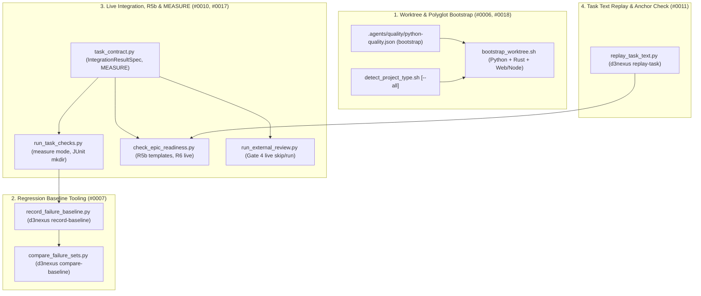

# Execution and Verification Infrastructure Design Specification

- **Date**: 2026-11-06
- **Author**: AI Assistant (Co-Architect)
- **Status**: Approved
- **Epic**: `execution-and-verification-infrastructure`
- **Epic Directory**: `execution_and_verification_infrastructure`
- **Source Observations**: `#0006`, `#0007`, `#0010`, `#0011`, `#0017`, `#0018`

## Table of Contents

- [Overview and Problem Statement](#overview-and-problem-statement)
- [Goals and Non-Goals](#goals-and-non-goals)
- [Architecture and Component Design](#architecture-and-component-design)
  - [1. Worktree Bootstrap and Polyglot Toolchain Support](#1-worktree-bootstrap-and-polyglot-toolchain-support)
  - [2. Full-Suite Failure-Set Baseline and Regression Comparison](#2-full-suite-failure-set-baseline-and-regression-comparison)
  - [3. Opt-In Live Integration Results and Route Template Matching](#3-opt-in-live-integration-results-and-route-template-matching)
  - [4. Static Edit-Anchor Validation and Pre-Packaging Task Replay](#4-static-edit-anchor-validation-and-pre-packaging-task-replay)
  - [5. Long-Running Measurement Phase and Evidence-Gated Verification](#5-long-running-measurement-phase-and-evidence-gated-verification)
- [Error Handling and Edge Cases](#error-handling-and-edge-cases)
- [Testing and Verification Strategy](#testing-and-verification-strategy)
- [Shared Contract Warnings](#shared-contract-warnings)
- [Dependency Mapping and Roadmap Context](#dependency-mapping-and-roadmap-context)

## Overview and Problem Statement

Across multiple feature epics in `lyrics-sync` and `ai-agent-tools`, six recurring execution and verification infrastructure gaps were recorded in `skill-observations/observation-log/`:

1. **Observation `#0006` (Worktree `.venv` missing optional extras)**: `check_task_contract.py --design` requires the registered capability command `uv run mypy --strict src` in every Python task, yet `bootstrap_worktree.sh` only executes bare `uv sync`. When modules import packages from optional dependency groups (such as `huggingface_hub` in `asr` or `soundfile` in `kokoro`), `mypy` and `pytest` fail in fresh worktrees unless each epic manually adds `uv sync --extra ...` to Task 1.
2. **Observation `#0007` (Hand-written bash pipelines for failure-set baselines)**: Every epic working against a repository with pre-existing unrelated test failures had to embed complex bash pipelines in Task 1 and the final task to record and compare failure sets. Those ad-hoc pipelines suffered from regex matches against captured log lines (`ERROR logger:file.py:123`), `pipefail` crashes on empty failure sets, missing `--continue-on-collection-errors`, dirty tracked files rewritten during test runs, and false-positive regressions caused by shared database state across tests.
3. **Observation `#0010` (No contract for opt-in live integration tests and R5b route template false positives)**: `R6` requires every Tier C test file to appear in an `Integration results:` command, and Gate 4 runs every `Integration results:` command unconditionally. Live integration tests requiring local LLM servers or hardware environment variables (`PLT_LIVE_OLLAMA_MODEL`) cannot be separated from hermetic CI tests without failing Gate 4 when the resource is absent. In addition, `R5b` in `check_epic_readiness.py` flags concrete route literals used in test assertions (`/api/align/stream/job_plt`) as missing when the backend defines parameterized route templates (`/api/align/stream/{job_id}`).
4. **Observation `#0011` (Pre-packaging task text replay)**: Prose edit instructions (`Replace in <path>:` / `With:`, `Insert in <path> after:` / `With:`, and embedded code blocks) can harbor wrapped anchors, line-length lint errors, or missing parent directories that static contract checks do not catch unless replayed against a scratch worktree before packaging.
5. **Observation `#0017` (Measurement tasks do not fit standard Verification rows)**: Multi-hour benchmark or LLM-judged evaluation tasks time out or re-run unnecessarily when forced into standard `GREEN`/`TIER-C` Verification rows.
6. **Observation `#0018` (Polyglot Python + JavaScript repositories lack secondary platform support)**: In repositories combining a Python backend (`pyproject.toml`) with a JavaScript frontend (`package.json`, `tests/js/**/*.test.mjs`), `detect_project_type.sh` returns only `python`, `bootstrap_worktree.sh` exits immediately after `uv sync` without installing Node dependencies, and `node --test --test-reporter=junit` exits with code 7 when the output directory (`build/test-results/`) does not yet exist.

This epic (`execution_and_verification_infrastructure`, Epic 2 of 3) delivers first-class, stdlib-only scripts and contract extensions that eliminate all six classes of execution friction.

## Goals and Non-Goals

### Goals

- Extend `.agents/quality/python-quality.json` (`python-quality.schema.json` and `validate_python_quality.py`) with an optional `"bootstrap"` command array and update `bootstrap_worktree.sh` to execute declared bootstrap commands and support polyglot Python + Web/Node repositories (`#0006`, `#0018`).
- Add `--all` to `detect_project_type.sh` to report all detected platforms in polyglot repositories while keeping default single-platform output backward-compatible (`#0018`).
- Auto-create parent directories for `--junitxml=<path>` and `--test-reporter-destination=<path>` targets in `run_task_checks.py` before command execution (`#0018`).
- Provide `record_failure_baseline.py` and `compare_failure_sets.py` (and `d3nexus record-baseline` / `d3nexus compare-baseline` subcommands) supporting `pytest` and `node --test`, terminal-summary-only failure extraction, `--restore <path>` file restoration, and `--rerun-new` isolated re-verification (`#0007`).
- Support `Integration results (live, needs: VAR1, VAR2): <cmd> -> <report>` in `task_contract.py`, `check_task_contract.py`, `check_epic_readiness.py` (`R6`), `audit_epic.py`, and `run_external_review.py` (Gate 4), and upgrade `R5b` in `check_epic_readiness.py` to match concrete route literals against parameterized route templates (`#0010`).
- Provide `replay_task_text.py` (`d3nexus replay-task`) with fast static anchor verification integrated into `check_epic_readiness.py` (`R5`) by default and full worktree execution replay via `check_epic_readiness.py --replay` (`#0011`).
- Add `MEASURE` phase support (`run_task_checks.py measure [--timeout 7200] [--resume]`) and document the **Measurement-to-Evidence** task pattern in `skills/dev-designer/SKILL.md` and `skills/dev-implementation/SKILL.md` (`#0017`).

### Non-Goals

- Cross-epic task dependency ordering, multi-epic board status transitions, and packaged epic amendment governance (`#0013, #0014, #0015, #0020`), which belong to **Epic 3 (`multi_epic_orchestration_and_governance`)**.
- Introducing third-party Python dependencies outside the Python 3.11+ standard library.

## Architecture and Component Design



### 1. Worktree Bootstrap and Polyglot Toolchain Support

- **Quality Manifest `"bootstrap"` Field (`#0006`)**:
  - In `skills/python-quality-check/resources/schemas/python-quality.schema.json` and `skills/python-quality-check/resources/scripts/validate_python_quality.py`:
    - Add optional top-level property `"bootstrap"`: an array of non-empty string argument arrays (e.g., `[["uv", "sync", "--extra", "asr"]]`).
    - `validate_python_config()` validates that if `"bootstrap"` is present, it is a non-empty list of non-empty `list[str]` command arrays; otherwise it emits `invalid_bootstrap_format`.
- **Polyglot & Manifest-Aware `bootstrap_worktree.sh` (`#0006`, `#0018`)**:
  - When `$WORKTREE_PATH/pyproject.toml` or `requirements.txt` exists:
    - If `$WORKTREE_PATH/.agents/quality/python-quality.json` defines `"bootstrap"`, parse and execute each declared command array inside `$WORKTREE_PATH`.
    - Otherwise fall back to `uv sync` (or `poetry install` / `pip install -r requirements.txt`).
  - Remove early `exit 0` statements after the Python and Rust blocks so that a polyglot repository containing both `pyproject.toml` and `package.json` (and not `pubspec.yaml`) runs both the Python bootstrap and the Web/Node bootstrap (`pnpm install` or `npm install`), exiting 0 after all detected non-Flutter toolchains are initialized.
- **Secondary Platform Detection in `detect_project_type.sh` and `scaffold_quality_manifest.py` (`#0018`)**:
  - `detect_project_type.sh [--all] [path_to_project_root]`:
    - Without `--all`: preserves exact existing single-line output (`flutter`, `ios`, `android`, `web`, `python`, `rust`, or `unknown`) so callers expecting a single string remain 100% compatible.
    - With `--all`: outputs every detected platform (space-separated on one line, e.g. `python web`), recognizing `web` when `package.json` is accompanied by web framework configs, `tests/js/`, or `static/` `.js` modules.
  - In `run_task_checks.py` (`run_command()`):
    - Before spawning a command, scan tokens for `--junitxml=<path>`, `--junitxml <path>`, or `--test-reporter-destination=<path>` and create ` (root / <path>).parent.mkdir(parents=True, exist_ok=True)` so `node --test` and `pytest` JUnit reporters never fail on a missing parent directory.

### 2. Full-Suite Failure-Set Baseline and Regression Comparison

- **`skills/dev-implementation/resources/scripts/record_failure_baseline.py` (`d3nexus record-baseline`) (`#0007`)**:
  - CLI signature:
    ```bash
    d3nexus record-baseline --output <evidence_file> [--runner auto|pytest|node] [--restore <path> ...] [--cwd <dir>] -- <command...>
    ```
  - Behavior:
    1. Automatically injects `--continue-on-collection-errors` when the runner is `pytest` and the flag is absent, and ensures parent directories exist for `--output` and any report path.
    2. Runs `<command...>` without failing the recorder itself when tests fail (exit codes 0, 1, or 2 from test runners are captured and parsed; only missing executables or internal errors exit non-zero).
    3. Extracts canonical failure/error identifiers strictly from the terminal summary section:
       - **Pytest**: parses lines after the final `=== short test summary info ===` header matching `^(?:FAILED|ERROR)\s+(\S+)`, stripping trailing ` - <reason>` suffixes while ignoring any captured log output earlier in the stream.
       - **Node (`node --test`)**: parses failing test identifiers from TAP/spec summary lines (`✖ <name>` or `not ok ... - <name>`).
    4. Restores any tracked files named via `--restore <path>` using `git checkout -- <path>` so side-effecting tests leave a clean git working tree.
    5. Writes a deterministic, newline-terminated sorted list of unique failing test identifiers to `<evidence_file>` (writing a single `# 0 failures\n` header comment so the file is non-empty and satisfies `evaluate_done_gate()` condition 8 even when 0 tests fail).
- **`skills/dev-implementation/resources/scripts/compare_failure_sets.py` (`d3nexus compare-baseline`) (`#0007`)**:
  - CLI signature:
    ```bash
    d3nexus compare-baseline --baseline <evidence_file> [--current <file>] [--output <report_file>] [--runner auto|pytest|node] [--rerun-new] [--restore <path> ...] [--cwd <dir>] [-- <command...>]
    ```
  - Behavior:
    1. Reads `baseline_set` from `--baseline` (ignoring `#` comment lines).
    2. Obtains `current_set` either by reading `--current <file>` or by executing `<command...>` using `record_failure_baseline`'s extraction and `--restore` logic.
    3. Computes `new_failures = sorted(current_set - baseline_set)` and `fixed_failures = sorted(baseline_set - current_set)`.
    4. When `--rerun-new` is enabled and `new_failures` is non-empty: re-runs each candidate test identifier in isolation (using the same runner base command) and removes any test that passes in isolation (recording it under `transient_or_shared_state_filtered`).
    5. Writes a summary report (to stdout and optionally `--output <report_file>`) and exits `0` if confirmed `new_failures` is empty, or exits `1` listing each confirmed regression.

### 3. Opt-In Live Integration Results and Route Template Matching

- **`Integration results (live, needs: VAR1, VAR2):` Contract (`#0010`)**:
  - In `skills/dev-implementation/resources/scripts/task_contract.py`:
    - Add frozen dataclass:
      ```python
      @dataclass(frozen=True)
      class IntegrationResultSpec:
          raw: str
          command: str
          report: str
          live: bool = False
          needs: tuple[str, ...] = ()
      ```
    - Add `parse_integration_result_specs(hld_text: str) -> list[IntegrationResultSpec]` recognizing both:
      - `Integration results: <command> -> <report>` (`live=False, needs=()`)
      - `Integration results (live, needs: VAR1, VAR2): <command> -> <report>` (`live=True, needs=("VAR1", "VAR2")`)
    - Update `parse_integration_results(hld_text: str) -> list[str]` to include the `<command> -> <report>` payload of both forms so `check_task_contract.py` (`check_hld`) and `check_epic_readiness.py` (`R6`) validate arrow syntax, git-ignored report paths, and Tier C test file coverage uniformly.
  - In `skills/dev-implementation/resources/scripts/audit_epic.py`:
    - Update `GRADER_LINES = ("Protected paths:", "Integration results:", "Integration results (live")`.
  - In `skills/dev-implementation/resources/scripts/run_external_review.py` (`collect_facts`):
    - Iterate over `parse_integration_result_specs(hld_text)`:
      - When `spec.live` is True and any variable in `spec.needs` is missing or empty in `os.environ`, append `$ <spec.command>\nSKIPPED (missing env: <missing_vars>)\n` to `results` without raising `PreconditionFailedError` and without adding `spec.report` to `reports`.
      - When all `spec.needs` variables are present (or `spec.live` is False), execute `run_gate` and include `spec.report` in `reports`.
      - When live specs were skipped, pass `--allow-skipped-live` (or filter scenario IDs covered exclusively by skipped live test files) to `check_bdd_traceability.py tests` so Gate 4 distinguishes "skipped because live resource env var is unset" from "failed".
- **Route Template Matching in `R5b` (`#0010`)**:
  - In `skills/dev-implementation/resources/scripts/check_epic_readiness.py` (`check_grounding`):
    - When a concrete route `/api/foo/bar/job_123` is not found as a literal substring in `tracked_contents`, extract parameterized route templates from `tracked_contents` matching `(?<![\w/])/api/[\w\-/{}<>:]*[\w}>]` that contain `{param}`, `<param>`, or `:param` segments.
    - Convert each template into a regex where `{[^}/]+}`, `<[^>/>]+>`, or `:[A-Za-z_][A-Za-z0-9_]*` matches `[^/\s"']+`. If the concrete route matches any compiled template regex, treat the route as grounded and do not emit `R5b WARN`.

### 4. Static Edit-Anchor Validation and Pre-Packaging Task Replay

- **`skills/dev-implementation/resources/scripts/replay_task_text.py` (`d3nexus replay-task`) (`#0011`)**:
  - Formalizes deterministic markdown edit directives in task files:
    1. **Full-file write**: `<!-- @@FILE:<rel_path>@@ -->`, `Create `<rel_path>`:`, or `File: `<rel_path>`` immediately above a fenced code block writes the block's contents to `<rel_path>`.
    2. **Exact replacement**: `Replace in `<rel_path>`:` above a fenced code block (the `anchor`) followed by `With:` above a fenced code block (the `replacement`) replaces the unique occurrence of `anchor` in `<rel_path>`.
    3. **Anchored insertion**: `Insert in `<rel_path>` after:` (or `before:`) above a fenced code block (`anchor`) followed by `With:` above a fenced code block (`insertion`) inserts `insertion` immediately after (or before) the unique occurrence of `anchor` in `<rel_path>`.
  - Provides two entry modes:
    - **Static Anchor Check (`verify_task_edit_anchors(root: Path, tasks: dict[Path, str]) -> list[str]`)**:
      - Called automatically during `R5` in `check_epic_readiness.py`.
      - For every `Replace in `<rel_path>`:` or `Insert in `<rel_path>` after|before:` targeting a file that already exists at `HEAD` (and was not previously rewritten by an earlier step in the same task), verifies that the first fenced block (`anchor`) occurs verbatim in `(root / rel_path).read_text()`. Any missing or ambiguous (count != 1) anchor produces an `R5 FAIL` finding naming the task file and target path.
    - **Scratch-Worktree Execution Replay (`d3nexus replay-task <task.md> [--worktree <dir>] [--run-rows]` and `check_epic_readiness.py <epic_dir> --replay`)**:
      - Applies all edit directives in `<task.md>` (or across all tasks of `<epic_dir>` in execution order inside a temporary `git worktree`) and optionally runs the task's `Verification` rows (`RED`, `GREEN`, `TIER-B`, `TIER-C`), cleaning up the temporary worktree on exit.

### 5. Long-Running Measurement Phase and Evidence-Gated Verification

- **`Phase: MEASURE` in `task_contract.py` and `run_task_checks.py` (`#0017`)**:
  - In `skills/dev-implementation/resources/scripts/task_contract.py`:
    - Update `PHASES = ("RED", "MEASURE", "GREEN", "TIER-B", "TIER-C")`.
    - In `evaluate_done_gate(task_file: Path)`: if a task has one or more rows with `row.phase == "MEASURE"`, verify that `evidence.get("runs", {}).get("measure")` exists, matches `HEAD` (or current tree), and all `MEASURE` rows recorded `"outcome": "PASS"`.
  - In `skills/dev-implementation/resources/scripts/run_task_checks.py`:
    - Update CLI `mode` choices to `("red", "measure", "verify", "status")`.
    - When `mode == "measure"`:
      - Default `--timeout` is `7200` seconds (or unbounded when `--timeout 0` is passed) instead of `600` seconds.
      - Support `--resume`: if `--resume` is passed, `evidence.get("runs", {}).get("measure")` already has all `MEASURE` rows with `"outcome": "PASS"`, and every file declared in `parse_evidence_files(task_text)` exists and is non-empty on disk, skip re-running the expensive command and print `MEASURE RESUMED (existing evidence valid)`.
  - Document the **Measurement-to-Evidence** pattern in `skills/dev-designer/SKILL.md` and `skills/dev-implementation/SKILL.md`:
    - Long-running benchmark generation runs in `MEASURE` (writing output to declared `Evidence files:`), mechanical acceptance assertions run as fast `GREEN`/`TIER-C` pytest rows reading that committed evidence file, and qualitative rubric fairness is listed as a `(Gate 5)` Definition of Done item.

## Error Handling and Edge Cases

- **Empty Failure Set in `record_failure_baseline.py`**: Writes `# 0 failures\n` so the file is non-empty on disk (satisfying `evaluate_done_gate()` condition 8) while parsing as an empty set `set()` in `compare_failure_sets.py`.
- **Collection Errors in `record_failure_baseline.py`**: Automatically passes `--continue-on-collection-errors` to `pytest` so collection errors are recorded as `ERROR <nodeid>` entries in the summary rather than aborting the run without a summary table.
- **Unset Live Environment Variables at Gate 4**: `run_external_review.py` logs `SKIPPED (missing env: ...)` for live integration lines without failing Gate 4, while still requiring all non-live `Integration results:` lines to pass.
- **Tasks Without Edit Directives**: `verify_task_edit_anchors()` and `replay_task_text.py` treat tasks without `Replace in` / `Insert in` directives as valid no-ops for anchor checking, preserving full backward compatibility.

## Testing and Verification Strategy

- **Tier A (Unit Tests)**:
  - `test_validate_python_quality.py`: Tests `"bootstrap"` schema validation (valid command arrays vs malformed strings/empty arrays).
  - `test_record_and_compare_baseline.py`: Tests terminal summary extraction (ignoring log lines matching `ERROR ...`), empty baseline handling, `--restore` file checkout, and `--rerun-new` transient failure filtering.
  - `test_check_epic_readiness.py` & `test_check_task_contract.py`: Tests `Integration results (live, needs: VAR):` parsing, `R6` coverage, `R5b` parameterized route template matching, and `R5` static edit-anchor verification.
  - `test_run_task_checks.py`: Tests `measure` mode execution, `--resume` short-circuiting, Done-Gate verification of `MEASURE` runs, and automatic parent directory creation for `--junitxml` / `--test-reporter-destination`.
- **Tier C1 (Subcutaneous End-to-End Integration)**:
  - `tests/test_execution_verification_infra_e2e.py`: End-to-end subcutaneous tests in temporary git repositories exercising polyglot worktree bootstrap, `d3nexus record-baseline` + `d3nexus compare-baseline`, `d3nexus replay-task`, `run_task_checks.py measure` + `verify`, and live integration result skipping when `needs:` env vars are unset.
- **Repository Quality Gate**:
  - `scripts/verify.sh`, `ruff check`, `mypy`, and `pytest` must pass with 0 errors.

## Shared Contract Warnings

- No `shared-contracts/` directory exists in `ai-agent-tools`. All changes are internal to the workflow plugin kit and preserve full backward compatibility for existing repositories and epics.

## Dependency Mapping and Roadmap Context

- **Depends on**: **Epic 1 (`contract_and_authoring_ergonomics`)** — builds on `Evidence files:`, `bin/d3nexus`, and `sync_task_status.py render`.
- **Blocks**: **Epic 3 (`multi_epic_orchestration_and_governance`)** — provides the execution and readiness foundation that Epic 3 extends for multi-epic dependencies (`#0013`, `#0014`) and packaged epic revisions (`#0015`, `#0020`).

