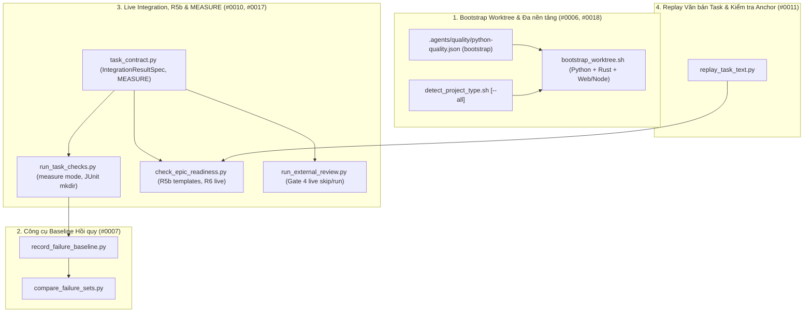

# Đặc tả Thiết kế Hạ tầng Thực thi và Xác minh (Execution and Verification Infrastructure)

- **Date**: 2026-11-06
- **Author**: AI Assistant (Co-Architect)
- **Status**: Approved
- **Epic**: `execution-and-verification-infrastructure`
- **Epic Directory**: `execution_and_verification_infrastructure`
- **Source Observations**: `#0006`, `#0007`, `#0010`, `#0011`, `#0017`, `#0018`

## Mục lục

- [Tổng quan và Phát biểu Bài toán](#tổng-quan-và-phát-biểu-bài-toán)
- [Mục tiêu và Phạm vi Ngoài Mục tiêu](#mục-tiêu-và-phạm-vi-ngoài-mục-tiêu)
- [Kiến trúc và Thiết kế Thành phần](#kiến-trúc-và-thiết-kế-thành-phần)
  - [1. Bootstrap Worktree và Hỗ trợ Đa nền tảng Polyglot](#1-bootstrap-worktree-và-hỗ-trợ-đa-nền-tảng-polyglot)
  - [2. Ghi nhận Baseline Lỗi Toàn cục và So sánh Hồi quy](#2-ghi-nhận-baseline-lỗi-toàn-cục-và-so-sánh-hồi-quy)
  - [3. Kết quả Kiểm thử Tích hợp Live Tùy chọn và So khớp Mẫu Route](#3-kết-quả-kiểm-thử-tích-hợp-live-tùy-chọn-và-so-khớp-mẫu-route)
  - [4. Kiểm tra Tĩnh Anchor Chỉnh sửa và Replay Văn bản Task Trước Đóng gói](#4-kiểm-tra-tĩnh-anchor-chỉnh-sửa-và-replay-văn-bản-task-trước-đóng-gói)
  - [5. Pha Đo lường Dài hạn (MEASURE) và Xác minh Dựa trên Bằng chứng](#5-pha-đo-lường-dài-hạn-measure-và-xác-minh-dựa-trên-bằng-chứng)
- [Xử lý Lỗi và Các Trường hợp Biên](#xử-lý-lỗi-và-các-trường-hợp-biên)
- [Chiến lược Kiểm thử và Xác minh](#chiến-lược-kiểm-thử-và-xác-minh)
- [Cảnh báo Shared Contract](#cảnh-báo-shared-contract)
- [Ánh xạ Phụ thuộc và Bối cảnh Lộ trình](#ánh-xạ-phụ-thuộc-và-bối-cảnh-lộ-trình)

## Tổng quan và Phát biểu Bài toán

Qua nhiều epic thực tế trên `lyrics-sync` và `ai-agent-tools`, sáu điểm nghẽn lặp đi lặp lại về hạ tầng thực thi và xác minh đã được ghi nhận trong `skill-observations/observation-log/`:

1. **Observation `#0006` (Môi trường `.venv` trong worktree thiếu các gói extras tùy chọn)**: `check_task_contract.py --design` yêu cầu mọi task Python phải có đúng dòng lệnh đã đăng ký `uv run mypy --strict src`, nhưng `bootstrap_worktree.sh` chỉ chạy `uv sync` mặc định. Khi mã nguồn import các thư viện thuộc nhóm phụ thuộc tùy chọn (như `huggingface_hub` trong `asr` hoặc `soundfile` trong `kokoro`), `mypy` và `pytest` đều thất bại trên worktree mới trừ khi từng epic phải chèn thủ công `uv sync --extra ...` vào Task 1.
2. **Observation `#0007` (Các đoạn ống lệnh bash viết tay để chụp và so sánh tập lỗi baseline)**: Mọi epic làm việc trên repo có sẵn một số test lỗi không liên quan đều phải tự viết các chuỗi lệnh bash phức tạp ở Task 1 và task cuối để ghi nhận và đối chiếu tập lỗi. Các ống lệnh thủ công này liên tục gặp lỗi: biểu thức chính quy bắt nhầm dòng log (`ERROR logger:file.py:123`), lỗi `pipefail` khi tập lỗi rỗng, thiếu `--continue-on-collection-errors`, làm bẩn các file được git theo dõi khi chạy test, và báo lỗi hồi quy giả do trạng thái cơ sở dữ liệu dùng chung giữa các test.
3. **Observation `#0010` (Thiếu hợp đồng cho kiểm thử tích hợp live cần biến môi trường và cảnh báo giả R5b trên route có tham số)**: Kiểm tra `R6` bắt buộc mọi file test Tier C phải xuất hiện trong một dòng `Integration results:`, và Gate 4 chạy toàn bộ các dòng này vô điều kiện. Các bài test tích hợp live cần máy chủ Ollama cục bộ hoặc biến môi trường (`PLT_LIVE_OLLAMA_MODEL`) không thể tách bạch khỏi test CI cô lập. Ngoài ra, `R5b` trong `check_epic_readiness.py` cảnh báo giả khi gặp đường dẫn cụ thể dùng làm dữ liệu test (`/api/align/stream/job_plt`) do route trong mã nguồn khai báo dưới dạng tham số (`/api/align/stream/{job_id}`).
4. **Observation `#0011` (Replay văn bản task trước khi đóng gói)**: Các chỉ dẫn chỉnh sửa trong thân bài task (`Replace in <path>:` / `With:`, `Insert in <path> after:` / `With:`, và các khối code nhúng) có thể chứa anchor bị ngắt dòng, lỗi độ dài dòng E501 hoặc thiếu thư mục cha mà kiểm tra hợp đồng tĩnh không phát hiện được nếu không chạy thử (replay) từ chính văn bản task trước khi đóng gói.
5. **Observation `#0017` (Các task đo lường dài hạn không phù hợp với dòng Verification thông thường)**: Các bài đo lường tốn nhiều giờ chạy model cục bộ hoặc chấm điểm theo rubric dễ bị quá thời gian chờ (timeout) hoặc phải chạy lại từ đầu nếu đặt trực tiếp vào dòng `GREEN`/`TIER-C`.
6. **Observation `#0018` (Các dự án đa nền tảng Python + JavaScript thiếu hỗ trợ nền tảng phụ)**: Trong các kho mã nguồn kết hợp backend Python (`pyproject.toml`) với frontend JavaScript (`package.json`, `tests/js/**/*.test.mjs`), `detect_project_type.sh` chỉ trả về `python`, `bootstrap_worktree.sh` thoát ngay sau bước `uv sync` mà không cài đặt phụ thuộc Node, và trình xuất JUnit của `node --test` thoát mã 7 khi thư mục đích (`build/test-results/`) chưa tồn tại.

Epic này (`execution_and_verification_infrastructure`, Epic 2 trên tổng số 3) xây dựng các công cụ chuẩn hóa chỉ dùng thư viện chuẩn Python và mở rộng hợp đồng kiểm tra nhằm giải quyết triệt để cả sáu vấn đề trên.

## Mục tiêu và Phạm vi Ngoài Mục tiêu

### Mục tiêu

- Mở rộng `.agents/quality/python-quality.json` (`python-quality.schema.json` và `validate_python_quality.py`) với trường tùy chọn `"bootstrap"` và cập nhật `bootstrap_worktree.sh` để thực thi các lệnh bootstrap đã khai báo cũng như khởi tạo đầy đủ các dự án đa nền tảng Python + Web/Node (`#0006`, `#0018`).
- Bổ sung cờ `--all` vào `detect_project_type.sh` để trả về tất cả các nền tảng phát hiện được trong dự án đa ngữ trong khi giữ nguyên đầu ra một nền tảng mặc định để tương thích ngược (`#0018`).
- Tự động tạo thư mục cha cho các tham số `--junitxml=<path>` và `--test-reporter-destination=<path>` trong `run_task_checks.py` trước khi chạy lệnh (`#0018`).
- Cung cấp `record_failure_baseline.py` và `compare_failure_sets.py` hỗ trợ `pytest` và `node --test`, chỉ trích xuất lỗi từ bảng tóm tắt cuối cùng, khôi phục file qua `--restore <path>`, và chạy lại cô lập các lỗi mới qua `--rerun-new` (`#0007`).
- Hỗ trợ cú pháp `Integration results (live, needs: VAR1, VAR2): <cmd> -> <report>` trong `task_contract.py`, `check_task_contract.py`, `check_epic_readiness.py` (`R6`), `audit_epic.py`, và `run_external_review.py` (Gate 4), đồng thời nâng cấp `R5b` trong `check_epic_readiness.py` để so khớp đường dẫn cụ thể với mẫu route có tham số (`#0010`).
- Cung cấp `replay_task_text.py` tích hợp kiểm tra tĩnh anchor mặc định vào `check_epic_readiness.py` (`R5`) và chế độ replay thực thi trên worktree tạm qua `check_epic_readiness.py --replay` (`#0011`).
- Bổ sung pha `MEASURE` (`run_task_checks.py measure [--timeout 7200] [--resume]`) và tài liệu hóa mẫu thiết kế **Measurement-to-Evidence** trong `skills/dev-designer/SKILL.md` và `skills/dev-implementation/SKILL.md` (`#0017`).

### Phạm vi Ngoài Mục tiêu

- Thứ tự phụ thuộc task liên epic, đồng bộ trạng thái bảng Kanban khi có nhiều epic hoạt động cùng lúc, và quy trình sửa đổi epic đã đóng gói (`#0013, #0014, #0015, #0020`) — thuộc phạm vi của **Epic 3 (`multi_epic_orchestration_and_governance`)**.
- Việc thêm bất kỳ thư viện bên thứ ba nào ngoài thư viện chuẩn Python 3.11+.

## Kiến trúc và Thiết kế Thành phần



### 1. Bootstrap Worktree và Hỗ trợ Đa nền tảng Polyglot

- **Trường `"bootstrap"` trong Quality Manifest (`#0006`)**:
  - Trong `skills/python-quality-check/resources/schemas/python-quality.schema.json` và `skills/python-quality-check/resources/scripts/validate_python_quality.py`:
    - Bổ sung thuộc tính tùy chọn cấp cao nhất `"bootstrap"`: mảng chứa các mảng chuỗi tham số lệnh không rỗng (ví dụ: `[["uv", "sync", "--extra", "asr"]]`).
    - Hàm `validate_python_config()` kiểm tra nếu có `"bootstrap"` thì giá trị phải là danh sách không rỗng chứa các mảng chuỗi `list[str]` không rỗng; nếu sai định dạng sẽ trả về lỗi `invalid_bootstrap_format`.
- **Nâng cấp `bootstrap_worktree.sh` Hỗ trợ Manifest và Đa nền tảng (`#0006`, `#0018`)**:
  - Khi tồn tại `$WORKTREE_PATH/pyproject.toml` hoặc `requirements.txt`:
    - Nếu `$WORKTREE_PATH/.agents/quality/python-quality.json` có khai báo `"bootstrap"`, đọc và thực thi lần lượt từng mảng lệnh đã khai báo bên trong `$WORKTREE_PATH`.
    - Nếu không có `"bootstrap"`, chạy `uv sync` (hoặc `poetry install` / `pip install -r requirements.txt`) như mặc định.
  - Loại bỏ lệnh `exit 0` sớm sau khối Python và Rust để một kho mã nguồn đa nền tảng vừa có `pyproject.toml` vừa có `package.json` (và không có `pubspec.yaml`) chạy tiếp bước cài đặt phụ thuộc Web/Node (`pnpm install` hoặc `npm install`), chỉ thoát `0` sau khi toàn bộ các toolchain phát hiện được đã khởi tạo xong.
- **Phát hiện Nền tảng Phụ trong `detect_project_type.sh` và Tự tạo Thư mục JUnit (`#0018`)**:
  - `detect_project_type.sh [--all] [path_to_project_root]`:
    - Khi gọi không có `--all`: giữ nguyên đầu ra một dòng duy nhất (`flutter`, `ios`, `android`, `web`, `python`, `rust`, hoặc `unknown`) để tương thích ngược tuyệt đối.
    - Khi gọi kèm `--all`: in ra tất cả các nền tảng phát hiện được (cách nhau bởi dấu cách trên một dòng, ví dụ `python web`), nhận diện `web` khi có `package.json` đi kèm cấu hình web framework, thư mục `tests/js/`, hoặc các module `.js` trong `static/`.
  - Trong `run_task_checks.py` (`run_command()`):
    - Trước khi khởi chạy lệnh, quét các token tìm `--junitxml=<path>`, `--junitxml <path>`, hoặc `--test-reporter-destination=<path>` và tự động gọi `(root / <path>).parent.mkdir(parents=True, exist_ok=True)` để trình xuất JUnit của `node --test` và `pytest` không bao giờ thất bại vì thiếu thư mục cha.

### 2. Ghi nhận Baseline Lỗi Toàn cục và So sánh Hồi quy

- **`skills/dev-implementation/resources/scripts/record_failure_baseline.py` (`#0007`)**:
  - Cú pháp CLI:
    ```bash
    record_failure_baseline.py --output|--out <evidence_file> [--in <raw_output_file>] [--cmd <shell_cmd>] [--runner auto|pytest|node] [--restore <path> ...] [--cwd <dir>] [-- <command...>]
    ```
  - Hành vi:
    1. Tự động chèn `--continue-on-collection-errors` khi runner là `pytest` và chưa có cờ này, đồng thời đảm bảo thư mục cha của `--output`/`--out` luôn tồn tại.
    2. Phân biệt rõ lần chạy kiểm thử hợp lệ với lỗi khởi chạy, lỗi cú pháp tham số, hoặc lỗi nội bộ:
       - Lần chạy `pytest` chỉ hợp lệ khi thoát mã `0` kèm dòng kết thúc `=== ... passed ... ===` hoặc thoát mã `1`/`2` kèm khối `=== short test summary info ===`; các mã thoát `3` (internal error), `4` (usage error), `5` (no tests collected), `126`/`127`, hoặc thoát khác `0` nhưng không có khối tóm tắt cuối sẽ thất bại với mã thoát `2` và không ghi baseline giả.
       - Lần chạy `node --test` chỉ hợp lệ khi có dòng tóm tắt TAP/spec (`# tests` / `ℹ tests`).
    3. Chỉ trích xuất mã định danh test lỗi từ đúng phần tóm tắt cuối cùng, giữ nguyên khoảng trắng và chuỗi ` - ` bên trong tham số:
       - **Pytest**: chỉ phân tích các dòng nằm sau tiêu đề `=== short test summary info ===` cuối cùng khớp mẫu `^(?:FAILED|ERROR)\s+([^\[\s]+(?:\[[^\]]*\])?)(?:\s+-\s+.*)?$`, bảo toàn đầy đủ chuỗi tham số trong ngoặc vuông (bao gồm cả khoảng trắng và chuỗi ` - ` bên trong `[...]`, ví dụ `tests/test_x.py::test_x[hello - world]`), chỉ cắt bỏ phần giải thích ` - <reason>` sau dấu `]` và bỏ qua hoàn toàn mọi dòng log in ra trong quá trình chạy test.
       - **Node (`node --test`)**: trích xuất định danh test thất bại kèm tên file `<file>::<test_name>` từ ngữ cảnh TAP/spec subtest (hoặc `<test_name>` cho đoạn TAP đơn lẻ) để các test trùng tên ở các file khác nhau không bị gộp nhầm.
    4. Luôn khôi phục mọi file theo dõi bởi git được liệt kê qua `--restore <path>` bằng `git checkout -- <path>` trong khối `finally:` để giữ cây thư mục làm việc sạch.
    5. Ghi danh sách các định danh test lỗi duy nhất đã sắp xếp vào `<evidence_file>` (luôn kèm dòng chú thích đầu file `# 0 failures\n` khi không có lỗi nào trong một lần chạy hợp lệ để file không bị rỗng).
- **`skills/dev-implementation/resources/scripts/compare_failure_sets.py` (`#0007`)**:
  - Cú pháp CLI:
    ```bash
    compare_failure_sets.py --baseline <evidence_file> [--current <file>] [--output|--out <report_file>] [--runner auto|pytest|node] [--rerun-new] [--allow-isolated-pass] [--rerun-cmd <cmd_prefix>] [--restore <path> ...] [--cwd <dir>] [-- <command...>]
    ```
  - Hành vi:
    1. Đọc tập `baseline_set` từ `--baseline` (bỏ qua các dòng chú thích bắt đầu bằng `#`).
    2. Thu thập `current_set` từ file `--current <file>` hoặc bằng cách chạy `<command...>` với cùng cơ chế trích xuất hợp lệ và `--restore` của `record_failure_baseline`.
    3. Tính tập lỗi mới `new_failures = sorted(current_set - baseline_set)` và tập lỗi đã được sửa `fixed_failures = sorted(baseline_set - current_set)`.
    4. Khi bật `--rerun-new` và `new_failures` khác rỗng:
       - Với `pytest` (mặc định): chạy lại từng test ID trong `new_failures` một cách độc lập như một đối số vị trí đơn lẻ (`[*rerun_cmd_argv, node_id]`).
       - Với `node` (`node --test`): yêu cầu định danh có kèm file `<file>::<test_name>` (thoát mã `2` nếu thiếu `<file>::`) và chạy `[*rerun_cmd_argv, f"--test-name-pattern=^{re.escape(test_name)}$", file_path]`.
       - Các ứng viên vẫn thất bại khi chạy cô lập được phân loại là `PERSISTENT_FAILURE: <nodeid>`; các ứng viên đạt khi chạy cô lập được phân loại là `ISOLATED_PASS (state-pollution or transient): <nodeid>`. Mặc định, cả hai loại đều trả về mã thoát `1` để không bỏ lọt lỗi hồi quy làm bẩn trạng thái dùng chung; chỉ khi truyền tường minh cờ `--allow-isolated-pass` thì `ISOLATED_PASS` mới được miễn trừ khỏi mã thoát lỗi.
    5. In báo cáo đối chiếu (ra stdout và tùy chọn ghi vào `--output`/`--out <report_file>`), thoát mã `0` nếu không còn lỗi chặn, hoặc thoát mã `1` kèm danh sách các lỗi hồi quy.

### 3. Kết quả Kiểm thử Tích hợp Live Tùy chọn và So khớp Mẫu Route

- **Hợp đồng `Integration results (live, needs: VAR1, VAR2):` (`#0010`)**:
  - Trong `skills/dev-implementation/resources/scripts/task_contract.py`:
    - Bổ sung dataclass bất biến:
      ```python
      @dataclass(frozen=True)
      class IntegrationResultSpec:
          raw: str
          command: str
          report: str
          live: bool = False
          needs: tuple[str, ...] = ()
      ```
    - Bổ sung hàm `parse_integration_result_specs(hld_text: str) -> list[IntegrationResultSpec]` nhận diện cả hai dạng:
      - `Integration results: <command> -> <report>` (`live=False, needs=()`)
      - `Integration results (live, needs: VAR1, VAR2): <command> -> <report>` (`live=True, needs=("VAR1", "VAR2")`)
    - Cập nhật `parse_integration_results(hld_text: str) -> list[str]` trả về phần `<command> -> <report>` của cả hai dạng để `check_task_contract.py` (`check_hld`) và `check_epic_readiness.py` (`R6`) kiểm tra cú pháp mũi tên, đường dẫn báo cáo git-ignored và độ phủ file test Tier C đồng nhất.
  - Trong `skills/dev-implementation/resources/scripts/audit_epic.py`:
    - Cập nhật `GRADER_LINES = ("Protected paths:", "Integration results:", "Integration results (live")`.
  - Trong `skills/dev-implementation/resources/scripts/run_external_review.py` (`collect_facts`):
    - Duyệt qua `parse_integration_result_specs(hld_text)`:
      - Nếu `spec.live` là True và bất kỳ biến môi trường nào trong `spec.needs` chưa được gán hoặc rỗng trong `os.environ`, ghi nhận `$ <spec.command>\nSKIPPED (missing env: <missing_vars>)\n` vào `results` mà không ném `PreconditionFailedError` và không thêm `spec.report` vào `reports`.
      - Khi tất cả các biến trong `spec.needs` đều có mặt (hoặc `spec.live` là False), chạy `run_gate` và đưa `spec.report` vào `reports`.
      - Truyền chính xác danh sách `[r.strip("`") for r in reports]` đã thực thi vào `check_bdd_traceability.py --results` (thay vì toàn bộ thư mục `build/test-results`, tránh đọc nhầm file XML cũ). Luôn chạy kiểm tra tĩnh `check_bdd_traceability.py tests` (không có `--results`) trên 100% kịch bản để mọi kịch bản live vẫn bắt buộc có hàm test trong mã nguồn, và khi có dòng live bị skip thì truyền `--ids <non_skipped_scenario_ids>` vào lệnh kiểm tra `--results` để các kịch bản không bị skip vẫn phải PASS trong `reports` còn kịch bản live bị skip không làm hỏng Gate 4.
- **So khớp Mẫu Route Tham số trong `R5b` (`#0010`)**:
  - Trong `skills/dev-implementation/resources/scripts/check_epic_readiness.py` (`check_grounding`):
    - Khi một đường dẫn cụ thể `/api/foo/bar/job_123` không xuất hiện nguyên văn trong `tracked_contents`, quét các mẫu route có tham số trong `tracked_contents` khớp `(?<![\w/])/api/[\w\-/{}<>:]*[\w}>]` có chứa `{param}`, `<param>`, hoặc `:param`.
    - Biên dịch từng mẫu route thành biểu thức chính quy trong đó `{[^}/]+}`, `<[^>/>]+>`, hoặc `:[A-Za-z_][A-Za-z0-9_]*` khớp với `[^/\s"']+`. Nếu đường dẫn cụ thể khớp với bất kỳ biểu thức mẫu nào, coi như đã được ground hợp lệ và không phát cảnh báo `R5b WARN`.

### 4. Kiểm tra Tĩnh Anchor Chỉnh sửa và Replay Văn bản Task Trước Đóng gói

- **`skills/dev-implementation/resources/scripts/replay_task_text.py` (`#0011`)**:
  - Chuẩn hóa 3 dạng chỉ thị chỉnh sửa tất định trong văn bản task:
    1. **Ghi toàn bộ file**: `<!-- @@FILE:<rel_path>@@ -->`, `Create `<rel_path>`:`, hoặc `File: `<rel_path>`` nằm ngay trên một khối code fence $\rightarrow$ ghi nội dung khối code vào `<rel_path>`.
    2. **Thay thế chính xác**: `Replace in `<rel_path>`:` ngay trên khối code fence (`anchor`) theo sau bởi `With:` ngay trên khối code fence (`replacement`) $\rightarrow$ thay thế vị trí xuất hiện duy nhất của `anchor` trong `<rel_path>`.
    3. **Chèn theo điểm neo**: `Insert in `<rel_path>` after:` (hoặc `before:`) ngay trên khối code fence (`anchor`) theo sau bởi `With:` ngay trên khối code fence (`insertion`) $\rightarrow$ chèn `insertion` ngay sau (hoặc trước) vị trí xuất hiện duy nhất của `anchor` trong `<rel_path>`.
  - Cung cấp hai chế độ hoạt động:
    - **Kiểm tra Tĩnh Anchor (`verify_task_edit_anchors(root: Path, task_path: Path, task_text: str, prior_modified: set[str] | None = None) -> list[str]`)**:
      - Được gọi tự động trong bước `R5` của `check_epic_readiness.py`.
      - Với mọi chỉ thị `Replace in `<rel_path>`:` hoặc `Insert in `<rel_path>` after|before:` nhắm tới file đã tồn tại ở `HEAD` (và chưa bị ghi đè bởi bước trước đó trong cùng task hoặc epic), kiểm tra khối `anchor` xuất hiện nguyên văn đúng 1 lần trong `(root / rel_path).read_text()`. Nếu không tìm thấy hoặc xuất hiện nhiều hơn 1 lần, báo lỗi `R5 FAIL` chỉ rõ tên task và đường dẫn file.
    - **Replay Thực thi trên Worktree Tạm (`replay_task_text.py <task.md> [--worktree <dir>] [--run-rows]` và `check_epic_readiness.py <epic_dir> --replay`)**:
      - Áp dụng chỉ thị chỉnh sửa và chạy các dòng Verification theo đúng thứ tự pha chuẩn để bảo toàn hợp đồng TDD và MEASURE:
        1. Áp dụng trước các chỉ thị nhắm tới file kiểm thử (`test_*.py`, `*_test.*`, `tests/**`); nếu task có dòng `RED` (và không phải `RED: n/a`), chạy các dòng `RED` và xác nhận chúng thất bại đúng kỳ vọng (`validate_pytest_red`).
        2. Áp dụng các chỉ thị chỉnh sửa mã nguồn sản phẩm còn lại (`Create`, `Replace in`, `Insert in`).
        3. Chạy các dòng `MEASURE` trước (để sinh các file `Evidence files:` đã khai báo), sau đó chạy `GREEN`, `TIER-B`, `TIER-C`, và tự động dọn dẹp worktree tạm khi kết thúc.

### 5. Pha Đo lường Dài hạn (MEASURE) và Xác minh Dựa trên Bằng chứng

- **Bổ sung `Phase: MEASURE` trong `task_contract.py` và `run_task_checks.py` (`#0017`)**:
  - Trong `skills/dev-implementation/resources/scripts/task_contract.py`:
    - Cập nhật `PHASES = ("RED", "MEASURE", "GREEN", "TIER-B", "TIER-C")`.
    - Tái sử dụng `parse_evidence_files(task_text: str) -> list[AllowedPath]` từ Epic 1 (`entry.pattern` cho mỗi đường dẫn `.devtool/epic/<epic_dir>/evidence/<file>`).
    - Trong `evaluate_done_gate(task_file: Path)` và `audit_epic.py` (`audit_evidence`): nếu task có bất kỳ dòng nào mang `row.phase == "MEASURE"`, kiểm tra `evidence.get("runs", {}).get("measure")` đã tồn tại, `tree` khớp với `fingerprint(layout.root)[0]` hiện tại (tại Done Gate), mọi dòng `MEASURE` trong bảng hiện tại khớp `id`, `command`, `expect` (`row_problems`) với `"outcome": "PASS"`, và mọi `entry.pattern` trong `parse_evidence_files(task_text)` tồn tại (trên đĩa tại Done Gate và tại `HEAD` qua `git show HEAD:<entry.pattern>` trong `audit_epic.py`), khác rỗng, đồng thời có mã băm SHA-256 khớp `runs["measure"]["evidence_digests"][entry.pattern]`.
  - Trong `skills/dev-implementation/resources/scripts/run_task_checks.py`:
    - Mở rộng danh sách `mode` CLI thành `("red", "measure", "verify", "status")`.
    - Khi chạy `mode == "measure"`:
      - Giá trị `--timeout` mặc định là `7200` giây (hoặc không giới hạn khi truyền `--timeout 0`) thay vì `1800` giây.
      - Ghi nhận `"evidence_digests": {rel_path: sha256_hex}` vào `evidence["runs"]["measure"]` cho toàn bộ `Evidence files:`.
      - Hỗ trợ cờ `--resume`: nếu truyền `--resume`, bản ghi `evidence.get("runs", {}).get("measure")` tồn tại, `tree` đã ghi khớp `fingerprint(layout.root)[0]`, `row_problems(measure_rows, evidence["runs"])` rỗng (tất cả dòng `MEASURE` hiện tại khớp `id`/`command`/`expect` và có `"outcome": "PASS"`), và toàn bộ các file trong `parse_evidence_files(task_text)` tồn tại, khác rỗng trên đĩa, đồng thời khớp mã băm SHA-256 trong `runs["measure"]["evidence_digests"]`, bỏ qua việc chạy lại lệnh đo lường tốn thời gian và in `MEASURE resumed (cached PASS)`.
  - Tài liệu hóa mẫu **Measurement-to-Evidence** trong `skills/dev-designer/SKILL.md` và `skills/dev-implementation/SKILL.md`:
    - Lệnh chạy đo lường/benchmark dài hạn được đặt ở pha `MEASURE` (ghi kết quả vào `Evidence files:`), các kiểm tra nghiệm thu cơ học được viết thành test `pytest` chạy nhanh ở pha `GREEN`/`TIER-C` đọc từ file bằng chứng đó, và đánh giá định tính theo rubric được ghi nhận là mục `(Gate 5)` trong Definition of Done.

## Xử lý Lỗi và Các Trường hợp Biên

- **Tập Lỗi Rỗng trong `record_failure_baseline.py`**: Ghi dòng `# 0 failures\n` để file trên đĩa luôn khác rỗng (thỏa mãn điều kiện 8 của `evaluate_done_gate()`) trong khi `compare_failure_sets.py` vẫn đọc ra tập rỗng `set()`.
- **Lỗi Collection trong `record_failure_baseline.py`**: Tự động truyền `--continue-on-collection-errors` cho `pytest` để các lỗi import/collection vẫn xuất hiện trong bảng tóm tắt dưới dạng `ERROR <nodeid>` thay vì dừng đột ngột trước khi in bảng tóm tắt.
- **Biến Môi trường Live Chưa Được Gán tại Gate 4**: `run_external_review.py` ghi nhận `SKIPPED (missing env: ...)` cho các dòng tích hợp live mà không làm gãy Gate 4, đồng thời vẫn bắt buộc mọi dòng `Integration results:` thông thường phải vượt qua.
- **Task Không Chứa Chỉ thị Chỉnh sửa**: `verify_task_edit_anchors()` và `replay_task_text.py` coi các task không có chỉ thị `Replace in` / `Insert in` là hợp lệ, đảm bảo tương thích ngược hoàn toàn với mọi epic trước đây.

## Chiến lược Kiểm thử và Xác minh

- **Tier A (Unit Tests)**:
  - `test_validate_python_quality.py`: Kiểm thử xác thực trường `"bootstrap"` trong schema (mảng lệnh hợp lệ so với chuỗi hoặc mảng rỗng).
  - `test_record_and_compare_baseline.py`: Kiểm thử trích xuất bảng tóm tắt cuối (bỏ qua các dòng log `ERROR ...`), xử lý baseline 0 lỗi, khôi phục file qua `--restore`, và lọc lỗi thoáng qua bằng `--rerun-new`.
  - `test_check_epic_readiness.py` & `test_check_task_contract.py`: Kiểm thử phân tích `Integration results (live, needs: VAR):`, độ phủ `R6`, so khớp mẫu route có tham số trong `R5b`, và kiểm tra tĩnh anchor chỉnh sửa trong `R5`.
  - `test_run_task_checks.py`: Kiểm thử thực thi mode `measure`, cơ chế `--resume`, kiểm tra Done Gate cho `MEASURE`, và tự động tạo thư mục cha cho `--junitxml` / `--test-reporter-destination`.
- **Tier C1 (Subcutaneous End-to-End Integration)**:
  - `tests/test_execution_infra_acceptance.py`: Kiểm thử tích hợp đầu-cuối trên các kho git tạm thời bao phủ bootstrap đa nền tảng, `record_failure_baseline.py` + `compare_failure_sets.py`, `replay_task_text.py`, `run_task_checks.py measure` + `verify`, và cơ chế skip kiểm thử tích hợp live khi thiếu biến môi trường `needs:`.
- **Cổng Chất lượng Kho mã nguồn**:
  - `scripts/verify.sh`, `ruff check`, `mypy`, và `pytest` phải vượt qua với 0 lỗi.

## Cảnh báo Shared Contract

- Không tồn tại thư mục `shared-contracts/` trong `ai-agent-tools`. Mọi thay đổi đều nằm gọn trong bộ công cụ workflow plugin và đảm bảo tương thích ngược hoàn toàn cho các kho mã nguồn cũng như các epic hiện có.

## Ánh xạ Phụ thuộc và Bối cảnh Lộ trình

- **Phụ thuộc vào**: **Epic 1 (`contract_and_authoring_ergonomics`)** — sử dụng trực tiếp `Evidence files:`, `bin/d3nexus`, và `sync_task_status.py render`.
- **Mở đường cho**: **Epic 3 (`multi_epic_orchestration_and_governance`)** — cung cấp nền tảng thực thi và kiểm tra sẵn sàng để Epic 3 mở rộng cho bài toán phụ thuộc liên epic (`#0013`, `#0014`) và quản trị sửa đổi epic đã đóng gói (`#0015`, `#0020`).
