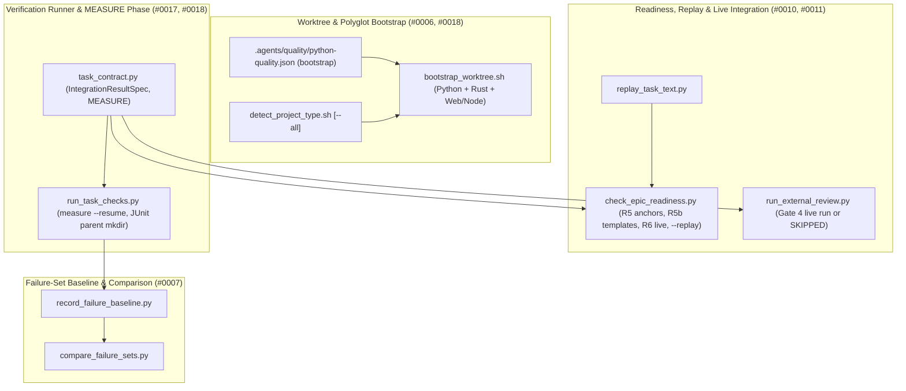
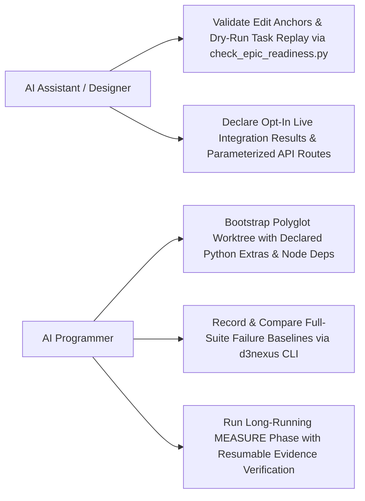

# Epic: Execution and Verification Infrastructure

## Table of Contents

- [Meta Data](#meta-data)
- [Background](#background)
- [Goals and Non-Goals](#goals-and-non-goals)
  - [Goals](#goals)
  - [Non-Goals](#non-goals)
- [Architecture and Technical Design](#architecture-and-technical-design)
  - [High-Level Architecture](#high-level-architecture)
  - [Use Cases](#use-cases)
  - [Sequence Diagram](#sequence-diagram)
  - [Integration Test Plan and Boundary Matrix](#integration-test-plan-and-boundary-matrix)
- [Verification Environment](#verification-environment)
  - [Comprehensive BDD Test Scenarios](#comprehensive-bdd-test-scenarios)
- [Shared Contract Impact](#shared-contract-impact)
- [Rollout Strategy and Mitigation](#rollout-strategy-and-mitigation)
- [Kanban Tasks Breakdown](#kanban-tasks-breakdown)

## Meta Data

- **Epic**: `execution-and-verification-infrastructure`
- **Status**: In Progress
- **Target Release**: v1.25.0
- **Platform**: Python
- **Source Spec**: [2026-11-06-execution-and-verification-infrastructure-design.en.md](2026-11-06-execution-and-verification-infrastructure-design.en.md)

## Background

During Stage 2 and Stage 3 execution across `lyrics-sync` and `ai-agent-tools`, six infrastructure friction points were logged in `skill-observations/observation-log/`:

1. **Observation `#0006`**: `bootstrap_worktree.sh` only runs bare `uv sync`, leaving worktree `.venv` environments missing optional extras (`--extra asr`) required by registered `mypy` and `pytest` capabilities.
2. **Observation `#0007`**: Recording and comparing full-suite failure baselines across tasks required brittle hand-written bash pipelines that matched captured log lines (`ERROR logger:file.py:123`), failed on empty failure sets under `pipefail`, lacked `--continue-on-collection-errors`, left modified tracked files behind, and reported false regressions from shared test DB state.
3. **Observation `#0010`**: `R6` requires every Tier C test file to appear in an `Integration results:` line, and Gate 4 runs every such line unconditionally, leaving no contract for opt-in live integration tests (`-m live_llm`) that require environment variables like `PLT_LIVE_OLLAMA_MODEL`. Furthermore, `R5b` flags concrete route literals (`http://localhost/api/align/stream/job_plt`) as ungrounded when the backend uses parameterized route templates (`http://localhost/api/align/stream/{job_id}`).
4. **Observation `#0011`**: Authoring defects inside task prose (`Replace in <path>:` / `With:`, `Insert in <path> after:` / `With:`, and code blocks) were only caught when manually replayed in a scratch worktree before packaging.
5. **Observation `#0017`**: Long-running measurement tasks (such as multi-hour local model benchmarks) do not fit standard 600s Verification rows and need a resumable `MEASURE` phase decoupled from fast evidence-checking `verify` rows.
6. **Observation `#0018`**: Polyglot repositories combining Python (`pyproject.toml`) and JavaScript (`package.json`, `tests/js/**/*.test.mjs`) only receive `python` detection from `detect_project_type.sh`, skip Node dependency installation in `bootstrap_worktree.sh`, and fail with exit code 7 when `node --test --test-reporter=junit` writes to a non-existent `build/test-results/` directory.

## Goals and Non-Goals

### Goals

- Add optional `"bootstrap"` command array support to `.agents/quality/python-quality.json` (`python-quality.schema.json` and `validate_python_quality.py`), execute configured `"bootstrap"` commands in `bootstrap_worktree.sh`, and remove early exits so polyglot Python + Web/Node repositories bootstrap all present toolchains (`#0006`, `#0018`).
- Add `--all` to `detect_project_type.sh` to report all detected platforms in polyglot repositories while keeping default single-platform output unchanged (`#0018`).
- Auto-create parent directories for `--junitxml` and `--test-reporter-destination` paths in `run_task_checks.py` before executing Verification rows (`#0018`).
- Ship `record_failure_baseline.py` and `compare_failure_sets.py` supporting `pytest` and `node --test`, terminal-summary-only parsing, `--restore <path>` file checkout, and `--rerun-new` isolated re-verification (`#0007`).
- Support `Integration results (live, needs: VAR1, VAR2): <cmd> -> <report>` across `task_contract.py`, `check_task_contract.py`, `check_epic_readiness.py` (`R6`), `audit_epic.py`, and `run_external_review.py` (Gate 4), and upgrade `R5b` in `check_epic_readiness.py` to match concrete routes against parameterized route templates (`#0010`).
- Ship `replay_task_text.py`, integrate fast static edit-anchor verification into `check_epic_readiness.py` (`R5`), and add `--replay` scratch-worktree execution to `check_epic_readiness.py` (`#0011`).
- Support `Phase: MEASURE` (`run_task_checks.py measure [--timeout 7200] [--resume]`) and document the **Measurement-to-Evidence** pattern in `skills/dev-designer/SKILL.md` and `skills/dev-implementation/SKILL.md` (`#0017`).

### Non-Goals

- Cross-epic task dependency ordering, multi-epic board status transitions, and packaged epic amendment governance (`#0013, #0014, #0015, #0020`), which are addressed in **Epic 3 (`multi_epic_orchestration_and_governance`)**.
- Adding third-party runtime dependencies outside the Python 3.11+ standard library.

## Architecture and Technical Design

### High-Level Architecture



### Use Cases



### Sequence Diagram

```mermaid
sequenceDiagram
    autonumber
    actor Designer as AI Assistant (dev-designer)
    participant Readiness as check_epic_readiness.py
    participant Replay as replay_task_text.py
    actor Programmer as AI Programmer (dev-implementation)
    participant Boot as bootstrap_worktree.py / .sh
    participant Runner as run_task_checks.py
    participant Baseline as record / compare_failure_sets.py
    participant Gate4 as run_external_review.py

    Designer->>Readiness: Run check_epic_readiness.py <epic_dir> [--replay]
    Readiness->>Replay: Verify Replace/Insert anchors (R5) & optional worktree replay
    Readiness->>Readiness: Match R5b route literals against parameterized templates & R6 live results
    Readiness-->>Designer: 0 FAIL, 0 WARN — PASS
    Programmer->>Boot: Run bootstrap_worktree.sh <worktree>
    Boot->>Boot: Execute python-quality.json bootstrap commands + npm/pnpm install
    Programmer->>Runner: Run run_task_checks.py measure <task> --resume
    Runner->>Baseline: Execute d3nexus record-baseline / compare-baseline
    Runner-->>Programmer: MEASURE & VERIFY PASS (evidence written)
    Programmer->>Gate4: Run Gate 4 pre-checks
    Gate4->>Gate4: Run standard Integration results; run or SKIP live results based on Needs env
    Gate4-->>Programmer: Gate 4 PASS
```

### Integration Test Plan and Boundary Matrix

```text
Integration test roots: tests/, skills/dev-implementation/resources/scripts/, skills/python-quality-check/resources/scripts/
Protected paths: .agents/quality/**, .devtool/epic/execution_and_verification_infrastructure/bdd_scenarios.en.md, .devtool/epic/execution_and_verification_infrastructure/bdd_scenarios.vi.md
Integration results: python3 -m pytest tests/ skills/dev-implementation/resources/scripts/ skills/python-quality-check/resources/scripts/ --junitxml=build/test-results/pytest.xml -> build/test-results/pytest.xml
```

| Boundary Seam | Testing Strategy | Verification Target |
| :--- | :--- | :--- |
| `validate_python_quality.py`, `detect_project_type.sh` & `bootstrap_worktree.sh` | Subprocess & schema validation tests in temporary polyglot repositories | Verify `"bootstrap"` array validation, `detect_project_type.sh --all` output (`python web`), and polyglot Python + Node worktree bootstrapping |
| `record_failure_baseline.py` & `compare_failure_sets.py` | Subcutaneous CLI tests with synthetic `pytest` and `node --test` outputs | Verify terminal-summary-only failure extraction (preserving spaces and ` - ` inside parameterized node IDs, extracting `<file>::<test_name>` for Node, ignoring `ERROR` log lines, and rejecting runner usage/launch errors), `# 0 failures` non-empty output, `--restore` git checkout, and `--rerun-new` isolated-pass vs persistent failure classification (`--allow-isolated-pass`, `--test-name-pattern` for Node) |
| `task_contract.py`, `check_epic_readiness.py`, `audit_epic.py` & `run_external_review.py` | Integration tests across HLD `Integration results (live, needs: VAR):` and `R5b` route templates | Verify `IntegrationResultSpec` parsing, `R6` Tier C coverage, Gate 4 `SKIPPED` vs executed live commands (with explicit `reports` paths and `--ids` filtering for `check_bdd_traceability.py`), and `R5b` parameterized route template matching (`http://localhost/api/jobs/{job_id}`) |
| `replay_task_text.py` & `run_task_checks.py` (`MEASURE`) | Filesystem & worktree replay tests and `measure` mode lifecycle tests | Verify `Create`, `Replace in`, and `Insert in` directives, `R5` static anchor checks, ordered `--replay` worktree execution (test edits + `RED` -> prod edits -> `MEASURE` -> `GREEN`/`TIER-B`/`TIER-C`), `measure --resume` tree/contract/SHA-256 digest validation (on disk at Done Gate and at `HEAD` in `audit_epic.py`), and JUnit parent directory auto-creation |

## Verification Environment

- Execution environment: Local macOS / Linux CLI with Python 3.11+, Git, Bash, `pytest`, `ruff`, and `mypy`.
- Isolation: All unit and integration tests run inside temporary directories / temporary Git repositories (`tmp_path` / `tempfile.TemporaryDirectory`) with no external network calls or live LLM servers required.
- Environment variables that `Needs` columns or live integration tests may reference in test fixtures: `EVI_LIVE_MODEL` (synthetic test variable used to test live integration run vs skip branches).

### Comprehensive BDD Test Scenarios

The suite covers all 5 dimensions under the `[EVI-]` prefix:
1. **Happy Paths (`EVI-HP-01` .. `EVI-HP-04`)**: Polyglot worktree bootstrap with `"bootstrap"` argument arrays and `detect_project_type.sh --all`; recording and comparing failure-set baselines via `record_failure_baseline.py` and `compare_failure_sets.py`; `Integration results (live, needs: VAR):` and `R5b` parameterized route template matching; and `replay_task_text.py` + `run_task_checks.py measure` execution.
2. **Edge Cases (`EVI-EC-01` .. `EVI-EC-03`)**: Zero-failure baseline producing non-empty `# 0 failures` file and ignoring captured `ERROR` log lines; automatic parent directory creation for `--junitxml` and `--test-reporter-destination`; and `R5b` matching multiple route parameter syntaxes (`{id}`, `<id>`, `:id`).
3. **State Transitions (`EVI-ST-01` .. `EVI-ST-02`)**: `--rerun-new` classifying isolated-pass vs persistent regressions and requiring explicit `--allow-isolated-pass` to ignore isolated passes; and `run_task_checks.py measure --resume` reusing cached `MEASURE` runs only when the worktree `tree`, row contracts, and `Evidence files:` SHA-256 digests match.
4. **Async & Concurrency (`EVI-AR-01` .. `EVI-AR-02`)**: Isolated temporary worktree creation and cleanup during `check_epic_readiness.py --replay` without polluting the main checkout; and `--restore <path>` restoring modified tracked files after baseline recording.
5. **Failures & Resilience (`EVI-FR-01` .. `EVI-FR-03`)**: Rejecting malformed `"bootstrap"` entries in `validate_python_quality.py`; `R5` failing when a `Replace in <path>:` anchor is missing or non-unique in the target file; and Done Gate failing when a task has `MEASURE` rows that are missing, failed, or stale relative to the current tree and evidence file digests.

## Shared Contract Impact

None — self-contained feature in `ai-agent-tools`.

## Rollout Strategy and Mitigation

- **Phase 1**: Implement `"bootstrap"` schema validation, `detect_project_type.sh --all`, polyglot `bootstrap_worktree.sh`, and JUnit parent directory auto-creation in `run_task_checks.py` (`Task 01`).
- **Phase 2**: Implement `record_failure_baseline.py` and `compare_failure_sets.py` (`Task 02`).
- **Phase 3**: Implement `IntegrationResultSpec` (`Integration results (live, needs: VAR):`) across `task_contract.py`, `check_task_contract.py`, `check_epic_readiness.py`, `audit_epic.py`, and `run_external_review.py`, plus `R5b` parameterized route template matching (`Task 03`).
- **Phase 4**: Implement `replay_task_text.py`, `R5` static anchor verification, `check_epic_readiness.py --replay`, and `Phase: MEASURE` in `task_contract.py` / `run_task_checks.py` (`Task 04`).
- **Phase 5**: Execute end-to-end subcutaneous integration and acceptance verification and update skill documentation (`Task 05`).
- **Rollback Plan**: All new scripts and flags are additive and backward-compatible; reverting the epic merge commit cleanly restores prior behavior.

## Kanban Tasks Breakdown

- [Task 01: Worktree Bootstrap Extras, Polyglot Detection, and JUnit Directory Creation](./task_01_polyglot_worktree_bootstrap.md)
- [Task 02: Failure-Set Baseline Recording and Regression Comparison CLI](./task_02_failure_baseline_and_comparison.md)
- [Task 03: Opt-In Live Integration Results and R5b Parameterized Route Matching](./task_03_live_integration_and_route_matching.md)
- [Task 04: Task Text Replay Engine, Static Anchor Verification, and MEASURE Phase](./task_04_task_replay_and_measure_phase.md)
- [Task 05: End-to-End Execution Infrastructure Acceptance Verification](./task_05_execution_infra_e2e_acceptance.md)

