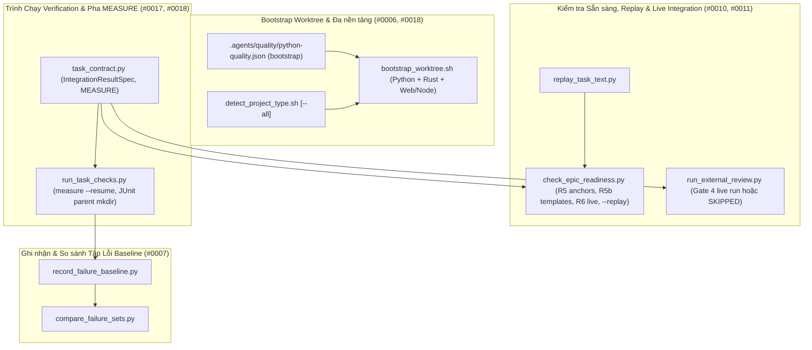
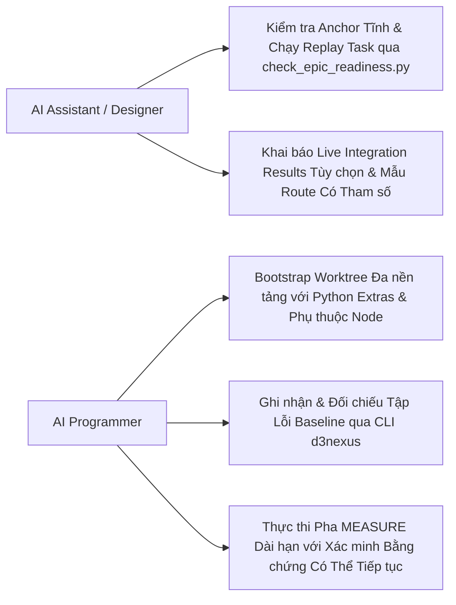

# Epic: Hạ tầng Thực thi và Xác minh (Execution and Verification Infrastructure)

## Mục lục

- [Thông tin Chung (Meta Data)](#thông-tin-chung-meta-data)
- [Bối cảnh (Background)](#bối-cảnh-background)
- [Mục tiêu và Phạm vi Ngoài Mục tiêu](#mục-tiêu-và-phạm-vi-ngoài-mục-tiêu)
  - [Mục tiêu (Goals)](#mục-tiêu-goals)
  - [Ngoài Mục tiêu (Non-Goals)](#ngoài-mục-tiêu-non-goals)
- [Kiến trúc và Thiết kế Kỹ thuật](#kiến-trúc-và-thiết-kế-kỹ-thuật)
  - [Kiến trúc Tổng thể (High-Level Architecture)](#kiến-trúc-tổng-thể-high-level-architecture)
  - [Các Ca Sử dụng (Use Cases)](#các-ca-sử-dụng-use-cases)
  - [Sơ đồ Tuần tự (Sequence Diagram)](#sơ-đồ-tuần-tự-sequence-diagram)
  - [Kế hoạch Kiểm thử Tích hợp và Ma trận Ranh giới](#kế-hoạch-kiểm-thử-tích-hợp-và-ma-trận-ranh-giới)
- [Môi trường Xác minh](#môi-trường-xác-minh)
  - [Kịch bản Kiểm thử BDD Toàn diện](#kịch-bản-kiểm-thử-bdd-toàn-diện)
- [Tác động Shared Contract](#tác-động-shared-contract)
- [Chiến lược Triển khai và Giảm thiểu Rủi ro](#chiến-lược-triển-khai-và-giảm-thiểu-rủi-ro)
- [Phân rã Kanban Tasks](#phân-rã-kanban-tasks)

## Thông tin Chung (Meta Data)

- **Epic**: `execution-and-verification-infrastructure`
- **Status**: Packaged (queued behind `contract-and-authoring-ergonomics`)
- **Target Release**: v1.25.0
- **Platform**: Python
- **Source Spec**: [2026-11-06-execution-and-verification-infrastructure-design.vi.md](2026-11-06-execution-and-verification-infrastructure-design.vi.md)

## Bối cảnh (Background)

Trong quá trình thực thi Stage 2 và Stage 3 trên `lyrics-sync` và `ai-agent-tools`, sáu điểm nghẽn hạ tầng thực thi và xác minh đã được ghi nhận trong `skill-observations/observation-log/`:

1. **Observation `#0006`**: `bootstrap_worktree.sh` chỉ chạy `uv sync` mặc định, khiến môi trường `.venv` trong worktree mới thiếu các gói phụ thuộc tùy chọn (`--extra asr`) cần thiết cho lệnh `mypy` và `pytest` đã đăng ký.
2. **Observation `#0007`**: Việc ghi nhận và so sánh tập lỗi baseline toàn bộ bộ test giữa các task đòi hỏi các ống lệnh bash viết tay dễ vỡ: bắt nhầm dòng log (`ERROR logger:file.py:123`), lỗi `pipefail` khi tập lỗi rỗng, thiếu `--continue-on-collection-errors`, để lại file bẩn trên git, và báo lỗi hồi quy giả do trạng thái DB dùng chung.
3. **Observation `#0010`**: Kiểm tra `R6` bắt buộc mọi file test Tier C phải xuất hiện trong một dòng `Integration results:`, và Gate 4 chạy mọi dòng này vô điều kiện, dẫn tới thiếu cơ chế cho các bài kiểm thử tích hợp live (`-m live_llm`) cần biến môi trường như `PLT_LIVE_OLLAMA_MODEL`. Đồng thời, `R5b` cảnh báo giả đối với các đường dẫn cụ thể (`http://localhost/api/align/stream/job_plt`) khi backend khai báo mẫu route có tham số (`http://localhost/api/align/stream/{job_id}`).
4. **Observation `#0011`**: Các sai sót trong văn bản hướng dẫn chỉnh sửa của task (`Replace in <path>:` / `With:`, `Insert in <path> after:` / `With:`, và các khối code) chỉ được phát hiện khi chạy replay trên một worktree nháp trước khi đóng gói.
5. **Observation `#0017`**: Các task đo lường dài hạn (như chạy benchmark LLM cục bộ hàng giờ) không phù hợp với giới hạn timeout 600 giây của dòng Verification thông thường và cần một pha `MEASURE` có khả năng tiếp tục (`--resume`), tách biệt khỏi bước `verify` kiểm tra bằng chứng nhanh.
6. **Observation `#0018`**: Các kho mã nguồn đa nền tảng kết hợp Python (`pyproject.toml`) và JavaScript (`package.json`, `tests/js/**/*.test.mjs`) chỉ được `detect_project_type.sh` trả về `python`, bị bỏ qua bước cài đặt phụ thuộc Node trong `bootstrap_worktree.sh`, và gặp lỗi thoát mã 7 khi `node --test --test-reporter=junit` ghi vào thư mục `build/test-results/` chưa được tạo.

## Mục tiêu và Phạm vi Ngoài Mục tiêu

### Mục tiêu (Goals)

- Bổ sung trường tùy chọn `"bootstrap"` vào `.agents/quality/python-quality.json` (`python-quality.schema.json` và `validate_python_quality.py`), thực thi các lệnh `"bootstrap"` trong `bootstrap_worktree.sh`, và bỏ lệnh thoát sớm để các repo đa nền tảng Python + Web/Node khởi tạo đầy đủ mọi toolchain (`#0006`, `#0018`).
- Bổ sung cờ `--all` vào `detect_project_type.sh` để báo cáo tất cả các nền tảng phát hiện được trong repo đa ngữ mà vẫn giữ nguyên đầu ra mặc định một nền tảng (`#0018`).
- Tự động tạo thư mục cha cho các đường dẫn `--junitxml` và `--test-reporter-destination` trong `run_task_checks.py` trước khi thực thi dòng lệnh Verification (`#0018`).
- Cung cấp `record_failure_baseline.py` và `compare_failure_sets.py` hỗ trợ `pytest` và `node --test`, chỉ trích xuất lỗi từ phần tóm tắt cuối, khôi phục file qua `--restore <path>`, và chạy lại cô lập các lỗi mới qua `--rerun-new` (`#0007`).
- Hỗ trợ `Integration results (live, needs: VAR1, VAR2): <cmd> -> <report>` trên `task_contract.py`, `check_task_contract.py`, `check_epic_readiness.py` (`R6`), `audit_epic.py`, và `run_external_review.py` (Gate 4), đồng thời nâng cấp `R5b` trong `check_epic_readiness.py` để so khớp đường dẫn cụ thể với mẫu route có tham số (`#0010`).
- Cung cấp `replay_task_text.py`, tích hợp kiểm tra tĩnh anchor chỉnh sửa vào `check_epic_readiness.py` (`R5`), và bổ sung cờ `--replay` chạy thử trên worktree tạm vào `check_epic_readiness.py` (`#0011`).
- Hỗ trợ `Phase: MEASURE` (`run_task_checks.py measure [--timeout 7200] [--resume]`) và tài liệu hóa mẫu thiết kế **Measurement-to-Evidence** trong `skills/dev-designer/SKILL.md` và `skills/dev-implementation/SKILL.md` (`#0017`).

### Ngoài Mục tiêu (Non-Goals)

- Thứ tự phụ thuộc task liên epic, chuyển trạng thái bảng Kanban đa epic, và quản trị sửa đổi epic đã đóng gói (`#0013, #0014, #0015, #0020`) — thuộc phạm vi của **Epic 3 (`multi_epic_orchestration_and_governance`)**.
- Bổ sung bất kỳ thư viện bên thứ ba nào ngoài thư viện chuẩn Python 3.11+.

## Kiến trúc và Thiết kế Kỹ thuật

### Kiến trúc Tổng thể (High-Level Architecture)



### Các Ca Sử dụng (Use Cases)



### Sơ đồ Tuần tự (Sequence Diagram)

```mermaid
sequenceDiagram
    autonumber
    actor Designer as AI Assistant (dev-designer)
    participant Readiness as check_epic_readiness.py
    participant Replay as replay_task_text.py
    actor Programmer as AI Programmer (dev-implementation)
    participant Boot as bootstrap_worktree.py / .sh
    participant Runner as run_task_checks.py
    participant Baseline as record / compare_failure_sets.py
    participant Gate4 as run_external_review.py

    Designer->>Readiness: Chạy check_epic_readiness.py <epic_dir> [--replay]
    Readiness->>Replay: Kiểm tra anchor Replace/Insert (R5) & replay trên worktree tạm (nếu bật)
    Readiness->>Readiness: So khớp route cụ thể với mẫu tham số (R5b) & kiểm tra R6 live results
    Readiness-->>Designer: 0 FAIL, 0 WARN — PASS
    Programmer->>Boot: Chạy bootstrap_worktree.sh <worktree>
    Boot->>Boot: Thực thi lệnh bootstrap trong python-quality.json + npm/pnpm install
    Programmer->>Runner: Chạy run_task_checks.py measure <task> --resume
    Runner->>Baseline: Thực thi d3nexus record-baseline / compare-baseline
    Runner-->>Programmer: MEASURE & VERIFY PASS (đã ghi bằng chứng)
    Programmer->>Gate4: Chạy kiểm tra Gate 4
    Gate4->>Gate4: Chạy Integration results chuẩn; chạy hoặc SKIP dòng live tùy theo biến môi trường Needs
    Gate4-->>Programmer: Gate 4 PASS
```

### Kế hoạch Kiểm thử Tích hợp và Ma trận Ranh giới

```text
Integration test roots: tests/, skills/dev-implementation/resources/scripts/, skills/python-quality-check/resources/scripts/
Protected paths: .agents/quality/**, .devtool/epic/execution_and_verification_infrastructure/bdd_scenarios.en.md, .devtool/epic/execution_and_verification_infrastructure/bdd_scenarios.vi.md
Integration results: python3 -m pytest tests/ skills/dev-implementation/resources/scripts/ skills/python-quality-check/resources/scripts/ --junitxml=build/test-results/pytest.xml -> build/test-results/pytest.xml
```

| Ranh giới Tích hợp | Chiến lược Kiểm thử | Mục tiêu Xác minh |
| :--- | :--- | :--- |
| `validate_python_quality.py`, `detect_project_type.sh` & `bootstrap_worktree.sh` | Kiểm thử tiến trình con & xác thực schema trên các repo đa nền tảng tạm | Xác minh kiểm tra mảng `"bootstrap"`, đầu ra `detect_project_type.sh --all` (`python web`), và khởi tạo worktree đa nền tảng Python + Node |
| `record_failure_baseline.py` & `compare_failure_sets.py` | Kiểm thử CLI subcutaneous với đầu ra `pytest` và `node --test` giả lập | Xác minh chỉ trích xuất lỗi từ phần tóm tắt cuối (giữ nguyên khoảng trắng và ` - ` trong tham số node ID, trích xuất `<file>::<test_name>` cho Node, bỏ qua dòng log `ERROR`, và từ chối lỗi khởi chạy/cú pháp của runner), sinh file `# 0 failures` khác rỗng, khôi phục file qua `--restore`, và phân loại `ISOLATED_PASS` so với `PERSISTENT_FAILURE` bằng `--rerun-new` (`--allow-isolated-pass`, `--test-name-pattern` cho Node) |
| `task_contract.py`, `check_epic_readiness.py`, `audit_epic.py` & `run_external_review.py` | Kiểm thử tích hợp cho `Integration results (live, needs: VAR):` và mẫu route `R5b` | Xác minh phân tích `IntegrationResultSpec`, độ phủ `R6`, trạng thái `SKIPPED` so với chạy thật ở Gate 4 (truyền danh sách `reports` tường minh và lọc `--ids` cho `check_bdd_traceability.py`), và so khớp mẫu route có tham số (`http://localhost/api/jobs/{job_id}`) trong `R5b` |
| `replay_task_text.py` & `run_task_checks.py` (`MEASURE`) | Kiểm thử replay trên hệ thống file/worktree và vòng đời mode `measure` | Xác minh chỉ thị `Create`, `Replace in`, `Insert in`, kiểm tra tĩnh anchor `R5`, thứ tự chạy `--replay` trên worktree (chỉnh sửa test + `RED` -> chỉnh sửa code sản phẩm -> `MEASURE` -> `GREEN`/`TIER-B`/`TIER-C`), kiểm tra `tree`/hợp đồng dòng/SHA-256 digest cho `measure --resume` (trên đĩa ở Done Gate và tại `HEAD` trong `audit_epic.py`), và tự tạo thư mục cha cho JUnit |

## Môi trường Xác minh

- Môi trường thực thi: Máy cục bộ macOS / Linux CLI cài đặt Python 3.11+, Git, Bash, `pytest`, `ruff` và `mypy`.
- Cô lập: Toàn bộ kiểm thử unit và tích hợp chạy bên trong các thư mục / kho Git tạm thời (`tmp_path` / `tempfile.TemporaryDirectory`), hoàn toàn không cần kết nối mạng hay máy chủ LLM live.
- Biến môi trường mà cột `Needs` hoặc dòng tích hợp live có thể tham chiếu trong fixture kiểm thử: `EVI_LIVE_MODEL` (biến môi trường giả lập dùng để kiểm thử nhánh chạy thật so với nhánh `SKIPPED`).

### Kịch bản Kiểm thử BDD Toàn diện

Bộ kịch bản bao phủ đầy đủ 5 chiều dưới tiền tố `[EVI-]`:
1. **Happy Paths (`EVI-HP-01` .. `EVI-HP-04`)**: Khởi tạo worktree đa nền tảng với mảng đối số `"bootstrap"` và `detect_project_type.sh --all`; ghi nhận và đối chiếu baseline lỗi qua `record_failure_baseline.py` và `compare_failure_sets.py`; hỗ trợ `Integration results (live, needs: VAR):` và so khớp mẫu route có tham số trong `R5b`; thực thi `replay_task_text.py` và `run_task_checks.py measure`.
2. **Edge Cases (`EVI-EC-01` .. `EVI-EC-03`)**: Baseline 0 lỗi vẫn tạo file `# 0 failures` khác rỗng và bỏ qua các dòng log `ERROR` in giữa chừng; tự động tạo thư mục cha cho `--junitxml` và `--test-reporter-destination`; và `R5b` khớp nhiều cú pháp tham số route (`{id}`, `<id>`, `:id`).
3. **State Transitions (`EVI-ST-01` .. `EVI-ST-02`)**: `--rerun-new` phân loại lỗi đạt cô lập so với lỗi hồi quy bền vững và yêu cầu cờ `--allow-isolated-pass` tường minh để bỏ qua lỗi đạt cô lập; và `run_task_checks.py measure --resume` chỉ tái sử dụng bản ghi `MEASURE` khi `tree`, hợp đồng dòng và mã băm SHA-256 của `Evidence files:` khớp.
4. **Async & Concurrency (`EVI-AR-01` .. `EVI-AR-02`)**: Tạo và dọn dẹp worktree tạm cô lập khi chạy `check_epic_readiness.py --replay` mà không làm bẩn cây làm việc chính; và `--restore <path>` khôi phục nguyên trạng các file theo dõi bởi git bị sửa đổi trong lúc chạy test.
5. **Failures & Resilience (`EVI-FR-01` .. `EVI-FR-03`)**: Từ chối cấu hình `"bootstrap"` sai định dạng trong `validate_python_quality.py`; báo lỗi `R5 FAIL` khi anchor của `Replace in <path>:` không tồn tại hoặc xuất hiện nhiều lần; và chặn tại Done Gate khi task có dòng `MEASURE` bị thiếu, thất bại hoặc lỗi thời so với `tree` và mã băm bằng chứng hiện tại.

## Tác động Shared Contract

None — tính năng khép kín trong `ai-agent-tools`.

## Chiến lược Triển khai và Giảm thiểu Rủi ro

- **Giai đoạn 1**: Hiện thực hóa kiểm tra schema `"bootstrap"`, `detect_project_type.sh --all`, `bootstrap_worktree.sh` đa nền tảng, và tự tạo thư mục cha cho JUnit trong `run_task_checks.py` (`Task 01`).
- **Giai đoạn 2**: Hiện thực hóa `record_failure_baseline.py` và `compare_failure_sets.py` (`Task 02`).
- **Giai đoạn 3**: Hiện thực hóa `IntegrationResultSpec` (`Integration results (live, needs: VAR):`) trên `task_contract.py`, `check_task_contract.py`, `check_epic_readiness.py`, `audit_epic.py`, và `run_external_review.py`, cùng so khớp mẫu route có tham số trong `R5b` (`Task 03`).
- **Giai đoạn 4**: Hiện thực hóa `replay_task_text.py`, kiểm tra tĩnh anchor `R5`, `check_epic_readiness.py --replay`, và `Phase: MEASURE` trong `task_contract.py` / `run_task_checks.py` (`Task 04`).
- **Giai đoạn 5**: Thực thi kiểm thử tích hợp đầu-cuối (Tier C), nghiệm thu toàn diện và cập nhật tài liệu skill (`Task 05`).
- **Kế hoạch Rollback**: Mọi script và cờ mới đều mang tính bổ sung và tương thích ngược; hoàn tác commit merge của epic sẽ khôi phục nguyên trạng hành vi trước đó.

## Phân rã Kanban Tasks

- [Task 01: Worktree Bootstrap Extras, Polyglot Detection, and JUnit Directory Creation](./task_01_polyglot_worktree_bootstrap.md)
- [Task 02: Failure-Set Baseline Recording and Regression Comparison CLI](./task_02_failure_baseline_and_comparison.md)
- [Task 03: Opt-In Live Integration Results and R5b Parameterized Route Matching](./task_03_live_integration_and_route_matching.md)
- [Task 04: Task Text Replay Engine, Static Anchor Verification, and MEASURE Phase](./task_04_task_replay_and_measure_phase.md)
- [Task 05: End-to-End Execution Infrastructure Acceptance Verification](./task_05_execution_infra_e2e_acceptance.md)

