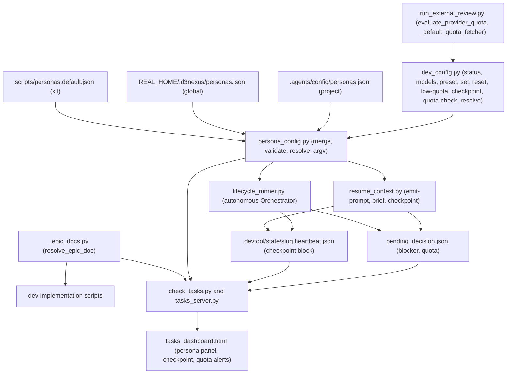
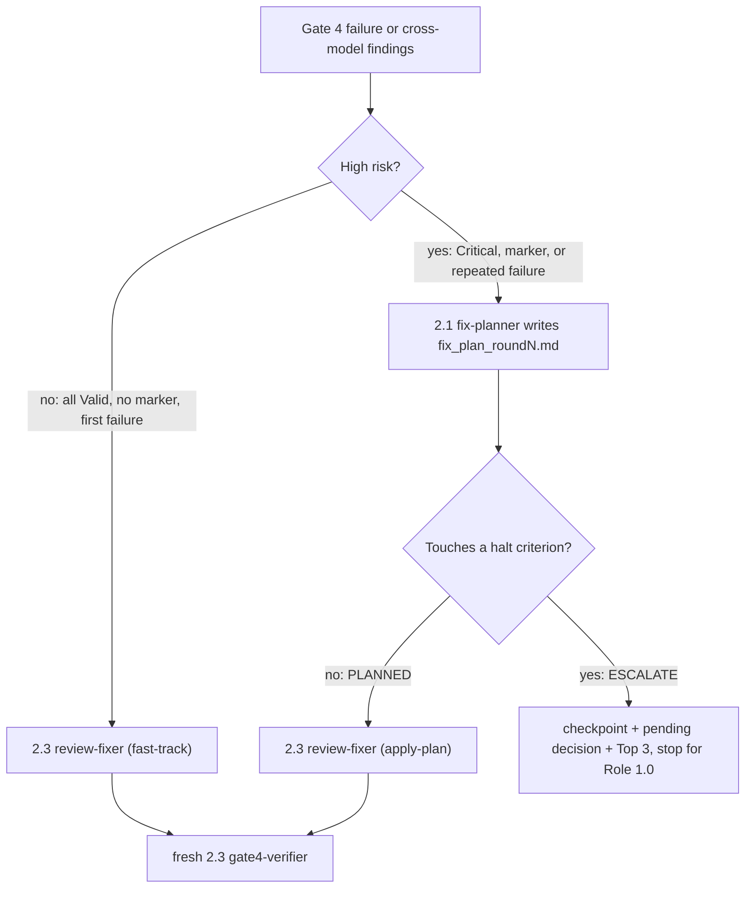

# Four-Persona Governance, Persona Model Config, and English-Only Dev Artefacts High-Level Design

## Table of Contents

- [Meta Data](#meta-data)
- [Background](#background)
- [Goals and Non-Goals](#goals-and-non-goals)
- [Architecture and Technical Design](#architecture-and-technical-design)
- [Feature Maintenance Map](#feature-maintenance-map)
- [Module Contracts and CLI Interfaces](#module-contracts-and-cli-interfaces)
- [Impact Analysis](#impact-analysis)
- [Shared Contract Impact](#shared-contract-impact)
- [Integration Test Plan and Boundary Matrix](#integration-test-plan-and-boundary-matrix)
- [Verification Environment](#verification-environment)
- [Comprehensive BDD Scenario Coverage](#comprehensive-bdd-scenario-coverage)
- [Rollout Strategy and Mitigation](#rollout-strategy-and-mitigation)
- [Kanban Tasks Breakdown](#kanban-tasks-breakdown)
- [Spec Errata](#spec-errata)

## Meta Data

- **Epic name**: `four_persona_governance`
- **Status**: Draft
- **PIC**: `danhdue`
- **Target release**: Next plugin release
- **Platform**: Python tooling, Markdown skills and rules, local HTTP dashboard (HTML/Vanilla JS)
- **Depends on epic**: none
- **Source Spec**: [Four-Persona Governance, Persona Model Config, and English-Only Dev Artefacts](2026-11-17-four-persona-governance-design.en.md)

## Background

The source spec describes four problems; this HLD maps them onto the code that carries them today.

1. **Two jobs in one Stage 3 session.** `skills/dev-lifecycle/references/orchestration-roles.md` makes
   the main session (Role 2.2) both the design authority (fix-plan rulings) and the mechanical
   orchestrator. `task-reviewer` is a Role 2.3 brief in `scripts/resume_context.py`
   (`_BRIEF_ROLE_CONTRACTS`, `L2026-L2051`), so code is reviewed by the model family that wrote it.
2. **Scattered model selection.** `lifecycle_runner.py` `RunnerConfig` (`L111-L226`) resolves the
   Programmer and Assistant from CLI flags, `--config`, `.devtool/review_config.json["providers"]`,
   `AGY_*` environment variables and constants; `emit_handoff_prompt` (`L2053-L2138`) re-reads them.
3. **Bilingual pairs.** `check_epic_readiness.py`, `package_epic.py`, `sync_task_status.py`,
   `check_bdd_traceability.py`, `check_tasks.py` and `tasks_server.py` hard-code `.en.md` / `.vi.md`
   names; `check_tasks.py::harvest_epics_overview` even reads `.vi.md` before `.en.md`.
4. **Late state saving.** State is written only when an agent calls `/save-context`; the per-epic
   heartbeat (`scripts/_state_envelope.py::update_epic_heartbeat`, `L497-L671`) has no checkpoint block,
   and nothing checks quota before a wave.

## Goals and Non-Goals

### Goals

- Four personas — Role 1.0 Human Architect, Role 2.1 AI Architect & Reviewer (`ai_architect_reviewer`),
  Role 2.2 Orchestrator (`orchestrator`), Role 2.3 Programmer (`programmer`) — with the boundaries,
  session map and brief roles of spec §3.
- One layered persona configuration (kit, global, project, CLI) and a `/d3nexus:dev-config` skill with
  `status`, `models`, `preset`, `set`, `reset`, `low-quota`, `checkpoint`, `quota-check` and `resolve`.
- High-risk findings routed to a Role 2.1 `fix-planner`; the five halt criteria escalate to Role 1.0.
- No automatic fallback: an unavailable model writes a checkpoint, records a blocker and stops.
- Proactive checkpoints in the heartbeat, a turn budget, low-quota mode and an automatic quota gate.
- English-only dev-lifecycle artefacts named `<stem>.md`, with `<stem>.en.md` read as legacy and
  `.vi.md` never read by tooling or agents.
- An exclusive-file-ownership readiness check for tasks that can run in parallel.
- Every new state, halt and binding surfaced on the `/d3nexus:check-tasks` dashboard.

### Non-Goals

- Changes to the doc-lifecycle skills, `check_document.py --require-bilingual`, or the bilingual kit
  guides beyond updating both variants for the four personas.
- Ollama persona bindings, automatic preset selection from live quota, a hard `Read(**/*.vi.md)` deny.
- Migrating or deleting `.vi.md` files in consuming repositories or in historical kit specs and plans.
- Changing the external review provider priority or `quota_thresholds`.

## Architecture and Technical Design

### High-Level Architecture



### Stage 3 Risk Routing



### Key Design Mechanics

1. **Persona configuration (`scripts/persona_config.py`).** Loads the kit
   default, the global file (`$REAL_HOME` resolved like `tasks_server.py::get_real_home`) and the project
   file; deep-merges them (later wins per key); picks `active_preset`; applies `overrides`; then CLI
   overrides. Each resolved field records its source layer. `{effort}` in a catalogue `id` is
   substituted. Validation rejects unknown aliases, efforts outside `efforts`, unknown personas, unknown
   CLIs (allowed: `agy`, `claude`, `codex`, `kiro`) and unknown `schema_version`. Legacy
   `review_config.json` persona keys and `AGY_*` variables are reported as warnings and never read.
2. **Dispatch argv (`persona_config.py::build_dispatch_argv`).** For `read-only` mode it delegates to
   `run_external_review.py::cli_command` (`L1049-L1123`), already tested per CLI. For `write` mode it
   builds the same base command with the CLI's write permission: `agy --mode auto`, `claude -p
   --dangerously-skip-permissions` with edit tools allowed, `codex exec --sandbox workspace-write`,
   `kiro-cli chat --no-interactive --trust-all-tools`.
3. **Quota gate (`dev_config.py quota-check`).** Loads `run_external_review.py` by path and calls
   `_default_quota_fetcher(cli)` and `evaluate_provider_quota(cli, data)` with the existing
   `quota_thresholds`. Exit `0` sufficient, `2` insufficient, `0` with a `quota_unknown` warning when no
   data is available. JSON output lists each persona's CLI, verdict and quota line.
4. **Checkpoints (`scripts/resume_context.py --checkpoint`, `scripts/_state_envelope.py`).** A new
   `update_epic_checkpoint()` runs inside `run_state_transaction()` under `_state_lock`, writes the
   `checkpoint` block into every mirrored heartbeat, appends one `checkpoint` event to
   `events_<safe_slug>.jsonl`, and refreshes `Next Immediate Step` in `.devtool/state/<slug>.md`.
5. **Runner (`lifecycle_runner.py`).** `RunnerConfig` resolves every persona through `persona_config`;
   `StageName` gains no stage, but halt reasons gain `MODEL_UNAVAILABLE`, `QUOTA_LOW`, `LOW_QUOTA_STOP` and
   `FIX_PLAN_ESCALATE`. `_draft_fix_plan` dispatches the `ai_architect_reviewer` binding in `read-only` mode
   and parses `PLANNED` / `ESCALATE`; `FixPlanVerdict` and `evaluate_programmer_fix_plan` are removed. A
   dispatch counter writes a `turn_budget` checkpoint every N dispatches (N/2 in low-quota mode).
6. **Document resolution (`skills/dev-implementation/resources/scripts/_epic_docs.py`).**
   `resolve_epic_doc(directory, stem)` returns `<stem>.md`, else `<stem>.en.md`, else `None`; it never
   returns `.vi.md`. `--strict-bilingual` stays accepted by the dev scripts as a deprecated no-op that prints
   one warning ([SE-02](#spec-errata)).
7. **Ownership check (`check_task_contract.py --design`).** Builds the `Blocked by` reachability graph
   from task files; for each unordered pair with no path, intersects normalised `Allowed files` and fails
   with `R-OWN` naming both tasks and the shared paths.
8. **Dashboard (`check_tasks.py`, `tasks_server.py`, `tasks_dashboard.html`).** `RepoMetadata` gains
   `persona_bindings`, `checkpoint` and `low_quota`; `quota` and `blocker` pending decisions and the new halt
   reasons feed `action_blockers` and `is_human_action_required`.

## Feature Maintenance Map

| Feature Area | Primary Files | Entry / Function |
|---|---|---|
| Persona config resolution | `scripts/persona_config.py`, `scripts/personas.default.json` | `load_persona_config()`, `resolve_persona()`, `build_dispatch_argv()` |
| dev-config CLI and skill | `skills/dev-config/SKILL.md` (agent instructions), `scripts/dev_config.py` | `main()` subcommands |
| Quota gate | `scripts/dev_config.py` | `cmd_quota_check()` |
| Checkpoints and briefs | `scripts/resume_context.py`, `scripts/_state_envelope.py` | `--checkpoint`, `update_epic_checkpoint()`, `_BRIEF_ROLE_CONTRACTS`, `emit_handoff_prompt()` |
| Autonomous runner | `skills/dev-lifecycle/resources/scripts/lifecycle_runner.py` | `RunnerConfig`, `_draft_fix_plan()`, `step_implementation()`, `step_cross_model_review()` |
| English-only resolution | `skills/dev-implementation/resources/scripts/_epic_docs.py` and its callers | `resolve_epic_doc()` |
| Ownership check | `skills/dev-implementation/resources/scripts/check_task_contract.py` | `check_exclusive_ownership()` |
| Dashboard sync | `skills/check-tasks/resources/scripts/check_tasks.py`, `tasks_server.py`, `tasks_dashboard.html` | `_scan_repo_impl()`, `renderRepoTabs()`, `renderEpicsOverviewAndApprovalGate()` |
| Governance text | `rules/CRITICAL_RULES.md`, `skills/dev-lifecycle/**`, stage skills | Rules §5, §8, §11 |

## Module Contracts and CLI Interfaces

1. **`persona_config.py`**:
   ```python
   PERSONAS: tuple[str, ...] = ("ai_architect_reviewer", "orchestrator", "programmer")
   ALLOWED_CLIS: frozenset[str] = frozenset({"agy", "claude", "codex", "kiro"})

   @dataclass(frozen=True)
   class PersonaBinding:
       persona: str
       alias: str
       cli: str
       model_id: str
       effort: str
       fallback_alias: str | None
       sources: dict[str, str]  # field -> "kit" | "global" | "project" | "cli"

   def load_persona_config(project_root: Path, *, real_home: Path | None = None) -> dict[str, Any]: ...
   def resolve_persona(persona: str, project_root: Path, *, cli_overrides: dict[str, str] | None = None,
                       real_home: Path | None = None) -> PersonaBinding: ...
   def build_dispatch_argv(binding: PersonaBinding, mode: str) -> list[str]: ...  # mode: "read-only" | "write"
   def low_quota_state(project_root: Path, profile: str, *, now: datetime | None = None,
                       real_home: Path | None = None) -> dict[str, Any] | None: ...
   class PersonaConfigError(ValueError): ...
   ```
2. **`dev_config.py`** (exit `0` success, `1` validation or usage error, `2` quota insufficient):
   ```text
   dev_config.py status [--json]
   dev_config.py models [--persona P] [--json]
   dev_config.py models add ALIAS --cli CLI --id ID --efforts E1,E2 [--scope global|project]
   dev_config.py models remove ALIAS [--scope global|project]
   dev_config.py preset NAME [--scope global|project]
   dev_config.py set PERSONA MODEL EFFORT [--fallback MODEL] [--scope global|project]
   dev_config.py reset [PERSONA] [--scope global|project]
   dev_config.py low-quota on|off [--for HOURS]      # alias: --low-quota
   dev_config.py checkpoint --turns N [--scope global|project]
   dev_config.py quota-check [--personas P1,P2] [--json]
   dev_config.py resolve PERSONA [--format json|argv] [--mode read-only|write]
   ```
3. **`resume_context.py`**: new `--checkpoint EVENT` (choices: `gate2_tasks_locked`, `subagent_returned`,
   `wave_merged`, `model_unavailable`, `turn_budget`, `low_quota_stop`, `quota_low`) with `--epic` and
   optional `--next`; `--role` choices `architect`, `orchestrator`, `programmer`, with `assistant` mapped to
   `architect`; `--brief-role` choices add `fix-planner`.
4. **`_state_envelope.py::update_epic_checkpoint`**:
   ```python
   def update_epic_checkpoint(primary_root: Path, epic_slug: str, checkpoint: Mapping[str, Any]) -> dict[str, Any]: ...
   ```
5. **`_epic_docs.py::resolve_epic_doc`**:
   ```python
   def resolve_epic_doc(directory: Path, stem: str) -> Path | None: ...
   ```

## Impact Analysis

Shift-left impact analysis (`check_code_impact.py --base-ref main`) over the planned files and the
symbols `update_epic_heartbeat`, `emit_handoff_prompt`, `RunnerConfig`, `evaluate_programmer_fix_plan`
and `extract_epic_hld_status`:

- Every modified Python module has a paired test suite (`scripts/test_resume_context.py`,
  `tests/test_rsdh_state_envelope.py`, `tests/test_lifecycle_runner.py`, `test_check_task_contract.py`,
  `test_sync_task_status.py`, `tests/test_check_tasks_fsm.py`, `tests/test_multi_epic_governance_acceptance.py`).
- Downstream callers that stay untouched but must keep passing: `audit_epic.py`, `run_task_checks.py`,
  `manage_worker_pool.py`, `verify_polyglot_registry.py`, `check_bdd_traceability.py` callers.
- `update_epic_heartbeat` keeps its signature; checkpoints use a new function in the same transaction.
- String-asserting tests that change with the renumbering or the English-only rule are listed per task.
- The working tree holds uncommitted user edits to `tasks_dashboard.html` and `quota_dashboard.html`;
  they must be committed or stashed before Stage 3 (see [Rollout](#rollout-strategy-and-mitigation)).

## Shared Contract Impact

None — self-contained change inside `ai-agent-tools` (`shared-contracts/` does not exist in this
repository).

## Integration Test Plan and Boundary Matrix

Integration test roots: tests
Protected paths: .agents/quality/**, .devtool/epic/four_persona_governance/bdd_scenarios.en.md
Integration results: python3 -m pytest -q --tb=short --maxfail=3 --junitxml=build/test-results/four-persona-governance.xml tests/test_fpg_persona_config.py tests/test_fpg_dispatch_and_quota.py tests/test_fpg_checkpoint_and_briefs.py tests/test_fpg_runner_personas.py tests/test_fpg_english_only_and_ownership.py tests/test_fpg_dashboard_sync.py tests/test_fpg_governance_text.py tests/test_fpg_english_only_text.py tests/test_fpg_acceptance.py tests/test_lifecycle_runner.py tests/test_rsdh_state_envelope.py tests/test_check_tasks_fsm.py -> build/test-results/four-persona-governance.xml

| Boundary | Producer | Consumer | Verification Tier |
|---|---|---|---|
| Persona config files and `resolve` output | `persona_config.py`, `dev_config.py` | `lifecycle_runner.py`, `resume_context.py`, `check_tasks.py` | Tier A Unit, Tier C CLI |
| Quota JSON | `dev_config.py quota-check` | Orchestrator, runner | Tier A Unit with stub fetcher |
| Heartbeat `checkpoint` block, `pending_decision.json` | `resume_context.py`, `_state_envelope.py`, runner | `check_tasks.py`, `resume_context.py` | Tier A Unit and Concurrency, Tier C |
| `resolve_epic_doc` | `_epic_docs.py` | dev-implementation scripts, check-tasks | Tier A Unit, Tier C |
| Dashboard payload | `check_tasks.py`, `tasks_server.py` | `tasks_dashboard.html` | Tier C HTTP and static UI |
| Governance text | rules and skills | agents | Tier A contract tests |

## Verification Environment

- **Data Isolation**: Tests run in `tmp_path` git repositories with a temporary `REAL_HOME`; CLIs are
  replaced by stub executables on a temporary `PATH`; quota fetchers are injected stubs.
- **Forbidden Live Stores**: Tests never read or write the host `~/.d3nexus/`, `~/.gemini/`,
  `~/antigravity_homes/`, `~/.zshrc`, real CLI credentials, or `/tmp/agy_tasks_server.pid`, and never call a
  real model CLI.
- **Needs Variables**: None (`Needs: none`).

## Comprehensive BDD Scenario Coverage

All 25 scenarios (`FPG-HP-01` to `FPG-FR-04`) are defined in [bdd_scenarios.en.md](bdd_scenarios.en.md)
across Happy Path (`HP`), Edge Cases (`EC`), State Transitions (`ST`), Architecture and Concurrency (`AR`)
and Fault Resilience (`FR`).

## Rollout Strategy and Mitigation

- Commit or stash the pending edits to `tasks_dashboard.html` and `quota_dashboard.html` on `main` before
  Gate 3, so Task 05 does not branch from a tree that conflicts at merge.
- Waves: (1) Tasks 01, 04; (2) Task 02; (3) Tasks 03, 05; (4) Task 06; (5) Task 07; (6) Task 08.
- Legacy compatibility: `.en.md` resolution, the `assistant` role alias and the no-op `--strict-bilingual`
  flag keep in-flight epics in consuming repositories working.
- After Gate 5, sync the installed plugin; until then agents must read `skills/` from the working tree.

## Kanban Tasks Breakdown

1. **[Task 01: Persona Config, Dispatch, Quota Gate and the dev-config Skill](task_01_persona_config_and_dev_config_cli.md)** (`review_tier: "full"`) — Covers: `FPG-HP-01`, `FPG-HP-02`, `FPG-HP-03`, `FPG-EC-01`, `FPG-EC-02`, `FPG-ST-01`, `FPG-FR-01`, `FPG-FR-02`
2. **[Task 02: Checkpoint Record, Persona Briefs and Handoff Prompts](task_02_checkpoints_briefs_and_handoff_prompts.md)** (`review_tier: "full"`) — Covers: `FPG-HP-04`, `FPG-HP-05`, `FPG-EC-03`, `FPG-AR-01`
3. **[Task 03: Lifecycle Runner on Persona Bindings, Risk Routing, Checkpoints and Quota Stops](task_03_runner_personas_risk_routing_and_quota_stops.md)** (`review_tier: "full"`) — Covers: `FPG-ST-02`, `FPG-ST-03`, `FPG-FR-03`, `FPG-FR-04`
4. **[Task 04: English-Only Document Resolution and Exclusive Ownership Check](task_04_english_only_resolution_and_ownership_check.md)** (`review_tier: "full"`) — Covers: `FPG-HP-06`, `FPG-EC-04`, `FPG-AR-02`
5. **[Task 05: check-tasks Dashboard Sync for Personas, Checkpoints and Quota Alerts](task_05_check_tasks_dashboard_persona_and_quota_sync.md)** (`review_tier: "full"`) — Covers: `FPG-HP-07`, `FPG-EC-05`, `FPG-ST-04`
6. **[Task 06: Four-Persona Governance and Checkpoint Rules in Rules and Skills](task_06_four_persona_governance_text.md)** (`review_tier: "full"`) — Covers: `FPG-AR-03`
7. **[Task 07: English-Only Dev-Lifecycle Skill Text and Vietnamese Mirror Isolation](task_07_english_only_skill_text_and_mirror_isolation.md)** (`review_tier: "full"`) — Covers: `FPG-AR-04`
8. **[Task 08: Kit Guides, verify.sh Registration and End-to-End Acceptance](task_08_kit_guides_verify_registration_and_acceptance.md)** (`review_tier: "full"`) — Covers: `FPG-HP-08`

## Spec Errata

- **[SE-01] §6.3 Vietnamese Mirrors and Context Loading**: Spec §6.3 states the `.vi.md` loading restriction as guidance. Per Role 1.0's 2026-11-17
  instruction, it becomes an explicit numbered rule, `CRITICAL_RULES.md` §11 "English SSOT and Vietnamese
  Mirror Isolation": agents MUST NOT open, grep, glob or list `*.vi.md` files into context; searches over
  epic or doc directories MUST exclude `*.vi.md`; subagent briefs and review bundles MUST NOT name them.
  Exceptions are limited to (a) a file Role 1.0 names explicitly and (b) writing the `.vi.md` variant of a
  doc-lifecycle document. A contract test fails if any dev-lifecycle skill instructs reading a `.vi.md`.
- **[SE-02] §6.2 File Naming and Legacy Compatibility**: Spec §6 does not say what happens to `--strict-bilingual`. Dev scripts keep accepting it as a
  deprecated no-op that prints one warning, so older skill text and scripts in consuming repositories do not
  fail on an unknown argument; the R7 mirror-sync check in `check_epic_readiness.py` is removed.
- **[SE-03] §5.3 The dev-config Skill**: Spec §5.1 and §5.3 place the kit defaults and scripts under
  `skills/dev-config/resources/`. They move to `scripts/personas.default.json`, `scripts/persona_config.py`
  and `scripts/dev_config.py`, beside `scripts/resume_context.py` and `scripts/_state_envelope.py`, and
  `skills/dev-config/SKILL.md` holds only agent instructions — the same layout as the `resume-context` and
  `save-context` skills. The runner, `resume_context.py` and `check_tasks.py` already load shared modules
  from `scripts/`.
