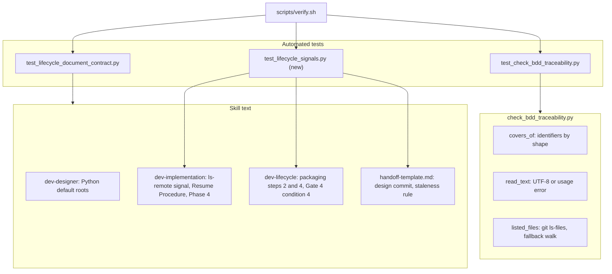
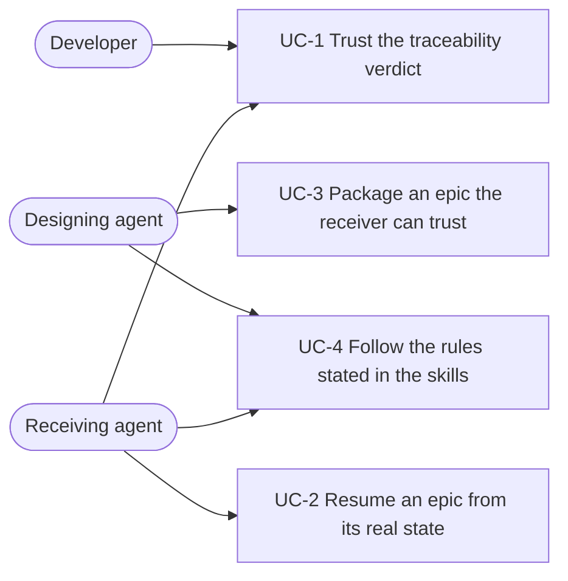
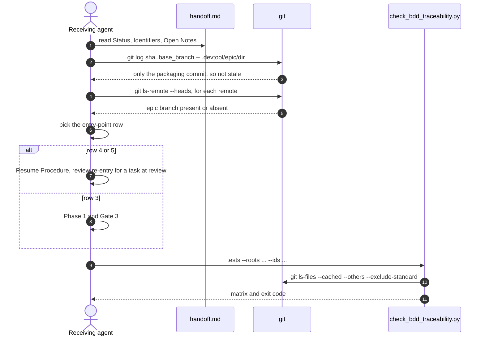

# Epic: Lifecycle Follow-ups

## Table of Contents

- [1. Meta Data](#1-meta-data)
- [2. Background](#2-background)
- [3. Goals and Non-Goals](#3-goals-and-non-goals)
- [4. Architecture and Technical Design](#4-architecture-and-technical-design)
- [5. Integration Test Plan](#5-integration-test-plan)
- [6. BDD Scenarios](#6-bdd-scenarios)
- [7. Rollout Strategy and Mitigation](#7-rollout-strategy-and-mitigation)
- [8. Kanban Tasks Breakdown](#8-kanban-tasks-breakdown)

## 1. Meta Data

- **Epic**: lifecycle-followups (directory `lifecycle_followups`)
- **Status**: todo
- **Target Release**: the next d3nexus release after 1.7.1
- **Platform**: Python — the kit repository: standard-library scripts tested with `unittest`, plus
  Markdown skills. `detect_project_type.sh` reports `unknown` for this repository.
- **Source Spec**: [2026-10-15-lifecycle-followups-design.en.md](2026-10-15-lifecycle-followups-design.en.md)

## 2. Background

BDD traceability (merge `bde3493`) and the epic handoff choice (merge `5b37dcc`) landed with eleven
deferred items. Re-checked against `main`, three reproduce on the real script, and one is worse than
recorded: `check_bdd_traceability.py tests` counts ignored and vendored files, so a stale generated
report can turn Gate 4 green for a deleted test. Resume and packaging also read misleading signals:
`git branch -r` misses an epic branch pushed from another clone until someone fetches, and the
handoff's staleness check flags the epic branch's own task commits. The source spec lists every item
and its fix; this epic formalizes it.

## 3. Goals and Non-Goals

**Goals:**

- Remove the false PASS from ignored files and the false "stale" warning in `handoff.md`.
- Let a resumed epic see a branch that exists only on a remote, before any fetch.
- Accept prose in `Covers:` lines, scan Python's `tests/e2e/`, and report bad encodings as usage
  errors.
- State the remaining small rules in the skills: value separators, Gate 4's re-run, the queued
  status, review re-entry, the retrofit's status fields and the `<N>` placeholder.

**Non-Goals:**

- New gates, changes to `quality_check` or its providers.
- Re-wrapping existing long lines.
- The `validate_quality_contract.py` crash on a missing registry.
- Retrofitting archived epics.

## 4. Architecture and Technical Design

### 4.1 High-Level Architecture

### 4.2 Use Cases

### 4.3 Sequence: a receiver resumes a packaged epic

### 4.4 Check 1 — Impact Analysis

`check_code_impact.py --base-ref main` over the five touched files reported no unmerged upstream
commits, no downstream callers and no native bridges. Its coverage section claimed "no test file
found" for `check_bdd_traceability.py`, whose test sits beside it as
`test_check_bdd_traceability.py`, and flagged Markdown files for exception handling; both are false
positives of the analyzer, not gaps in this epic.

## 5. Integration Test Plan

Integration test roots: skills/dev-implementation/resources/scripts/, scripts/

| Scenario | Automated test | File |
|----------|----------------|------|
| LF-HP-01, LF-HP-02, LF-EC-01, LF-EC-02, LF-FR-01, LF-FR-02 | `test_lf_*` methods that drive the real CLI through `main()` | `skills/dev-implementation/resources/scripts/test_check_bdd_traceability.py` |
| LF-ST-01, LF-ST-02, LF-ST-03, LF-FR-03 | `test_lf_*` methods that build throwaway git repositories and run the commands the skills prescribe, read from the skill text itself | `scripts/test_lifecycle_signals.py` (new, run by `scripts/verify.sh`) |
| LF-HP-03, LF-HP-04, LF-HP-05, LF-ST-04, LF-ST-05, LF-ST-06, LF-FR-04 | Required phrases, each tagged with its identifier in a comment | `scripts/test_lifecycle_document_contract.py` |

Boundaries: real git, real filesystem, no network — remotes are local bare repositories, and the
unreachable remote is a path that does not exist.

## 6. BDD Scenarios

The full Gherkin suite lives in [bdd_scenarios.en.md](bdd_scenarios.en.md). Index:

| Use case | Scenarios |
|----------|-----------|
| UC-1 The traceability script reads coverage faithfully | LF-HP-01, LF-HP-02, LF-EC-01, LF-EC-02, LF-FR-01, LF-FR-02 |
| UC-2 Resuming an epic reads truthful signals | LF-ST-01, LF-FR-03, LF-ST-04, LF-ST-06 |
| UC-3 Packaging records what the receiver needs | LF-ST-02, LF-FR-04, LF-ST-03, LF-HP-05 |
| UC-4 Skill text states the rules | LF-HP-03, LF-HP-04, LF-ST-05 |

## 7. Rollout Strategy and Mitigation

The change ships with the next plugin release. `scripts/verify.sh` must pass, now including the new
signal tests. The riskiest change is B4: a project that ignores a real test directory by mistake
will see new uncovered identifiers. The failure is loud and names them; the fix is in the project's
`.gitignore`. Rollback is a revert of the epic's merge commit.

## 8. Kanban Tasks Breakdown

- [Task 1: Traceability script reads coverage faithfully](task_1_traceability_script_reads_coverage_faithfully.md)
- [Task 2: Skill and template text](task_2_skill_and_template_text.md)
- [Task 3: Lifecycle signal integration tests](task_3_lifecycle_signal_integration_tests.md)
