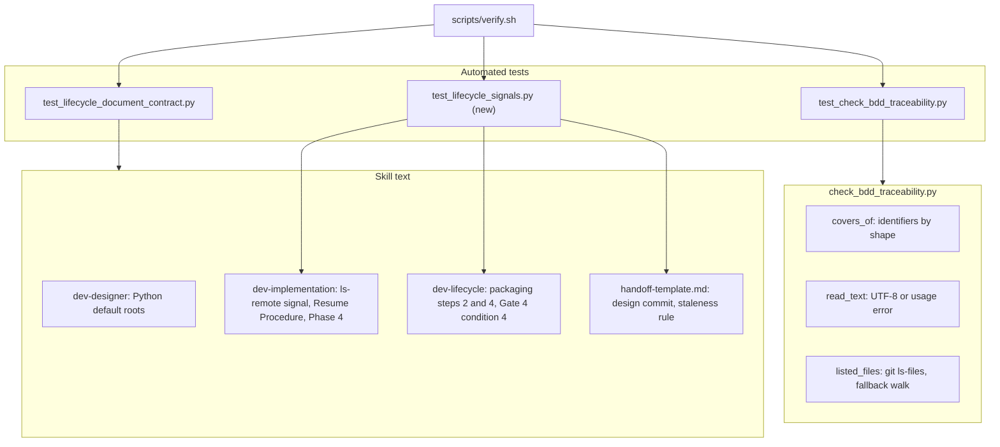
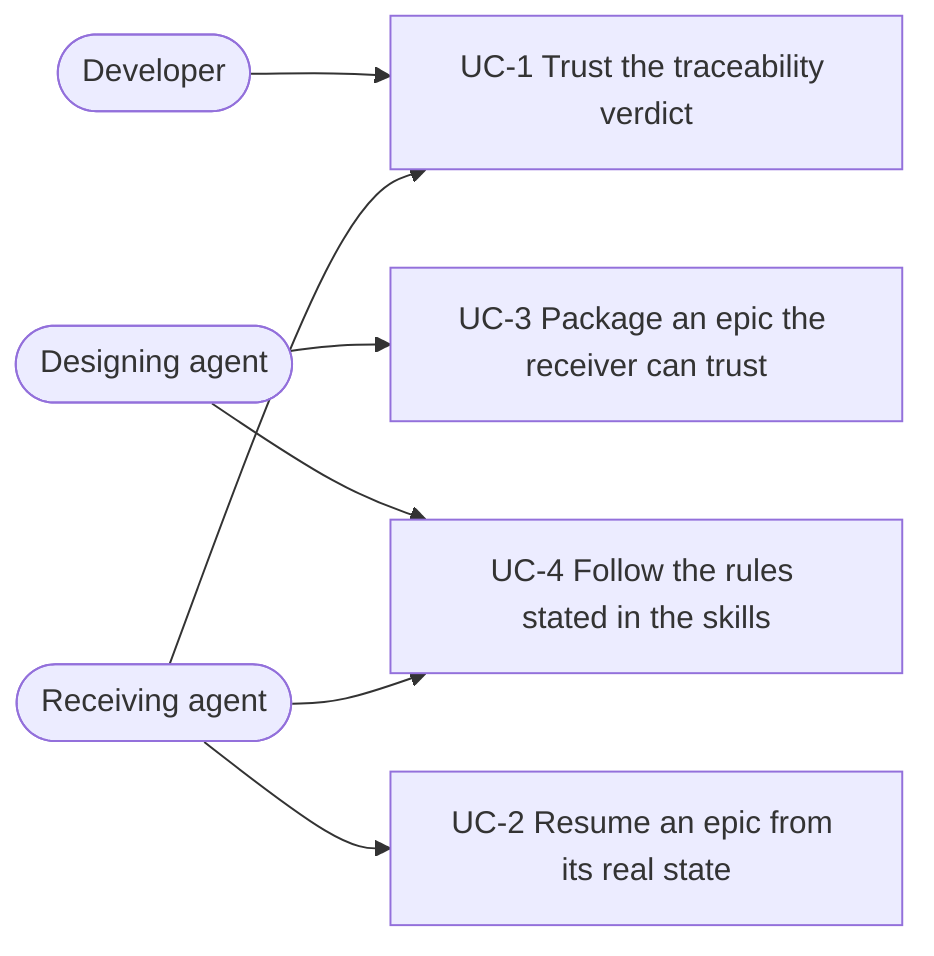
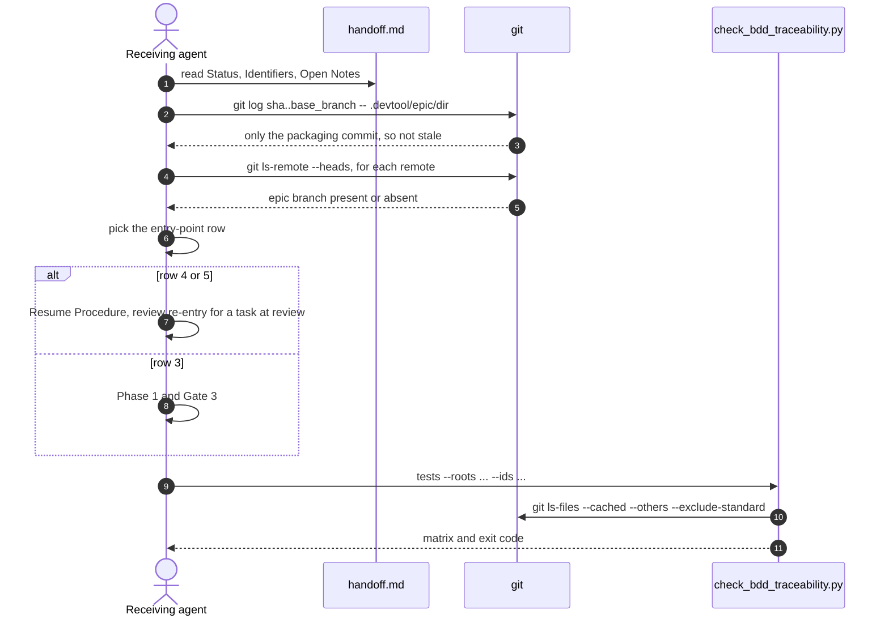

# Epic: Các điểm vá tiếp theo của lifecycle

## Mục lục

- [1. Meta Data](#1-meta-data)
- [2. Bối cảnh](#2-bối-cảnh)
- [3. Mục tiêu và ngoài mục tiêu](#3-mục-tiêu-và-ngoài-mục-tiêu)
- [4. Kiến trúc và thiết kế kỹ thuật](#4-kiến-trúc-và-thiết-kế-kỹ-thuật)
- [5. Kế hoạch integration test](#5-kế-hoạch-integration-test)
- [6. Kịch bản BDD](#6-kịch-bản-bdd)
- [7. Chiến lược triển khai và giảm thiểu rủi ro](#7-chiến-lược-triển-khai-và-giảm-thiểu-rủi-ro)
- [8. Phân rã task Kanban](#8-phân-rã-task-kanban)

## 1. Meta Data

- **Epic**: lifecycle-followups (thư mục `lifecycle_followups`)
- **Trạng thái**: todo
- **Bản phát hành mục tiêu**: bản d3nexus tiếp theo sau 1.7.1
- **Platform**: Python — chính repo của kit: script chỉ dùng thư viện chuẩn, test bằng `unittest`,
  cùng các skill Markdown. `detect_project_type.sh` báo `unknown` cho repo này.
- **Spec gốc**: [2026-10-15-lifecycle-followups-design.vi.md](2026-10-15-lifecycle-followups-design.vi.md)

## 2. Bối cảnh

Truy vết BDD (merge `bde3493`) và lựa chọn bàn giao epic (merge `5b37dcc`) được triển khai cùng mười
một mục bị hoãn. Kiểm tra lại trên `main`, ba mục tái hiện được trên script thật, và một mục tệ hơn mức
đã ghi: `check_bdd_traceability.py tests` tính cả file bị ignore và file vendored, nên một báo cáo cũ được
sinh ra có thể làm Gate 4 xanh cho một test đã bị xóa. Việc tiếp tục và đóng gói epic cũng đọc phải tín
hiệu sai lệch: `git branch -r` bỏ sót epic branch được push từ clone khác cho tới khi có người fetch, và
kiểm tra "đã cũ" của bản bàn giao gắn cờ cả commit task của chính epic branch. Spec gốc liệt kê từng mục
và cách sửa; epic này chính thức hóa nó.

## 3. Mục tiêu và ngoài mục tiêu

**Mục tiêu:**

- Loại bỏ PASS giả do file bị ignore và cảnh báo "đã cũ" giả trong `handoff.md`.
- Cho epic được tiếp tục thấy branch chỉ có trên remote, trước mọi lần fetch.
- Chấp nhận chú thích trong dòng `Covers:`, quét `tests/e2e/` của Python, và báo mã hóa sai là lỗi sử
  dụng.
- Nêu các quy tắc nhỏ còn lại trong skill: cách phân tách giá trị, quy tắc chạy lại của Gate 4, Status
  khi đang xếp hàng, vào lại khi đang review, trường trạng thái trong commit bổ sung, và placeholder
  `<N>`.

**Ngoài mục tiêu:**

- Gate mới, thay đổi `quality_check` hay các provider của nó.
- Ngắt lại các dòng dài sẵn có.
- Lỗi crash của `validate_quality_contract.py` khi thiếu registry.
- Bổ sung cho các epic đã lưu trữ.

## 4. Kiến trúc và thiết kế kỹ thuật

### 4.1 Kiến trúc tổng thể

### 4.2 Use case

### 4.3 Trình tự: người nhận tiếp tục một epic đã đóng gói

### 4.4 Check 1 — Phân tích tác động

`check_code_impact.py --base-ref main` trên năm file bị sửa báo không có commit thượng nguồn chưa merge,
không có caller phía dưới và không có native bridge. Phần coverage của nó báo "no test file found" cho
`check_bdd_traceability.py`, trong khi test nằm ngay cạnh là `test_check_bdd_traceability.py`, và gắn cờ
"exception handling" cho các file Markdown; cả hai đều là báo nhầm của bộ phân tích, không phải lỗ hổng
của epic này.

## 5. Kế hoạch integration test

Integration test roots: skills/dev-implementation/resources/scripts/, scripts/

| Scenario | Test tự động | File |
|----------|--------------|------|
| LF-HP-01, LF-HP-02, LF-EC-01, LF-EC-02, LF-FR-01, LF-FR-02 | Các method `test_lf_*` chạy CLI thật qua `main()` | `skills/dev-implementation/resources/scripts/test_check_bdd_traceability.py` |
| LF-ST-01, LF-ST-02, LF-ST-03, LF-FR-03 | Các method `test_lf_*` dựng repo git dùng một lần và chạy đúng lệnh mà skill quy định, đọc từ chính văn bản skill | `scripts/test_lifecycle_signals.py` (mới, được `scripts/verify.sh` chạy) |
| LF-HP-03, LF-HP-04, LF-HP-05, LF-ST-04, LF-ST-05, LF-ST-06, LF-FR-04 | Các cụm từ bắt buộc, mỗi cụm có comment ghi định danh của nó | `scripts/test_lifecycle_document_contract.py` |

Biên: git thật, filesystem thật, không có mạng — remote là các repo bare ở local, còn remote không kết
nối được là một đường dẫn không tồn tại.

## 6. Kịch bản BDD

Bộ Gherkin đầy đủ nằm trong [bdd_scenarios.vi.md](bdd_scenarios.vi.md). Mục lục:

| Use case | Scenario |
|----------|----------|
| UC-1 Script truy vết đọc coverage trung thực | LF-HP-01, LF-HP-02, LF-EC-01, LF-EC-02, LF-FR-01, LF-FR-02 |
| UC-2 Tiếp tục epic đọc đúng tín hiệu | LF-ST-01, LF-FR-03, LF-ST-04, LF-ST-06 |
| UC-3 Đóng gói ghi đủ điều người nhận cần | LF-ST-02, LF-FR-04, LF-ST-03, LF-HP-05 |
| UC-4 Văn bản skill nêu rõ các quy tắc | LF-HP-03, LF-HP-04, LF-ST-05 |

## 7. Chiến lược triển khai và giảm thiểu rủi ro

Thay đổi được phát hành cùng bản plugin tiếp theo. `scripts/verify.sh` phải pass, giờ có thêm các test
tín hiệu mới. Thay đổi rủi ro nhất là B4: một project lỡ ignore một thư mục test thật sẽ thấy định danh
mới chưa được phủ. Lỗi báo to và nêu rõ chúng; cách sửa nằm ở `.gitignore` của project. Rollback bằng
cách revert merge commit của epic.

## 8. Phân rã task Kanban

- [Task 1: Script truy vết đọc coverage trung thực](task_1_traceability_script_reads_coverage_faithfully.md)
- [Task 2: Văn bản skill và template](task_2_skill_and_template_text.md)
- [Task 3: Integration test cho tín hiệu lifecycle](task_3_lifecycle_signal_integration_tests.md)
