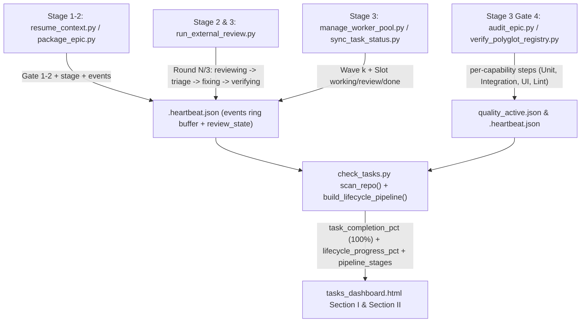

# Lifecycle Stage Progress, Sub-Step Telemetry, and Early Epic Activation Design

- **Date**: 2026-11-14
- **Status**: Approved (Gate 1)
- **PIC**: `phungthuy8901`
- **Epic Directory**: `lifecycle_telemetry_and_stage_progress_ui`
- **Epic Slug**: `lifecycle-telemetry-and-stage-progress-ui`
- **Scope**: `scripts/_state_envelope.py`, `scripts/resume_context.py`, `skills/quality_check/resources/scripts/verify_polyglot_registry.py`, `skills/dev-implementation/resources/scripts/run_external_review.py`, `skills/dev-implementation/resources/scripts/audit_epic.py`, `skills/dev-implementation/resources/scripts/check_bdd_traceability.py`, `skills/dev-implementation/resources/scripts/package_epic.py`, `skills/check-tasks/resources/scripts/check_tasks.py`, `skills/check-tasks/resources/dashboard/tasks_dashboard.html`, `tests/`
- **Next step**: `dev-designer` (Stage 2)

## Table of Contents

- [1. Background](#1-background)
- [2. Goals and Non-Goals](#2-goals-and-non-goals)
  - [Goals](#goals)
  - [Non-Goals](#non-goals)
- [3. Architecture and Data Flow](#3-architecture-and-data-flow)
- [4. Detailed Component Design](#4-detailed-component-design)
  - [4.1. Early Epic Activation from Gate 1 Across Lifecycle Stages](#41-early-epic-activation-from-gate-1-across-lifecycle-stages)
  - [4.2. Decoupled Task Progress (100%) and Weighted Lifecycle Progress Bar](#42-decoupled-task-progress-100-and-weighted-lifecycle-progress-bar)
  - [4.3. Granular Sub-Step State Machine and Rolling Event Log Envelope](#43-granular-sub-step-state-machine-and-rolling-event-log-envelope)
  - [4.4. Quality Check Capability Breakdown and Review Micro-Step Producers](#44-quality-check-capability-breakdown-and-review-micro-step-producers)
  - [4.5. Check-Tasks Harvester and Dashboard Pipeline UI Rendering](#45-check-tasks-harvester-and-dashboard-pipeline-ui-rendering)
- [5. Error Handling and Resilience](#5-error-handling-and-resilience)
- [6. Shared Contract Warnings](#6-shared-contract-warnings)
- [7. Verification and Testing Strategy](#7-verification-and-testing-strategy)
- [8. Risks and Mitigations](#8-risks-and-mitigations)

---

## 1. Background

During active epic execution on the `/check-tasks` Web Dashboard (`tasks_dashboard.html` Section II), four UX and telemetry limitations make it difficult for the Human Architect to track what `/dev-lifecycle` is doing in real time:

1. **Late Epic Visibility**: Epics only appear in Section II ("Triển khai Epic") once a `.worktrees/<epic>` directory is created in Stage 3 (`in_progress`). Stage 1 (`dev-brainstorming` / Gate 1) and Stage 2 (`dev-designer` HLD authoring, Gate 2, `/principal-review`, and `package_epic.py`) are invisible in Section II.
2. **Conflated Task Progress vs. Overall Lifecycle Progress**: When all Kanban tasks are completed (`9 / 9 Hoàn thành`), the single progress bar displays `Tiến độ Tasks: 9 / 9 Hoàn thành` on the left while capping the bar at `⚡ 96% Review` on the right. Task implementation completion (`9/9 = 100%`) is conflated with post-implementation verification stages (Gate 4 Quality Check, Cross-Model Review, and Stage 4 Finish).
3. **Opaque Stage Sub-Steps**: Even when the badge shows `Stage 2 Exit (Handoff)` or `Stage 3 Phase 4 (Review)`, the user cannot see the active micro-step inside each stage:
   - During **Quality Check**: Which capability is currently running or completed (`PyCore testing`, `Unit test`, `Integration test`, `UI / E2E test`, `Static Lint`, `Typecheck`, `Architecture`)?
   - During **`/principal-review` & `/cross-model-review`**: Which round (`Round 1/3`, `Round 2/3`, `Round 3/3`) and which micro-step is active (`<Provider/Model> reviewing` -> `Lập bảng triage` -> `Fix findings` -> `Verifying`)?
   - During **Task Implementation**: Which wave, worker slot, and task (`task_01..task_N`) is currently in `working` vs `review` vs `done`?
4. **Single-Line Stale Heartbeat Event**: `<epic_slug>.heartbeat.json` only stores a single `last_event` string (`sync_task task_09_... -> done`), overwriting previous events and leaving no rolling activity log stream on the card.

---

## 2. Goals and Non-Goals

### Goals
- Activate Epics in `/check-tasks` Section II immediately after **Gate 1 (`dev-brainstorming`)** approval (or when active state/heartbeat is recorded in Stage 1/2), tracking the full `/dev-lifecycle` workflow from Stage 1 to Stage 4.
- Decouple **Task Implementation Progress** (reaching **`100% ✓`** as soon as `done_tasks == total_tasks > 0`) from **Overall Epic Lifecycle Progress** (`0% -> 100%` weighted across Stage 1 Spec `10%`, Stage 2 HLD & Principal Review `25%`, Stage 3 Task Implementation `80%`, Stage 3 Gate 4 Quality Check `88%`, Stage 3 Cross-Model Review `96%`, and Stage 4 Waiting Finish `98%` / Done `100%`).
- Extend `<epic_slug>.heartbeat.json` and `quality_active.json` with a bounded rolling `events` ring buffer (last 20 timestamped events), structured `sub_step` / `review_state` metadata, and per-capability step history (`steps`) in `verify_polyglot_registry.py`.
- Emit real-time sub-step heartbeats from `resume_context.py`, `package_epic.py`, `audit_epic.py`, `check_bdd_traceability.py`, `verify_polyglot_registry.py`, and `run_external_review.py` (`reviewing` -> `triage` -> `fixing` -> `verifying`).
- Render a 6-stage **Lifecycle Pipeline Stepper**, **Active Sub-Step Detail Strip**, **Dual Progress Indicators** (`Tiến độ Tasks: N/N (100% ✓)` + `Tổng tiến trình Lifecycle: X%`), and a collapsible **Live Execution Log Stream** inside `tasks_dashboard.html`.

### Non-Goals
- Do not introduce external databases or background daemon processes beyond the existing `tasks_server.py` and atomic `.devtool/state/*.json` envelopes.
- Do not invoke LLM APIs for progress calculation or telemetry harvesting.
- Do not break existing `/api/review` modal inspection or PIC assignment endpoints.

---

## 3. Architecture and Data Flow

---

## 4. Detailed Component Design

### 4.1. Early Epic Activation from Gate 1 Across Lifecycle Stages

In `skills/check-tasks/resources/scripts/check_tasks.py`:
1. **`resolve_active_epic(repo_path)` & `harvest_epics_overview(repo_path)`**:
   - Share a single eligibility predicate (`_is_epic_eligible_for_active(slug, completed_epics, abandoned_epics, hld_status)`) that excludes `completed`, `archived`, and `abandoned` epics across both functions, even when an abandoned epic retains historical Gate 1 ledger entries or `.heartbeat.json` files.
   - Any eligible non-completed, non-abandoned epic with at least **Gate 1 approved** in `parse_gate_ledger_entries(repo_path)` (or an active `.heartbeat.json` / state file) is resolved as an active epic and marked `in_progress` in `epics_summary.epics` even before `.worktrees/<epic>` is created in Stage 3.
   - This ensures Section II ("Triển khai Epic") and the Kanban `"TIẾN ĐỘ EPICS"` sidebar immediately display newly brainstormed epics from Stage 1 onwards.

### 4.2. Decoupled Task Progress (100%) and Weighted Lifecycle Progress Bar

1. **Task Implementation Progress (`task_completion_pct`)**:
   - `task_completion_pct = round((done_tasks / total_tasks) * 100)` when `total_tasks > 0`, else `0`.
   - Reaches **`100%`** immediately when `done_tasks >= total_tasks > 0` (never artificially capped at `95%` or `96%`).
2. **Overall Epic Lifecycle Progress (`lifecycle_progress_pct` / `percentage`)**:
   - Deterministic monotonic weighting across the 6 pipeline stages:
     - **Stage 1 — Spec & Brainstorming (`0% -> 10%`)**:
       - Spec file present / drafting: `5%`
       - Gate 1 approved: `10%`
     - **Stage 2 — HLD, Tasks & Principal Review (`10% -> 25%`)**:
       - HLD & BDD authored: `14%`
       - Tasks generated / Gate 2 approved: `18%`
       - `/principal-review` Round 1..3 in progress: `20% -> 23%`
       - `handoff.md` packaged (`Stage 2 Exit`): `25%`
     - **Stage 3 (Phase 1–2) — Worktree & Task Implementation (`25% -> 80%`)**:
       - Gate 3 approved / Worktree created (`0` tasks done): `25%`
       - Tasks in progress (`0 < done < total`): `25 + round((done / total) * 55)` (scales linearly from `25%` to `79%`)
       - All tasks `done` (`done == total > 0`): **`80%`** (while `task_completion_pct` is **`100%`**)
     - **Stage 3 (Phase 4a) — Gate 4 Quality Check (`80% -> 88%`)**:
       - Gate 4 running (`audit_epic`, `bdd_traceability`, `quality_check` step `i/N`): `81% -> 87%` (`80 + round((step_i / step_N) * 7)`). Passing `quality_check` capabilities alone remains capped at **`87%`**.
       - **`88%`** requires full Gate 4 completion (`audit_epic` PASS + `bdd_traceability` PASS + `quality_check` PASS, or Gate 4 recorded in `GATE_LEDGER.md` / `gate_ledger.jsonl`).
     - **Stage 3 (Phase 4b) — Cross-Model Review & Post-Review Gate 4 Re-Verification (`88% -> 96%`)**:
       - Round 1 (`reviewing` -> `triage` -> `fixing` -> `verifying`): `89% -> 92%`
       - Round 2 (`reviewing` -> `triage` -> `fixing` -> `verifying`): `93% -> 95%`
       - Round 3 or post-review full Gate 4 re-verification on the latest candidate SHA: **`96%`** (while `current_stage_index` highlights the active post-review Gate 4 / `verifying` step without regressing monotonic `lifecycle_progress_pct`).
     - **Stage 4 — Gate 5 Sign-Off & Finish (`98% -> 100%`)**:
       - Review Converged **AND** Gate 4 PASS verified on the current `HEAD` SHA (`Stage 3 Phase 4.1 (Sign-off)` / Waiting `/finish`): **`98%`**
       - Gate 5 PASS / Epic Completed & Archived: **`100%`**

### 4.3. Granular Sub-Step State Machine and Rolling Event Log Envelope

In `scripts/_state_envelope.py`:
1. **`update_epic_heartbeat()` Enhancements**:
   - Add optional parameters:
     - `sub_step: str | None = None` (e.g. `"reviewing"`, `"triage"`, `"fixing"`, `"verifying"`, `"quality_check"`, `"tdd_wave"`)
     - `sub_step_detail: str | None = None` (human-readable active detail, e.g. `"Round 1/3: codex (gpt-6.1-sol) reviewing"`)
     - `review_state: Mapping[str, Any] | None = None` (tracks `{kind, round, max_rounds, cli, model, phase, verdict, critical, important, minor, action}`)
     - `append_event: bool = True`
   - Maintain `events: list[dict[str, str]]` (bounded ring buffer of the latest `20` entries `{"ts": now_iso, "stage": stage, "sub_step": sub_step, "message": last_event}`). Deduplicate consecutive identical `message` strings so polling ticks do not spam the log.

### 4.4. Quality Check Capability Breakdown and Review Micro-Step Producers

1. **Quality Check Capability Breakdown (`verify_polyglot_registry.py`, `audit_epic.py`, `check_bdd_traceability.py`)**:
   - Add a canonical human-readable capability label mapper in `verify_polyglot_registry.py`:
     - `pycore` / `unit` / `pytest_unit` -> `"PyCore / Unit Test"`
     - `test` / `pytest` / `flutter_test` / `cargo_test` -> `"Unit & Integration Test"`
     - `integration` / `integration_test` -> `"Integration Test"`
     - `e2e` / `playwright` / `ui` / `web_e2e` -> `"UI / E2E Test"`
     - `lint` / `ruff` / `spotless` / `swiftlint` / `clippy` -> `"Static Lint"`
     - `typecheck` / `type_check` / `mypy` / `analyze` -> `"Typecheck"`
     - `architecture` / `import_linter` / `konsist` -> `"Architecture Gate"`
   - In `_QualityRunCoordinator`, maintain `steps: list[dict[str, Any]]` inside `runs[run_id]` in `quality_active.json`, where each planned capability has `{"index": i, "provider": provider, "capability": cap, "label": label, "status": "pending" | "running" | "passed" | "failed", "elapsed_sec": ...}`.
   - Also emit distinct start and completion heartbeat events via `_state_envelope.update_epic_heartbeat()`: on start emit `last_event=f"Quality Check [{step_index}/{step_total}]: {label} ({provider}:{capability}) running..."` and on completion emit `last_event=f"Quality Check [{step_index}/{step_total}]: {label} ({provider}:{capability}) -> {status} ({elapsed_sec:.1f}s)"` so consecutive message deduplication preserves both events.
   - In `audit_epic.py` and `check_bdd_traceability.py`, emit heartbeat events when Gate 4 Epic Audit and BDD Traceability run.
2. **Principal & Cross-Model Review Micro-Steps (`run_external_review.py`)**:
   - Emit structured `review_state` and `last_event` into `<epic_slug>.heartbeat.json` across the 4 review micro-steps:
     1. **Step 1 — Model Reviewing (`phase="reviewing"`)**: Before invoking the external CLI (`claude`, `codex`, `kiro`, `agy`, `ollama`), record `review_state={"kind": kind, "round": next_round, "max_rounds": max_rounds, "cli": cli, "model": model, "phase": "reviewing", "label": f"{cli} ({model}) reviewing"}` and `last_event=f"{kind_label} Round {next_round}/{max_rounds}: {cli} ({model}) reviewing..."`.
     2. **Step 2 — Building Triage Table (`phase="triage"`)**: When `record_round()` completes and when `triage()` runs, record `phase="triage"`, `verdict`, finding counts (`critical`, `important`, `minor`), and `action` (`AUTO_PASS_CLEAN`, `AUTO_FIX_ELIGIBLE`, etc.), with `last_event=f"{kind_label} Round {round_num}/{max_rounds}: Lập bảng triage -> {verdict} ({crit}C/{imp}I/{min}M · {action})"`.
     3. **Step 3 — Fixing Findings (`phase="fixing"`) & Step 4 — Verifying (`phase="verifying"`)**: Provide a CLI flag / helper (`run_external_review.py status --epic-dir <dir> [--kind code|principal] --phase fixing|verifying|converged [--detail "..."]`) and wire `lifecycle_runner.py` / `check_tasks.py` git-commit & test-run heuristics so even in interactive sessions, when new commits appear after Round $N$ or quality/test runs execute after Round $N$, `check_tasks.py` automatically detects and displays `Fix findings` (`fixed in <sha>`) -> `Verifying`!

### 4.5. Check-Tasks Harvester and Dashboard Pipeline UI Rendering

1. **Harvester (`check_tasks.py`)**:
   - Add `build_epic_pipeline_telemetry(repo_path, active_epic, ...)` returning a structured dictionary attached to `RepoMetadata.pipeline_telemetry` (and per-epic in `epics_summary.epics[i]["pipeline_telemetry"]`):
     - `task_completion_pct`: `0..100` (`100` as soon as `done_tasks == total_tasks > 0`)
     - `lifecycle_progress_pct`: `0..100` (weighted across all 6 stages)
     - `current_stage_index`: `1..6`
     - `active_sub_step_summary`: concise banner string describing the exact current micro-step
     - `stages`: list of 6 stage objects (`id`, `label`, `weight_range`, `status` in `done|running|action_required|pending`, `summary`, `sub_steps`: list of `{label, status, detail}`)
     - `events`: latest 20 timestamped activity log entries from `heartbeat.json`
2. **Dashboard UI (`tasks_dashboard.html`)**:
   - **Dual Progress Display**:
     - Left pill / mini-bar: **`Tiến độ Tasks: 9 / 9 Hoàn thành (100% ✓)`** (reaches `100%` immediately when all tasks are `done`).
     - Main bar: **`Tổng tiến trình Lifecycle: 84% (Gate 4 Quality Check)`** with color-coded segments/gradient.
   - **6-Stage Pipeline Stepper & Sub-Step Micro-Tracker**:
     - Render the 6 stages (`1. Spec`, `2. HLD & Principal`, `3. Tasks (N/N · 100%)`, `4. Gate 4 QA`, `5. Cross-Review`, `6. Finish`).
     - Below the stepper, render the **Active Stage Micro-Steps Bar** showing the exact sequence of steps inside the active stage:
       - During **Task Implementation**: `Wave k` · `Slot 1: task_03 (Working)` · `Slot 2: task_04 (Review)` · `Done: 7/9 (78%)`
       - During **Gate 4 Quality Check**: `[✓ Epic Audit] → [✓ Static Lint] → [✓ Typecheck] → [⚡ PyCore / Unit & Integration Test (3/5 · 12s)] → [⏳ UI / E2E Test]`
       - During **Principal / Cross-Model Review**: `Round 1/3 (Codex · gpt-6.1-sol): [✓ 1. Reviewing] → [✓ 2. Lập bảng Triage (2 Important)] → [⚡ 3. Fix findings] → [⏳ 4. Verifying]`
   - **Collapsible Live Execution Logs**:
     - Show the latest 4 timestamped events from `hb.events` by default, with a toggle button (`Xem tất cả N logs ▾`) to expand all 20 events while preserving scroll/expand state across polling ticks (`tier2Sig`).
   - **Kanban Sidebar `"TIẾN ĐỘ EPICS"` Overview & Lifecycle Progress (`renderKanbanDashboard`)**:
     - Seed `epicsProgressMap` from both `allTasks` and active/in-progress epics in `repo.epics_summary.epics` (so Stage 1/2 epics appear even before tasks are created or completed).
     - Drive the card's percentage and progress bar via `lifecycle_progress_pct` (`10% -> 25% -> 80% -> 88% -> 96% -> 98%/100%`) while displaying `done/total Tasks (100% ✓)` when all tasks are done.
     - Render an overview stage & active micro-step line (`data-telemetry="kanban-epic-stage"`) on each epic card in `"TIẾN ĐỘ EPICS"` showing which `/dev-lifecycle` stage and sub-step the epic is currently executing (e.g., `Stage 2: HLD & Principal`, `Stage 4: Gate 4 QA · PyCore`, `Stage 5: Cross-Review R1 · Triage`), and include `pipeline_telemetry` in `buildKanbanSig`.

---

## 5. Error Handling and Resilience

- Missing or legacy `.heartbeat.json` / `quality_active.json` files without `events`, `steps`, or `review_state` fields degrade gracefully to synthesized stage summaries derived from `GATE_LEDGER.md`, `principal_review.md`, `review_results.md`, and `task_*.md`.
- All state writes in `verify_polyglot_registry.py`, `run_external_review.py`, and `audit_epic.py` wrap `_state_envelope` calls in `contextlib.suppress(Exception)` so telemetry failures never abort a review or quality gate run.

---

## 6. Shared Contract Warnings

- `shared-contracts/` is not present or modified in `ai-agent-tools` (`None — self-contained feature`). Internal JSON payload additions to `/api/tasks` (`pipeline_telemetry`, `task_completion_pct`, `lifecycle_progress_pct`, `events`, `steps`) are strictly additive and backward-compatible.

---

## 7. Verification and Testing Strategy

- **Unit Tests**:
  - `tests/test_lifecycle_telemetry_and_stage_progress.py`: Verify `update_epic_heartbeat` `events` ring buffer deduplication/capping (`<= 20`), `verify_polyglot_registry.py` capability label mapping and `steps` array tracking, `run_external_review.py` `review_state` micro-step transitions (`reviewing -> triage -> fixing -> verifying`), early Stage 1 epic activation in `check_tasks.py`, and decoupled `task_completion_pct` (`100%`) vs `lifecycle_progress_pct` weighting.
- **Integration & Headless Browser CDP Tests**:
  - Verify `tasks_dashboard.html` renders the 6-stage pipeline stepper, micro-step chips (`Codex reviewing -> Lập bảng triage -> Fix findings -> Verifying`, Quality Check capabilities `PyCore / Unit Test`, `Integration Test`, `UI / E2E Test`), `100%` task completion badge when `N/N` tasks are done, weighted overall progress bar, and live polling updates in headless Chrome CDP with zero console/runtime errors.

---

## 8. Risks and Mitigations

- **Existing RSDH test assertions on `96%` ceiling**: Existing tests in `tests/test_rsdh_tasks_dashboard_ui.py` and `tests/test_rsdh_harvester_and_pic.py` check `96% Review` and `doesNotMatch(/99%|100%/)`. We will update the affected test assertions to validate both the decoupled `100%` Task Completion indicator and the weighted Lifecycle Progress indicator cleanly.

