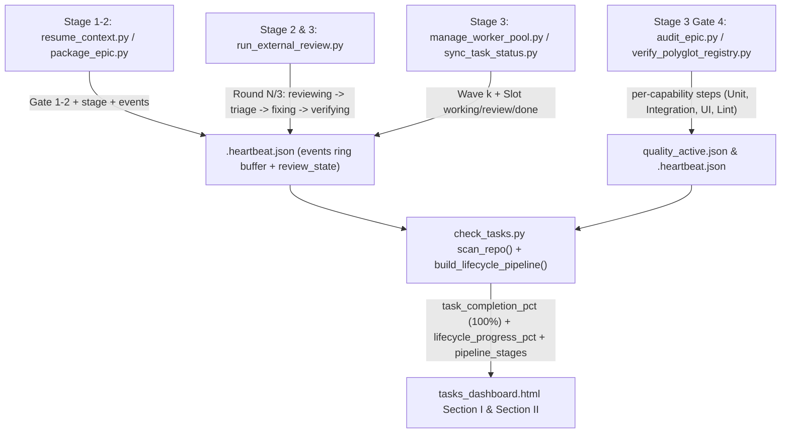

# Thiết kế Tiến trình Từng Stage Lifecycle, Telemetry Bước Con và Kích hoạt Epic Sớm

- **Ngày**: 2026-11-14
- **Trạng thái**: Đã phê duyệt (Gate 1)
- **PIC**: `phungthuy8901`
- **Thư mục Epic**: `lifecycle_telemetry_and_stage_progress_ui`
- **Epic Slug**: `lifecycle-telemetry-and-stage-progress-ui`
- **Phạm vi**: `scripts/_state_envelope.py`, `scripts/resume_context.py`, `skills/quality_check/resources/scripts/verify_polyglot_registry.py`, `skills/dev-implementation/resources/scripts/run_external_review.py`, `skills/dev-implementation/resources/scripts/audit_epic.py`, `skills/dev-implementation/resources/scripts/check_bdd_traceability.py`, `skills/dev-implementation/resources/scripts/package_epic.py`, `skills/check-tasks/resources/scripts/check_tasks.py`, `skills/check-tasks/resources/dashboard/tasks_dashboard.html`, `tests/`
- **Bước tiếp theo**: `dev-designer` (Stage 2)

## Mục lục

- [1. Bối cảnh](#1-bối-cảnh)
- [2. Mục tiêu và Ngoài phạm vi](#2-mục-tiêu-và-ngoài-phạm-vi)
  - [Mục tiêu](#mục-tiêu)
  - [Ngoài phạm vi](#ngoài-phạm-vi)
- [3. Kiến trúc và Luồng Dữ liệu](#3-kiến-trúc-và-luồng-dữ-liệu)
- [4. Thiết kế Chi tiết Thành phần](#4-thiết-kế-chi-tiết-thành-phần)
  - [4.1. Kích hoạt Epic Sớm từ Gate 1 xuyên suốt các Stage Lifecycle](#41-kích-hoạt-epic-sớm-từ-gate-1-xuyên-suốt-các-stage-lifecycle)
  - [4.2. Tách rời Tiến độ Task (100%) và Thanh Tiến trình Lifecycle Có Trọng số](#42-tách-rời-tiến-độ-task-100-và-thanh-tiến-trình-lifecycle-có-trọng-số)
  - [4.3. Máy trạng thái Bước con Chi tiết và Ring Buffer Log Sự kiện Cuộn](#43-máy-trạng-thái-bước-con-chi-tiết-và-ring-buffer-log-sự-kiện-cuộn)
  - [4.4. Phân rã Capability của Quality Check và Các Producer Vi bước Review](#44-phân-rã-capability-của-quality-check-và-các-producer-vi-bước-review)
  - [4.5. Harvester Check-Tasks và Giao diện Pipeline UI trên Dashboard](#45-harvester-check-tasks-và-giao-diện-pipeline-ui-trên-dashboard)
- [5. Xử lý Lỗi và Khả năng Chịu lỗi](#5-xử-lý-lỗi-và-khả-năng-chịu-lỗi)
- [6. Cảnh báo Hợp đồng Dùng chung](#6-cảnh-báo-hợp-đồng-dùng-chung)
- [7. Chiến lược Kiểm thử và Xác minh](#7-chiến-lược-kiểm-thử-và-xác-minh)
- [8. Rủi ro và Giảm thiểu](#8-rủi-ro-và-giảm-thiểu)

---

## 1. Bối cảnh

Trong quá trình thực thi epic theo `/dev-lifecycle` trên Web Dashboard `/check-tasks` (`tasks_dashboard.html` Phần II), có bốn hạn chế về quan sát và telemetry khiến Human Architect khó theo dõi diễn biến thực tế:

1. **Hiển thị Epic Muộn**: Các epic chỉ xuất hiện ở Phần II ("Triển khai Epic") khi thư mục `.worktrees/<epic>` được tạo tại Stage 3 (`in_progress`). Stage 1 (`dev-brainstorming` / Gate 1) và Stage 2 (`dev-designer` viết HLD, Gate 2, `/principal-review`, và `package_epic.py`) bị ẩn ở Phần II.
2. **Gộp chung Tiến độ Task với Tổng tiến trình Lifecycle**: Khi toàn bộ task Kanban đã xong (`9 / 9 Hoàn thành`), thanh tiến trình duy nhất hiển thị `Tiến độ Tasks: 9 / 9 Hoàn thành` bên trái trong khi ghim ở `⚡ 96% Review` bên phải. Việc hoàn thành task (`9/9 = 100%`) bị trộn lẫn với các stage hậu triển khai (Gate 4 Quality Check, Cross-Model Review, và Stage 4 Finish).
3. **Mờ nhạt Vi bước bên trong từng Stage**: Ngay cả khi nhãn hiển thị `Stage 2 Exit (Handoff)` hoặc `Stage 3 Phase 4 (Review)`, người dùng không biết vi bước nào đang chạy bên trong mỗi stage:
   - Trong **Quality Check**: Capability nào đang chạy hoặc đã xong (`PyCore testing`, `Unit test`, `Integration test`, `UI / E2E test`, `Static Lint`, `Typecheck`, `Architecture`)?
   - Trong **`/principal-review` & `/cross-model-review`**: Đang ở round nào (`Round 1/3`, `Round 2/3`, `Round 3/3`) và vi bước nào đang chạy (`<Provider/Model> reviewing` -> `Lập bảng triage` -> `Fix findings` -> `Verifying`)?
   - Trong **Task Implementation**: Wave, worker slot, và task nào (`task_01..task_N`) đang `working`, `review`, hoặc `done`?
4. **Sự kiện Heartbeat Một dòng Cũ**: `<epic_slug>.heartbeat.json` chỉ lưu một chuỗi `last_event` duy nhất (`sync_task task_09_... -> done`), ghi đè các sự kiện trước đó và không có dòng log cuộn trên thẻ.

---

## 2. Mục tiêu và Ngoài phạm vi

### Mục tiêu

- Kích hoạt Epic trên `/check-tasks` Phần II ngay sau khi phê duyệt **Gate 1 (`dev-brainstorming`)** (hoặc khi có state/heartbeat hoạt động ở Stage 1/2), theo dõi trọn vẹn quy trình `/dev-lifecycle` từ Stage 1 đến Stage 4.
- Tách rời **Tiến độ Thực thi Task** (đạt **`100% ✓`** ngay khi `done_tasks == total_tasks > 0`) khỏi **Tổng tiến trình Epic Lifecycle** (`0% -> 100%` phân bổ trọng số qua Stage 1 Spec `10%`, Stage 2 HLD & Principal Review `25%`, Stage 3 Task Implementation `80%`, Stage 3 Gate 4 Quality Check `88%`, Stage 3 Cross-Model Review `96%`, và Stage 4 Chờ Finish `98%` / Done `100%`).
- Mở rộng `<epic_slug>.heartbeat.json` và `quality_active.json` với ring buffer `events` có giới hạn (20 sự kiện gần nhất kèm timestamp), metadata `sub_step` / `review_state` có cấu trúc, và lịch sử bước theo capability (`steps`) trong `verify_polyglot_registry.py`.
- Phát heartbeat vi bước theo thời gian thực từ `resume_context.py`, `package_epic.py`, `audit_epic.py`, `check_bdd_traceability.py`, `verify_polyglot_registry.py`, và `run_external_review.py` (`reviewing` -> `triage` -> `fixing` -> `verifying`).
- Render thanh bước **Lifecycle Pipeline Stepper** 6 stage, **Dải Chi tiết Bước con Đang chạy**, **Bộ chỉ báo Tiến độ Kép** (`Tiến độ Tasks: N/N (100% ✓)` + `Tổng tiến trình Lifecycle: X%`), và khối **Nhật ký Thực thi Trực tiếp** có thể đóng mở trong `tasks_dashboard.html`.

### Ngoài phạm vi

- Không thêm cơ sở dữ liệu ngoài hay daemon nền ngoài `tasks_server.py` và các vỏ `.devtool/state/*.json` atomic hiện có.
- Không gọi LLM API để tính toán tiến độ hoặc thu thập telemetry.
- Không làm gãy các endpoint kiểm tra modal `/api/review` hoặc gán PIC hiện hành.

---

## 3. Kiến trúc và Luồng Dữ liệu

---

## 4. Thiết kế Chi tiết Thành phần

### 4.1. Kích hoạt Epic Sớm từ Gate 1 xuyên suốt các Stage Lifecycle

Trong `skills/check-tasks/resources/scripts/check_tasks.py`:
1. **`resolve_active_epic(repo_path)` & `harvest_epics_overview(repo_path)`**:
   - Dùng chung một điều kiện lọc (`_is_epic_eligible_for_active(slug, completed_epics, abandoned_epics, hld_status)`) để loại bỏ các epic `completed`, `archived`, và `abandoned` ở cả hai hàm, ngay cả khi epic bị hủy vẫn còn bản ghi Gate 1 hoặc tệp `.heartbeat.json`.
   - Mọi epic hợp lệ chưa hoàn thành và chưa bị hủy có ít nhất **Gate 1 đã phê duyệt** trong `parse_gate_ledger_entries(repo_path)` (hoặc có `.heartbeat.json` / state file hoạt động) đều được xác định là epic đang chạy và đánh dấu `in_progress` trong `epics_summary.epics` ngay cả trước khi `.worktrees/<epic>` được tạo ở Stage 3.
   - Điều này đảm bảo Phần II ("Triển khai Epic") và sidebar `"TIẾN ĐỘ EPICS"` trên Kanban hiển thị ngay các epic vừa brainstorm xong từ Stage 1 trở đi.

### 4.2. Tách rời Tiến độ Task (100%) và Thanh Tiến trình Lifecycle Có Trọng số

1. **Tiến độ Thực thi Task (`task_completion_pct`)**:
   - `task_completion_pct = round((done_tasks / total_tasks) * 100)` khi `total_tasks > 0`, ngược lại là `0`.
   - Đạt **`100%`** ngay lập tức khi `done_tasks >= total_tasks > 0` (không bị chặn nhân tạo ở `95%` hoặc `96%`).
2. **Tổng tiến trình Lifecycle Epic (`lifecycle_progress_pct` / `percentage`)**:
   - Phân bổ trọng số đơn điệu xác định qua 6 stage pipeline:
     - **Stage 1 — Spec & Brainstorming (`0% -> 10%`)**:
       - Có file Spec / đang soạn thảo: `5%`
       - Gate 1 đã phê duyệt: `10%`
     - **Stage 2 — HLD, Tasks & Principal Review (`10% -> 25%`)**:
       - Đã viết HLD & BDD: `14%`
       - Đã tạo Tasks / Gate 2 đã phê duyệt: `18%`
       - `/principal-review` Round 1..3 đang chạy: `20% -> 23%`
       - Đã đóng gói `handoff.md` (`Stage 2 Exit`): `25%`
     - **Stage 3 (Phase 1–2) — Worktree & Triển khai Tasks (`25% -> 80%`)**:
       - Gate 3 đã phê duyệt / đã tạo Worktree (`0` task xong): `25%`
       - Đang làm task (`0 < done < total`): `25 + round((done / total) * 55)` (tăng tuyến tính từ `25%` đến `79%`)
       - Toàn bộ task `done` (`done == total > 0`): **`80%`** (trong khi `task_completion_pct` là **`100%`**)
     - **Stage 3 (Phase 4a) — Gate 4 Quality Check (`80% -> 88%`)**:
       - Đang chạy Gate 4 (`audit_epic`, `bdd_traceability`, `quality_check` bước `i/N`): `81% -> 87%` (`80 + round((step_i / step_N) * 7)`). Chỉ riêng các capability của `quality_check` đạt giới hạn tại **`87%`**.
       - Đạt **`88%`** đòi hỏi hoàn tất đầy đủ Gate 4 (`audit_epic` PASS + `bdd_traceability` PASS + `quality_check` PASS, hoặc đã ghi Gate 4 vào `GATE_LEDGER.md` / `gate_ledger.jsonl`).
     - **Stage 3 (Phase 4b) — Cross-Model Review & Tái xác minh Gate 4 sau Review (`88% -> 96%`)**:
       - Round 1 (`reviewing` -> `triage` -> `fixing` -> `verifying`): `89% -> 92%`
       - Round 2 (`reviewing` -> `triage` -> `fixing` -> `verifying`): `93% -> 95%`
       - Round 3 hoặc tái xác minh Gate 4 đầy đủ trên candidate SHA mới nhất: **`96%`** (trong khi `current_stage_index` làm nổi bật bước tái xác minh Gate 4 / `verifying` mà không làm tụt giá trị đơn điệu của `lifecycle_progress_pct`).
     - **Stage 4 — Ký duyệt Gate 5 & Hoàn tất (`98% -> 100%`)**:
       - Review đã hội tụ **VÀ** đã xác minh Gate 4 PASS trên `HEAD` SHA hiện tại (`Stage 3 Phase 4.1 (Sign-off)` / Chờ `/finish`): **`98%`**
       - Gate 5 PASS / Epic Hoàn tất & Lưu trữ: **`100%`**

### 4.3. Máy trạng thái Bước con Chi tiết và Ring Buffer Log Sự kiện Cuộn

Trong `scripts/_state_envelope.py`:
1. **Nâng cấp `update_epic_heartbeat()`**:
   - Bổ sung các tham số tùy chọn:
     - `sub_step: str | None = None` (ví dụ `"reviewing"`, `"triage"`, `"fixing"`, `"verifying"`, `"quality_check"`, `"tdd_wave"`)
     - `sub_step_detail: str | None = None` (mô tả dễ đọc, ví dụ `"Round 1/3: codex (gpt-6.1-sol) reviewing"`)
     - `review_state: Mapping[str, Any] | None = None` (theo dõi `{kind, round, max_rounds, cli, model, phase, verdict, critical, important, minor, action}`)
     - `append_event: bool = True`
   - Duy trì `events: list[dict[str, str]]` (ring buffer giới hạn `20` mục gần nhất `{"ts": now_iso, "stage": stage, "sub_step": sub_step, "message": last_event}`). Khử trùng lặp các chuỗi `message` liên tiếp giống nhau để tránh spam log khi poll.

### 4.4. Phân rã Capability của Quality Check và Các Producer Vi bước Review

1. **Phân rã Capability của Quality Check (`verify_polyglot_registry.py`, `audit_epic.py`, `check_bdd_traceability.py`)**:
   - Bổ sung hàm ánh xạ tên capability dễ đọc chuẩn trong `verify_polyglot_registry.py`:
     - `pycore` / `unit` / `pytest_unit` -> `"PyCore / Unit Test"`
     - `test` / `pytest` / `flutter_test` / `cargo_test` -> `"Unit & Integration Test"`
     - `integration` / `integration_test` -> `"Integration Test"`
     - `e2e` / `playwright` / `ui` / `web_e2e` -> `"UI / E2E Test"`
     - `lint` / `ruff` / `spotless` / `swiftlint` / `clippy` -> `"Static Lint"`
     - `typecheck` / `type_check` / `mypy` / `analyze` -> `"Typecheck"`
     - `architecture` / `import_linter` / `konsist` -> `"Architecture Gate"`
   - Trong `_QualityRunCoordinator`, khởi tạo `steps: list[dict[str, Any]]` dưới `runs[run_id]` trong `quality_active.json`, trong đó mỗi capability dự kiến có `{"index": i, "provider": provider, "capability": cap, "label": label, "status": "pending" | "running" | "passed" | "failed", "elapsed_sec": ...}`.
   - Đồng thời phát sự kiện heartbeat bắt đầu và hoàn tất riêng biệt qua `_state_envelope.update_epic_heartbeat()`: khi bắt đầu phát `last_event=f"Quality Check [{step_index}/{step_total}]: {label} ({provider}:{capability}) running..."` và khi kết thúc phát `last_event=f"Quality Check [{step_index}/{step_total}]: {label} ({provider}:{capability}) -> {status} ({elapsed_sec:.1f}s)"` để khử trùng lặp vẫn giữ cả hai sự kiện.
   - Trong `audit_epic.py` và `check_bdd_traceability.py`, phát sự kiện heartbeat khi Gate 4 Epic Audit và BDD Traceability thực thi.
2. **Vi bước Principal & Cross-Model Review (`run_external_review.py`)**:
   - Phát `review_state` và `last_event` có cấu trúc vào `<epic_slug>.heartbeat.json` qua 4 vi bước review:
     1. **Bước 1 — Model Đang Review (`phase="reviewing"`)**: Trước khi gọi CLI ngoài (`claude`, `codex`, `kiro`, `agy`, `ollama`), ghi nhận `review_state={"kind": kind, "round": next_round, "max_rounds": max_rounds, "cli": cli, "model": model, "phase": "reviewing", "label": f"{cli} ({model}) reviewing"}` và `last_event=f"{kind_label} Round {next_round}/{max_rounds}: {cli} ({model}) reviewing..."`.
     2. **Bước 2 — Lập Bảng Triage (`phase="triage"`)**: Khi `record_round()` hoàn tất và khi `triage()` chạy, ghi `phase="triage"`, `verdict`, số lượng finding (`critical`, `important`, `minor`), và `action` (`AUTO_PASS_CLEAN`, `AUTO_FIX_ELIGIBLE`, v.v.), cùng `last_event=f"{kind_label} Round {round_num}/{max_rounds}: Lập bảng triage -> {verdict} ({crit}C/{imp}I/{min}M · {action})"`.
     3. **Bước 3 — Sửa Findings (`phase="fixing"`) & Bước 4 — Xác minh (`phase="verifying"`)**: Cung cấp cờ/hàm CLI (`run_external_review.py status --epic-dir <dir> [--kind code|principal] --phase fixing|verifying|converged [--detail "..."]`) và đấu nối suy diễn git commit / test run trong `lifecycle_runner.py` / `check_tasks.py` để ngay cả ở phiên tương tác, khi có commit mới sau Round $N$ hoặc có lần chạy quality/test sau Round $N$, `check_tasks.py` tự động phát hiện và hiển thị `Fix findings` (`fixed in <sha>`) -> `Verifying`.

### 4.5. Harvester Check-Tasks và Giao diện Pipeline UI trên Dashboard

1. **Harvester (`check_tasks.py`)**:
   - Bổ sung `build_epic_pipeline_telemetry(repo_path, active_epic, ...)` trả về từ điển có cấu trúc gắn vào `RepoMetadata.pipeline_telemetry` (và từng epic trong `epics_summary.epics[i]["pipeline_telemetry"]`):
     - `task_completion_pct`: `0..100` (`100` ngay khi `done_tasks == total_tasks > 0`)
     - `lifecycle_progress_pct`: `0..100` (có trọng số qua cả 6 stage)
     - `current_stage_index`: `1..6`
     - `active_sub_step_summary`: chuỗi banner ngắn gọn mô tả đúng vi bước hiện tại
     - `stages`: danh sách 6 đối tượng stage (`id`, `label`, `weight_range`, `status` thuộc `done|running|action_required|pending`, `summary`, `sub_steps`: danh sách `{label, status, detail}`)
     - `events`: 20 mục nhật ký hoạt động kèm timestamp mới nhất từ `heartbeat.json`
2. **Giao diện Dashboard (`tasks_dashboard.html`)**:
   - **Hiển thị Tiến độ Kép**:
     - Pill / thanh nhỏ bên trái: **`Tiến độ Tasks: 9 / 9 Hoàn thành (100% ✓)`** (đạt `100%` ngay khi toàn bộ task đều `done`).
     - Thanh chính: **`Tổng tiến trình Lifecycle: 84% (Gate 4 Quality Check)`** kèm phân đoạn / gradient mã màu.
   - **Thanh 6-Stage Pipeline Stepper & Vi bước Hiện hành**:
     - Render 6 stage (`1. Spec`, `2. HLD & Principal`, `3. Tasks (N/N · 100%)`, `4. Gate 4 QA`, `5. Cross-Review`, `6. Finish`).
     - Bên dưới stepper, render **Thanh Vi bước Stage Đang chạy** hiển thị chính xác chuỗi bước bên trong stage hiện tại:
       - Khi **Task Implementation**: `Wave k` · `Slot 1: task_03 (Working)` · `Slot 2: task_04 (Review)` · `Done: 7/9 (78%)`
       - Khi **Gate 4 Quality Check**: `[✓ Epic Audit] → [✓ Static Lint] → [✓ Typecheck] → [⚡ PyCore / Unit & Integration Test (3/5 · 12s)] → [⏳ UI / E2E Test]`
       - Khi **Principal / Cross-Model Review**: `Round 1/3 (Codex · gpt-6.1-sol): [✓ 1. Reviewing] → [✓ 2. Lập bảng Triage (2 Important)] → [⚡ 3. Fix findings] → [⏳ 4. Verifying]`
   - **Nhật ký Thực thi Trực tiếp Đóng/Mở được**:
     - Mặc định hiện 4 sự kiện có timestamp mới nhất từ `hb.events`, kèm nút bật/tắt (`Xem tất cả N logs ▾`) để mở rộng toàn bộ 20 sự kiện mà vẫn giữ nguyên trạng thái mở/cuộn qua các chu kỳ poll (`tier2Sig`).
   - **Tổng quan Kanban `"TIẾN ĐỘ EPICS"` & Tiến trình Lifecycle (`renderKanbanDashboard`)**:
     - Nạp `epicsProgressMap` từ cả `allTasks` lẫn các epic active/in_progress trong `repo.epics_summary.epics` (giúp các epic ở Stage 1/2 vẫn hiển thị trước khi tạo hoặc xong task).
     - Điều khiển tỷ lệ phần trăm và thanh tiến độ thẻ bằng `lifecycle_progress_pct` (`10% -> 25% -> 80% -> 88% -> 96% -> 98%/100%`) đồng thời hiển thị `done/total Tasks (100% ✓)` khi xong hết tasks.
     - Render dòng tổng quan stage & vi bước đang chạy (`data-telemetry="kanban-epic-stage"`) trên mỗi thẻ epic trong `"TIẾN ĐỘ EPICS"` cho biết epic đang thực thi stage và bước con nào của `/dev-lifecycle` (ví dụ `Stage 2: HLD & Principal`, `Stage 4: Gate 4 QA · PyCore`, `Stage 5: Cross-Review R1 · Triage`), và đưa `pipeline_telemetry` vào `buildKanbanSig`.

---

## 5. Xử lý Lỗi và Khả năng Chịu lỗi

- Các file `.heartbeat.json` / `quality_active.json` thiếu hoặc ở định dạng cũ không có trường `events`, `steps`, hoặc `review_state` sẽ tự suy diễn an toàn sang tóm tắt stage tổng hợp từ `GATE_LEDGER.md`, `principal_review.md`, `review_results.md`, và `task_*.md`.
- Mọi thao tác ghi state trong `verify_polyglot_registry.py`, `run_external_review.py`, và `audit_epic.py` đều bọc lệnh gọi `_state_envelope` bằng `contextlib.suppress(Exception)` để lỗi telemetry không bao giờ làm ngắt quá trình review hay quality gate.

---

## 6. Cảnh báo Hợp đồng Dùng chung

- `shared-contracts/` không có và không bị sửa đổi trong `ai-agent-tools` (`Không có — tính năng độc lập`). Các trường JSON bổ sung nội bộ vào `/api/tasks` (`pipeline_telemetry`, `task_completion_pct`, `lifecycle_progress_pct`, `events`, `steps`) hoàn toàn có tính cộng thêm và tương thích ngược.

---

## 7. Chiến lược Kiểm thử và Xác minh

- **Kiểm thử Đơn vị (Unit Tests)**:
  - `tests/test_lifecycle_telemetry_and_stage_progress.py`: Kiểm chứng ring buffer `events` của `update_epic_heartbeat` (khử trùng lặp/giới hạn `<= 20`), ánh xạ nhãn capability và mảng `steps` trong `verify_polyglot_registry.py`, chuyển trạng thái vi bước `review_state` (`reviewing -> triage -> fixing -> verifying`) trong `run_external_review.py`, kích hoạt sớm Stage 1 trong `check_tasks.py`, và tách rời `task_completion_pct` (`100%`) với trọng số `lifecycle_progress_pct`.
- **Kiểm thử Tích hợp & Chrome CDP Headless**:
  - Xác minh `tasks_dashboard.html` render stepper 6-stage, các chip vi bước (`Codex reviewing -> Lập bảng triage -> Fix findings -> Verifying`, các capability Quality Check `PyCore / Unit Test`, `Integration Test`, `UI / E2E Test`), huy hiệu hoàn thành task `100%` khi xong `N/N` task, thanh tổng tiến trình theo trọng số, và cập nhật poll trực tiếp trong Chrome CDP headless không có lỗi console/runtime.

---

## 8. Rủi ro và Giảm thiểu

- **Các assertion kiểm thử RSDH hiện tại về trần `96%`**: Các bài test hiện có trong `tests/test_rsdh_tasks_dashboard_ui.py` và `tests/test_rsdh_harvester_and_pic.py` kiểm tra `96% Review` và `doesNotMatch(/99%|100%/)`. Chúng ta sẽ cập nhật các assertion bị ảnh hưởng để kiểm chứng rõ ràng cả chỉ báo Hoàn thành Task `100%` lẫn thanh Tiến trình Lifecycle theo trọng số một cách tách bạch.

<!-- sync-en-sha256: b9a6f93fe0dc6f58 -->
