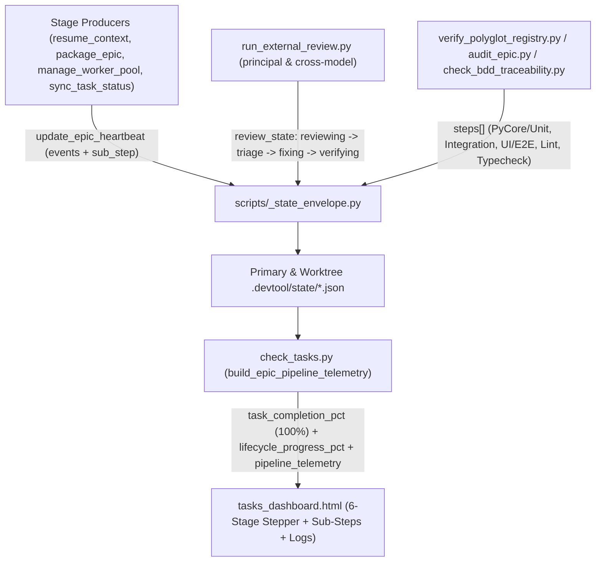

# Lifecycle Stage Progress, Sub-Step Telemetry, and Early Epic Activation High-Level Design

## Table of Contents

- [Meta Data](#meta-data)
- [Background](#background)
- [Goals and Non-Goals](#goals-and-non-goals)
- [Architecture and Technical Design](#architecture-and-technical-design)
- [Feature Maintenance Map](#feature-maintenance-map)
- [Module Contracts and CLI Interfaces](#module-contracts-and-cli-interfaces)
- [Impact Analysis](#impact-analysis)
- [Shared Contract Impact](#shared-contract-impact)
- [Integration Test Plan and Boundary Matrix](#integration-test-plan-and-boundary-matrix)
- [Verification Environment](#verification-environment)
- [Comprehensive BDD Scenario Coverage](#comprehensive-bdd-scenario-coverage)
- [Rollout Strategy and Mitigation](#rollout-strategy-and-mitigation)
- [Kanban Tasks Breakdown](#kanban-tasks-breakdown)
- [Spec Errata](#spec-errata)

## Meta Data

- **Epic name**: `lifecycle_telemetry_and_stage_progress_ui`
- **Status**: In Progress
- **PIC**: `phungthuy8901`
- **Target release**: Next plugin release
- **Platform**: Python tooling, dashboard HTML/JS UI, and agent workflow kit
- **Depends on epic**: none
- **Source Spec**: [Lifecycle Stage Progress, Sub-Step Telemetry, and Early Epic Activation Design](2026-11-14-lifecycle-telemetry-and-stage-progress-ui-design.en.md)

## Background

During `/dev-lifecycle` execution on the `/check-tasks` Web Dashboard (`skills/check-tasks/resources/dashboard/tasks_dashboard.html`), four observability and progress-reporting gaps obscure real-time execution state:

1. **Late Epic Activation**: `harvest_epics_overview()` (`check_tasks.py:L964-L1078`) and `resolve_active_epic()` (`check_tasks.py:L807-L918`) only surface an epic in Section II (`renderExecutionEpics`) once `.worktrees/<epic>` exists at Stage 3 or when HLD status is manually set to `in_progress`. Stage 1 (`dev-brainstorming` / Gate 1) and Stage 2 (`dev-designer` HLD authoring, Gate 2, `/principal-review`, and `package_epic.py`) do not appear in Section II.
2. **Conflated Task Implementation Progress vs. Overall Lifecycle Progress**: `extract_task_progress()` (`check_tasks.py:L1430-L1436`) and `computeEpicProgressState()` (`tasks_dashboard.html:L2058-L2107`) map `done_tasks == total_tasks` pre-convergence to `96%` (`⚡ 96% Review`) on the same bar labeled `Tiến độ Tasks: 9 / 9 Hoàn thành`. As a result, Task Implementation does not show `100%` when all tasks are done, and the progress bar does not reflect weighted progress across the 6 `/dev-lifecycle` stages.
3. **Opaque Stage Micro-Steps**: The UI shows only a high-level stage badge (`Stage 3 Phase 4 (Review)`) without showing what the current stage is doing internally:
   - **Quality Check (`verify_polyglot_registry.py` / `audit_epic.py`)**: Does not break down individual capabilities (`PyCore / Unit Test`, `Unit & Integration Test`, `Integration Test`, `UI / E2E Test`, `Static Lint`, `Typecheck`, `Architecture Gate`) with per-step status (`passed`, `running`, `failed`, `pending`).
   - **Principal Review & Cross-Model Review (`run_external_review.py`)**: Does not emit micro-step transitions for the active round (`Round N/3: <CLI/Model> reviewing -> Lập bảng triage -> Fix findings -> Verifying`).
   - **Task Implementation (`manage_worker_pool.py` / `sync_task_status.py`)**: Does not summarize active wave/slot tasks alongside completed task counts inside a unified stage pipeline view.
4. **Single-Line Stale Heartbeat Banner**: `<epic_slug>.heartbeat.json` (`scripts/_state_envelope.py:L416-L492`) stores only `last_event`, leaving the banner frozen on `sync_task task_09_... -> done` after the final task finishes instead of maintaining a timestamped rolling event stream.

## Goals and Non-Goals

### Goals

- Activate epics in `/check-tasks` Section II immediately upon **Gate 1** approval (or when an active `.heartbeat.json` / state file exists for a non-completed epic), enabling full Stage 1 -> Stage 4 visibility.
- Decouple **Task Implementation Progress (`task_completion_pct`)** — which reaches **`100%`** as soon as `done_tasks >= total_tasks > 0` — from **Overall Lifecycle Progress (`lifecycle_progress_pct`)**, weighted monotonically across Stage 1 (`5% -> 10%`), Stage 2 (`10% -> 25%`), Stage 3 Tasks (`25% -> 80%`), Stage 3 Gate 4 QA (`80% -> 88%`), Stage 3 Cross-Model Review (`88% -> 96%`), and Stage 4 Finish (`98% -> 100%`).
- Extend `update_epic_heartbeat()` in `scripts/_state_envelope.py` with a bounded 20-entry `events` ring buffer (`[{ts, stage, sub_step, message}]`), `sub_step`, `sub_step_detail`, and `review_state`, and extend `verify_polyglot_registry.py` with human-readable capability labels and a per-step `steps` list in `quality_active.json`.
- Emit micro-step telemetry from `run_external_review.py` (`reviewing` -> `triage` -> `fixing` -> `verifying`), `verify_polyglot_registry.py`, `audit_epic.py`, `check_bdd_traceability.py`, `package_epic.py`, and `resume_context.py`.
- Render a 6-Stage **Lifecycle Pipeline Stepper**, **Active Stage Micro-Steps Bar**, **Dual Progress Indicators** (`Tiến độ Tasks: N/N (100% ✓)` + `Tổng tiến trình Lifecycle: X%`), and a collapsible **Live Execution Log Stream** in `tasks_dashboard.html`.

### Non-Goals

- Introducing external databases, WebSocket servers, or background daemons outside `tasks_server.py`.
- Making network or LLM API calls inside `check_tasks.py` or `_state_envelope.py`.
- Modifying production source code in unrelated sibling repositories (`D3Nexus`, `lyrics-sync`, `nexus`).

## Architecture and Technical Design

### High-Level Architecture



### Early Epic Activation and Stage Weighting Model

1. **Early Stage 1/2 Activation (`check_tasks.py`)**:
   - Both `resolve_active_epic(repo_path)` and `harvest_epics_overview(repo_path)` share a single eligibility predicate (`_is_epic_eligible_for_active(slug, completed_epics, abandoned_epics, hld_status)`) that excludes `completed`, `archived`, and `abandoned` epics (even if an abandoned epic retains a Gate 1 ledger entry or `.heartbeat.json`).
   - Eligible epics with Gate 1+ in `parse_gate_ledger_entries(repo_path)` or an active `.heartbeat.json` / state file resolve as `active_epic` and `status = "in_progress"` in `epics_summary.epics`, while bare unstarted backlog folders without gates or heartbeats remain `None` / `"unstarted"` (`RSDH-EC-04`).
   - `extract_epic_pic(repo_path, active_epic)` scans `*design*.md` in `.devtool/epic/<epic>/` alongside HLD and `handoff.md` so PIC (`@phungthuy8901` / `@duedd`) is resolved immediately at Stage 1.
2. **Decoupled Task Progress vs. 6-Stage Lifecycle Progress**:
   - `TaskProgress.task_completion_pct`: `round((done_tasks / total_tasks) * 100.0, 1)` when `total_tasks > 0`, else `0.0`. Reaches **`100.0`** immediately when `done_tasks == total_tasks > 0`.
   - `lifecycle_progress_pct` (monotonic milestone watermark decoupled from `current_stage_index` when QA re-runs after review):
     - **Stage 1 (`stage_1_spec`, weight `0% -> 10%`)**: `5%` while drafting spec (`*-design.en.md` present, Gate 1 not yet approved); `10%` when Gate 1 is approved.
     - **Stage 2 (`stage_2_hld`, weight `10% -> 25%`)**: `14%` when HLD/BDD exist; `18%` when Gate 2 is approved or `task_*.md` files exist; `20%..23%` while `/principal-review` Round `1..3` runs (`20 + min(3, round_num)`); `25%` when `handoff.md` is packaged (`Stage 2 Exit`).
     - **Stage 3 Phase 1–2 (`stage_3_tasks`, weight `25% -> 80%`)**: `25%` when Gate 3 is approved or `.worktrees/<epic>` exists with `0` tasks done; `25 + round((done_tasks / total_tasks) * 55)` while tasks are in progress (`0 < done_tasks < total_tasks`, capped at `79%`); **`80%`** when `done_tasks == total_tasks > 0` and Gate 4 has not started.
     - **Stage 3 Phase 4a (`stage_3_quality`, weight `80% -> 88%`)**: `81%..87%` while Gate 4 verification (`audit_epic`, `bdd_traceability`, or `quality_check` step `step_index / step_total`) is running; passing `quality_check` capabilities alone without `audit_epic` and `bdd_traceability` stays at **`87%`**. Reaching **`88%`** requires full Gate 4 PASS (`audit_epic` PASS + `bdd_traceability` PASS + `quality_check` PASS, or Gate 4 recorded in `GATE_LEDGER.md` / `gate_ledger.jsonl`).
     - **Stage 3 Phase 4b (`stage_3_review`, weight `88% -> 96%`)**: Scales across Cross-Model Review rounds and micro-steps (`Round 1: 89%..92%`, `Round 2: 93%..95%`, `Round 3 / post-review Gate 4 re-verification on latest SHA: 96%`). When Gate 4 re-runs after review fixes, `lifecycle_progress_pct` stays monotonically in `95%..96%` while `current_stage_index` / `sub_steps` show the active post-review verification on the candidate SHA.
     - **Stage 4 (`stage_4_finish`, weight `98% -> 100%`)**: **`98%`** (with `100%` task badge and `Chờ /finish` status) ONLY when Cross-Model Review is converged **AND** Gate 4 has passed on the current `HEAD` SHA (`Stage 3 Phase 4.1 (Sign-off)`); **`100%`** when Gate 5 is approved or epic status is `done`.

### Granular Sub-Step Producers and Rolling Event Log

1. **Rolling Event Log & Sub-Step Envelope (`scripts/_state_envelope.py`)**:
   - `update_epic_heartbeat()` accepts `sub_step: str | None = None`, `sub_step_detail: str | None = None`, `review_state: Mapping[str, Any] | None = None`, and `max_events: int = 20`.
   - Whenever `last_event` is non-empty and differs from `state["events"][-1]["message"]`, appends `{"ts": updated_at, "stage": state.get("stage", ""), "sub_step": state.get("sub_step", ""), "message": last_event}` and slices `state["events"][-max_events:]`.
2. **Quality Check Capability Labels & Step Breakdown (`verify_polyglot_registry.py`)**:
   - `format_capability_label(provider: str, capability: str) -> str` maps capability identifiers to clear human labels:
     - `pycore` / `unit` / `unit_test` -> `"PyCore / Unit Test"`
     - `test` / `pytest` / `flutter_test` / `cargo_test` -> `"Unit & Integration Test"`
     - `integration` / `integration_test` -> `"Integration Test"`
     - `e2e` / `ui` / `playwright` / `web_e2e` -> `"UI / E2E Test"`
     - `lint` / `ruff` / `spotless` / `swiftlint` / `clippy` -> `"Static Lint"`
     - `typecheck` / `type_check` / `mypy` / `analyze` -> `"Typecheck"`
     - `architecture` / `import_linter` / `konsist` -> `"Architecture Gate"`
   - `_QualityRunCoordinator` initializes `steps: list[dict[str, Any]]` from the planned provider capabilities (`status: "pending"`), transitions each step to `"running"` on `start_step()` and `"passed"` / `"failed"` on completion, persists `steps` and `capability_label` inside `runs[run_id]` in `quality_active.json`, and emits distinct start (`"Quality Check [i/N]: <label> (<provider>:<cap>) running..."`) and completion (`"Quality Check [i/N]: <label> (<provider>:<cap>) -> <status> (<elapsed>s)"`) heartbeat events to `<epic_slug>.heartbeat.json`.
3. **Review Micro-Step State Machine (`run_external_review.py` & `check_tasks.py`)**:
   - Every review round (`kind="principal"` or `kind="code"|"epic"`) tracks 4 sequential micro-steps:
     1. `reviewing`: `<CLI> (<Model>) reviewing` — emitted when `run_external_review.py run` starts invoking the reviewer CLI.
     2. `triage`: `Lập bảng triage` — emitted when `record_round()` records the round and when `run_external_review.py triage` generates the triage table (`AUTO_PASS_CLEAN`, `AUTO_FIX_ELIGIBLE`, `CIRCUIT_BREAKER_HALT`).
     3. `fixing`: `Fix findings` — emitted via `run_external_review.py status --phase fixing` or inferred automatically by `check_tasks.py` when `review_results.md` / `principal_review.md` has `fixed in <sha>` decisions or when `HEAD` has advanced past the latest round's `SHA` (`[EPIC] Fix ...` / `[EPIC] Revise ...`).
     4. `verifying`: `Verifying` — emitted via `run_external_review.py status --phase verifying` or inferred automatically only when a verification execution (`quality_active.json` run, `audit_epic.py` / `run_task_checks.py` heartbeat, or `--phase verifying` status) runs on or after the fix commit `<sha2>`.

## Feature Maintenance Map

| Feature Area | Primary Files | Entry / Function |
|---|---|---|
| Heartbeat `events` Ring Buffer & `review_state` | `scripts/_state_envelope.py` | `update_epic_heartbeat()` |
| Quality Capability Labels & `steps` Array | `skills/quality_check/resources/scripts/verify_polyglot_registry.py` | `format_capability_label()`, `_QualityRunCoordinator` |
| Review Round Micro-Step Telemetry | `skills/dev-implementation/resources/scripts/run_external_review.py` | `_emit_review_heartbeat()`, `run()`, `record_round()`, `triage()`, `status_cmd()` |
| Gate 4 Audit & BDD Heartbeat Events | `skills/dev-implementation/resources/scripts/audit_epic.py`, `check_bdd_traceability.py`, `package_epic.py` | `main()` |
| Early Epic Activation & 6-Stage Pipeline Harvester | `skills/check-tasks/resources/scripts/check_tasks.py` | `resolve_active_epic()`, `harvest_epics_overview()`, `build_epic_pipeline_telemetry()` |
| Dashboard 6-Stage Stepper, Sub-Steps, Log Feed & Kanban `"TIẾN ĐỘ EPICS"` Overview | `skills/check-tasks/resources/dashboard/tasks_dashboard.html` | `computeEpicProgressState()`, `renderPipelineStepper()`, `renderLiveTelemetryBanner()`, `renderExecutionEpics()`, `renderKanbanDashboard()`, `buildKanbanSig()` |

## Module Contracts and CLI Interfaces

1. **`scripts/_state_envelope.py::update_epic_heartbeat`**:
   ```python
   def update_epic_heartbeat(
       start_path: Path | None,
       epic_slug: str,
       *,
       stage: str | None = None,
       sub_step: str | None = None,
       sub_step_detail: str | None = None,
       review_state: Mapping[str, Any] | None = None,
       active_wave: int | None = None,
       active_tasks: Sequence[str] | None = None,
       slots: Mapping[str, Any] | None = None,
       slot_updates: Mapping[str, Any] | None = None,
       remove_slots: Sequence[str] | None = None,
       replace_slots: bool = False,
       last_event: str | None = None,
       updated_at: str | None = None,
       pic: str | None = None,
       tally: Mapping[str, int] | None = None,
       max_events: int = 20,
       extra_devtool_dirs: Sequence[Path] | None = None,
   ) -> dict[str, Any]:
   ```
2. **`skills/quality_check/resources/scripts/verify_polyglot_registry.py::format_capability_label`**:
   ```python
   def format_capability_label(provider: str, capability: str) -> str:
   ```
3. **`skills/dev-implementation/resources/scripts/run_external_review.py`**:
   - Supports optional subcommand `status --epic-dir <epic_dir> [--kind code|principal|epic] --phase <reviewing|triage|fixing|verifying|converged> [--round <n>] [--detail <text>]`.
4. **`skills/check-tasks/resources/scripts/check_tasks.py::build_epic_pipeline_telemetry`**:
   ```python
   def build_epic_pipeline_telemetry(
       repo_path: Path,
       epic_slug: str | None,
       *,
       task_progress: TaskProgress,
       decision: LifecycleDecision,
       heartbeat: dict[str, Any] | None,
       quality_active: dict[str, Any] | None,
       quality_runs: list[dict[str, Any]],
   ) -> dict[str, Any]:
   ```

## Impact Analysis

Shift-left impact analysis (`check_code_impact.py --base-ref main`) identified 9 downstream caller/test files:
- `tests/test_rsdh_state_envelope.py`
- `tests/test_runtime_sync_and_dashboard_hardening.py`
- `tests/test_check_tasks_fsm.py`
- `tests/test_check_tasks_harvester.py`
- `tests/test_rsdh_harvester_and_pic.py`
- `tests/test_rsdh_tasks_dashboard_ui.py`
- `skills/dev-implementation/resources/scripts/test_local_review.py`
- `skills/dev-implementation/resources/scripts/manage_worker_pool.py`
- `skills/dev-implementation/resources/scripts/sync_task_status.py`

All new parameters on `update_epic_heartbeat()` are keyword-optional with backward-compatible defaults.

## Shared Contract Impact

None — self-contained feature inside `ai-agent-tools`.

## Integration Test Plan and Boundary Matrix

Integration test roots: tests
Protected paths: .devtool/epic/lifecycle_telemetry_and_stage_progress_ui/bdd_scenarios.en.md
Integration results: python3 -m pytest -q --tb=short --maxfail=3 --junitxml=build/test-results/lifecycle-telemetry-and-stage-progress-ui.xml tests/test_ltsp_state_and_producers.py tests/test_ltsp_harvester_pipeline.py tests/test_ltsp_dashboard_ui.py tests/test_lifecycle_telemetry_and_stage_progress.py tests/test_check_tasks_fsm.py tests/test_rsdh_state_envelope.py tests/test_rsdh_harvester_and_pic.py tests/test_rsdh_tasks_dashboard_ui.py -> build/test-results/lifecycle-telemetry-and-stage-progress-ui.xml

| Boundary | Producer | Consumer | Verification Tier |
|---|---|---|---|
| `.devtool/state/<epic>.heartbeat.json` (`events`, `review_state`, `sub_step`) | `_state_envelope.py`, `run_external_review.py`, `audit_epic.py` | `check_tasks.py` | Tier A Unit & Tier C Integration |
| `.devtool/state/quality_active.json` (`steps`, `capability_label`) | `verify_polyglot_registry.py` | `check_tasks.py`, `tasks_dashboard.html` | Tier A Unit & Tier C Integration |
| `/api/tasks` (`pipeline_telemetry`, `task_completion_pct`, `lifecycle_progress_pct`) | `check_tasks.py` / `tasks_server.py` | `tasks_dashboard.html` | Tier C Headless Chrome CDP |

## Verification Environment

- **Data Isolation**: All unit and integration tests execute inside temporary directories (`tmp_path` / `tempfile.TemporaryDirectory`) with isolated git repositories and ephemeral localhost ports (`find_available_port`).
- **Forbidden Live Stores**: Tests must never mutate `~/.gemini/`, host `~/.zshrc`, or `/tmp/agy_tasks_server.pid`.
- **Needs Variables**: None required (`Needs: none`).

## Comprehensive BDD Scenario Coverage

All 18 BDD scenarios (`LTSP-HP-01` through `LTSP-FR-03`) are defined in [bdd_scenarios.en.md](bdd_scenarios.en.md) across Happy Path (`HP`), Edge Cases (`EC`), State Transitions (`ST`), Architecture & Concurrency (`AR`), and Fault Resilience (`FR`).

## Rollout Strategy and Mitigation

- Roll out atomically across producer scripts, `check_tasks.py`, and `tasks_dashboard.html`.
- Update existing RSDH test assertions in `tests/test_rsdh_tasks_dashboard_ui.py` and `tests/test_rsdh_harvester_and_pic.py` where `100%` Task Completion is now intentionally displayed alongside the Lifecycle Progress bar.

## Kanban Tasks Breakdown

1. **[Task 01: State Envelope Rolling Events and Stage Sub-Step Producers](task_01_state_envelope_events_and_stage_producers.md)** (`review_tier: "full"`) — Covers: `LTSP-HP-01`, `LTSP-HP-02`, `LTSP-EC-01`, `LTSP-ST-01`, `LTSP-FR-01`
2. **[Task 02: Check-Tasks Early Epic Activation, Weighted Progress, and Pipeline Harvester](task_02_check_tasks_pipeline_harvester_and_progress_weights.md)** (`review_tier: "full"`) — Covers: `LTSP-HP-03`, `LTSP-HP-04`, `LTSP-EC-02`, `LTSP-ST-02`, `LTSP-AR-01`
3. **[Task 03: Tasks Dashboard 6-Stage Stepper, Sub-Step Bar, Dual Progress, and Log Stream UI](task_03_tasks_dashboard_stepper_substeps_and_logs_ui.md)** (`review_tier: "full"`) — Covers: `LTSP-HP-05`, `LTSP-EC-03`, `LTSP-ST-03`, `LTSP-AR-02`, `LTSP-FR-02`
4. **[Task 04: End-to-End Integration, Chrome CDP Verification, and Regression Alignment](task_04_integration_and_cdp_acceptance_verification.md)** (`review_tier: "full"`) — Covers: `LTSP-HP-06`, `LTSP-EC-04`, `LTSP-ST-04`, `LTSP-AR-03`, `LTSP-FR-03`

## Spec Errata

None.

