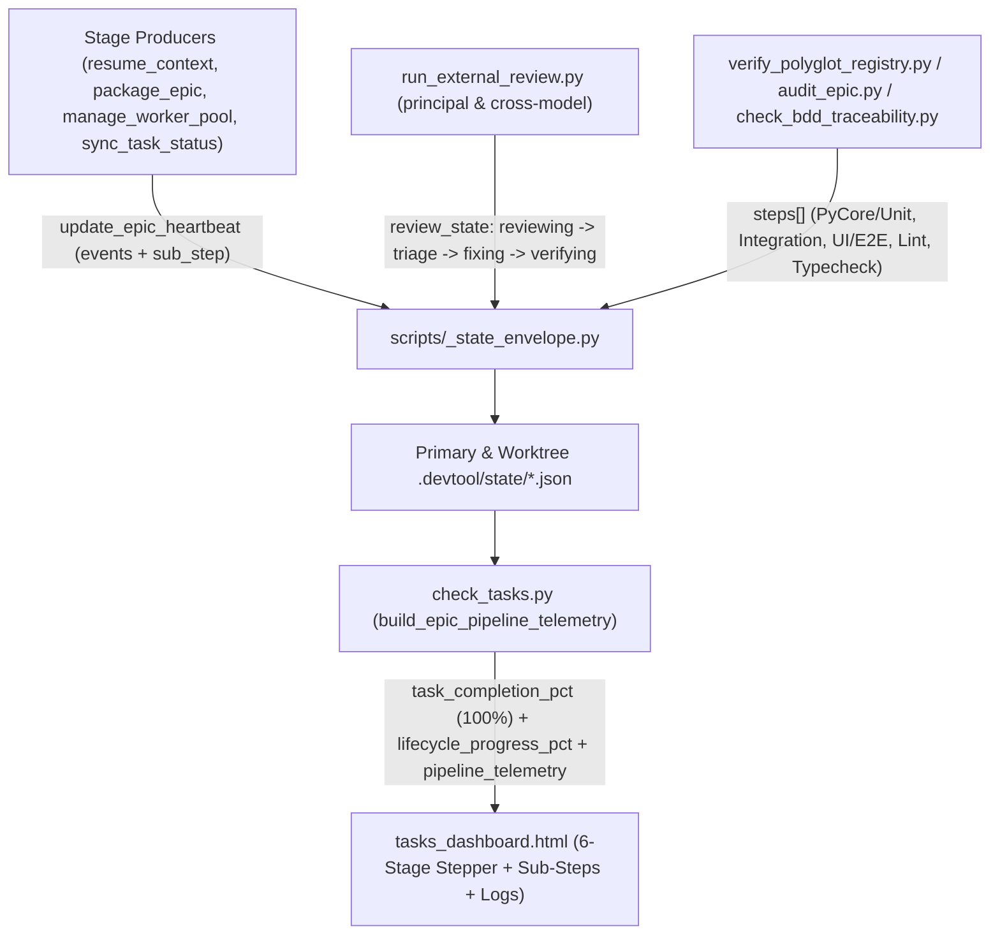

# Thiết kế Cấp cao: Telemetry Tiến trình Stage Lifecycle, Bước con Chi tiết và Kích hoạt Epic Sớm

## Mục lục

- [Meta Data](#meta-data)
- [Bối cảnh](#bối-cảnh)
- [Mục tiêu và Ngoài phạm vi](#mục-tiêu-và-ngoài-phạm-vi)
- [Kiến trúc và Thiết kế Kỹ thuật](#kiến-trúc-và-thiết-kế-kỹ-thuật)
- [Bản đồ Bảo trì Tính năng](#bản-đồ-bảo-trì-tính-năng)
- [Hợp đồng Module và Giao diện CLI](#hợp-đồng-module-và-giao-diện-cli)
- [Phân tích Tác động](#phân-tích-tác-động)
- [Tác động Hợp đồng Dùng chung](#tác-động-hợp-đồng-dùng-chung)
- [Kế hoạch Kiểm thử Tích hợp và Ma trận Ranh giới](#kế-hoạch-kiểm-thử-tích-hợp-và-ma-trận-ranh-giới)
- [Môi trường Xác minh](#môi-trường-xác-minh)
- [Độ phủ Kịch bản BDD Toàn diện](#độ-phủ-kịch-bản-bdd-toàn-diện)
- [Chiến lược Triển khai và Giảm thiểu Rủi ro](#chiến-lược-triển-khai-và-giảm-thiểu-rủi-ro)
- [Phân rã Task Kanban](#phân-rã-task-kanban)
- [Đính chính Đặc tả (Spec Errata)](#đính-chính-đặc-tả-spec-errata)

## Meta Data

- **Epic name**: `lifecycle_telemetry_and_stage_progress_ui`
- **Trạng thái**: Done
- **PIC**: `phungthuy8901`
- **Phiên bản phát hành dự kiến**: Bản phát hành plugin tiếp theo
- **Nền tảng**: Công cụ Python, giao diện HTML/JS dashboard, và bộ workflow agent
- **Depends on epic**: none
- **Tài liệu Thiết kế gốc**: [Thiết kế Tiến trình Từng Stage Lifecycle, Telemetry Bước con và Kích hoạt Epic Sớm](2026-11-14-lifecycle-telemetry-and-stage-progress-ui-design.vi.md)

## Bối cảnh

Trong quá trình thực thi `/dev-lifecycle` trên Web Dashboard `/check-tasks` (`skills/check-tasks/resources/dashboard/tasks_dashboard.html`), bốn khoảng trống về khả năng quan sát và báo cáo tiến độ làm che khuất trạng thái thực thi thời gian thực:

1. **Kích hoạt Epic Muộn**: `harvest_epics_overview()` (`check_tasks.py:L964-L1078`) và `resolve_active_epic()` (`check_tasks.py:L807-L918`) chỉ đưa một epic lên Phần II (`renderExecutionEpics`) khi `.worktrees/<epic>` đã được tạo tại Stage 3 hoặc khi trạng thái HLD được chuyển thủ công sang `in_progress`. Stage 1 (`dev-brainstorming` / Gate 1) và Stage 2 (`dev-designer` viết HLD, Gate 2, `/principal-review`, và `package_epic.py`) không xuất hiện tại Phần II.
2. **Gộp chung Tiến độ Triển khai Task với Tổng tiến trình Lifecycle**: `extract_task_progress()` (`check_tasks.py:L1430-L1436`) và `computeEpicProgressState()` (`tasks_dashboard.html:L2058-L2107`) ánh xạ trạng thái `done_tasks == total_tasks` trước khi hội tụ về `96%` (`⚡ 96% Review`) ngay trên thanh có nhãn `Tiến độ Tasks: 9 / 9 Hoàn thành`. Hệ quả là phần Triển khai Task không thể hiện `100%` khi đã làm xong toàn bộ tasks, và thanh tiến trình không phản ánh trọng số theo 6 stage của `/dev-lifecycle`.
3. **Thiếu Chi tiết Vi bước Stage**: Giao diện chỉ hiển thị nhãn stage cấp cao (`Stage 3 Phase 4 (Review)`) mà không cho biết bước con bên trong đang làm gì:
   - **Quality Check (`verify_polyglot_registry.py` / `audit_epic.py`)**: Chưa phân rã từng capability riêng lẻ (`PyCore / Unit Test`, `Unit & Integration Test`, `Integration Test`, `UI / E2E Test`, `Static Lint`, `Typecheck`, `Architecture Gate`) kèm trạng thái từng bước (`passed`, `running`, `failed`, `pending`).
   - **Principal Review & Cross-Model Review (`run_external_review.py`)**: Chưa phát chuyển đổi vi bước của round hiện hành (`Round N/3: <CLI/Model> reviewing -> Lập bảng triage -> Fix findings -> Verifying`).
   - **Task Implementation (`manage_worker_pool.py` / `sync_task_status.py`)**: Chưa tóm tắt wave/slot task đang chạy cạnh số lượng task đã xong trong cùng chế độ xem pipeline thống nhất.
4. **Banner Heartbeat Một dòng Lỗi thời**: `<epic_slug>.heartbeat.json` (`scripts/_state_envelope.py:L416-L492`) chỉ lưu `last_event`, khiến banner đóng băng ở `sync_task task_09_... -> done` sau khi hoàn thành task cuối mà không duy trì dòng sự kiện cuộn theo thời gian.

## Mục tiêu và Ngoài phạm vi

### Mục tiêu

- Kích hoạt epic trên `/check-tasks` Phần II ngay sau khi phê duyệt **Gate 1** (hoặc khi có `.heartbeat.json` / tệp state hoạt động cho epic chưa hoàn thành), hiển thị xuyên suốt từ Stage 1 -> Stage 4.
- Tách rời **Tiến độ Triển khai Task (`task_completion_pct`)** — đạt **`100%`** ngay khi `done_tasks >= total_tasks > 0` — khỏi **Tổng tiến trình Lifecycle (`lifecycle_progress_pct`)**, tính trọng số tăng đơn điệu qua Stage 1 (`5% -> 10%`), Stage 2 (`10% -> 25%`), Stage 3 Tasks (`25% -> 80%`), Stage 3 Gate 4 QA (`80% -> 88%`), Stage 3 Cross-Model Review (`88% -> 96%`), và Stage 4 Finish (`98% -> 100%`).
- Mở rộng `update_epic_heartbeat()` trong `scripts/_state_envelope.py` với ring buffer `events` tối đa 20 mục (`[{ts, stage, sub_step, message}]`), `sub_step`, `sub_step_detail`, và `review_state`, đồng thời mở rộng `verify_polyglot_registry.py` với nhãn capability dễ đọc và danh sách `steps` từng bước trong `quality_active.json`.
- Phát telemetry vi bước từ `run_external_review.py` (`reviewing` -> `triage` -> `fixing` -> `verifying`), `verify_polyglot_registry.py`, `audit_epic.py`, `check_bdd_traceability.py`, `package_epic.py`, và `resume_context.py`.
- Render **Lifecycle Pipeline Stepper** 6-Stage, **Thanh Vi bước Stage Đang chạy**, **Bộ chỉ báo Tiến độ Kép** (`Tiến độ Tasks: N/N (100% ✓)` + `Tổng tiến trình Lifecycle: X%`), và **Dòng Nhật ký Thực thi Trực tiếp** có thể đóng mở trong `tasks_dashboard.html`.

### Ngoài phạm vi

- Không bổ sung cơ sở dữ liệu ngoài, máy chủ WebSocket, hoặc daemon chạy nền bên ngoài `tasks_server.py`.
- Không thực hiện lời gọi mạng hay LLM API bên trong `check_tasks.py` hoặc `_state_envelope.py`.
- Không chỉnh sửa mã nguồn production tại các repository anh em khác (`D3Nexus`, `lyrics-sync`, `nexus`).

## Kiến trúc và Thiết kế Kỹ thuật

### Kiến trúc Tổng thể



### Mô hình Kích hoạt Epic Sớm và Trọng số Stage

1. **Kích hoạt Sớm Stage 1/2 (`check_tasks.py`)**:
   - Cả `resolve_active_epic(repo_path)` và `harvest_epics_overview(repo_path)` dùng chung điều kiện lọc (`_is_epic_eligible_for_active(slug, completed_epics, abandoned_epics, hld_status)`) để loại trừ các epic `completed`, `archived`, và `abandoned` (ngay cả khi epic bị hủy vẫn giữ lại bản ghi Gate 1 hoặc `.heartbeat.json`).
   - Các epic hợp lệ có Gate 1+ trong `parse_gate_ledger_entries(repo_path)` hoặc có `.heartbeat.json` / tệp state hoạt động đều phân giải thành `active_epic` với `status = "in_progress"` trong `epics_summary.epics`, trong khi thư mục backlog chưa bắt đầu không có gate hay heartbeat giữ nguyên `None` / `"unstarted"` (`RSDH-EC-04`).
   - `extract_epic_pic(repo_path, active_epic)` quét `*design*.md` trong `.devtool/epic/<epic>/` song song với HLD và `handoff.md` để lấy PIC (`@phungthuy8901` / `@duedd`) ngay từ Stage 1.
2. **Tách rời Tiến độ Task và Tiến trình Lifecycle 6 Stage**:
   - `TaskProgress.task_completion_pct`: `round((done_tasks / total_tasks) * 100.0, 1)` khi `total_tasks > 0`, ngược lại là `0.0`. Đạt **`100.0`** ngay khi `done_tasks == total_tasks > 0`.
   - `lifecycle_progress_pct` (mốc đánh dấu đơn điệu tách biệt với `current_stage_index` khi QA chạy lại sau review):
     - **Stage 1 (`stage_1_spec`, trọng số `0% -> 10%`)**: `5%` khi đang soạn spec (có `*-design.en.md`, chưa duyệt Gate 1); `10%` khi Gate 1 đã được phê duyệt.
     - **Stage 2 (`stage_2_hld`, trọng số `10% -> 25%`)**: `14%` khi đã có HLD/BDD; `18%` khi Gate 2 được duyệt hoặc đã có các tệp `task_*.md`; `20%..23%` khi `/principal-review` Round `1..3` đang chạy (`20 + min(3, round_num)`); `25%` khi đã đóng gói `handoff.md` (`Stage 2 Exit`).
     - **Stage 3 Phase 1–2 (`stage_3_tasks`, trọng số `25% -> 80%`)**: `25%` khi Gate 3 được duyệt hoặc đã tạo `.worktrees/<epic>` với `0` task xong; `25 + round((done_tasks / total_tasks) * 55)` khi đang triển khai (`0 < done_tasks < total_tasks`, trần `79%`); **`80%`** khi `done_tasks == total_tasks > 0` và chưa bắt đầu Gate 4.
     - **Stage 3 Phase 4a (`stage_3_quality`, trọng số `80% -> 88%`)**: `81%..87%` khi đang chạy xác minh Gate 4 (`audit_epic`, `bdd_traceability`, hoặc bước `step_index / step_total` của `quality_check`); riêng các capability của `quality_check` đạt mà chưa có `audit_epic` và `bdd_traceability` giữ ở **`87%`**. Đạt **`88%`** đòi hỏi đủ bộ Gate 4 PASS (`audit_epic` PASS + `bdd_traceability` PASS + `quality_check` PASS, hoặc đã ghi nhận Gate 4 trong `GATE_LEDGER.md` / `gate_ledger.jsonl`).
     - **Stage 3 Phase 4b (`stage_3_review`, trọng số `88% -> 96%`)**: Tăng qua từng round Cross-Model Review và vi bước (`Round 1: 89%..92%`, `Round 2: 93%..95%`, `Round 3 / tái xác minh Gate 4 sau review trên SHA mới nhất: 96%`). Khi Gate 4 chạy lại sau khi sửa lỗi review, `lifecycle_progress_pct` giữ đơn điệu ở `95%..96%` trong khi `current_stage_index` / `sub_steps` hiển thị bước xác minh hậu review trên candidate SHA.
     - **Stage 4 (`stage_4_finish`, trọng số `98% -> 100%`)**: **`98%`** (cùng huy hiệu `100%` task và trạng thái `Chờ /finish`) CHỈ KHI Cross-Model Review đã hội tụ **VÀ** Gate 4 đã PASS trên `HEAD` SHA hiện hành (`Stage 3 Phase 4.1 (Sign-off)`); **`100%`** khi Gate 5 được duyệt hoặc trạng thái epic là `done`.

### Các Producer Vi bước Chi tiết và Nhật ký Sự kiện Cuộn

1. **Ring Buffer Sự kiện Cuộn & Vỏ Bước con (`scripts/_state_envelope.py`)**:
   - `update_epic_heartbeat()` nhận `sub_step: str | None = None`, `sub_step_detail: str | None = None`, `review_state: Mapping[str, Any] | None = None`, và `max_events: int = 20`.
   - Khi `last_event` khác rỗng và khác với `state["events"][-1]["message"]`, nối `{"ts": updated_at, "stage": state.get("stage", ""), "sub_step": state.get("sub_step", ""), "message": last_event}` và cắt `state["events"][-max_events:]`.
2. **Nhãn Capability Quality Check & Phân rã Bước (`verify_polyglot_registry.py`)**:
   - `format_capability_label(provider: str, capability: str) -> str` ánh xạ mã capability sang nhãn dễ hiểu:
     - `pycore` / `unit` / `unit_test` -> `"PyCore / Unit Test"`
     - `test` / `pytest` / `flutter_test` / `cargo_test` -> `"Unit & Integration Test"`
     - `integration` / `integration_test` -> `"Integration Test"`
     - `e2e` / `ui` / `playwright` / `web_e2e` -> `"UI / E2E Test"`
     - `lint` / `ruff` / `spotless` / `swiftlint` / `clippy` -> `"Static Lint"`
     - `typecheck` / `type_check` / `mypy` / `analyze` -> `"Typecheck"`
     - `architecture` / `import_linter` / `konsist` -> `"Architecture Gate"`
   - `_QualityRunCoordinator` khởi tạo `steps: list[dict[str, Any]]` từ các capability dự kiến (`status: "pending"`), chuyển mỗi bước sang `"running"` tại `start_step()` và `"passed"` / `"failed"` khi xong, lưu `steps` và `capability_label` trong `runs[run_id]` của `quality_active.json`, đồng thời phát riêng hai sự kiện bắt đầu (`"Quality Check [i/N]: <label> (<provider>:<cap>) running..."`) và kết thúc (`"Quality Check [i/N]: <label> (<provider>:<cap>) -> <status> (<elapsed>s)"`) vào `<epic_slug>.heartbeat.json`.
3. **Máy trạng thái Vi bước Review (`run_external_review.py` & `check_tasks.py`)**:
   - Mỗi round review (`kind="principal"` hoặc `kind="code"|"epic"`) theo dõi 4 vi bước tuần tự:
     1. `reviewing`: `<CLI> (<Model>) reviewing` — phát khi `run_external_review.py run` bắt đầu gọi CLI review.
     2. `triage`: `Lập bảng triage` — phát khi `record_round()` ghi lại round và khi `run_external_review.py triage` lập bảng triage (`AUTO_PASS_CLEAN`, `AUTO_FIX_ELIGIBLE`, `CIRCUIT_BREAKER_HALT`).
     3. `fixing`: `Fix findings` — phát qua `run_external_review.py status --phase fixing` hoặc được `check_tasks.py` suy diễn tự động khi `review_results.md` / `principal_review.md` đã ghi quyết định `fixed in <sha>` hoặc khi `HEAD` đã tiến qua `SHA` của round gần nhất (`[EPIC] Fix ...` / `[EPIC] Revise ...`).
     4. `verifying`: `Verifying` — phát qua `run_external_review.py status --phase verifying` hoặc chỉ suy diễn tự động khi có quá trình kiểm chứng (`quality_active.json`, heartbeat từ `audit_epic.py` / `run_task_checks.py`, hoặc trạng thái `--phase verifying`) chạy từ hoặc sau commit sửa lỗi `<sha2>`.

## Bản đồ Bảo trì Tính năng

| Khu vực Tính năng | Tệp Chính | Điểm vào / Hàm |
|---|---|---|
| Ring Buffer `events` & `review_state` của Heartbeat | `scripts/_state_envelope.py` | `update_epic_heartbeat()` |
| Nhãn Capability Quality & Mảng `steps` | `skills/quality_check/resources/scripts/verify_polyglot_registry.py` | `format_capability_label()`, `_QualityRunCoordinator` |
| Telemetry Vi bước Round Review | `skills/dev-implementation/resources/scripts/run_external_review.py` | `_emit_review_heartbeat()`, `run()`, `record_round()`, `triage()`, `status_cmd()` |
| Sự kiện Heartbeat Audit & BDD Gate 4 | `skills/dev-implementation/resources/scripts/audit_epic.py`, `check_bdd_traceability.py`, `package_epic.py` | `main()` |
| Kích hoạt Epic Sớm & Harvester Pipeline 6 Stage | `skills/check-tasks/resources/scripts/check_tasks.py` | `resolve_active_epic()`, `harvest_epics_overview()`, `build_epic_pipeline_telemetry()` |
| Giao diện Stepper 6-Stage, Vi bước, Dòng Log & Tổng quan Kanban `"TIẾN ĐỘ EPICS"` | `skills/check-tasks/resources/dashboard/tasks_dashboard.html` | `computeEpicProgressState()`, `renderPipelineStepper()`, `renderLiveTelemetryBanner()`, `renderExecutionEpics()`, `renderKanbanDashboard()`, `buildKanbanSig()` |

## Hợp đồng Module và Giao diện CLI

1. **`scripts/_state_envelope.py::update_epic_heartbeat`**:
   ```python
   def update_epic_heartbeat(
       start_path: Path | None,
       epic_slug: str,
       *,
       stage: str | None = None,
       sub_step: str | None = None,
       sub_step_detail: str | None = None,
       review_state: Mapping[str, Any] | None = None,
       active_wave: int | None = None,
       active_tasks: Sequence[str] | None = None,
       slots: Mapping[str, Any] | None = None,
       slot_updates: Mapping[str, Any] | None = None,
       remove_slots: Sequence[str] | None = None,
       replace_slots: bool = False,
       last_event: str | None = None,
       updated_at: str | None = None,
       pic: str | None = None,
       tally: Mapping[str, int] | None = None,
       max_events: int = 20,
       extra_devtool_dirs: Sequence[Path] | None = None,
   ) -> dict[str, Any]:
   ```
2. **`skills/quality_check/resources/scripts/verify_polyglot_registry.py::format_capability_label`**:
   ```python
   def format_capability_label(provider: str, capability: str) -> str:
   ```
3. **`skills/dev-implementation/resources/scripts/run_external_review.py`**:
   - Hỗ trợ subcommand tùy chọn `status --epic-dir <epic_dir> [--kind code|principal|epic] --phase <reviewing|triage|fixing|verifying|converged> [--round <n>] [--detail <text>]`.
4. **`skills/check-tasks/resources/scripts/check_tasks.py::build_epic_pipeline_telemetry`**:
   ```python
   def build_epic_pipeline_telemetry(
       repo_path: Path,
       epic_slug: str | None,
       *,
       task_progress: TaskProgress,
       decision: LifecycleDecision,
       heartbeat: dict[str, Any] | None,
       quality_active: dict[str, Any] | None,
       quality_runs: list[dict[str, Any]],
   ) -> dict[str, Any]:
   ```

## Phân tích Tác động

Phân tích tác động shift-left (`check_code_impact.py --base-ref main`) xác định 9 tệp caller/kiểm thử downstream:
- `tests/test_rsdh_state_envelope.py`
- `tests/test_runtime_sync_and_dashboard_hardening.py`
- `tests/test_check_tasks_fsm.py`
- `tests/test_check_tasks_harvester.py`
- `tests/test_rsdh_harvester_and_pic.py`
- `tests/test_rsdh_tasks_dashboard_ui.py`
- `skills/dev-implementation/resources/scripts/test_local_review.py`
- `skills/dev-implementation/resources/scripts/manage_worker_pool.py`
- `skills/dev-implementation/resources/scripts/sync_task_status.py`

Mọi tham số mới trên `update_epic_heartbeat()` đều là keyword-optional với giá trị mặc định tương thích ngược.

## Tác động Hợp đồng Dùng chung

Không có — tính năng độc lập hoàn toàn bên trong `ai-agent-tools`.

## Kế hoạch Kiểm thử Tích hợp và Ma trận Ranh giới

Integration test roots: tests
Protected paths: .devtool/epic/lifecycle_telemetry_and_stage_progress_ui/bdd_scenarios.en.md
Integration results: python3 -m pytest -q --tb=short --maxfail=3 --junitxml=build/test-results/lifecycle-telemetry-and-stage-progress-ui.xml tests/test_ltsp_state_and_producers.py tests/test_ltsp_harvester_pipeline.py tests/test_ltsp_dashboard_ui.py tests/test_lifecycle_telemetry_and_stage_progress.py tests/test_check_tasks_fsm.py tests/test_rsdh_state_envelope.py tests/test_rsdh_harvester_and_pic.py tests/test_rsdh_tasks_dashboard_ui.py -> build/test-results/lifecycle-telemetry-and-stage-progress-ui.xml

| Ranh giới | Producer | Consumer | Mức Kiểm chứng |
|---|---|---|---|
| `.devtool/state/<epic>.heartbeat.json` (`events`, `review_state`, `sub_step`) | `_state_envelope.py`, `run_external_review.py`, `audit_epic.py` | `check_tasks.py` | Tier A Unit & Tier C Integration |
| `.devtool/state/quality_active.json` (`steps`, `capability_label`) | `verify_polyglot_registry.py` | `check_tasks.py`, `tasks_dashboard.html` | Tier A Unit & Tier C Integration |
| `/api/tasks` (`pipeline_telemetry`, `task_completion_pct`, `lifecycle_progress_pct`) | `check_tasks.py` / `tasks_server.py` | `tasks_dashboard.html` | Tier C Headless Chrome CDP |

## Môi trường Xác minh

- **Cô lập Dữ liệu**: Toàn bộ unit và integration test chạy trong thư mục tạm (`tmp_path` / `tempfile.TemporaryDirectory`) với git repository cô lập và cổng localhost cấp phát động (`find_available_port`).
- **Kho Lưu trữ Trực tiếp Bị cấm**: Kiểm thử tuyệt đối không được thay đổi `~/.gemini/`, `~/.zshrc` máy host, hay `/tmp/agy_tasks_server.pid`.
- **Biến Môi trường Bắt buộc**: Không cần (`Needs: none`).

## Độ phủ Kịch bản BDD Toàn diện

Toàn bộ 18 kịch bản BDD (`LTSP-HP-01` đến `LTSP-FR-03`) được định nghĩa trong [bdd_scenarios.vi.md](bdd_scenarios.vi.md) qua các nhóm Luồng chính (`HP`), Trường hợp biên (`EC`), Chuyển đổi Trạng thái (`ST`), Kiến trúc & Đồng thời (`AR`), và Phục hồi Lỗi (`FR`).

## Chiến lược Triển khai và Giảm thiểu Rủi ro

- Triển khai đồng bộ trên các script producer, `check_tasks.py`, và `tasks_dashboard.html`.
- Cập nhật các assertion RSDH hiện có trong `tests/test_rsdh_tasks_dashboard_ui.py` và `tests/test_rsdh_harvester_and_pic.py` tại những điểm mà chỉ số Hoàn thành Task `100%` được hiển thị có chủ đích bên cạnh thanh Tiến trình Lifecycle.

## Phân rã Task Kanban

1. **[Task 01: State Envelope Rolling Events and Stage Sub-Step Producers](task_01_state_envelope_events_and_stage_producers.md)** (`review_tier: "full"`) — Bao phủ: `LTSP-HP-01`, `LTSP-HP-02`, `LTSP-EC-01`, `LTSP-ST-01`, `LTSP-FR-01`
2. **[Task 02: Check-Tasks Early Epic Activation, Weighted Progress, and Pipeline Harvester](task_02_check_tasks_pipeline_harvester_and_progress_weights.md)** (`review_tier: "full"`) — Bao phủ: `LTSP-HP-03`, `LTSP-HP-04`, `LTSP-EC-02`, `LTSP-ST-02`, `LTSP-AR-01`
3. **[Task 03: Tasks Dashboard 6-Stage Stepper, Sub-Step Bar, Dual Progress, and Log Stream UI](task_03_tasks_dashboard_stepper_substeps_and_logs_ui.md)** (`review_tier: "full"`) — Bao phủ: `LTSP-HP-05`, `LTSP-EC-03`, `LTSP-ST-03`, `LTSP-AR-02`, `LTSP-FR-02`
4. **[Task 04: End-to-End Integration, Chrome CDP Verification, and Regression Alignment](task_04_integration_and_cdp_acceptance_verification.md)** (`review_tier: "full"`) — Bao phủ: `LTSP-HP-06`, `LTSP-EC-04`, `LTSP-ST-04`, `LTSP-AR-03`, `LTSP-FR-03`

## Đính chính Đặc tả (Spec Errata)

Chưa có.

<!-- sync-en-sha256: bcd11e236d6f9375 -->
