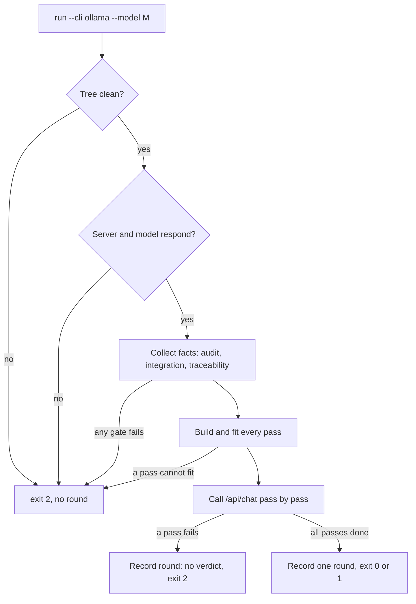

# Local Model Review Design Spec

## Table of Contents

- [Summary](#summary)
- [Problem](#problem)
- [Goals and Non-Goals](#goals-and-non-goals)
- [Decisions](#decisions)
- [Architecture](#architecture)
- [Prompt Base](#prompt-base)
- [Workflow Changes](#workflow-changes)
- [Error Handling](#error-handling)
- [Testing and Acceptance](#testing-and-acceptance)
- [Risks and Dependencies](#risks-and-dependencies)

## Summary

The Review Choice that `dev-implementation` presents after every Gate 4 PASS gains a third option,
**Local model review**. A model served by a local Ollama reviews the finished epic through
`run_external_review.py run --cli ollama --model <model>`. The round is recorded in
`review_results.md` exactly like a Claude CLI or Codex CLI round, `check` governs it the same way,
and the loop returns to a full Gate 4 run.

A local model has no tools and a bounded context, so the review is split into one pass per task
commit plus one epic pass. Each pass carries everything the model may judge. A dedicated prompt base
teaches the model the d3nexus workflow and the kit's own rules for the languages that pass touches.

## Problem

1. **Only paid, remote reviewers exist.** Option 2 needs the Claude CLI or the Codex CLI. A developer
   who wants a private, offline or free second opinion has no route inside the loop.
2. **The current prompt assumes an agentic reviewer.** `external-review-prompt.md` lists artefact
   *paths* and says "Read these paths". Only the diff is inlined. A model called through the plain
   Ollama API cannot open a file, so it would review paths it never saw.
3. **One prompt does not fit a local context.** Measured on this repository's last three epics:
   spec, HLD, BDD scenarios and task files take 25–170 KB, evidence 40–265 KB, and the last epic's
   source diff 196 KB. The reference model runs with a 64K-token context.
4. **The current prompt misses two Gate 4 rules.** dev-implementation's Semantic Test Integrity rules
   ("No Reconstructed Logic", "Immutable Real Artifacts") are absent from the review checklist.

## Goals and Non-Goals

### Goals

- Review Choice offers Finish, Cross-model review and Local model review on every Gate 4 PASS.
- `run_external_review.py run --cli ollama` reviews an epic through Ollama's `/api/chat`, using only
  the Python standard library.
- Every pass is self-contained, fits the model's context, and says what it could not show.
- A prompt base that explains the d3nexus workflow and loads the kit's platform rules per pass.
- One round per run, in the existing `review_results.md` format, governed by the existing `check`.
- The Verification rules live in one shared file used by both prompts.
- A short setup reference with an example reviewer Modelfile.

### Non-Goals

- Agentic local review (Claude Code or Codex pointed at an Ollama backend).
- Other local servers (LM Studio, llama.cpp server).
- Choosing, pulling or tuning a model for the developer.
- Running passes in parallel; a local GPU serialises them anyway.
- Any behaviour change of the Claude CLI and Codex CLI paths beyond the shared rules file.

## Decisions

| # | Decision | Reason |
|---|----------|--------|
| D1 | Local model review is Review Choice **option 3**, separate from option 2 | It differs in kind (private, offline, weaker model). The fast-executor recommendation keeps pointing at option 2 |
| D2 | Transport is Ollama's native `POST /api/chat` through `urllib`, `stream: false`. Amended in Stage 3: `stream: true`, so each pass writes a live log (see the HLD) | No new dependency; the model has no tools, so the review is read-only by construction |
| D3 | One pass per task commit plus one epic pass, merged into one round | One commit per task makes the slice natural; each pass fits a 32K–64K context |
| D4 | `--model` is required with `--cli ollama`; the agent runs `ollama list` and asks | The developer picks the reviewer, as with the CLI choice |
| D5 | The model's Modelfile governs sampling and context | `num_ctx` is read from `/api/show` and sent only with `--num-ctx`, or as 32768 when the Modelfile sets none |
| D6 | `think` is never sent; only `message.content` is parsed, after its last `</think>` if any | Works whether thinking is off, separated by Ollama, or inlined by a template |
| D7 | The prompt asks for an `## Analysis` section before the verdict block | A model with thinking off still reasons before it decides, and the developer can read why |
| D8 | `num_predict` is the context left after the estimated prompt | Thinking at high effort is not cut short, and generation never shifts the context |
| D9 | Platform rules are chosen per pass from the file extensions in that pass's diff | `detect_project_type.sh` returns one type; a Flutter + Rust repository would get Flutter rules for Rust code |
| D10 | Platform rules quote only rules the kit already defines, with their IDs, at Blocker level | No invented rules; Warning-level rules only add noise on a small model |
| D11 | Verification rules move to a shared `references/review-rules.md`, inserted as `$rules` | Both prompts stay identical on rules, and option 2 gains the two missing ones |
| D12 | Blocking semantics are unchanged; a blocking finding whose path the pass never showed is annotated, not downgraded | Every blocking finding still needs the developer's decision; the annotation speeds up spotting a fabricated one |

The reference model during design is `qwen38-reviewer`: Qwen3.8 27B Q8 with `num_ctx 65536`,
temperature 0.2 and thinking on. A smoke test on 2026-10-21 returned the reasoning in
`message.thinking`, a clean `content` ending in a `Verdict:` line, 11 s load and 12 tok/s output.

## Architecture

### Components

| Unit | Change | Responsibility |
|------|--------|----------------|
| `resources/scripts/run_external_review.py` | modified | `--cli ollama`, `--host`, `--num-ctx`; records one round from a list of passes. Claude CLI and Codex CLI run as a single pass with the existing prompt |
| `resources/scripts/local_review.py` | new | Probes the server and model, builds and fits the passes, renders each prompt, calls `/api/chat` |
| `references/local-review-prompt.md` | new | The system-message template: role, workflow primer, `$rules`, `$platform_rules`, `$checklist`, output format |
| `references/local-review-platforms.md` | new | One section per platform: Flutter, Android, iOS, Rust, Python |
| `references/review-rules.md` | new | Verification hierarchy and Semantic Test Integrity rules, shared by both prompts |
| `references/external-review-prompt.md` | modified | Its rules section becomes `$rules` |
| `references/local-review-setup.md` | new | Example reviewer Modelfile and the empty-think-block caveat |

All paths are under `skills/dev-implementation/`. `--host` defaults to `$OLLAMA_HOST`, then
`http://localhost:11434`.

### Run Flow

1. Without `--model`, the run exits 2 before anything else.
2. A dirty tree stops the run, as today.
3. The probe calls `GET /api/version` and `POST /api/show`. It reads `num_ctx` from the model's
   parameters. A failure prints the precondition banner ("OLLAMA WAS NOT INVOKED") and exits 2.
4. Fact collection is unchanged and still fails fast.
5. Every pass is built and fitted before the first model call, so a pass that cannot fit stops
   the run without spending model time.
6. Passes run in commit order, epic pass last. Each prints a live status line on stderr
   (`⏳ [Pass 2/6] task_2_… ✅ 214s`). The first failing pass ends the run.

### Pass Contents

A **task pass** covers one task commit: the latest commit on `<base>..HEAD` that touches
`.devtool/epic/<epic_dir>/evidence/<task_id>.json`, the same rule `audit_epic.py` uses. Its user
message holds:

- the task file mirror `.devtool/epic/<epic_dir>/<task_id>.md`;
- the Gherkin blocks of every scenario ID on the task's `Covers:` lines, from `bdd_scenarios.en.md`;
- the evidence, compacted to `id`, `phase`, `command`, `expect`, `exit`, `outcome` and at most
  15 lines of `output_tail` per row, for the `red` and `verify` runs;
- the commit's diff, filtered with the existing `EXCLUDES` and `.devtool/**`;
- a `Not shown` list of the files dropped to fit.

The **epic pass** holds the spec, the HLD, the `audit_epic.py` output (including its Gate 5 items),
the integration and traceability output, `git diff --stat <base>...HEAD`, and the diffs of the
commits outside tasks. A task without an evidence commit (a legacy task) gets no task pass; its
commit is one of the commits outside tasks.

### Context Budget

- Tokens are estimated as bytes divided by 3, deliberately high for code.
- A prompt may use at most 60% of `num_ctx`. The rest is left for thinking and the answer, and
  `num_predict` is set to `num_ctx` minus the estimate.
- A task pass drops diff files largest first until it fits. Its task file, scenarios and evidence
  are never cut.
- The epic pass drops, in order: the diffs of commits outside tasks, the spec, then the HLD. The
  audit and traceability output are never cut.
- When the parts that are never cut exceed the budget alone, the run stops before any model call
  and suggests `--num-ctx`.

### One Round From Many Passes

- **Status** is `completed` only when every pass completed: HTTP 200, `done_reason` `stop`, a
  verdict line, and at least one finding behind `CHANGES REQUIRED`.
- **Verdict** is `CHANGES REQUIRED` when any pass says so, otherwise `PASS`.
- **Findings** are read only from a pass's last `Verdict:` line onward, so a draft line in
  `## Analysis` never becomes a finding; the prompt also forbids severity tags there, as the
  existing prompt does.
- **Findings** are concatenated in pass order. A Critical or Important finding whose path does not
  appear in that pass's user message gets `(location not shown to reviewer)` appended to its Problem.
- **Metadata** keeps today's fields with `CLI: ollama` and adds `Passes`, `Context` and, when any
  file was dropped, `Omitted`.
- **Raw output** holds each pass's parsed `content` under `### Pass N: <label>`.
- **Exit codes** are unchanged: 0 no blocking finding, 1 a blocking finding, 2 anything else.

## Prompt Base

### System Message

`local-review-prompt.md` is written in English and rendered with `string.Template`:

1. **Role and hard limits.** The model reviews one slice of a d3nexus epic. It has no tools and
   judges only what is shown. It never invents file contents, line numbers, commands or test
   names. Something it needs but cannot see becomes `[Minor] <slice>:not-shown — <what>`, never a
   blocking finding.
2. **Workflow primer.** About 40 lines covering:
   - Gates 1 to 4, and that Gate 4 already passed, so exit codes are settled and only semantics
     remain;
   - the task file: Allowed files, Read-only context, Decisions Already Made (binding),
     the Verification table (`Vn`, RED or GREEN, command, expect), Definition of Done and
     `(Gate 5)` items;
   - evidence recorded by `run_task_checks.py` by running each row, never hand-written;
   - BDD scenario IDs (`HP`, `EC`, `FR`, `ST`), each covered by at least one passing integration
     test;
   - `Fix` commits after the last task, and protected paths.
3. **`$rules`** from `review-rules.md`: the four existing Verification rules plus "No Reconstructed
   Logic" and "Immutable Real Artifacts".
4. **`$platform_rules`**, described below.
5. **`$checklist`** for this pass type, described below.
6. **Output format.** First `## Analysis`, one short paragraph per checklist item, each quoting the
   shown line it relies on. Then the verdict block in the grammar the parser already reads, with
   one worked example. Critical or Important requires a quote from the shown content.

### Platform Rules

`local-review-platforms.md` has one `##` section per platform. A pass loads every section whose
extensions appear in its diff:

| Extensions | Section | Sources |
|------------|---------|---------|
| `.dart` | Flutter | `architecture-audit`, `code-health-audit`, `security-audit` |
| `.kt`, `.kts` | Android | `architecture-audit`, `code-health-audit`, `security-audit` |
| `.swift` | iOS | `architecture-audit`, `code-health-audit`, `security-audit` |
| `.rs` | Rust | `rust-quality-check` architecture governance |
| `.py` | Python | `python-quality-check` architecture governance |

Any other extension adds nothing, and the workflow rules still apply. Each rule keeps its kit ID,
for example `HLT-FLUTTER-03`. Rules apply to added lines of production files; test files are judged
by the checklist. A violation is reported as `Important` with the rule ID in its Problem.

### Pass Checklists

Each item is answered in `## Analysis` with a quote.

**Task pass:**

- Does each GREEN row's command exercise the Definition of Done item it backs?
- Does each RED row fail for the missing behaviour, allowing a compile failure in compiled languages?
- Does each test import and call production code from Allowed files, or rebuild the logic locally?
- Is any assertion vacuous: none at all, always true, or on a mock the test itself configured?
- Do each covered scenario's Given, When and Then map to an arrange, act and assert?
- Does the code contradict a Decision Already Made?
- Does any added line violate a loaded platform rule?

**Epic pass:**

- Do code constants, defaults and enum values match the spec and HLD (contract drift)?
- Is each audit disclosure justified: grader amendments, protected paths, commits outside tasks?
- Does each `Fix` commit change what its title says, and nothing untested besides?
- Does the traceability output reveal a scenario covered only superficially?
- Restate the Gate 5 items for the developer, without severity.

### User Message

The slice, under fixed headings. A task pass uses `## Task file`, `## Scenarios covered`,
`## Evidence`, `## Diff of <short sha>` and `## Not shown`. The epic pass uses `## Spec`, `## HLD`,
`## Audit`, `## Traceability`, `## Diff stat` and `## Commits outside tasks`.

## Workflow Changes

| File | Change |
|------|--------|
| `skills/dev-implementation/SKILL.md` | Review Choice lists option 3 with its command; the agent runs `ollama list` and asks for the model. HARD-GATE, the loop invariant and the workflow-transition comment name the third option and its `round recorded` edge back to Phase 4. Commit per round: `[EPIC_NAME] Record local model review round N` |
| `skills/dev-lifecycle/SKILL.md` | Review Choice loop with three options; invariant "Cross-model review or Local model review → Gate 4 in full"; the fast-executor recommendation adds "Local model review does not replace it"; Red Flag: never pick the review CLI or the Ollama model for the developer |
| `rules/CRITICAL_RULES.md` | Rule 5 lists Option 3 |
| `docs/lifecycles.en.md`, `docs/lifecycles.vi.md` | The diagram gains the option 3 node and edges; the Gate 4 paragraph names it |
| `docs/choosing-a-lifecycle.en.md`, `docs/choosing-a-lifecycle.vi.md` | Review Choice described with three options |
| `CHANGELOG.md` | An Unreleased entry |

## Error Handling

| Condition | Outcome |
|-----------|---------|
| `--cli ollama` without `--model` | exit 2 before any check |
| Server unreachable, or the model is not installed | precondition banner, exit 2, no round |
| A fact gate fails | unchanged: banner, exit 2, no round |
| A pass cannot fit even after dropping its diff | exit 2 before any model call, naming the pass and suggesting `--num-ctx` |
| A pass returns an HTTP error or exceeds `--timeout` (per pass) | the run stops; the round is recorded `no verdict` with the outputs so far |
| `done_reason` is `length` | that pass, and so the round, is `no verdict` |
| No verdict line, or `CHANGES REQUIRED` without a finding | `no verdict`, as today |

## Testing and Acceptance

- **Runner tests** use a fake Ollama server: `http.server` in a thread on a free port, reached
  through `--host`. No test reaches a real model. They cover:
  - missing `--model`, server down and unknown model stop before any facts;
  - one pass per evidence commit plus the epic pass, in commit order;
  - the system and user message split, and the selected platform sections;
  - `num_ctx` taken from `/api/show`, overridden by `--num-ctx`, and defaulted when absent;
  - dropped files listed as `Not shown` and `Omitted`;
  - a pass that cannot fit stops the run before any call;
  - HTTP error, timeout and `done_reason: length` record `no verdict`;
  - content after the last `</think>` is the only text parsed;
  - verdicts and findings merge across passes, with the location annotation.
- **The existing runner tests** pass unchanged; the Claude CLI and Codex CLI paths keep their
  behaviour.
- **Text tests** `scripts/test_verifiable_handoff_text.py` and
  `scripts/test_lifecycle_document_contract.py` assert the third option.
- **`scripts/verify.sh`** and `check_document.py --require-toc --require-bilingual` on every changed
  bilingual pair.
- **Acceptance:** this epic's own Review Choice takes option 3 with `qwen38-reviewer`, and the
  round's timing and findings are recorded. Loading the 29 GB model may evict another loaded model,
  so the agent asks before the run.

## Risks and Dependencies

- **Duration.** At about 12 tok/s with thinking, a pass takes several minutes; a five-task epic
  takes 20 to 40 minutes. Prompt-processing speed on a 30K-token prompt is not yet measured.
- **False positives.** A 27B model over-reports. Quotes are required, unseen locations are
  annotated, and every blocking finding still needs the developer's decision.
- **Estimate drift.** Bytes divided by 3 can still underestimate a dense prompt; the outcome is a
  `length` stop, and the remedy is `--num-ctx`.
- **Ollama API surface.** The design depends on `/api/version`, `/api/show` and `/api/chat` with
  `stream: false`, and on `num_ctx` appearing in `/api/show` parameters. Tested against Ollama
  0.40.6.
- **Model templates.** A Modelfile that pre-fills an empty `<think></think>` block silently turns
  thinking off. The setup reference documents this; the runner works either way.
- **Kit repository gate.** Gate 4 here is always `BLOCKED` (no quality registry), so
  `scripts/verify.sh` is the effective gate for this epic.
- **No upstream dependency.** The work blocks no other epic and needs nothing outside the kit.
