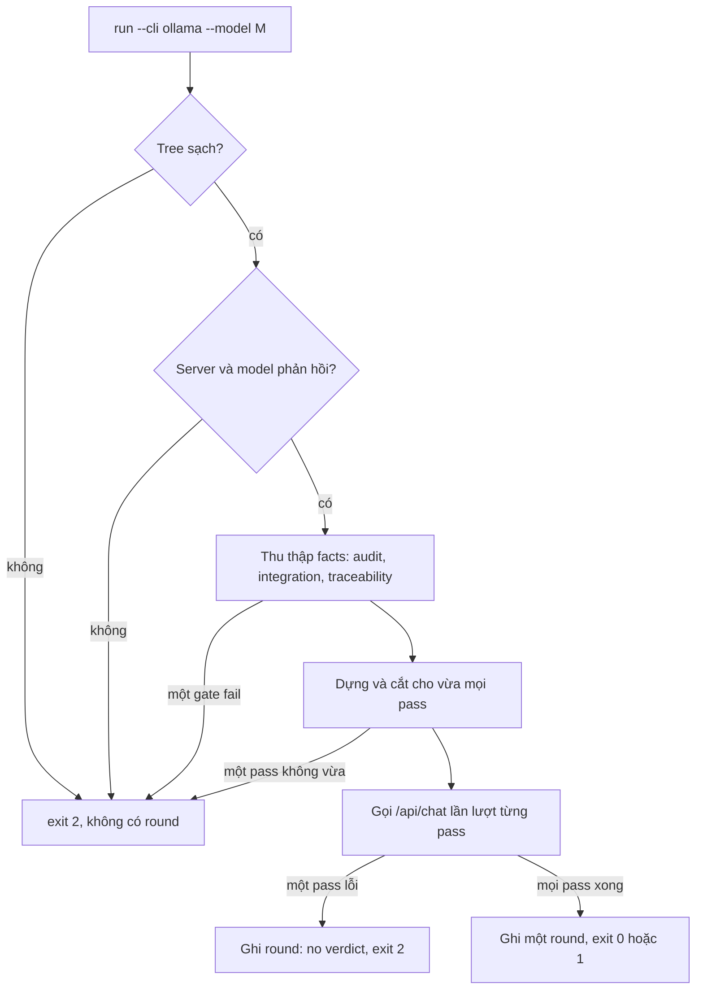

# Đặc tả Thiết kế Review bằng Model Local

## Mục lục

- [Tóm tắt](#tóm-tắt)
- [Vấn đề](#vấn-đề)
- [Mục tiêu và Ngoài phạm vi](#mục-tiêu-và-ngoài-phạm-vi)
- [Quyết định](#quyết-định)
- [Kiến trúc](#kiến-trúc)
- [Prompt base](#prompt-base)
- [Thay đổi workflow](#thay-đổi-workflow)
- [Xử lý lỗi](#xử-lý-lỗi)
- [Kiểm thử và nghiệm thu](#kiểm-thử-và-nghiệm-thu)
- [Rủi ro và phụ thuộc](#rủi-ro-và-phụ-thuộc)

## Tóm tắt

Review Choice mà `dev-implementation` đưa ra sau mỗi lần Gate 4 PASS có thêm lựa chọn thứ ba,
**Local model review**. Một model do Ollama phục vụ ở máy local review epic đã hoàn thành qua
`run_external_review.py run --cli ollama --model <model>`. Round được ghi vào `review_results.md`
giống hệt một round của Claude CLI hay Codex CLI, `check` quản lý nó theo cùng cách, và vòng lặp
quay lại một lần chạy Gate 4 đầy đủ.

Model local không có tool và có context giới hạn, nên review được chia thành một pass cho mỗi commit
của task cộng với một pass cho cả epic. Mỗi pass mang theo mọi thứ model được phép đánh giá. Một
prompt base riêng dạy model về workflow d3nexus và về các luật của chính kit cho những ngôn ngữ mà
pass đó chạm tới.

## Vấn đề

1. **Chỉ có reviewer trả phí, chạy từ xa.** Option 2 cần Claude CLI hoặc Codex CLI. Developer muốn
   một ý kiến thứ hai riêng tư, offline hoặc miễn phí thì không có đường nào trong vòng lặp.
2. **Prompt hiện tại giả định reviewer tự đọc được file.** `external-review-prompt.md` liệt kê
   *đường dẫn* artefact và nói "Read these paths". Chỉ có diff được inline. Một model gọi qua Ollama
   API thuần không mở được file, nên nó sẽ review những đường dẫn mà nó chưa từng thấy nội dung.
3. **Một prompt không vừa context local.** Đo trên ba epic gần nhất của repo này: spec, HLD, BDD
   scenario và file task chiếm 25–170 KB, evidence 40–265 KB, và diff mã nguồn của epic gần nhất là
   196 KB. Model tham chiếu chạy với context 64K token.
4. **Prompt hiện tại thiếu hai luật của Gate 4.** Hai luật Semantic Test Integrity của
   dev-implementation ("No Reconstructed Logic", "Immutable Real Artifacts") không có trong
   checklist review.

## Mục tiêu và Ngoài phạm vi

### Mục tiêu

- Review Choice đưa ra Finish, Cross-model review và Local model review sau mỗi lần Gate 4 PASS.
- `run_external_review.py run --cli ollama` review epic qua `/api/chat` của Ollama, chỉ dùng thư
  viện chuẩn của Python.
- Mỗi pass tự đủ, vừa context của model, và nói rõ những gì nó không đưa vào được.
- Một prompt base giải thích workflow d3nexus và nạp luật nền tảng của kit theo từng pass.
- Mỗi lần chạy là một round, theo định dạng `review_results.md` hiện có, do `check` hiện có quản lý.
- Các luật Verification nằm trong một file dùng chung cho cả hai prompt.
- Một tài liệu tham khảo ngắn về cách thiết lập, kèm một Modelfile reviewer mẫu.

### Ngoài phạm vi

- Review local kiểu agentic (Claude Code hoặc Codex trỏ vào backend Ollama).
- Các server local khác (LM Studio, llama.cpp server).
- Chọn, tải hay tinh chỉnh model thay developer.
- Chạy các pass song song; GPU local vốn xử lý tuần tự.
- Mọi thay đổi hành vi của đường Claude CLI và Codex CLI, ngoài file luật dùng chung.

## Quyết định

| # | Quyết định | Lý do |
|---|------------|-------|
| D1 | Local model review là **option 3** của Review Choice, tách khỏi option 2 | Nó khác loại (riêng tư, offline, model yếu hơn). Khuyến nghị cho fast executor vẫn chỉ vào option 2 |
| D2 | Kênh gọi là `POST /api/chat` gốc của Ollama qua `urllib`, `stream: false` | Không thêm dependency; model không có tool nên review read-only ngay từ thiết kế |
| D3 | Mỗi commit của task một pass, cộng một pass epic, gộp thành một round | Một commit cho mỗi task khiến việc cắt lát tự nhiên; mỗi pass vừa context 32K–64K |
| D4 | `--model` bắt buộc khi dùng `--cli ollama`; agent chạy `ollama list` rồi hỏi | Developer chọn reviewer, giống việc chọn CLI |
| D5 | Modelfile của model quyết định sampling và context | `num_ctx` đọc từ `/api/show` và chỉ được gửi khi có `--num-ctx`, hoặc gửi 32768 khi Modelfile không đặt |
| D6 | Không bao giờ gửi `think`; chỉ parse `message.content`, phần sau `</think>` cuối cùng nếu có | Chạy đúng dù thinking tắt, được Ollama tách riêng, hay bị template chèn vào content |
| D7 | Prompt yêu cầu một mục `## Analysis` trước khối verdict | Model tắt thinking vẫn suy luận trước khi kết luận, và developer đọc được lý do |
| D8 | `num_predict` bằng phần context còn lại sau prompt ước lượng | Thinking ở mức cao không bị cắt, và việc sinh không bao giờ làm dịch context |
| D9 | Luật nền tảng được chọn theo từng pass, từ đuôi file trong diff của pass đó | `detect_project_type.sh` trả về một loại; repo Flutter + Rust sẽ nhận luật Flutter cho code Rust |
| D10 | Luật nền tảng chỉ trích luật kit đã định nghĩa, kèm ID, ở mức Blocker | Không bịa luật; luật mức Warning chỉ sinh nhiễu trên model nhỏ |
| D11 | Các luật Verification chuyển sang `references/review-rules.md` dùng chung, chèn vào bằng `$rules` | Hai prompt luôn giống nhau về luật, và option 2 có thêm hai luật đang thiếu |
| D12 | Ngữ nghĩa blocking không đổi; finding blocking có đường dẫn mà pass chưa từng đưa vào thì được chú thích, không bị hạ mức | Mọi finding blocking vẫn cần developer quyết định; chú thích giúp nhận ra finding bịa nhanh hơn |

Model tham chiếu trong lúc thiết kế là `qwen38-reviewer`: Qwen3.8 27B Q8 với `num_ctx 65536`,
temperature 0.2 và thinking bật. Lần chạy thử ngày 2026-10-21 trả phần suy nghĩ trong
`message.thinking`, `content` sạch kết thúc bằng một dòng `Verdict:`, load 11 s và output 12 tok/s.

## Kiến trúc

### Thành phần

| Đơn vị | Thay đổi | Trách nhiệm |
|--------|----------|-------------|
| `resources/scripts/run_external_review.py` | sửa | `--cli ollama`, `--host`, `--num-ctx`; ghi một round từ danh sách pass. Claude CLI và Codex CLI chạy như một pass duy nhất với prompt hiện có |
| `resources/scripts/local_review.py` | mới | Thăm dò server và model, dựng và cắt cho vừa các pass, render từng prompt, gọi `/api/chat` |
| `references/local-review-prompt.md` | mới | Template của system message: vai trò, primer workflow, `$rules`, `$platform_rules`, `$checklist`, định dạng output |
| `references/local-review-platforms.md` | mới | Mỗi nền tảng một section: Flutter, Android, iOS, Rust, Python |
| `references/review-rules.md` | mới | Luật phân cấp Verification và luật Semantic Test Integrity, dùng chung cho cả hai prompt |
| `references/external-review-prompt.md` | sửa | Section luật của nó trở thành `$rules` |
| `references/local-review-setup.md` | mới | Modelfile reviewer mẫu và lưu ý về khối think rỗng |

Mọi đường dẫn nằm dưới `skills/dev-implementation/`. `--host` mặc định là `$OLLAMA_HOST`, nếu không
có thì `http://localhost:11434`.

### Luồng chạy

1. Thiếu `--model` thì lần chạy exit 2 trước mọi bước khác.
2. Tree bẩn thì dừng, như hiện nay.
3. Bước thăm dò gọi `GET /api/version` và `POST /api/show`, rồi đọc `num_ctx` từ tham số của model.
   Lỗi thì in banner precondition ("OLLAMA WAS NOT INVOKED") và exit 2.
4. Thu thập facts không đổi và vẫn dừng sớm khi fail.
5. Mọi pass được dựng và cắt cho vừa trước lần gọi model đầu tiên, nên một pass không vừa sẽ dừng
   lần chạy mà không tốn thời gian của model.
6. Các pass chạy theo thứ tự commit, pass epic chạy cuối. Mỗi pass in một dòng trạng thái trực tiếp
   ra stderr (`⏳ [Pass 2/6] task_2_… ✅ 214s`). Pass đầu tiên bị lỗi kết thúc lần chạy.

### Nội dung pass

Một **pass task** phủ một commit của task: commit mới nhất trên `<base>..HEAD` chạm vào
`.devtool/epic/<epic_dir>/evidence/<task_id>.json`, cùng quy tắc mà `audit_epic.py` dùng. User
message của nó gồm:

- bản mirror của file task `.devtool/epic/<epic_dir>/<task_id>.md`;
- các khối Gherkin của mọi ID scenario trên các dòng `Covers:` của task, lấy từ `bdd_scenarios.en.md`;
- evidence đã rút gọn còn `id`, `phase`, `command`, `expect`, `exit`, `outcome` và tối đa 15 dòng
  `output_tail` cho mỗi row, của các lần chạy `red` và `verify`;
- diff của commit, lọc bằng `EXCLUDES` hiện có và `.devtool/**`;
- danh sách `Not shown` gồm các file bị bỏ để vừa ngân sách.

**Pass epic** gồm spec, HLD, output của `audit_epic.py` (có cả các mục Gate 5 của nó), output
integration và traceability, `git diff --stat <base>...HEAD`, và diff của các commit nằm ngoài task.
Task không có commit evidence (task legacy) không có pass task; commit của nó là một trong các commit
nằm ngoài task.

### Ngân sách context

- Số token được ước lượng bằng số byte chia 3, cố ý ước cao cho code.
- Một prompt được dùng tối đa 60% `num_ctx`. Phần còn lại dành cho thinking và câu trả lời, và
  `num_predict` được đặt bằng `num_ctx` trừ số ước lượng.
- Pass task bỏ dần các file diff, file lớn nhất trước, cho tới khi vừa. File task, scenario và
  evidence không bao giờ bị cắt.
- Pass epic bỏ lần lượt: diff của các commit ngoài task, rồi spec, rồi HLD. Output audit và
  traceability không bao giờ bị cắt.
- Khi riêng các phần không được cắt đã vượt ngân sách, lần chạy dừng trước mọi lần gọi model và gợi
  ý dùng `--num-ctx`.

### Một round từ nhiều pass

- **Status** chỉ là `completed` khi mọi pass đều completed: HTTP 200, `done_reason` là `stop`, có
  dòng verdict, và có ít nhất một finding đi kèm `CHANGES REQUIRED`.
- **Verdict** là `CHANGES REQUIRED` khi có bất kỳ pass nào nói vậy, ngược lại là `PASS`.
- **Finding** chỉ được đọc từ dòng `Verdict:` cuối cùng của pass trở xuống, nên một dòng nháp trong
  `## Analysis` không bao giờ thành finding; prompt cũng cấm tag severity ở đó, như prompt hiện có.
- **Finding** được nối theo thứ tự pass. Finding Critical hoặc Important có đường dẫn không xuất hiện
  trong user message của pass đó được nối thêm `(location not shown to reviewer)` vào ô Problem.
- **Metadata** giữ các trường hiện có với `CLI: ollama`, và thêm `Passes`, `Context`, cùng `Omitted`
  khi có file bị bỏ.
- **Raw output** chứa `content` đã parse của từng pass dưới `### Pass N: <label>`.
- **Exit code** không đổi: 0 không có finding blocking, 1 có finding blocking, 2 mọi trường hợp khác.

## Prompt base

### System message

`local-review-prompt.md` viết bằng tiếng Anh và được render bằng `string.Template`:

1. **Vai trò và giới hạn cứng.** Model review một lát cắt của một epic d3nexus. Nó không có tool và
   chỉ đánh giá những gì được đưa vào. Nó không bao giờ bịa nội dung file, số dòng, lệnh hay tên
   test. Thứ nó cần mà không thấy được ghi thành `[Minor] <slice>:not-shown — <what>`, không bao giờ
   thành finding blocking.
2. **Primer workflow.** Khoảng 40 dòng, gồm:
   - Gate 1 đến 4, và việc Gate 4 đã PASS, nên exit code đã được máy xác nhận và chỉ còn phần ngữ
     nghĩa;
   - file task: Allowed files, Read-only context, Decisions Already Made (ràng buộc), bảng
     Verification (`Vn`, RED hoặc GREEN, command, expect), Definition of Done và các mục `(Gate 5)`;
   - evidence do `run_task_checks.py` ghi lại bằng cách chạy từng row, không bao giờ viết tay;
   - ID scenario BDD (`HP`, `EC`, `FR`, `ST`), mỗi ID được ít nhất một integration test PASS phủ;
   - các commit `Fix` sau task cuối cùng, và các protected path.
3. **`$rules`** từ `review-rules.md`: bốn luật Verification hiện có cộng "No Reconstructed Logic"
   và "Immutable Real Artifacts".
4. **`$platform_rules`**, mô tả bên dưới.
5. **`$checklist`** cho loại pass này, mô tả bên dưới.
6. **Định dạng output.** Đầu tiên là `## Analysis`, mỗi mục checklist một đoạn ngắn, mỗi đoạn trích
   dòng được đưa vào mà nó dựa vào. Sau đó là khối verdict theo đúng ngữ pháp parser đang đọc, kèm
   một ví dụ mẫu. Critical hoặc Important bắt buộc có trích dẫn từ nội dung được đưa vào.

### Luật theo nền tảng

`local-review-platforms.md` có mỗi nền tảng một section `##`. Một pass nạp mọi section có đuôi file
xuất hiện trong diff của nó:

| Đuôi file | Section | Nguồn |
|-----------|---------|-------|
| `.dart` | Flutter | `architecture-audit`, `code-health-audit`, `security-audit` |
| `.kt`, `.kts` | Android | `architecture-audit`, `code-health-audit`, `security-audit` |
| `.swift` | iOS | `architecture-audit`, `code-health-audit`, `security-audit` |
| `.rs` | Rust | governance kiến trúc của `rust-quality-check` |
| `.py` | Python | governance kiến trúc của `python-quality-check` |

Đuôi file khác không thêm gì, và luật workflow vẫn áp dụng. Mỗi luật giữ ID của nó trong kit, ví dụ
`HLT-FLUTTER-03`. Luật áp dụng cho các dòng được thêm vào của file production; file test được đánh
giá theo checklist. Vi phạm được ghi là `Important`, có ID luật trong ô Problem.

### Checklist của pass

Mỗi mục được trả lời trong `## Analysis`, kèm trích dẫn.

**Pass task:**

- Lệnh của mỗi row GREEN có thật sự kiểm tra mục Definition of Done mà nó đứng sau không?
- Mỗi row RED có fail vì hành vi còn thiếu không, chấp nhận lỗi biên dịch với ngôn ngữ biên dịch?
- Mỗi test có import và gọi code production từ Allowed files, hay tự dựng lại logic?
- Có assert nào rỗng không: không assert gì, luôn đúng, hoặc assert lên mock mà chính test đã cấu hình?
- Given, When và Then của mỗi scenario được phủ có khớp với arrange, act và assert không?
- Code có trái với một Decision Already Made không?
- Có dòng nào được thêm vào vi phạm luật nền tảng đã nạp không?

**Pass epic:**

- Hằng số, giá trị mặc định và giá trị enum trong code có khớp với spec và HLD không (contract drift)?
- Mỗi mục audit disclosure có lý do chính đáng không: grader amendments, protected paths, commit
  ngoài task?
- Mỗi commit `Fix` có thay đổi đúng điều tiêu đề của nó nói, và không thêm gì chưa được test không?
- Output traceability có để lộ scenario nào chỉ được phủ hời hợt không?
- Liệt kê lại các mục Gate 5 cho developer, không gắn severity.

### User message

Lát cắt, dưới các tiêu đề cố định. Pass task dùng `## Task file`, `## Scenarios covered`,
`## Evidence`, `## Diff of <short sha>` và `## Not shown`. Pass epic dùng `## Spec`, `## HLD`,
`## Audit`, `## Traceability`, `## Diff stat` và `## Commits outside tasks`.

## Thay đổi workflow

| File | Thay đổi |
|------|----------|
| `skills/dev-implementation/SKILL.md` | Review Choice liệt kê option 3 với lệnh của nó; agent chạy `ollama list` và hỏi chọn model. HARD-GATE, invariant của vòng lặp và chú thích workflow transitions nêu option thứ ba cùng cạnh `round recorded` quay về Phase 4. Commit cho mỗi round: `[EPIC_NAME] Record local model review round N` |
| `skills/dev-lifecycle/SKILL.md` | Vòng Review Choice với ba lựa chọn; invariant "Cross-model review or Local model review → Gate 4 in full"; khuyến nghị cho fast executor thêm "Local model review does not replace it"; Red Flag: không bao giờ chọn review CLI hay model Ollama thay developer |
| `rules/CRITICAL_RULES.md` | Rule 5 liệt kê Option 3 |
| `docs/lifecycles.en.md`, `docs/lifecycles.vi.md` | Sơ đồ có thêm node và các cạnh của option 3; đoạn Gate 4 nhắc tới nó |
| `docs/choosing-a-lifecycle.en.md`, `docs/choosing-a-lifecycle.vi.md` | Review Choice được mô tả với ba lựa chọn |
| `CHANGELOG.md` | Một mục Unreleased |

## Xử lý lỗi

| Tình huống | Kết quả |
|------------|---------|
| `--cli ollama` không có `--model` | exit 2 trước mọi kiểm tra |
| Server không phản hồi, hoặc model chưa được cài | banner precondition, exit 2, không có round |
| Một fact gate fail | không đổi: banner, exit 2, không có round |
| Một pass không vừa dù đã bỏ hết diff | exit 2 trước mọi lần gọi model, nêu tên pass và gợi ý `--num-ctx` |
| Một pass trả lỗi HTTP hoặc vượt `--timeout` (tính cho từng pass) | lần chạy dừng; round được ghi `no verdict` với các output đã có |
| `done_reason` là `length` | pass đó, và vì thế cả round, là `no verdict` |
| Không có dòng verdict, hoặc `CHANGES REQUIRED` không có finding | `no verdict`, như hiện nay |

## Kiểm thử và nghiệm thu

- **Test của runner** dùng một fake Ollama server: `http.server` chạy trong thread trên một port
  trống, trỏ tới qua `--host`. Không test nào chạm tới model thật. Chúng phủ:
  - thiếu `--model`, server down và model không tồn tại đều dừng trước bước facts;
  - mỗi commit evidence một pass cộng pass epic, theo thứ tự commit;
  - việc tách system message và user message, và các section nền tảng được chọn;
  - `num_ctx` lấy từ `/api/show`, bị `--num-ctx` ghi đè, và có giá trị mặc định khi không có;
  - các file bị bỏ được liệt kê trong `Not shown` và `Omitted`;
  - một pass không vừa sẽ dừng lần chạy trước mọi lần gọi;
  - lỗi HTTP, timeout và `done_reason: length` đều ghi `no verdict`;
  - chỉ phần sau `</think>` cuối cùng được parse;
  - verdict và finding được gộp qua các pass, cùng chú thích location.
- **Các test runner hiện có** pass mà không sửa; đường Claude CLI và Codex CLI giữ nguyên hành vi.
- **Test văn bản** `scripts/test_verifiable_handoff_text.py` và
  `scripts/test_lifecycle_document_contract.py` kiểm tra lựa chọn thứ ba.
- **`scripts/verify.sh`** và `check_document.py --require-toc --require-bilingual` trên mọi cặp tài
  liệu song ngữ bị sửa.
- **Nghiệm thu:** Review Choice của chính epic này chọn option 3 với `qwen38-reviewer`, và thời gian
  chạy cùng các finding của round được ghi lại. Load model 29 GB có thể đẩy một model khác đang được
  load ra khỏi bộ nhớ, nên agent hỏi trước khi chạy.

## Rủi ro và phụ thuộc

- **Thời gian.** Ở khoảng 12 tok/s khi có thinking, mỗi pass mất vài phút; một epic năm task mất 20
  tới 40 phút. Tốc độ xử lý prompt với prompt 30K token chưa được đo.
- **Báo nhầm.** Model 27B hay báo thừa. Trích dẫn là bắt buộc, location không được đưa vào sẽ bị chú
  thích, và mọi finding blocking vẫn cần developer quyết định.
- **Sai lệch ước lượng.** Chia byte cho 3 vẫn có thể ước thấp một prompt dày đặc; hậu quả là dừng vì
  `length`, và cách khắc phục là `--num-ctx`.
- **Bề mặt API của Ollama.** Thiết kế phụ thuộc vào `/api/version`, `/api/show` và `/api/chat` với
  `stream: false`, và vào việc `num_ctx` xuất hiện trong tham số của `/api/show`. Đã thử với Ollama
  0.40.6.
- **Template của model.** Modelfile chèn sẵn một khối `<think></think>` rỗng sẽ âm thầm tắt
  thinking. Tài liệu thiết lập ghi lại điều này; runner chạy đúng trong cả hai trường hợp.
- **Gate của repo kit.** Gate 4 ở đây luôn `BLOCKED` (không có quality registry), nên
  `scripts/verify.sh` là gate thực tế của epic này.
- **Không có phụ thuộc upstream.** Công việc này không chặn epic nào khác và không cần gì ngoài kit.
