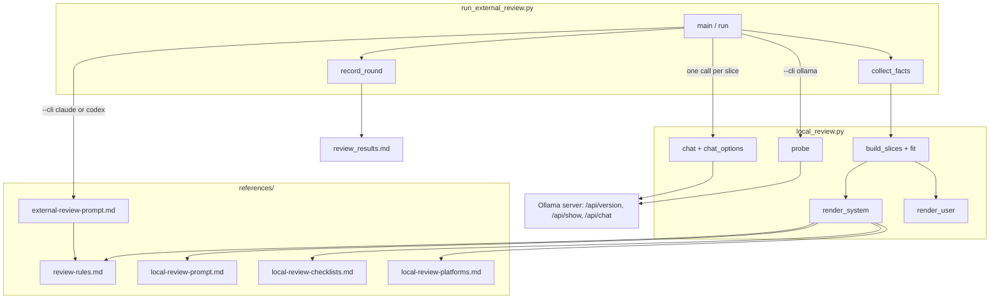
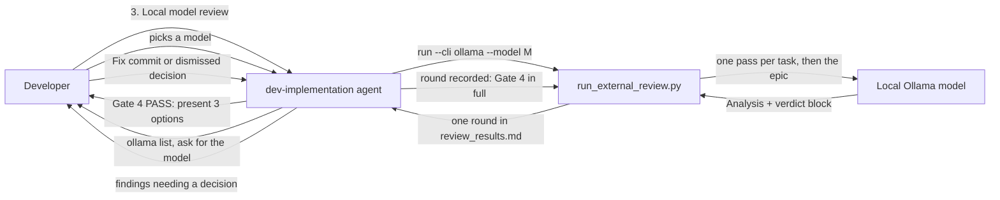
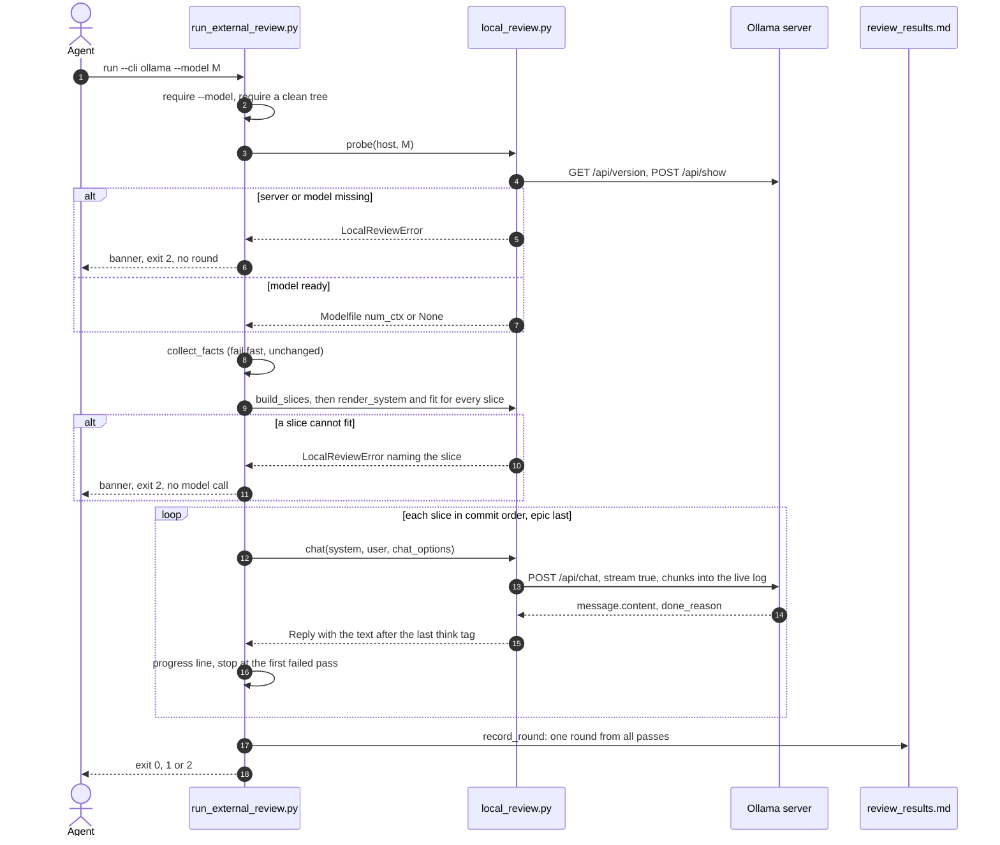

# Local Model Review High-Level Design

## Table of Contents

- [Meta Data](#meta-data)
- [Background](#background)
- [Goals and Non-Goals](#goals-and-non-goals)
- [Architecture and Technical Design](#architecture-and-technical-design)
- [Integration Test Plan and Boundary Matrix](#integration-test-plan-and-boundary-matrix)
- [Verification Environment](#verification-environment)
- [Comprehensive BDD Scenario Coverage](#comprehensive-bdd-scenario-coverage)
- [Rollout Strategy and Mitigation](#rollout-strategy-and-mitigation)
- [Kanban Tasks Breakdown](#kanban-tasks-breakdown)

## Meta Data

- **Epic name**: `local_model_review`
- **Status**: In Progress
- **Target release**: Next plugin release
- **Platform**: Python tooling / agent skill kit
- **Source Spec**: [Approved local model review design](2026-10-21-local-model-review-design.en.md)

## Background

The Review Choice after every Gate 4 PASS offers Finish or a cross-model review through the Claude
CLI or the Codex CLI. Both are paid, remote and agentic: the prompt lists artefact paths and the
reviewer reads them itself. A developer who wants a private, offline second opinion from a model
served by a local Ollama has no route inside the loop, and the current prompt cannot serve one: a
model behind the plain Ollama API has no tools, and one epic's artefacts and diff exceed a local
context several times over. The approved spec settles the design in twelve decisions (D1–D12); this
HLD freezes the module contracts that implement them.

## Goals and Non-Goals

### Goals

- Review Choice offers Finish, Cross-model review and Local model review on every Gate 4 PASS.
- `run_external_review.py run --cli ollama --model <model>` reviews an epic through Ollama's
  `/api/chat` with the Python standard library only.
- One self-contained pass per task commit plus one epic pass, each fitted to the model's context.
- A prompt base that teaches the d3nexus workflow and loads the kit's own rules per touched language.
- One round per run in the existing `review_results.md` format, governed by the existing `check`.
- Verification rules shared by both prompts through `references/review-rules.md`.
- After every review round, from any reviewer, `run_external_review.py triage` lays out its findings and compares
  the rounds, and the developer decides before any fix.

### Non-Goals

- Agentic local review, other local servers, model selection or tuning on the developer's behalf.
- Parallel passes. Measured on 2026-10-21: Ollama served `qwen38-reviewer-fast` with one slot (`-np 1`) even with
  `OLLAMA_NUM_PARALLEL=3` set, and 1, 2 and 3 concurrent requests all gave 11.5 tok/s in total.
- Any behaviour change of the Claude CLI and Codex CLI paths beyond the shared rules file.

## Architecture and Technical Design

### High-Level Architecture



### Use Cases



### Sequence Diagram



### Module Contracts

These signatures are frozen for Stage 3. All files live under `skills/dev-implementation/`.

**`resources/scripts/local_review.py`** (new). Standard library only. It never imports
`run_external_review.py`; it may import `task_contract` and `check_bdd_traceability`.

```python
DEFAULT_HOST = "http://localhost:11434"
DEFAULT_NUM_CTX = 32768
PROMPT_SHARE = 0.6
BYTES_PER_TOKEN = 3
TAIL_LINES = 15
EXTENSIONS = {".dart": "Flutter", ".kt": "Android", ".kts": "Android",
              ".swift": "iOS", ".rs": "Rust", ".py": "Python"}

class LocalReviewError(Exception): ...          # str(error) is the reason shown to the developer

@dataclass(frozen=True)
class Reply:
    content: str                 # answer_text of message.content; "" on failure
    done_reason: str | None
    error: str | None            # None on HTTP 200

@dataclass(frozen=True)
class Slice:
    label: str                   # the task id, or "epic"
    kind: str                    # "task" or "epic"
    paths: tuple[str, ...]       # changed paths shown in this slice's diffs
    omitted: tuple[str, ...]     # names dropped by fit, in drop order
    # further fields are private to local_review.py

def host_from_env() -> str
def probe(host: str, model: str, timeout: int = 10) -> int | None
def chat_options(model_ctx: int | None, flag_ctx: int | None, prompt_tokens: int) -> dict[str, int]
def chat(host: str, model: str, system: str, user: str, options: dict[str, int], timeout: int,
         log: Path | None = None) -> Reply
def answer_text(content: str) -> str
def estimate_tokens(text: str) -> int
def build_slices(root: Path, epic_dir: str, base: str, sha: str, audit_output: str,
                 results_output: str, excludes: tuple[str, ...]) -> list[Slice]
def fit(slice_: Slice, budget_tokens: int) -> Slice
def render_user(slice_: Slice) -> str
def platform_sections(paths: Iterable[str]) -> list[str]
def render_system(slice_: Slice) -> str
```

- `probe` raises `LocalReviewError("Ollama server not reachable at <host>")` or
  `LocalReviewError("model <model> is not installed (ollama list)")`, and returns the integer after
  `num_ctx` in `/api/show` `parameters`, or `None`.
- `chat_options` returns `num_predict = effective - prompt_tokens` where
  `effective = flag_ctx or model_ctx or DEFAULT_NUM_CTX`, and adds `num_ctx = effective` only when
  `flag_ctx` is set or `model_ctx` is `None`. No sampling option is ever sent.
- `chat` posts `{"model", "messages": [system, user], "stream": true, "options"}` and never sends
  `think`. As chunks arrive it writes their thinking, then `--- answer ---`, then the answer to
  `log`; `timeout` bounds the whole pass, not only the wait for each chunk. A timeout gives `error="timed out after <timeout> seconds"`; an HTTP error gives
  `error="HTTP <code>: <first 500 characters of the body>"`.
- `answer_text` returns the text after the last `</think>`, stripped, or the whole text without one.
- `estimate_tokens` is `ceil(len(text.encode("utf-8")) / BYTES_PER_TOKEN)`.
- `fit` drops droppable parts until `estimate_tokens(render_user(result)) <= budget_tokens`, and
  raises `LocalReviewError("<label> needs <n> tokens of never-cut content but the budget is <b>; raise --num-ctx")`.
  A task slice drops diff files largest first; the epic slice drops commits outside tasks, then the
  spec, then the HLD.
- `render_user` writes the fixed headings: a task slice `## Task file`, `## Scenarios covered`,
  `## Evidence`, `## Diff of <short sha>`, `## Not shown`; the epic slice `## Spec`, `## HLD`,
  `## Audit`, `## Traceability`, `## Diff stat`, `## Commits outside tasks`, `## Not shown`.
- `platform_sections` returns the `##` sections of `local-review-platforms.md` for the extensions
  present, in the order Flutter, Android, iOS, Rust, Python, read with `task_contract.section`.
- `render_system` substitutes `$rules`, `$platform_rules` and `$checklist` into
  `local-review-prompt.md` with `string.Template.safe_substitute`. `$checklist` is the
  `## Task pass` or `## Epic pass` section of `local-review-checklists.md`. With no platform
  section, `$platform_rules` reads `No platform rules apply to this slice.`

**`resources/scripts/run_external_review.py`** (modified).

```python
RULES = SCRIPTS.parent.parent / "references" / "review-rules.md"

@dataclass(frozen=True)
class Pass:
    label: str
    code: int | None             # 0 transport success, None timeout, otherwise failure
    out: str                     # the text the parser reads
    err: str
    shown: str                   # what the reviewer was shown
    omitted: tuple[str, ...] = ()
    done_reason: str | None = None

def record_round(root: Path, args: argparse.Namespace, sha: str, passes: list[Pass],
                 changed: list[str], extra: dict[str, str]) -> int
```

- `--cli` accepts `claude`, `codex` and `ollama`; `--host` (default `local_review.host_from_env()`)
  and `--num-ctx` (default `None`) are new. `--timeout` is per pass for `ollama`.
- The Claude CLI and Codex CLI run as one `Pass` labelled `review`, and `record_round` writes the
  same round, byte for byte, as today. The prompt gains `rules=RULES.read_text()`.
- Each local pass streams into `<logs>/<n>-<label>.log`, where `<logs>` is
  `build/local-review/<epic_dir>` when Git ignores it, else `git rev-parse --git-path local-review/<epic_dir>`.
  Either place leaves `git status` untouched. The runner prints `Live logs: <logs>` before the first pass.
- For `--cli ollama` only: findings are read from each pass's last `Verdict:` line onward; a
  Critical or Important finding whose location path does not occur in `Pass.shown` gets
  ` (location not shown to reviewer)` appended to its Problem; a pass completes only with
  `code == 0`, `done_reason == "stop"`, a verdict, and a finding behind `CHANGES REQUIRED`; raw
  output puts each pass under `### Pass <n>: <label>`; metadata adds `Passes`, `Context`, and
  `Omitted` when any slice dropped a part.
- The round verdict is `CHANGES REQUIRED` when any pass says so. Exit codes stay 0, 1 and 2.


**Review triage** (Task 8, added after the first review rounds of this epic): `run_external_review.py triage --epic-dir <epic_dir>` prints, for the latest round whatever its status, a Markdown skeleton the agent fills before any action:

- `# Review Triage: <epic_dir>, Round <n>` with the round's SHA, CLI, Model, Status and Verdict;
- `## Passes`: one row per pass (`### Pass <n>: <label>` blocks, or a single `review` pass for the Claude CLI and
  Codex CLI) with its last verdict or `none`, and the first line of its `--- error ---` text or `—`;
- `## Findings`: the round's findings table, numbered as in `review_results.md`, with `?` in the Assessment,
  Evidence and Proposed action columns;
- `## Round Comparison`: one row per round with CLI / Model, SHA, Status, Verdict, the Critical, Important and Minor
  counts, and the Fixed (`fixed in `), Dismissed (`dismissed: `) and Undecided (blocking, no decision) counts;
- `## Since Round <n-1>`: each finding of the previous round that was blocking or fixed, marked `re-reported at the
  same path (#k)` when the latest round reports a finding at the same file, with `check the fix` when it was fixed,
  or `not re-reported`; paths are compared without line numbers, which move after fixes;
- `## Next Steps`, left for the agent.

It reads only; it exits 0, or 2 with `no review round recorded for <epic_dir>` when there is none. `references/review-triage.md` says how to fill it: verify every finding at the round's SHA, assess it Valid, Debatable, False positive or Not shown, propose `fix`, `dismiss: <reason>` or `none`, stop for the developer's decisions, and recommend a confirmation round after blocking fixes, whose triage measures the improvement.

**References** (new unless noted): `review-rules.md` (the four existing Verification rules plus
"No Reconstructed Logic" and "Immutable Real Artifacts"); `external-review-prompt.md` (modified,
its rules section becomes `$rules`); `local-review-prompt.md`; `local-review-checklists.md`;
`local-review-platforms.md` (Flutter, Android and iOS quote Blocker rules by their kit IDs from
`architecture-audit`, `code-health-audit` and `security-audit`; Rust and Python quote the named
policies of the two governance references); `local-review-setup.md`; `review-triage.md`.

### Impact Analysis

`check_code_impact.py` against `main` reports a clean upstream and two callers of the runner:
`scripts/test_verifiable_handoff_text.py` (asserts Review Choice text) and
`skills/dev-implementation/resources/scripts/test_run_external_review.py` (the existing runner
suite, which must keep passing unchanged). No native bridge is involved. Its "no test file found"
warnings are a known false positive of the tool. `scripts/verify.sh` line 253 runs the runner suite
and gains the new suite.

## Integration Test Plan and Boundary Matrix

Integration test roots: skills/dev-implementation/resources/scripts/, scripts/

Protected paths: .agents/quality/**, .devtool/epic/local_model_review/bdd_scenarios.en.md, .devtool/epic/local_model_review/bdd_scenarios.vi.md, skills/dev-implementation/resources/scripts/test_run_external_review.py, scripts/test_lifecycle_document_contract.py, scripts/test_verifiable_handoff_text.py

Integration results: python3 scripts/run_unittest_junit.py --junitxml build/test-results/local-model-review.xml skills/dev-implementation/resources/scripts/test_local_review.py skills/dev-implementation/resources/scripts/test_run_external_review.py scripts/test_lifecycle_document_contract.py scripts/test_verifiable_handoff_text.py -> build/test-results/local-model-review.xml

| Boundary | Real components | Isolation or fixture | Required assertions |
|---|---|---|---|
| Shared rules | `run_external_review.py`, `external-review-prompt.md`, `review-rules.md` | Throwaway Git repository, fake `claude` on `PATH` | The prompt carries all six rules and no `$rules` |
| Ollama transport | `probe`, `chat`, `chat_options`, `answer_text` | Fake Ollama `http.server` on `127.0.0.1`, free port | Errors name host or model; options follow the Modelfile; thinking text never parsed |
| Slices and budget | `build_slices`, `fit`, `render_user` | Throwaway epic repository with task, evidence and Fix commits | Headings, compact evidence, drop order, never-cut error, legacy task routing |
| Prompt base | `render_system`, `platform_sections`, the four reference files | Repository reference files | Sections by extension; every quoted rule exists in its source skill |
| Round merging | `record_round`, `check` | Throwaway repository, constructed `Pass` lists | Status, verdict, last-verdict findings, annotation, metadata, numbering |
| Runner wiring | `run --cli ollama` end to end | Throwaway epic repository and fake Ollama server | Order of checks, sequential passes, per-pass timeout, failure stops |
| Review triage | `triage`, `rounds_in`, `table_findings` | Throwaway repository with recorded rounds | Every finding listed, per-pass summary, round comparison, recurrence at the same path |
| Workflow text | Skills, rules, lifecycle documents | Repository documents | Three options and the `round recorded` return in every variant |
| Full acceptance | All suites above | Current repository checkout | Integration results command, `scripts/verify.sh`, document checks |

No test reaches a real model: every Ollama call goes to the fake server through `--host` or a
patched `OLLAMA_HOST`.

## Verification Environment

- Tests use `tempfile` directories and throwaway Git repositories; they never mutate this
  repository, a remote, a worktree or user configuration.
- The fake Ollama server binds `127.0.0.1` on an ephemeral port inside the test process. No other
  network access, credential, model download or real Ollama server is permitted.
- Tests that need the default host patch `OLLAMA_HOST` for their own duration only.
- Test commands require no environment variables; every `Needs` cell is `—`.
- JUnit reports live under the ignored `build/test-results/`.

## Comprehensive BDD Scenario Coverage

The canonical Gherkin definitions are in [BDD scenarios](bdd_scenarios.en.md), with the synchronized
[Vietnamese translation](bdd_scenarios.vi.md).

| Dimension | Scenario IDs | Coverage intent |
|---|---|---|
| Happy Paths | LMR-HP-01 through LMR-HP-10 | Three options, shared rules, a full local round, slice and system content, context options, grounded platform rules, triage and round comparison |
| Edge Cases and Boundaries | LMR-EC-01 through LMR-EC-11 | Missing model, context defaults, oversized diffs, never-cut overflow, mixed languages, legacy tasks, inline thinking, draft findings, omitted metadata, passes without a verdict, fixes reported again |
| State Transitions | LMR-ST-01 through LMR-ST-04 | Decisions gate `check`, round numbering across CLIs, the loop back to Gate 4, triage of the latest round |
| Async and Race Conditions | LMR-AR-01 through LMR-AR-02 | Strict pass order and a per-pass timeout |
| Failures and Resilience | LMR-FR-01 through LMR-FR-08 | Unreachable server, unknown model, HTTP errors, a failing pass, truncated output, unseen locations, budget stop, triage without a round |

## Rollout Strategy and Mitigation

1. Move the Verification rules into `review-rules.md` first, so both prompts share them before the
   local prompt exists.
2. Land the Ollama transport, then slices and budget, then the prompt base; each is a separate
   module surface with its own tests and no caller yet.
3. Refactor round recording behind `record_round` with the existing runner suite as the guard, then
   wire `--cli ollama` on top.
4. Change the skills, rules and documents last, then run the Integration results command,
   `scripts/verify.sh` and the document checks on the candidate SHA.
5. At this epic's own Review Choice, take option 3 with `qwen38-reviewer` and record the timing and
   findings. Ask the developer before loading the 29 GB model.
6. Add Review Triage (Task 8) once those rounds show that findings need a structured synthesis before any fix,
   then rerun Gate 4 in full.

No feature flag is needed: option 3 is opt-in at every Review Choice. Each task reverts on its own.
If the local path misbehaves after release, options 1 and 2 are unaffected because the Claude CLI
and Codex CLI rounds are byte-identical to today's.

## Kanban Tasks Breakdown

1. [Task 1: Share Verification Rules Between Review Prompts](task_1_share_verification_rules.md)
2. [Task 2: Add the Ollama Transport](task_2_ollama_transport.md)
3. [Task 3: Build and Fit Review Slices](task_3_review_slices_and_budget.md)
4. [Task 4: Write the Local Review Prompt Base](task_4_local_review_prompt_base.md)
5. [Task 5: Record One Round From Many Passes](task_5_record_round_from_passes.md)
6. [Task 6: Wire Local Model Review Into the Runner](task_6_wire_local_review_into_runner.md)
7. [Task 7: Update the Review Choice Workflow and Run Acceptance](task_7_review_choice_workflow_and_acceptance.md)
8. [Task 8: Triage Review Findings and Compare Rounds](task_8_review_triage_and_round_comparison.md)
