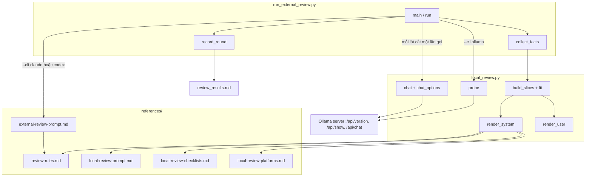
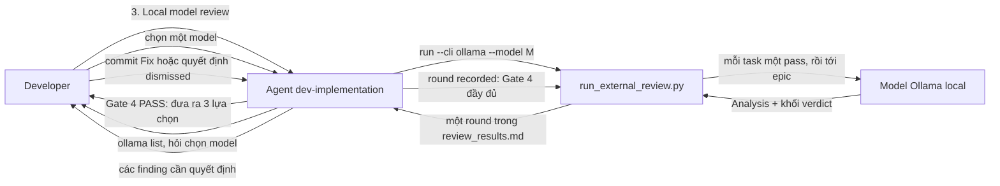
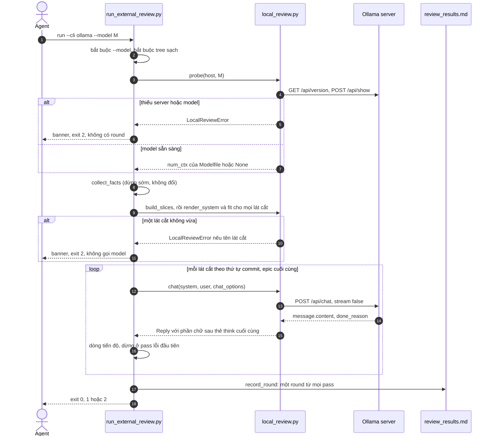

# Thiết kế cấp cao Review bằng Model Local

## Mục lục

- [Siêu dữ liệu](#siêu-dữ-liệu)
- [Bối cảnh](#bối-cảnh)
- [Mục tiêu và ngoài phạm vi](#mục-tiêu-và-ngoài-phạm-vi)
- [Kiến trúc và thiết kế kỹ thuật](#kiến-trúc-và-thiết-kế-kỹ-thuật)
- [Kế hoạch kiểm thử tích hợp và ma trận biên](#kế-hoạch-kiểm-thử-tích-hợp-và-ma-trận-biên)
- [Môi trường xác minh](#môi-trường-xác-minh)
- [Phạm vi kịch bản BDD toàn diện](#phạm-vi-kịch-bản-bdd-toàn-diện)
- [Chiến lược triển khai và giảm thiểu](#chiến-lược-triển-khai-và-giảm-thiểu)
- [Phân rã task Kanban](#phân-rã-task-kanban)

## Siêu dữ liệu

- **Tên epic**: `local_model_review`
- **Trạng thái**: In Progress
- **Bản phát hành mục tiêu**: Bản plugin tiếp theo
- **Nền tảng**: Python tooling / agent skill kit
- **Spec nguồn**: [Thiết kế review bằng model local đã duyệt](2026-10-21-local-model-review-design.vi.md)

## Bối cảnh

Review Choice sau mỗi lần Gate 4 PASS cho chọn Finish hoặc cross-model review qua Claude CLI hay
Codex CLI. Cả hai đều trả phí, chạy từ xa và kiểu agentic: prompt liệt kê đường dẫn artefact và
reviewer tự đọc. Developer muốn một ý kiến thứ hai riêng tư, offline từ một model do Ollama phục vụ ở
máy local thì không có đường nào trong vòng lặp, và prompt hiện tại không phục vụ được: một model sau
Ollama API thuần không có tool, và artefact cùng diff của một epic vượt context local nhiều lần.
Spec đã duyệt chốt thiết kế bằng mười hai quyết định (D1–D12); HLD này đóng băng các hợp đồng module
hiện thực chúng.

## Mục tiêu và ngoài phạm vi

### Mục tiêu

- Review Choice đưa ra Finish, Cross-model review và Local model review sau mỗi lần Gate 4 PASS.
- `run_external_review.py run --cli ollama --model <model>` review epic qua `/api/chat` của Ollama,
  chỉ dùng thư viện chuẩn của Python.
- Mỗi commit của task một pass tự đủ, cộng một pass epic, mỗi pass được cắt cho vừa context của model.
- Một prompt base dạy workflow d3nexus và nạp luật của chính kit theo từng ngôn ngữ được chạm tới.
- Mỗi lần chạy một round theo định dạng `review_results.md` hiện có, do `check` hiện có quản lý.
- Luật Verification dùng chung cho cả hai prompt qua `references/review-rules.md`.

### Ngoài phạm vi

- Review local kiểu agentic, server local khác, chọn hay tinh chỉnh model thay developer.
- Chạy các pass song song.
- Mọi thay đổi hành vi của đường Claude CLI và Codex CLI ngoài file luật dùng chung.

## Kiến trúc và thiết kế kỹ thuật

### Kiến trúc cấp cao



### Ca sử dụng



### Sơ đồ trình tự



### Hợp đồng module

Các chữ ký này được đóng băng cho Stage 3. Mọi file nằm dưới `skills/dev-implementation/`.

**`resources/scripts/local_review.py`** (mới). Chỉ dùng thư viện chuẩn. Nó không bao giờ import
`run_external_review.py`; nó được import `task_contract` và `check_bdd_traceability`.

```python
DEFAULT_HOST = "http://localhost:11434"
DEFAULT_NUM_CTX = 32768
PROMPT_SHARE = 0.6
BYTES_PER_TOKEN = 3
TAIL_LINES = 15
EXTENSIONS = {".dart": "Flutter", ".kt": "Android", ".kts": "Android",
              ".swift": "iOS", ".rs": "Rust", ".py": "Python"}

class LocalReviewError(Exception): ...          # str(error) is the reason shown to the developer

@dataclass(frozen=True)
class Reply:
    content: str                 # answer_text of message.content; "" on failure
    done_reason: str | None
    error: str | None            # None on HTTP 200

@dataclass(frozen=True)
class Slice:
    label: str                   # the task id, or "epic"
    kind: str                    # "task" or "epic"
    paths: tuple[str, ...]       # changed paths shown in this slice's diffs
    omitted: tuple[str, ...]     # names dropped by fit, in drop order
    # further fields are private to local_review.py

def host_from_env() -> str
def probe(host: str, model: str, timeout: int = 10) -> int | None
def chat_options(model_ctx: int | None, flag_ctx: int | None, prompt_tokens: int) -> dict[str, int]
def chat(host: str, model: str, system: str, user: str, options: dict[str, int], timeout: int) -> Reply
def answer_text(content: str) -> str
def estimate_tokens(text: str) -> int
def build_slices(root: Path, epic_dir: str, base: str, sha: str, audit_output: str,
                 results_output: str, excludes: tuple[str, ...]) -> list[Slice]
def fit(slice_: Slice, budget_tokens: int) -> Slice
def render_user(slice_: Slice) -> str
def platform_sections(paths: Iterable[str]) -> list[str]
def render_system(slice_: Slice) -> str
```

- `probe` raise `LocalReviewError("Ollama server not reachable at <host>")` hoặc
  `LocalReviewError("model <model> is not installed (ollama list)")`, và trả về số nguyên sau
  `num_ctx` trong `parameters` của `/api/show`, hoặc `None`.
- `chat_options` trả về `num_predict = effective - prompt_tokens` với
  `effective = flag_ctx or model_ctx or DEFAULT_NUM_CTX`, và chỉ thêm `num_ctx = effective` khi có
  `flag_ctx` hoặc `model_ctx` là `None`. Không bao giờ gửi tham số sampling nào.
- `chat` gửi `{"model", "messages": [system, user], "stream": false, "options"}` và không bao giờ gửi
  `think`. Timeout cho `error="timed out after <timeout> seconds"`; lỗi HTTP cho
  `error="HTTP <code>: <first 500 characters of the body>"`.
- `answer_text` trả về phần chữ sau `</think>` cuối cùng, đã strip, hoặc toàn bộ chữ nếu không có.
- `estimate_tokens` là `ceil(len(text.encode("utf-8")) / BYTES_PER_TOKEN)`.
- `fit` bỏ các phần được phép bỏ cho tới khi `estimate_tokens(render_user(result)) <= budget_tokens`,
  và raise `LocalReviewError("<label> needs <n> tokens of never-cut content but the budget is <b>; raise --num-ctx")`.
  Lát cắt task bỏ file diff lớn nhất trước; lát cắt epic bỏ lần lượt các commit ngoài task, rồi
  spec, rồi HLD.
- `render_user` viết các tiêu đề cố định: lát cắt task `## Task file`, `## Scenarios covered`,
  `## Evidence`, `## Diff of <short sha>`, `## Not shown`; lát cắt epic `## Spec`, `## HLD`,
  `## Audit`, `## Traceability`, `## Diff stat`, `## Commits outside tasks`, `## Not shown`.
- `platform_sections` trả về các section `##` của `local-review-platforms.md` theo các đuôi file có
  mặt, theo thứ tự Flutter, Android, iOS, Rust, Python, đọc bằng `task_contract.section`.
- `render_system` thế `$rules`, `$platform_rules` và `$checklist` vào `local-review-prompt.md` bằng
  `string.Template.safe_substitute`. `$checklist` là section `## Task pass` hoặc `## Epic pass` của
  `local-review-checklists.md`. Khi không có section nền tảng nào, `$platform_rules` là
  `No platform rules apply to this slice.`

**`resources/scripts/run_external_review.py`** (sửa).

```python
RULES = SCRIPTS.parent.parent / "references" / "review-rules.md"

@dataclass(frozen=True)
class Pass:
    label: str
    code: int | None             # 0 transport success, None timeout, otherwise failure
    out: str                     # the text the parser reads
    err: str
    shown: str                   # what the reviewer was shown
    omitted: tuple[str, ...] = ()
    done_reason: str | None = None

def record_round(root: Path, args: argparse.Namespace, sha: str, passes: list[Pass],
                 changed: list[str], extra: dict[str, str]) -> int
```

- `--cli` nhận `claude`, `codex` và `ollama`; `--host` (mặc định `local_review.host_from_env()`) và
  `--num-ctx` (mặc định `None`) là mới. Với `ollama`, `--timeout` tính cho từng pass.
- Claude CLI và Codex CLI chạy như một `Pass` nhãn `review`, và `record_round` ghi round giống hệt
  từng byte so với hiện nay. Prompt có thêm `rules=RULES.read_text()`.
- Chỉ với `--cli ollama`: finding được đọc từ dòng `Verdict:` cuối cùng của mỗi pass trở xuống;
  finding Critical hoặc Important có đường dẫn location không xuất hiện trong `Pass.shown` được nối
  ` (location not shown to reviewer)` vào ô Problem; một pass chỉ completed khi `code == 0`,
  `done_reason == "stop"`, có verdict, và có finding đi kèm `CHANGES REQUIRED`; raw output đặt mỗi
  pass dưới `### Pass <n>: <label>`; metadata thêm `Passes`, `Context`, và `Omitted` khi có lát cắt
  bỏ phần nào đó.
- Verdict của round là `CHANGES REQUIRED` khi có bất kỳ pass nào nói vậy. Exit code giữ nguyên 0, 1
  và 2.

**References** (mới trừ khi ghi khác): `review-rules.md` (bốn luật Verification hiện có cộng
"No Reconstructed Logic" và "Immutable Real Artifacts"); `external-review-prompt.md` (sửa, section
luật thành `$rules`); `local-review-prompt.md`; `local-review-checklists.md`;
`local-review-platforms.md` (Flutter, Android và iOS trích luật mức Blocker theo ID của kit từ
`architecture-audit`, `code-health-audit` và `security-audit`; Rust và Python trích các chính sách có
tên của hai tài liệu governance); `local-review-setup.md`.

### Phân tích ảnh hưởng

`check_code_impact.py` so với `main` báo upstream sạch và hai caller của runner:
`scripts/test_verifiable_handoff_text.py` (kiểm văn bản Review Choice) và
`skills/dev-implementation/resources/scripts/test_run_external_review.py` (bộ test runner hiện có,
phải tiếp tục pass mà không sửa). Không có native bridge nào. Cảnh báo "no test file found" của nó là
báo nhầm đã biết của công cụ. Dòng 253 của `scripts/verify.sh` chạy bộ test runner và sẽ chạy thêm bộ
test mới.

## Kế hoạch kiểm thử tích hợp và ma trận biên

Integration test roots: skills/dev-implementation/resources/scripts/, scripts/

Protected paths: .agents/quality/**, .devtool/epic/local_model_review/bdd_scenarios.en.md, .devtool/epic/local_model_review/bdd_scenarios.vi.md, skills/dev-implementation/resources/scripts/test_run_external_review.py, scripts/test_lifecycle_document_contract.py, scripts/test_verifiable_handoff_text.py

Integration results: python3 scripts/run_unittest_junit.py --junitxml build/test-results/local-model-review.xml skills/dev-implementation/resources/scripts/test_local_review.py skills/dev-implementation/resources/scripts/test_run_external_review.py scripts/test_lifecycle_document_contract.py scripts/test_verifiable_handoff_text.py -> build/test-results/local-model-review.xml

| Ranh giới | Thành phần thật | Cô lập hoặc fixture | Assertion bắt buộc |
|---|---|---|---|
| Luật dùng chung | `run_external_review.py`, `external-review-prompt.md`, `review-rules.md` | Repo Git tạm, `claude` giả trên `PATH` | Prompt mang đủ sáu luật và không còn `$rules` |
| Kênh Ollama | `probe`, `chat`, `chat_options`, `answer_text` | `http.server` Ollama giả trên `127.0.0.1`, port trống | Lỗi nêu host hoặc model; options theo Modelfile; phần thinking không bao giờ được parse |
| Lát cắt và ngân sách | `build_slices`, `fit`, `render_user` | Repo epic tạm có commit task, evidence và Fix | Tiêu đề, evidence rút gọn, thứ tự bỏ, lỗi phần không được cắt, định tuyến task legacy |
| Prompt base | `render_system`, `platform_sections`, bốn file reference | File reference trong repo | Section theo đuôi file; mọi luật được trích đều có trong skill nguồn |
| Gộp round | `record_round`, `check` | Repo tạm, danh sách `Pass` dựng sẵn | Status, verdict, finding từ verdict cuối, chú thích, metadata, đánh số |
| Nối runner | `run --cli ollama` đầu cuối | Repo epic tạm và server Ollama giả | Thứ tự kiểm tra, pass tuần tự, timeout theo pass, dừng khi lỗi |
| Văn bản workflow | Skill, rule, tài liệu vòng đời | Tài liệu trong repo | Ba lựa chọn và đường quay về `round recorded` trong mọi biến thể |
| Nghiệm thu đầy đủ | Mọi bộ test ở trên | Checkout hiện tại của repo | Lệnh Integration results, `scripts/verify.sh`, kiểm tra tài liệu |

Không test nào chạm tới model thật: mọi lần gọi Ollama đi tới server giả qua `--host` hoặc
`OLLAMA_HOST` được patch.

## Môi trường xác minh

- Test dùng thư mục `tempfile` và repo Git tạm; chúng không bao giờ thay đổi repo này, remote,
  worktree hay cấu hình người dùng.
- Server Ollama giả bind `127.0.0.1` trên một port tạm trong tiến trình test. Không được phép truy
  cập mạng nào khác, credential, tải model hay server Ollama thật.
- Test cần host mặc định chỉ patch `OLLAMA_HOST` trong thời gian chạy của chính nó.
- Lệnh test không cần biến môi trường nào; mọi ô `Needs` là `—`.
- Report JUnit nằm dưới `build/test-results/` đã bị ignore.

## Phạm vi kịch bản BDD toàn diện

Định nghĩa Gherkin chuẩn nằm trong [kịch bản BDD](bdd_scenarios.en.md), cùng
[bản dịch tiếng Việt](bdd_scenarios.vi.md) được đồng bộ.

| Chiều | ID scenario | Mục đích phủ |
|---|---|---|
| Luồng thành công | LMR-HP-01 tới LMR-HP-07 | Ba lựa chọn, luật dùng chung, một round local đầy đủ, nội dung lát cắt và system, options context, luật nền tảng có nguồn |
| Ca biên và ranh giới | LMR-EC-01 tới LMR-EC-09 | Thiếu model, mặc định context, diff quá lớn, phần không được cắt vượt ngân sách, nhiều ngôn ngữ, task legacy, thinking nằm trong content, finding nháp, metadata Omitted |
| Chuyển trạng thái | LMR-ST-01 tới LMR-ST-03 | Quyết định chặn `check`, đánh số round giữa các CLI, vòng quay về Gate 4 |
| Bất đồng bộ và race condition | LMR-AR-01 tới LMR-AR-02 | Thứ tự pass chặt chẽ và timeout theo từng pass |
| Lỗi và khả năng phục hồi | LMR-FR-01 tới LMR-FR-07 | Server không phản hồi, model không tồn tại, lỗi HTTP, pass lỗi, output bị cắt, location không được đưa vào, dừng vì ngân sách |

## Chiến lược triển khai và giảm thiểu

1. Chuyển các luật Verification vào `review-rules.md` trước, để hai prompt dùng chung luật trước khi
   prompt local tồn tại.
2. Đưa vào kênh Ollama, rồi lát cắt và ngân sách, rồi prompt base; mỗi phần là một bề mặt module
   riêng có test riêng và chưa có caller.
3. Refactor việc ghi round sau `record_round`, với bộ test runner hiện có làm lưới an toàn, rồi nối
   `--cli ollama` lên trên.
4. Sửa skill, rule và tài liệu sau cùng, rồi chạy lệnh Integration results, `scripts/verify.sh` và
   kiểm tra tài liệu trên SHA ứng viên.
5. Ở Review Choice của chính epic này, chọn option 3 với `qwen38-reviewer` và ghi lại thời gian chạy
   cùng các finding. Hỏi developer trước khi load model 29 GB.

Không cần feature flag: option 3 là tùy chọn ở mỗi Review Choice. Mỗi task revert được độc lập. Nếu
đường local có vấn đề sau khi phát hành, option 1 và 2 không bị ảnh hưởng vì round của Claude CLI và
Codex CLI giống hệt từng byte so với hiện nay.

## Phân rã task Kanban

1. [Task 1: Share Verification Rules Between Review Prompts](task_1_share_verification_rules.md)
2. [Task 2: Add the Ollama Transport](task_2_ollama_transport.md)
3. [Task 3: Build and Fit Review Slices](task_3_review_slices_and_budget.md)
4. [Task 4: Write the Local Review Prompt Base](task_4_local_review_prompt_base.md)
5. [Task 5: Record One Round From Many Passes](task_5_record_round_from_passes.md)
6. [Task 6: Wire Local Model Review Into the Runner](task_6_wire_local_review_into_runner.md)
7. [Task 7: Update the Review Choice Workflow and Run Acceptance](task_7_review_choice_workflow_and_acceptance.md)
