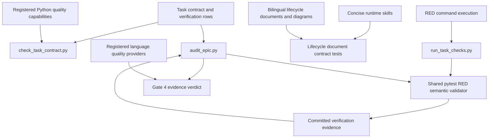
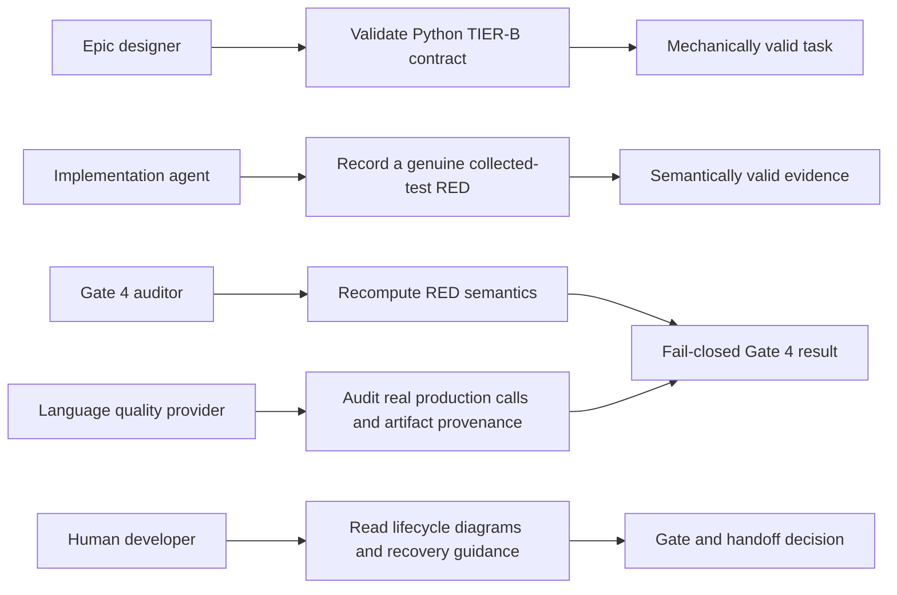
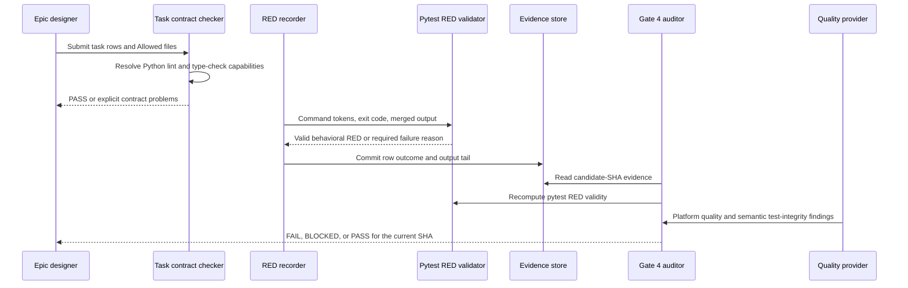

# Mechanical Verification and Lifecycle Slimming High-Level Design

## Table of Contents

- [Meta Data](#meta-data)
- [Background](#background)
- [Goals and Non-Goals](#goals-and-non-goals)
- [Architecture and Technical Design](#architecture-and-technical-design)
- [Integration Test Plan and Boundary Matrix](#integration-test-plan-and-boundary-matrix)
- [Verification Environment](#verification-environment)
- [Comprehensive BDD Scenario Coverage](#comprehensive-bdd-scenario-coverage)
- [Rollout Strategy and Mitigation](#rollout-strategy-and-mitigation)
- [Kanban Tasks Breakdown](#kanban-tasks-breakdown)

## Meta Data

- **Epic name**: `mechanical_verification_and_lifecycle_slimming`
- **Status**: Designing — Gate 2 pending
- **Target release**: Next plugin release
- **Platform**: Python tooling / agent skill kit
- **Source Spec**: [Approved mechanical verification and lifecycle slimming design](2026-10-19-mechanical-verification-and-lifecycle-slimming-design.en.md)

## Background

The implementation lifecycle currently validates the shape of task verification evidence more
strongly than its meaning. A pytest RED command can appear successful because it exits non-zero even
when no behavioral test ran, and a Python task can claim tooling completeness while running only a
linter. At the same time, the runtime lifecycle skills carry diagrams and repeated platform
instructions that compete with the hard rules for an agent's attention.

This epic moves deterministic invariants into scripts, keeps semantic test-integrity requirements
explicit at Gate 4, and moves human explanation into the existing bilingual lifecycle documents.
It does not claim universal mechanical source analysis for every supported language.

## Goals and Non-Goals

### Goals

- Reject fake pytest RED evidence at recording time and again during Gate 4 audit.
- Require Python TIER-B verification to invoke both lint and type-check capabilities.
- Make command recognition token-aware and fail closed on ambiguous evidence.
- Add concise Gate 4 rules against reconstructed production logic and substituted artifact anchors.
- Reduce `dev-lifecycle/SKILL.md` to at most 2,500 words and
  `dev-implementation/SKILL.md` to at most 4,500 words without losing lifecycle invariants.
- Keep lifecycle diagrams and explanations synchronized in `docs/lifecycles.en.md` and
  `docs/lifecycles.vi.md`.
- Provide regression tests for mechanical rules and for the runtime-skill/document boundary.

### Non-Goals

- Building a universal AST analyzer for Python, Dart, Kotlin, Swift, Rust, and TypeScript.
- Changing quality-provider schemas or requiring a new `test_integrity` capability in this epic.
- Replacing registered language providers with generic lifecycle scripts.
- Changing stage ownership, the five approval gates, or the Review Choice loop.
- Introducing a new lifecycle overview when the bilingual lifecycle documents already exist.

## Architecture and Technical Design

### High-Level Architecture

The pytest validator is a pure shared implementation consumed by the recorder and auditor. It
recognizes supported pytest invocations through shell tokens, accepts only exit 1 or 2, rejects
missing-file and zero-test markers, and requires a positive failure summary. The audit recomputes
this verdict from committed evidence rather than trusting the stored `outcome` field.

The task contract validator classifies Python work using the task's own Allowed files and commands.
It evaluates all TIER-B rows together and requires a direct lint invocation plus a direct type-check
invocation. Registered commands in `.agents/quality/python-quality.json` take precedence; recognized
`ruff`, `mypy`, `pyright`, and `ty` forms provide the fallback.

### Use Cases

### Primary Verification Sequence

### Decision Rules

1. A pytest RED row is valid only when a supported direct invocation exits 1 or 2, contains no
   forbidden marker, and contains positive evidence that one or more tests failed or errored.
2. Any invalid pytest RED uses this exact reason:
   `Invalid pytest RED phase: must fail on a collected test (exit 1 or 2), not missing file (exit 4) or zero selected tests (exit 5).`
3. `audit_epic.py` applies the same semantic validator even when evidence says `outcome: PASS`.
4. A Python task or any task with a ruff TIER-B row must directly invoke both a linter and a type
   checker across its TIER-B rows.
5. A malformed registered Python capability manifest is a contract failure, not a fallback signal.
6. Test-integrity review remains semantic: tests call production symbols from Allowed files, and
   real repository artifacts are copied to temporary storage without changing scenario anchors.
7. Runtime skills contain operational instructions only; human diagrams live in the lifecycle docs.

## Integration Test Plan and Boundary Matrix

Integration test roots: skills/dev-implementation/resources/scripts/, scripts/

Protected paths: .agents/quality/**, .devtool/epic/mechanical_verification_and_lifecycle_slimming/bdd_scenarios.en.md, .devtool/epic/mechanical_verification_and_lifecycle_slimming/bdd_scenarios.vi.md, skills/dev-implementation/resources/scripts/run_task_checks.py, skills/dev-implementation/resources/scripts/audit_epic.py, skills/dev-implementation/resources/scripts/check_task_contract.py, skills/dev-implementation/SKILL.md, skills/dev-lifecycle/SKILL.md, docs/lifecycles.en.md, docs/lifecycles.vi.md, scripts/test_lifecycle_document_contract.py

Integration results: python3 scripts/run_unittest_junit.py --junitxml build/test-results/mechanical-verification-and-lifecycle-slimming.xml skills/dev-implementation/resources/scripts/test_run_task_checks.py skills/dev-implementation/resources/scripts/test_audit_epic.py skills/dev-implementation/resources/scripts/test_check_task_contract.py scripts/test_lifecycle_document_contract.py -> build/test-results/mechanical-verification-and-lifecycle-slimming.xml

| Boundary | Real components | Isolation or fixture | Required assertions |
|---|---|---|---|
| RED recording | Task parser, shell runner, shared RED validator, evidence writer | Temporary task files; mocked subprocess results | Exit 4/5 and forbidden markers fail; valid exit 1/2 evidence passes |
| Gate 4 audit | Task rows, committed evidence, shared RED validator, audit report | Throwaway Git repository and candidate SHA | Tampered `PASS` is rejected; multiple rows remain deterministic |
| Python TIER-B | Task parser, local language detection, capability manifest loader | Temporary task and manifest files | Linter and type checker both required; polyglot false positives avoided |
| Test integrity | Gate 4/provider review contract | Purpose-built test fixtures | Reconstructed logic or changed artifact anchors produce a finding |
| Skill slimming | Runtime skill text and lifecycle contract checker | Repository document fixtures | Required gates/recovery tokens remain; runtime diagram fences disappear |
| Human docs | English and Vietnamese lifecycle documents | Document checker and semantic token assertions | Both languages retain diagrams and Gate 4/Review Choice/Gate 5 invariants |
| Full acceptance | All modified scripts, tests, skills, and docs | Current repository checkout | Targeted JUnit suite, `scripts/verify.sh`, and registered quality gate pass |

Every scenario in the canonical BDD document is automated under an integration test root. Tests may
exercise a single script but use its real parser/validator boundary and temporary repository state;
they do not reproduce the algorithm being tested.

## Verification Environment

- Tests use `tempfile` directories and throwaway Git repositories. They never mutate another
  repository, remote, worktree, or user configuration.
- Subprocess behavior is mocked where a real pytest installation is irrelevant; integration tests
  execute the real repository scripts and parsers.
- No network, credentials, package installation, live database, mobile device, or external provider
  is permitted.
- Repository artifacts used as inputs are copied to a temporary path before mutation or execution,
  and scenario anchor values remain unchanged.
- Test commands require no environment variables; task `Needs` cells use `—`.
- Generated JUnit reports live under ignored `build/test-results/` paths.

## Comprehensive BDD Scenario Coverage

The canonical Gherkin definitions are in [BDD scenarios](bdd_scenarios.en.md), with the synchronized
[Vietnamese translation](bdd_scenarios.vi.md).

| Dimension | Scenario IDs | Coverage intent |
|---|---|---|
| Happy Paths | MVLS-HP-01 through MVLS-HP-05 | Valid RED, audit, TIER-B, concise skills, and human docs |
| Edge Cases and Boundaries | MVLS-EC-01 through MVLS-EC-05 | Missing/empty tests, polyglot detection, shell tokens, and diagram boundary |
| State Transitions | MVLS-ST-01 through MVLS-ST-03 | Evidence and documentation move only through valid states |
| Async and Race Conditions | MVLS-AR-01 through MVLS-AR-02 | Independent rows and multi-task audits do not leak state |
| Failures and Resilience | MVLS-FR-01 through MVLS-FR-05 | Wrapper tricks, ambiguous output, malformed manifests, test fakery, and doc drift |

## Rollout Strategy and Mitigation

1. Land recorder validation and its tests first, then make Gate 4 reuse the same validator.
2. Land task-contract enforcement independently so existing non-Python and polyglot tasks remain
   unaffected unless task-local evidence activates the Python rule.
3. Add positive lifecycle contract assertions before deleting duplicated skill prose or diagrams.
4. Slim `dev-implementation` first, then `dev-lifecycle`, updating both human documents in the same
   task as the latter change.
5. Run the targeted JUnit suite, repository verification, document quality check, and registered
   quality gate against the final candidate SHA.

No feature flag is needed because these are planning and audit gates. Each work package is separately
revertible. Existing pytest RED evidence that violates the new semantics must be rerecorded; it is not
grandfathered. If a provider does not yet implement semantic test-integrity analysis, Gate 4 must not
claim mechanical coverage for that platform.

## Kanban Tasks Breakdown

1. [Task 12: Harden Pytest RED Recording Semantics](task_12_harden_pytest_red_recording.md)
2. [Task 13: Re-Audit Pytest RED Evidence at Gate 4](task_13_audit_pytest_red_evidence.md)
3. [Task 14: Enforce Python TIER-B Lint and Type Checking](task_14_enforce_python_tier_b.md)
4. [Task 15: Add Test Integrity Rules and Slim Dev Implementation](task_15_test_integrity_and_implementation_slimming.md)
5. [Task 16: Consolidate Lifecycle Docs and Run Acceptance](task_16_lifecycle_docs_and_acceptance.md)
