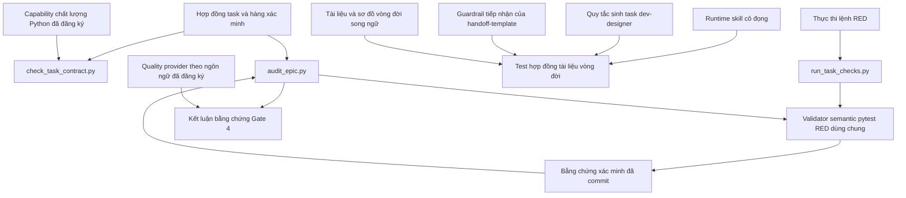
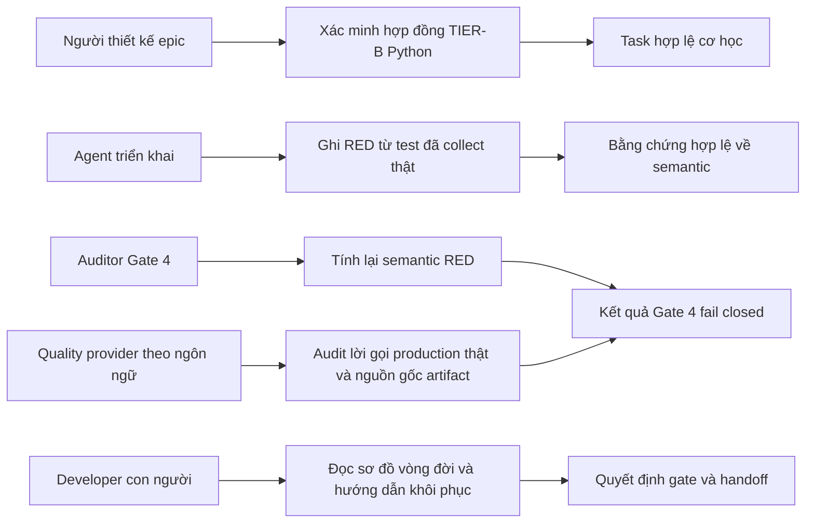
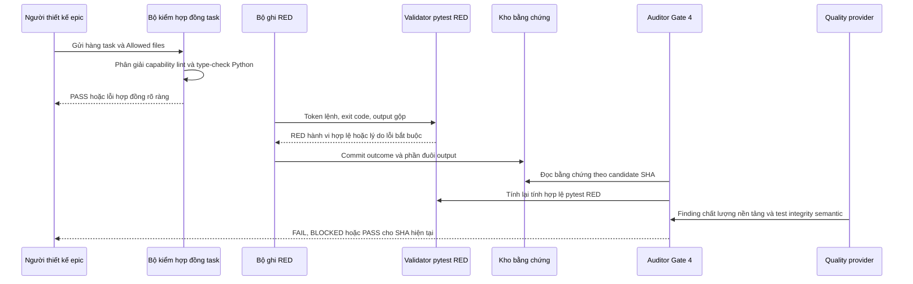

# Thiết kế tổng thể siết chặt xác minh cơ học và tinh gọn vòng đời

## Mục lục

- [Siêu dữ liệu](#siêu-dữ-liệu)
- [Bối cảnh](#bối-cảnh)
- [Mục tiêu và ngoài phạm vi](#mục-tiêu-và-ngoài-phạm-vi)
- [Kiến trúc và thiết kế kỹ thuật](#kiến-trúc-và-thiết-kế-kỹ-thuật)
- [Kế hoạch kiểm thử tích hợp và ma trận biên](#kế-hoạch-kiểm-thử-tích-hợp-và-ma-trận-biên)
- [Môi trường xác minh](#môi-trường-xác-minh)
- [Phạm vi kịch bản BDD toàn diện](#phạm-vi-kịch-bản-bdd-toàn-diện)
- [Chiến lược triển khai và giảm thiểu](#chiến-lược-triển-khai-và-giảm-thiểu)
- [Phân rã task Kanban](#phân-rã-task-kanban)

## Siêu dữ liệu

- **Tên epic**: `mechanical_verification_and_lifecycle_slimming`
- **Trạng thái**: In Progress
- **Bản phát hành mục tiêu**: Bản phát hành plugin kế tiếp
- **Nền tảng**: Công cụ Python / bộ skill cho agent
- **Đặc tả nguồn**: [Thiết kế siết chặt xác minh cơ học và tinh gọn vòng đời đã được duyệt](2026-10-19-mechanical-verification-and-lifecycle-slimming-design.vi.md)

## Bối cảnh

Vòng đời triển khai hiện xác minh hình dạng của bằng chứng task mạnh hơn ý nghĩa của nó. Một lệnh
pytest RED có thể trông hợp lệ vì thoát khác 0 dù không chạy kiểm thử hành vi nào, và một task Python
có thể tuyên bố hoàn tất tooling trong khi chỉ chạy linter. Đồng thời, các runtime skill chứa sơ đồ
và hướng dẫn nền tảng lặp lại, cạnh tranh sự chú ý của agent với các hard rule.

Epic này chuyển invariant xác định được vào script, giữ yêu cầu semantic về tính toàn vẹn kiểm thử ở
Gate 4, và chuyển phần giải thích cho con người vào bộ tài liệu vòng đời song ngữ hiện có. Epic không
tuyên bố phân tích source cơ học phổ quát cho mọi ngôn ngữ được hỗ trợ.

## Mục tiêu và ngoài phạm vi

### Mục tiêu

- Chặn bằng chứng pytest RED giả tại lúc ghi nhận và kiểm lại tại audit Gate 4.
- Yêu cầu xác minh TIER-B của Python gọi cả capability lint và type-check.
- Nhận diện lệnh theo token và fail closed khi bằng chứng mơ hồ.
- Thêm quy tắc Gate 4 ngắn gọn chống tái dựng logic production và thay anchor của artifact.
- Giảm `dev-lifecycle/SKILL.md` xuống tối đa 2.500 từ và
  `dev-implementation/SKILL.md` xuống tối đa 4.500 từ mà không mất invariant vòng đời.
- Đồng bộ sơ đồ và giải thích trong `docs/lifecycles.en.md` và `docs/lifecycles.vi.md`.
- Gia cố quy tắc sinh task trong `dev-designer` và guardrail cho LLM tiếp nhận trong `handoff-template.md`
  bằng các assertion chống drift.
- Có regression test cho quy tắc cơ học và ranh giới runtime-skill/tài liệu.

### Ngoài phạm vi

- Xây một bộ phân tích AST phổ quát cho Python, Dart, Kotlin, Swift, Rust và TypeScript.
- Thay đổi schema quality provider hoặc bắt buộc capability `test_integrity` mới trong epic này.
- Thay provider theo ngôn ngữ đã đăng ký bằng script vòng đời tổng quát.
- Thay đổi chủ sở hữu stage, năm approval gate hoặc vòng lặp Review Choice.
- Tạo tổng quan vòng đời mới khi tài liệu vòng đời song ngữ đã tồn tại.

## Kiến trúc và thiết kế kỹ thuật

### Kiến trúc cấp cao

Validator pytest là implementation thuần dùng chung cho recorder và auditor. Nó nhận diện invocation
pytest được hỗ trợ qua shell token, chỉ chấp nhận exit 1 hoặc 2, chặn marker thiếu file và không có
test, đồng thời yêu cầu summary lỗi dương. Audit tính lại kết luận từ bằng chứng đã commit thay vì tin
trường `outcome` được lưu.

Validator hợp đồng task phân loại công việc Python bằng Allowed files và lệnh của chính task. Nó xem
tất cả hàng TIER-B cùng nhau và yêu cầu gọi trực tiếp một linter cùng một type checker. Lệnh đã đăng
ký trong `.agents/quality/python-quality.json` được ưu tiên; các dạng `ruff`, `mypy`, `pyright` và
`ty` đã biết là fallback.

### Ca sử dụng

### Trình tự xác minh chính

### Quy tắc quyết định

1. Hàng pytest RED chỉ hợp lệ khi invocation trực tiếp được hỗ trợ thoát 1 hoặc 2, không chứa marker
   bị cấm, và có bằng chứng dương rằng ít nhất một test failed hoặc errored.
2. Mọi pytest RED không hợp lệ dùng đúng lý do:
   `Invalid pytest RED phase: must fail on a collected test (exit 1 or 2), not missing file (exit 4) or zero selected tests (exit 5).`
3. `audit_epic.py` áp dụng cùng validator semantic dù bằng chứng ghi `outcome: PASS`.
4. Task Python hoặc bất kỳ task nào có hàng ruff TIER-B phải gọi trực tiếp cả linter và type checker
   trên tổng các hàng TIER-B.
5. Manifest capability Python đã đăng ký nhưng sai định dạng là lỗi hợp đồng, không phải tín hiệu fallback.
6. Review test integrity vẫn là semantic: test gọi symbol production từ Allowed files, và artifact
   repository thật được sao chép vào vùng tạm mà không đổi anchor của scenario.
7. Runtime skill chỉ chứa hướng dẫn vận hành; sơ đồ cho con người nằm trong tài liệu vòng đời.
8. Các task có thay đổi executable phải phơi bày fact đã xác lập dưới `## Decisions Already Made`, dùng
   exact node ID cho pytest RED không có placeholder `-k`, và tránh assertion yếu (`non-empty`,
   `truthy`, `works`, `valid`). Handoff giữ đủ bốn guardrail cho LLM tiếp nhận và giao thức nạp
   context có giới hạn 3 bước.
9. `run_task_checks.py` xác thực tính toàn vẹn của task so với HEAD đã commit hoặc bản mirror cha
   tại epic trước khi chạy các lệnh kiểm tra, lập tức dừng với `TASK_TAMPERED_ERROR` nếu phát hiện
   các section cốt lõi bị sửa đổi.
10. Gate 4 đưa ra khuyến nghị mạnh mang tính động về cross-model review khi các task được thực thi
    bởi một fast hoặc lightweight model.

## Kế hoạch kiểm thử tích hợp và ma trận biên

Integration test roots: skills/dev-implementation/resources/scripts/, scripts/

Protected paths: .agents/quality/**, .devtool/epic/mechanical_verification_and_lifecycle_slimming/bdd_scenarios.en.md, .devtool/epic/mechanical_verification_and_lifecycle_slimming/bdd_scenarios.vi.md, skills/dev-implementation/resources/scripts/run_task_checks.py, skills/dev-implementation/resources/scripts/audit_epic.py, skills/dev-implementation/resources/scripts/check_task_contract.py, skills/dev-implementation/SKILL.md, skills/dev-lifecycle/SKILL.md, skills/dev-designer/SKILL.md, skills/dev-lifecycle/references/handoff-template.md, docs/lifecycles.en.md, docs/lifecycles.vi.md, scripts/test_lifecycle_document_contract.py

Integration results: python3 scripts/run_unittest_junit.py --junitxml build/test-results/mechanical-verification-and-lifecycle-slimming.xml skills/dev-implementation/resources/scripts/test_run_task_checks.py skills/dev-implementation/resources/scripts/test_audit_epic.py skills/dev-implementation/resources/scripts/test_check_task_contract.py scripts/test_lifecycle_document_contract.py -> build/test-results/mechanical-verification-and-lifecycle-slimming.xml

| Biên | Thành phần thật | Cách ly hoặc fixture | Assertion bắt buộc |
|---|---|---|---|
| Ghi RED | Parser task, shell runner, validator RED dùng chung, writer bằng chứng | File task tạm; kết quả subprocess giả lập | Exit 4/5 và marker cấm thất bại; bằng chứng exit 1/2 hợp lệ đi qua |
| Chốt chặn chống giả mạo task | Parser task, bộ so sánh HEAD/mirror git, runner kiểm tra | File task bị sửa trong `.devtool/features/` | Section cốt lõi bị sửa sẽ dừng với `TASK_TAMPERED_ERROR` trước khi chạy |
| Audit Gate 4 | Hàng task, bằng chứng đã commit, validator RED dùng chung, báo cáo audit | Git repository tạm và candidate SHA | `PASS` bị sửa bị chặn; nhiều hàng vẫn xác định |
| Python TIER-B | Parser task, nhận diện ngôn ngữ cục bộ, loader manifest capability | File task và manifest tạm | Phải có cả linter và type checker; tránh false positive polyglot |
| Kiểm tra xác định cho fast model | Parser task, validator regex assertion, bộ kiểm contract | File task tạm có assertion yếu hoặc `-k` chung | Từ chối pytest `-k` không có node ID, assertion yếu và decisions trống |
| Test integrity | Hợp đồng review Gate 4/provider | Fixture kiểm thử chuyên biệt | Logic tái dựng hoặc anchor artifact bị đổi tạo finding |
| Tinh gọn skill | Nội dung runtime skill và bộ kiểm hợp đồng vòng đời | Fixture tài liệu repository | Giữ gate/recovery token bắt buộc; runtime không còn diagram fence |
| Hợp đồng executor và handoff | Skill `dev-designer`, template handoff, test contract vòng đời | Anchor file skill và template | Assertion chống drift xác minh quy tắc sinh task, 4 guardrail handoff và không có assertion yếu |
| Tài liệu cho người | Tài liệu vòng đời Anh và Việt | Document checker và assertion semantic token | Hai ngôn ngữ giữ sơ đồ và invariant Gate 4/Review Choice/Gate 5 |
| Acceptance đầy đủ | Mọi script, test, skill và tài liệu đã đổi | Checkout repository hiện tại | Targeted JUnit, `scripts/verify.sh` và quality gate đã đăng ký đều qua |

Mọi scenario trong tài liệu BDD chuẩn được tự động hóa dưới một integration test root. Test có thể
chạy một script riêng lẻ nhưng dùng ranh giới parser/validator thật và trạng thái repository tạm;
không tái dựng thuật toán cần kiểm thử.

## Môi trường xác minh

- Test dùng thư mục `tempfile` và Git repository tạm. Chúng không sửa repository, remote, worktree
  hoặc cấu hình người dùng khác.
- Hành vi subprocess được mock khi việc cài pytest thật không liên quan; integration test thực thi
  script và parser thật của repository.
- Không được dùng mạng, credential, cài package, database live, thiết bị di động hoặc provider ngoài.
- Artifact repository dùng làm input được sao chép vào đường dẫn tạm trước khi sửa hoặc thực thi,
  và các anchor value của scenario không đổi.
- Lệnh kiểm thử không cần biến môi trường; ô `Needs` của task dùng `—`.
- Báo cáo JUnit sinh ra nằm trong đường dẫn bị ignore `build/test-results/`.

## Phạm vi kịch bản BDD toàn diện

Định nghĩa Gherkin chuẩn nằm tại [Các kịch bản BDD](bdd_scenarios.vi.md), đồng bộ với
[bản tiếng Anh](bdd_scenarios.en.md).

| Chiều | ID scenario | Ý định bao phủ |
|---|---|---|
| Luồng thành công | MVLS-HP-01 đến MVLS-HP-06 | RED hợp lệ, audit, TIER-B, skill cô đọng, tài liệu cho người và hợp đồng executor |
| Ca biên và ranh giới | MVLS-EC-01 đến MVLS-EC-07 | Thiếu/rỗng test, nhận diện polyglot, shell token, ranh giới sơ đồ, thiếu anchor hợp đồng và kiểm tra xác định cho fast model |
| Chuyển trạng thái | MVLS-ST-01 đến MVLS-ST-03 | Bằng chứng và tài liệu chỉ chuyển qua trạng thái hợp lệ |
| Bất đồng bộ và race | MVLS-AR-01 đến MVLS-AR-02 | Hàng độc lập và audit nhiều task không rò trạng thái |
| Lỗi và khả năng phục hồi | MVLS-FR-01 đến MVLS-FR-06 | Trick wrapper, output mơ hồ, manifest hỏng, test giả, drift tài liệu và giả mạo task |

## Chiến lược triển khai và giảm thiểu

1. Đưa validator recorder và test vào trước, sau đó cho Gate 4 dùng lại cùng validator.
2. Đưa enforcement hợp đồng task vào độc lập để task không phải Python và task polyglot hiện có không
   bị ảnh hưởng trừ khi bằng chứng cục bộ của task kích hoạt quy tắc Python.
3. Thêm assertion dương về hợp đồng vòng đời trước khi xóa prose hoặc sơ đồ lặp lại trong skill.
4. Tinh gọn `dev-implementation` trước (Task 15), gia cố quy tắc sinh task `dev-designer` và guardrail
   handoff (Task 17), rồi tinh gọn `dev-lifecycle`, đồng thời cập nhật hai tài liệu cho người và
   nghiệm thu (Task 16).
5. Chạy targeted JUnit, xác minh repository, kiểm tra chất lượng tài liệu và quality gate đã đăng ký
   trên candidate SHA cuối.

Không cần feature flag vì đây là planning và audit gate. Mỗi work package có thể revert riêng. Bằng
chứng pytest RED cũ vi phạm semantic mới phải được ghi lại, không được grandfather. Nếu provider chưa
có phân tích test integrity semantic, Gate 4 không được tuyên bố đã bao phủ cơ học nền tảng đó.

## Phân rã task Kanban

1. [Task 12: Siết semantic khi ghi Pytest RED](task_12_harden_pytest_red_recording.md)
2. [Task 13: Audit lại bằng chứng Pytest RED tại Gate 4](task_13_audit_pytest_red_evidence.md)
3. [Task 14: Bắt buộc lint và type-check trong Python TIER-B](task_14_enforce_python_tier_b.md)
4. [Task 15: Thêm quy tắc test integrity và tinh gọn Dev Implementation](task_15_test_integrity_and_implementation_slimming.md)
5. [Task 16: Hợp nhất tài liệu vòng đời và chạy acceptance](task_16_lifecycle_docs_and_acceptance.md)
6. [Task 17: Gia cố hợp đồng task dev-designer và guardrail handoff](task_17_dev_designer_and_handoff_guardrails.md)
