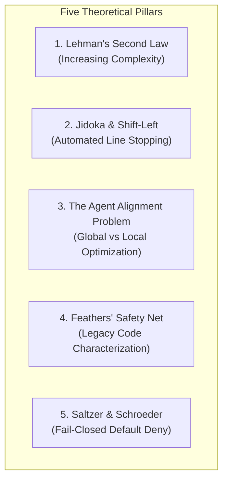
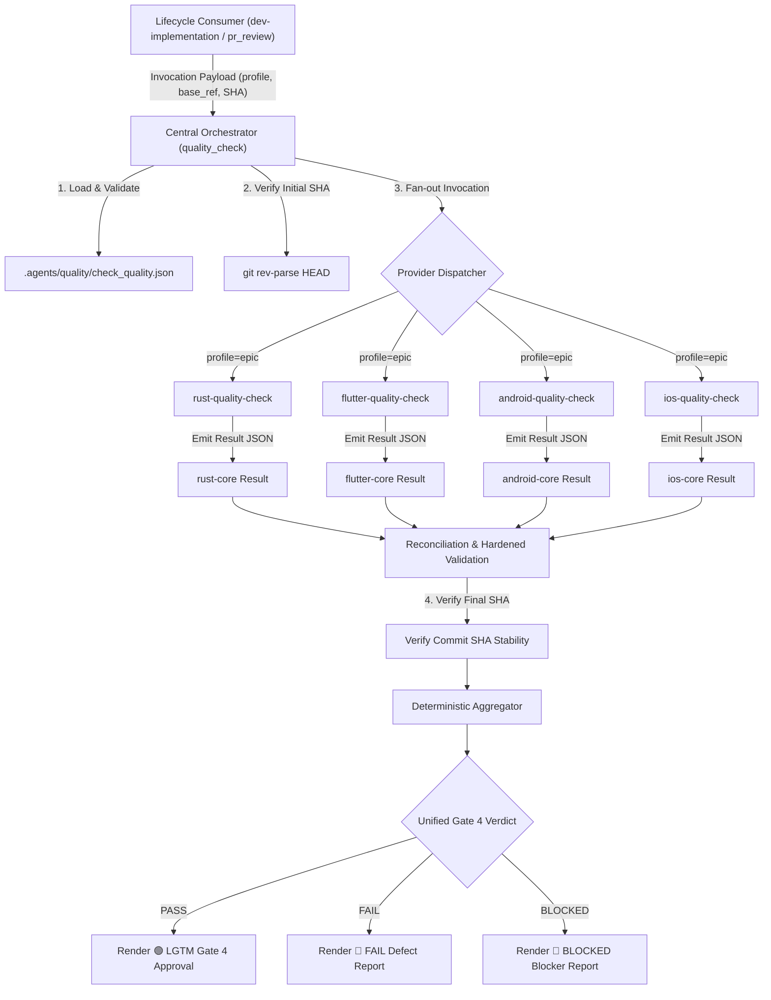

# Mobile Quality Providers and Contract Hardening Design

- **Date**: 2026-10-12
- **Status**: Draft
- **Scope**: `quality_check`, `rust-quality-check`, `flutter-quality-check`, `android-quality-check`, `ios-quality-check`, `setup_quality_check`, validation scripts, aggregation engine
- **Next step**: `dev-designer` (Epic-scale multi-provider architecture and task breakdown)

## Table of Contents

- [1. Background and Motivation](#1-background-and-motivation)
- [2. Theoretical Foundations](#2-theoretical-foundations)
- [3. Goals and Non-Goals](#3-goals-and-non-goals)
- [4. Architectural Decisions](#4-architectural-decisions)
- [5. System Invariants](#5-system-invariants)
- [6. Architecture and Component Breakdown](#6-architecture-and-component-breakdown)
- [7. Engine Hardening and False-PASS Prevention](#7-engine-hardening-and-false-pass-prevention)
- [8. Mobile Quality Provider Specifications](#8-mobile-quality-provider-specifications)
- [9. Onboarding and Scaffolding Tooling](#9-onboarding-and-scaffolding-tooling)
- [10. Template Ground Truth Adoption](#10-template-ground-truth-adoption)
- [11. Error Handling and Edge Cases](#11-error-handling-and-edge-cases)
- [12. Verification and Testing Strategy](#12-verification-and-testing-strategy)
- [13. Migration and Release Strategy](#13-migration-and-release-strategy)

## 1. Background and Motivation

The `provider_based_quality_check` epic decoupled the central `quality_check` orchestrator from mobile platform command matrices into a platform-neutral composition root driven by project-owned manifests (`.agents/quality/check_quality.json`).

However, that initial implementation left critical gaps:
1. **Missing Mobile Platform Providers**: The orchestrator was published with only `rust-quality-check`. The historical 3-Tier test runners and semantic audits for Android Native, Flutter, and iOS Native were decoupled but not yet re-packaged into independent provider skills.
2. **Fail-Closed Ecosystem Breakage**: Because the orchestrator enforces fail-closed execution without legacy heuristic fallback, publishing this version immediately blocks all existing mobile codebases.
3. **Engine Contract Vulnerabilities**: Comprehensive sibling review (`quality_check_comparison.vi.md`) revealed critical validator gaps (F1–F3):
   - A provider reporting `status: PASS` while containing failed checks or coverage far below threshold (`0.10 < 0.85`) is erroneously aggregated into an overall `PASS` (False-PASS vulnerability).
   - The reconciliation CLI omits result validation, permitting stale SHA evidence to bypass checks.
   - Capability manifests permit empty profile selections, empty command arrays, and duplicate capability IDs.

Without addressing these gaps, publishing the new provider-based orchestrator breaks all mobile developer workflows and risks granting false approvals.

## 2. Theoretical Foundations

Establishing a strict, automated, provider-driven quality system is justified by five software engineering principles:

### 2.1. Lehman's Second Law of Software Evolution
As an evolving system is modified, its complexity increases unless work is done to maintain or reduce it. In an agentic engineering environment where AI agents produce code at $10\times$ to $100\times$ human throughput, codebase entropy expands exponentially. Without mechanical architectural assertions (Konsist, ArchTests, boundary scripts), multi-module codebases degrade into tightly coupled monoliths within days.

### 2.2. Jidoka and Shift-Left Quality
From Toyota Lean Production, Jidoka demands that production automatically halts upon detecting any anomaly, preventing defective units from reaching downstream stages. Gate 4 (`quality_check`) acts as the Jidoka brake: if architectural rules, security policies, or regression tests fail, execution stops immediately and forbids merging into `develop`.

### 2.3. The Agent Alignment Problem in Code Generation
LLM agents are biased toward local optimization: completing the immediate prompt efficiently. Agents frequently adopt local shortcuts (bypassing layer boundaries, using force-unwrapping `!`, disabling lint checks, or creating superficial mocks). A platform-neutral provider system acts as an objective immune system outside the generative model, enforcing global architectural invariants.

### 2.4. Feathers' Safety Net for Legacy and Greenfield Systems
Michael Feathers defines legacy code as code without automated tests. Introducing AI agents into an un-harnessed codebase multiplies regression risk. Establishing provider-based quality baselines prior to agent maintenance provides the required safety harness. Greenfield projects adopt this harness on Day 0 to maintain zero technical debt.

### 2.5. Fail-Closed Security and Governance
Following Saltzer and Schroeder's fail-safe defaults, verification requires positive empirical evidence. Absence of evidence, unreadable configurations, or missing tools evaluate strictly to `BLOCKED`.

## 3. Goals and Non-Goals

### 3.1. Goals
- **Engine Hardening**: Eliminate all False-PASS vulnerabilities (F1–F3) and enforce C1–C7 acceptance criteria across `validate_quality_contract.py` and `aggregate_quality_results.py`.
- **Three Mobile Platform Providers**:
  - Implement `d3nexus:flutter-quality-check` supporting Melos, FVM/Flutter, boundaries, licensing, and 4 specialist audits.
  - Implement `d3nexus:android-quality-check` supporting Gradle, Konsist, BCV, Detekt/Spotless, acceptance harness, and 4 specialist audits.
  - Implement `d3nexus:ios-quality-check` supporting Tuist, SwiftPM, ArchTests, SwiftLint/SwiftFormat, boundaries, and 4 specialist audits.
- **Onboarding and Scaffolding Tool**: Create `setup_quality_check` to detect repository types and generate valid manifests for Greenfield and Brownfield projects.
- **Template Symmetry**: Ensure zero-configuration friction for `android_digital_wallet`, `bloc_digital_wallet`, and `ios_digital_wallet`.
- **Architectural Purity**: Maintain a platform-neutral orchestrator without embedded mobile command logic.

### 3.2. Non-Goals
- Modifying product business logic or application features inside the template repositories.
- Replacing project-owned linters (Detekt, SwiftLint, Melos) with third-party SaaS tools.
- Introducing automatic code mutation or formatting during Gate 4 verification runs.

## 4. Architectural Decisions

### 4.1. Decision 1: Strict Provider Model Over Dual-Mode Fallback
- **Decision**: Retain strict fail-closed provider architecture without adding legacy fallback logic into `quality_check/SKILL.md`.
- **Rationale**: Rather than maintaining a temporary dual-mode bridge, we package the three missing mobile providers and provide an automated onboarding tool. All platforms (Rust, Android, iOS, Flutter) operate uniformly under the same provider contracts.

### 4.2. Decision 2: Project-Owned Capability Command Arrays
- **Decision**: Capability manifests declare explicit command arrays (e.g. `["fvm", "flutter", "analyze"]` or `["./gradlew", "check"]`) instead of fixed executable names.
- **Rationale**: Eliminates environment assumptions (e.g. whether Flutter runs via FVM or global PATH, or whether Gradle uses `./gradlew`).

### 4.3. Decision 3: Deterministic Evidence-Based Status Aggregation
- **Decision**: Result validation checks internal consistency. A provider cannot pass if any contained check fails or if coverage falls below configured thresholds.
- **Precedence**:
  $$\text{FAIL} > \text{BLOCKED} > \text{PASS}$$

## 5. System Invariants

1. **Candidate Immutability**: All verification results bind strictly to the commit SHA returned by `git rev-parse HEAD`. Any modification between run start and completion invalidates evidence.
2. **Read-Only Verification**: Verification runs never modify source code, stage files, or run auto-formatters.
3. **No False-PASS**: If any individual check fails, the provider verdict is `FAIL`. If a required capability lacks verifiable evidence, the verdict is `BLOCKED`.
4. **Deterministic Precedence**: One `FAIL` yields an overall `FAIL`. In the absence of failure, one `BLOCKED` yields an overall `BLOCKED`.
5. **Contract Versioning**: Registries declare `schema_version: 1`; results declare `contract_version: 1`. Unsupported versions are rejected.

## 6. Architecture and Component Breakdown

## 7. Engine Hardening and False-PASS Prevention

To satisfy acceptance criteria C1 through C7, `skills/quality_check/resources/scripts/` will be updated:

### 7.1. Internal Consistency Validation (C4)
`validate_quality_contract.py` validates that:
- If `status == "PASS"`, no item in `checks` has `status == "FAIL"` or `status == "BLOCKED"`.
- If `coverage` is declared with a `threshold` and `measured < threshold`, top-level status cannot be `PASS`. Any contradictory result document is rejected as `CONTRACT_VIOLATION` (`BLOCKED`).
- All `checks` contain valid, non-empty `source`, `category`, and `summary` strings.

### 7.2. Full Reconciliation Validation (C3)
The `reconcile` subcommand will:
- Run schema and consistency validation on every provided result file.
- Verify that every selected required provider from the execution plan has exactly one corresponding result document.
- Confirm that `repository_sha`, `started_head`, and `finished_head` across all result files match the target SHA.

### 7.3. Capability Schema Hardening (C1, C2)
Validators will reject:
- Empty `profiles` mappings or profiles with empty capability lists.
- Capabilities with empty command arrays.
- Duplicate provider IDs or duplicate capability names.
- Missing required fields or unknown schema properties.

## 8. Mobile Quality Provider Specifications

### 8.1. Flutter Quality Provider (`d3nexus:flutter-quality-check`)
- **Manifest Location**: `.agents/quality/flutter-quality.json`
- **Capabilities**:
  - `format`: Executes project formatter (e.g. `./scripts/dartfmt.sh`).
  - `analyze`: Executes Dart analyzer (`fvm flutter analyze` or `flutter analyze`).
  - `boundaries`: Executes architecture boundary checker (`./scripts/check_module_boundaries.sh`).
  - `license`: Verifies license headers (`./scripts/check_license_header.sh`).
  - `test`: Executes unit and package test suites (`melos run test` or `fvm flutter test`).
  - `coverage`: Executes coverage harness (`./scripts/testWithCoverage.sh`) and extracts line metrics from `lcov.info`.
  - `audits`: Dispatches specialist audits (`security-audit`, `architecture-audit`, `flutter-ui-audit`, `code-health-audit`).

### 8.2. Android Quality Provider (`d3nexus:android-quality-check`)
- **Manifest Location**: `.agents/quality/android-quality.json`
- **Capabilities**:
  - `format`: Runs `./gradlew spotlessCheck`.
  - `lint`: Runs `./gradlew detekt`.
  - `bcv`: Runs `./gradlew apiCheck` for public ABI governance.
  - `architecture`: Runs `./gradlew :konsist-test:test` with boundary whitelist verification.
  - `test`: Runs `./gradlew testDebugUnitTest`.
  - `coverage`: Runs Jacoco coverage task and evaluates threshold.
  - `acceptance`: Runs `./scripts/acceptance_check.sh`.
  - `cleanup`: Executes `pkill -9 java` to release Gradle daemons.
  - `audits`: Dispatches specialist audits (`security-audit`, `architecture-audit`, `android-ui-audit`, `code-health-audit`).

### 8.3. iOS Quality Provider (`d3nexus:ios-quality-check`)
- **Manifest Location**: `.agents/quality/ios-quality.json`
- **Capabilities**:
  - `format`: Runs `swiftformat --lint .`.
  - `lint`: Runs `swiftlint lint --strict`.
  - `boundaries`: Runs `./scripts/check_module_boundaries.sh`.
  - `architecture`: Runs `swift test --package-path ArchTests` for AST governance.
  - `test`: Runs package tests (`swift test`).
  - `coverage`: Runs `./scripts/check_coverage_thresholds.sh`.
  - `acceptance`: Runs `./scripts/acceptance_check.sh`.
  - `audits`: Dispatches specialist audits (`security-audit`, `architecture-audit`, `ios-ui-audit`, `code-health-audit`).

## 9. Onboarding and Scaffolding Tooling

A dedicated skill `skills/setup_quality_check/SKILL.md` provides automated onboarding:
1. **Inspection**: Detects repository indicators:
   - Rust: `Cargo.toml`
   - Flutter: `pubspec.yaml`
   - Android: `build.gradle.kts` / `settings.gradle.kts`
   - iOS: `Project.swift` / `Package.swift`
2. **Scaffolding**: Generates `.agents/quality/check_quality.json` and the corresponding platform capability JSON.
3. **Baseline Certification**: Executes an initial quality run with profile `pr` to establish a verified baseline for AI agent workflows.

## 10. Template Ground Truth Adoption

The three canonical templates in `digital_wallet/` represent the ground truth for configuration:

| Template | Registered Provider ID | Primary Verification Tools |
| :--- | :--- | :--- |
| `android_digital_wallet` | `android-core` | `./gradlew check :konsist-test:test apiCheck`, `scripts/acceptance_check.sh` |
| `bloc_digital_wallet` | `flutter-core` | `melos run test`, `scripts/check_module_boundaries.sh`, `scripts/testWithCoverage.sh` |
| `ios_digital_wallet` | `ios-core` | `swift test`, `ArchTests`, `scripts/check_coverage_thresholds.sh`, `scripts/acceptance_check.sh` |

Adopting the provider model requires adding only the two JSON manifests to each template, with zero changes to existing build scripts.

## 11. Error Handling and Edge Cases

1. **SHA Drift During Provider Run**: If `git rev-parse HEAD` changes between run initialization and completion, all evidence is rejected as stale and status is set to `BLOCKED`.
2. **Missing Executables**: If a tool (e.g. `cargo`, `melos`, `swiftlint`) is absent from `PATH`, the provider reports `BLOCKED` with the missing tool name.
3. **Contradictory Results**: If a provider reports `PASS` while containing failed checks or coverage deficits, the validator overrides status to `BLOCKED` (Contract Violation).
4. **Empty Provider Selection**: If no provider matches the requested profile, the aggregator returns `BLOCKED` (`empty_selection`).

## 12. Verification and Testing Strategy

Implementation follows Test-Driven Development (TDD):
1. **Unit Tests for Validator**:
   - Write failing tests for False-PASS detection (F1).
   - Write failing tests for reconciliation validation (F2).
   - Write failing tests for empty profiles and duplicate capability keys (F3).
   - Implement hardening in `validate_quality_contract.py` until tests pass.
2. **Provider Acceptance Tests**:
   - Simulate execution across all 4 platform providers using mock fixtures.
   - Assert schema compliance and evidence validation.
3. **Repository Verification**:
   - Run `./scripts/verify.sh` to ensure all 13 checks pass cleanly.

## 13. Migration and Release Strategy

1. **Phase 1: Engine Hardening**: Fix F1–F3 and verify C1–C7 in `ai-agent-tools`.
2. **Phase 2: Mobile Providers**: Implement `flutter-quality-check`, `android-quality-check`, and `ios-quality-check`.
3. **Phase 3: Scaffolding Tool**: Implement `setup_quality_check`.
4. **Phase 4: Template Integration**: Add `.agents/quality/check_quality.json` and capability manifests to the three digital wallet templates.
5. **Phase 5: Release**: Bump plugin version to `1.6.0` and deploy to global plugin configurations.
