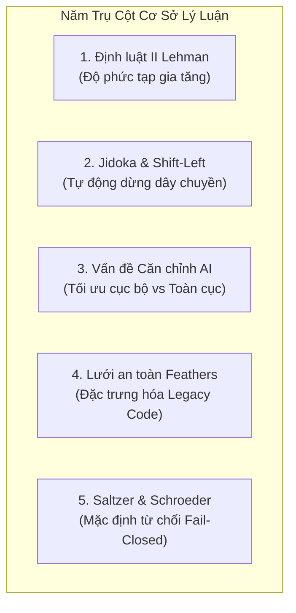
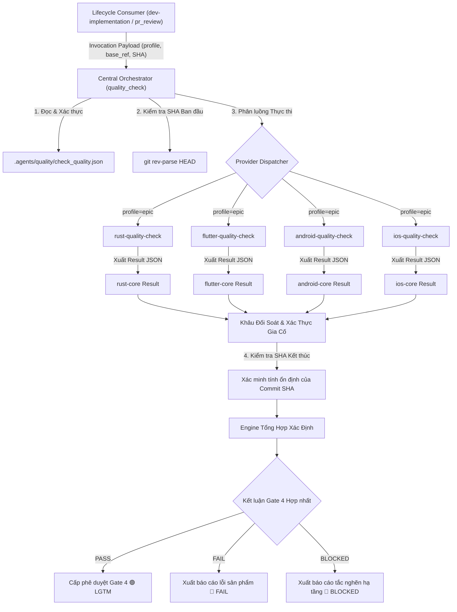

# Thiết Kế Gia Cố Hợp Đồng Và Bộ Provider Kiểm Thử Di Động

- **Ngày**: 2026-10-12
- **Trạng thái**: Draft
- **Phạm vi**: `quality_check`, `rust-quality-check`, `flutter-quality-check`, `android-quality-check`, `ios-quality-check`, `setup_quality_check`, scripts xác thực, aggregation engine
- **Bước tiếp theo**: `dev-designer` (Kiến trúc đa provider quy mô epic và phân rã task)

## Mục Lục

- [1. Bối Cảnh và Động Lực](#1-bối-cảnh-và-động-lực)
- [2. Cơ Sở Lý Luận](#2-cơ-sở-lý-luận)
- [3. Mục Tiêu và Ngoài Phạm Vi](#3-mục-tiêu-và-ngoài-phạm-vi)
- [4. Các Quyết Định Thiết Kế](#4-các-quyết-định-thiết-kế)
- [5. Các Bất Biến Của Hệ Thống](#5-các-bất-biến-của-hệ-thống)
- [6. Kiến Trúc và Phân Rã Thành Phần](#6-kiến-trúc-và-phân-rã-thành-phần)
- [7. Gia Cố Engine và Ngăn Chặn False-PASS](#7-gia-cố-engine-và-ngăn-chặn-false-pass)
- [8. Đặc Tả Các Provider Kiểm Thử Di Động](#8-đặc-tả-các-provider-kiểm-thử-di-động)
- [9. Công Cụ Onboarding và Khởi Tạo Mẫu](#9-công-cụ-onboarding-và-khởi-tạo-mẫu)
- [10. Áp Dụng Thực Tế Vào Template Mẫu](#10-áp-dụng-thực-tế-vào-template-mẫu)
- [11. Xử Lý Lỗi và Các Tình Huống Biên](#11-xử-lý-lỗi-và-các-tình-huống-biên)
- [12. Chiến Lược Kiểm Thử và Thẩm Định](#12-chiến-lược-kiểm-thử-và-thẩm-định)
- [13. Lộ Trình Di Chuyển và Phát Hành](#13-lộ-trình-di-chuyển-và-phát-hành)

## 1. Bối Cảnh và Động Lực

Epic `provider_based_quality_check` đã tách orchestrator trung tâm `quality_check` khỏi các ma trận lệnh nền tảng mobile thành một composition root trung lập, điều khiển bởi dependency injection qua manifest dự án (`.agents/quality/check_quality.json`).

Tuy nhiên, lần triển khai ban đầu đó để lại những khoảng trống nghiêm trọng:
1. **Thiếu Provider Nền Tảng Di Động**: Orchestrator được công bố chỉ kèm duy nhất `rust-quality-check`. Các runner 3-Tier và specialist audit cũ cho Android Native, Flutter, và iOS Native đã bị gỡ khỏi lõi nhưng chưa được đóng gói thành các skill provider độc lập.
2. **Gãy Hệ Sinh Thái Vì Cơ Chế Fail-Closed**: Do orchestrator thực thi cơ chế fail-closed nghiêm ngặt mà không có fallback heuristic cũ, việc phát hành phiên bản này sẽ lập tức chặn đứng toàn bộ codebase mobile hiện hữu.
3. **Lỗ Hổng Hợp Đồng Của Engine**: Đợt review tích hợp từ repo D3Nexus (`quality_check_comparison.vi.md`) đã phát hiện các kẽ hở xác thực nghiêm trọng (F1–F3):
   - Provider báo cáo `status: PASS` dù chứa check con bị lỗi hoặc mức coverage tụt sâu dưới ngưỡng (`0.10 < 0.85`) vẫn được tổng hợp thành `PASS` chung (lỗ hổng False-PASS).
   - Lệnh CLI `reconcile` bỏ qua bước xác thực kết quả, để lọt bằng chứng commit SHA cũ (stale SHA).
   - Manifest capability chấp nhận profile rỗng, mảng lệnh kiểm thử rỗng, và trùng lặp capability ID.

Nếu không khắc phục các vấn đề này, việc publish orchestrator mới sẽ vừa làm gián đoạn luồng làm việc của lập trình viên mobile, vừa có nguy cơ phê duyệt sai chất lượng.

## 2. Cơ Sở Lý Luận

Việc bắt buộc xây dựng hệ thống kiểm thử chất lượng nghiêm ngặt dựa trên provider được bảo chứng bởi 5 trụ cột lý luận kỹ nghệ phần mềm:

### 2.1. Định Luật II Lehman về Tiến Hóa Phần Mềm
Khi một hệ thống phần mềm tiến hóa, độ phức tạp của nó sẽ liên tục gia tăng trừ khi có nỗ lực chủ động để kiểm soát. Trong môi trường phát triển có AI Agents, nơi mã nguồn được sinh ra với tốc độ gấp $10\times$ đến $100\times$ con người, entropy của codebase bùng nổ theo cấp số nhân. Nếu thiếu các chốt chặn kiến trúc tự động (Konsist, ArchTests, scripts kiểm soát ranh giới), các module sẽ nhanh chóng bị phụ thuộc chéo và suy thoái thành khối đơn khối hỗn tạp.

### 2.2. Jidoka và Chất Lượng Shift-Left
Bắt nguồn từ sản xuất tinh gọn Toyota, Jidoka yêu cầu dây chuyền phải **tự động dừng ngay lập tức** khi phát hiện bất kỳ linh kiện lỗi nào, ngăn ngừa phế phẩm lọt sang công đoạn kế tiếp. Gate 4 (`quality_check`) chính là chiếc phanh Jidoka: nếu luật kiến trúc, bảo mật hay test hồi quy bị vi phạm, quy trình dừng ngay và từ chối việc merge vào nhánh `develop`.

### 2.3. Vấn Đề Căn Chỉnh Của AI Trong Sinh Mã Nguồn
Các mô hình AI luôn tối ưu hóa cho mục tiêu cục bộ: hoàn thành prompt hiện tại nhanh nhất. AI sẵn sàng đi đường tắt (bỏ qua ranh giới tầng, ép kiểu force-unwrap `!`, tắt linter, hoặc viết mock test hời hợt). Hệ thống provider trung lập đóng vai trò hệ miễn dịch khách quan nằm ngoài mô hình sinh mã, bảo vệ các bất biến kiến trúc toàn cục.

### 2.4. Lưới An Toàn Của Michael Feathers Cho Dự Án Mới và Cũ
Michael Feathers định nghĩa legacy code là code không có automated test. Việc đưa AI vào bảo trì một codebase chưa có kiểm chuẩn tự động sẽ nhân đôi rủi ro hồi quy. Thiết lập baseline kiểm chuẩn trước khi cho agent can thiệp tạo ra lưới an toàn tối thiểu. Các dự án mới áp dụng lưới an toàn này từ Ngày 0 để duy trì nợ kỹ thuật bằng không.

### 2.5. Bảo Mật và Quản Trị Fail-Closed
Theo nguyên lý của Saltzer và Schroeder, việc thẩm định phải dựa trên bằng chứng thực chứng rõ ràng. Mặc định là từ chối (`Default Deny`). Sự vắng mặt của bằng chứng, cấu hình không đọc được, hay thiếu công cụ đều phải được đánh giá nghiêm ngặt thành `BLOCKED`.

## 3. Mục Tiêu và Ngoài Phạm Vi

### 3.1. Mục Tiêu
- **Gia Cố Engine**: Triệt tiêu toàn bộ lỗ hổng False-PASS (F1–F3) và thực thi đầy đủ các tiêu chí chấp nhận C1–C7 trong `validate_quality_contract.py` và `aggregate_quality_results.py`.
- **Ba Provider Nền Tảng Di Động**:
  - Triển khai `d3nexus:flutter-quality-check` hỗ trợ Melos, FVM/Flutter, ranh giới module, bản quyền, và 4 specialist audit.
  - Triển khai `d3nexus:android-quality-check` hỗ trợ Gradle, Konsist, BCV, Detekt/Spotless, acceptance harness, và 4 specialist audit.
  - Triển khai `d3nexus:ios-quality-check` hỗ trợ Tuist, SwiftPM, ArchTests, SwiftLint/SwiftFormat, ranh giới module, và 4 specialist audit.
- **Công Cụ Onboarding và Khởi Tạo Mẫu**: Tạo skill `setup_quality_check` để tự động nhận diện loại repo và sinh manifest chuẩn cho cả dự án mới và cũ.
- **Tương Thích Tuyệt Đối Với Template**: Đảm bảo cấu hình khớp 100% không ma sát với `android_digital_wallet`, `bloc_digital_wallet`, và `ios_digital_wallet`.
- **Giữ Gìn Tính Thuần Khiết Kiến Trúc**: Duy trì orchestrator trung lập, không nhúng logic lệnh mobile vào lõi.

### 3.2. Ngoài Phạm Vi
- Sửa đổi logic nghiệp vụ tính năng bên trong các template dự án.
- Thay thế các linter hiện có của dự án bằng các giải pháp SaaS bên thứ ba.
- Tự động sửa mã nguồn hay format lại file trong lúc chạy xác thực Gate 4.

## 4. Các Quyết Định Thiết Kế

### 4.1. Quyết Định 1: Mô Hình Strict Provider Thay Vì Fallback Tạm Bợ
- **Quyết định**: Giữ vững kiến trúc fail-closed nghiêm ngặt, không thêm logic fallback heuristic cũ vào `quality_check/SKILL.md`.
- **Lý do**: Thay vì duy trì một cầu nối tạm bợ tạo ra nợ kỹ thuật kép, chúng ta đóng gói đủ 3 provider di động và cung cấp công cụ onboarding tự động. Tất cả nền tảng (Rust, Android, iOS, Flutter) hoạt động đồng nhất dưới cùng một chuẩn hợp đồng provider.

### 4.2. Quyết Định 2: Dự Án Tự Sở Hữu Mảng Lệnh Capability
- **Quyết định**: Manifest capability khai báo mảng lệnh tường minh (ví dụ `["fvm", "flutter", "analyze"]` hoặc `["./gradlew", "check"]`) thay vì tên file thực thi cố định.
- **Lý do**: Loại bỏ hoàn toàn các giả định về môi trường (như việc Flutter chạy qua FVM hay PATH toàn cục, hoặc Gradle dùng `./gradlew`).

### 4.3. Quyết Định 3: Tổng Hợp Trạng Thái Dựa Trên Bằng Chứng Thực Chứng
- **Quyết định**: Khâu xác thực kiểm tra tính nhất quán nội tại. Một provider không thể pass nếu bất kỳ check con nào fail hoặc coverage thấp hơn ngưỡng cấu hình.
- **Thứ tự ưu tiên**:
  $$\text{FAIL} > \text{BLOCKED} > \text{PASS}$$

## 5. Các Bất Biến Của Hệ Thống

1. **Tính Bất Biến Của Ứng Viên**: Mọi kết quả kiểm chuẩn gắn chặt với commit SHA trả về từ `git rev-parse HEAD`. Bất kỳ thay đổi cây mã nguồn nào giữa lúc bắt đầu và kết thúc đều vô hiệu hóa bằng chứng.
2. **Kiểm Tra Chỉ Đọc**: Quá trình kiểm chuẩn không bao giờ chỉnh sửa code, stage file, hay chạy auto-formatter.
3. **Không False-PASS**: Nếu một check con fail, kết luận của provider bắt buộc là `FAIL`. Nếu capability bắt buộc thiếu bằng chứng, kết luận là `BLOCKED`.
4. **Độ Ưu Tiên Xác Định**: Một `FAIL` dẫn tới `FAIL` toàn cục. Khi không có lỗi, một `BLOCKED` dẫn tới `BLOCKED` toàn cục.
5. **Phiên Bản Hợp Đồng Rõ Ràng**: Registry khai báo `schema_version: 1`; kết quả khai báo `contract_version: 1`. Các phiên bản không hỗ trợ đều bị từ chối.

## 6. Kiến Trúc và Phân Rã Thành Phần

## 7. Gia Cố Engine và Ngăn Chặn False-PASS

Để đáp ứng trọn vẹn các tiêu chí nghiệm thu C1 đến C7, thư mục `skills/quality_check/resources/scripts/` sẽ được cập nhật:

### 7.1. Xác Thực Tính Nhất Quán Nội Tại (C4)
`validate_quality_contract.py` sẽ kiểm tra:
- Nếu `status == "PASS"`, không mục nào trong `checks` có `status == "FAIL"` hoặc `status == "BLOCKED"`.
- Nếu `coverage` có khai báo `threshold` và `measured < threshold`, trạng thái cấp cao nhất không thể là `PASS`. Bất kỳ kết quả mâu thuẫn nào đều bị bác bỏ với lỗi `CONTRACT_VIOLATION` (`BLOCKED`).
- Mọi `checks` đều phải có chuỗi `source`, `category`, và `summary` hợp lệ, không được rỗng.

### 7.2. Xác Thực Toàn Diện Khi Đối Soát (C3)
Lệnh con `reconcile` sẽ:
- Chạy toàn bộ bước xác thực schema và tính nhất quán trên từng file kết quả được cung cấp.
- Đảm bảo mỗi provider bắt buộc trong kế hoạch thực thi đều có đúng một file kết quả tương ứng.
- Xác nhận `repository_sha`, `started_head`, và `finished_head` trên mọi file kết quả khớp chính xác với SHA mục tiêu.

### 7.3. Thắt Chặt Schema Của Capability (C1, C2)
Bộ xác thực sẽ từ chối:
- Khai báo `profiles` rỗng hoặc profile chứa danh sách capability rỗng.
- Capability có mảng câu lệnh rỗng.
- Trùng lặp provider ID hoặc trùng lặp tên capability.
- Thiếu các trường bắt buộc hoặc chứa thuộc tính lạ ngoài schema.

## 8. Đặc Tả Các Provider Kiểm Thử Di Động

### 8.1. Provider Kiểm Thử Flutter (`d3nexus:flutter-quality-check`)
- **Vị trí Manifest**: `.agents/quality/flutter-quality.json`
- **Các Capability**:
  - `format`: Chạy lệnh format của dự án (ví dụ `./scripts/dartfmt.sh`).
  - `analyze`: Chạy Dart analyzer (`fvm flutter analyze` hoặc `flutter analyze`).
  - `boundaries`: Chạy script kiểm tra ranh giới kiến trúc (`./scripts/check_module_boundaries.sh`).
  - `license`: Kiểm tra header bản quyền (`./scripts/check_license_header.sh`).
  - `test`: Chạy bộ test unit và package (`melos run test` hoặc `fvm flutter test`).
  - `coverage`: Chạy harness đo coverage (`./scripts/testWithCoverage.sh`) và bóc tách thông số line coverage từ file `lcov.info`.
  - `audits`: Phân luồng các audit chuyên sâu (`security-audit`, `architecture-audit`, `flutter-ui-audit`, `code-health-audit`).

### 8.2. Provider Kiểm Thử Android (`d3nexus:android-quality-check`)
- **Vị trí Manifest**: `.agents/quality/android-quality.json`
- **Các Capability**:
  - `format`: Chạy `./gradlew spotlessCheck`.
  - `lint`: Chạy `./gradlew detekt`.
  - `bcv`: Chạy `./gradlew apiCheck` để quản trị public ABI.
  - `architecture`: Chạy `./gradlew :konsist-test:test` kèm kiểm tra whitelist ranh giới.
  - `test`: Chạy `./gradlew testDebugUnitTest`.
  - `coverage`: Chạy task Jacoco coverage và đối chiếu với ngưỡng quy định.
  - `acceptance`: Chạy `./scripts/acceptance_check.sh`.
  - `cleanup`: Chạy `pkill -9 java` để giải phóng các tiến trình Gradle daemon.
  - `audits`: Phân luồng các audit chuyên sâu (`security-audit`, `architecture-audit`, `android-ui-audit`, `code-health-audit`).

### 8.3. Provider Kiểm Thử iOS (`d3nexus:ios-quality-check`)
- **Vị trí Manifest**: `.agents/quality/ios-quality.json`
- **Các Capability**:
  - `format`: Chạy `swiftformat --lint .`.
  - `lint`: Chạy `swiftlint lint --strict`.
  - `boundaries`: Chạy `./scripts/check_module_boundaries.sh`.
  - `architecture`: Chạy `swift test --package-path ArchTests` để kiểm tra AST kiến trúc.
  - `test`: Chạy test các package (`swift test`).
  - `coverage`: Chạy `./scripts/check_coverage_thresholds.sh`.
  - `acceptance`: Chạy `./scripts/acceptance_check.sh`.
  - `audits`: Phân luồng các audit chuyên sâu (`security-audit`, `architecture-audit`, `ios-ui-audit`, `code-health-audit`).

## 9. Công Cụ Onboarding và Khởi Tạo Mẫu

Skill chuyên trách `skills/setup_quality_check/SKILL.md` cung cấp luồng onboarding tự động:
1. **Khảo Sát**: Nhận diện các dấu hiệu cấu trúc dự án:
   - Rust: `Cargo.toml`
   - Flutter: `pubspec.yaml`
   - Android: `build.gradle.kts` / `settings.gradle.kts`
   - iOS: `Project.swift` / `Package.swift`
2. **Khởi Tạo**: Tự động sinh file `.agents/quality/check_quality.json` và file JSON capability tương ứng cho nền tảng.
3. **Chứng Nhận Baseline**: Chạy kiểm thử ban đầu với profile `pr` để thiết lập baseline đã được kiểm chứng cho các AI Agent làm việc.

## 10. Áp Dụng Thực Tế Vào Template Mẫu

Ba template chuẩn trong `digital_wallet/` đóng vai trò là "tiêu chuẩn vàng" để đối chiếu cấu hình:

| Template | Provider ID Đăng Ký | Công Cụ Kiểm Chuẩn Chính |
| :--- | :--- | :--- |
| `android_digital_wallet` | `android-core` | `./gradlew check :konsist-test:test apiCheck`, `scripts/acceptance_check.sh` |
| `bloc_digital_wallet` | `flutter-core` | `melos run test`, `scripts/check_module_boundaries.sh`, `scripts/testWithCoverage.sh` |
| `ios_digital_wallet` | `ios-core` | `swift test`, `ArchTests`, `scripts/check_coverage_thresholds.sh`, `scripts/acceptance_check.sh` |

Việc áp dụng mô hình provider chỉ đòi hỏi thêm 2 file manifest JSON vào mỗi template mà không phải sửa đổi bất kỳ script build nào sẵn có.

## 11. Xử Lý Lỗi và Các Tình Huống Biên

1. **Trôi Lệch SHA Khi Đang Chạy Provider**: Nếu `git rev-parse HEAD` thay đổi giữa lúc bắt đầu và kết thúc, toàn bộ bằng chứng bị từ chối là quá hạn và trạng thái chuyển sang `BLOCKED`.
2. **Thiếu File Thực Thi**: Nếu một công cụ (như `cargo`, `melos`, `swiftlint`) vắng mặt trên `PATH`, provider báo cáo `BLOCKED` kèm tên công cụ bị thiếu.
3. **Kết Quả Mâu Thuẫn**: Nếu provider báo cáo `PASS` nhưng chứa check con bị fail hoặc thiếu hụt coverage, bộ xác thực ghi đè trạng thái thành `BLOCKED` (Vi phạm hợp đồng).
4. **Không Có Provider Phù Hợp Profile**: Nếu không có provider nào khớp với profile được yêu cầu, engine trả về `BLOCKED` (`empty_selection`).

## 12. Chiến Lược Kiểm Thử và Thẩm Định

Quy trình phát triển tuân thủ Test-Driven Development (TDD):
1. **Unit Test Cho Bộ Xác Thực**:
   - Viết test thất bại (red) cho trường hợp phát hiện False-PASS (F1).
   - Viết test thất bại cho xác thực đối soát (F2).
   - Viết test thất bại cho profile rỗng và trùng lặp capability (F3).
   - Hiện thực hóa logic gia cố trong `validate_quality_contract.py` cho đến khi tất cả test chuyển xanh (green).
2. **Acceptance Test Cho Các Provider**:
   - Mô phỏng quá trình thực thi trên cả 4 provider nền tảng bằng các fixture mẫu.
   - Thẩm định độ tuân thủ schema và tính hợp lệ của bằng chứng.
3. **Xác Minh Toàn Diện Repo**:
   - Chạy `./scripts/verify.sh` để đảm bảo vượt qua toàn bộ 13 bước kiểm tra.

## 13. Lộ Trình Di Chuyển và Phát Hành

1. **Giai Đoạn 1: Gia Cố Engine**: Sửa các lỗi F1–F3 và thẩm định C1–C7 trong `ai-agent-tools`.
2. **Giai Đoạn 2: Các Provider Di Động**: Hiện thực `flutter-quality-check`, `android-quality-check`, và `ios-quality-check`.
3. **Giai Đoạn 3: Công Cụ Khởi Tạo Mẫu**: Hiện thực `setup_quality_check`.
4. **Giai Đoạn 4: Tích Hợp Vào Template**: Thêm `.agents/quality/check_quality.json` và manifest capability vào 3 template ví điện tử.
5. **Giai Đoạn 5: Phát Hành**: Nâng phiên bản plugin lên `1.6.0` và cập nhật vào cấu hình plugin toàn cục.
