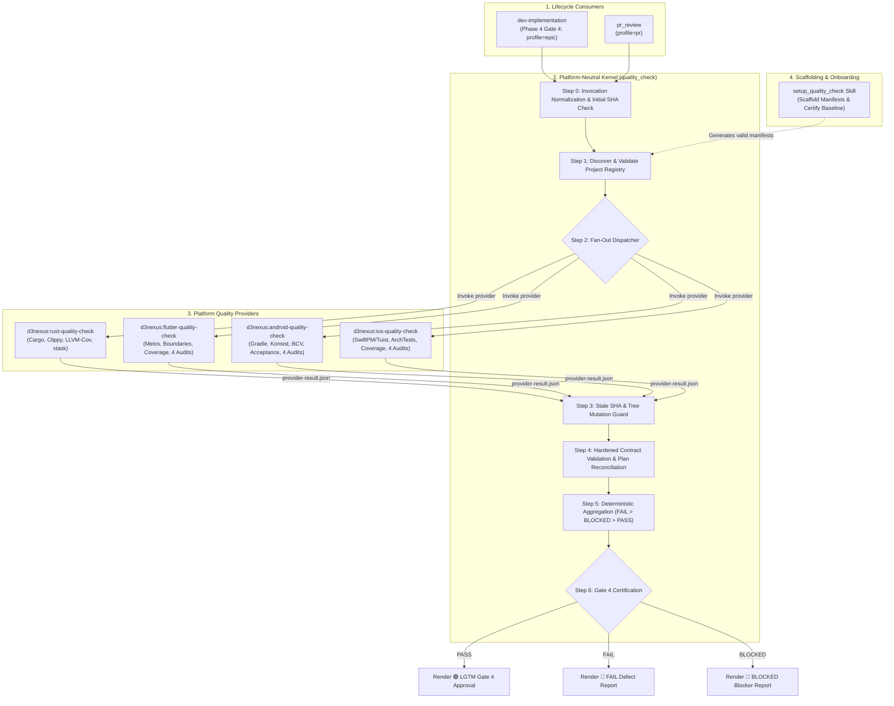
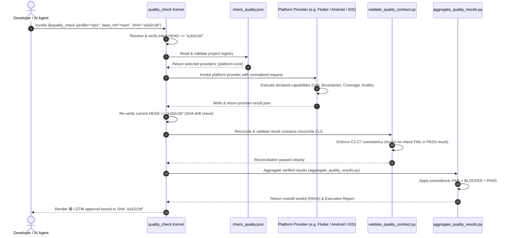

# Epic: Mobile Quality Providers and Contract Hardening

## Table of Contents

- [1. Meta Data](#1-meta-data)
- [2. Background and Motivation](#2-background-and-motivation)
- [3. Goals and Non-Goals](#3-goals-and-non-goals)
- [4. Architecture and Technical Design](#4-architecture-and-technical-design)
  - [4.1. High-Level Architecture](#41-high-level-architecture)
  - [4.2. Use Cases](#42-use-cases)
  - [4.3. Sequence Diagram](#43-sequence-diagram)
  - [4.4. Shift-Left Impact Analysis (Check 1)](#44-shift-left-impact-analysis-check-1)
- [5. BDD Scenarios Overview](#5-bdd-scenarios-overview)
- [6. Rollout Strategy and Mitigation](#6-rollout-strategy-and-mitigation)
- [7. Kanban Tasks Breakdown](#7-kanban-tasks-breakdown)

---

## 1. Meta Data

- **Epic Name**: `mobile_quality_providers_and_contract_hardening`
- **Status**: done
- **Priority**: High
- **Target Release**: `d3nexus 1.6.0`
- **Platform**: Multi-platform Agent Toolkit (Rust, Flutter, Android Native, iOS Native)
- **Source Spec**: [2026-10-12-mobile-quality-providers-and-contract-hardening-design.en.md](2026-10-12-mobile-quality-providers-and-contract-hardening-design.en.md)
- **Dependencies**: `ai-agent-tools/main` at `b997869` (Provider Architecture baseline)

---

## 2. Background and Motivation

The provider-based quality system transition decoupled `quality_check` into a platform-neutral orchestrator driven by `.agents/quality/check_quality.json`. While this established a clean kernel architecture, it created an immediate ecosystem crisis:
1. Mobile platforms (Flutter, Android Native, iOS Native) lost their execution path because their runner logic was removed from `quality_check` before standalone provider skills were implemented.
2. The orchestrator enforces strict fail-closed execution without heuristic fallback, immediately returning `🔴 BLOCKED` on any mobile project.
3. Review of the baseline merge identified critical contract vulnerabilities (F1–F3):
   - A provider with top-level `status: PASS` containing failed checks or sub-threshold coverage is accepted as `PASS` (False-PASS).
   - Reconcile CLI commands do not validate result documents or reject stale SHAs.
   - Capability schemas allow empty profile selections and duplicate capability IDs.

This epic hardens the contract validator and aggregation engine against all False-PASS conditions, implements the 3 missing mobile platform provider skills directly aligned with the canonical `digital_wallet` templates, and delivers an automated onboarding tool (`setup_quality_check`).

---

## 3. Goals and Non-Goals

### 3.1. Goals
- **Contract Hardening (C1–C7)**: Enforce internal consistency in `validate_quality_contract.py` and `aggregate_quality_results.py`. A provider cannot pass if any contained check fails or if coverage falls below threshold.
- **Three Mobile Platform Providers**:
  - `d3nexus:flutter-quality-check` (Melos, FVM/Flutter, boundaries, licensing, coverage, 4 audits).
  - `d3nexus:android-quality-check` (Gradle, Konsist, BCV apiCheck, Detekt/Spotless, acceptance harness, 4 audits).
  - `d3nexus:ios-quality-check` (Tuist, SwiftPM, ArchTests AST, SwiftLint, SwiftFormat, coverage, 4 audits).
- **Scaffolding and Onboarding Skill**: `setup_quality_check` to inspect repository structure and generate `.agents/quality/check_quality.json` and platform capability manifests in a single command.
- **Template Ground Truth Compatibility**: 100% command and path compatibility with `android_digital_wallet`, `bloc_digital_wallet`, and `ios_digital_wallet`.
- **E2E Multi-Platform Acceptance**: Verify four-way polyglot provider execution under unified aggregation.

### 3.2. Non-Goals
- Modifying business features or application code inside template repositories.
- Adding legacy platform-detection fallback into `quality_check/SKILL.md`.
- Introducing automated file mutation or code refactoring during Gate 4 verification runs.

---

## 4. Architecture and Technical Design

### 4.1. High-Level Architecture



### 4.2. Use Cases

```mermaid
flowchart TD
    actor DEV["Developer / AI Agent"]
    actor CI["CI System / Gatekeeper"]

    subgraph UC_ONBOARD ["Use Case 1: Repository Onboarding"]
        U1["Run setup_quality_check"]
        U1_SCAN["Scan root indicators (pubspec, gradle, tuist, cargo)"]
        U1_GEN["Generate check_quality.json &amp; platform-quality.json"]
        U1_CERT["Execute initial PR profile baseline check"]
    end

    subgraph UC_GATE4 ["Use Case 2: End-of-Epic Gate 4 Certification"]
        U2["Invoke quality_check (profile=epic, SHA=HEAD)"]
        U2_RUN["Run workspace unit, architecture, boundary, and acceptance suites"]
        U2_AUDIT["Run 4 specialist semantic audits"]
        U2_VERDICT["Emit unified immutable Gate 4 verdict"]
    end

    subgraph UC_PR ["Use Case 3: Pull Request Review"]
        U3["Invoke pr_review / quality_check (profile=pr)"]
        U3_FAST["Run fast compilation, lint, boundary checks, touched tests"]
        U3_VERDICT["Render PR review summary with inline defect pointers"]
    end

    DEV --> U1
    U1 --> U1_SCAN --> U1_GEN --> U1_CERT

    DEV --> U2
    CI --> U2
    U2 --> U2_RUN --> U2_AUDIT --> U2_VERDICT

    DEV --> U3
    CI --> U3
    U3 --> U3_FAST --> U3_VERDICT
```

### 4.3. Sequence Diagram



### 4.4. Shift-Left Impact Analysis (Check 1)

Touchpoint analysis across existing code:
- **Modified Core Scripts**:
  - `skills/quality_check/resources/scripts/validate_quality_contract.py`: Hardened validation rules for checks and coverage.
  - `skills/quality_check/resources/scripts/aggregate_quality_results.py`: Precedence engine and report generator.
- **New Provider Skills**:
  - `skills/flutter-quality-check/` (Isolated skill directory).
  - `skills/android-quality-check/` (Isolated skill directory).
  - `skills/ios-quality-check/` (Isolated skill directory).
  - `skills/setup_quality_check/` (Isolated skill directory).
- **Blast Radius**: Zero breaking changes to `skills/quality_check/SKILL.md` kernel interface; full forward-compatibility for all mobile repositories.
- **Safety Net**: Complete regression protection via `skills/quality_check/resources/scripts/test_validate_quality_contract.py`, `test_aggregate_quality_results.py`, and `test_quality_provider_acceptance.py`.

---

## 5. BDD Scenarios Overview

The complete Gherkin scenario suite across the mandatory 5-dimension boundary matrix is maintained in:
- English: [bdd_scenarios.en.md](bdd_scenarios.en.md)
- Vietnamese: [bdd_scenarios.vi.md](bdd_scenarios.vi.md)

Key behavioral guarantees:
1. **Contradictory Results**: A provider reporting top-level `PASS` containing failed checks is rejected with status `BLOCKED` (`CONTRACT_VIOLATION`).
2. **Sub-Threshold Coverage**: A provider reporting measured coverage below configured threshold cannot return `PASS`.
3. **SHA Stability**: Any repository tree mutation or rebase during execution invalidates collected evidence.
4. **Missing Executables**: Missing required compilers or tools explicitly evaluate to `BLOCKED`.
5. **Polyglot Consensus**: In a multi-provider workspace, failure in one provider forces the overall verdict to `FAIL`.

---

## 6. Rollout Strategy and Mitigation

1. **Phase 1: Engine Hardening**: Fix F1–F3 and verify C1–C7 in `ai-agent-tools`.
2. **Phase 2: Mobile Providers**: Implement `flutter-quality-check`, `android-quality-check`, and `ios-quality-check`.
3. **Phase 3: Scaffolding Tool**: Implement `setup_quality_check`.
4. **Phase 4: Template Adoption**: Add manifest files to `android_digital_wallet`, `bloc_digital_wallet`, and `ios_digital_wallet`.
5. **Phase 5: Release**: Bump plugin version to `1.6.0` and deploy to global plugin configurations.

**Rollback Strategy**: If unforeseen issues arise, consumer skills (`dev-implementation`, `pr_review`) can temporarily pin to `d3nexus 1.5.0` while provider fixes are applied.

---

## 7. Kanban Tasks Breakdown

Proposed Gate 2 task split:

1. **[Task 1: Harden Quality Contract Validator and Reconcile Engine](task_1_harden_contract_validator.md)**
2. **[Task 2: Harden Result Aggregator Engine and Precedence](task_2_harden_result_aggregator.md)**
3. **[Task 3: Build Flutter Quality Provider](task_3_build_flutter_quality_provider.md)**
4. **[Task 4: Build Android Quality Provider](task_4_build_android_quality_provider.md)**
5. **[Task 5: Build iOS Quality Provider](task_5_build_ios_quality_provider.md)**
6. **[Task 6: Build Scaffolding and Onboarding Skill](task_6_build_scaffolding_skill.md)**
7. **[Task 7: Run End-to-End Acceptance and Verify Release](task_7_run_e2e_acceptance_and_release.md)**

