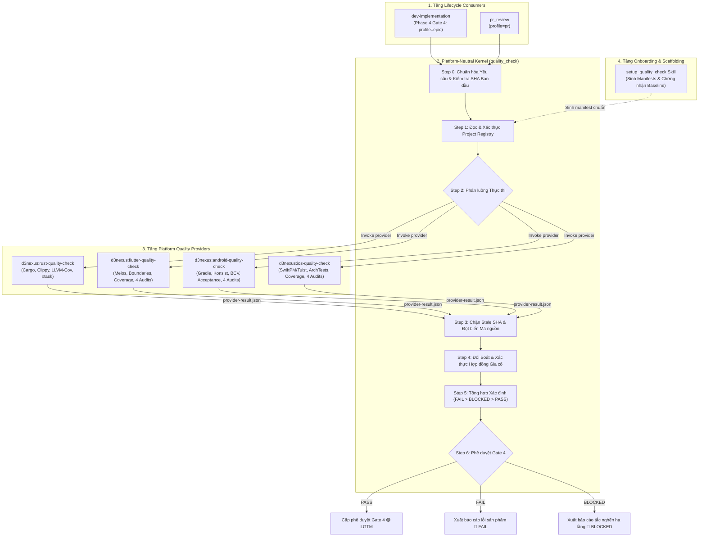
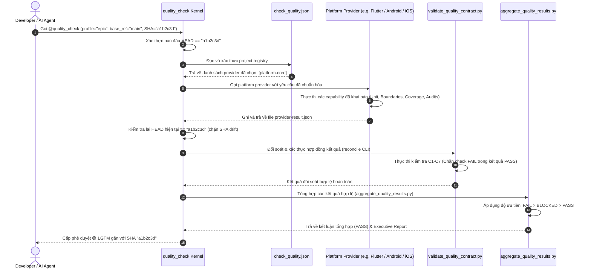

# Epic: Gia Cố Hợp Đồng Và Bộ Provider Kiểm Thử Di Động

## Mục Lục

- [1. Meta Data](#1-meta-data)
- [2. Bối Cảnh và Động Lực](#2-bối-cảnh-và-động-lực)
- [3. Mục Tiêu và Ngoài Phạm Vi](#3-mục-tiêu-và-ngoài-phạm-vi)
- [4. Kiến Trúc và Thiết Kế Kỹ Thuật](#4-kiến-trúc-và-thiết-kế-kỹ-thuật)
  - [4.1. Kiến Trúc Mức Cao](#41-kiến-trúc-mức-cao)
  - [4.2. Use Cases](#42-use-cases)
  - [4.3. Sequence Diagram](#43-sequence-diagram)
  - [4.4. Phân Tích Tác Động Shift-Left (Check 1)](#44-phân-tích-tác-động-shift-left-check-1)
- [5. Tổng Quan Kịch Bản BDD](#5-tổng-quan-kịch-bản-bdd)
- [6. Chiến Lược Rollout và Giảm Thiểu Rủi Ro](#6-chiến-lược-rollout-và-giảm-thiểu-rủi-ro)
- [7. Phân Rã Kanban Task](#7-phân-rã-kanban-task)

---

## 1. Meta Data

- **Tên Epic**: `mobile_quality_providers_and_contract_hardening`
- **Trạng thái**: Planning
- **Ưu tiên**: High
- **Target Release**: `d3nexus 1.6.0`
- **Nền tảng**: Multi-platform Agent Toolkit (Rust, Flutter, Android Native, iOS Native)
- **Source Spec**: [2026-10-12-mobile-quality-providers-and-contract-hardening-design.vi.md](2026-10-12-mobile-quality-providers-and-contract-hardening-design.vi.md)
- **Phụ thuộc**: `ai-agent-tools/main` tại `b997869` (Nền tảng kiến trúc Provider ban đầu)

---

## 2. Bối Cảnh và Động Lực

Quá trình chuyển đổi hệ thống kiểm thử chất lượng sang mô hình provider đã phân tách `quality_check` thành một orchestrator trung lập được điều khiển bởi `.agents/quality/check_quality.json`. Dù tạo ra một kiến trúc kernel sạch sẽ, nó đã gây ra một cuộc khủng hoảng tức thì cho hệ sinh thái:
1. Các nền tảng di động (Flutter, Android Native, iOS Native) mất đường thực thi vì logic runner cũ đã bị gỡ khỏi `quality_check` trước khi các skill provider độc lập được hiện thực.
2. Orchestrator thực thi cơ chế fail-closed nghiêm ngặt mà không có fallback heuristic cũ, lập tức trả về `🔴 BLOCKED` trên mọi dự án mobile.
3. Review đợt merge nền tảng đã phát hiện các kẽ hở hợp đồng nghiêm trọng (F1–F3):
   - Một provider có `status: PASS` cấp cao nhất nhưng chứa check con bị lỗi hoặc coverage dưới ngưỡng vẫn được chấp nhận là `PASS` (False-PASS).
   - Lệnh CLI reconcile không xác thực file kết quả và không từ chối SHA quá hạn.
   - Schema của capability cho phép lựa chọn profile rỗng và trùng lặp capability ID.

Epic này gia cố bộ xác thực hợp đồng và aggregation engine để chặn đứng mọi điều kiện False-PASS, hiện thực 3 skill provider di động khớp chính xác với các template `digital_wallet` chuẩn, và cung cấp công cụ onboarding tự động (`setup_quality_check`).

---

## 3. Mục Tiêu và Ngoài Phạm Vi

### 3.1. Mục Tiêu
- **Gia Cố Hợp Đồng (C1–C7)**: Thực thi tính nhất quán nội tại trong `validate_quality_contract.py` và `aggregate_quality_results.py`. Một provider không thể pass nếu bất kỳ check con nào fail hoặc coverage dưới ngưỡng.
- **Ba Provider Nền Tảng Di Động**:
  - `d3nexus:flutter-quality-check` (Melos, FVM/Flutter, ranh giới module, bản quyền, coverage, 4 audits).
  - `d3nexus:android-quality-check` (Gradle, Konsist, BCV apiCheck, Detekt/Spotless, acceptance harness, 4 audits).
  - `d3nexus:ios-quality-check` (Tuist, SwiftPM, ArchTests AST, SwiftLint, SwiftFormat, coverage, 4 audits).
- **Skill Khởi Tạo Mẫu và Onboarding**: `setup_quality_check` để khảo sát cấu trúc repo và sinh file `.agents/quality/check_quality.json` cùng manifest capability chỉ bằng một lệnh duy nhất.
- **Tương Thích Tuyệt Đối Với Template**: Đạt độ tương thích 100% về lệnh và đường dẫn với `android_digital_wallet`, `bloc_digital_wallet`, và `ios_digital_wallet`.
- **Nghiệm Thu Đa Nền Tảng E2E**: Xác thực quá trình thực thi đồng thời của 4 nền tảng dưới một quy chuẩn tổng hợp duy nhất.

### 3.2. Ngoài Phạm Vi
- Chỉnh sửa tính năng nghiệp vụ hay mã nguồn ứng dụng trong các template ví điện tử.
- Bổ sung fallback phát hiện nền tảng cũ vào `quality_check/SKILL.md`.
- Tự động chỉnh sửa mã nguồn hay format code trong lúc chạy xác thực Gate 4.

---

## 4. Kiến Trúc và Thiết Kế Kỹ Thuật

### 4.1. Kiến Trúc Mức Cao



### 4.2. Use Cases

```mermaid
flowchart TD
    actor DEV["Developer / AI Agent"]
    actor CI["Hệ thống CI / Gatekeeper"]

    subgraph UC_ONBOARD ["Use Case 1: Khởi Tạo Dự Án (Onboarding)"]
        U1["Chạy setup_quality_check"]
        U1_SCAN["Khảo sát dấu hiệu root (pubspec, gradle, tuist, cargo)"]
        U1_GEN["Sinh check_quality.json &amp; platform-quality.json"]
        U1_CERT["Chạy kiểm thử baseline ban đầu với profile PR"]
    end

    subgraph UC_GATE4 ["Use Case 2: Phê Duyệt Gate 4 Cuối Epic"]
        U2["Gọi quality_check (profile=epic, SHA=HEAD)"]
        U2_RUN["Chạy toàn bộ bộ test unit, architecture, boundary, acceptance"]
        U2_AUDIT["Chạy 4 specialist semantic audit"]
        U2_VERDICT["Xuất kết luận Gate 4 bất biến"]
    end

    subgraph UC_PR ["Use Case 3: Đánh Giá Pull Request"]
        U3["Gọi pr_review / quality_check (profile=pr)"]
        U3_FAST["Chạy biên dịch nhanh, lint, boundary check, test bị chạm"]
        U3_VERDICT["Xuất báo cáo review PR kèm vị trí lỗi cụ thể"]
    end

    DEV --> U1
    U1 --> U1_SCAN --> U1_GEN --> U1_CERT

    DEV --> U2
    CI --> U2
    U2 --> U2_RUN --> U2_AUDIT --> U2_VERDICT

    DEV --> U3
    CI --> U3
    U3 --> U3_FAST --> U3_VERDICT
```

### 4.3. Sequence Diagram



### 4.4. Phân Tích Tác Động Shift-Left (Check 1)

Phân tích các điểm chạm trong mã nguồn:
- **Các Script Lõi Được Sửa Đổi**:
  - `skills/quality_check/resources/scripts/validate_quality_contract.py`: Gia cố các quy tắc xác thực cho check và coverage.
  - `skills/quality_check/resources/scripts/aggregate_quality_results.py`: Engine ưu tiên và bộ sinh báo cáo.
- **Các Skill Provider Mới**:
  - `skills/flutter-quality-check/` (Thư mục skill độc lập).
  - `skills/android-quality-check/` (Thư mục skill độc lập).
  - `skills/ios-quality-check/` (Thư mục skill độc lập).
  - `skills/setup_quality_check/` (Thư mục skill độc lập).
- **Blast Radius**: Không gây breaking change tới giao diện kernel của `skills/quality_check/SKILL.md`; tương thích hoàn toàn cho tất cả repository di động.
- **Lưới An Toàn**: Bảo vệ hồi quy toàn diện qua `skills/quality_check/resources/scripts/test_validate_quality_contract.py`, `test_aggregate_quality_results.py`, và `test_quality_provider_acceptance.py`.

---

## 5. Tổng Quan Kịch Bản BDD

Bộ kịch bản Gherkin đầy đủ bao phủ ma trận ranh giới 5 chiều bắt buộc được duy trì tại:
- Bản tiếng Anh: [bdd_scenarios.en.md](bdd_scenarios.en.md)
- Bản tiếng Việt: [bdd_scenarios.vi.md](bdd_scenarios.vi.md)

Các đảm bảo hành vi cốt lõi:
1. **Kết Quả Mâu Thuẫn**: Provider báo cáo top-level `PASS` nhưng chứa check con fail sẽ bị từ chối với trạng thái `BLOCKED` (`CONTRACT_VIOLATION`).
2. **Coverage Dưới Ngưỡng**: Provider đo được coverage thấp hơn ngưỡng cấu hình không thể trả về `PASS`.
3. **Tính Ổn Định SHA**: Mọi đột biến cây mã nguồn hay rebase trong lúc chạy đều vô hiệu hóa bằng chứng.
4. **Thiếu File Thực Thi**: Thiếu trình biên dịch hay công cụ cần thiết bắt buộc trả về `BLOCKED`.
5. **Đồng Thuận Đa Nền Tảng**: Trong workspace nhiều provider, lỗi ở một provider bắt buộc kéo toàn bộ kết luận về `FAIL`.

---

## 6. Chiến Lược Rollout và Giảm Thiểu Rủi Ro

1. **Giai Đoạn 1: Gia Cố Engine**: Sửa F1–F3 và nghiệm thu C1–C7 trong `ai-agent-tools`.
2. **Giai Đoạn 2: Các Provider Di Động**: Hiện thực `flutter-quality-check`, `android-quality-check`, và `ios-quality-check`.
3. **Giai Đoạn 3: Công Cụ Khởi Tạo Mẫu**: Hiện thực `setup_quality_check`.
4. **Giai Đoạn 4: Tích Hợp Template**: Thêm manifest vào `android_digital_wallet`, `bloc_digital_wallet`, và `ios_digital_wallet`.
5. **Giai Đoạn 5: Phát Hành**: Nâng phiên bản plugin lên `1.6.0` và cập nhật vào cấu hình plugin toàn cục.

**Chiến Lược Rollback**: Nếu có vấn đề phát sinh, các skill consumer (`dev-implementation`, `pr_review`) có thể tạm thời ghim phiên bản `d3nexus 1.5.0` trong khi chờ vá lỗi provider.

---

## 7. Phân Rã Kanban Task

Đề xuất phân rã task cho Gate 2:

1. **Task 1**: Gia cố Bộ Xác Thực Hợp Đồng và Engine Đối Soát (`task_1_harden_contract_validator.md`)
2. **Task 2**: Gia cố Engine Tổng Hợp Kết Quả và Thứ Tự Ưu Tiên (`task_2_harden_result_aggregator.md`)
3. **Task 3**: Xây dựng Flutter Quality Provider (`task_3_build_flutter_quality_provider.md`)
4. **Task 4**: Xây dựng Android Quality Provider (`task_4_build_android_quality_provider.md`)
5. **Task 5**: Xây dựng iOS Quality Provider (`task_5_build_ios_quality_provider.md`)
6. **Task 6**: Xây dựng Skill Onboarding và Khởi Tạo Mẫu (`task_6_build_scaffolding_skill.md`)
7. **Task 7**: Chạy Nghiệm Thu End-to-End và Thẩm Định Bản Phát Hành (`task_7_run_e2e_acceptance_and_release.md`)

