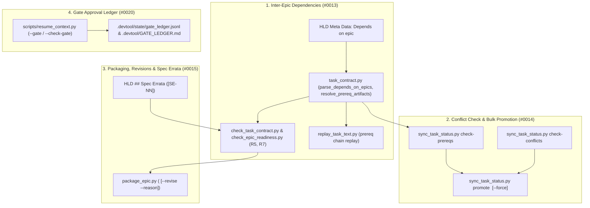

# Multi-Epic Orchestration and Governance Design Specification

- **Date**: 2026-11-06
- **Author**: AI Assistant (Co-Architect)
- **Status**: Approved
- **Epic**: `multi-epic-orchestration-and-governance`
- **Epic Directory**: `multi_epic_orchestration_and_governance`
- **Source Observations**: `#0013`, `#0014`, `#0015`, `#0020`

## Table of Contents

- [Overview and Problem Statement](#overview-and-problem-statement)
- [Goals and Non-Goals](#goals-and-non-goals)
- [Architecture and Component Design](#architecture-and-component-design)
  - [1. Inter-Epic Dependency Declarations and Readiness Resolution](#1-inter-epic-dependency-declarations-and-readiness-resolution)
  - [2. Conflict-Aware Concurrent Epic Backlog and Bulk Promotion](#2-conflict-aware-concurrent-epic-backlog-and-bulk-promotion)
  - [3. Packaged Epic Revision Workflow and HLD Spec Errata](#3-packaged-epic-revision-workflow-and-hld-spec-errata)
  - [4. Structured Gate Approval Ledger in Project Memory](#4-structured-gate-approval-ledger-in-project-memory)
- [Error Handling and Edge Cases](#error-handling-and-edge-cases)
- [Testing and Verification Strategy](#testing-and-verification-strategy)
- [Shared Contract Warnings](#shared-contract-warnings)
- [Dependency Mapping and Roadmap Context](#dependency-mapping-and-roadmap-context)

## Overview and Problem Statement

Across multi-epic engineering campaigns in `lyrics-sync` and `ai-agent-tools`, four recurring orchestration and governance gaps were recorded in `skill-observations/observation-log/`:

1. **Observation `#0013` (No first-class support for designing an epic on top of a packaged, unmerged epic)**: When Epic B builds on files or symbols introduced by a packaged, unmerged Epic A, `check_task_contract.py --design` rejects `Read-only context` and non-`(new)` `Allowed files` paths that do not yet exist at `HEAD`, and `check_epic_readiness.py` (`R5`) rejects symbols created by Epic A unless re-marked `new` in Epic B. Furthermore, `replay_epic_in_worktree()` and Stage 3 entry-point detection have no formal `Depends on epic:` metadata in the HLD to replay prerequisite epics automatically or block Stage 3 startup until prerequisite epics are merged.
2. **Observation `#0014` (Concurrent-epic backlog rule ignores whether epics touch the same files)**: Any active task of another epic in `.devtool/features/` forces a newly designed epic's tasks to `status: "backlog"`, even when the two epics have completely disjoint `Allowed files` sets and can safely run in parallel worktrees. Promoting a queued epic from `backlog` to `todo` also requires invoking `sync_task_status.py task <id> todo` manually for every task.
3. **Observation `#0015` (No formal flow for revising an epic after packaging or for spec errata)**: `handoff.md` states that it is never updated after packaging, yet post-packaging reviews and cross-epic alignments require revising packaged epics and re-anchoring `Design commit`. In addition, when Stage 2 HLD design intentionally refines a Stage 1 specification detail, there is no structured `## Spec Errata` section in the HLD for Gate 2 to approve and for Principal Review (`P1`) to recognize as an intentional amendment rather than accidental drift.
4. **Observation `#0020` (Gate approvals and their exact scope are recorded by hand)**: Developer gate approvals (`Gate 1`–`Gate 5`), including approved deviations (`Spec Errata`, parallel epic execution, or backlog promotion), are recorded only in free-text prose inside `.devtool/state/<epic>.md`, which is subject to a 20-line compaction limit.

This epic (`multi_epic_orchestration_and_governance`, Epic 3 of 3) delivers first-class, stdlib-only scripts and contract extensions that resolve all four multi-epic orchestration and governance gaps.

## Goals and Non-Goals

### Goals

- Support `- **Depends on epic**: <epic_slug_or_dir>[, ...]` in HLD `## Meta Data` across `task_contract.py`, `check_task_contract.py`, `check_epic_readiness.py` (`R5`, `R7`), `replay_task_text.py`, and `sync_task_status.py check-prereqs <epic_dir>` (`#0013`).
- Provide conflict-aware concurrent epic analysis (`sync_task_status.py check-conflicts <epic_dir>`) comparing `Allowed files` sets across active epics and bulk promotion (`sync_task_status.py promote <epic_dir> [--force]`) (`#0014`).
- Ship `skills/dev-implementation/resources/scripts/package_epic.py` (`package_epic.py <epic_dir> [--revise --reason "<text>"]`) and support `## Spec Errata` (`[SE-NN]`) in HLD documents and `check_epic_readiness.py` (`R7`) (`#0015`).
- Extend `scripts/resume_context.py` with a structured, lock-protected Gate Approval Ledger (`--gate <1..5> --epic <slug> --approved "<scope>" [--deviations "<text>"]` and `--check-gate <1..5> --epic <slug>`) persisted in `.devtool/state/gate_ledger.jsonl` and rendered to `.devtool/GATE_LEDGER.md` (`#0020`).

### Non-Goals

- Changing single-epic task execution semantics inside `run_task_checks.py` (`red`, `measure`, `verify`), which are covered by Epics 1 and 2.
- Introducing third-party Python dependencies outside the Python 3.11+ standard library.

## Architecture and Component Design



### 1. Inter-Epic Dependency Declarations and Readiness Resolution

- **HLD `Depends on epic:` Metadata (`#0013`)**:
  - In `skills/dev-implementation/resources/scripts/task_contract.py`:
    - Add `DEPENDS_ON_EPIC_RE = re.compile(r"^-\s*\*\*(?:Depends on epic|Phụ thuộc vào epic)\*\*:\s*(.+)$", re.MULTILINE)`.
    - Add `parse_depends_on_epics(hld_text: str) -> list[str]`: extracts comma-separated epic identifiers from the metadata line, stripping backticks, parenthetical notes, and `"None"` / `"Không"` sentinels.
    - Add `resolve_prerequisite_epic_dirs(root: Path, hld_text: str) -> tuple[list[str], list[str]]`: resolves each declared identifier to its `.devtool/epic/<prereq_dir>` directory name (matching either `<prereq_dir>` directly or via `sync_task_status.find_epic_dir_for_slug(root, ident)`), returning `(resolved_dirs, missing_identifiers)` in topological order (detecting cycles via depth-first traversal).
    - Add `collect_prerequisite_artifacts(root: Path, prereq_dirs: list[str]) -> tuple[set[str], dict[str, set[str]]]`: scans all `task_*.md` files in each prerequisite epic directory and returns:
      - `prereq_files: set[str]`: all file paths declared in `Allowed files` (both `(new)` and modified existing paths) across the prerequisite epics.
      - `prereq_symbols: dict[str, set[str]]`: mapping from `rel_path` to symbol names declared as `new <symbol>` under `Target Files & Symbols` in the prerequisite epics.
- **Design-Time Contract & Grounding Resolution (`#0013`)**:
  - In `skills/dev-implementation/resources/scripts/check_task_contract.py`:
    - When `args.hld` declares `Depends on epic:`, resolve `prereq_files` via `tc.collect_prerequisite_artifacts(check.root, prereq_dirs)[0]`.
    - Merge `prereq_files` into `created` and allow non-`(new)` entries in `check_allowed()` when `pattern in prereq_files` so a dependent epic can modify or reference files created by an unmerged prerequisite epic without false failures.
  - In `skills/dev-implementation/resources/scripts/check_epic_readiness.py`:
    - In `check_metadata(ctx)` (`R7`): call `tc.resolve_prerequisite_epic_dirs(ctx.root, ctx.hld_text)`. Emit `Finding("R7", "FAIL", f"Depends on epic '{missing}' does not exist under .devtool/epic/")` for any missing or cyclic prerequisite epic, and verify that `.en.md` and `.vi.md` declare identical prerequisite epic lists.
    - In `check_grounding(ctx)` (`R5`): for symbols in `Target Files & Symbols` on a path where either the file does not yet exist at `HEAD` (created in a prerequisite epic) or the symbol is not yet in `file_text` at `HEAD`, treat the symbol as grounded if `name in prereq_symbols.get(path_str, set())`.
- **Prerequisite Replay Chain & Stage 3 Entry Check (`#0013`)**:
  - In `skills/dev-implementation/resources/scripts/replay_task_text.py` (`replay_epic_in_worktree`):
    - Before replaying `<epic_dir>`'s own tasks in the temporary worktree, inspect `resolve_prerequisite_epic_dirs(root, hld_text)`: for any prerequisite epic whose status is not `Done`, apply its task directives in topological order first so the temporary worktree contains the prerequisite code and fixtures.
  - In `skills/dev-implementation/resources/scripts/sync_task_status.py`:
    - Add `check_epic_prerequisites(root: Path, epic_dir: str) -> list[str]` and CLI subcommand `sync_task_status.py check-prereqs <epic_dir>`: checks each prerequisite epic in `resolve_prerequisite_epic_dirs(root, hld_text)` and verifies its HLD `Status` is `Done` (or all its tasks have `status: "done"`). Exits `0` if all prerequisites are complete, or exits `1` listing unfinished prerequisite epics.

### 2. Conflict-Aware Concurrent Epic Backlog and Bulk Promotion

- **Allowed-File Conflict Detector (`#0014`)**:
  - In `skills/dev-implementation/resources/scripts/sync_task_status.py`:
    - Add `check_epic_file_conflicts(root: Path, epic_dir: str) -> dict[str, list[str]]` and CLI subcommand `sync_task_status.py check-conflicts <epic_dir>`:
      - Collects all `Allowed files` patterns across `<epic_dir>`'s tasks.
      - Scans all active tasks (`status` in `("todo", "in-progress", "review")`) in `.devtool/features/task_*.md` belonging to other epics.
      - For each other active epic, computes overlapping patterns where `tc.path_matches(pat_a, pat_b) or tc.path_matches(pat_b, pat_a)`.
      - Prints `0 conflicts — safe for concurrent execution` and exits `0` when the mapping is empty, or prints each conflicting epic and file pattern and exits `1` when overlaps exist.
- **Bulk Epic Promotion (`sync_task_status.py promote <epic_dir> [--force]`) (`#0014`)**:
  - In `skills/dev-implementation/resources/scripts/sync_task_status.py`:
    - Add subcommand `promote <epic_dir> [--force]`:
      1. Unless `--force` is set, runs `check_epic_prerequisites(root, epic_dir)` and `check_epic_file_conflicts(root, epic_dir)`; if either reports blockers/conflicts, prints the blockers to `stderr` and exits `1`.
      2. Transitions every task of `<epic_dir>` currently in `status: "backlog"` to `status: "todo"` across all checkouts (`sync_task(roots, task_id, "todo")`) and updates `<epic_dir>.{en,vi}.md` `Status` to `Packaged (ready for implementation)`.

### 3. Packaged Epic Revision Workflow and HLD Spec Errata

- **`skills/dev-implementation/resources/scripts/package_epic.py` (`#0015`)**:
  - CLI signature:
    ```bash
    package_epic.py <epic_dir> [--revise --reason "<summary>"] [--status "<hld_status>"]
    ```
  - Behavior:
    1. Runs `check_epic_readiness.py <epic_dir>` first; if readiness fails, prints the readiness report and exits `1` without writing `handoff.md`.
    2. Resolves `design_commit = git rev-parse --short HEAD` and `base_branch` (`main` or `develop`).
    3. When `--revise` is NOT passed (initial packaging):
       - Updates `<epic_dir>.{en,vi}.md` `Status` to `Packaged (<YYYY-MM-DD>)` (or `--status` / existing `Queued (backlog)` status if any task is `backlog`), commits the HLD status update if modified, re-reads `design_commit = git rev-parse --short HEAD`, and writes `.devtool/epic/<epic_dir>/handoff.md` with the required sections (`Status`, `Identifiers`, `Read First`, `Resume Prompt`, `Execution Guardrails for Receiving LLM`, `Open Notes`, `Rules for the Receiving Agent`).
    4. When `--revise` IS passed (post-packaging revision):
       - Requires `--reason "<summary>"` (exiting `2` if `--reason` is missing or empty) and requires `.devtool/epic/<epic_dir>/handoff.md` to exist.
       - Extracts the previous `Design commit` (`<old_sha>`) from `handoff.md`.
       - Updates `- **Packaged**: <YYYY-MM-DD>`, `- **Design commit**: `<new_sha>``, and the staleness command `git log <new_sha>..<base_branch> -- .devtool/epic/<epic_dir>` in `handoff.md`.
       - Inserts or appends `- **<YYYY-MM-DD> (`<old_sha>` -> `<new_sha>`)**: <reason>` under a `## Revisions` section (adding `- [Revisions](#revisions)` to the Table of Contents if not yet present), preserving existing `Open Notes`.
    5. Expose `package-epic` and `revise-epic` subcommands in `bin/d3nexus` (extending Epic 1's dispatcher).
- **HLD `## Spec Errata` Contract (`#0015`)**:
  - In `skills/dev-implementation/resources/scripts/task_contract.py` and `check_epic_readiness.py`:
    - Add `parse_spec_errata(hld_text: str) -> list[tuple[str, str]]` extracting bullets matching `^-\s*\*\*\[(SE-\d+)\]\s*([^*]+)\*\*:\s*(.+)$` from `## Spec Errata` (or `## Đính chính Đặc tả (Spec Errata)`).
    - In `check_epic_readiness.py` (`check_metadata` / `R7`): if either `<epic_dir>.en.md` or `<epic_dir>.vi.md` contains a `Spec Errata` section, verify that both language files contain the section with the exact same list of `[SE-NN]` IDs and non-empty descriptions; otherwise emit `Finding("R7", "FAIL", "Spec Errata IDs differ between .en.md and .vi.md: ...")`.

### 4. Structured Gate Approval Ledger in Project Memory

- **Gate Approval Ledger in `scripts/resume_context.py` (`#0020`)**:
  - Extend `scripts/resume_context.py` CLI with:
    - `--gate <1|2|3|4|5>`: Gate number to record (`choices=[1, 2, 3, 4, 5]`, `type=int`).
    - `--approved "<scope_summary>"`: Required non-empty description of what the developer approved at this gate.
    - `--deviations "<errata_or_override>"`: Optional record of approved deviations (e.g., `SE-01`, parallel epic execution, `--force` promotion).
    - `--by "<approver>"`: Optional approver identifier (default `"developer"`).
    - `--check-gate <1|2|3|4|5>`: Query whether the specified gate is recorded for `--epic <epic_slug>`, printing the matching record and exiting `0` if found, or exiting `1` if missing.
  - Storage & Concurrency:
    - Under `file_lock(devtool_dir)` (`fcntl.flock`), `record_gate_approval()` appends a JSON object line to `.devtool/state/gate_ledger.jsonl`:
      ```json
      {"timestamp": "2026-11-06T04:20:00Z", "epic": "multi-epic-orchestration-and-governance", "gate": 2, "commit": "e26d73b", "approved": "HLD and 5 Kanban tasks", "deviations": "SE-01", "by": "developer"}
      ```
    - Automatically regenerates `.devtool/GATE_LEDGER.md` containing a Markdown table of all recorded gate approvals grouped by epic, and prints the active epic's recorded gate approvals during default `resume_context.py` context harvesting.

## Error Handling and Edge Cases

- **Cyclic or Missing `Depends on epic:` Declarations**: `resolve_prerequisite_epic_dirs()` detects cycles (`A -> B -> A`) and missing directories, reporting a deterministic `R7 FAIL` finding without infinite recursion.
- **Revising an Unpackaged Epic**: Calling `package_epic.py <epic_dir> --revise` when `handoff.md` does not exist or without `--reason` exits with code `2` and a clear usage error.
- **Promoting an Epic Blocked by Prerequisites or File Conflicts**: `sync_task_status.py promote <epic_dir>` refuses to transition tasks from `backlog` to `todo` (exiting `1`) if any prerequisite epic is not `Done` or any active epic touches overlapping `Allowed files`, unless `--force` is explicitly provided.
- **Missing `--approved` Text on `--gate`**: `scripts/resume_context.py --gate <n>` without a non-empty `--approved` string exits with code `2` so empty approvals can never be logged.

## Testing and Verification Strategy

- **Tier A (Unit Tests)**:
  - `test_inter_epic_dependencies.py`: Tests `parse_depends_on_epics()`, `resolve_prerequisite_epic_dirs()` (including cycle detection and missing epic detection), `collect_prerequisite_artifacts()`, and design-time `Read-only context` / `R5` symbol resolution across dependent epics.
  - `test_concurrent_epic_backlog.py`: Tests `check_epic_file_conflicts()` (disjoint vs overlapping globs/paths), `check_epic_prerequisites()`, and `sync_task_status.py promote` (blocked vs clean vs `--force`).
  - `test_package_and_revise_epic.py`: Tests `package_epic.py` initial packaging, `--revise --reason` handoff re-anchoring and `## Revisions` history, and `parse_spec_errata()` bilingual `[SE-NN]` validation in `R7`.
  - `test_gate_approval_ledger.py`: Tests `resume_context.py --gate` JSONL + Markdown rendering, `--check-gate` exit codes (`0` vs `1`), and rejection of empty `--approved` strings.
- **Tier C1 (Subcutaneous End-to-End Integration)**:
  - `tests/test_multi_epic_governance_acceptance.py`: End-to-end subcutaneous tests in temporary Git repositories exercising a 2-epic dependency chain (replay, conflict check, promotion, packaging, revision, and gate ledger).
- **Repository Quality Gate**:
  - `scripts/verify.sh`, `ruff check`, `mypy`, `pytest`, and `check_document.py` must pass with 0 findings.

## Shared Contract Warnings

- No `shared-contracts/` directory exists in `ai-agent-tools`. All changes are internal to the workflow plugin kit and preserve full backward compatibility.

## Dependency Mapping and Roadmap Context

- **Depends on**:
  - **Epic 1 (`contract_and_authoring_ergonomics`)** — uses `bin/d3nexus` and `task_contract.py` extensions.
  - **Epic 2 (`execution_and_verification_infrastructure`)** — extends `replay_task_text.py` (`replay_epic_in_worktree`) and `check_epic_readiness.py`.
- **Completes**: The 3-Epic optimization roadmap addressing all 15 open observations in `skill-observations/observation-log/`.
