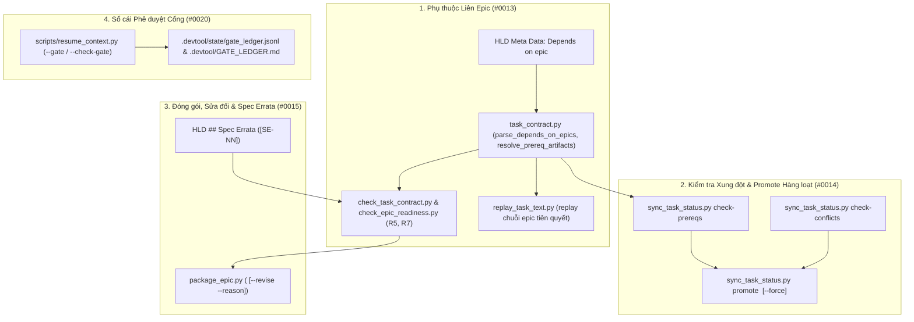

# Đặc tả Thiết kế Điều phối Đa Epic và Quản trị (Multi-Epic Orchestration and Governance)

- **Date**: 2026-11-06
- **Author**: AI Assistant (Co-Architect)
- **Status**: Approved
- **Epic**: `multi-epic-orchestration-and-governance`
- **Epic Directory**: `multi_epic_orchestration_and_governance`
- **Source Observations**: `#0013`, `#0014`, `#0015`, `#0020`

## Mục lục

- [Tổng quan và Phát biểu Bài toán](#tổng-quan-và-phát-biểu-bài-toán)
- [Mục tiêu và Phạm vi Ngoài Mục tiêu](#mục-tiêu-và-phạm-vi-ngoài-mục-tiêu)
- [Kiến trúc và Thiết kế Thành phần](#kiến-trúc-và-thiết-kế-thành-phần)
  - [1. Khai báo Phụ thuộc Liên Epic và Phân giải Sẵn sàng](#1-khai-báo-phụ-thuộc-liên-epic-và-phân-giải-sẵn-sàng)
  - [2. Quản lý Backlog Đa Epic Theo Xung đột và Chuyển Trạng thái Hàng loạt](#2-quản-lý-backlog-đa-epic-theo-xung-đột-và-chuyển-trạng-thái-hàng-loạt)
  - [3. Quy trình Sửa đổi Epic Đã Đóng gói và Mục Spec Errata trong HLD](#3-quy-trình-sửa-đổi-epic-đã-đóng-gói-và-mục-spec-errata-trong-hld)
  - [4. Sổ cái Phê duyệt Cổng Có Cấu trúc trong Bộ nhớ Dự án](#4-sổ-cái-phê-duyệt-cổng-có-cấu-trúc-trong-bộ-nhớ-dự-án)
- [Xử lý Lỗi và Các Trường hợp Biên](#xử-lý-lỗi-và-các-trường-hợp-biên)
- [Chiến lược Kiểm thử và Xác minh](#chiến-lược-kiểm-thử-và-xác-minh)
- [Cảnh báo Shared Contract](#cảnh-báo-shared-contract)
- [Ánh xạ Phụ thuộc và Bối cảnh Lộ trình](#ánh-xạ-phụ-thuộc-và-bối-cảnh-lộ-trình)

## Tổng quan và Phát biểu Bài toán

Qua các chiến dịch phát triển nhiều epic nối tiếp và song song trên `lyrics-sync` và `ai-agent-tools`, bốn khoảng trống về điều phối đa epic và quản trị đã được ghi nhận trong `skill-observations/observation-log/`:

1. **Observation `#0013` (Thiếu hỗ trợ chính thức khi thiết kế một epic phụ thuộc vào một epic đã đóng gói nhưng chưa merge)**: Khi Epic B xây dựng dựa trên các file hoặc symbol sẽ được tạo bởi Epic A (đã đóng gói nhưng chưa merge), `check_task_contract.py --design` báo lỗi đối với các đường dẫn trong `Read-only context` và `Allowed files` (không gắn `(new)`) chưa tồn tại tại `HEAD`, còn `check_epic_readiness.py` (`R5`) từ chối các symbol của Epic A trừ khi đánh dấu lại `new` trong Epic B. Bên cạnh đó, `replay_epic_in_worktree()` và bước kiểm tra đầu vào Stage 3 không có trường metadata `Depends on epic:` trong HLD để tự động replay epic tiên quyết hoặc chặn khởi chạy Stage 3 khi epic tiên quyết chưa hoàn tất.
2. **Observation `#0014` (Quy tắc xếp hàng backlog đa epic bỏ qua việc các epic có chạm vào cùng file hay không)**: Bất kỳ task đang hoạt động nào của một epic khác trong `.devtool/features/` đều buộc mọi task của epic mới phải đặt `status: "backlog"`, ngay cả khi hai epic có tập `Allowed files` hoàn toàn tách biệt và có thể chạy song song an toàn trên hai worktree. Việc chuyển một epic từ `backlog` sang `todo` sau khi được phê duyệt cũng phải chạy thủ công từng lệnh `sync_task_status.py task <id> todo`.
3. **Observation `#0015` (Thiếu quy trình chuẩn để sửa đổi epic sau khi đóng gói và ghi nhận đính chính đặc tả Spec Errata)**: `handoff.md` quy định không cập nhật sau khi đóng gói, nhưng thực tế kiểm tra sau đóng gói hoặc đồng bộ liên epic đòi hỏi phải sửa đổi tài liệu và cập nhật lại `Design commit` trong `handoff.md`. Ngoài ra, khi HLD ở Stage 2 chủ động tinh chỉnh một chi tiết so với Spec ở Stage 1, chưa có mục `## Spec Errata` có cấu trúc để Gate 2 phê duyệt chính thức và để Principal Review (`P1`) phân biệt giữa điều chỉnh có chủ đích với lỗi lệch tài liệu.
4. **Observation `#0020` (Phê duyệt cổng và phạm vi phê duyệt chỉ được ghi chép thủ công)**: Các quyết định phê duyệt cổng (`Gate 1`–`Gate 5`) của developer — bao gồm cả phạm vi ngoại lệ như duyệt `Spec Errata`, cho phép chạy song song hai epic, hoặc mở khóa `backlog` — chỉ được ghi tự do trong `.devtool/state/<epic>.md` (vốn bị cắt gọn ở giới hạn 20 dòng).

Epic này (`multi_epic_orchestration_and_governance`, Epic 3 trên tổng số 3) cung cấp các công cụ chuẩn hóa chỉ dùng thư viện chuẩn Python và mở rộng hợp đồng để giải quyết triệt để cả bốn vấn đề trên.

## Mục tiêu và Phạm vi Ngoài Mục tiêu

### Mục tiêu

- Hỗ trợ trường `- **Depends on epic**: <epic_slug_or_dir>[, ...]` trong `## Meta Data` của HLD xuyên suốt `task_contract.py`, `check_task_contract.py`, `check_epic_readiness.py` (`R5`, `R7`), `replay_task_text.py`, và `sync_task_status.py check-prereqs <epic_dir>` (`#0013`).
- Cung cấp công cụ phân tích xung đột file giữa các epic (`sync_task_status.py check-conflicts <epic_dir>`) và lệnh chuyển trạng thái hàng loạt từ `backlog` sang `todo` (`sync_task_status.py promote <epic_dir> [--force]`) (`#0014`).
- Cung cấp `skills/dev-implementation/resources/scripts/package_epic.py` (`package_epic.py <epic_dir> [--revise --reason "<text>"]`) và hỗ trợ mục `## Spec Errata` (`[SE-NN]`) trong tài liệu HLD cùng kiểm tra đối xứng trong `check_epic_readiness.py` (`R7`) (`#0015`).
- Mở rộng `scripts/resume_context.py` với Sổ cái Phê duyệt Cổng (`--gate <1..5> --epic <slug> --approved "<scope>" [--deviations "<text>"]` và `--check-gate <1..5> --epic <slug>`) được bảo vệ bằng khóa `fcntl.flock`, lưu trữ tại `.devtool/state/gate_ledger.jsonl` và kết xuất ra `.devtool/GATE_LEDGER.md` (`#0020`).

### Phạm vi Ngoài Mục tiêu

- Không thay đổi ngữ nghĩa thực thi từng task đơn lẻ trong `run_task_checks.py` (`red`, `measure`, `verify`) vốn đã được giải quyết ở Epic 1 và Epic 2.
- Không bổ sung bất kỳ thư viện bên thứ ba nào ngoài thư viện chuẩn Python 3.11+.

## Kiến trúc và Thiết kế Thành phần



### 1. Khai báo Phụ thuộc Liên Epic và Phân giải Sẵn sàng

- **Metadata `Depends on epic:` trong HLD (`#0013`)**:
  - Trong `skills/dev-implementation/resources/scripts/task_contract.py`:
    - Bổ sung biểu thức `DEPENDS_ON_EPIC_RE = re.compile(r"^-\s*\*\*(?:Depends on epic|Phụ thuộc vào epic)\*\*:\s*(.+)$", re.MULTILINE)`.
    - Bổ sung `parse_depends_on_epics(hld_text: str) -> list[str]`: trích xuất danh sách các mã định danh epic ngăn cách bởi dấu phẩy, loại bỏ dấu backtick, ghi chú trong ngoặc đơn và các giá trị `"None"` / `"Không"`.
    - Bổ sung `resolve_prerequisite_epic_dirs(root: Path, hld_text: str) -> tuple[list[str], list[str]]`: phân giải từng mã định danh thành tên thư mục `.devtool/epic/<prereq_dir>` theo thứ tự topo (phát hiện chu trình phụ thuộc bằng duyệt chiều sâu DFS), trả về `(resolved_dirs, missing_identifiers)`.
    - Bổ sung `collect_prerequisite_artifacts(root: Path, prereq_dirs: list[str]) -> tuple[set[str], dict[str, set[str]]]`: quét tất cả các file `task_*.md` trong các epic tiên quyết và trả về:
      - `prereq_files: set[str]`: tập hợp mọi đường dẫn file khai báo trong `Allowed files` của các epic tiên quyết.
      - `prereq_symbols: dict[str, set[str]]`: ánh xạ từ `rel_path` sang tập các symbol được khai báo `new <symbol>` trong `Target Files & Symbols` của các epic tiên quyết.
- **Phân giải Hợp đồng và Grounding ở Thời điểm Thiết kế (`#0013`)**:
  - Trong `skills/dev-implementation/resources/scripts/check_task_contract.py`:
    - Khi `args.hld` có khai báo `Depends on epic:`, thu thập `prereq_files` qua `tc.collect_prerequisite_artifacts(check.root, prereq_dirs)[0]`.
    - Hợp nhất `prereq_files` vào tập `created` và cho phép các mục không gắn `(new)` trong `check_allowed()` nếu `pattern in prereq_files`, giúp epic phụ thuộc có thể tham chiếu hoặc sửa đổi tiếp các file được tạo bởi epic tiên quyết chưa merge.
  - Trong `skills/dev-implementation/resources/scripts/check_epic_readiness.py`:
    - Trong `check_metadata(ctx)` (`R7`): gọi `tc.resolve_prerequisite_epic_dirs(ctx.root, ctx.hld_text)`. Phát lỗi `Finding("R7", "FAIL", ...)` nếu có epic tiên quyết không tồn tại hoặc tạo chu trình, đồng thời kiểm tra `.en.md` và `.vi.md` khai báo danh sách epic tiên quyết khớp nhau.
    - Trong `check_grounding(ctx)` (`R5`): với các symbol trong `Target Files & Symbols` thuộc file chưa tồn tại ở `HEAD` hoặc chưa có mặt trong `file_text` ở `HEAD`, coi là hợp lệ nếu `name in prereq_symbols.get(path_str, set())`.
- **Replay Chuỗi Epic Tiên quyết & Kiểm tra Đầu vào Stage 3 (`#0013`)**:
  - Trong `skills/dev-implementation/resources/scripts/check_epic_readiness.py` (`replay_with_prerequisites(root: Path, epic_dir: str, row_timeout: int = 600) -> list[str]`):
    - Phân giải `prereq_dirs, missing = tc.resolve_prerequisite_epic_dirs(root, hld_text)`: với mọi epic tiên quyết chưa ở trạng thái `Done`, áp dụng tuần tự các task của epic tiên quyết đó theo thứ tự topo trước khi replay các task của `<epic_dir>` trên worktree tạm để worktree có sẵn mã nguồn nền tảng.
  - Trong `skills/dev-implementation/resources/scripts/sync_task_status.py`:
    - Bổ sung `check_epic_prerequisites(root: Path, epic_dir: str) -> list[str]` và lệnh CLI `sync_task_status.py check-prereqs <epic_dir>`: kiểm tra từng epic tiên quyết đã có `Status: Done` (hoặc toàn bộ task đã `done`) hay chưa. Thoát mã `0` nếu tất cả đã hoàn tất, hoặc thoát mã `1` kèm danh sách epic tiên quyết chưa xong.

### 2. Quản lý Backlog Đa Epic Theo Xung đột và Chuyển Trạng thái Hàng loạt

- **Bộ Phát hiện Xung đột `Allowed files` (`#0014`)**:
  - Trong `skills/dev-implementation/resources/scripts/sync_task_status.py`:
    - Bổ sung `check_epic_file_conflicts(root: Path, epic_dir: str) -> dict[str, list[str]]` và lệnh CLI `sync_task_status.py check-conflicts <epic_dir>`:
      - Thu thập toàn bộ mẫu đường dẫn `Allowed files` trong các task của `<epic_dir>`.
      - Quét tất cả các task đang hoạt động (`status` thuộc `("todo", "in-progress", "review")`) trong `.devtool/features/task_*.md` của các epic khác.
      - Kiểm tra giao nhau bằng `tc.path_matches(pat_a, pat_b) or tc.path_matches(pat_b, pat_a)`.
      - In `0 conflicts — safe for concurrent execution` và thoát `0` khi không có giao nhau, hoặc liệt kê từng epic/đường dẫn xung đột và thoát `1`.
- **Lệnh Chuyển Trạng thái Hàng loạt (`sync_task_status.py promote <epic_dir> [--force]`) (`#0014`)**:
  - Trong `skills/dev-implementation/resources/scripts/sync_task_status.py`:
    - Bổ sung lệnh `promote <epic_dir> [--force]`:
      1. Trừ khi có `--force`, chạy `check_epic_prerequisites(root, epic_dir)` và `check_epic_file_conflicts(root, epic_dir)`; nếu có epic tiên quyết chưa hoàn tất hoặc có xung đột file với epic đang chạy, in lý do chặn ra `stderr` và thoát mã `1`.
      2. Chuyển toàn bộ các task đang `backlog` của `<epic_dir>` sang `todo` trên mọi checkout (`sync_task(roots, task_id, "todo")`) và cập nhật `Status` trong `<epic_dir>.{en,vi}.md` thành `Packaged (ready for implementation)`.

### 3. Quy trình Sửa đổi Epic Đã Đóng gói và Mục Spec Errata trong HLD

- **`skills/dev-implementation/resources/scripts/package_epic.py` (`#0015`)**:
  - Cú pháp CLI:
    ```bash
    package_epic.py <epic_dir> [--revise --reason "<summary>"] [--status "<hld_status>"]
    ```
  - Hành vi:
    1. Chạy `check_epic_readiness.py <epic_dir>` trước tiên; nếu không đạt, in báo cáo lỗi và thoát mã `1` mà không ghi `handoff.md`.
    2. Xác định `design_commit = git rev-parse --short HEAD` và nhánh gốc `base_branch` (`main` hoặc `develop`).
    3. Khi KHÔNG truyền `--revise` (đóng gói lần đầu):
       - Cập nhật `Status` của `<epic_dir>.{en,vi}.md` thành `Packaged (<YYYY-MM-DD>)` (hoặc giữ `Queued (backlog)` nếu các task đang ở `backlog`), tạo `.devtool/epic/<epic_dir>/handoff.md` chuẩn gồm đầy đủ các mục bắt buộc.
    4. Khi CÓ truyền `--revise` (sửa đổi sau khi đã đóng gói):
       - Bắt buộc phải có `--reason "<summary>"` (thoát mã `2` nếu thiếu hoặc rỗng) và file `.devtool/epic/<epic_dir>/handoff.md` phải đang tồn tại.
       - Đọc `Design commit` cũ (`<old_sha>`) từ `handoff.md`.
       - Cập nhật `- **Packaged**: <YYYY-MM-DD>`, `- **Design commit**: `<new_sha>`` và lệnh kiểm tra lỗi thời `git log <new_sha>..<base_branch> -- .devtool/epic/<epic_dir>` trong `handoff.md`.
       - Chèn hoặc nối thêm dòng `- **<YYYY-MM-DD> (`<old_sha>` -> `<new_sha>`)**: <reason>` vào mục `## Revisions` (tự động thêm `- [Revisions](#revisions)` vào Mục lục nếu chưa có), giữ nguyên nội dung `Open Notes`.
- **Hợp đồng `## Spec Errata` trong HLD (`#0015`)**:
  - Trong `skills/dev-implementation/resources/scripts/task_contract.py` và `check_epic_readiness.py`:
    - Bổ sung `parse_spec_errata(hld_text: str) -> list[tuple[str, str]]` trích xuất các dòng `- **[SE-NN] <Mục>**: <Mô tả>` từ mục `## Spec Errata` (hoặc `## Đính chính Đặc tả (Spec Errata)`).
    - Trong `check_epic_readiness.py` (`check_metadata` / `R7`): nếu `.en.md` hoặc `.vi.md` có mục `Spec Errata`, kiểm tra cả hai bản ngôn ngữ đều có mục này với danh sách mã `[SE-NN]` trùng khớp hoàn toàn; nếu lệch sẽ báo `Finding("R7", "FAIL", "Spec Errata IDs differ between .en.md and .vi.md: ...")`.

### 4. Sổ cái Phê duyệt Cổng Có Cấu trúc trong Bộ nhớ Dự án

- **Sổ cái Phê duyệt Cổng (`Gate Approval Ledger`) trong `scripts/resume_context.py` (`#0020`)**:
  - Mở rộng CLI của `scripts/resume_context.py` với:
    - `--gate <1|2|3|4|5>`: Số hiệu cổng cần ghi nhận (`choices=[1, 2, 3, 4, 5]`, `type=int`).
    - `--approved "<scope_summary>"`: Chuỗi mô tả phạm vi phê duyệt (bắt buộc không rỗng).
    - `--deviations "<errata_or_override>"`: Chuỗi tùy chọn ghi nhận các ngoại lệ được duyệt (như `SE-01`, chạy song song 2 epic, mở khóa `--force`).
    - `--by "<approver>"`: Định danh người phê duyệt (mặc định `"developer"`).
    - `--check-gate <1|2|3|4|5>`: Kiểm tra cổng `<n>` của `--epic <epic_slug>` đã được ghi nhận hay chưa (in bản ghi và thoát `0` nếu đã có, thoát `1` nếu chưa có).
  - Lưu trữ & Đồng thời:
    - Dưới khóa `file_lock(devtool_dir)` (`fcntl.flock`), `record_gate_approval()` ghi nối tiếp một dòng JSON vào `.devtool/state/gate_ledger.jsonl` và tự động kết xuất bảng tổng hợp Markdown vào `.devtool/GATE_LEDGER.md`, đồng thời hiển thị các cổng đã duyệt của epic hiện hành khi chạy `resume_context.py` mặc định.

## Xử lý Lỗi và Các Trường hợp Biên

- **Khai báo `Depends on epic:` Bị Thiếu hoặc Tạo Chu trình**: `resolve_prerequisite_epic_dirs()` phát hiện chu trình (`A -> B -> A`) và thư mục không tồn tại, trả về lỗi `R7 FAIL` tất định mà không đệ quy vô hạn.
- **Chạy `--revise` Khi Chưa Đóng gói**: Gọi `package_epic.py <epic_dir> --revise` khi chưa có `handoff.md` hoặc thiếu `--reason` sẽ thoát mã `2` kèm thông báo lỗi rõ ràng.
- **Promote Epic Đang Bị Chặn Bởi Tiên quyết hoặc Xung đột File**: `sync_task_status.py promote <epic_dir>` từ chối chuyển task từ `backlog` sang `todo` (thoát mã `1`) nếu còn epic tiên quyết chưa `Done` hoặc có xung đột `Allowed files` với epic đang chạy, trừ khi truyền `--force`.
- **Thiếu Nội dung `--approved` Khi Ghi nhận `--gate`**: `scripts/resume_context.py --gate <n>` không có chuỗi `--approved` khác rỗng sẽ thoát mã `2`.

## Chiến lược Kiểm thử và Xác minh

- **Tier A (Unit Tests)**:
  - `test_inter_epic_dependencies.py`: Kiểm thử `parse_depends_on_epics()`, `resolve_prerequisite_epic_dirs()` (bao gồm phát hiện chu trình và epic thiếu), `collect_prerequisite_artifacts()`, và kiểm tra `Read-only context` / symbol `R5` liên epic.
  - `test_concurrent_epic_backlog.py`: Kiểm thử `check_epic_file_conflicts()` (tập file tách biệt so với giao nhau), `check_epic_prerequisites()`, và `sync_task_status.py promote` (bị chặn, hợp lệ, và `--force`).
  - `test_package_and_revise_epic.py`: Kiểm thử đóng gói lần đầu bằng `package_epic.py`, tái đóng gói `--revise --reason` cập nhật `Design commit` + mục `## Revisions`, và kiểm tra đối xứng `[SE-NN]` của `parse_spec_errata()` trong `R7`.
  - `test_gate_approval_ledger.py`: Kiểm thử ghi sổ cái `resume_context.py --gate` (JSONL + Markdown), mã thoát của `--check-gate` (`0` so với `1`), và từ chối `--approved` rỗng.
- **Tier C1 (Subcutaneous End-to-End Integration)**:
  - `tests/test_multi_epic_governance_acceptance.py`: Kiểm thử tích hợp đầu-cuối trên kho Git tạm thời bao phủ chuỗi 2 epic phụ thuộc nhau, kiểm tra xung đột, promote, đóng gói, tái đóng gói và sổ cái phê duyệt cổng.
- **Cổng Chất lượng Kho mã nguồn**:
  - `scripts/verify.sh`, `ruff check`, `mypy`, `pytest`, và `check_document.py` phải vượt qua với 0 lỗi.

## Cảnh báo Shared Contract

- Không tồn tại thư mục `shared-contracts/` trong `ai-agent-tools`. Mọi thay đổi đều nằm gọn trong bộ công cụ workflow plugin và đảm bảo tương thích ngược hoàn toàn.

## Ánh xạ Phụ thuộc và Bối cảnh Lộ trình

- **Phụ thuộc vào**:
  - **Epic 1 (`contract_and_authoring_ergonomics`)** — sử dụng `bin/d3nexus` và các mở rộng trong `task_contract.py`.
  - **Epic 2 (`execution_and_verification_infrastructure`)** — mở rộng `replay_task_text.py` (`replay_epic_in_worktree`) và `check_epic_readiness.py`.
- **Hoàn tất**: Lộ trình tối ưu hóa 3 Epic giải quyết toàn bộ 15 quan sát đang mở trong `skill-observations/observation-log/`.

