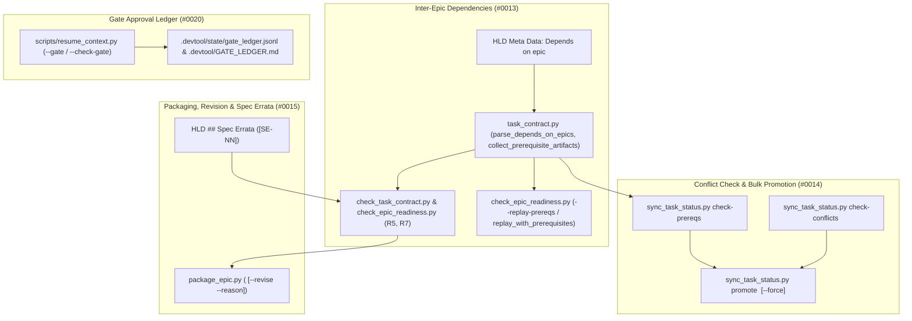
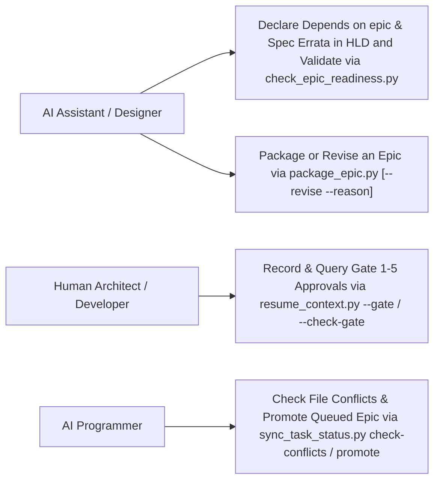
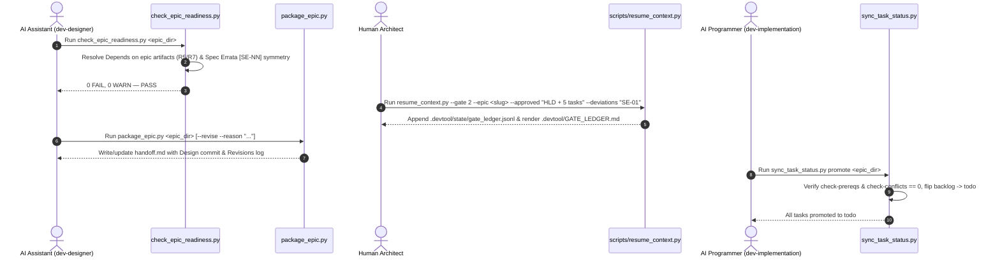

# Epic: Multi-Epic Orchestration and Governance

## Table of Contents

- [Meta Data](#meta-data)
- [Background](#background)
- [Goals and Non-Goals](#goals-and-non-goals)
  - [Goals](#goals)
  - [Non-Goals](#non-goals)
- [Architecture and Technical Design](#architecture-and-technical-design)
  - [High-Level Architecture](#high-level-architecture)
  - [Use Cases](#use-cases)
  - [Sequence Diagram](#sequence-diagram)
  - [Integration Test Plan and Boundary Matrix](#integration-test-plan-and-boundary-matrix)
- [Verification Environment](#verification-environment)
  - [Comprehensive BDD Test Scenarios](#comprehensive-bdd-test-scenarios)
- [Shared Contract Impact](#shared-contract-impact)
- [Rollout Strategy and Mitigation](#rollout-strategy-and-mitigation)
- [Kanban Tasks Breakdown](#kanban-tasks-breakdown)

## Meta Data

- **Epic**: `multi-epic-orchestration-and-governance`
- **Status**: Queued (backlog) — behind `contract-and-authoring-ergonomics` and `execution-and-verification-infrastructure`
- **Depends on epic**: `contract-and-authoring-ergonomics`, `execution-and-verification-infrastructure`
- **Target Release**: v1.26.0
- **Platform**: Python
- **Source Spec**: [2026-11-06-multi-epic-orchestration-and-governance-design.en.md](2026-11-06-multi-epic-orchestration-and-governance-design.en.md)

## Background

During multi-epic feature engineering across `lyrics-sync` and `ai-agent-tools`, four orchestration and governance friction points were logged in `skill-observations/observation-log/`:

1. **Observation `#0013`**: Designing an epic that depends on a packaged, unmerged prerequisite epic lacked a `Depends on epic:` metadata contract, causing `check_task_contract.py --design` and `check_epic_readiness.py` (`R5`) to reject files and symbols created by the prerequisite epic, requiring manual scratch bases during replay, and providing no mechanical guard to block Stage 3 startup until prerequisite epics are merged.
2. **Observation `#0014`**: Any active task of another epic in `.devtool/features/` forced new epics into `status: "backlog"` even when their `Allowed files` sets were completely disjoint, and promoting a queued epic from `backlog` to `todo` required updating each task manually one by one.
3. **Observation `#0015`**: Post-packaging reviews and cross-epic alignments required revising packaged epics and re-anchoring `Design commit` in `handoff.md` without a formal `package_epic.py --revise` command or a `## Revisions` history section, and Stage 2 HLD refinements over Stage 1 specifications had no structured `## Spec Errata` section (`[SE-NN]`).
4. **Observation `#0020`**: Developer gate approvals (`Gate 1`–`Gate 5`) and their scope or approved deviations were recorded only in free-text prose inside `.devtool/state/<epic>.md`, which is subject to a 20-line truncation limit.

## Goals and Non-Goals

### Goals

- Add `- **Depends on epic**: <epic_slug_or_dir>[, ...]` support to `task_contract.py`, `check_task_contract.py`, `check_epic_readiness.py` (`R5`, `R7`, `replay_with_prerequisites`, `--replay-prereqs`), and `sync_task_status.py check-prereqs <epic_dir>` (`#0013`).
- Add conflict-aware concurrent epic analysis (`sync_task_status.py check-conflicts <epic_dir>`) and bulk task promotion (`sync_task_status.py promote <epic_dir> [--force]`) (`#0014`).
- Ship `skills/dev-implementation/resources/scripts/package_epic.py` (`<epic_dir> [--revise --reason "<text>"]`), update `skills/dev-lifecycle/references/handoff-template.md`, and support `## Spec Errata` (`[SE-NN]`) in HLD documents and `check_epic_readiness.py` (`R7`) (`#0015`).
- Extend `scripts/resume_context.py` with a lock-protected Gate Approval Ledger (`--gate <1..5> --epic <slug> --approved "<scope>" [--deviations "<text>"]` and `--check-gate <1..5> --epic <slug>`) where `.devtool/GATE_LEDGER.md` is the tracked permanent Tier-1 record alongside `.devtool/PROJECT_LEDGER.md` while `.devtool/state/gate_ledger.jsonl` stays ephemeral (`#0020`).

### Non-Goals

- Modifying single-epic task execution inside `run_task_checks.py` (`red`, `measure`, `verify`), which is owned by Epics 1 and 2.
- Adding third-party runtime dependencies outside the Python 3.11+ standard library.

## Architecture and Technical Design

### High-Level Architecture



### Use Cases



### Sequence Diagram



### Integration Test Plan and Boundary Matrix

```text
Integration test roots: tests/, skills/dev-implementation/resources/scripts/
Protected paths: .agents/quality/**, .devtool/epic/multi_epic_orchestration_and_governance/bdd_scenarios.en.md, .devtool/epic/multi_epic_orchestration_and_governance/bdd_scenarios.vi.md
Integration results: python3 -m pytest tests/ skills/dev-implementation/resources/scripts/ --junitxml=build/test-results/pytest.xml -> build/test-results/pytest.xml
```

| Boundary Seam | Testing Strategy | Verification Target |
| :--- | :--- | :--- |
| `task_contract.py`, `check_task_contract.py` & `check_epic_readiness.py` | Subcutaneous tests across 2-epic dependency chains in temporary Git repos | Verify `parse_depends_on_epics()`, `resolve_prerequisite_epic_dirs()` (cycle/missing detection), `collect_prerequisite_artifacts()` (`Read-only context` and `R5` symbol grounding), and prerequisite replay chain in `replay_with_prerequisites()` |
| `sync_task_status.py` (`check-prereqs`, `check-conflicts`, `promote`) | CLI & unit tests across multi-epic Kanban boards | Verify `check_epic_prerequisites()`, `check_epic_file_conflicts()` (disjoint vs overlapping globs), and `promote <epic_dir> [--force]` bulk `backlog` $\rightarrow$ `todo` transition |
| `package_epic.py` & HLD `## Spec Errata` | Subprocess packaging and revision tests on temporary epics | Verify initial `handoff.md` generation, `--revise --reason` `Design commit` re-anchoring and `## Revisions` log appending, and `R7` bilingual `[SE-NN]` `Spec Errata` validation |
| `scripts/resume_context.py` (`--gate`, `--check-gate`) | Concurrency-safe ledger tests on temporary `.devtool/` directories | Verify `fcntl.flock`-guarded `.devtool/state/gate_ledger.jsonl` appends, `.devtool/GATE_LEDGER.md` table rendering, and `--check-gate` exit codes (`0` vs `1`) |

## Verification Environment

- Execution environment: Local macOS / Linux CLI with Python 3.11+, Git, Bash, `pytest`, `ruff`, and `mypy`.
- Isolation: All unit and integration tests run inside temporary directories / temporary Git repositories (`tmp_path` / `tempfile.TemporaryDirectory`) with no external network calls or live servers required.
- Environment variables referenced in `Needs`: None (`—`).

### Comprehensive BDD Test Scenarios

The suite covers all 5 dimensions under the `[MEO-]` prefix:
1. **Happy Paths (`MEO-HP-01` .. `MEO-HP-04`)**: Designing and replaying a dependent epic declaring `Depends on epic:` (`MEO-HP-01`); checking file conflicts and bulk-promoting a disjoint epic via `sync_task_status.py check-conflicts` and `promote` (`MEO-HP-02`); packaging and revising an epic with `package_epic.py --revise --reason` and `## Spec Errata` (`MEO-HP-03`); and recording and querying Gate approvals via `scripts/resume_context.py --gate` and `--check-gate` (`MEO-HP-04`).
2. **Edge Cases (`MEO-EC-01` .. `MEO-EC-02`)**: Transitive multi-epic dependency resolution (`Epic C -> Epic B -> Epic A`) preserving topological order and deduplicating artifacts (`MEO-EC-01`); and `check_epic_file_conflicts()` ignoring `done` tasks of other epics while detecting glob-vs-literal file overlaps on active (`todo`/`in-progress`/`review`) tasks (`MEO-EC-02`).
3. **State Transitions (`MEO-ST-01` .. `MEO-ST-02`)**: `sync_task_status.py promote <epic_dir>` blocking when prerequisites are unfinished or active file conflicts exist, and succeeding when prerequisites become `Done` or `--force` is passed (`MEO-ST-01`); and `package_epic.py <epic_dir> --revise` preserving existing `Open Notes` while updating `Design commit`, the staleness `git log` command, and appending a chronological bullet to `## Revisions` (`MEO-ST-02`).
4. **Async & Concurrency (`MEO-AR-01` .. `MEO-AR-02`)**: Concurrent `scripts/resume_context.py --gate` invocations across parallel processes serializing cleanly via `fcntl.flock` without corrupting `gate_ledger.jsonl` or `GATE_LEDGER.md` (`MEO-AR-01`); and `sync_task_status.py promote` synchronizing task status across both `.devtool/epic/<epic_dir>/` and `.devtool/features/` across worktrees (`MEO-AR-02`).
5. **Failures & Resilience (`MEO-FR-01` .. `MEO-FR-03`)**: `check_epic_readiness.py` (`R7`) failing when `Depends on epic:` names a non-existent epic or forms a dependency cycle (`MEO-FR-01`); `check_epic_readiness.py` (`R7`) and `package_epic.py --revise` failing when `## Spec Errata` IDs mismatch between `.en.md` and `.vi.md` or when `--reason` is omitted (`MEO-FR-02`); and `scripts/resume_context.py --gate` / `--check-gate` rejecting invalid gate numbers or empty `--approved` scope strings (`MEO-FR-03`).

## Shared Contract Impact

None — self-contained feature in `ai-agent-tools`.

## Rollout Strategy and Mitigation

- **Phase 1**: Implement `Depends on epic:` parsing, artifact collection, design-time contract/grounding resolution, and prerequisite replay chain (`--replay-prereqs`) in `task_contract.py`, `check_task_contract.py`, and `check_epic_readiness.py` (`Task 01`).
- **Phase 2**: Implement `check-prereqs`, `check-conflicts`, and `promote [--force]` in `sync_task_status.py` (`Task 02`).
- **Phase 3**: Implement `package_epic.py` (`--revise --reason`), update `skills/dev-lifecycle/references/handoff-template.md`, and add HLD `## Spec Errata` validation in `task_contract.py` and `check_epic_readiness.py` (`Task 03`).
- **Phase 4**: Implement the Gate Approval Ledger (`--gate`, `--check-gate`, tracked `.devtool/GATE_LEDGER.md`, and ephemeral `gate_ledger.jsonl`) in `scripts/resume_context.py` and `.gitignore` (`Task 04`).
- **Phase 5**: Execute end-to-end subcutaneous integration verification, register the new suites in `scripts/verify.sh`, and update `dev-lifecycle`, `dev-designer`, `dev-implementation`, `principal-review`, and `save-context` skill documentation (`Task 05`).
- **Rollback Plan**: All new subcommands, metadata fields, and scripts are additive and backward-compatible; reverting the epic merge commit cleanly restores prior behavior.

## Kanban Tasks Breakdown

- [Task 01: Inter-Epic Dependency Declarations, Readiness Resolution, and Prerequisite Replay](./task_01_inter_epic_dependencies.md)
- [Task 02: Conflict-Aware Concurrent Epic Backlog and Bulk Task Promotion](./task_02_conflict_aware_epic_promotion.md)
- [Task 03: Packaged Epic Revision Workflow and HLD Spec Errata Contract](./task_03_package_revise_and_spec_errata.md)
- [Task 04: Structured Gate Approval Ledger in Project Memory](./task_04_gate_approval_ledger.md)
- [Task 05: End-to-End Multi-Epic Governance Acceptance Verification](./task_05_multi_epic_governance_e2e_acceptance.md)
