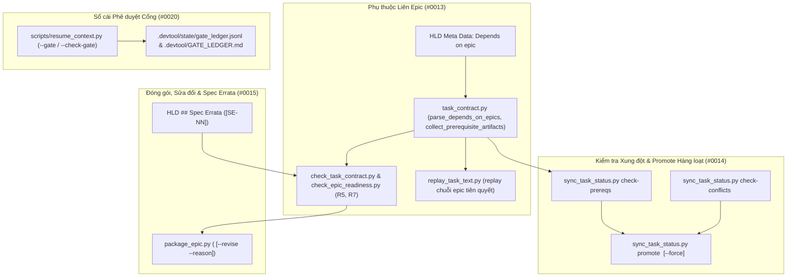
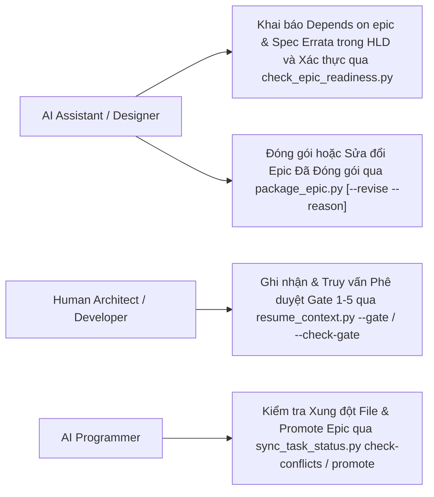
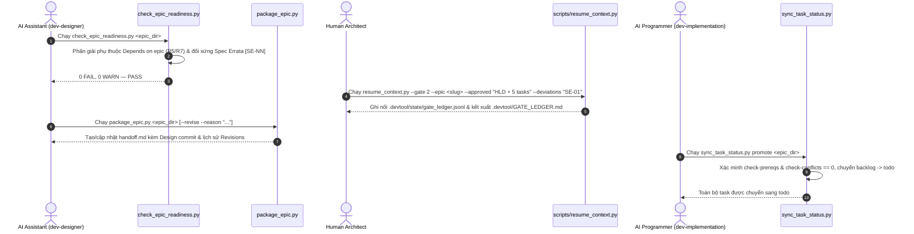

# Epic: Điều phối Đa Epic và Quản trị (Multi-Epic Orchestration and Governance)

## Mục lục

- [Thông tin Chung (Meta Data)](#thông-tin-chung-meta-data)
- [Bối cảnh (Background)](#bối-cảnh-background)
- [Mục tiêu và Phạm vi Ngoài Mục tiêu](#mục-tiêu-và-phạm-vi-ngoài-mục-tiêu)
  - [Mục tiêu (Goals)](#mục-tiêu-goals)
  - [Ngoài Mục tiêu (Non-Goals)](#ngoài-mục-tiêu-non-goals)
- [Kiến trúc và Thiết kế Kỹ thuật](#kiến-trúc-và-thiết-kế-kỹ-thuật)
  - [Kiến trúc Tổng thể (High-Level Architecture)](#kiến-trúc-tổng-thể-high-level-architecture)
  - [Các Ca Sử dụng (Use Cases)](#các-ca-sử-dụng-use-cases)
  - [Sơ đồ Tuần tự (Sequence Diagram)](#sơ-đồ-tuần-tự-sequence-diagram)
  - [Kế hoạch Kiểm thử Tích hợp và Ma trận Ranh giới](#kế-hoạch-kiểm-thử-tích-hợp-và-ma-trận-ranh-giới)
- [Môi trường Xác minh](#môi-trường-xác-minh)
  - [Kịch bản Kiểm thử BDD Toàn diện](#kịch-bản-kiểm-thử-bdd-toàn-diện)
- [Tác động Shared Contract](#tác-động-shared-contract)
- [Chiến lược Triển khai và Giảm thiểu Rủi ro](#chiến-lược-triển-khai-và-giảm-thiểu-rủi-ro)
- [Phân rã Kanban Tasks](#phân-rã-kanban-tasks)

## Thông tin Chung (Meta Data)

- **Epic**: `multi-epic-orchestration-and-governance`
- **Status**: Queued (backlog) — behind `contract-and-authoring-ergonomics` and `execution-and-verification-infrastructure`
- **Depends on epic**: `contract-and-authoring-ergonomics`, `execution-and-verification-infrastructure`
- **Target Release**: v1.26.0
- **Platform**: Python
- **Source Spec**: [2026-11-06-multi-epic-orchestration-and-governance-design.vi.md](2026-11-06-multi-epic-orchestration-and-governance-design.vi.md)

## Bối cảnh (Background)

Trong quá trình phát triển nhiều epic nối tiếp và song song trên `lyrics-sync` và `ai-agent-tools`, bốn điểm nghẽn về điều phối đa epic và quản trị đã được ghi nhận trong `skill-observations/observation-log/`:

1. **Observation `#0013`**: Việc thiết kế một epic phụ thuộc vào một epic tiên quyết đã đóng gói nhưng chưa merge chưa có hợp đồng metadata `Depends on epic:`, khiến `check_task_contract.py --design` và `check_epic_readiness.py` (`R5`) từ chối các file và symbol được tạo bởi epic tiên quyết, đòi hỏi phải dựng nhánh nháp thủ công khi replay, và thiếu chốt chặn cơ học ngăn Stage 3 khởi chạy khi epic tiên quyết chưa hoàn tất.
2. **Observation `#0014`**: Bất kỳ task đang hoạt động nào của một epic khác trong `.devtool/features/` đều buộc epic mới phải đặt `status: "backlog"` ngay cả khi tập `Allowed files` của hai epic hoàn toàn tách biệt, và việc chuyển một epic đang xếp hàng từ `backlog` sang `todo` phải cập nhật thủ công từng task một.
3. **Observation `#0015`**: Các đợt review sau đóng gói và đồng bộ liên epic đòi hỏi phải sửa đổi epic đã đóng gói và neo lại `Design commit` trong `handoff.md` nhưng chưa có lệnh `package_epic.py --revise` hay mục lịch sử `## Revisions`, đồng thời các tinh chỉnh có chủ đích ở HLD Stage 2 so với Spec Stage 1 chưa có mục `## Spec Errata` (`[SE-NN]`) chính thức.
4. **Observation `#0020`**: Các quyết định phê duyệt cổng (`Gate 1`–`Gate 5`) của developer cùng phạm vi hoặc ngoại lệ đi kèm chỉ được ghi tự do trong `.devtool/state/<epic>.md`, vốn chịu giới hạn cắt gọn 20 dòng.

## Mục tiêu và Phạm vi Ngoài Mục tiêu

### Mục tiêu (Goals)

- Bổ sung hỗ trợ `- **Depends on epic**: <epic_slug_or_dir>[, ...]` vào `task_contract.py`, `check_task_contract.py`, `check_epic_readiness.py` (`R5`, `R7`), `replay_task_text.py`, và `sync_task_status.py check-prereqs <epic_dir>` (`#0013`).
- Bổ sung phân tích xung đột file giữa các epic (`sync_task_status.py check-conflicts <epic_dir>`) và lệnh chuyển trạng thái hàng loạt (`sync_task_status.py promote <epic_dir> [--force]`) (`#0014`).
- Cung cấp `skills/dev-implementation/resources/scripts/package_epic.py` (`<epic_dir> [--revise --reason "<text>"]`) và hỗ trợ mục `## Spec Errata` (`[SE-NN]`) trong tài liệu HLD cùng kiểm tra `check_epic_readiness.py` (`R7`) (`#0015`).
- Mở rộng `scripts/resume_context.py` với Sổ cái Phê duyệt Cổng được bảo vệ bằng khóa `fcntl.flock` (`--gate <1..5> --epic <slug> --approved "<scope>" [--deviations "<text>"]` và `--check-gate <1..5> --epic <slug>`), ghi vào `.devtool/state/gate_ledger.jsonl` và `.devtool/GATE_LEDGER.md` (`#0020`).

### Ngoài Mục tiêu (Non-Goals)

- Không thay đổi cơ chế thực thi từng task đơn lẻ trong `run_task_checks.py` (`red`, `measure`, `verify`) vốn thuộc phạm vi của Epic 1 và Epic 2.
- Không thêm bất kỳ thư viện bên thứ ba nào ngoài thư viện chuẩn Python 3.11+.

## Kiến trúc và Thiết kế Kỹ thuật

### Kiến trúc Tổng thể (High-Level Architecture)



### Các Ca Sử dụng (Use Cases)



### Sơ đồ Tuần tự (Sequence Diagram)



### Kế hoạch Kiểm thử Tích hợp và Ma trận Ranh giới

```text
Integration test roots: tests/, skills/dev-implementation/resources/scripts/
Protected paths: .agents/quality/**, .devtool/epic/multi_epic_orchestration_and_governance/bdd_scenarios.en.md, .devtool/epic/multi_epic_orchestration_and_governance/bdd_scenarios.vi.md
Integration results: python3 -m pytest tests/ skills/dev-implementation/resources/scripts/ --junitxml=build/test-results/pytest.xml -> build/test-results/pytest.xml
```

| Ranh giới Tích hợp | Chiến lược Kiểm thử | Mục tiêu Xác minh |
| :--- | :--- | :--- |
| `task_contract.py`, `check_task_contract.py`, `check_epic_readiness.py` & `replay_task_text.py` | Kiểm thử subcutaneous trên chuỗi 2 epic phụ thuộc nhau trong kho Git tạm | Xác minh `parse_depends_on_epics()`, `resolve_prerequisite_epic_dirs()` (phát hiện chu trình/epic thiếu), `collect_prerequisite_artifacts()` (`Read-only context` và symbol `R5`), và replay chuỗi tiên quyết trong `replay_epic_in_worktree()` |
| `sync_task_status.py` (`check-prereqs`, `check-conflicts`, `promote`) | Kiểm thử CLI & unit trên bảng Kanban đa epic | Xác minh `check_epic_prerequisites()`, `check_epic_file_conflicts()` (tập file tách biệt so với giao nhau), và `promote <epic_dir> [--force]` chuyển hàng loạt `backlog` $\rightarrow$ `todo` |
| `package_epic.py` & HLD `## Spec Errata` | Kiểm thử đóng gói và sửa đổi trên các epic tạm | Xác minh sinh `handoff.md` lần đầu, neo lại `Design commit` và ghi mục `## Revisions` khi chạy `--revise --reason`, cùng kiểm tra đối xứng `[SE-NN]` `Spec Errata` trong `R7` |
| `scripts/resume_context.py` (`--gate`, `--check-gate`) | Kiểm thử sổ cái an toàn đồng thời trên thư mục `.devtool/` tạm | Xác minh ghi nối `.devtool/state/gate_ledger.jsonl` dưới khóa `fcntl.flock`, kết xuất bảng `.devtool/GATE_LEDGER.md`, và mã thoát của `--check-gate` (`0` so với `1`) |

## Môi trường Xác minh

- Môi trường thực thi: Máy cục bộ macOS / Linux CLI cài đặt Python 3.11+, Git, Bash, `pytest`, `ruff` và `mypy`.
- Cô lập: Toàn bộ kiểm thử unit và tích hợp chạy bên trong các thư mục / kho Git tạm thời (`tmp_path` / `tempfile.TemporaryDirectory`), không cần kết nối mạng hay máy chủ bên ngoài.
- Biến môi trường tham chiếu trong cột `Needs`: Không có (`—`).

### Kịch bản Kiểm thử BDD Toàn diện

Bộ kịch bản bao phủ đầy đủ 5 chiều dưới tiền tố `[MEO-]`:
1. **Happy Paths (`MEO-HP-01` .. `MEO-HP-04`)**: Thiết kế và replay một epic phụ thuộc có khai báo `Depends on epic:` (`MEO-HP-01`); kiểm tra xung đột file và promote hàng loạt một epic không giao nhau qua `sync_task_status.py check-conflicts` và `promote` (`MEO-HP-02`); đóng gói và sửa đổi epic đã đóng gói qua `package_epic.py --revise --reason` cùng `## Spec Errata` (`MEO-HP-03`); và ghi nhận, truy vấn phê duyệt cổng qua `scripts/resume_context.py --gate` và `--check-gate` (`MEO-HP-04`).
2. **Edge Cases (`MEO-EC-01` .. `MEO-EC-02`)**: Phân giải phụ thuộc bắc cầu nhiều tầng (`Epic C -> Epic B -> Epic A`) bảo toàn thứ tự topo và khử trùng lặp artifact (`MEO-EC-01`); và `check_epic_file_conflicts()` bỏ qua các task đã `done` của epic khác trong khi phát hiện chính xác giao nhau giữa glob và đường dẫn cụ thể trên các task đang hoạt động (`todo`/`in-progress`/`review`) (`MEO-EC-02`).
3. **State Transitions (`MEO-ST-01` .. `MEO-ST-02`)**: `sync_task_status.py promote <epic_dir>` chặn việc chuyển trạng thái khi epic tiên quyết chưa xong hoặc còn xung đột file, và thành công khi epic tiên quyết chuyển sang `Done` hoặc có cờ `--force` (`MEO-ST-01`); và `package_epic.py <epic_dir> --revise` giữ nguyên `Open Notes` đồng thời cập nhật `Design commit`, lệnh `git log` kiểm tra lỗi thời và nối thêm mục mới vào `## Revisions` (`MEO-ST-02`).
4. **Async & Concurrency (`MEO-AR-01` .. `MEO-AR-02`)**: Nhiều tiến trình gọi `scripts/resume_context.py --gate` đồng thời được tuần tự hóa an toàn bằng `fcntl.flock` mà không làm hỏng `gate_ledger.jsonl` hay `GATE_LEDGER.md` (`MEO-AR-01`); và `sync_task_status.py promote` đồng bộ trạng thái task trên cả `.devtool/epic/<epic_dir>/` và `.devtool/features/` giữa các worktree (`MEO-AR-02`).
5. **Failures & Resilience (`MEO-FR-01` .. `MEO-FR-03`)**: `check_epic_readiness.py` (`R7`) báo lỗi khi `Depends on epic:` trỏ tới epic không tồn tại hoặc tạo chu trình phụ thuộc (`MEO-FR-01`); `check_epic_readiness.py` (`R7`) và `package_epic.py --revise` báo lỗi khi mã `[SE-NN]` trong `## Spec Errata` lệch nhau giữa `.en.md` và `.vi.md` hoặc khi thiếu `--reason` (`MEO-FR-02`); và `scripts/resume_context.py --gate` / `--check-gate` từ chối số hiệu cổng không hợp lệ hoặc chuỗi `--approved` rỗng (`MEO-FR-03`).

## Tác động Shared Contract

None — tính năng khép kín trong `ai-agent-tools`.

## Chiến lược Triển khai và Giảm thiểu Rủi ro

- **Giai đoạn 1**: Hiện thực hóa phân tích `Depends on epic:`, thu thập artifact tiên quyết, kiểm tra hợp đồng/grounding lúc thiết kế, và replay chuỗi tiên quyết trong `task_contract.py`, `check_task_contract.py`, `check_epic_readiness.py`, và `replay_task_text.py` (`Task 01`).
- **Giai đoạn 2**: Hiện thực hóa `check-prereqs`, `check-conflicts`, và `promote [--force]` trong `sync_task_status.py` (`Task 02`).
- **Giai đoạn 3**: Hiện thực hóa `package_epic.py` (`--revise --reason`) và kiểm tra `## Spec Errata` trong `task_contract.py` và `check_epic_readiness.py` (`Task 03`).
- **Giai đoạn 4**: Hiện thực hóa Sổ cái Phê duyệt Cổng (`--gate`, `--check-gate`, `gate_ledger.jsonl`, `GATE_LEDGER.md`) trong `scripts/resume_context.py` (`Task 04`).
- **Giai đoạn 5**: Thực thi kiểm thử tích hợp đầu-cuối (Tier C) và cập nhật tài liệu skill (`dev-lifecycle`, `dev-designer`, `dev-implementation`, `principal-review`, `save-context`) (`Task 05`).
- **Kế hoạch Rollback**: Mọi lệnh con, trường metadata và script mới đều mang tính bổ sung và tương thích ngược; hoàn tác commit merge của epic sẽ khôi phục nguyên trạng hành vi trước đó.

## Phân rã Kanban Tasks

- **Task 01: Inter-Epic Dependency Declarations, Readiness Resolution, and Prerequisite Replay (`task_01_inter_epic_dependencies.md`)**
- **Task 02: Conflict-Aware Concurrent Epic Backlog and Bulk Task Promotion (`task_02_conflict_aware_epic_promotion.md`)**
- **Task 03: Packaged Epic Revision Workflow and HLD Spec Errata Contract (`task_03_package_revise_and_spec_errata.md`)**
- **Task 04: Structured Gate Approval Ledger in Project Memory (`task_04_gate_approval_ledger.md`)**
- **Task 05: End-to-End Multi-Epic Governance Acceptance Verification (`task_05_multi_epic_governance_e2e_acceptance.md`)**
