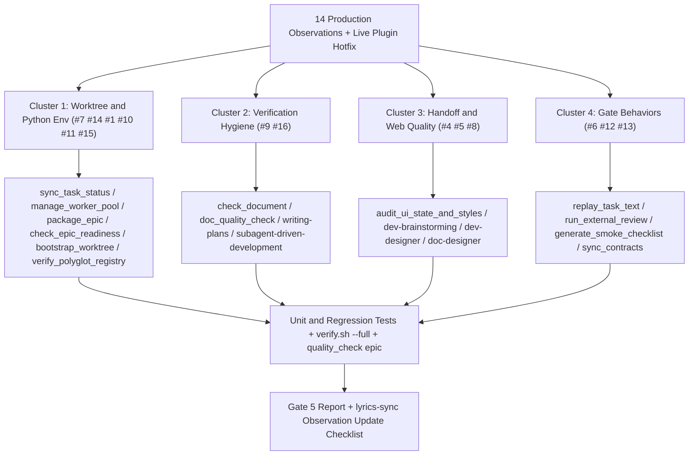

# Observer Hardening 2026-11 Design Specification

- **Status**: Approved (Gate 1 — 2026-11-26)
- **PIC**: duvthinh403
- **Epic Slug**: `observer-hardening-2026-11`
- **Epic Directory**: `observer_hardening_2026_11`
- **Date**: 2026-11-26
- **Base Branch**: `main`

## Table of Contents

- [Shared Contract Warnings](#shared-contract-warnings)
- [Background and Source Scope](#background-and-source-scope)
- [Safety Boundaries and Isolation Rules](#safety-boundaries-and-isolation-rules)
- [Architecture Overview](#architecture-overview)
- [Detailed Component Specifications](#detailed-component-specifications)
- [Testing and Verification Plan](#testing-and-verification-plan)
- [Dependencies and Merge Hygiene](#dependencies-and-merge-hygiene)
- [Post-Release Observation Checklist Contract](#post-release-observation-checklist-contract)

## Shared Contract Warnings

No `shared-contracts/` directory exists in `ai-agent-tools` (kit repository only). Zero shared-contract warnings or drift items apply to this epic.

## Background and Source Scope

Production lifecycle runs in `lyrics-sync` produced 14 actionable `task-observer` entries documenting real failures across isolated git worktrees, Python `uv` environments, shell verification snippets, Stage 1-to-Stage 2 handoff artifacts, subdirectory web UI audits, and mechanical gate preconditions. In addition, an uncommitted live plugin hotfix exists in the installed `d3nexus` plugin's `audit_ui_state_and_styles.py` that directly depends on `#8`'s subdirectory fix and would be erased by a future `scripts/release.sh` unless folded into this kit branch.

### Included Scope (14 Observations plus Folded Live Plugin Hotfix)

| Cluster | Obs ID | Target Area | Kit Scope |
|---|---|---|---|
| Cluster 1: Worktree Isolation and Python Env | `#7` | `sync_task_status.py` `promote` | Resolve `epic_checkout_roots(args.epic_dir)` instead of `checkout_roots()` |
| Cluster 1: Worktree Isolation and Python Env | `#14` (Part 1 only) | `sync_task_status.py` `archive-done`, `archive-epic` | Prevent mutating sibling `epic/*` worktrees via `checkout_roots()` |
| Cluster 1: Worktree Isolation and Python Env | `#1` | `manage_worker_pool.py` `finalize_slot` | Avoid `:!.venv` gitignore failure on `git add`; preserve tracked `shared-contracts` symlink |
| Cluster 1: Worktree Isolation and Python Env | `#10` | `package_epic.py --revise`, `check_epic_readiness.py` R7 | Skip stale `Design commit` ancestor check during `--revise` via `--reanchoring` |
| Cluster 1: Worktree Isolation and Python Env | `#11` (Kit only) | `bootstrap_worktree.sh`, `verify_polyglot_registry.py`, `python-quality-check`, `dev-implementation` | Bootstrap with `--all-extras` (and `--group dev` when declared) and preserve via `UV_NO_SYNC=1` |
| Cluster 1: Worktree Isolation and Python Env | `#15` | `using-git-worktrees`, `subagent-driven-development`, `dev-implementation` | Require `UV_NO_SYNC=1 PYTHONPATH="$WORKTREE_ROOT/src"` when reusing symlinked parent `.venv` |
| Cluster 2: Verification Hygiene | `#9` | `check_document.py`, `doc_quality_check/SKILL.md` | Split embedded newlines defensively in `refusal()` and make Check 0 snippet zsh-safe |
| Cluster 2: Verification Hygiene | `#16` | `writing-plans`, `dev-designer`, `subagent-driven-development` | Require quality manifest commands, forbid bare `npx`, and add non-overlapping `invoke_subagent` 180s timer bullet |
| Cluster 3: Handoff and Web Quality | `#4` | `dev-brainstorming`, `visual-companion.md`, `dev-designer` | Persist approved Visual Companion HTML files into `.devtool/epic/<epic_dir>/assets/` |
| Cluster 3: Handoff and Web Quality | `#5` | `dev-designer`, `doc-designer` | Use inline code spans for planned `task_*.md` in Step 1; upgrade to links in Step 2 |
| Cluster 3: Handoff and Web Quality | `#8` + Live Hotfix | `audit_ui_state_and_styles.py`, `dev-designer` | Fix `{base_ref}:./{rel_path}`, merge uncommitted diff, fold live exclude/scope/base-ref filter hotfix, enforce multi-template `Allowed files` |
| Cluster 4: Gate Behaviors | `#6` | `replay_task_text.py`, `check_epic_readiness.py`, `dev-designer` | Self-skip `R8` when 0 test-creation directives exist for `(new)` test files and scope `--replay` doc guidance |
| Cluster 4: Gate Behaviors | `#12` | `external-review-prompt.md`, `run_external_review.py`, `generate_smoke_checklist.py`, `cross-model-review`, `orchestration-roles.md` | Exclude `.devtool/epic/` from code-review Minor findings, add `deferred: out-of-scope epic doc (§4.4)` token, improve browser/URL target inference |
| Cluster 4: Gate Behaviors | `#13` | `sync_contracts.py`, `sync-shared-contracts`, `dev-designer` | Add scoped `--allow-dirty` flag to `diff-check` (blocks if `shared-contracts` or `contract_map.json` is dirty) |

### Explicit Exclusions

- `lyrics-sync` observations `#2` and `#3` (`generate-flashcard-images` repo-local skill).
- Repo-local config portion of `#11` (`lyrics-sync/.agents/quality/python-quality.json`).
- Repo-local test harness portion of `#14` (`lyrics-sync/tests/conftest.py`).
- Unapproved expansion into `ai-agent-tools` open observations `#43` and `#46`, or `#53`'s Vietnamese reduplicative bigram allowlist (cross-referenced for awareness only; `#55` and the exclude list from `#53` are absorbed via the live plugin hotfix).

## Safety Boundaries and Isolation Rules

All active sibling repositories (`D3Nexus`, `nexus`, `lyrics-sync`) and the `main` checkout of `ai-agent-tools` (running `tasks_server.py :8766`, `agy_quota.py :8765`, with uncommitted edits in `.vscode/settings.json` and `skills/check-quota/resources/dashboard/quota_dashboard.html`) must experience zero impact:

1. **Isolated Worktree Only**: All reads/writes for this epic stay inside `.worktrees/observer_hardening_2026_11` on branch `epic/observer-hardening-2026-11` branched from `main` (`93f9346`).
2. **Zero `main` Mutation**: Never modify tracked files, `.vscode/settings.json`, or uncommitted files on `/Users/danhdueexoictif/AllProjects/ai-agent-tools`.
3. **Zero External Repo or Live Plugin Mutation**: Never write to `lyrics-sync`, `D3Nexus`, `nexus`, `~/.gemini/config/plugins/d3nexus`, `~/.claude/plugins/`, or `~/.codex/`.
4. **No Release or Push**: Never run `scripts/release.sh`, `git push`, or `git pull` into live plugin directories. Stop cleanly at Gate 5 on the local worktree branch.

## Architecture Overview

Selected approach: **Surgical Hardening across Four Independent Clusters**. Each fix targets the exact root cause in its owning script or skill while preserving backwards compatibility for existing CLI callers, JSON schemas, and unit test suites.



## Detailed Component Specifications

### Cluster 1: Worktree Isolation and Python Environment

#### 1.1 `sync_task_status.py` Epic-Scoped Worktree Resolution (`#7`, `#14` Part 1)
- **File**: `skills/dev-implementation/resources/scripts/sync_task_status.py`
- **`epic_checkout_roots(epic_dir: str) -> list[Path]`**:
  - Filter EVERY candidate checkout (including `current_root`) by slot exclusion (`not _is_slot_worktree(path)`) and branch ownership: exclude any checkout currently on an unrelated `refs/heads/epic/<other>` branch whose slug does not match `epic_dir` (even if that branch inherited `.devtool/epic/<epic_dir>/` from `develop`).
  - Resolve `slug` from non-excluded checkouts holding `.devtool/epic/<epic_dir>/`, preferring an eligible `current_root` when it owns the epic branch (or is on a non-epic base branch holding the epic dir) and otherwise promoting the matching `refs/heads/epic/<slug>` worktree to `roots[0]`.
- **`main()` — `promote`**:
  - Replace `roots = checkout_roots()` with `roots = epic_checkout_roots(args.epic_dir)`.
- **`main()` — `archive-epic`**:
  - Replace `roots = checkout_roots()` with `roots = epic_checkout_roots(args.epic_dir)`.
- **`main()` — `archive-done`**:
  - Determine `current_root = _current_checkout_root() or Path.cwd()`.
  - Discover completed epic directories strictly from `current_root / ".devtool" / "features" / "done"` (never scanning sibling `.worktrees/<other_epic>` checkouts on different `epic/*` branches).
  - For each discovered `epic_dir`, resolve `target_roots = epic_checkout_roots(epic_dir)` and call `sync_epic(target_roots, epic_dir, "Done")`.
  - Keep `archive_all_done_epics(roots: list[Path]) -> list[str]` backwards compatible for direct callers, while scoping sibling mutations by filtering out checkouts checked out on an unrelated `refs/heads/epic/*` branch when git branch metadata is available.

#### 1.2 `manage_worker_pool.py` Safe Slot Staging (`#1`)
- **File**: `skills/dev-implementation/resources/scripts/manage_worker_pool.py` (`finalize_slot`)
- Replace negative cache-dir pathspecs (`:!.venv`, etc.) passed to `git add -A` (which fail with exit 1 when `.venv` is listed in `.gitignore`).
- New staging sequence in `finalize_slot`:
  1. Run `git add -A` in `slot_path` (git naturally skips ignored entries like `.venv` with exit 0).
  2. Build exclusion list containing `.devtool/epic/<epic_dir>/review_audit_notes*` plus any `cdir` in `CACHE_DIR_CANDIDATES` where `(slot_path / cdir).is_symlink()`.
  3. Unstage those excluded paths from the index without modifying the filesystem: run `git reset -q HEAD -- <existing_staged_or_excluded_paths>` (or `git rm -r -q --cached --ignore-unmatch` for paths untracked in `HEAD`).
  4. Never unlink symlinks on disk and never unstage or remove tracked repository symlinks such as `shared-contracts`.

#### 1.3 `package_epic.py --revise` and `check_epic_readiness.py` R7 Re-Anchoring (`#10`)
- **Files**: `skills/dev-implementation/resources/scripts/check_epic_readiness.py`, `skills/dev-implementation/resources/scripts/package_epic.py`
- Add CLI flag `--reanchoring` (`action="store_true"`) to `check_epic_readiness.py` and field `reanchoring: bool = False` to `Context`.
- In `check_metadata(ctx)` (`R7`): when `ctx.reanchoring` is `True`, skip only the `git merge-base --is-ancestor <design_commit> HEAD` verification (continue checking HLD status, `handoff.md` existence, presence of the `Design commit` line, task `epic` slug alignment, and valid `status`).
- In `package_epic.py` (`package_epic()`): when `revise` is `True`, append `--reanchoring` to `readiness_cmd` so rebasing an active Stage 3 branch onto base never deadlocks `--revise`.

#### 1.4 Python `uv` Optional Extras Bootstrap and `UV_NO_SYNC=1` Preservation (`#11` Kit Only)
- **Files**: `skills/dev-implementation/resources/scripts/bootstrap_worktree.sh`, `skills/quality_check/resources/scripts/verify_polyglot_registry.py`, `skills/python-quality-check/SKILL.md`, `skills/python-quality-check/references/python-capability-contract.md`, `skills/dev-implementation/SKILL.md`
- In `bootstrap_worktree.sh`: when `.agents/quality/python-quality.json` does not define a custom `"bootstrap"` array and `uv` is selected, inspect `$WORKTREE_PATH/pyproject.toml` with Python `tomllib` (falling back safely on parse error):
  - If `[project.optional-dependencies]` is a non-empty mapping, include `--all-extras`.
  - If `[dependency-groups]` contains `"dev"`, include `--group dev`.
  - Execute `uv sync` with the derived flags.
- In `verify_polyglot_registry.py` (`_run_capability_subprocess`):
  - Detect `uv run` capability commands (`len(substituted_cmd) >= 2` and `Path(substituted_cmd[0]).name == "uv"` and `substituted_cmd[1] == "run"`).
  - Construct `child_env = os.environ.copy()` and set `child_env.setdefault("UV_NO_SYNC", "1")` before passing `env=child_env` to `subprocess.Popen`, preserving caller overrides while preventing `uv run` from silently pruning optional extras during Gate 4.
- Update `python-quality-check/SKILL.md`, `python-capability-contract.md`, and `dev-implementation/SKILL.md` (Step 5) to document `--all-extras` bootstrapping and `UV_NO_SYNC=1`.

#### 1.5 Shared `.venv` Symlink Isolation Guidance (`#15`)
- **Files**: `skills/using-git-worktrees/SKILL.md`, `skills/subagent-driven-development/SKILL.md`, `skills/dev-implementation/SKILL.md`
- Document clearly in Step 2 Python worktree setup and worker execution guidance: when a linked worktree reuses a symlinked parent `.venv` instead of provisioning an isolated venv via `uv sync --all-extras`, all test and quality invocations must export `UV_NO_SYNC=1 PYTHONPATH="$WORKTREE_ROOT/src"` so mutable editable `.pth` pointers never import from the parent checkout's `src/` and `uv run` never mutates or prunes the shared `.venv`.

### Cluster 2: Verification Hygiene

#### 2.1 `check_document.py` Newline Flattening and Zsh-Safe Check 0 (`#9`)
- **Files**: `skills/doc_quality_check/resources/scripts/check_document.py`, `skills/doc_quality_check/SKILL.md`
- Add helper `_flatten_changed(changed: list[str]) -> list[str]` that splits each item on `\r\n` / `\n`, strips whitespace, and discards empty entries.
- Call `_flatten_changed(changed)` inside `refusal(changed)` so newline-joined strings from zsh unquoted `$(...)` never allow a build-shipping file to hide behind a trailing `.md` path.
- In `main()`, compute `flattened = _flatten_changed(args.changed_files)` and report `len(flattened)` in the `ok refusal rule` output line.
- Update `doc_quality_check/SKILL.md` Check 0 snippet to use null-delimited piping:
  ```bash
  git diff --name-only -z <base_ref>...HEAD | xargs -0 python3 skills/doc_quality_check/resources/scripts/check_document.py --changed-files
  ```

#### 2.2 Quality-Manifest Commands, Ban Bare `npx`, and Non-Overlapping Subagent Watchdog Timer (`#16`)
- **Files**: `skills/writing-plans/SKILL.md`, `skills/dev-designer/SKILL.md`, `skills/dev-designer/references/verification-rows.md`, `skills/subagent-driven-development/SKILL.md`
- In `writing-plans/SKILL.md`, `dev-designer/SKILL.md`, and `verification-rows.md`:
  - Require inspecting `.agents/quality/*-quality.json` (when present) and copying the project's canonical `type_check` / `lint` commands verbatim instead of inventing `npx` invocations.
  - Forbid bare `npx <bin>` in verification steps and task tables; require `--no-install` (or explicit `--yes --package <pkg>` when intentional non-interactive install is required).
- In `subagent-driven-development/SKILL.md`:
  - Leave the existing `**Waiting on dispatched subagents:**` paragraph text intact to minimize merge conflicts with `feat/bg-task-watchdog-and-stall-detection`.
  - Add a standalone bullet immediately below it stating that on runtimes supporting reactive timers, `invoke_subagent` dispatches pair with `schedule(DurationSeconds=180, TimerCondition="any")` (complementing 240s watchdogs on backgrounded shell/`agy` tasks) so interactive-stdin hangs are caught within 3 minutes.

### Cluster 3: Handoff and Web Quality

#### 3.1 Persist Approved Visual Companion HTML Mockups (`#4`)
- **Files**: `skills/dev-brainstorming/SKILL.md`, `skills/dev-brainstorming/visual-companion.md`, `skills/dev-designer/SKILL.md`, `skills/dev-designer/references/task-template-examples.md`
- In `dev-brainstorming/SKILL.md` ("Routing After Approval" and "Visual Companion") and `visual-companion.md`: require copying final approved HTML mockup files from `.superpowers/brainstorm/` into `.devtool/epic/<epic_dir>/assets/` at Stage 1 handoff and linking them under `Approved Visual Companions` in the spec.
- In `dev-designer/SKILL.md` (Step 1 Meta Data) and `task-template-examples.md` (§5): include `Approved Visual Companions` links pointing to `assets/*.html` whenever Stage 1 produced approved HTML mockups.

#### 3.2 Defer Clickable `task_*.md` Links Until Step 2 (`#5`)
- **Files**: `skills/dev-designer/SKILL.md`, `skills/dev-designer/references/task-template-examples.md`, `skills/doc-designer/SKILL.md`
- Clarify in `dev-designer/SKILL.md` (Step 1 & Step 2), `task-template-examples.md` (§5 item 9), and `doc-designer/SKILL.md` (Step 4 & The Overview Document):
  - Prior to Gate 2 confirmation (when `check_document.py` runs before task files exist on disk), format planned task filenames as inline code spans (for example `` `task_01_example.md` ``).
  - In Step 2 (immediately after materializing `task_*.md` files), promote those code spans to relative Markdown links (`[Task 01](task_01_example.md)`).

#### 3.3 `audit_ui_state_and_styles.py` Subdirectory Fix, Uncommitted Diff Merge, Folded Live Hotfix, and Multi-Template Scope (`#8` + Live Hotfix)
- **Files**: `skills/web-quality-check/resources/scripts/audit_ui_state_and_styles.py`, `skills/dev-designer/SKILL.md`, `skills/dev-designer/references/task-template-examples.md`
- **`_get_base_file_content(repo_root: Path, base_ref: str, rel_path: str) -> str | None`**:
  - Normalize `rel_path` to POSIX form by stripping only exact leading `./` segments (`while norm_rel.startswith("./"): norm_rel = norm_rel[2:]`), preserving dot-prefixed path components (such as `.well-known/index.html`) and rejecting parent traversal (`..` parts), then invoke `git show f"{base_ref}:./{norm_rel}"` with `cwd=str(repo_root)` so subdirectory `--project-root` lookups resolve relative to `cwd` rather than git top-level.
- **`get_git_diff_files(repo_root: Path, base_ref: str = "main") -> list[str]`**:
  - Collect and merge (preserving order, deduplicating) committed changes (`git diff --name-only {base_ref}...HEAD`), unstaged tracked working-tree changes (`git diff --name-only HEAD`), staged changes (`git diff --name-only --cached`), and non-ignored untracked files (`git ls-files --others --exclude-standard`), normalizing all paths relative to `repo_root`. Fall back cleanly to 2-dot `git diff --name-only {base_ref}` when 3-dot fails.
- **Folded Live Plugin Hotfix (cleanly integrated with tests)**:
  - Expand `_is_excluded(p, repo_root)` to exclude: `node_modules`, `build`, `.worktrees`, `.git`, `dist`, `.astro`, `.devtool`, `docs`, `target`, `tests`.
  - In `run_all_ui_reviews()`: filter `ui_modified` with `not _is_excluded(root / f, root)`.
  - Pass `target_files=ui_modified` to Invariants 3 and 4 when `_git_base_ref_exists(root, base_ref)` is `True`; for Invariant 2 (`audit_orphaned_classes_and_styles`), whenever any `.css` stylesheet is modified in `ui_modified`, scan ALL non-excluded templates (`target_files=None`) so removing a CSS class catches newly orphaned classes in both directly-linked and layout-inherited templates (`layout.html` -> `page.html`), and otherwise pass `target_files=ui_modified`.
  - Filter out pre-existing base-ref findings in Invariants 2/3/4 using `_get_base_file_content(root, base_ref, rel_f)` (which now works reliably under subdirectory `--project-root` and dot-prefixed directories). For `orphaned_class`, suppress a class only when it was ALREADY orphaned at `base_ref` (evaluated against baseline stylesheet class definitions fetched from `base_ref`, never suppressing a class that existed in baseline CSS and was deleted in HEAD), and cache per-file base `unstyled_default` messages once per file rather than recomputing inside the finding loop.
- **`dev-designer/SKILL.md` & `task-template-examples.md`**:
  - Add a pre-packaging rule under `Allowed files`: whenever a task modifies shared `.css` or `.js` assets, grep every referencing `*.html`, `*.astro`, `*.jinja`, and `*.jinja2` template and include all of them in the same task's `Allowed files` so `?v=` cache-bust updates commit atomically.

### Cluster 4: Gate Behaviors

#### 4.1 `replay_task_text.py` and `check_epic_readiness.py` R8 Graceful Skip (`#6`)
- **Files**: `skills/dev-implementation/resources/scripts/replay_task_text.py`, `skills/dev-implementation/resources/scripts/check_epic_readiness.py`, `skills/dev-designer/SKILL.md`
- In `replay_task_text.py`:
  - Add a helper `_task_requires_skipped_replay(task_text: str, directives: list[Directive]) -> str | None` that checks whether `directives` contains zero test-file directives (`not any(is_test_file(d.path) for d in directives)`) AND the task declares `(new)` test files in `Allowed files` (or has zero `Create`/`Replace in`/`Insert in` directives overall for a contract-based task).
  - In `replay_epic_in_worktree()`: if every task in the epic qualifies for skip (zero literal patch directives for test creation), return a dedicated skip signal (e.g. exit code `0` with `skipped=True` or structured `SKIP:` marker handled by `check_epic_readiness.py`) so `check_epic_readiness.py --replay` emits `R8 SKIP (no literal patch directives for (new) test files)` and exits `0`.
  - If a task DOES embed literal `Create`/`Replace in`/`Insert in` test directives, replay executes strictly as before and exits non-zero on invalid `RED` / failing `GREEN`.
  - Preserve standalone `replay_task()` and CLI `replay_task_text.py <task.md> --run-rows` contracts cleanly (returning clear diagnostic when a single task has zero directives for `(new)` test files).
- In `dev-designer/SKILL.md` Step 3.1:
  - Keep `check_epic_readiness.py <epic_name>` as the mandatory universal Gate 2 check.
  - Qualify `check_epic_readiness.py <epic_name> --replay` as required specifically when tasks embed literal `Create` / `Replace in` / `Insert in` patch directives (noting that contract-based tasks self-skip `R8`).

#### 4.2 Cross-Model Review Immutable Epic Doc Handling and Smoke Checklist Inference (`#12`)
- **Files**: `skills/dev-implementation/references/external-review-prompt.md`, `skills/dev-implementation/resources/scripts/run_external_review.py`, `skills/dev-implementation/resources/scripts/generate_smoke_checklist.py`, `skills/cross-model-review/SKILL.md`, `skills/cross-model-review/references/review-triage.md`, `skills/dev-lifecycle/references/orchestration-roles.md`
- **`external-review-prompt.md`**:
  - Under `## Checklist` / `Rules for Severity & Verdict`, instruct code reviewers that immutable Stage 2/3 artefacts under `.devtool/epic/<epic_dir>/` (such as `task_*.md`, `handoff.md`, `manual_smoke_checklist.md`, `<epic_dir>.md`, `bdd_scenarios.md`) are read-only specification context — do not report `Minor` prose or formatting findings against them (only report code/test defects that violate them).
- **`run_external_review.py`**:
  - Define canonical constant `DEFERRED_EPIC_DOC_DECISION = "deferred: out-of-scope epic doc (§4.4)"` and helper `_is_immutable_epic_doc_location(location: str, epic_dir: str | None = None) -> bool` matching paths under `.devtool/epic/` (excluding `review_results.md` / `principal_review.md`).
  - In `delta_round_context()`: extend Anti-Ping-Pong rule 4 to honor `deferred:` decisions alongside `dismissed:` (`Do not re-raise a finding marked dismissed: or deferred: unless the source contradicts its rationale.`).
  - In `check()`: keep `BLOCKING` (`Critical`/`Important`) strictly requiring `fixed in ` or `dismissed: ` — `deferred:` NEVER closes a `Critical` or `Important` blocker.
  - In `auto_triage_section()` (when `kind == "code"`): partition `minor_rows` into actionable minors vs auto-deferred rows strictly where `_is_immutable_epic_doc_location(cells[2], epic_dir)` is `True` (and any decision cell, if already populated, equals the exact canonical `DEFERRED_EPIC_DOC_DECISION` token). Ordinary source-file findings carrying an arbitrary `deferred:` string MUST remain actionable and continue triggering `AUTO_PASS_FINAL_MINOR_SWEEP`. When `blocking_rows` is empty and zero actionable minors remain, emit `AUTO_PASS_CLEAN` with a clear directive note that out-of-scope `.devtool/epic/` Minor rows are closed as `deferred: out-of-scope epic doc (§4.4)` under §4.4, instead of emitting `AUTO_PASS_FINAL_MINOR_SWEEP`.
  - In `triage()`: for `kind == "code"`, pre-fill `Proposed action` with `deferred: out-of-scope epic doc (§4.4)` on `Minor` rows whose location matches `_is_immutable_epic_doc_location()`.
- **Skill docs (`cross-model-review/SKILL.md`, `review-triage.md`, `orchestration-roles.md` §4.4)**:
  - Document `deferred: out-of-scope epic doc (§4.4)` as the sole machine-recordable non-action terminal decision for `Minor` code-review findings targeting immutable `.devtool/epic/<epic_dir>/` files.
- **`generate_smoke_checklist.py`**:
  - Enhance `extract_target_from_text(text: str, default_web_target: str | None = None) -> str`:
    1. Prefer explicit `http(s)://` URLs.
    2. Validate backticked spans before accepting them as CLI commands (reject CSS selectors `.foo`/`#bar`, HTML tags, pure identifiers, or asset filenames like `style.css` that are not executable commands).
    3. Match explicit CLI entrypoints (`CLI_ENTRYPOINT_REGEX`).
    4. Detect browser / Playwright / web UI cues (`playwright`, `browser`, `viewport`, `preview`, `modal`, `dom`, `page`, `click`, `render`, `.html`, `/route` paths) and return `default_web_target` (extracted from BDD/HLD URLs if present) or `"Web Preview UI"` instead of `"CLI / Workspace Root"`.
    5. Fall back to `"CLI / Workspace Root"` only for non-browser scenarios without a URL or CLI command.

#### 4.3 `sync_contracts.py diff-check --allow-dirty` (`#13`)
- **Files**: `skills/sync-shared-contracts/resources/scripts/sync_contracts.py`, `skills/sync-shared-contracts/SKILL.md`, `skills/dev-designer/SKILL.md`
- Add `--allow-dirty` (`action="store_true"`) to the `diff-check` subparser in `sync_contracts.py`.
- In `cmd_diff_check(args)`:
  - Default (`--allow-dirty` unset): unchanged — any tracked modification from `git status --porcelain --untracked-files=no` returns `BLOCKED` (exit `2`).
  - When `--allow-dirty` is set: inspect every dirty path (both tracked and untracked for protected metadata files via `git status --porcelain -- shared-contracts .agents/contract_map.json .agents/contract_sync.json` plus tracked modifications). If any dirty path is `shared-contracts`, starts with `shared-contracts/`, equals `.agents/contract_map.json`, or equals `.agents/contract_sync.json`, STILL return `BLOCKED` (exit `2`) naming the protected dirty path(s) so an uncommitted acknowledgement cannot falsely satisfy a committed source delta. Otherwise, proceed with the committed `merge_base..HEAD` contract diff audit.
- Document `--allow-dirty` in `sync-shared-contracts/SKILL.md` and `dev-designer/SKILL.md` for Tier C governance tests running inside uncommitted `review_tier: "full"` worker slots, explicitly stating Gate 4 / release must continue omitting `--allow-dirty`.

## Testing and Verification Plan

Every modified Python script and shell bootstrapper gets dedicated unit and regression coverage inside `.worktrees/observer_hardening_2026_11`:

| Target Script | Test Suite | Key Cases Covered |
|---|---|---|
| `sync_task_status.py` | `skills/dev-implementation/resources/scripts/test_sync_task_status.py` | `promote` in isolated worktree (`#7`); `archive-done` and `archive-epic` leave sibling `epic/*` worktrees clean (`#14`) |
| `manage_worker_pool.py` | `skills/dev-implementation/resources/scripts/test_manage_worker_pool.py` | `finalize_slot` succeeds when `.venv` symlink is gitignored; tracked `shared-contracts` symlink preserved (`#1`) |
| `package_epic.py`, `check_epic_readiness.py` | `test_package_and_revise_epic.py`, `test_check_epic_readiness.py` | `--revise` succeeds after rebase rewrites `Design commit` SHA; normal `R7` still fails on non-ancestor without `--reanchoring` (`#10`) |
| `bootstrap_worktree.sh`, `verify_polyglot_registry.py` | `tests/test_polyglot_gate4.py` (plus new dedicated bootstrap/env tests) | `uv sync --all-extras [--group dev]` selection from `pyproject.toml`; `UV_NO_SYNC=1` injected for `uv run` capabilities without clobbering caller env (`#11`) |
| `check_document.py` | `skills/doc_quality_check/resources/scripts/test_check_document.py` | Newline-joined `--changed-files` argument catching `src/foo.py\ndocs/guide.en.md` and accurate file count (`#9`) |
| `audit_ui_state_and_styles.py` | `tests/test_audit_ui_state_and_styles.py` | Subdirectory `--project-root` `{base_ref}:./{rel_path}`; uncommitted template diff merge; excluded `dist`/`.astro`/`.devtool`/`docs`/`target`/`tests`; `ui_modified` scoping and pre-existing base-ref filtering (`#8` + live hotfix) |
| `replay_task_text.py`, `check_epic_readiness.py` | `test_replay_and_measure.py`, `test_check_epic_readiness.py` | Contract-based `(new)` tasks emit `R8 SKIP` (exit 0); literal directive tasks still run strict RED/GREEN replay (`#6`) |
| `run_external_review.py`, `generate_smoke_checklist.py` | `test_run_external_review.py` (plus smoke checklist tests) | `deferred: out-of-scope epic doc (§4.4)` closes Minor `.devtool/epic/` rows into `AUTO_PASS_CLEAN`; `check()` rejects `deferred:` on `Critical`/`Important`; browser/Playwright BDD scenarios infer web target (`#12`) |
| `sync_contracts.py` | `skills/sync-shared-contracts/resources/scripts/test_sync_contracts.py` | Default dirty tree exits `2` (`BLOCKED`); `--allow-dirty` passes on non-contract dirty files and still blocks when `shared-contracts` or `.agents/contract_map.json` is dirty (`#13`) |
| Skill docs and kit invariants | `tests/test_observer_hardening_acceptance.py` + `bash scripts/verify.sh --full` | Frontmatter (`name` + `description` only), link resolution, ToC anchors, `d3nexus:` namespace, doc contract assertions (`#4`, `#5`, `#15`, `#16`, etc.) |

Final Gate 4 verification inside `.worktrees/observer_hardening_2026_11`:
1. `bash scripts/verify.sh --full`
2. `@quality_check --profile epic` (`ruff format --check`, `ruff check`, `mypy`, `pytest tests`, `bash scripts/verify.sh`)
3. Confirm `git -C /Users/danhdueexoictif/AllProjects/ai-agent-tools status -s` is completely unchanged (only `.vscode/settings.json` and `quota_dashboard.html`).

## Dependencies and Merge Hygiene

- **`feat/bg-task-watchdog-and-stall-detection` merge hygiene**: In `skills/subagent-driven-development/SKILL.md`, `#16` inserts an independent bullet below `**Waiting on dispatched subagents:**` without rewriting the existing paragraph touched by commit `2dfb737`, keeping any future three-way merge trivial and semantic intent aligned (`180s` `invoke_subagent` + `240s` backgrounded `agy`/shell watchdog).
- **Live plugin hotfix preservation**: Folding the live `audit_ui_state_and_styles.py` diff into `#8` guarantees that when the user runs `scripts/release.sh` after active sibling epics finish, `git reset --hard` on the plugin repo will not drop the `dist`/`.astro` exclusion or modified-file scoping.
- **Zero-impact `.devtool/` discipline**: During execution inside `.worktrees/observer_hardening_2026_11`, avoid commands that rewrite `main/.vscode/settings.json` or tracked files on `main`.

## Post-Release Observation Checklist Contract

At Gate 5 (before merge and release), the session outputs an explicit, copy-ready checklist for updating `/Users/danhdueexoictif/AllProjects/lyrics-sync/skill-observations/observation-log/` once active sibling epics finish and the kit branch is released:

- **`actioned` (12 IDs)**: `#1`, `#4`, `#5`, `#6`, `#7`, `#8`, `#9`, `#10`, `#12`, `#13`, `#15`, `#16` (each with exact commit/feature summary).
- **`partial` — keep `open` pending repo-local follow-up (2 IDs)**:
  - `#11`: kit side complete (`bootstrap_worktree.sh`, `verify_polyglot_registry.py`, docs); remaining repo-local edit in `lyrics-sync/.agents/quality/python-quality.json`.
  - `#14`: kit side complete (`sync_task_status.py` `archive-done`/`archive-epic` isolation); remaining repo-local edit in `lyrics-sync/tests/conftest.py` (`pytest-xdist` worktree-namespaced PostgreSQL schema).
- **Untouched / Excluded (2 IDs)**: `#2`, `#3` (`generate-flashcard-images` in `lyrics-sync`).
- **Related `ai-agent-tools` observations to review after release**: `#55` (fully addressed via folded live hotfix) and `#53` (partially addressed: exclude list done, Vietnamese reduplicative allowlist deferred).
